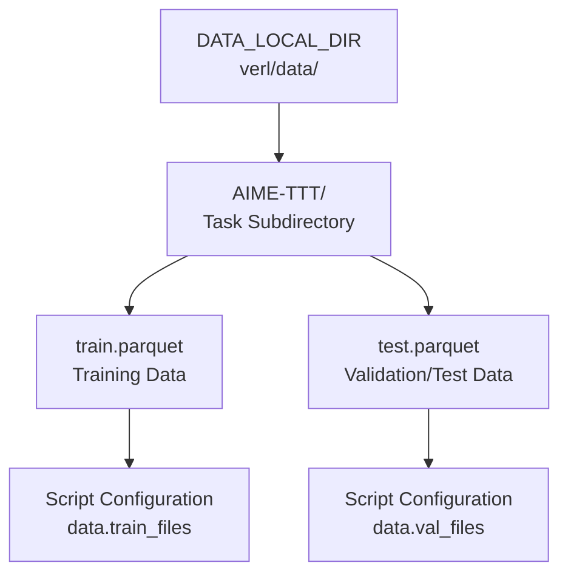
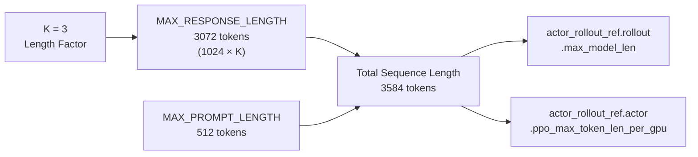
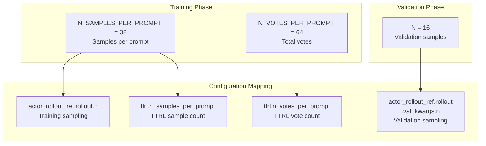
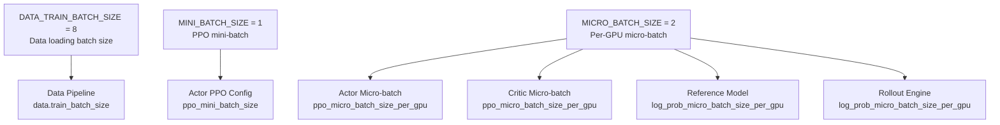
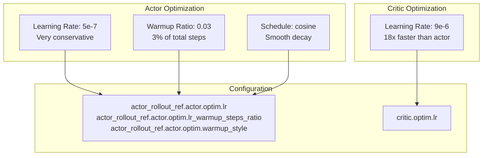
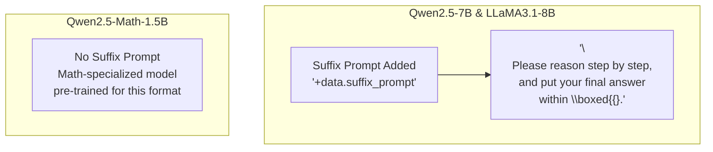
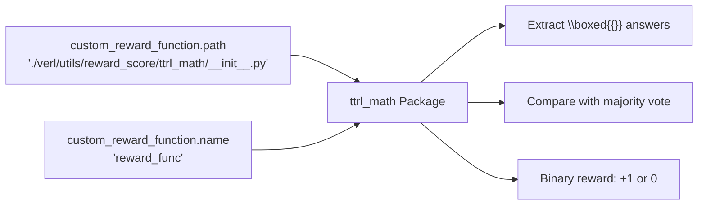
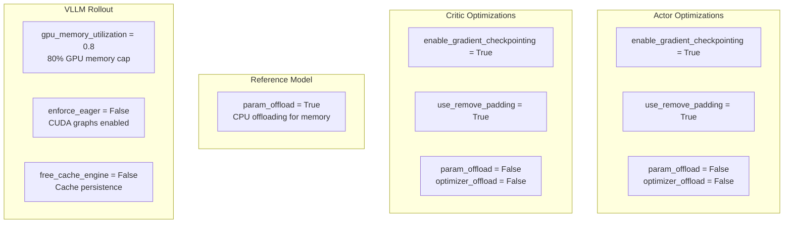
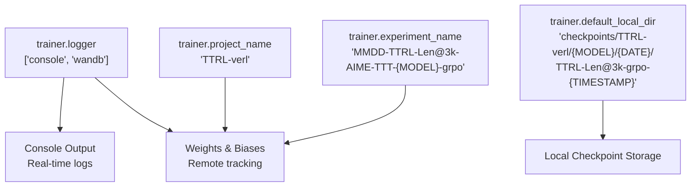

<!-- source: DeepWiki mcp.deepwiki.com · repo PRIME-RL/TTRL · extra page AIME Tasks · fetched 2026-10-30 -->

# AIME Tasks

<details>
<summary>Relevant source files</summary>

The following files were used as context for generating this wiki page:

- [verl/examples/ttrl/LLaMA3.1-Instruct/aime.sh](verl/examples/ttrl/LLaMA3.1-Instruct/aime.sh)
- [verl/examples/ttrl/Qwen2.5-Math/aime.sh](verl/examples/ttrl/Qwen2.5-Math/aime.sh)
- [verl/examples/ttrl/Qwen2.5/aime.sh](verl/examples/ttrl/Qwen2.5/aime.sh)

</details>


## Purpose and Scope

This page documents the configuration and setup for training TTRL on AIME (American Invitational Mathematics Examination) tasks. AIME is a 15-question, 3-hour examination for high school students, featuring challenging mathematical problems that require integer answers between 0 and 999. This page covers data preparation, task-specific configuration parameters, and model-specific variations for running TTRL training on AIME datasets.

For general task configuration concepts, see [Task Configurations](#3.3). For model-specific details, see [Qwen2.5 Models](#3.2.1), [Qwen2.5-Math Models](#3.2.2), or [LLaMA3.1-Instruct Models](#3.2.3).

---

## AIME Task Overview

AIME problems are distinguished by their difficulty level and structured answer format. The task is identified in the codebase as `AIME-TTT` (AIME Test-Time Training), which reflects TTRL's focus on test-time adaptation.

### Task Characteristics

| Characteristic | Value |
|----------------|-------|
| Task Identifier | `AIME-TTT` |
| Answer Format | Integer (0-999) |
| Problem Complexity | High school competition level |
| Reasoning Type | Multi-step mathematical reasoning |
| Dataset Structure | Parquet files (train/test split) |

The AIME task requires models to perform step-by-step reasoning and extract final answers in the `\boxed{}` LaTeX format for evaluation.

**Sources:** [verl/examples/ttrl/Qwen2.5/aime.sh:11](), [verl/examples/ttrl/Qwen2.5-Math/aime.sh:11](), [verl/examples/ttrl/LLaMA3.1-Instruct/aime.sh:11]()

---

## Data Setup and Structure

### Data File Organization

AIME datasets must be organized in the following directory structure:

```
verl/data/AIME-TTT/
├── train.parquet
└── test.parquet
```

The `DATA_LOCAL_DIR` variable in the shell scripts points to the base data directory (`verl/data`), and the task subdirectory (`AIME-TTT`) is automatically appended.



**Diagram: AIME Data File Structure and Loading Path**

**Sources:** [verl/examples/ttrl/Qwen2.5/aime.sh:31](), [verl/examples/ttrl/Qwen2.5/aime.sh:44-45]()

### Data Format Requirements

The parquet files must contain columns compatible with the verl data processing pipeline:

| Column | Description | Required |
|--------|-------------|----------|
| `data_source` | Problem source identifier | Yes |
| `prompt` | Problem statement | Yes |
| `ability` | Problem difficulty/category | Optional |
| `reward_model` | Ground truth answer (unused in TTRL) | Optional |

During TTRL training, the `reward_model` column (ground truth) is not used for reward calculation, as TTRL relies on majority voting for self-supervised rewards.

**Sources:** [verl/examples/ttrl/Qwen2.5/aime.sh:44-50]()

---

## Core Configuration Parameters

All AIME training scripts share a common set of configuration parameters optimized for the task's characteristics.

### Response Length Configuration



**Diagram: AIME Token Length Configuration Chain**

The `K=3` parameter sets the response length factor, resulting in:
- Maximum prompt length: 512 tokens
- Maximum response length: 3072 tokens (1024 × 3)
- Total sequence length: 3584 tokens

This configuration allows models to generate detailed step-by-step solutions for complex AIME problems.

**Sources:** [verl/examples/ttrl/Qwen2.5/aime.sh:15-17](), [verl/examples/ttrl/Qwen2.5/aime.sh:46-47](), [verl/examples/ttrl/Qwen2.5/aime.sh:78]()

### TTRL Voting Parameters



**Diagram: AIME Voting Parameter Configuration Mapping**

The voting configuration for AIME:

| Parameter | Training Value | Validation Value | Configuration Key |
|-----------|----------------|------------------|-------------------|
| Samples per prompt | 32 | 16 | `actor_rollout_ref.rollout.n` |
| Votes per prompt | 64 | N/A | `ttrl.n_votes_per_prompt` |
| Temperature | 1.0 | 0.6 | `actor_rollout_ref.rollout.temperature` |

The validation phase uses fewer samples (`N=16`) when `K ≤ 8` to reduce computational cost while still providing meaningful evaluation metrics.

**Sources:** [verl/examples/ttrl/Qwen2.5/aime.sh:18-22](), [verl/examples/ttrl/Qwen2.5/aime.sh:26-27](), [verl/examples/ttrl/Qwen2.5/aime.sh:72-77]()

### Batch Size Configuration



**Diagram: AIME Batch Size Configuration Hierarchy**

**Sources:** [verl/examples/ttrl/Qwen2.5/aime.sh:25](), [verl/examples/ttrl/Qwen2.5/aime.sh:28-29](), [verl/examples/ttrl/Qwen2.5/aime.sh:48]()

---

## Training Configuration

### Training Duration and Checkpointing

| Parameter | Value | Configuration Key | Purpose |
|-----------|-------|-------------------|---------|
| Total Epochs | 80 | `trainer.total_epochs` | Complete training duration |
| Test Frequency | 2 | `trainer.test_freq` | Validation every 2 epochs |
| Save Frequency | 2000000 | `trainer.save_freq` | Effectively disables saving |
| Max Actor Checkpoints | 0 | `trainer.max_actor_ckpt_to_keep` | No intermediate checkpoints |
| Max Critic Checkpoints | 0 | `trainer.max_critic_ckpt_to_keep` | No intermediate checkpoints |

The checkpoint configuration is designed to minimize disk I/O during training. Only the final model is retained.

**Sources:** [verl/examples/ttrl/Qwen2.5/aime.sh:24](), [verl/examples/ttrl/Qwen2.5/aime.sh:98-102]()

### Learning Rate Configuration



**Diagram: AIME Learning Rate Configuration**

The actor uses an extremely conservative learning rate (5e-7) to ensure stable policy updates, while the critic learns significantly faster (9e-6) to track policy changes effectively.

**Sources:** [verl/examples/ttrl/Qwen2.5/aime.sh:57-60](), [verl/examples/ttrl/Qwen2.5/aime.sh:79]()

---

## Model-Specific Variations

### Prompt Augmentation

Different model families require different prompt formats for optimal performance:



**Diagram: Model-Specific Prompt Augmentation Strategy**

| Model Family | Suffix Prompt | Reason |
|--------------|---------------|--------|
| Qwen2.5-7B | Yes | General-purpose model needs explicit instructions |
| LLaMA3.1-8B-Instruct | Yes | Instruction-tuned but benefits from step-by-step guidance |
| Qwen2.5-Math-1.5B | No | Pre-trained on mathematical reasoning with this format |

**Sources:** [verl/examples/ttrl/Qwen2.5/aime.sh:51](), [verl/examples/ttrl/LLaMA3.1-Instruct/aime.sh:50](), [verl/examples/ttrl/Qwen2.5-Math/aime.sh:42-50]()

### Temperature Settings

Temperature controls sampling diversity during rollout:

| Model Family | Training Temperature | Validation Temperature | Configuration |
|--------------|---------------------|------------------------|---------------|
| Qwen2.5-7B | 0.6 | 0.6 | [verl/examples/ttrl/Qwen2.5/aime.sh:67]() |
| Qwen2.5-Math-1.5B | 1.0 | 0.6 | [verl/examples/ttrl/Qwen2.5-Math/aime.sh:66]() |
| LLaMA3.1-8B-Instruct | 0.6 | 0.6 | [verl/examples/ttrl/LLaMA3.1-Instruct/aime.sh:67]() |

Qwen2.5-Math uses higher training temperature (1.0) to encourage exploration during the self-supervised learning phase, while maintaining lower temperature (0.6) during validation for more focused predictions.

**Sources:** [verl/examples/ttrl/Qwen2.5/aime.sh:67](), [verl/examples/ttrl/Qwen2.5/aime.sh:77](), [verl/examples/ttrl/Qwen2.5-Math/aime.sh:66](), [verl/examples/ttrl/Qwen2.5-Math/aime.sh:76]()

---

## Reward Function Configuration

All AIME tasks use the `ttrl_math` custom reward function for answer extraction and validation:



**Diagram: AIME Reward Function Configuration Flow**

The reward function:
1. Extracts answers enclosed in `\boxed{}` LaTeX markup
2. Computes majority vote across 64 samples (from 32 generated samples per prompt, each voted twice)
3. Assigns binary rewards: +1 if sample matches majority, 0 otherwise

This enables TTRL's self-supervised learning without ground truth labels.

**Sources:** [verl/examples/ttrl/Qwen2.5/aime.sh:88-90]()

---

## Memory Optimization

AIME tasks use aggressive memory optimization to handle long sequences (3584 tokens total):



**Diagram: AIME Memory Optimization Strategy**

| Component | Gradient Checkpointing | Padding Removal | Offloading | Purpose |
|-----------|----------------------|-----------------|------------|---------|
| Actor | ✓ | ✓ | × | Fast updates, no offload overhead |
| Critic | ✓ | ✓ | × | Fast value updates, no offload overhead |
| Reference | N/A | N/A | CPU | Frozen model, save GPU memory |
| VLLM Rollout | N/A | N/A | N/A | 80% GPU cap for inference |

**Sources:** [verl/examples/ttrl/Qwen2.5/aime.sh:52-54](), [verl/examples/ttrl/Qwen2.5/aime.sh:60-61](), [verl/examples/ttrl/Qwen2.5/aime.sh:64](), [verl/examples/ttrl/Qwen2.5/aime.sh:67-72](), [verl/examples/ttrl/Qwen2.5/aime.sh:80-86]()

---

## Logging and Monitoring

AIME training scripts configure comprehensive experiment tracking:



**Diagram: AIME Experiment Tracking Configuration**

Experiment naming convention:
- Date prefix (MMDD)
- Experiment type (TTRL-Len@3k)
- Task (AIME-TTT)
- Model (Qwen2.5-7B / Qwen2.5-Math-1.5B / Llama-3.1-8B-Instruct)
- Advantage estimator (grpo)

**Sources:** [verl/examples/ttrl/Qwen2.5/aime.sh:8-9](), [verl/examples/ttrl/Qwen2.5/aime.sh:37-39](), [verl/examples/ttrl/Qwen2.5/aime.sh:93-96](), [verl/examples/ttrl/Qwen2.5/aime.sh:102]()

---

## Running AIME Training

### Execution Command

All AIME scripts follow the same execution pattern:

```bash
python -m verl.trainer.main_ppo \
  --config-name='ppo_trainer_ttrl.yaml' \
  [configuration overrides...]
```

The base configuration `ppo_trainer_ttrl.yaml` is loaded from the verl configuration directory, and all task-specific parameters are passed as command-line overrides.

**Sources:** [verl/examples/ttrl/Qwen2.5/aime.sh:42-43]()

### Environment Variables

Required environment setup:

| Variable | Value | Purpose |
|----------|-------|---------|
| `VLLM_ATTENTION_BACKEND` | unset | Use default attention implementation |
| `VLLM_USE_V1` | 1 | Enable VLLM v1 API |

**Sources:** [verl/examples/ttrl/Qwen2.5/aime.sh:2-4]()

### Example Execution

```bash
# Set environment
unset VLLM_ATTENTION_BACKEND
export VLLM_USE_V1=1

# Update paths in script
# - DATA_LOCAL_DIR: Point to your data directory
# - BACKBONE_PATH: Point to your model checkpoint

# Run training
bash verl/examples/ttrl/Qwen2.5/aime.sh
```

**Sources:** [verl/examples/ttrl/Qwen2.5/aime.sh:1-106]()

---

## Summary

AIME task configuration in TTRL is characterized by:

1. **Long sequences**: K=3 factor → 3584 total tokens for complex reasoning
2. **Intensive voting**: 64 votes from 32 samples for robust self-supervision
3. **Extended training**: 80 epochs with validation every 2 epochs
4. **Conservative optimization**: Very low actor LR (5e-7), 18x faster critic (9e-6)
5. **Memory efficiency**: Gradient checkpointing, padding removal, reference offloading
6. **Model-specific prompts**: Math-specialized models skip explicit instructions
7. **Custom rewards**: LaTeX answer extraction via `ttrl_math` package

These configurations are optimized for AIME's high difficulty level and structured integer answer format, enabling TTRL to achieve significant performance gains through test-time adaptation without ground truth labels.

**Sources:** [verl/examples/ttrl/Qwen2.5/aime.sh:1-106](), [verl/examples/ttrl/Qwen2.5-Math/aime.sh:1-105](), [verl/examples/ttrl/LLaMA3.1-Instruct/aime.sh:1-106]()

---

