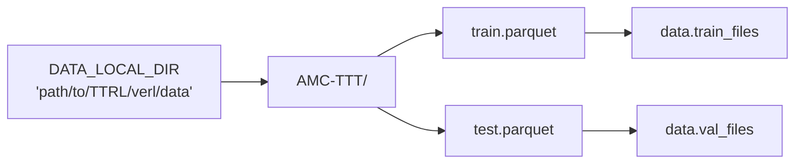
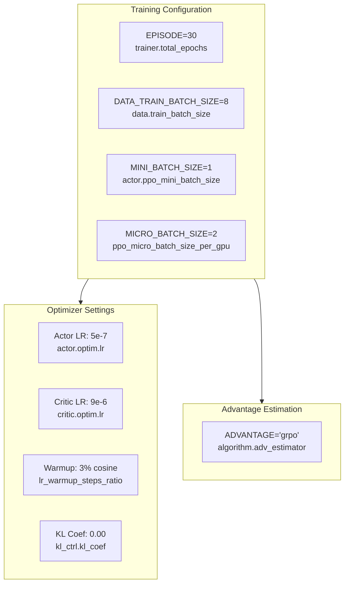
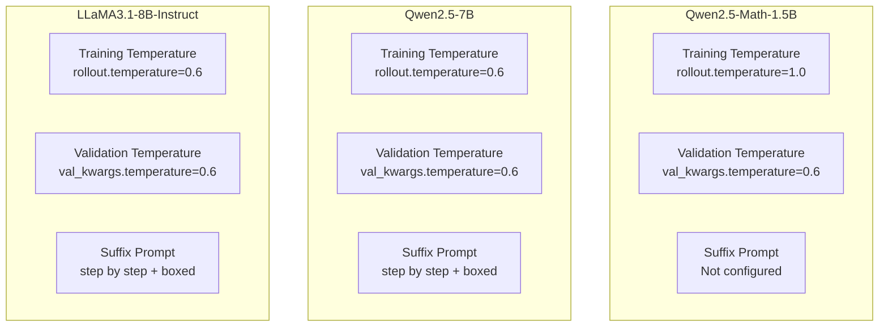
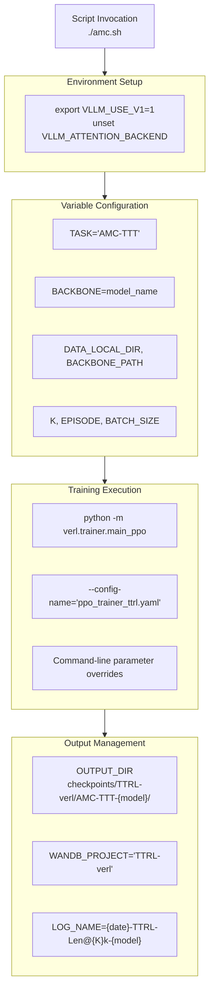
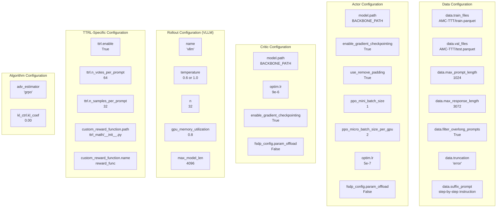
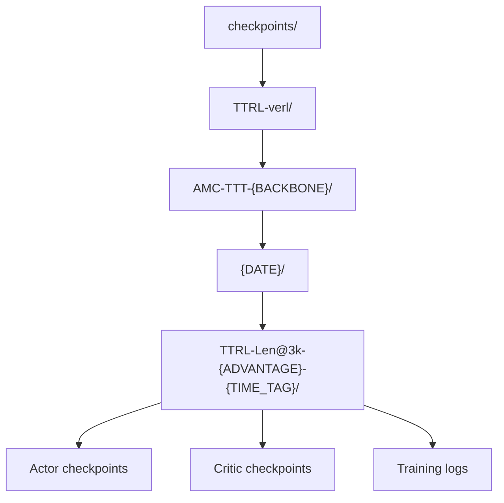

<!-- source: DeepWiki mcp.deepwiki.com · repo PRIME-RL/TTRL · extra page AMC Tasks · fetched 2026-10-30 -->

# AMC Tasks

<details>
<summary>Relevant source files</summary>

The following files were used as context for generating this wiki page:

- [verl/examples/ttrl/LLaMA3.1-Instruct/amc.sh](verl/examples/ttrl/LLaMA3.1-Instruct/amc.sh)
- [verl/examples/ttrl/Qwen2.5-Math/amc.sh](verl/examples/ttrl/Qwen2.5-Math/amc.sh)
- [verl/examples/ttrl/Qwen2.5/amc.sh](verl/examples/ttrl/Qwen2.5/amc.sh)

</details>


This page covers configuration and data setup for training TTRL on AMC (American Mathematics Competitions) tasks. AMC represents a specific mathematical reasoning benchmark focused on competition-style problems.

For general task configuration concepts, see [Task Configurations](#3.3). For other mathematical reasoning tasks, see [AIME Tasks](#3.3.1) and [MATH Tasks](#3.3.3). For model-specific configuration details, see [Model Configurations](#3.2).

---

## Overview

AMC (American Mathematics Competitions) is a series of standardized mathematical examinations that test problem-solving abilities in algebra, geometry, number theory, and combinatorics. In the TTRL framework, AMC tasks are configured with the task identifier `"AMC-TTT"` and are available for all three supported model families: Qwen2.5, Qwen2.5-Math, and LLaMA3.1-Instruct.

**Scope of this document:**
- AMC dataset structure and file paths
- Task-specific configuration parameters
- Model-specific script variations for AMC
- Execution procedures for AMC training

---

## Task Identifier and Data Structure

The AMC task uses a consistent identifier and data structure across all model configurations:

| Configuration | Value | Description |
|---------------|-------|-------------|
| Task Identifier | `AMC-TTT` | Task name used in file paths and experiment naming |
| Training Data | `$DATA_LOCAL_DIR/AMC-TTT/train.parquet` | Parquet file containing training problems |
| Validation Data | `$DATA_LOCAL_DIR/AMC-TTT/test.parquet` | Parquet file containing test problems |
| Data Format | Parquet | Preprocessed from JSON using `verl/data/preprocess.py` |

### Data File Paths



**Sources:** [verl/examples/ttrl/Qwen2.5-Math/amc.sh:31](), [verl/examples/ttrl/Qwen2.5-Math/amc.sh:44-45]()

The `DATA_LOCAL_DIR` environment variable must be set to point to the directory containing preprocessed AMC data before running training scripts.

---

## Core Configuration Parameters

### Response Length Configuration

All AMC scripts use a parametric response length configuration based on the `K` parameter:

```bash
K=3
MAX_PROMPT_LENGTH=1024
MAX_RESPONSE_LENGTH=$((1024 * $K))  # 3072 tokens
```

**Sources:** [verl/examples/ttrl/Qwen2.5/amc.sh:15-17]()

The `K` parameter controls the maximum response length in multiples of 1024 tokens. For AMC tasks, `K=3` provides 3072 tokens for the model to generate step-by-step reasoning and final answers.

### TTRL Voting Parameters

AMC tasks use the standard TTRL voting configuration:

| Parameter | Value | Configuration Key |
|-----------|-------|-------------------|
| Votes per Prompt | 64 | `ttrl.n_votes_per_prompt` |
| Samples per Prompt | 32 | `ttrl.n_samples_per_prompt` |
| Validation Samples | 16 | `actor_rollout_ref.rollout.val_kwargs.n` |

**Sources:** [verl/examples/ttrl/Qwen2.5/amc.sh:26-27](), [verl/examples/ttrl/Qwen2.5/amc.sh:74]()

The system generates 32 samples during training and 16 during validation, using 64 votes to determine majority consensus for reward calculation.

### Training Hyperparameters



**Sources:** [verl/examples/ttrl/Qwen2.5/amc.sh:24-29](), [verl/examples/ttrl/Qwen2.5/amc.sh:58-59](), [verl/examples/ttrl/Qwen2.5/amc.sh:80](), [verl/examples/ttrl/Qwen2.5/amc.sh:87]()

---

## Model-Specific Variations

### Temperature Configuration Differences



**Sources:** [verl/examples/ttrl/Qwen2.5-Math/amc.sh:66](), [verl/examples/ttrl/Qwen2.5/amc.sh:67](), [verl/examples/ttrl/LLaMA3.1-Instruct/amc.sh:67]()

#### Qwen2.5-Math-1.5B Configuration

```bash
actor_rollout_ref.rollout.temperature=1.0
actor_rollout_ref.rollout.val_kwargs.temperature=0.6
# No suffix prompt configured
```

**Sources:** [verl/examples/ttrl/Qwen2.5-Math/amc.sh:66](), [verl/examples/ttrl/Qwen2.5-Math/amc.sh:76]()

Qwen2.5-Math uses higher training temperature (1.0) for more diverse exploration but does not include a suffix prompt, relying on its specialized mathematical training.

#### Qwen2.5-7B Configuration

```bash
actor_rollout_ref.rollout.temperature=0.6
+data.suffix_prompt='"\nPlease reason step by step, and put your final answer within \boxed{}."'
```

**Sources:** [verl/examples/ttrl/Qwen2.5/amc.sh:51](), [verl/examples/ttrl/Qwen2.5/amc.sh:67]()

Qwen2.5 uses a consistent temperature (0.6) and includes an explicit prompt suffix to guide the model's reasoning format.

#### LLaMA3.1-8B-Instruct Configuration

```bash
actor_rollout_ref.rollout.temperature=0.6
+data.suffix_prompt='"\nPlease reason step by step, and put your final answer within \boxed{}."'
```

**Sources:** [verl/examples/ttrl/LLaMA3.1-Instruct/amc.sh:50](), [verl/examples/ttrl/LLaMA3.1-Instruct/amc.sh:67]()

LLaMA3.1 uses identical configuration to Qwen2.5 for AMC tasks.

---

## Script Execution Flow



**Sources:** [verl/examples/ttrl/Qwen2.5/amc.sh:1-106]()

### Execution Steps

1. **Environment Configuration** [verl/examples/ttrl/Qwen2.5/amc.sh:2-4]()
   - Enable VLLM v1 engine
   - Clear attention backend to use default

2. **Path Setup** [verl/examples/ttrl/Qwen2.5/amc.sh:31-32]()
   ```bash
   DATA_LOCAL_DIR="path/to/TTRL/verl/data"
   BACKBONE_PATH="path/to/${BACKBONE}"
   ```
   Update these paths to point to your local data directory and model checkpoint.

3. **Launch Training** [verl/examples/ttrl/Qwen2.5/amc.sh:42-104]()
   ```bash
   python -m verl.trainer.main_ppo \
   --config-name='ppo_trainer_ttrl.yaml' \
   data.train_files=["$DATA_LOCAL_DIR/$TASK/train.parquet"] \
   # ... additional overrides
   ```

---

## Complete Configuration Mapping



**Sources:** [verl/examples/ttrl/Qwen2.5/amc.sh:44-93]()

### Critical Configuration Parameters

| Category | Parameter | Value | Line Reference |
|----------|-----------|-------|----------------|
| Task | `TASK` | `"AMC-TTT"` | [verl/examples/ttrl/Qwen2.5/amc.sh:11]() |
| Episodes | `EPISODE` | `30` | [verl/examples/ttrl/Qwen2.5/amc.sh:24]() |
| Response Length | `MAX_RESPONSE_LENGTH` | `3072` (K=3) | [verl/examples/ttrl/Qwen2.5/amc.sh:17]() |
| Actor LR | `actor.optim.lr` | `5e-7` | [verl/examples/ttrl/Qwen2.5/amc.sh:58]() |
| Critic LR | `critic.optim.lr` | `9e-6` | [verl/examples/ttrl/Qwen2.5/amc.sh:80]() |
| TTRL Votes | `ttrl.n_votes_per_prompt` | `64` | [verl/examples/ttrl/Qwen2.5/amc.sh:92]() |
| Reward Function | `custom_reward_function.path` | `./verl/utils/reward_score/ttrl_math/__init__.py` | [verl/examples/ttrl/Qwen2.5/amc.sh:89]() |

---

## Checkpoint and Logging Configuration

### Output Directory Structure



**Sources:** [verl/examples/ttrl/Qwen2.5/amc.sh:39](), [verl/examples/ttrl/Qwen2.5/amc.sh:103]()

### Logging Configuration

| Parameter | Value | Purpose |
|-----------|-------|---------|
| `trainer.logger` | `['console','wandb']` | Log to console and WandB |
| `trainer.project_name` | `'TTRL-verl'` | WandB project name |
| `trainer.experiment_name` | `{DATE}-TTRL-Len@{K}k-{MODEL}-{ADVANTAGE}` | Unique experiment identifier |
| `trainer.save_freq` | `2000000` | Checkpoint save frequency (effectively disabled) |
| `trainer.test_freq` | `2` | Run validation every 2 epochs |
| `trainer.max_actor_ckpt_to_keep` | `0` | Disable automatic checkpoint cleanup |
| `trainer.max_critic_ckpt_to_keep` | `0` | Disable automatic checkpoint cleanup |

**Sources:** [verl/examples/ttrl/Qwen2.5/amc.sh:94-102]()

---

## Key Differences from Other Tasks

### Comparison with AIME and MATH

| Aspect | AMC | AIME | MATH |
|--------|-----|------|------|
| Task Identifier | `AMC-TTT` | `AIME-TTT` | `MATH-TTT` |
| Problem Difficulty | Intermediate | Advanced | General |
| Response Length (K) | 3 | 3 | 3 |
| Configuration Complexity | Standard | Standard | Standard |
| Suffix Prompt | Model-dependent | Model-dependent | Model-dependent |

**Sources:** [verl/examples/ttrl/Qwen2.5/amc.sh:11]()

All three tasks (AMC, AIME, MATH) share identical TTRL configuration parameters, differing only in the dataset files loaded. This consistency allows for easy comparison of model performance across different mathematical reasoning benchmarks.

---

## Prerequisites and Dependencies

Before running AMC training scripts, ensure:

1. **Data Preparation**: AMC dataset must be preprocessed into Parquet format
   - Training file: `AMC-TTT/train.parquet`
   - Test file: `AMC-TTT/test.parquet`
   - See [Data Processing Pipeline](#4.1) for preprocessing steps

2. **Model Checkpoints**: Pre-trained model must be downloaded
   - Qwen2.5-7B, Qwen2.5-Math-1.5B, or LLaMA3.1-8B-Instruct
   - Update `BACKBONE_PATH` in the script

3. **Environment Variables**:
   - `VLLM_USE_V1=1` (set in script)
   - `VLLM_ATTENTION_BACKEND` (unset in script)

4. **GPU Resources**: 
   - Configuration assumes 8 GPUs per node (`trainer.n_gpus_per_node=8`)
   - Single node setup (`trainer.nnodes=1`)

**Sources:** [verl/examples/ttrl/Qwen2.5/amc.sh:1-4](), [verl/examples/ttrl/Qwen2.5/amc.sh:31-32](), [verl/examples/ttrl/Qwen2.5/amc.sh:97-98]()

---

