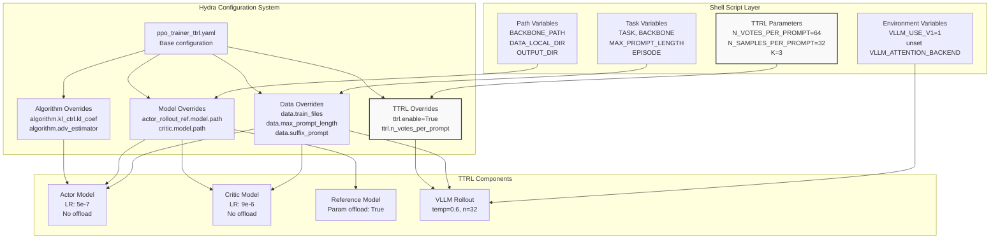
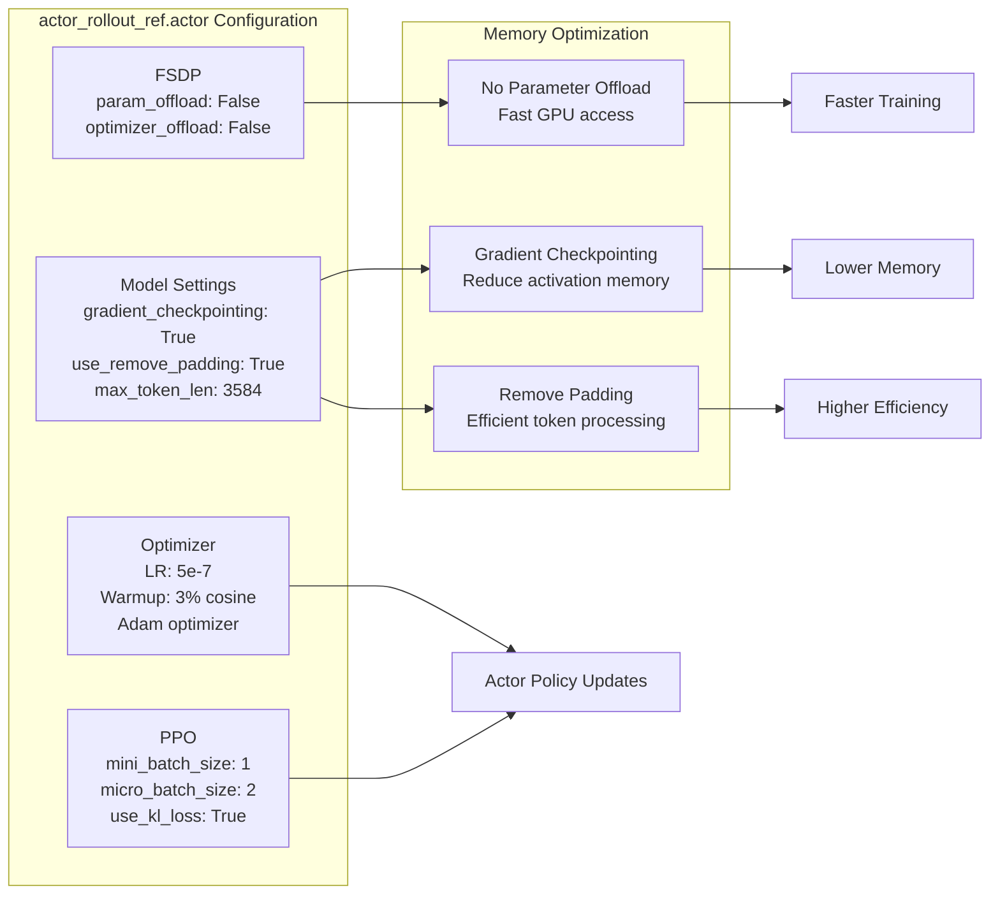
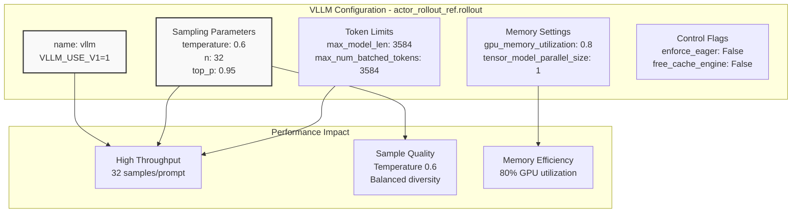

<!-- source: DeepWiki mcp.deepwiki.com · repo PRIME-RL/TTRL · extra page LLaMA3.1-Instruct Models · fetched 2026-10-30 -->

# LLaMA3.1-Instruct Models

<details>
<summary>Relevant source files</summary>

The following files were used as context for generating this wiki page:

- [verl/examples/ttrl/LLaMA3.1-Instruct/aime.sh](verl/examples/ttrl/LLaMA3.1-Instruct/aime.sh)
- [verl/examples/ttrl/LLaMA3.1-Instruct/amc.sh](verl/examples/ttrl/LLaMA3.1-Instruct/amc.sh)
- [verl/examples/ttrl/LLaMA3.1-Instruct/math.sh](verl/examples/ttrl/LLaMA3.1-Instruct/math.sh)

</details>


This page documents the configuration and usage of **LLaMA3.1-8B-Instruct** models within the TTRL framework. LLaMA3.1-Instruct is Meta's instruction-tuned model that has been optimized for following instructions and reasoning tasks. The TTRL implementation provides ready-to-use shell scripts for training this model on mathematical reasoning benchmarks (AIME, AMC, MATH).

For general model configuration concepts, see [Model Configurations](#3.2). For task-specific dataset details, see [Task Configurations](#3.3).

---

## Overview

The LLaMA3.1-Instruct configuration uses the **Llama-3.1-8B-Instruct** model as the shared backbone for the actor, critic, and reference components. This instruction-tuned variant is particularly well-suited for TTRL's mathematical reasoning tasks due to its strong instruction-following capabilities and reasoning performance.

Three example scripts are provided in [verl/examples/ttrl/LLaMA3.1-Instruct/]():
- `aime.sh` - AIME (American Invitational Mathematics Examination)
- `amc.sh` - AMC (American Mathematics Competitions)
- `math.sh` - MATH (general mathematical problems)

All scripts follow a consistent configuration pattern with task-specific adjustments for prompt length, training episodes, and batch size.

**Sources:** [verl/examples/ttrl/LLaMA3.1-Instruct/aime.sh:1-106](), [verl/examples/ttrl/LLaMA3.1-Instruct/amc.sh:1-106](), [verl/examples/ttrl/LLaMA3.1-Instruct/math.sh:1-106]()

---

## Environment Setup

### Required Environment Variables

All LLaMA3.1-Instruct scripts configure VLLM-specific environment variables:

```bash
unset VLLM_ATTENTION_BACKEND
export VLLM_USE_V1=1
```

**Configuration Details:**

| Environment Variable | Value | Purpose |
|---------------------|-------|---------|
| `VLLM_ATTENTION_BACKEND` | unset | Disables specific attention backend, allowing VLLM to auto-select |
| `VLLM_USE_V1` | `1` | Enables VLLM v1 engine for improved performance |

The VLLM v1 engine provides enhanced throughput and memory efficiency for the rollout phase. The unset attention backend allows VLLM to automatically choose the optimal implementation based on available hardware.

**Sources:** [verl/examples/ttrl/LLaMA3.1-Instruct/aime.sh:2-4](), [verl/examples/ttrl/LLaMA3.1-Instruct/amc.sh:2-4](), [verl/examples/ttrl/LLaMA3.1-Instruct/math.sh:2-4]()

### Model Path Configuration

```bash
BACKBONE="Llama-3.1-8B-Instruct"
BACKBONE_PATH="path/to/${BACKBONE}"
```

Users must update `BACKBONE_PATH` to point to their local LLaMA3.1-8B-Instruct checkpoint. The model should be in HuggingFace format, compatible with the `transformers` library. The same path is used to initialize the actor, critic, and reference models:

```bash
actor_rollout_ref.model.path=$BACKBONE_PATH
critic.model.path=$BACKBONE_PATH
```

**Sources:** [verl/examples/ttrl/LLaMA3.1-Instruct/aime.sh:12,32,52,82]()

---

## Configuration Architecture

### Script Structure and Parameter Flow



**Diagram: Configuration Flow from Shell Variables to TTRL Components**

The configuration follows a layered approach:
1. **Shell variables** define task-specific and model-specific parameters
2. **Hydra overrides** pass these to `verl.trainer.main_ppo` via command-line arguments
3. **TTRL components** receive final merged configuration

**Sources:** [verl/examples/ttrl/LLaMA3.1-Instruct/aime.sh:8-104]()

---

## Common TTRL Configuration

All LLaMA3.1-Instruct scripts share a consistent TTRL configuration pattern:

### Response Length Configuration

```bash
K=3
MAX_RESPONSE_LENGTH=$((1024 * $K))
```

The parameter `K` controls the maximum response length multiplier. With `K=3`, the model can generate responses up to 3,072 tokens. The conditional logic adjusts sampling budget based on response length:

```bash
if [ "$K" -gt 8 ]; then
  N=4
else
  N=16
fi
```

For `K=3`, validation sampling uses `N=16` samples per prompt, while training uses 32 samples (`N_SAMPLES_PER_PROMPT`).

**Sources:** [verl/examples/ttrl/LLaMA3.1-Instruct/aime.sh:15-22]()

### TTRL Voting Parameters

```bash
N_VOTES_PER_PROMPT=64
N_SAMPLES_PER_PROMPT=32
```

These control the majority voting mechanism:
- **64 votes** are aggregated across multiple sampling rounds
- **32 samples** are generated per prompt during training rollout
- Voting creates self-supervised reward signal without ground truth labels

The configuration is passed to the trainer:

```bash
ttrl.enable=True
ttrl.n_votes_per_prompt=$N_VOTES_PER_PROMPT
ttrl.n_samples_per_prompt=$N_SAMPLES_PER_PROMPT
```

**Sources:** [verl/examples/ttrl/LLaMA3.1-Instruct/aime.sh:26-27,91-93]()

### Batch Size Configuration

```bash
MINI_BATCH_SIZE=1
MICRO_BATCH_SIZE=2
```

| Parameter | Value | Applied To | Purpose |
|-----------|-------|------------|---------|
| `MINI_BATCH_SIZE` | 1 | Actor PPO | Number of mini-batches per PPO update |
| `MICRO_BATCH_SIZE` | 2 | Actor, Critic, Reference | Micro-batches per GPU for gradient accumulation |

These values balance memory usage and training stability on 8 GPUs with 80GB memory each.

**Sources:** [verl/examples/ttrl/LLaMA3.1-Instruct/aime.sh:28-29,55-56,64,70,84]()

---

## Hyperparameter Configuration

### Actor Model Settings



**Diagram: Actor Model Configuration and Memory Strategy**

Key actor hyperparameters from [verl/examples/ttrl/LLaMA3.1-Instruct/aime.sh:52-63]():

```bash
actor_rollout_ref.actor.optim.lr=5e-7
actor_rollout_ref.actor.optim.lr_warmup_steps_ratio=0.03
actor_rollout_ref.actor.optim.warmup_style='cosine'
actor_rollout_ref.actor.fsdp_config.param_offload=False
actor_rollout_ref.actor.fsdp_config.optimizer_offload=False
```

**Configuration Rationale:**
- **Conservative learning rate (5e-7)**: Prevents catastrophic forgetting in the pre-trained model
- **3% warmup**: Gradual learning rate increase for stable training start
- **No FSDP offloading**: Parameters remain on GPU for fast access during frequent updates
- **Gradient checkpointing**: Trades computation for memory by recomputing activations

**Sources:** [verl/examples/ttrl/LLaMA3.1-Instruct/aime.sh:52-63]()

### Critic Model Settings

The critic uses a significantly higher learning rate to track the changing actor policy:

```bash
critic.optim.lr=9e-6
critic.model.fsdp_config.param_offload=False
critic.model.fsdp_config.optimizer_offload=False
```

**Critic vs Actor Learning Rates:**

| Component | Learning Rate | Ratio | Justification |
|-----------|--------------|-------|---------------|
| Actor | 5e-7 | 1.0x | Slow, stable policy updates |
| Critic | 9e-6 | 18x | Fast value function adaptation |

The critic learns 18x faster than the actor to quickly adjust value estimates as the policy evolves. Like the actor, critic parameters are not offloaded for efficient training.

**Sources:** [verl/examples/ttrl/LLaMA3.1-Instruct/aime.sh:80-86]()

### Reference Model Settings

The reference model configuration emphasizes memory efficiency:

```bash
actor_rollout_ref.ref.log_prob_micro_batch_size_per_gpu=$MICRO_BATCH_SIZE
actor_rollout_ref.ref.fsdp_config.param_offload=True
```

Unlike actor and critic, the reference model:
- **Remains frozen** (no gradient updates)
- **Offloads parameters to CPU** (`param_offload=True`)
- **Only computes log probabilities** for KL divergence calculation

This configuration saves GPU memory for the trainable components while maintaining the reference policy baseline.

**Sources:** [verl/examples/ttrl/LLaMA3.1-Instruct/aime.sh:64-65]()

### VLLM Rollout Configuration



**Diagram: VLLM Rollout Configuration and Performance Characteristics**

Complete VLLM configuration from [verl/examples/ttrl/LLaMA3.1-Instruct/aime.sh:66-79]():

| Parameter | Value | Purpose |
|-----------|-------|---------|
| `name` | `vllm` | Use VLLM engine for rollout |
| `temperature` | 0.6 | Moderate sampling diversity |
| `n` | 32 | Generate 32 samples per prompt |
| `top_p` | 0.95 | Nucleus sampling threshold |
| `tensor_model_parallel_size` | 1 | Single-GPU inference (no tensor parallelism) |
| `gpu_memory_utilization` | 0.8 | Use 80% of GPU memory |
| `max_model_len` | 3584 | Maximum sequence length (512+3072) |
| `enforce_eager` | False | Allow CUDA graph optimization |
| `free_cache_engine` | False | Keep KV cache between batches |

**Temperature Strategy:**
- **Training**: 0.6 - Moderate diversity for exploration
- **Validation**: 0.6 - Consistent evaluation conditions

**Sources:** [verl/examples/ttrl/LLaMA3.1-Instruct/aime.sh:66-79]()

### Algorithm Configuration

```bash
algorithm.kl_ctrl.kl_coef=0.00
algorithm.adv_estimator=grpo
```

| Parameter | Value | Explanation |
|-----------|-------|-------------|
| `kl_coef` | 0.00 | No KL penalty (TTRL relies on majority voting for constraint) |
| `adv_estimator` | `grpo` | Group Relative Policy Optimization for advantage estimation |

The zero KL coefficient is a key TTRL design choice - the majority voting mechanism provides sufficient regularization without explicit KL divergence penalties.

**Sources:** [verl/examples/ttrl/LLaMA3.1-Instruct/aime.sh:87-88]()

---

## Task-Specific Configurations

### Configuration Comparison Table

| Parameter | AIME | AMC | MATH | Notes |
|-----------|------|-----|------|-------|
| `TASK` | `AIME-TTT` | `AMC-TTT` | `MATH-TTT` | Dataset identifier |
| `MAX_PROMPT_LENGTH` | 512 | 1024 | 1024 | AIME has shorter prompts |
| `MAX_RESPONSE_LENGTH` | 3072 | 3072 | 3072 | All use K=3 (3×1024) |
| `EPISODE` | 80 | 30 | 10 | Training epochs |
| `DATA_TRAIN_BATCH_SIZE` | 8 | 8 | 32 | MATH uses larger batches |
| `trainer.test_freq` | 2 | 2 | 2 | Validation every 2 epochs |

**Sources:** [verl/examples/ttrl/LLaMA3.1-Instruct/aime.sh:11-25](), [verl/examples/ttrl/LLaMA3.1-Instruct/amc.sh:11-25](), [verl/examples/ttrl/LLaMA3.1-Instruct/math.sh:11-25]()

### AIME Configuration

```bash
TASK="AIME-TTT"
MAX_PROMPT_LENGTH=512
EPISODE=80
DATA_TRAIN_BATCH_SIZE=8
```

AIME problems are typically shorter but more challenging, requiring:
- **Shorter prompts (512 tokens)**: AIME problems are concise competition questions
- **More training episodes (80)**: Difficult problems benefit from extended training
- **Smaller batches (8)**: Memory constraints with longer response generation

**Data paths:**
```bash
data.train_files=["$DATA_LOCAL_DIR/$TASK/train.parquet"]
data.val_files=["$DATA_LOCAL_DIR/$TASK/test.parquet"]
```

**Sources:** [verl/examples/ttrl/LLaMA3.1-Instruct/aime.sh:11-25,44-45]()

### AMC Configuration

```bash
TASK="AMC-TTT"
MAX_PROMPT_LENGTH=1024
EPISODE=30
DATA_TRAIN_BATCH_SIZE=8
```

AMC problems have moderate complexity:
- **Standard prompts (1024 tokens)**: Accommodates longer problem statements
- **Moderate training (30 epochs)**: Balanced training duration
- **Standard batches (8)**: Similar to AIME configuration

**Sources:** [verl/examples/ttrl/LLaMA3.1-Instruct/amc.sh:11-25]()

### MATH Configuration

```bash
TASK="MATH-TTT"
MAX_PROMPT_LENGTH=1024
EPISODE=10
DATA_TRAIN_BATCH_SIZE=32
```

The MATH dataset has diverse problems with varied difficulty:
- **Standard prompts (1024 tokens)**: Supports diverse problem formats
- **Fewer episodes (10)**: Larger dataset requires less training
- **Larger batches (32)**: Better gradient estimates with diverse problems

**Sources:** [verl/examples/ttrl/LLaMA3.1-Instruct/math.sh:11-25]()

---

## Data Configuration

### Prompt Augmentation

All scripts append a standardized instruction suffix to prompts:

```bash
+data.suffix_prompt='"\nPlease reason step by step, and put your final answer within \boxed{}."'
```

This instruction:
1. **Encourages step-by-step reasoning**: Improves solution quality and interpretability
2. **Standardizes answer format**: Ensures answers are in `\boxed{}` LaTeX format
3. **Facilitates reward extraction**: The `reward_func` parses boxed answers for voting

**Sources:** [verl/examples/ttrl/LLaMA3.1-Instruct/aime.sh:50]()

### Data Filtering and Truncation

```bash
data.filter_overlong_prompts=True
data.truncation='error'
```

| Setting | Value | Behavior |
|---------|-------|----------|
| `filter_overlong_prompts` | True | Remove prompts exceeding `max_prompt_length` |
| `truncation` | `error` | Raise error if truncation would occur (fail-fast) |

The `error` truncation mode ensures data quality by rejecting any prompt that would require truncation, rather than silently truncating and potentially losing critical problem information.

**Sources:** [verl/examples/ttrl/LLaMA3.1-Instruct/aime.sh:49,51]()

---

## Custom Reward Function

All LLaMA3.1-Instruct configurations use the TTRL math reward function:

```bash
custom_reward_function.path="./verl/utils/reward_score/ttrl_math/__init__.py"
custom_reward_function.name=reward_func
```

This function:
1. **Extracts boxed answers** from LaTeX responses using regex patterns
2. **Performs majority voting** across multiple samples per prompt
3. **Assigns binary rewards**: +1 for matching majority, 0 otherwise
4. **Enables self-supervised learning** without ground truth labels

For implementation details, see [Custom Reward Functions](#5.3).

**Sources:** [verl/examples/ttrl/LLaMA3.1-Instruct/aime.sh:89-90]()

---

## Logging and Checkpointing

### WandB Integration

```bash
trainer.logger=['console','wandb']
trainer.project_name=$WANDB_PROJECT
trainer.experiment_name=$LOG_NAME
```

Where:
```bash
WANDB_PROJECT="TTRL-verl"
LOG_NAME="${DATE}-${EXPERIMENT}-${MODEL}-${ADVANTAGE}"
```

Example experiment name: `1215-TTRL-Len@3k-AIME-TTT-Llama-3.1-8B-Instruct-grpo`

**Sources:** [verl/examples/ttrl/LLaMA3.1-Instruct/aime.sh:37-38,94-96]()

### Checkpoint Configuration

```bash
trainer.save_freq=2000000
trainer.max_actor_ckpt_to_keep=0
trainer.max_critic_ckpt_to_keep=0
trainer.default_local_dir=$OUTPUT_DIR
```

| Parameter | Value | Effect |
|-----------|-------|--------|
| `save_freq` | 2000000 | Effectively disable periodic checkpointing (very high frequency) |
| `max_actor_ckpt_to_keep` | 0 | Do not save actor checkpoints |
| `max_critic_ckpt_to_keep` | 0 | Do not save critic checkpoints |
| `default_local_dir` | Custom output path | Save location for any checkpoints/logs |

This configuration prioritizes experimental iteration over checkpoint retention, with validation metrics logged to WandB for analysis.

**Sources:** [verl/examples/ttrl/LLaMA3.1-Instruct/aime.sh:99-103]()

---

## Execution and Resource Requirements

### Hardware Requirements

```bash
trainer.n_gpus_per_node=8
trainer.nnodes=1
```

LLaMA3.1-8B-Instruct training requires:
- **8 GPUs per node** (typically A100 80GB or H100)
- **Single-node training** (no multi-node distribution)
- **~80% GPU memory utilization** for VLLM rollout

**Sources:** [verl/examples/ttrl/LLaMA3.1-Instruct/aime.sh:97-98]()

### Running a Training Script

```bash
# Update paths in the script
BACKBONE_PATH="path/to/Llama-3.1-8B-Instruct"
DATA_LOCAL_DIR="path/to/TTRL/verl/data"

# Execute training
bash verl/examples/ttrl/LLaMA3.1-Instruct/aime.sh
```

The script will:
1. Set VLLM environment variables
2. Configure all hyperparameters
3. Launch `verl.trainer.main_ppo` with Hydra overrides
4. Output checkpoint directory path at completion

**Output example:**
```
Output directory: checkpoints/TTRL-verl/AIME-TTT-Llama-3.1-8B-Instruct/1215/TTRL-Len@3k-grpo-143052
```

**Sources:** [verl/examples/ttrl/LLaMA3.1-Instruct/aime.sh:42-106]()

---

## Key Differences from Other Model Families

### LLaMA3.1-Instruct vs Qwen2.5

| Aspect | LLaMA3.1-Instruct | Qwen2.5 |
|--------|-------------------|---------|
| Model Size | 8B parameters | 7B parameters |
| Instruction Tuning | Explicitly instruction-tuned | General purpose |
| Attention Backend | VLLM auto-select (unset) | XFORMERS or auto |
| Typical Use | Instruction-following tasks | Broad applications |

### LLaMA3.1-Instruct vs Qwen2.5-Math

| Aspect | LLaMA3.1-Instruct | Qwen2.5-Math |
|--------|-------------------|--------------|
| Model Size | 8B parameters | 1.5B parameters |
| Specialization | General instruction-following | Math-specific pre-training |
| Training Strategy | Leverage instruction capability | Leverage math domain knowledge |
| Parameter Efficiency | Less efficient (larger) | More efficient (smaller, specialized) |

For Qwen configurations, see [Qwen2.5 Models](#3.2.1) and [Qwen2.5-Math Models](#3.2.2).

**Sources:** [verl/examples/ttrl/LLaMA3.1-Instruct/aime.sh:12](), [verl/examples/ttrl/Qwen2.5/aime.sh](), [verl/examples/ttrl/Qwen2.5-Math/aime.sh]()

---

## Summary

The LLaMA3.1-Instruct configuration demonstrates TTRL's flexibility in working with instruction-tuned models. Key characteristics:

- **Conservative training**: Low learning rate (5e-7) preserves instruction-following capabilities
- **Memory-efficient**: Strategic FSDP offloading for reference model only
- **High throughput**: VLLM v1 engine with 32 samples per prompt
- **Task-adaptable**: Three pre-configured scripts for different mathematical reasoning benchmarks
- **Self-supervised**: Majority voting rewards without ground truth labels

All three example scripts share consistent TTRL hyperparameters (64 votes, 32 samples, K=3) while adapting prompt length, training episodes, and batch size to task characteristics.

**Sources:** [verl/examples/ttrl/LLaMA3.1-Instruct/aime.sh:1-106](), [verl/examples/ttrl/LLaMA3.1-Instruct/amc.sh:1-106](), [verl/examples/ttrl/LLaMA3.1-Instruct/math.sh:1-106]()

---

