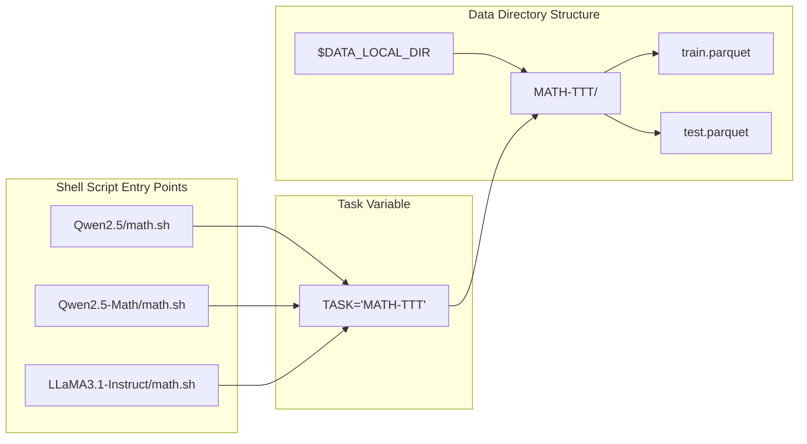
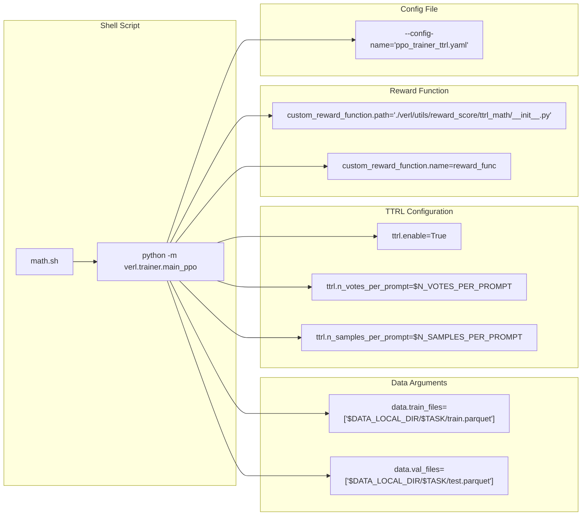

<!-- source: DeepWiki mcp.deepwiki.com · repo PRIME-RL/TTRL · extra page MATH Tasks · fetched 2026-10-30 -->

# MATH Tasks

<details>
<summary>Relevant source files</summary>

The following files were used as context for generating this wiki page:

- [verl/examples/ttrl/LLaMA3.1-Instruct/math.sh](verl/examples/ttrl/LLaMA3.1-Instruct/math.sh)
- [verl/examples/ttrl/Qwen2.5-Math/math.sh](verl/examples/ttrl/Qwen2.5-Math/math.sh)
- [verl/examples/ttrl/Qwen2.5/math.sh](verl/examples/ttrl/Qwen2.5/math.sh)

</details>


This page documents the configuration and data setup for running TTRL training on the MATH dataset. The MATH dataset provides general mathematical reasoning problems and is configured as the `MATH-TTT` task in the TTRL system.

For related task configurations, see [3.3.1]() for AIME tasks and [3.3.2]() for AMC tasks.

## Task Overview

The MATH task (`MATH-TTT`) is a general mathematical reasoning benchmark for TTRL training. Data is stored in parquet format at `$DATA_LOCAL_DIR/MATH-TTT/` with separate files for training and testing.

MATH Task Data Structure



Sources:
- [verl/examples/ttrl/Qwen2.5/math.sh:11]()
- [verl/examples/ttrl/Qwen2.5/math.sh:44-45]()
- [verl/examples/ttrl/Qwen2.5-Math/math.sh:11]()
- [verl/examples/ttrl/LLaMA3.1-Instruct/math.sh:11]()

## Shell Script Configuration

All three model variants use consistent task configuration parameters but differ in model paths and prompt augmentation strategies.

### Common Task Parameters

| Variable | Value | Description |
|----------|-------|-------------|
| `TASK` | `"MATH-TTT"` | Task identifier used in file paths |
| `K` | 3 | Response length multiplier (3k tokens) |
| `MAX_PROMPT_LENGTH` | 1024 | Maximum prompt tokens |
| `MAX_RESPONSE_LENGTH` | `$((1024 * $K))` | 3072 tokens maximum response |
| `EPISODE` | 10 | Total training epochs |
| `DATA_TRAIN_BATCH_SIZE` | 32 | Training batch size |
| `N_VOTES_PER_PROMPT` | 64 | TTRL voting samples |
| `N_SAMPLES_PER_PROMPT` | 32 | Generation samples per prompt |
| `MINI_BATCH_SIZE` | 1 | PPO mini-batch size |
| `MICRO_BATCH_SIZE` | 2 | Micro-batch size per GPU |

### Model Backbone Paths

| Script | `BACKBONE` Variable | `BACKBONE_PATH` |
|--------|---------------------|-----------------|
| `Qwen2.5/math.sh` | `"Qwen2.5-7B"` | `"path/to/Qwen2.5-7B"` |
| `Qwen2.5-Math/math.sh` | `"Qwen2.5-Math-1.5B"` | `"path/to/Qwen2.5-Math-1.5B"` |
| `LLaMA3.1-Instruct/math.sh` | `"Llama-3.1-8B-Instruct"` | `"path/to/Llama-3.1-8B-Instruct"` |

Sources:
- [verl/examples/ttrl/Qwen2.5/math.sh:11-32]()
- [verl/examples/ttrl/Qwen2.5-Math/math.sh:11-32]()
- [verl/examples/ttrl/LLaMA3.1-Instruct/math.sh:11-32]()

## Command Line Invocation

Each shell script invokes `verl.trainer.main_ppo` with task-specific data file paths and TTRL configuration.

MATH Task Training Pipeline



Sources:
- [verl/examples/ttrl/Qwen2.5/math.sh:42-43]()
- [verl/examples/ttrl/Qwen2.5/math.sh:44-45]()
- [verl/examples/ttrl/Qwen2.5/math.sh:87-93]()

## Data Processing Configuration

The MATH dataset uses parquet format for efficient data loading and processing. The data configuration includes specific parameters for prompt handling and response generation.

### Data Configuration Parameters

| Parameter | Value | Description |
|-----------|-------|-------------|
| `data.max_prompt_length` | 1024 | Maximum input prompt length |
| `data.max_response_length` | 3072 | Maximum response length (3 × 1024) |
| `data.train_batch_size` | 32 | Training batch size |
| `data.filter_overlong_prompts` | True | Filter prompts exceeding max length |
| `data.truncation` | 'error' | Error on truncation required |

### Prompt Augmentation

Qwen2.5 and LLaMA 3.1 configurations add a suffix prompt to encourage step-by-step reasoning:

```bash
+data.suffix_prompt='"\nPlease reason step by step, and put your final answer within \boxed{}."'
```

Qwen2.5-Math omits this suffix since the model is pre-trained for mathematical reasoning.

| Model | Suffix Prompt | Line Reference |
|-------|---------------|----------------|
| Qwen2.5 | Yes | [verl/examples/ttrl/Qwen2.5/math.sh:51]() |
| Qwen2.5-Math | No | - |
| LLaMA3.1-Instruct | Yes | [verl/examples/ttrl/LLaMA3.1-Instruct/math.sh:50]() |

Sources:
- [verl/examples/ttrl/Qwen2.5/math.sh:51]()
- [verl/examples/ttrl/LLaMA3.1-Instruct/math.sh:50]()

## TTRL and Reward Configuration

All MATH task scripts enable TTRL mode and configure the `reward_func` from the `ttrl_math` module.

### TTRL Parameters

| Parameter | Value | Description |
|-----------|-------|-------------|
| `ttrl.enable` | `True` | Enable TTRL voting mechanism |
| `ttrl.n_votes_per_prompt` | `$N_VOTES_PER_PROMPT` (64) | Total voting samples |
| `ttrl.n_samples_per_prompt` | `$N_SAMPLES_PER_PROMPT` (32) | Samples generated per prompt |

### Custom Reward Function

| Parameter | Value |
|-----------|-------|
| `custom_reward_function.path` | `"./verl/utils/reward_score/ttrl_math/__init__.py"` |
| `custom_reward_function.name` | `reward_func` |

The `reward_func` extracts answers from `\boxed{}` LaTeX notation and compares generated samples against the majority vote consensus. See [5.3]() for details on custom reward functions.

Sources:
- [verl/examples/ttrl/Qwen2.5/math.sh:87-93]()
- [verl/examples/ttrl/Qwen2.5-Math/math.sh:87-93]()
- [verl/examples/ttrl/LLaMA3.1-Instruct/math.sh:87-93]()

## Actor and Rollout Configuration

Actor and rollout parameters control model training and sample generation behavior.

### Actor Configuration

| Parameter | Value | Purpose |
|-----------|-------|---------|
| `actor_rollout_ref.actor.optim.lr` | 5e-7 | Actor learning rate |
| `actor_rollout_ref.actor.optim.lr_warmup_steps_ratio` | 0.03 | Warmup ratio (3%) |
| `actor_rollout_ref.actor.optim.warmup_style` | `'cosine'` | Cosine warmup schedule |
| `actor_rollout_ref.actor.ppo_mini_batch_size` | `$MINI_BATCH_SIZE` (1) | Mini-batch size |
| `actor_rollout_ref.actor.ppo_micro_batch_size_per_gpu` | `$MICRO_BATCH_SIZE` (2) | Micro-batch per GPU |
| `actor_rollout_ref.actor.use_kl_loss` | `True` | Enable KL divergence loss |
| `actor_rollout_ref.actor.fsdp_config.param_offload` | `False` | No parameter offloading |
| `actor_rollout_ref.actor.fsdp_config.optimizer_offload` | `False` | No optimizer offloading |

### Rollout (VLLM) Configuration

| Parameter | Qwen2.5 | Qwen2.5-Math | LLaMA3.1 |
|-----------|---------|--------------|----------|
| `rollout.name` | `vllm` | `vllm` | `vllm` |
| `rollout.temperature` | 0.6 | 1.0 | 0.6 |
| `rollout.n` | - | - | `$N_SAMPLES_PER_PROMPT` |
| `rollout.tensor_model_parallel_size` | 1 | 1 | 1 |
| `rollout.gpu_memory_utilization` | 0.8 | 0.8 | 0.8 |
| `rollout.val_kwargs.temperature` | 0.6 | 0.6 | 0.6 |
| `rollout.val_kwargs.n` | `$N` (16) | `$N` (16) | `$N` (16) |
| `rollout.val_kwargs.top_p` | 0.95 | 0.95 | 0.95 |

Note: Qwen2.5-Math uses `temperature=1.0` during training rollout for exploration, while maintaining `val_kwargs.temperature=0.6` for validation.

Sources:
- [verl/examples/ttrl/Qwen2.5/math.sh:52-77]()
- [verl/examples/ttrl/Qwen2.5-Math/math.sh:52-76]()
- [verl/examples/ttrl/LLaMA3.1-Instruct/math.sh:52-79]()

## Trainer Configuration

Trainer parameters control experiment logging, checkpointing, and training duration.

| Parameter | Value | Description |
|-----------|-------|-------------|
| `trainer.logger` | `['console','wandb']` | Console and WandB logging |
| `trainer.project_name` | `$WANDB_PROJECT` (`"TTRL-verl"`) | WandB project name |
| `trainer.experiment_name` | `$LOG_NAME` | Experiment identifier |
| `trainer.n_gpus_per_node` | 8 | GPUs per node |
| `trainer.nnodes` | 1 | Number of nodes |
| `trainer.save_freq` | 2000000 | Checkpoint save frequency (high = rare saves) |
| `trainer.test_freq` | 2 | Test evaluation every 2 epochs |
| `trainer.max_actor_ckpt_to_keep` | 0 | Keep no actor checkpoints |
| `trainer.max_critic_ckpt_to_keep` | 0 | Keep no critic checkpoints |
| `trainer.default_local_dir` | `$OUTPUT_DIR` | Output directory for logs |
| `trainer.total_epochs` | `$EPISODE` (10) | Total training epochs |

### Output Directory Structure

The `OUTPUT_DIR` variable constructs a hierarchical checkpoint path:

```bash
OUTPUT_DIR="checkpoints/${WANDB_PROJECT}/${MODEL}/${DATE}/${EXPERIMENT}-${ADVANTAGE}-${TIME_TAG}"
```

Example: `checkpoints/TTRL-verl/MATH-TTT-Qwen2.5-7B/1215/TTRL-Len@3k-grpo-143022`

Sources:
- [verl/examples/ttrl/Qwen2.5/math.sh:37-39]()
- [verl/examples/ttrl/Qwen2.5/math.sh:92-102]()

## Execution

Execute the appropriate shell script for the target model:

```bash
# Qwen2.5-7B
bash verl/examples/ttrl/Qwen2.5/math.sh

# Qwen2.5-Math-1.5B
bash verl/examples/ttrl/Qwen2.5-Math/math.sh

# LLaMA3.1-8B-Instruct
bash verl/examples/ttrl/LLaMA3.1-Instruct/math.sh
```

Before execution, update the `DATA_LOCAL_DIR` and `BACKBONE_PATH` variables to point to your local data and model directories.

Sources:
- [verl/examples/ttrl/Qwen2.5/math.sh:31-32]()
- [verl/examples/ttrl/Qwen2.5-Math/math.sh:31-32]()
- [verl/examples/ttrl/LLaMA3.1-Instruct/math.sh:31-32]()

## Critic Configuration

The critic (value network) uses a higher learning rate than the actor for faster value function approximation.

| Parameter | Value | Description |
|-----------|-------|-------------|
| `critic.optim.lr` | 9e-6 | Critic learning rate (18x actor) |
| `critic.ppo_micro_batch_size_per_gpu` | `$MICRO_BATCH_SIZE` (2) | Micro-batch per GPU |
| `critic.model.use_remove_padding` | `True` | Remove padding for efficiency |
| `critic.model.enable_gradient_checkpointing` | `True` | Enable gradient checkpointing |
| `critic.model.fsdp_config.param_offload` | `False` | No parameter offloading |
| `critic.model.fsdp_config.optimizer_offload` | `False` | No optimizer offloading |

Sources:
- [verl/examples/ttrl/Qwen2.5/math.sh:78-86]()
- [verl/examples/ttrl/Qwen2.5-Math/math.sh:78-86]()
- [verl/examples/ttrl/LLaMA3.1-Instruct/math.sh:80-86]()

## Algorithm Configuration

| Parameter | Value | Description |
|-----------|-------|-------------|
| `algorithm.kl_ctrl.kl_coef` | 0.00 | KL divergence coefficient (disabled) |
| `algorithm.adv_estimator` | `$ADVANTAGE` (`"grpo"`) | GRPO advantage estimation |

The KL coefficient is set to 0.00, meaning KL divergence regularization is effectively disabled for MATH tasks.

Sources:
- [verl/examples/ttrl/Qwen2.5/math.sh:85-86]()
- [verl/examples/ttrl/Qwen2.5-Math/math.sh:85-86]()
- [verl/examples/ttrl/LLaMA3.1-Instruct/math.sh:87-88]()

## Using MATH Datasets in TTRL

The MATH datasets play a crucial role in the TTRL system by providing challenging mathematical problems for testing and improving language model performance. The following steps outline how these datasets are used:

1. **Data Loading**: The MATH datasets are loaded from their JSON files into the TTRL system.
2. **Problem Presentation**: Individual problems are presented to the language model.
3. **Solution Generation**: The model generates multiple solutions for each problem.
4. **Reward Calculation**: Using the majority voting mechanism, a reward signal is calculated without using ground truth.
5. **Model Updating**: The language model is updated using reinforcement learning based on these rewards.
6. **Performance Evaluation**: The model's performance is evaluated on unseen test problems.

Sources:
- `code/data/MATH-L1-TTT/test.json`
- `code/data/MATH-L1-TTT/train.json`
- `code/data/MATH-L2-TTT/test.json`
- `code/data/MATH-L3-TTT/test.json`

## Conclusion

The MATH datasets provide a comprehensive benchmark for evaluating and improving the mathematical reasoning capabilities of language models in the TTRL system. With three difficulty levels and a wide range of mathematical domains, these datasets enable systematic testing and enhancement of model performance on increasingly complex mathematical problems. The structured JSON format and detailed solutions make them particularly useful for the test-time reinforcement learning approach, where models are improved using unlabeled data through majority voting as a reward mechanism.

---

