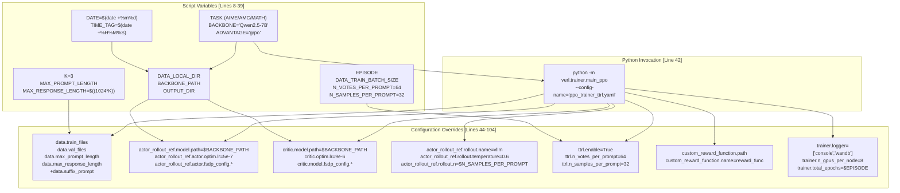
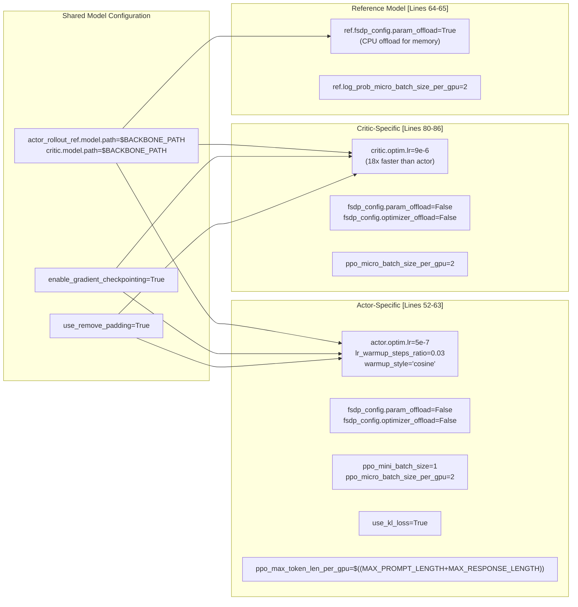
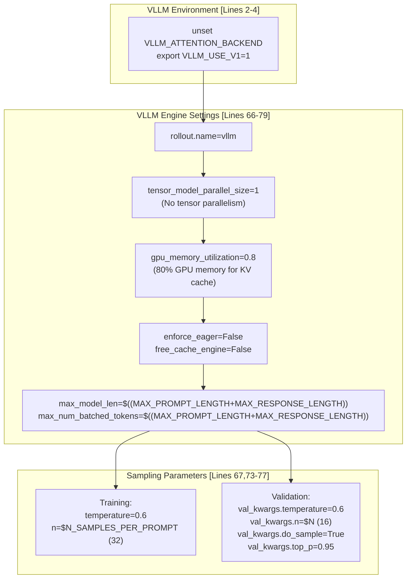
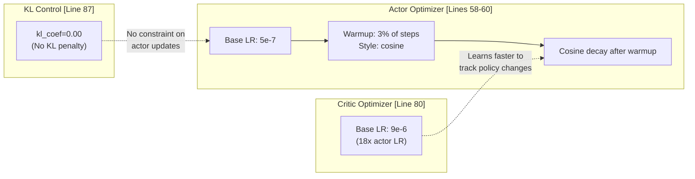
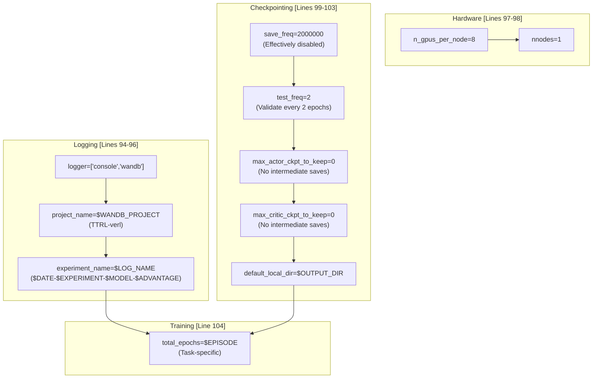

<!-- source: DeepWiki mcp.deepwiki.com · repo PRIME-RL/TTRL · extra page Qwen2.5 Models · fetched 2026-10-30 -->

# Qwen2.5 Models

<details>
<summary>Relevant source files</summary>

The following files were used as context for generating this wiki page:

- [verl/examples/ttrl/Qwen2.5/aime.sh](verl/examples/ttrl/Qwen2.5/aime.sh)
- [verl/examples/ttrl/Qwen2.5/amc.sh](verl/examples/ttrl/Qwen2.5/amc.sh)
- [verl/examples/ttrl/Qwen2.5/math.sh](verl/examples/ttrl/Qwen2.5/math.sh)

</details>


This page documents the configuration details specific to training TTRL with Qwen2.5-7B models. Qwen2.5-7B is a general-purpose 7-billion parameter language model used as the backbone for TTRL mathematical reasoning tasks.

For math-specialized model configurations, see [Qwen2.5-Math Models](#3.2.2). For general model configuration concepts, see [Model Configurations](#3.2). For task-specific data setup, see [Task Configurations](#3.3).

## Model Specifications

The Qwen2.5 configuration targets the **Qwen2.5-7B** model with the following specifications:

| Parameter | Value | Description |
|-----------|-------|-------------|
| Model Size | 7B parameters | General-purpose language model |
| Model Path Variable | `BACKBONE_PATH` | Points to local Qwen2.5-7B checkpoint |
| Default K Value | 3 | Response length multiplier (3k tokens = 3072 tokens) |
| Supported Tasks | AIME, AMC, MATH | Mathematical reasoning benchmarks |

All three example scripts ([verl/examples/ttrl/Qwen2.5/aime.sh](), [verl/examples/ttrl/Qwen2.5/amc.sh](), [verl/examples/ttrl/Qwen2.5/math.sh]()) use identical model configurations with task-specific variations in prompt length, training batch size, and epoch count.

**Sources:** [verl/examples/ttrl/Qwen2.5/aime.sh:12](), [verl/examples/ttrl/Qwen2.5/amc.sh:12](), [verl/examples/ttrl/Qwen2.5/math.sh:12]()

## Configuration Script Structure



**Configuration Script Structure for Qwen2.5**

All Qwen2.5 scripts follow this pattern: shell variables define experiment parameters (lines 8-39), which are then passed as Hydra configuration overrides to `verl.trainer.main_ppo` (lines 42-104).

**Sources:** [verl/examples/ttrl/Qwen2.5/aime.sh:1-106](), [verl/examples/ttrl/Qwen2.5/amc.sh:1-106](), [verl/examples/ttrl/Qwen2.5/math.sh:1-106]()

## Actor-Critic Model Configuration



**Actor-Critic-Reference Configuration Mapping**

The configuration creates three model instances from the same `BACKBONE_PATH`. The actor uses conservative learning (5e-7) with no FSDP offloading for fast updates. The critic learns 18x faster (9e-6) with matching FSDP settings. The reference model enables CPU parameter offloading to reduce GPU memory usage.

**Sources:** [verl/examples/ttrl/Qwen2.5/aime.sh:52-86]()

## Memory Optimization Strategy

The Qwen2.5-7B configuration employs aggressive memory optimization to fit the model on 8 GPUs:

| Component | Configuration | Purpose |
|-----------|--------------|---------|
| **Actor FSDP** | `param_offload=False`, `optimizer_offload=False` | Keep actor fully on GPU for fast training |
| **Critic FSDP** | `param_offload=False`, `optimizer_offload=False` | Keep critic fully on GPU for fast value updates |
| **Reference FSDP** | `param_offload=True` | Offload frozen parameters to CPU to save GPU memory |
| **Gradient Checkpointing** | `enable_gradient_checkpointing=True` | Trade compute for memory during backpropagation |
| **Padding Removal** | `use_remove_padding=True` | Remove padding tokens from sequences |
| **Micro-batching** | `ppo_micro_batch_size_per_gpu=2` | Process 2 sequences per GPU at a time |
| **Mini-batching** | `ppo_mini_batch_size=1` | Single mini-batch for PPO updates |

**Sources:** [verl/examples/ttrl/Qwen2.5/aime.sh:53-86]()

## VLLM Rollout Configuration



**VLLM Configuration for Qwen2.5 Rollout**

The rollout engine uses VLLM v1 with 80% GPU memory allocation for KV caching. Temperature is set to 0.6 for both training and validation, with 32 samples during training and 16 samples during validation (when K≤8).

**Sources:** [verl/examples/ttrl/Qwen2.5/aime.sh:2-4,66-79]()

## Hyperparameter Settings

### Learning Rate Configuration



**Learning Rate and Optimization Schedule**

The actor uses a very conservative learning rate (5e-7) with 3% warmup and cosine decay. The critic learns 18x faster (9e-6) to track rapid policy changes. KL divergence coefficient is set to 0.00, effectively disabling KL penalties against the reference model.

**Sources:** [verl/examples/ttrl/Qwen2.5/aime.sh:58-60,80,87]()

### Response Length Control

The response length configuration uses a multiplier system:

```python
K=3  # Response length multiplier
MAX_RESPONSE_LENGTH=$((1024 * $K))  # 3072 tokens
if [ "$K" -gt 8 ]; then
  N=4  # Validation samples
else
  N=16  # Validation samples
fi
```

**Sources:** [verl/examples/ttrl/Qwen2.5/aime.sh:15-22]()

| K Value | Response Length | Validation Samples (N) | Use Case |
|---------|----------------|------------------------|----------|
| K=3 | 3072 tokens | 16 | Default configuration for all Qwen2.5 tasks |
| K>8 | >8192 tokens | 4 | Reduced samples for very long responses |

## TTRL-Specific Configuration

The TTRL voting mechanism configuration is identical across all Qwen2.5 tasks:

```yaml
ttrl.enable=True
ttrl.n_votes_per_prompt=64
ttrl.n_samples_per_prompt=32
custom_reward_function.path="./verl/utils/reward_score/ttrl_math/__init__.py"
custom_reward_function.name=reward_func
```

**Sources:** [verl/examples/ttrl/Qwen2.5/aime.sh:89-93]()

This configuration:
- Enables TTRL voting mechanism (`ttrl.enable=True`)
- Generates 32 samples per prompt during training
- Uses 64 total votes for majority consensus (2 votes per sample)
- Points to the `reward_func` in `ttrl_math` module for mathematical answer extraction

For details on the reward function implementation, see [Custom Reward Functions](#5.3).

## Task-Specific Variations

While model configurations remain constant, the three Qwen2.5 scripts vary in task-specific parameters:

| Parameter | AIME | AMC | MATH |
|-----------|------|-----|------|
| **Max Prompt Length** | 512 tokens | 1024 tokens | 1024 tokens |
| **Training Epochs** | 80 | 30 | 10 |
| **Train Batch Size** | 8 | 8 | 32 |
| **Test Frequency** | Every 2 epochs | Every 2 epochs | Every 2 epochs |

**Sources:** [verl/examples/ttrl/Qwen2.5/aime.sh:16,24-25](), [verl/examples/ttrl/Qwen2.5/amc.sh:16,24-25](), [verl/examples/ttrl/Qwen2.5/math.sh:16,24-25]()

### AIME Configuration
- Shorter prompts (512 tokens) due to concise problem statements
- More epochs (80) for harder problems
- Smaller batch size (8) for memory efficiency

**Sources:** [verl/examples/ttrl/Qwen2.5/aime.sh:16,24-25]()

### AMC Configuration
- Medium prompts (1024 tokens)
- Medium epochs (30)
- Standard batch size (8)

**Sources:** [verl/examples/ttrl/Qwen2.5/amc.sh:16,24-25]()

### MATH Configuration
- Medium prompts (1024 tokens)
- Fewer epochs (10) for larger dataset
- Larger batch size (32) for throughput

**Sources:** [verl/examples/ttrl/Qwen2.5/math.sh:16,24-25]()

## Data Configuration

All Qwen2.5 scripts use the same data processing configuration:

```yaml
data.train_files=["$DATA_LOCAL_DIR/$TASK/train.parquet"]
data.val_files=["$DATA_LOCAL_DIR/$TASK/test.parquet"]
data.filter_overlong_prompts=True
data.truncation='error'
+data.suffix_prompt='"\nPlease reason step by step, and put your final answer within \boxed{}."'
```

**Sources:** [verl/examples/ttrl/Qwen2.5/aime.sh:44-51]()

The `+data.suffix_prompt` adds a instruction suffix to every prompt, instructing the model to:
1. Provide step-by-step reasoning
2. Place the final answer in LaTeX `\boxed{}` format for extraction

## Trainer Configuration



**Trainer Configuration Mapping**

The trainer is configured for single-node 8-GPU training with WandB logging. Checkpointing is effectively disabled during training (`save_freq=2000000`, `max_*_ckpt_to_keep=0`) but validation runs every 2 epochs (`test_freq=2`).

**Sources:** [verl/examples/ttrl/Qwen2.5/aime.sh:94-104]()

## Running Qwen2.5 Scripts

Before running, update the path variables:

```bash
DATA_LOCAL_DIR="path/to/TTRL/verl/data"  # Line 31
BACKBONE_PATH="path/to/${BACKBONE}"      # Line 32
```

**Sources:** [verl/examples/ttrl/Qwen2.5/aime.sh:31-32]()

To run AIME training:
```bash
bash verl/examples/ttrl/Qwen2.5/aime.sh
```

To run with custom arguments:
```bash
bash verl/examples/ttrl/Qwen2.5/aime.sh trainer.n_gpus_per_node=4
```

The output directory structure:
```
checkpoints/TTRL-verl/${MODEL}/${DATE}/${EXPERIMENT}-${ADVANTAGE}-${TIME_TAG}/
```

**Sources:** [verl/examples/ttrl/Qwen2.5/aime.sh:39,106]()

## Configuration Parameter Reference

### Complete Actor Configuration Block

```yaml
actor_rollout_ref.model.path=$BACKBONE_PATH                               # Line 52
actor_rollout_ref.model.enable_gradient_checkpointing=True               # Line 53
actor_rollout_ref.model.use_remove_padding=True                          # Line 54
actor_rollout_ref.actor.ppo_mini_batch_size=1                            # Line 55
actor_rollout_ref.actor.ppo_micro_batch_size_per_gpu=2                   # Line 56
actor_rollout_ref.actor.use_kl_loss=True                                 # Line 57
actor_rollout_ref.actor.optim.lr=5e-7                                    # Line 58
actor_rollout_ref.actor.optim.lr_warmup_steps_ratio=0.03                 # Line 59
actor_rollout_ref.actor.optim.warmup_style='cosine'                      # Line 60
actor_rollout_ref.actor.fsdp_config.param_offload=False                  # Line 61
actor_rollout_ref.actor.fsdp_config.optimizer_offload=False              # Line 62
actor_rollout_ref.actor.ppo_max_token_len_per_gpu=$((MAX_PROMPT_LENGTH + MAX_RESPONSE_LENGTH))  # Line 63
```

**Sources:** [verl/examples/ttrl/Qwen2.5/aime.sh:52-63]()

### Complete Critic Configuration Block

```yaml
critic.optim.lr=9e-6                                    # Line 80
critic.model.use_remove_padding=True                    # Line 81
critic.model.path=$BACKBONE_PATH                        # Line 82
critic.model.enable_gradient_checkpointing=True         # Line 83
critic.ppo_micro_batch_size_per_gpu=2                   # Line 84
critic.model.fsdp_config.param_offload=False            # Line 85
critic.model.fsdp_config.optimizer_offload=False        # Line 86
```

**Sources:** [verl/examples/ttrl/Qwen2.5/aime.sh:80-86]()

### Complete VLLM Configuration Block

```yaml
actor_rollout_ref.rollout.name=vllm                                                      # Line 66
actor_rollout_ref.rollout.temperature=0.6                                                # Line 67
actor_rollout_ref.rollout.enforce_eager=False                                            # Line 68
actor_rollout_ref.rollout.free_cache_engine=False                                        # Line 69
actor_rollout_ref.rollout.log_prob_micro_batch_size_per_gpu=2                            # Line 70
actor_rollout_ref.rollout.tensor_model_parallel_size=1                                   # Line 71
actor_rollout_ref.rollout.gpu_memory_utilization=0.8                                     # Line 72
actor_rollout_ref.rollout.n=32                                                           # Line 73
actor_rollout_ref.rollout.val_kwargs.do_sample=True                                      # Line 74
actor_rollout_ref.rollout.val_kwargs.n=16                                                # Line 75
actor_rollout_ref.rollout.val_kwargs.top_p=0.95                                          # Line 76
actor_rollout_ref.rollout.val_kwargs.temperature=0.6                                     # Line 77
actor_rollout_ref.rollout.max_model_len=$((MAX_PROMPT_LENGTH + MAX_RESPONSE_LENGTH))    # Line 78
actor_rollout_ref.rollout.max_num_batched_tokens=$((MAX_PROMPT_LENGTH + MAX_RESPONSE_LENGTH))  # Line 79
```

**Sources:** [verl/examples/ttrl/Qwen2.5/aime.sh:66-79]()

---

