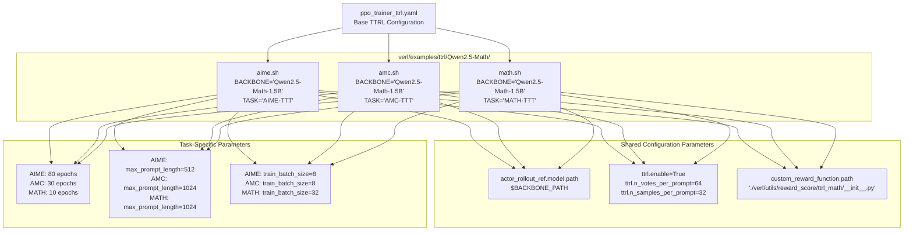
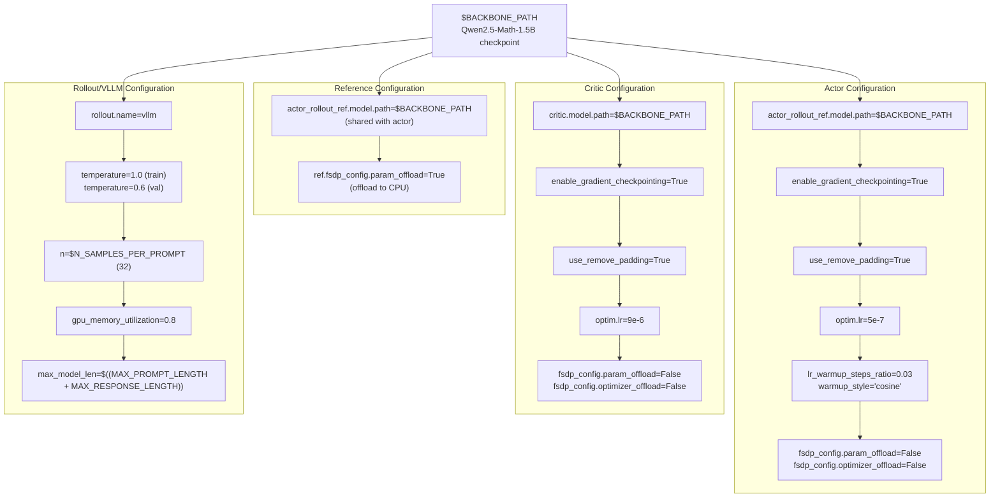
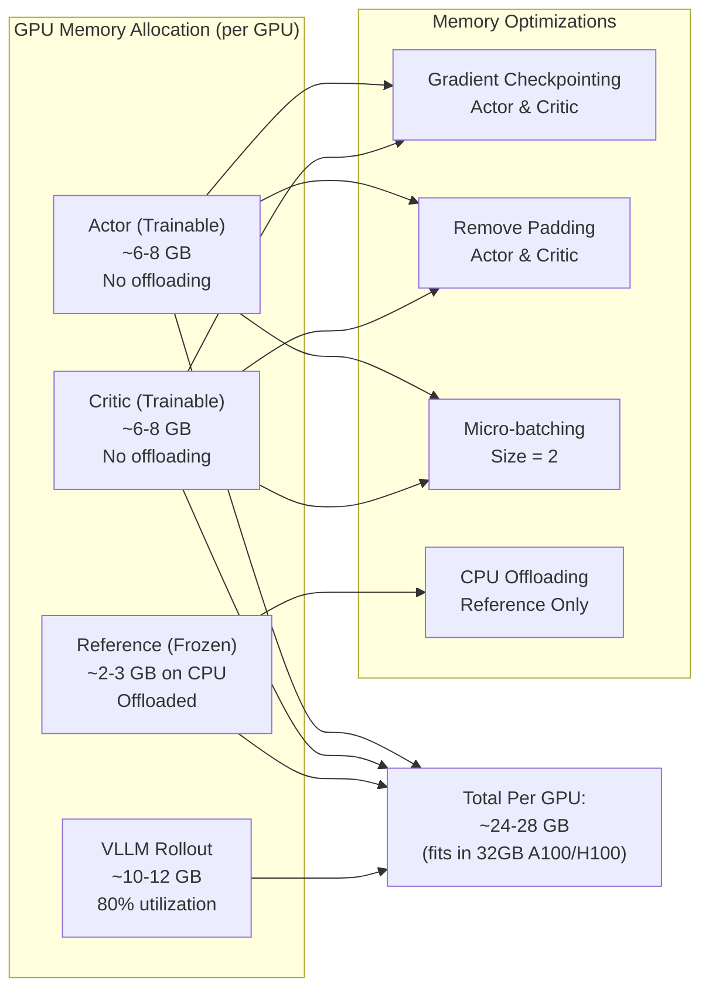
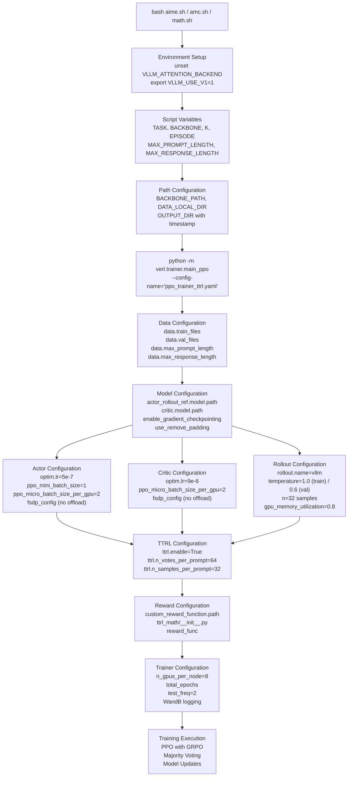

<!-- source: DeepWiki mcp.deepwiki.com · repo PRIME-RL/TTRL · extra page Qwen2.5-Math Models · fetched 2026-10-30 -->

# Qwen2.5-Math Models

<details>
<summary>Relevant source files</summary>

The following files were used as context for generating this wiki page:

- [verl/examples/ttrl/Qwen2.5-Math/aime.sh](verl/examples/ttrl/Qwen2.5-Math/aime.sh)
- [verl/examples/ttrl/Qwen2.5-Math/amc.sh](verl/examples/ttrl/Qwen2.5-Math/amc.sh)
- [verl/examples/ttrl/Qwen2.5-Math/math.sh](verl/examples/ttrl/Qwen2.5-Math/math.sh)

</details>


This page documents configuration details specific to the Qwen2.5-Math-1.5B model, a specialized mathematical reasoning model. Qwen2.5-Math is a 1.5B parameter model pre-trained specifically for mathematical problem-solving tasks, making it well-suited for TTRL training on AIME, AMC, and MATH datasets.

For general-purpose Qwen2.5 models (7B parameters), see [Qwen2.5 Models](#3.2.1). For LLaMA3.1-Instruct configurations, see [LLaMA3.1-Instruct Models](#3.2.3). For dataset-specific configurations, see [Task Configurations](#3.3).

## Model Overview

The Qwen2.5-Math-1.5B model is a compact, domain-specialized variant of the Qwen2.5 family optimized for mathematical reasoning. Its smaller size (1.5B vs 7B parameters) enables:

- **Lower memory footprint**: Reduced GPU memory requirements for training
- **Faster iteration**: Quicker training cycles for experimentation
- **Task specialization**: Pre-trained specifically on mathematical content
- **Efficient scaling**: Suitable for multi-GPU setups without extreme memory optimization

The model is accessed via the identifier `Qwen2.5-Math-1.5B` in all example scripts and must be downloaded from HuggingFace or other model repositories before use.

Sources: [verl/examples/ttrl/Qwen2.5-Math/aime.sh:12](), [verl/examples/ttrl/Qwen2.5-Math/amc.sh:12](), [verl/examples/ttrl/Qwen2.5-Math/math.sh:12]()

## Script Organization

TTRL provides three pre-configured scripts for Qwen2.5-Math-1.5B, each targeting a different mathematical reasoning benchmark:



**Script Organization Diagram**: Shows how the three Qwen2.5-Math example scripts inherit from the base TTRL configuration and customize parameters for their respective tasks.

Sources: [verl/examples/ttrl/Qwen2.5-Math/aime.sh:1-105](), [verl/examples/ttrl/Qwen2.5-Math/amc.sh:1-105](), [verl/examples/ttrl/Qwen2.5-Math/math.sh:1-105]()

## Common Configuration Parameters

All three Qwen2.5-Math scripts share a consistent set of configuration parameters that define the TTRL training setup:

### Environment Setup

```bash
unset VLLM_ATTENTION_BACKEND
export VLLM_USE_V1=1
```

These environment variables configure the VLLM inference engine to use version 1 and unset the attention backend preference, allowing VLLM to automatically select the optimal backend.

Sources: [verl/examples/ttrl/Qwen2.5-Math/aime.sh:3-4]()

### Model and Path Configuration

| Parameter | Value | Description |
|-----------|-------|-------------|
| `BACKBONE` | `Qwen2.5-Math-1.5B` | Model identifier |
| `BACKBONE_PATH` | `path/to/Qwen2.5-Math-1.5B` | Local path to model checkpoint |
| `DATA_LOCAL_DIR` | `path/to/TTRL/verl/data` | Base directory for training/test data |

**Note**: Users must update `BACKBONE_PATH` to point to their local Qwen2.5-Math-1.5B checkpoint directory before running the scripts.

Sources: [verl/examples/ttrl/Qwen2.5-Math/aime.sh:31-32]()

### Response Length Configuration

```bash
K=3
MAX_PROMPT_LENGTH=512  # or 1024 for AMC/MATH
MAX_RESPONSE_LENGTH=$((1024 * $K))  # 3072 tokens
```

The response length is controlled by the `K` parameter, which sets the maximum response to `K * 1024` tokens. For Qwen2.5-Math, `K=3` provides 3072 tokens for step-by-step mathematical reasoning.

Sources: [verl/examples/ttrl/Qwen2.5-Math/aime.sh:15-17]()

### TTRL-Specific Parameters

```bash
N_VOTES_PER_PROMPT=64
N_SAMPLES_PER_PROMPT=32
```

These parameters control the majority voting mechanism:
- `N_VOTES_PER_PROMPT`: Number of samples to aggregate for voting (64)
- `N_SAMPLES_PER_PROMPT`: Number of responses generated per prompt during training (32)

For validation, the number of samples is determined by the conditional logic:

```bash
if [ "$K" -gt 8 ]; then
  N=4
else
  N=16
fi
```

With `K=3`, validation uses `N=16` samples per prompt.

Sources: [verl/examples/ttrl/Qwen2.5-Math/aime.sh:18-27]()

### Batching Configuration

| Parameter | Value | Description |
|-----------|-------|-------------|
| `MINI_BATCH_SIZE` | 1 | PPO mini-batch size |
| `MICRO_BATCH_SIZE` | 2 | Micro-batch size per GPU |

These small batch sizes are necessary for the 1.5B model with 3K+ token sequences to fit in GPU memory.

Sources: [verl/examples/ttrl/Qwen2.5-Math/aime.sh:28-29]()

## Actor-Critic-Reference Configuration

The following diagram illustrates how the Qwen2.5-Math-1.5B checkpoint is loaded into the three model components:



**Model Component Configuration**: Shows how the same Qwen2.5-Math-1.5B checkpoint initializes all four components (actor, critic, reference, rollout) with component-specific optimizations.

Sources: [verl/examples/ttrl/Qwen2.5-Math/aime.sh:51-78]()

### Actor Configuration Details

The actor (trainable policy network) uses conservative training settings:

```bash
actor_rollout_ref.actor.optim.lr=5e-7
actor_rollout_ref.actor.optim.lr_warmup_steps_ratio=0.03
actor_rollout_ref.actor.optim.warmup_style='cosine'
actor_rollout_ref.actor.fsdp_config.param_offload=False
actor_rollout_ref.actor.fsdp_config.optimizer_offload=False
```

Key aspects:
- **Learning rate**: `5e-7` (very conservative to prevent destabilization)
- **Warmup**: 3% of training steps with cosine schedule
- **FSDP**: No parameter or optimizer offloading for fast updates
- **Gradient checkpointing**: Enabled to reduce memory usage

Sources: [verl/examples/ttrl/Qwen2.5-Math/aime.sh:57-61]()

### Critic Configuration Details

The critic (value network) learns faster than the actor:

```bash
critic.optim.lr=9e-6
critic.model.enable_gradient_checkpointing=True
critic.ppo_micro_batch_size_per_gpu=$MICRO_BATCH_SIZE
critic.model.fsdp_config.param_offload=False
critic.model.fsdp_config.optimizer_offload=False
```

Key aspects:
- **Learning rate**: `9e-6` (18x faster than actor at `5e-7`)
- **FSDP**: Same no-offload configuration as actor
- **Micro-batching**: Uses same `MICRO_BATCH_SIZE=2` as actor

The higher learning rate allows the critic to track the rapidly changing policy value estimates.

Sources: [verl/examples/ttrl/Qwen2.5-Math/aime.sh:79-85]()

### Reference Model Configuration

The reference model remains frozen and uses CPU offloading:

```bash
actor_rollout_ref.ref.fsdp_config.param_offload=True
actor_rollout_ref.ref.log_prob_micro_batch_size_per_gpu=$MICRO_BATCH_SIZE
```

The reference model shares the same checkpoint path as the actor but:
- Offloads parameters to CPU to save GPU memory
- Only computes log probabilities (no gradient updates)
- Uses micro-batching for memory efficiency

Sources: [verl/examples/ttrl/Qwen2.5-Math/aime.sh:63-64]()

### VLLM Rollout Configuration

The VLLM engine handles high-throughput inference during rollout:

```bash
actor_rollout_ref.rollout.name=vllm
actor_rollout_ref.rollout.temperature=1.0
actor_rollout_ref.rollout.gpu_memory_utilization=0.8
actor_rollout_ref.rollout.tensor_model_parallel_size=1
actor_rollout_ref.rollout.n=$N_SAMPLES_PER_PROMPT
```

Key settings:
- **Engine**: VLLM v1 (set via environment variable)
- **Temperature**: 1.0 for training diversity, 0.6 for validation consistency
- **GPU utilization**: 80% of available memory
- **Tensor parallelism**: 1 (no model parallelism for 1.5B model)
- **Samples**: 32 per prompt during training

Sources: [verl/examples/ttrl/Qwen2.5-Math/aime.sh:65-77]()

## Task-Specific Configuration Differences

The three example scripts differ primarily in their task-specific parameters:

### Configuration Comparison Table

| Parameter | AIME | AMC | MATH |
|-----------|------|-----|------|
| **Task Name** | `AIME-TTT` | `AMC-TTT` | `MATH-TTT` |
| **Max Prompt Length** | 512 | 1024 | 1024 |
| **Max Response Length** | 3072 (K=3) | 3072 (K=3) | 3072 (K=3) |
| **Total Epochs** | 80 | 30 | 10 |
| **Train Batch Size** | 8 | 8 | 32 |
| **Validation Samples** | 16 | 16 | 16 |
| **Data Path** | `data/AIME-TTT/` | `data/AMC-TTT/` | `data/MATH-TTT/` |

Sources: [verl/examples/ttrl/Qwen2.5-Math/aime.sh:11-48](), [verl/examples/ttrl/Qwen2.5-Math/amc.sh:11-48](), [verl/examples/ttrl/Qwen2.5-Math/math.sh:11-48]()

### AIME Configuration

AIME (American Invitational Mathematics Examination) requires:
- **Shorter prompts**: `MAX_PROMPT_LENGTH=512` (problems are concise)
- **Long training**: `EPISODE=80` (challenging problems need more iterations)
- **Small batches**: `DATA_TRAIN_BATCH_SIZE=8` (limited training data)

```bash
TASK="AIME-TTT"
MAX_PROMPT_LENGTH=512
EPISODE=80
DATA_TRAIN_BATCH_SIZE=8
```

Sources: [verl/examples/ttrl/Qwen2.5-Math/aime.sh:11-25]()

### AMC Configuration

AMC (American Mathematics Competitions) requires:
- **Medium prompts**: `MAX_PROMPT_LENGTH=1024` (more context than AIME)
- **Medium training**: `EPISODE=30` (moderate difficulty)
- **Small batches**: `DATA_TRAIN_BATCH_SIZE=8` (similar to AIME)

```bash
TASK="AMC-TTT"
MAX_PROMPT_LENGTH=1024
EPISODE=30
DATA_TRAIN_BATCH_SIZE=8
```

Sources: [verl/examples/ttrl/Qwen2.5-Math/amc.sh:11-25]()

### MATH Configuration

MATH (general mathematical problems) requires:
- **Medium prompts**: `MAX_PROMPT_LENGTH=1024` (varied problem types)
- **Short training**: `EPISODE=10` (larger, more diverse dataset)
- **Large batches**: `DATA_TRAIN_BATCH_SIZE=32` (4x larger for efficiency)

```bash
TASK="MATH-TTT"
MAX_PROMPT_LENGTH=1024
EPISODE=10
DATA_TRAIN_BATCH_SIZE=32
```

Sources: [verl/examples/ttrl/Qwen2.5-Math/math.sh:11-25]()

## Algorithm and Reward Configuration

All Qwen2.5-Math scripts use identical algorithm and reward settings:

### PPO Algorithm Settings

```bash
algorithm.kl_ctrl.kl_coef=0.00
algorithm.adv_estimator=$ADVANTAGE  # "grpo"
```

- **KL coefficient**: 0.00 (no KL penalty between actor and reference)
- **Advantage estimator**: GRPO (Group Relative Policy Optimization)

Sources: [verl/examples/ttrl/Qwen2.5-Math/aime.sh:86-87]()

### Custom Reward Function

```bash
custom_reward_function.path="./verl/utils/reward_score/ttrl_math/__init__.py"
custom_reward_function.name=reward_func
```

The reward function extracts `\boxed{}` answers from mathematical solutions and compares them to the majority vote consensus. See [Custom Reward Functions](#5.3) for implementation details.

Sources: [verl/examples/ttrl/Qwen2.5-Math/aime.sh:88-89]()

### TTRL Voting Configuration

```bash
ttrl.enable=True
ttrl.n_votes_per_prompt=$N_VOTES_PER_PROMPT  # 64
ttrl.n_samples_per_prompt=$N_SAMPLES_PER_PROMPT  # 32
```

This enables the TTRL majority voting mechanism with 64 votes aggregated from 32 samples per prompt.

Sources: [verl/examples/ttrl/Qwen2.5-Math/aime.sh:90-92]()

## Training Infrastructure

### Distributed Training Setup

```bash
trainer.n_gpus_per_node=8
trainer.nnodes=1
```

All scripts are configured for single-node, 8-GPU training. For multi-node setups, adjust `trainer.nnodes` accordingly.

Sources: [verl/examples/ttrl/Qwen2.5-Math/aime.sh:96-97]()

### Checkpoint and Logging Configuration

```bash
trainer.save_freq=2000000  # Effectively disabled (very large number)
trainer.test_freq=2  # Evaluate every 2 epochs
trainer.max_actor_ckpt_to_keep=0  # No checkpoints kept
trainer.max_critic_ckpt_to_keep=0  # No checkpoints kept
```

The default configuration disables checkpoint saving (useful for rapid experimentation). To enable checkpoints:
- Set `trainer.save_freq` to a reasonable value (e.g., 1000 steps)
- Set `trainer.max_actor_ckpt_to_keep` and `trainer.max_critic_ckpt_to_keep` to positive values

Sources: [verl/examples/ttrl/Qwen2.5-Math/aime.sh:98-101]()

### WandB Integration

```bash
trainer.logger=['console','wandb']
trainer.project_name=$WANDB_PROJECT  # "TTRL-verl"
trainer.experiment_name=$LOG_NAME
```

Training metrics are logged to both console and Weights & Biases with automatic experiment naming based on date, model, and task.

Sources: [verl/examples/ttrl/Qwen2.5-Math/aime.sh:93-95]()

## Memory Requirements



**Memory Allocation Diagram**: Shows approximate GPU memory usage for Qwen2.5-Math-1.5B with enabled optimizations.

The 1.5B model size allows for comfortable training on 8x 32GB GPUs without aggressive memory optimization. Key memory-saving features:

1. **Gradient checkpointing**: Trades computation for memory
2. **Remove padding**: Eliminates padding tokens from computation
3. **Reference offloading**: Moves frozen reference model to CPU
4. **Micro-batching**: Processes 2 sequences per GPU at a time

Sources: [verl/examples/ttrl/Qwen2.5-Math/aime.sh:52-85]()

## Comparison with Qwen2.5-7B

| Aspect | Qwen2.5-Math-1.5B | Qwen2.5-7B |
|--------|-------------------|------------|
| **Parameter Count** | 1.5B | 7B |
| **Specialization** | Mathematical reasoning | General purpose |
| **Memory per GPU** | ~24-28 GB | ~40-50 GB |
| **Recommended GPUs** | 8x 32GB | 8x 80GB |
| **Training Speed** | Faster (~1.5x) | Slower |
| **Actor Learning Rate** | 5e-7 | 5e-7 (same) |
| **Critic Learning Rate** | 9e-6 | 9e-6 (same) |
| **FSDP Offloading** | None (actor/critic) | May need offloading |

The smaller Qwen2.5-Math model enables faster experimentation while maintaining strong performance on mathematical tasks due to its domain-specific pretraining.

Sources: [verl/examples/ttrl/Qwen2.5-Math/aime.sh:1-105]()

## Running Training

To run TTRL training with Qwen2.5-Math-1.5B:

1. **Download the model checkpoint** and update the path:
   ```bash
   BACKBONE_PATH="path/to/Qwen2.5-Math-1.5B"
   ```

2. **Prepare dataset** (see [Task Configurations](#3.3) for details):
   ```bash
   DATA_LOCAL_DIR="path/to/TTRL/verl/data"
   ```

3. **Choose a task** and run the corresponding script:
   ```bash
   # For AIME
   bash verl/examples/ttrl/Qwen2.5-Math/aime.sh
   
   # For AMC
   bash verl/examples/ttrl/Qwen2.5-Math/amc.sh
   
   # For MATH
   bash verl/examples/ttrl/Qwen2.5-Math/math.sh
   ```

4. **Monitor training** via WandB dashboard or console output

5. **Adjust hyperparameters** by passing additional arguments:
   ```bash
   bash verl/examples/ttrl/Qwen2.5-Math/aime.sh \
     trainer.n_gpus_per_node=4 \
     trainer.total_epochs=40
   ```

The output checkpoints will be saved to the directory specified by `$OUTPUT_DIR`, which includes timestamp and configuration details for easy identification.

Sources: [verl/examples/ttrl/Qwen2.5-Math/aime.sh:42-105]()

## Configuration Flow



**Configuration Flow Diagram**: Illustrates the complete configuration pipeline from script execution to training, showing how parameters flow through the system.

Sources: [verl/examples/ttrl/Qwen2.5-Math/aime.sh:1-103]()

---

