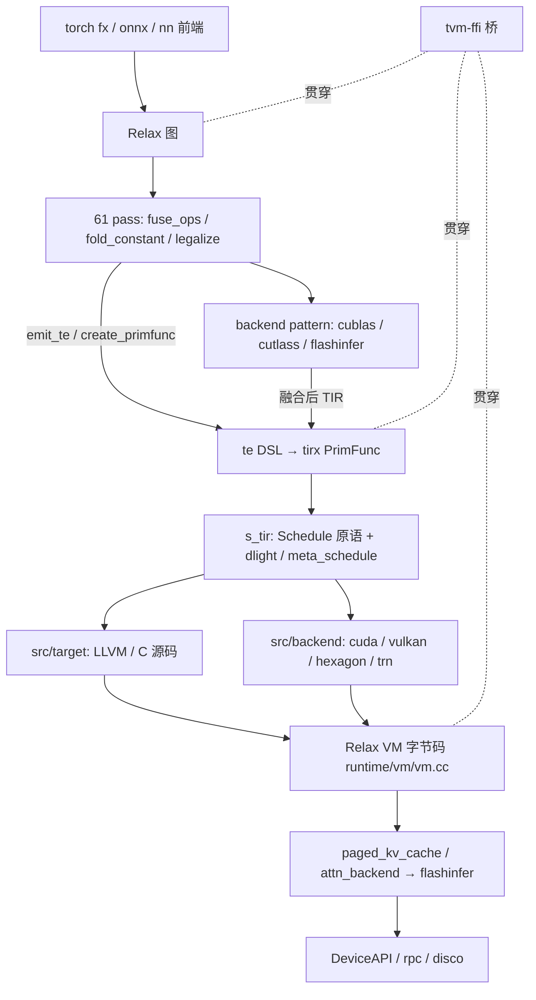

# TVM（fork 深度定制版）新人入职文档

> 基于知识图谱（10713 节点 / 21401 边 / 16 层 / 16 步 tour，commit `15b607d6`，1979 个已分析文件）与源码抽查写成。本仓是 Apache TVM 的深度定制 fork：**多层 IR 拆分改名 + 后端目录重组 + LLM 推理运行时定制**，与上游同名概念存在系统性差异，请先读第 1、3、7 节校准坐标。

---

## 1. 这是什么项目

Apache TVM 是 **Python-first 的开源机器学习编译框架**：把 PyTorch/ONNX 等前端模型经多层 IR 逐级降级，为 CUDA/LLVM/Vulkan/Hexagon 等硬件生成代码，打包成最小可部署模块在 TVM Runtime 执行。编译器本体是 C++（`src/` + `include/tvm/`），用户接口与 pass 编排在 Python（`python/tvm/`）。

本 fork 在上游骨架上做了三类大手术：

1. **TIR 拆成两半**：上游 `tir` 拆为 `tirx`（IR 本体：stmt/buffer/PrimFunc）与 `s_tir`（调度层：schedule/dlight/meta_schedule），Python 侧为 `tvm.tirx` 与 `tvm.s_tir` 两包。上游 `tir/expr.h` 的 PrimExpr 体系迁至 `include/tvm/ir/prim/expr.h`（`tvm::prim` 命名空间，含新增 vector_expr.h）。
2. **后端目录改名**：上游 `src/target/` 下的硬件 codegen 整体搬到 `src/backend/`（cuda/hexagon/metal/opencl/rocm/trn/vulkan/webgpu，136 文件）；`src/target/` 只剩 40 文件——Target 对象模型、LLVM 后端（llvm/）、C 源码后端（source/）。
3. **FFI 换血 + LLM 定制**：Python↔C++ 绑定改用外部包 **tvm-ffi**（`3rdparty/tvm-ffi`），库拆成 `tvm_runtime` + `tvm_compiler` 双 so。LLM 定制集中在运行时与前端：`src/runtime/vm/` 的 paged_kv_cache/kv_state/attn_backend（FlashInfer prefill/decode 函数族）、`python/tvm/relax/backend/cuda/flashinfer.py|cutlass.py` 库桥、`relax/frontend/nn/llm/` 的 kv_cache/tree_attn/paged kernels；后端矩阵还有独一无二的 `trn` = **AWS Trainium**（`src/backend/trn/codegen/target_kind.cc` 自述 "Trainium compiler backend"）。版本 `0.26.dev0`。

一句话定位：**以 Relax 为图前端、tirx/s_tir 为调度核心、后端覆盖 GPU/DSP/Trainium、内置分页 KV cache 等推理原语的 ML 编译器栈**。

---

## 2. 十分钟架构

降级主路径：模型 → Relax 图（61 pass）→（`src/te/operation/create_primfunc.cc`）→ tirx PrimFunc → s_tir 调度 → 后端 codegen → VM 字节码或 C 源码 → runtime 执行。两条旁路：Relax backend pattern 可把子图直接交给硬件库不进 tirx；topi 算子库是 legalize 的落点。`te` DSL 如今主要作 Relax→tirx 桥。tvm-ffi 桥是贯穿全部层的隐形脊梁。

---

## 3. 目录地图（16 层 → 9 组）

| 组 | 位置 | 内容（图谱层） |
|---|---|---|
| ① 工程外壳 | 仓根 + `.github/` | CMakeLists/pyproject、CI 工作流 main/lint/publish_wheel/tvmbot（L01，34 文件） |
| ② C++ 头·基座 | `include/tvm/ir` `arith` `tirx` `runtime` | IRModule/attrs 底座、整数分析、tirx 19 头（L02，76 文件） |
| ③ C++ 头·领域 | `include/tvm/relax` `s_tir` `topi` `target` | relax 40 头、s_tir 28 头、Target 模型（L03，109 文件） |
| ④ Python 门面/FFI | `python/tvm/__init__.py` `runtime/` `support/` | 库定位加载、FFI 桥、编译器工具链（L04，51 文件） |
| ⑤ Python 核心 IR | `python/tvm/ir` `tirx` `te` `script` | tirx 54 文件 Python 面、te、TVMScript（L05，120 文件） |
| ⑥ Python 图栈 | `python/tvm/relax`(212) `topi`(138) | op/transform/backend/frontend + 算子库（L06+L07） |
| ⑦ Python 调度 | `python/tvm/s_tir`(70) `meta_schedule`(107) | dlight 三套 rule、Schedule、搜索调优（L08+L09） |
| ⑧ Python 后端工具 | `python/tvm/backend` `contrib` `rpc` | cuda 79 文件调优工具、trn 38 文件（L10，191 文件） |
| ⑨ C++ 实现 | `src/` | 基础(L11,162)/relax(L12,217)/s_tir(L13,176)/codegen(L14,176)/runtime(L15,159)/横切(L16,39) |

**fork 换算口诀**：① `tirx` = 上游 tir 的 IR 本体，`s_tir` = 其调度半区——上游文档的 `tvm.tir.transform.X` 本仓是 `tvm.s_tir.transform.X`，tests/python 同样是 `tirx/`、`tirx-base/`、`s_tir/` 目录；② 找硬件 codegen 去 `src/backend/`，`src/target/` 只有 Target 模型+LLVM+C 源码（Python 侧同构：`python/tvm/backend/` 是工具、`python/tvm/target/` 是定义）；③ PrimExpr 根在 `include/tvm/ir/prim/expr.h`（不在 tir 下）；④ `include/tvm/s_tir/stmt.h` 是约 40 个调度注解键（async_commit/double_buffer/meta_schedule.*），别与 tirx/stmt.h 的语句 AST 混淆。

---

## 4. 核心子系统深读（5 个）

### 4.1 tirx：张量 IR 本体
`include/tvm/tirx/` 19 头：stmt.h/buffer.h/function.h（PrimFunc+TensorIntrin）/op.h（`TVM_TIR_REGISTER_OP`）/analysis.h（VerifySSA/VerifyMemory 校验族）；实现 `src/tirx/ir/`（含 layout/ 子目录：axis_registry/compose_layout 等 TileLayout 体系）与 `src/tirx/ops/`。遍历骨架 stmt_functor.h（StmtFunctor/Visitor/Mutator，fanIn 137 全仓前列）。新概念 `tile_primitive` 与 `exec_context` 面向 GPU 调度（trn 的 lower_trainium_layout.cc 消费 TileLayout）。Python 面 54 文件，barrel 出口调 `tvm.script.register_dialect("tirx")` 自注册方言。

### 4.2 s_tir：调度层（schedule / dlight / meta_schedule）
`python/tvm/s_tir/schedule/schedule.py` 包装 C++ concrete_schedule.cc 状态机；instruction/trace 记录随机变换可回放，`schedule/analysis/verify.cc` 守门——原语要么证明等价要么报错。dlight（34 文件）：模板规则零搜索生成调度，gpu/cpu/adreno 三套 rule。meta_schedule（Python 107 + `src/s_tir/meta_schedule/` 70 文件）：extracted_task → search_strategy → cost_model(xgb) → database，tune_tir.py 一条龙。tensor_intrin/ 登记 Tensor Core/mma 内建。

### 4.3 relax：新一代图 IR + LLM 线
IR 本体 `include/tvm/relax/expr.h`（577 行：Var/DataflowVar/Function/ExternFunc 与 Binding/DataflowBlock）；实现 `src/relax/ir/`。pass 链 `src/relax/transform/` 61 个：to_non_dataflow/canonicalize_bindings 规整图、fuse_ops 定融合边界、fold_constant/static_plan_block_memory 化简与内存规划、fuse_tir 收口；声明总集 `include/tvm/relax/transform.h`（683 行）。**LLM 线三件套**：① `relax/frontend/nn/llm/`（kv_cache.py/tree_attn.py/_paged_kernels.py/_prefill_kernels.py/_decode_kernels.py，nn 子树是 Relax 层抽象且 exporter 支持反向导出）；② `relax/backend/cuda/`（flashinfer.py/cutlass.py/cublas.py/cudnn.py + pattern_registry.py 子图匹配）；③ `src/runtime/vm/`（paged_kv_cache.cc/kv_state.cc/attn_backend.cc/rnn_state.cc/lm_support.cc——attn_backend.cc 的 flashinfer 分支构造 FlashInferPagedPrefill/FlashInferRaggedPrefill/FlashInferPagedDecode 函数族，**分页注意力是运行时一等公民**；`3rdparty/` 随之收纳 cutlass/cutlass_fpA_intB_gemm/libflash_attn/tensorrt_llm）。VM：codegen_vm.cc 编字节码、vm.cc 解释执行。

### 4.4 target/backend：后端矩阵
`src/target/`（40 文件）：Target 对象模型（target.cc/target_kind.cc）+ LLVM 后端（llvm/，codegen_cpu）+ C 源码后端（source/codegen_c，供 MCU）+ canonicalizer。`src/backend/`（136 文件）：cuda 17（intrin_rule→NVVM/PTX、tensor core builtin）、vulkan 33（SPIR-V 最大单后端）、hexagon 44（高通 DSP 全套）、opencl 13、metal 10、rocm 8、webgpu 6、**trn 5（AWS Trainium：codegen_trn.cc + transform/lower_trainium_layout.cc + op/target_builtin.cc）**。Python 工具面：`python/tvm/backend/cuda/`（79 文件调优工具与 pipeline）、`backend/trn/`（38 文件）、`relax/backend/contrib/`（tensorrt/nnapi/example_npu）。

### 4.5 runtime + contrib：硬件 glue 与部署
最小运行时 `src/runtime/` 直下 21 文件（module/device_api/tensor/threading/workspace_pool）；device_api.h 定义 AllocDataSpace/CopyDataFromTo/Stream 虚函数契约。子系统：rpc/（19 文件远程会话，配 `python/tvm/exec/` 脚本）、disco 多卡会话（CMake 有 tvm_disco/nccl/nvshmem/rccl 对象组）、contrib glue（cublas/cudnn/mkl/dnnl）。FFI 化：`include/tvm/runtime/tensor.h` 把 runtime::Tensor 定义为 `tvm::ffi::Tensor` 薄包装。

---

## 5. 新人第一周路线（16 步 tour → 5 天）

**Day 1 包门面与 FFI（tour 1-3）**：`python/tvm/__init__.py` 按依赖序装载子系统、尾部 `_autoload_backends()` 拉起后端；libinfo.py 定位双 so；runtime/_ffi_api.py 函数注册与 object_generic/_tensor/module 的对象反射。

**Day 2 通用 IR 基座 + 算术引擎（tour 4-5）**：`include/tvm/ir/expr.h` 公共基座与 IRModule、`src/ir/` 的 transform.cc——PassManager 从此可用。算术层 `include/tvm/arith/analyzer.h`（fanIn 105：ConstIntBound/ModularSet/RewriteSimplifier/CanonicalSimplifier/IntSet/Z3 等七子分析器），是循环变换安全性的隐形地基。

**Day 3 两代 IR（tour 6-9）**：上午 tirx（stmt/buffer/function.h + `src/tirx/ir/`，TVMScript roundtrip 感受）+ te DSL 与 create_primfunc.cc 桥；下午 relax（expr.h 的 DataflowBlock、block_builder、dataflow_pattern）与 transform 默认 pass 顺序。

**Day 4 调度与调优（tour 14-15）**：Schedule 对象与 trace 回放、verify.cc 语义验证；dlight 三套 rule 与 meta_schedule 的 tune_tir.py。思考题：新算子何时走 dlight 模板、何时必须上搜索？

**Day 5 执行与收官（tour 10-13、16）**：codegen_vm.cc → bytecode.cc → vm.cc 执行链；重点走读 LLM 三件套（paged_kv_cache.cc / attn_backend.cc 的 flashinfer 分支 / nn/llm paged kernels）；扫后端矩阵（cuda intrin→PTX、vulkan SPIR-V、trn 布局降级）与 topi（`topi/testing/` 52 个 numpy 参考实现是全仓测试基线）。

---

## 6. 构建与测试

**CMake 三库组装**（CMakeLists.txt）：`tvm_ffi` 外部包（add_subdirectory(3rdparty/tvm-ffi)）；`tvm_runtime`（libtvm_runtime.so，可独立部署）；`tvm_compiler`（链 tvm_runtime，**RTLD_LOCAL 加载**防编译器符号泄漏）。两个链接细节：Linux+静态 LLVM 时 `-Wl,--no-relax` 绕 binutils ld/25754（GOT 调用被错误松弛致 SIGSEGV）、`--as-needed` 防 libxml2 进 wheel；产物统一放 `build/lib/` 镜像 tvm-ffi 布局，`tvm_ffi.libinfo.load_lib_ctypes(package="tvm")` 依赖此布局。Python 包走 pyproject.toml + `python/tvm/support/libinfo.py`（setup 与运行时共用的配置侦探）。

**测试**：`tests/python/` 按域分目录（tirx/ tirx-base/ s_tir/ relax/ arith/ codegen/ runtime/，命名跟随 fork）；`tests/cpp` 走 GoogleTest。**CI**：`.github/workflows/` 四条线（main/lint/publish_wheel/tvmbot）；`ci/jenkins/`（data.py/generate.py）保留上游 Jenkins 生成器。日常回归：`pytest tests/python/<域>`。

---

## 7. 设计哲学与坑

**哲学四条**：① 一切皆注册——算子经 Op::Get，tirx builtin 约 80 个工厂（`include/tvm/tirx/builtin.h`），pass 是 transform::Pass，target 是 TargetKind；读懂一个域先找注册点。② 可证明的调度——s_tir 原语证明等价或报错，trace 可回放保证调优可复现。③ Python 编排、C++ 本体——pass 顺序在 Python，重活经 tvm-ffi 全反射无手写胶水。④ 最小可部署——runtime 与 compiler 拆库，嵌入式只带 libtvm_runtime.so。

**坑清单**：
- **目录名换算**：带着上游记忆找 `src/target/cuda` 会扑空（在 `src/backend/cuda`）；`tvm.tir` 不存在，是 `tvm.tirx` + `tvm.s_tir`；grep 时 `tirx\|s_tir` 双写。
- **registry 宏体系**：新 IR 节点跨语言要同时动 include 头、src 注册、Python 包装三处，漏一处即"Python 侧看不见"。
- **TVM_FFI 新 FFI**：不再用上游 PackedFunc 原生桥，写新绑定照抄 `python/tvm/s_tir/meta_schedule/_ffi_api.py` 的 `init_ffi_api("s_tir.meta_schedule")` 模式。
- **条件编译包裹的大文件**：paged_kv_cache.cc 等被 CUDA 宏大片包裹（flashinfer 路径），不带 CUDA 构建时大半代码不参与编译——别假设"编译过=读过全部路径"。
- **图谱侧史实**：understand 图谱构建时 scanner 曾误裁 target 目录、后补录 58 文件（tmp/ 下 266 个 rescan/handscan 中间产物即重扫痕迹）；查 src/target 与 src/backend 交界文件的 imports 遇可疑悬空边时，以 `knowledge-graph.json` 最新版为准。
- 仓内 AGENTS.md 与上游文档冲突时一律以源码为准。

---

## 8. 深入索引

**图谱指针**（`.understand-anything/knowledge-graph.json`）：层入口 L02（tirx 头）/L03（relax、s_tir 头）/L12（src/relax）/L13（src/s_tir）/L14（codegen）/L15（runtime）。高 fanIn hub：`python/tvm/__init__.py`（278）、`python/tvm/tirx/__init__.py`（183）、`include/tvm/ir/prim/expr.h`（169）、`include/tvm/tirx/stmt_functor.h`（137）、`include/tvm/runtime/logging.h`（132）、`include/tvm/tirx/op.h`（131）、`include/tvm/arith/analyzer.h`（105）。

**grep 起手词**：方言注册 `register_dialect("tirx")`；LLM 分页注意力 `FlashInferPaged`（src/runtime/vm/attn_backend.cc）；Trainium 后端 `Trainium`（src/backend/trn/）；调度原语 `TVM_TIR_REGISTER_OP`、`ScheduleNode`；relax pass `FuseOps`；te→tirx 桥 `create_primfunc`；FFI 模式 `init_ffi_api`。

配套：`python/tvm/driver/`（tvm.build 顶层驱动）、`tests/python/conftest.py`（测试基建）、`docs/`（上游文档，注意换算目录名）。
