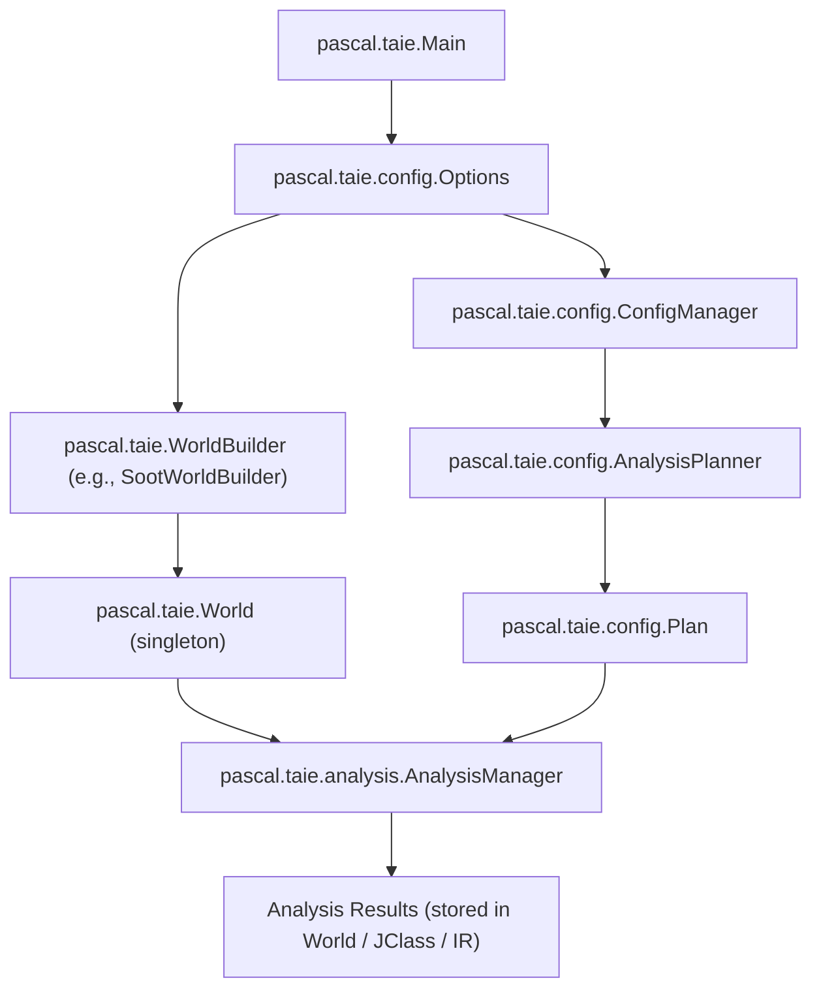
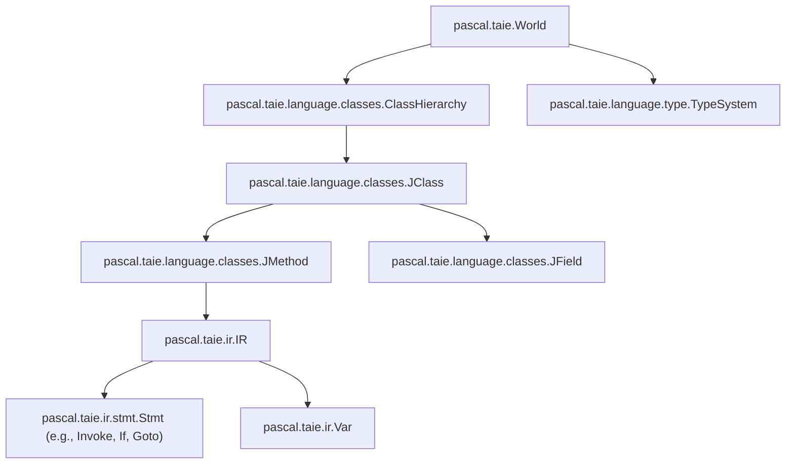
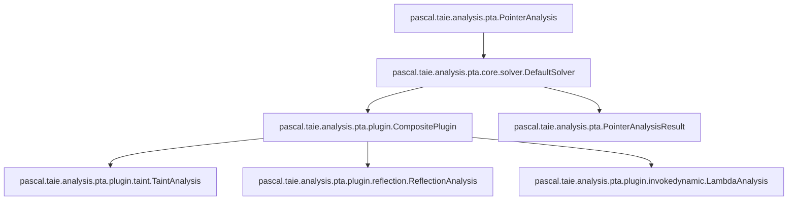

<!-- source: DeepWiki mcp.deepwiki.com · repo pascal-lab/Tai-e · page 1 Overview · fetched 2026-10-12 -->

# Overview

Relevant source files

The following files were used as context for generating this wiki page:

- [.github/workflows/release.yml](.github/workflows/release.yml)
- [.github/workflows/test.yml](.github/workflows/test.yml)
- [README.md](README.md)
- [build.gradle.kts](build.gradle.kts)
- [config/javadoc/footer.html](config/javadoc/footer.html)
- [docs/en/analysis-management.adoc](docs/en/analysis-management.adoc)
- [docs/en/android-analysis.adoc](docs/en/android-analysis.adoc)
- [docs/en/attributes.adoc](docs/en/attributes.adoc)
- [docs/en/command-line-options.adoc](docs/en/command-line-options.adoc)
- [docs/en/develop-new-analysis.adoc](docs/en/develop-new-analysis.adoc)
- [docs/en/index-single.adoc](docs/en/index-single.adoc)
- [docs/en/index.adoc](docs/en/index.adoc)
- [docs/en/pointer-analysis-framework.adoc](docs/en/pointer-analysis-framework.adoc)
- [docs/en/program-abstraction.adoc](docs/en/program-abstraction.adoc)
- [docs/en/publications.adoc](docs/en/publications.adoc)
- [docs/en/setup-in-intellij-idea.adoc](docs/en/setup-in-intellij-idea.adoc)
- [gradle.properties](gradle.properties)
- [src/main/java/pascal/taie/Main.java](src/main/java/pascal/taie/Main.java)
- [src/main/java/pascal/taie/analysis/AnalysisManager.java](src/main/java/pascal/taie/analysis/AnalysisManager.java)
- [src/main/java/pascal/taie/analysis/graph/callgraph/CallGraphBuilder.java](src/main/java/pascal/taie/analysis/graph/callgraph/CallGraphBuilder.java)
- [src/main/java/pascal/taie/analysis/graph/callgraph/CallGraphs.java](src/main/java/pascal/taie/analysis/graph/callgraph/CallGraphs.java)
- [src/main/java/pascal/taie/analysis/graph/callgraph/PTABasedBuilder.java](src/main/java/pascal/taie/analysis/graph/callgraph/PTABasedBuilder.java)
- [src/main/java/pascal/taie/analysis/graph/cfg/CFGBuilder.java](src/main/java/pascal/taie/analysis/graph/cfg/CFGBuilder.java)
- [src/main/java/pascal/taie/analysis/graph/cfg/CFGDumper.java](src/main/java/pascal/taie/analysis/graph/cfg/CFGDumper.java)
- [src/main/java/pascal/taie/analysis/graph/flowgraph/FlowGraphDumper.java](src/main/java/pascal/taie/analysis/graph/flowgraph/FlowGraphDumper.java)
- [src/main/java/pascal/taie/analysis/graph/icfg/ICFGBuilder.java](src/main/java/pascal/taie/analysis/graph/icfg/ICFGBuilder.java)
- [src/main/java/pascal/taie/analysis/misc/IRDumper.java](src/main/java/pascal/taie/analysis/misc/IRDumper.java)
- [src/main/java/pascal/taie/analysis/misc/ResultProcessor.java](src/main/java/pascal/taie/analysis/misc/ResultProcessor.java)
- [src/main/java/pascal/taie/analysis/pta/PointerAnalysis.java](src/main/java/pascal/taie/analysis/pta/PointerAnalysis.java)
- [src/main/java/pascal/taie/analysis/pta/client/Collector.java](src/main/java/pascal/taie/analysis/pta/client/Collector.java)
- [src/main/java/pascal/taie/analysis/pta/plugin/AnalysisTimer.java](src/main/java/pascal/taie/analysis/pta/plugin/AnalysisTimer.java)
- [src/main/java/pascal/taie/analysis/pta/plugin/Profiler.java](src/main/java/pascal/taie/analysis/pta/plugin/Profiler.java)
- [src/main/java/pascal/taie/config/AnalysisConfig.java](src/main/java/pascal/taie/config/AnalysisConfig.java)
- [src/main/java/pascal/taie/config/AnalysisOptions.java](src/main/java/pascal/taie/config/AnalysisOptions.java)
- [src/main/java/pascal/taie/config/AnalysisPlanner.java](src/main/java/pascal/taie/config/AnalysisPlanner.java)
- [src/main/java/pascal/taie/config/ConfigManager.java](src/main/java/pascal/taie/config/ConfigManager.java)
- [src/main/java/pascal/taie/config/Configs.java](src/main/java/pascal/taie/config/Configs.java)
- [src/main/java/pascal/taie/config/Plan.java](src/main/java/pascal/taie/config/Plan.java)
- [src/main/java/pascal/taie/config/PlanConfig.java](src/main/java/pascal/taie/config/PlanConfig.java)
- [src/main/java/pascal/taie/util/Timer.java](src/main/java/pascal/taie/util/Timer.java)
- [src/main/java/pascal/taie/util/graph/DotDumper.java](src/main/java/pascal/taie/util/graph/DotDumper.java)
- [src/main/resources/android/tai-e-android-analyses.yml](src/main/resources/android/tai-e-android-analyses.yml)
- [src/main/resources/tai-e-analyses.yml](src/main/resources/tai-e-analyses.yml)
- [src/test/java/pascal/taie/analysis/Tests.java](src/test/java/pascal/taie/analysis/Tests.java)
- [src/test/java/pascal/taie/config/AnalysisOptionsTest.java](src/test/java/pascal/taie/config/AnalysisOptionsTest.java)

Tai-e (Chinese: 太阿; pronunciation: [ˈtaɪə:]) is a modern static analysis framework for Java, described in the ISSTA 2023 paper *"Tai-e: A Developer-Friendly Static Analysis Framework for Java by Harnessing the Good Designs of Classics"* [README.md:72-74](). It features designs inspired by classic frameworks such as Soot, WALA, Doop, and SpotBugs while introducing novel optimizations for speed and precision [README.md:42-43]().

The framework targets both analysis consumers (running existing analyses) and analysis developers (building new analyses). Key capabilities include pointer analysis, taint analysis, dataflow analysis, call graph construction, reflection handling, and bug detection [README.md:45-66]().

For setup and running instructions, see page [Getting Started](#1.1). For core architectural components, see page [Core Architecture](#2). For the pointer analysis subsystem, see page [Pointer Analysis](#3).

## Major Subsystems

| Subsystem | Wiki Page | Key Packages / Entry Points |
|---|---|---|
| Program model (World, classes, types, IR) | [World and Class Hierarchy](#2.1), [Intermediate Representation](#2.2) | `pascal.taie.World`, `pascal.taie.language.*`, `pascal.taie.ir.*` |
| Analysis management (planning, execution) | [Analysis Management](#2.3) | `pascal.taie.config.*`, `pascal.taie.analysis.AnalysisManager` |
| Frontend (Soot integration, IR building) | [Frontend](#5) | `pascal.taie.frontend.soot.*` |
| Pointer analysis | [Pointer Analysis](#3) | `pascal.taie.analysis.pta.PointerAnalysis` |
| Taint analysis | [Taint Analysis](#4) | `pascal.taie.analysis.pta.plugin.taint.*` |
| Dataflow analysis | [Dataflow Analysis](#6) | `pascal.taie.analysis.dataflow.*` |
| Advanced features (Zipper, Mahjong, reflection) | [Advanced Features](#7) | `pascal.taie.analysis.pta.plugin.*` |

Sources: [README.md:45-66](), [src/main/resources/tai-e-analyses.yml:1-171]()

## Framework Architecture

Tai-e follows a layered architecture with clear separation between frontend processing, core analysis infrastructure, and extensible analysis implementations.

### High-Level Execution Flow

**Diagram: End-to-end execution pipeline from CLI to analysis results**

The execution starts in `pascal.taie.Main` [src/main/java/pascal/taie/Main.java:50-62](), which parses command-line arguments into an `Options` object [src/main/java/pascal/taie/Main.java:70-77](). It then builds the `World` (the central program model) and executes a `Plan` (a topologically sorted sequence of analyses) via the `AnalysisManager` [src/main/java/pascal/taie/Main.java:128-156]().

Sources: [src/main/java/pascal/taie/Main.java:50-62](), [src/main/java/pascal/taie/analysis/AnalysisManager.java:88-110]()

## Core Framework Components

### Program Representation Layer

**Diagram: World singleton and the program model it exposes**

`World` is the singleton program model [src/main/java/pascal/taie/analysis/AnalysisManager.java:150-151](). It provides access to the `ClassHierarchy` and `TypeSystem`. Method bodies are represented as `IR` (Intermediate Representation) [src/main/java/pascal/taie/analysis/AnalysisManager.java:190-205](), which contains a list of 3-address code statements (`Stmt`) and variables (`Var`).

Sources: [src/main/java/pascal/taie/Main.java:138-147](), [src/main/java/pascal/taie/analysis/AnalysisManager.java:147-188]()

### Analysis Management System

All available analyses are declared in `src/main/resources/tai-e-analyses.yml` [src/main/resources/tai-e-analyses.yml:1-171](). `AnalysisPlanner` resolves dependencies (e.g., `cg` requires `pta`) and produces a `Plan` [src/main/java/pascal/taie/Main.java:83-96](). `AnalysisManager` executes the plan, supporting three levels of analysis:
- `ProgramAnalysis`: Whole-program scope [src/main/java/pascal/taie/analysis/AnalysisManager.java:147-152]().
- `ClassAnalysis`: Analyzes each class in scope [src/main/java/pascal/taie/analysis/AnalysisManager.java:154-162]().
- `MethodAnalysis`: Analyzes each method in scope [src/main/java/pascal/taie/analysis/AnalysisManager.java:190-205]().

Sources: [src/main/resources/tai-e-analyses.yml:1-171](), [src/main/java/pascal/taie/analysis/AnalysisManager.java:112-145]()

## Core Analysis Framework

### Pointer Analysis Infrastructure

Pointer analysis is the foundation of Tai-e's whole-program analysis [src/main/resources/tai-e-analyses.yml:1-36](). It uses a plugin-based architecture [src/main/java/pascal/taie/analysis/pta/PointerAnalysis.java:125-165]().

**Diagram: Pointer analysis solver and its plugin system**

`DefaultSolver` implements the fixpoint algorithm [src/main/java/pascal/taie/analysis/pta/PointerAnalysis.java:115-122](). Plugins like `TaintAnalysis` and `ReflectionAnalysis` register with the solver to extend its logic during propagation [src/main/java/pascal/taie/analysis/pta/PointerAnalysis.java:125-165]().

Sources: [src/main/java/pascal/taie/analysis/pta/PointerAnalysis.java:75-123](), [src/main/resources/tai-e-analyses.yml:1-36]()

## Build and Testing

Tai-e uses Gradle for builds [build.gradle.kts:1-6](). It includes a robust testing utility `Tests` for regression testing [src/test/java/pascal/taie/analysis/Tests.java:51-147]().
- **Fat JAR**: Can be built via `./gradlew fatJar` [build.gradle.kts:116-134]().
- **CI**: Automated testing via GitHub Actions [test.yml:1-43]().
- **Coverage**: Code coverage reporting via Jacoco and Codecov [test.yml:35-43]().

Sources: [build.gradle.kts:116-134](), [src/test/java/pascal/taie/analysis/Tests.java:110-147](), [.github/workflows/test.yml:1-43]()

---

