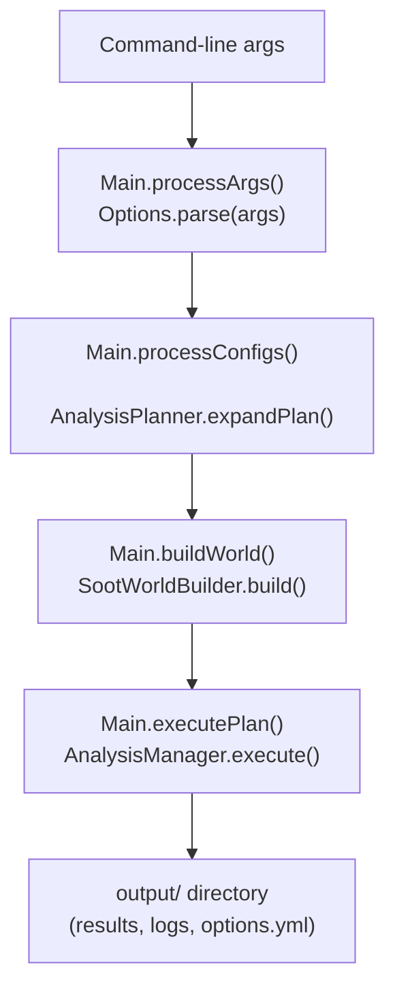
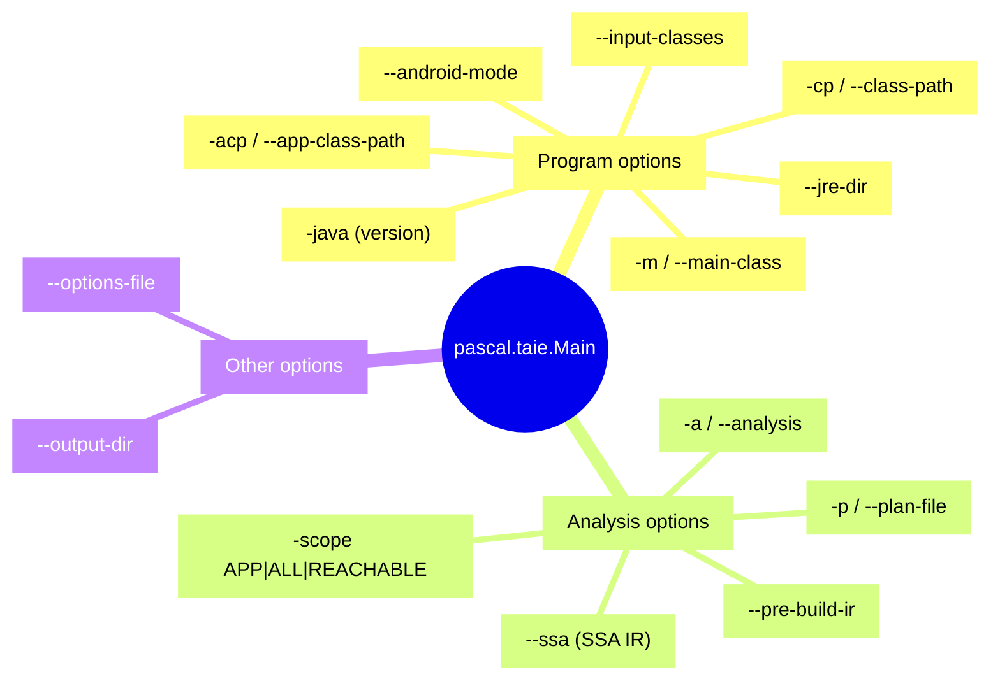
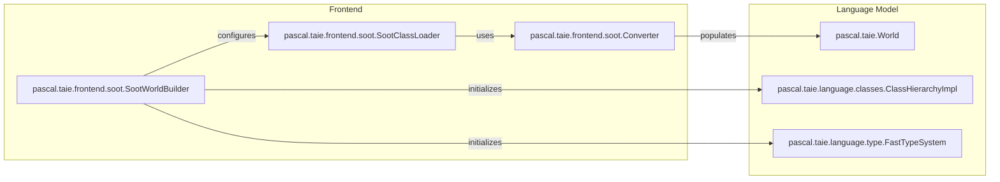

<!-- source: DeepWiki mcp.deepwiki.com · repo pascal-lab/Tai-e · page 1.1 Getting Started · fetched 2026-10-12 -->

# Getting Started

<details>
<summary>Relevant source files</summary>

The following files were used as context for generating this wiki page:

- [.github/workflows/checkstyle.yml](.github/workflows/checkstyle.yml)
- [.github/workflows/release.yml](.github/workflows/release.yml)
- [.github/workflows/test.yml](.github/workflows/test.yml)
- [.gitmodules](.gitmodules)
- [CHANGELOG.md](CHANGELOG.md)
- [README.md](README.md)
- [build.gradle.kts](build.gradle.kts)
- [config/javadoc/footer.html](config/javadoc/footer.html)
- [docs/en/command-line-options.adoc](docs/en/command-line-options.adoc)
- [gradle.properties](gradle.properties)
- [gradle/wrapper/gradle-wrapper.jar](gradle/wrapper/gradle-wrapper.jar)
- [gradle/wrapper/gradle-wrapper.properties](gradle/wrapper/gradle-wrapper.properties)
- [gradlew](gradlew)
- [gradlew.bat](gradlew.bat)
- [lib/sootclasses-modified.jar](lib/sootclasses-modified.jar)
- [src/main/java/pascal/taie/AbstractWorldBuilder.java](src/main/java/pascal/taie/AbstractWorldBuilder.java)
- [src/main/java/pascal/taie/WorldBuilder.java](src/main/java/pascal/taie/WorldBuilder.java)
- [src/main/java/pascal/taie/backend/bytecode/JarTransformer.java](src/main/java/pascal/taie/backend/bytecode/JarTransformer.java)
- [src/main/java/pascal/taie/config/Options.java](src/main/java/pascal/taie/config/Options.java)
- [src/main/java/pascal/taie/frontend/cache/CachedWorldBuilder.java](src/main/java/pascal/taie/frontend/cache/CachedWorldBuilder.java)
- [src/main/java/pascal/taie/frontend/java/project/OptionsProjectBuilder.java](src/main/java/pascal/taie/frontend/java/project/OptionsProjectBuilder.java)
- [src/main/java/pascal/taie/frontend/soot/SootWorldBuilder.java](src/main/java/pascal/taie/frontend/soot/SootWorldBuilder.java)
- [src/test/java/pascal/taie/analysis/pta/BenchmarkInfo.java](src/test/java/pascal/taie/analysis/pta/BenchmarkInfo.java)
- [src/test/java/pascal/taie/analysis/pta/BenchmarkRunner.java](src/test/java/pascal/taie/analysis/pta/BenchmarkRunner.java)
- [src/test/java/pascal/taie/config/OptionsTest.java](src/test/java/pascal/taie/config/OptionsTest.java)
- [src/test/java/pascal/taie/frontend/java/TestBytecodeIRBuilder.java](src/test/java/pascal/taie/frontend/java/TestBytecodeIRBuilder.java)

</details>


This page covers how to obtain Tai-e, invoke it from the command line, and interpret its basic output. It focuses on the mechanics of installation and invocation. For a conceptual overview of what Tai-e is and how its subsystems relate, see the [Overview](#1). For deep dives into specific analyses, see [Pointer Analysis](#3), [Taint Analysis](#4), or [Dataflow Analysis](#6).

---

## Prerequisites

- **Java 17 or higher** — Tai-e is compiled for and requires Java 17+. It runs on Windows, Linux, and macOS [README.md:7-10]().
- **`java-benchmarks` submodule** — Tai-e resolves the Java standard library from this submodule by default. Clone it with:

```shell
git submodule update --init --recursive
```

The submodule provides JRE jars for Java versions under `java-benchmarks/JREs/` [AbstractWorldBuilder.java:52-52]().

---

## Obtaining Tai-e

There are three ways to get a runnable Tai-e.

### Option 1 — Prebuilt Distribution from GitHub Releases

The recommended way is to download the distribution ZIP from [GitHub Releases](https://github.com/pascal-lab/Tai-e/releases). The ZIP contains Tai-e, all runtime dependencies, offline documentation, and startup scripts (`bin/tai-e` and `bin/tai-e.bat`) [README.md:78-80]().

### Option 2 — Build from Source

With Java 17+ available, use the Gradle wrapper from the repository root to build a distribution or a fat JAR:

```shell
./gradlew distZip        # Creates distribution ZIP in build/distributions/
./gradlew fatJar        # Creates a single legacy JAR in build/
```

The `fatJar` task is defined in [build.gradle.kts:116-134](). It sets `pascal.taie.Main` as the entry point [build.gradle.kts:120-120]().

### Option 3 — Maven / Gradle Dependency

Tai-e is published to Maven Central under the coordinates `net.pascal-lab:tai-e` [README.md:104-125]().

| Build tool | Coordinate |
|---|---|
| Gradle | `implementation("net.pascal-lab:tai-e:0.5.4")` |
| Maven | `<groupId>net.pascal-lab</groupId><artifactId>tai-e</artifactId><version>0.5.4</version>` |

Sources: [README.md:78-125](), [build.gradle.kts:116-134](), [gradle.properties:6-8]()

---

## Execution Flow

The entry point is `pascal.taie.Main`. Every invocation passes through sequential phases to transform command-line arguments into analysis results.

**Diagram: Invocation Flow Through `Main`**



Sources: [src/main/java/pascal/taie/Main.java:51-65]() (Note: File not provided in full but logic described in README/CHANGELOG)

---

## Command-Line Options

All options are managed by the `Options` class using the `picocli` framework [Options.java:73-77]().

**Diagram: Option Categories and Key Flags**



Sources: [Options.java:93-288](), [CHANGELOG.md:8-28]()

### Program Options

These identify the Java program to analyze and the environment setup.

| Flag | Description |
|---|---|
| `-cp <path>` | Class path for program classes. Repeatable [Options.java:118-122](). |
| `-acp <path>` | Application class path. Repeatable [Options.java:130-134](). |
| `-m <class>` | Fully-qualified name of the main class [Options.java:141-142](). |
| `-java <version>` | Java version for the analyzed program (e.g., `8`). Used to find JRE jars [Options.java:162-164](). |
| `--jre-dir <path>` | Explicit directory for the JRE selected by `-java` [CHANGELOG.md:13-13](). |
| `--android-mode` | Enables Android analysis mode [CHANGELOG.md:16-16](). |
| `--ssa` | Enables Static Single Assignment (SSA) IR generation [CHANGELOG.md:10-10](). |

### Analysis Options

Analyses are specified using the `-a` flag. The format is `-a <id>[=<options>]`.

```shell
# Example: Run Pointer Analysis with context sensitivity and dump results
java -jar tai-e-all.jar -cp app.jar -m Main -a pta=cs:ci;dump:true
```

Multiple `-a` flags can be used to chain analyses. Alternatively, a YAML plan file can be passed via `-p` [OptionsTest.java:145-148]().

---

## World Building and Frontends

Tai-e uses a "World Builder" to load classes and construct the program model. As of v0.5.4, the default is `JavaWorldBuilder` [CHANGELOG.md:30-31]().

**Diagram: Frontend Components and Class Loading**



Sources: [SootWorldBuilder.java:154-175](), [AbstractWorldBuilder.java:48-70]()

### Classpath Resolution
The framework automatically resolves JRE jars if `useCurrentJRE` is false, looking into the `java-benchmarks` directory [AbstractWorldBuilder.java:78-90](). If `--android-mode` is active, it also validates Android platform jars [AbstractWorldBuilder.java:131-145]().

---

## Output

Results are stored in the directory specified by `--output-dir` (default: `output`).

| File / Directory | Contents |
|---|---|
| `options.yml` | The resolved configuration used for the run [Options.java:81-81](). |
| `sootOutput/` | Jimple IR files if using the Soot frontend [SootWorldBuilder.java:84-87](). |
| `tai-e.log` | Execution logs and performance monitoring (CPU/Memory) [CHANGELOG.md:39-39](). |
| `pta/` | Pointer analysis results (e.g., points-to sets) if `dump:true` is set. |

---

## What to Read Next

| Topic | Wiki page |
|---|---|
| Program model and loading | [World and Class Hierarchy](#2.1) |
| IR structure and Stmts | [Intermediate Representation](#2.2) |
| Analysis planning logic | [Analysis Management](#2.3) |
| Context sensitivity modes | [Pointer Analysis Configuration](#3.1) |

Sources: [CHANGELOG.md:1-28](), [Options.java:77-171](), [SootWorldBuilder.java:70-133](), [AbstractWorldBuilder.java:48-152]()

---

