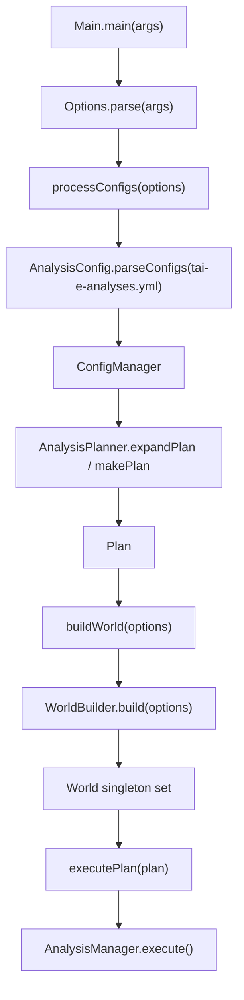
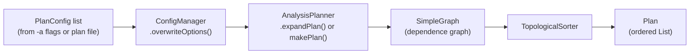
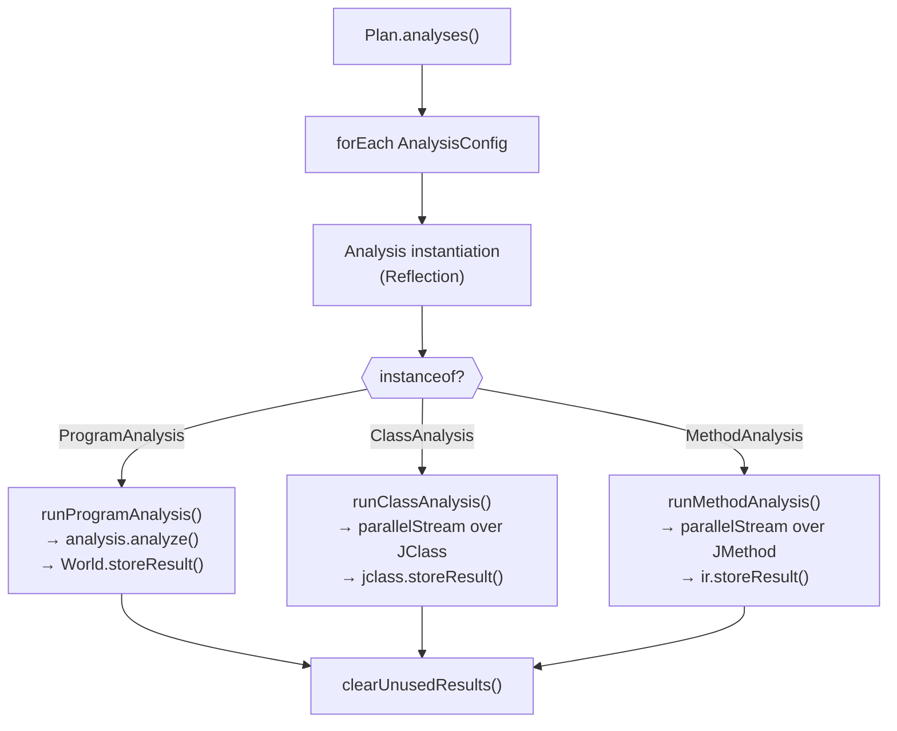

<!-- source: DeepWiki mcp.deepwiki.com · repo pascal-lab/Tai-e · page 2 Core Architecture · fetched 2026-10-12 -->

# Core Architecture

<details>
<summary>Relevant source files</summary>

The following files were used as context for generating this wiki page:

- [src/main/java/pascal/taie/Main.java](src/main/java/pascal/taie/Main.java)
- [src/main/java/pascal/taie/World.java](src/main/java/pascal/taie/World.java)
- [src/main/java/pascal/taie/analysis/AnalysisManager.java](src/main/java/pascal/taie/analysis/AnalysisManager.java)
- [src/main/java/pascal/taie/analysis/graph/callgraph/CallGraphBuilder.java](src/main/java/pascal/taie/analysis/graph/callgraph/CallGraphBuilder.java)
- [src/main/java/pascal/taie/analysis/graph/callgraph/CallGraphs.java](src/main/java/pascal/taie/analysis/graph/callgraph/CallGraphs.java)
- [src/main/java/pascal/taie/analysis/graph/callgraph/PTABasedBuilder.java](src/main/java/pascal/taie/analysis/graph/callgraph/PTABasedBuilder.java)
- [src/main/java/pascal/taie/analysis/graph/cfg/CFGBuilder.java](src/main/java/pascal/taie/analysis/graph/cfg/CFGBuilder.java)
- [src/main/java/pascal/taie/analysis/graph/cfg/CFGDumper.java](src/main/java/pascal/taie/analysis/graph/cfg/CFGDumper.java)
- [src/main/java/pascal/taie/analysis/graph/flowgraph/FlowGraphDumper.java](src/main/java/pascal/taie/analysis/graph/flowgraph/FlowGraphDumper.java)
- [src/main/java/pascal/taie/analysis/graph/icfg/ICFGBuilder.java](src/main/java/pascal/taie/analysis/graph/icfg/ICFGBuilder.java)
- [src/main/java/pascal/taie/analysis/misc/IRDumper.java](src/main/java/pascal/taie/analysis/misc/IRDumper.java)
- [src/main/java/pascal/taie/analysis/misc/ResultProcessor.java](src/main/java/pascal/taie/analysis/misc/ResultProcessor.java)
- [src/main/java/pascal/taie/analysis/pta/PointerAnalysis.java](src/main/java/pascal/taie/analysis/pta/PointerAnalysis.java)
- [src/main/java/pascal/taie/analysis/pta/client/Collector.java](src/main/java/pascal/taie/analysis/pta/client/Collector.java)
- [src/main/java/pascal/taie/analysis/pta/plugin/AnalysisTimer.java](src/main/java/pascal/taie/analysis/pta/plugin/AnalysisTimer.java)
- [src/main/java/pascal/taie/analysis/pta/plugin/Profiler.java](src/main/java/pascal/taie/analysis/pta/plugin/Profiler.java)
- [src/main/java/pascal/taie/config/AnalysisConfig.java](src/main/java/pascal/taie/config/AnalysisConfig.java)
- [src/main/java/pascal/taie/config/AnalysisOptions.java](src/main/java/pascal/taie/config/AnalysisOptions.java)
- [src/main/java/pascal/taie/config/AnalysisPlanner.java](src/main/java/pascal/taie/config/AnalysisPlanner.java)
- [src/main/java/pascal/taie/config/ConfigManager.java](src/main/java/pascal/taie/config/ConfigManager.java)
- [src/main/java/pascal/taie/config/Configs.java](src/main/java/pascal/taie/config/Configs.java)
- [src/main/java/pascal/taie/config/Plan.java](src/main/java/pascal/taie/config/Plan.java)
- [src/main/java/pascal/taie/config/PlanConfig.java](src/main/java/pascal/taie/config/PlanConfig.java)
- [src/main/java/pascal/taie/ir/DefaultIR.java](src/main/java/pascal/taie/ir/DefaultIR.java)
- [src/main/java/pascal/taie/ir/IR.java](src/main/java/pascal/taie/ir/IR.java)
- [src/main/java/pascal/taie/util/Timer.java](src/main/java/pascal/taie/util/Timer.java)
- [src/main/java/pascal/taie/util/graph/DotDumper.java](src/main/java/pascal/taie/util/graph/DotDumper.java)
- [src/main/java/pascal/taie/util/graph/SCC.java](src/main/java/pascal/taie/util/graph/SCC.java)
- [src/main/resources/android/tai-e-android-analyses.yml](src/main/resources/android/tai-e-android-analyses.yml)
- [src/main/resources/tai-e-analyses.yml](src/main/resources/tai-e-analyses.yml)
- [src/test/java/pascal/taie/TaieTestSuite.java](src/test/java/pascal/taie/TaieTestSuite.java)
- [src/test/java/pascal/taie/analysis/Tests.java](src/test/java/pascal/taie/analysis/Tests.java)
- [src/test/java/pascal/taie/config/AnalysisOptionsTest.java](src/test/java/pascal/taie/config/AnalysisOptionsTest.java)
- [src/test/java/pascal/taie/frontend/soot/InvokeDynamicTest.java](src/test/java/pascal/taie/frontend/soot/InvokeDynamicTest.java)
- [src/test/java/pascal/taie/ir/IRTest.java](src/test/java/pascal/taie/ir/IRTest.java)
- [src/test/java/pascal/taie/language/classes/StringRepsTest.java](src/test/java/pascal/taie/language/classes/StringRepsTest.java)
- [src/test/java/pascal/taie/util/graph/GraphTest.java](src/test/java/pascal/taie/util/graph/GraphTest.java)

</details>


This page describes how Tai-e's major subsystems fit together: the `World` singleton as the central program model, the configuration and planning pipeline, and the execution flow from command-line invocation through world construction to analysis results.

For details on what `World` contains (class hierarchy, type system, IR), see [World and Class Hierarchy](#2.1). For the analysis management details specific to individual analysis types, see [Analysis Management](#2.3). For the frontend pipeline that populates `World`, see [Frontend](#5).

---

## Startup and Execution Flow

The entry point is `pascal.taie.Main` [src/main/java/pascal/taie/Main.java:46-46](), which performs four sequential steps:

1. **Parse arguments** — `Options.parse(args)` [src/main/java/pascal/taie/Main.java:71-71]() populates an `Options` instance via picocli.
2. **Process configs** — reads `tai-e-analyses.yml` [src/main/java/pascal/taie/Main.java:80-81](), resolves dependencies, and produces a `Plan` [src/main/java/pascal/taie/Main.java:95-96]().
3. **Build the world** — invokes a `WorldBuilder` to construct the global `World` singleton [src/main/java/pascal/taie/Main.java:128-151]().
4. **Execute the plan** — `AnalysisManager` runs each analysis in topological order [src/main/java/pascal/taie/Main.java:154-156]().

**Startup sequence in `Main.main`**



Sources: [src/main/java/pascal/taie/Main.java:50-64](), [src/main/java/pascal/taie/Main.java:128-151]()

---

## Configuration System

### `Options` — Global CLI Options

`Options` is populated by picocli at startup. It controls the analysis scope, class paths, and which analyses to execute. Options can also be read from a YAML file via `--options-file`.

| Field / Flag | Purpose |
|---|---|
| `-cp` / `--class-path` | Library class path |
| `-m` / `--main-class` | Entry class for analysis |
| `--input-classes` | Additional classes to include |
| `--world-builder` | `WorldBuilder` class (default: `SootWorldBuilder`) |
| `--output-dir` | Output directory |
| `-wc` / `--world-cache-mode` | Serialize/deserialize `World` to disk |
| `-scope` | `APP`, `ALL`, or `REACHABLE` |
| `-a` / `--analysis` | Analyses to run (id=options pairs) |
| `-p` / `--plan-file` | Path to a plan YAML file |
| `-kr` / `--keep-result` | Analysis IDs whose results are retained |

Sources: [src/main/java/pascal/taie/Main.java:70-77](), [src/main/java/pascal/taie/config/PlanConfig.java:107-116]()

---

### `AnalysisConfig` vs `PlanConfig`

Two config types serve different purposes:

| | `AnalysisConfig` | `PlanConfig` |
|---|---|---|
| **Source** | `tai-e-analyses.yml` (static registry) | CLI `-a` flags or a plan YAML file |
| **Contains** | `id`, `analysisClass`, `requires`, default `options` | `id`, user-supplied `options` |
| **Role** | Declares what an analysis is | Declares what the user wants to run |

`AnalysisOptions` [src/main/java/pascal/taie/config/AnalysisOptions.java]() wraps a `Map<String, Object>` and provides typed accessors (`getString`, `getBoolean`, `getInt`).

Sources: [src/main/java/pascal/taie/config/PlanConfig.java:47-72](), [src/main/java/pascal/taie/config/AnalysisConfig.java]()

---

### Analysis Registry: `tai-e-analyses.yml`

Every built-in analysis is declared in [src/main/resources/tai-e-analyses.yml](). Each entry defines the implementing class, a unique ID, and optional dependencies.

```yaml
- description: whole-program pointer analysis
  analysisClass: pascal.taie.analysis.pta.PointerAnalysis
  id: pta
  options:
    cs: ci
    ...
```

The `requires` field [src/main/resources/tai-e-analyses.yml:42-42]() allows for conditional dependencies, such as `cg` requiring `pta` only when a specific algorithm is selected.

Sources: [src/main/resources/tai-e-analyses.yml:1-171]()

---

### `ConfigManager` and `AnalysisPlanner`

`ConfigManager` holds all `AnalysisConfig` objects and merges user-supplied `PlanConfig` options. `AnalysisPlanner` [src/main/java/pascal/taie/config/AnalysisPlanner.java:45-45]() converts requested analyses into a topologically sorted `Plan`:

- **`expandPlan`** [src/main/java/pascal/taie/config/AnalysisPlanner.java:151-170]() — Automatically adds missing required analyses by traversing the dependency graph.
- **`makePlan`** [src/main/java/pascal/taie/config/AnalysisPlanner.java:67-74]() — Validates a pre-defined sequence (e.g., from a plan file).

**Planning pipeline**



Sources: [src/main/java/pascal/taie/config/AnalysisPlanner.java:71-73](), [src/main/java/pascal/taie/config/Plan.java]()

---

## World Building

### `WorldBuilder` and `SootWorldBuilder`

The `WorldBuilder` interface defines the contract for constructing the program model. `SootWorldBuilder` uses Soot to load Java class files and translate them into Tai-e's internal representation.

`SootWorldBuilder` performs the following in its `build` method [src/main/java/pascal/taie/frontend/soot/SootWorldBuilder.java:69-84]():
- Initializes the Soot `Scene`.
- Populates the `ClassHierarchy` and `TypeSystem`.
- Sets the `mainMethod` and entry points.
- Initializes the `IRBuilder` for converting method bodies to Tai-e IR.

The resulting `World` singleton is set via `World.set(world)` [src/main/java/pascal/taie/World.java:91-93]().

Sources: [src/main/java/pascal/taie/World.java:49-196](), [src/main/java/pascal/taie/Main.java:128-152]()

### `CachedWorldBuilder` — World Caching

When `--world-cache-mode` is enabled, `Main` wraps the builder with `CachedWorldBuilder` [src/main/java/pascal/taie/Main.java:134-136](). This implementation attempts to load a serialized `World` from disk based on a hash of the input options to skip the expensive frontend phase.

Sources: [src/main/java/pascal/taie/Main.java:134-137]()

---

## Analysis Execution

### `AnalysisManager`

`AnalysisManager` [src/main/java/pascal/taie/analysis/AnalysisManager.java:51-51]() executes the `Plan`. It instantiates analyses via reflection [src/main/java/pascal/taie/analysis/AnalysisManager.java:116-118]() and dispatches them based on their granularity:

| Type | Dispatch method | Scope | Result stored on |
|---|---|---|---|
| `ProgramAnalysis<R>` | `runProgramAnalysis` | Whole program | `World` |
| `ClassAnalysis<R>` | `runClassAnalysis` | Per `JClass` | `JClass` |
| `MethodAnalysis<R>` | `runMethodAnalysis` | Per `JMethod` | `IR` |

The analysis scope (which classes/methods to process) is determined by `getClassScope()` [src/main/java/pascal/taie/analysis/AnalysisManager.java:164-188]() and `getMethodScope()`, respecting the `-scope` option (APP, ALL, or REACHABLE).

**Analysis dispatch flow**



Sources: [src/main/java/pascal/taie/analysis/AnalysisManager.java:88-109](), [src/main/java/pascal/taie/analysis/AnalysisManager.java:147-162]()

---

## The `World` Singleton

`World` [src/main/java/pascal/taie/World.java:49-49]() is the central hub for all global information. It holds the `ClassHierarchy`, `TypeSystem`, and analysis results.

| Accessor | Type | Purpose |
|---|---|---|
| `getClassHierarchy()` | `ClassHierarchy` | Access to `JClass`, `JMethod`, `JField` |
| `getTypeSystem()` | `TypeSystem` | Java type model and hierarchy |
| `getIRBuilder()` | `IRBuilder` | Logic to build Tai-e IR from bytecode |
| `getResult(id)` | `Object` | Retrieve result of a completed analysis |

Sources: [src/main/java/pascal/taie/World.java:119-166]()

---

