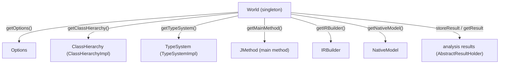
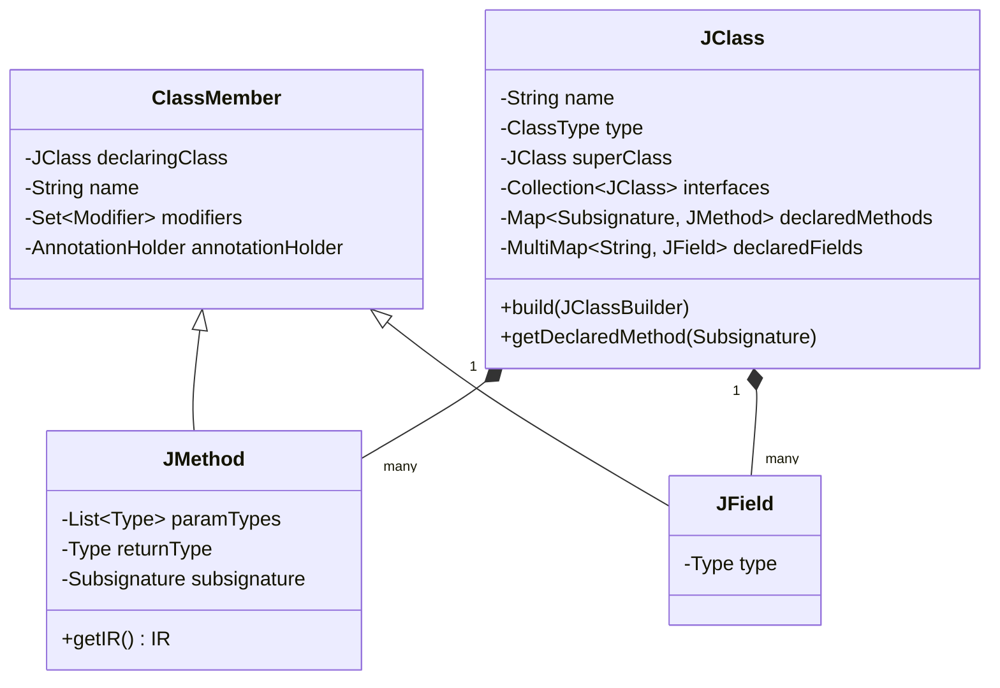

<!-- source: DeepWiki mcp.deepwiki.com · repo pascal-lab/Tai-e · page 2.1 World and Class Hierarchy · fetched 2026-10-12 -->

# World and Class Hierarchy

<details>
<summary>Relevant source files</summary>

The following files were used as context for generating this wiki page:

- [src/main/java/pascal/taie/World.java](src/main/java/pascal/taie/World.java)
- [src/main/java/pascal/taie/analysis/graph/callgraph/CHABuilder.java](src/main/java/pascal/taie/analysis/graph/callgraph/CHABuilder.java)
- [src/main/java/pascal/taie/analysis/graph/callgraph/DefaultCallGraph.java](src/main/java/pascal/taie/analysis/graph/callgraph/DefaultCallGraph.java)
- [src/main/java/pascal/taie/android/util/AndroidSystemClassUtil.java](src/main/java/pascal/taie/android/util/AndroidSystemClassUtil.java)
- [src/main/java/pascal/taie/frontend/java/classes/Modifiers.java](src/main/java/pascal/taie/frontend/java/classes/Modifiers.java)
- [src/main/java/pascal/taie/frontend/soot/Converter.java](src/main/java/pascal/taie/frontend/soot/Converter.java)
- [src/main/java/pascal/taie/frontend/soot/SootClassBuilder.java](src/main/java/pascal/taie/frontend/soot/SootClassBuilder.java)
- [src/main/java/pascal/taie/frontend/soot/SootClassLoader.java](src/main/java/pascal/taie/frontend/soot/SootClassLoader.java)
- [src/main/java/pascal/taie/ir/DefaultIR.java](src/main/java/pascal/taie/ir/DefaultIR.java)
- [src/main/java/pascal/taie/ir/IR.java](src/main/java/pascal/taie/ir/IR.java)
- [src/main/java/pascal/taie/ir/proginfo/MemberRef.java](src/main/java/pascal/taie/ir/proginfo/MemberRef.java)
- [src/main/java/pascal/taie/language/annotation/Annotated.java](src/main/java/pascal/taie/language/annotation/Annotated.java)
- [src/main/java/pascal/taie/language/annotation/Annotation.java](src/main/java/pascal/taie/language/annotation/Annotation.java)
- [src/main/java/pascal/taie/language/annotation/AnnotationElement.java](src/main/java/pascal/taie/language/annotation/AnnotationElement.java)
- [src/main/java/pascal/taie/language/annotation/AnnotationHolder.java](src/main/java/pascal/taie/language/annotation/AnnotationHolder.java)
- [src/main/java/pascal/taie/language/annotation/ArrayElement.java](src/main/java/pascal/taie/language/annotation/ArrayElement.java)
- [src/main/java/pascal/taie/language/annotation/BooleanElement.java](src/main/java/pascal/taie/language/annotation/BooleanElement.java)
- [src/main/java/pascal/taie/language/annotation/ClassElement.java](src/main/java/pascal/taie/language/annotation/ClassElement.java)
- [src/main/java/pascal/taie/language/annotation/DoubleElement.java](src/main/java/pascal/taie/language/annotation/DoubleElement.java)
- [src/main/java/pascal/taie/language/annotation/Element.java](src/main/java/pascal/taie/language/annotation/Element.java)
- [src/main/java/pascal/taie/language/annotation/EnumElement.java](src/main/java/pascal/taie/language/annotation/EnumElement.java)
- [src/main/java/pascal/taie/language/annotation/FloatElement.java](src/main/java/pascal/taie/language/annotation/FloatElement.java)
- [src/main/java/pascal/taie/language/annotation/IntElement.java](src/main/java/pascal/taie/language/annotation/IntElement.java)
- [src/main/java/pascal/taie/language/annotation/LongElement.java](src/main/java/pascal/taie/language/annotation/LongElement.java)
- [src/main/java/pascal/taie/language/annotation/StringElement.java](src/main/java/pascal/taie/language/annotation/StringElement.java)
- [src/main/java/pascal/taie/language/annotation/package-info.java](src/main/java/pascal/taie/language/annotation/package-info.java)
- [src/main/java/pascal/taie/language/classes/ClassHierarchy.java](src/main/java/pascal/taie/language/classes/ClassHierarchy.java)
- [src/main/java/pascal/taie/language/classes/ClassHierarchyImpl.java](src/main/java/pascal/taie/language/classes/ClassHierarchyImpl.java)
- [src/main/java/pascal/taie/language/classes/ClassMember.java](src/main/java/pascal/taie/language/classes/ClassMember.java)
- [src/main/java/pascal/taie/language/classes/JClass.java](src/main/java/pascal/taie/language/classes/JClass.java)
- [src/main/java/pascal/taie/language/classes/JClassBuilder.java](src/main/java/pascal/taie/language/classes/JClassBuilder.java)
- [src/main/java/pascal/taie/language/classes/JField.java](src/main/java/pascal/taie/language/classes/JField.java)
- [src/main/java/pascal/taie/language/classes/JMethod.java](src/main/java/pascal/taie/language/classes/JMethod.java)
- [src/main/java/pascal/taie/language/classes/StringReps.java](src/main/java/pascal/taie/language/classes/StringReps.java)
- [src/main/java/pascal/taie/language/classes/package-info.java](src/main/java/pascal/taie/language/classes/package-info.java)
- [src/main/java/pascal/taie/util/graph/SCC.java](src/main/java/pascal/taie/util/graph/SCC.java)
- [src/main/resources/android/android-basic-classes.yml](src/main/resources/android/android-basic-classes.yml)
- [src/main/resources/android/android-callbacks.yml](src/main/resources/android/android-callbacks.yml)
- [src/main/resources/android/android-lifecycle.yml](src/main/resources/android/android-lifecycle.yml)
- [src/main/resources/basic-classes.yml](src/main/resources/basic-classes.yml)
- [src/test/java/pascal/taie/TaieTestSuite.java](src/test/java/pascal/taie/TaieTestSuite.java)
- [src/test/java/pascal/taie/frontend/soot/InvokeDynamicTest.java](src/test/java/pascal/taie/frontend/soot/InvokeDynamicTest.java)
- [src/test/java/pascal/taie/frontend/soot/OuterInnerTest.java](src/test/java/pascal/taie/frontend/soot/OuterInnerTest.java)
- [src/test/java/pascal/taie/ir/IRTest.java](src/test/java/pascal/taie/ir/IRTest.java)
- [src/test/java/pascal/taie/language/classes/StringRepsTest.java](src/test/java/pascal/taie/language/classes/StringRepsTest.java)
- [src/test/java/pascal/taie/util/graph/GraphTest.java](src/test/java/pascal/taie/util/graph/GraphTest.java)

</details>


This page documents the central program model in Tai-e: the `World` singleton, the `ClassHierarchy` interface and its implementation, the `JClass`/`JMethod`/`JField` language model, the `TypeSystem`, class loading, method dispatch, field resolution, and the annotation subsystem.

For how Soot is configured and how class files are translated into this model, see [Soot Integration](#5.1). For how the IR is built on top of this model, see [Intermediate Representation](#2.2). For how analyses are run against the built world, see [Analysis Management](#2.3).

---

## The World Singleton

`World` ([src/main/java/pascal/taie/World.java:49-50]()) is the root of the entire program model. It holds references to every subsystem that analyses need, and is accessed globally via the static method `World.get()` ([src/main/java/pascal/taie/World.java:98-100]()).

**Lifecycle:**
- `World.reset()` clears the current instance and invokes registered callbacks to clear class-level caches ([src/main/java/pascal/taie/World.java:106-109]()).
- `World.set(world)` installs a newly built instance ([src/main/java/pascal/taie/World.java:91-93]()).
- After construction, `World.get()` is valid for the lifetime of the analysis run.

**Key components stored in World:**

| Method | Type | Description |
|---|---|---|
| `getOptions()` | `Options` | Parsed command-line options [src/main/java/pascal/taie/World.java:111-113]() |
| `getClassHierarchy()` | `ClassHierarchy` | All loaded classes and hierarchy relations [src/main/java/pascal/taie/World.java:127-129]() |
| `getTypeSystem()` | `TypeSystem` | Type creation and subtype checking [src/main/java/pascal/taie/World.java:119-121]() |
| `getMainMethod()` | `JMethod` | Entry point of the analyzed program [src/main/java/pascal/taie/World.java:151-153]() |
| `getIRBuilder()` | `IRBuilder` | Lazily builds method IRs on demand [src/main/java/pascal/taie/World.java:135-137]() |
| `getNativeModel()` | `NativeModel` | Provides IR stubs for native methods [src/main/java/pascal/taie/World.java:143-145]() |
| `getImplicitEntries()`| `Collection<JMethod>`| JVM-internal entry points [src/main/java/pascal/taie/World.java:159-161]() |

**Diagram: World singleton and its major dependencies**


Sources: [src/main/java/pascal/taie/World.java:49-167]()

---

## World Building Pipeline

The world is built by a `WorldBuilder` implementation. The default is `SootWorldBuilder`, which uses Soot as the Java frontend.

**Construction sequence in `SootWorldBuilder`:**

1. Reset Soot and configure Soot options.
2. Pre-register basic classes (from `basic-classes.yml`) and reflection log classes into the Soot `Scene`.
3. Register a Soot `SceneTransformer` that runs the building logic after Soot finishes class loading.
4. Inside the transformer:
   - `World.reset()` then `World.set(new World())`.
   - Create `ClassHierarchyImpl`, then `SootClassLoader(scene, hierarchy, allowPhantom)`.
   - Create `TypeSystemImpl(hierarchy)`.
   - Create `Converter(loader, typeSystem)` for bridging Soot ↔ Tai-e types.
   - Walk all Soot classes and call `hierarchy.getDefaultClassLoader().loadClass(name)` for each.
   - Set the main method, implicit entries, native model, and `IRBuilder`.

**Diagram: World building sequence**

```mermaid
sequenceDiagram
    participant SWB as SootWorldBuilder
    participant Scene as SootScene
    participant CH as ClassHierarchyImpl
    participant SCL as SootClassLoader
    participant World as World

    SWB->>Scene: "runSoot()"
    Scene-->>SWB: "SceneTransformer callback"
    SWB->>World: "World.reset(); World.set(new World())"
    SWB->>CH: "new ClassHierarchyImpl(SootClassLoader)"
    SWB->>SCL: "setConverter(Converter)"
    SWB->>SCL: "loadClass(name) for all SootClasses"
    SCL->>CH: "addClass(jclass)"
    CH->>CH: "setIndex(classCounter++)"
    SWB->>World: "setClassHierarchy / setTypeSystem / setMainMethod"
```
Sources: [src/main/java/pascal/taie/frontend/soot/SootClassLoader.java:54-69](), [src/main/java/pascal/taie/language/classes/ClassHierarchyImpl.java:133-161]()

---

## ClassHierarchy

`ClassHierarchy` ([src/main/java/pascal/taie/language/classes/ClassHierarchy.java:37]()) manages all loaded classes and provides resolution services. `ClassHierarchyImpl` ([src/main/java/pascal/taie/language/classes/ClassHierarchyImpl.java:46]()) is the core implementation.

### ClassHierarchy Interface

**Key methods:**

| Method | Description |
|---|---|
| `addClass(JClass)` | Registers a class; updates subclass/interface/inner-class maps [src/main/java/pascal/taie/language/classes/ClassHierarchyImpl.java:133-161]() |
| `allClasses()` | `Stream<JClass>` over all loaded classes [src/main/java/pascal/taie/language/classes/ClassHierarchyImpl.java:174-176]() |
| `getClass(String name)` | Returns a class by name via the default loader [src/main/java/pascal/taie/language/classes/ClassHierarchyImpl.java:197-200]() |
| `resolveMethod(MethodRef)` | Resolves a method reference following JVM Spec §5.4.3.3 [src/main/java/pascal/taie/language/classes/ClassHierarchyImpl.java:249-261]() |
| `resolveField(FieldRef)` | Resolves a field reference following JVM Spec §5.4.3.2 [src/main/java/pascal/taie/language/classes/ClassHierarchyImpl.java:401-412]() |
| `dispatch(JClass, MethodRef)` | Virtual dispatch on a receiver class [src/main/java/pascal/taie/language/classes/ClassHierarchyImpl.java:353-376]() |
| `getAllSubclassesOf(JClass)` | Returns all subclasses/implementors (cached) [src/main/java/pascal/taie/language/classes/ClassHierarchyImpl.java:470-490]() |

`ClassHierarchy` also extends `Indexer<JClass>`, providing integer-indexed access to classes for efficient set operations via `getIndex(JClass)` and `getObject(int)` ([src/main/java/pascal/taie/language/classes/ClassHierarchyImpl.java:164-171]()).

### ClassHierarchyImpl Internals

`ClassHierarchyImpl` maintains several maps updated via `addClass(jclass)`:

| Field | Type | Purpose |
|---|---|---|
| `directSubinterfaces` | `MultiMap<JClass, JClass>` | Direct subinterfaces [src/main/java/pascal/taie/language/classes/ClassHierarchyImpl.java:66]() |
| `directImplementors` | `MultiMap<JClass, JClass>` | Direct implementors [src/main/java/pascal/taie/language/classes/ClassHierarchyImpl.java:71]() |
| `directSubclasses` | `MultiMap<JClass, JClass>` | Direct subclasses [src/main/java/pascal/taie/language/classes/ClassHierarchyImpl.java:76]() |
| `dispatchTable` | `TwoKeyMap<JClass, Subsignature, JMethod>` | Cache for virtual dispatch [src/main/java/pascal/taie/language/classes/ClassHierarchyImpl.java:86]() |

The `allSubclasses` cache is cleared whenever `addClass` is called to ensure consistency ([src/main/java/pascal/taie/language/classes/ClassHierarchyImpl.java:160]()).

Sources: [src/main/java/pascal/taie/language/classes/ClassHierarchyImpl.java:46-161]()

---

## Method Dispatch and Field Resolution

### Method Resolution (`resolveMethod`)

Follows JVM Spec §5.4.3.3. It utilizes `lookupMethod` ([src/main/java/pascal/taie/language/classes/ClassHierarchyImpl.java:271-314]()):
1. Scan class `C` and its superclasses for a matching `Subsignature`.
2. If not found, scan superinterfaces recursively.
3. Returns `null` if no match is found.

### Field Resolution (`resolveField`)

Follows JVM Spec §5.4.3.2 ([src/main/java/pascal/taie/language/classes/ClassHierarchyImpl.java:401-412]()):
1. If the class is phantom, create/retrieve a `phantomField` stub ([src/main/java/pascal/taie/language/classes/JClass.java:286-297]()).
2. Check if the class declares the field.
3. Recursively check superinterfaces and then the superclass.

### Virtual Dispatch (`dispatch`)

- Converts receiver `Type` to `JClass` (arrays dispatch to `java.lang.Object`).
- Checks `dispatchTable` cache ([src/main/java/pascal/taie/language/classes/ClassHierarchyImpl.java:363]()).
- On miss, calls `lookupMethod` with `allowAbstract=false` ([src/main/java/pascal/taie/language/classes/ClassHierarchyImpl.java:371]()).

Sources: [src/main/java/pascal/taie/language/classes/ClassHierarchyImpl.java:249-412]()

---

## Language Model: JClass, JMethod, JField

Tai-e represents program entities using a hierarchical model.

**Diagram: Language Model Entities**



### JClass
`JClass` ([src/main/java/pascal/taie/language/classes/JClass.java:61]()) uses a two-phase initialization. The constructor creates the shell ([src/main/java/pascal/taie/language/classes/JClass.java:117-132]()), and `build(JClassBuilder)` populates fields like `superClass`, `interfaces`, and members ([src/main/java/pascal/taie/language/classes/JClass.java:146-180]()). This avoids recursion issues during class loading.

### JMethod
`JMethod` ([src/main/java/pascal/taie/language/classes/JMethod.java:47]()) holds signature and parameter info. The `IR` is built lazily via `getIR()` ([src/main/java/pascal/taie/language/classes/JMethod.java:185-201]()). If the method is native, it uses the `NativeModel` ([src/main/java/pascal/taie/language/classes/JMethod.java:192]()).

### JField
`JField` ([src/main/java/pascal/taie/language/classes/JField.java:38]()) represents a class field, storing its `Type` and providing a `FieldRef` for IR references ([src/main/java/pascal/taie/language/classes/JField.java:76-78]()).

Sources: [src/main/java/pascal/taie/language/classes/JClass.java:61-180](), [src/main/java/pascal/taie/language/classes/JMethod.java:47-201](), [src/main/java/pascal/taie/language/classes/JField.java:38-79]()

---

## Class Loading and Converter

### SootClassLoader
`SootClassLoader` ([src/main/java/pascal/taie/frontend/soot/SootClassLoader.java:35]()) delegates to Soot's `Scene`. It caches `JClass` instances to ensure uniqueness ([src/main/java/pascal/taie/frontend/soot/SootClassLoader.java:45]()).

### Converter
`Converter` ([src/main/java/pascal/taie/frontend/soot/Converter.java:113]()) translates Soot types and members to Tai-e.
- `convertType(soot.Type)`: Maps Soot primitives and `RefType` to Tai-e `Type` ([src/main/java/pascal/taie/frontend/soot/Converter.java:138-172]()).
- `convertMethod(SootMethod)`: Uses a `methodMap` to cache and return `JMethod` ([src/main/java/pascal/taie/frontend/soot/Converter.java:204-228]()).

Sources: [src/main/java/pascal/taie/frontend/soot/SootClassLoader.java:35-87](), [src/main/java/pascal/taie/frontend/soot/Converter.java:113-228]()

---

## Annotation Subsystem

Annotations are managed via `AnnotationHolder` ([src/main/java/pascal/taie/language/annotation/AnnotationHolder.java:36]()).

- **`Annotated` Interface**: Implemented by `JClass`, `JMethod`, and `JField` to provide annotation access ([src/main/java/pascal/taie/language/annotation/Annotated.java:39]()).
- **`Annotation`**: Represents a single annotation with a type and a map of `Element` values ([src/main/java/pascal/taie/language/annotation/Annotation.java:44]()).
- **`Element`**: Hierarchical values including `StringElement`, `IntElement`, `EnumElement`, etc. ([src/main/java/pascal/taie/language/annotation/Element.java:34]()).

Methods also support parameter annotations via `paramAnnotations` in `JMethod`, indexed by parameter position ([src/main/java/pascal/taie/language/classes/JMethod.java:131-156]()).

Sources: [src/main/java/pascal/taie/language/annotation/Annotation.java:44-60](), [src/main/java/pascal/taie/language/annotation/AnnotationHolder.java:36-50](), [src/main/java/pascal/taie/language/classes/JMethod.java:131-156]()

---

