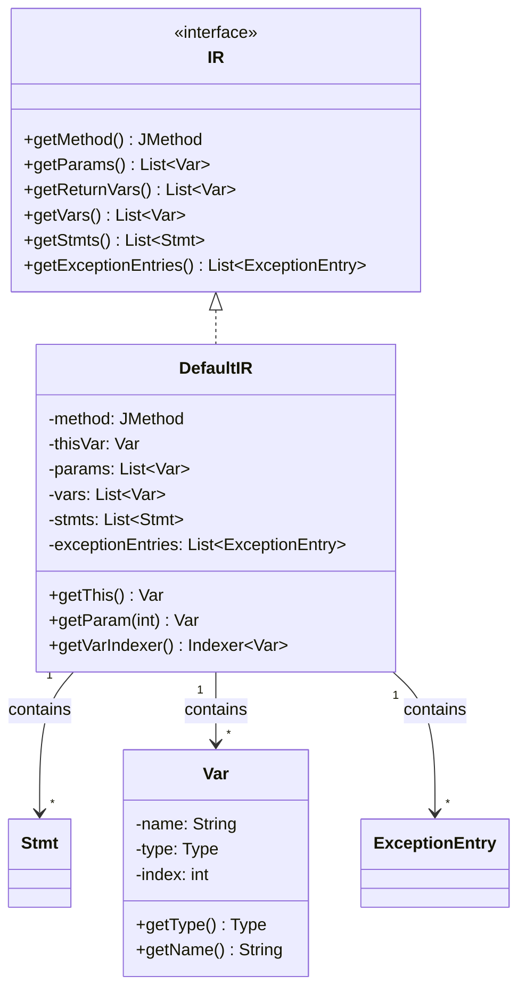
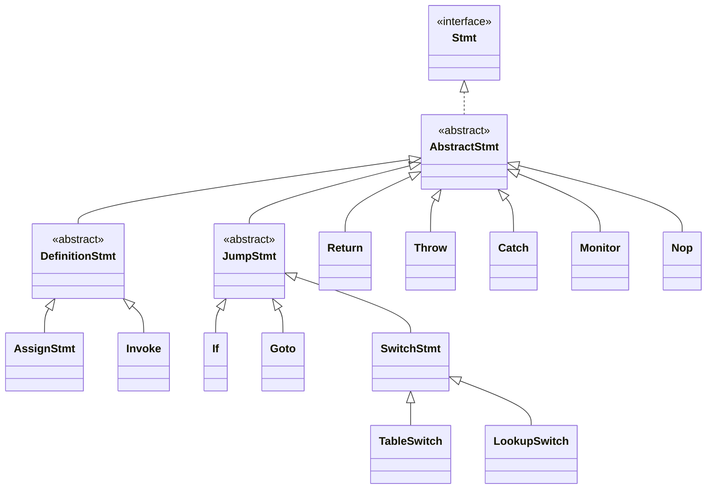

<!-- source: DeepWiki mcp.deepwiki.com · repo pascal-lab/Tai-e · page 2.2 Intermediate Representation · fetched 2026-10-12 -->

# Intermediate Representation

<details>
<summary>Relevant source files</summary>

The following files were used as context for generating this wiki page:

- [src/main/java/pascal/taie/World.java](src/main/java/pascal/taie/World.java)
- [src/main/java/pascal/taie/analysis/exception/IntraExplicitThrowAnalysis.java](src/main/java/pascal/taie/analysis/exception/IntraExplicitThrowAnalysis.java)
- [src/main/java/pascal/taie/analysis/pta/plugin/reflection/LogItem.java](src/main/java/pascal/taie/analysis/pta/plugin/reflection/LogItem.java)
- [src/main/java/pascal/taie/ir/DefaultIR.java](src/main/java/pascal/taie/ir/DefaultIR.java)
- [src/main/java/pascal/taie/ir/IR.java](src/main/java/pascal/taie/ir/IR.java)
- [src/main/java/pascal/taie/ir/IRBuildHelper.java](src/main/java/pascal/taie/ir/IRBuildHelper.java)
- [src/main/java/pascal/taie/ir/IRPrinter.java](src/main/java/pascal/taie/ir/IRPrinter.java)
- [src/main/java/pascal/taie/ir/exp/ArithmeticExp.java](src/main/java/pascal/taie/ir/exp/ArithmeticExp.java)
- [src/main/java/pascal/taie/ir/exp/BinaryExp.java](src/main/java/pascal/taie/ir/exp/BinaryExp.java)
- [src/main/java/pascal/taie/ir/exp/BitwiseExp.java](src/main/java/pascal/taie/ir/exp/BitwiseExp.java)
- [src/main/java/pascal/taie/ir/exp/CastExp.java](src/main/java/pascal/taie/ir/exp/CastExp.java)
- [src/main/java/pascal/taie/ir/exp/ClassLiteral.java](src/main/java/pascal/taie/ir/exp/ClassLiteral.java)
- [src/main/java/pascal/taie/ir/exp/ComparisonExp.java](src/main/java/pascal/taie/ir/exp/ComparisonExp.java)
- [src/main/java/pascal/taie/ir/exp/ConditionExp.java](src/main/java/pascal/taie/ir/exp/ConditionExp.java)
- [src/main/java/pascal/taie/ir/exp/DoubleLiteral.java](src/main/java/pascal/taie/ir/exp/DoubleLiteral.java)
- [src/main/java/pascal/taie/ir/exp/Exp.java](src/main/java/pascal/taie/ir/exp/Exp.java)
- [src/main/java/pascal/taie/ir/exp/ExpVisitor.java](src/main/java/pascal/taie/ir/exp/ExpVisitor.java)
- [src/main/java/pascal/taie/ir/exp/FieldAccess.java](src/main/java/pascal/taie/ir/exp/FieldAccess.java)
- [src/main/java/pascal/taie/ir/exp/FloatLiteral.java](src/main/java/pascal/taie/ir/exp/FloatLiteral.java)
- [src/main/java/pascal/taie/ir/exp/FloatingPointLiteral.java](src/main/java/pascal/taie/ir/exp/FloatingPointLiteral.java)
- [src/main/java/pascal/taie/ir/exp/InstanceFieldAccess.java](src/main/java/pascal/taie/ir/exp/InstanceFieldAccess.java)
- [src/main/java/pascal/taie/ir/exp/InstanceOfExp.java](src/main/java/pascal/taie/ir/exp/InstanceOfExp.java)
- [src/main/java/pascal/taie/ir/exp/IntLiteral.java](src/main/java/pascal/taie/ir/exp/IntLiteral.java)
- [src/main/java/pascal/taie/ir/exp/IntegerLiteral.java](src/main/java/pascal/taie/ir/exp/IntegerLiteral.java)
- [src/main/java/pascal/taie/ir/exp/InvokeDynamic.java](src/main/java/pascal/taie/ir/exp/InvokeDynamic.java)
- [src/main/java/pascal/taie/ir/exp/InvokeExp.java](src/main/java/pascal/taie/ir/exp/InvokeExp.java)
- [src/main/java/pascal/taie/ir/exp/InvokeInstanceExp.java](src/main/java/pascal/taie/ir/exp/InvokeInstanceExp.java)
- [src/main/java/pascal/taie/ir/exp/InvokeInterface.java](src/main/java/pascal/taie/ir/exp/InvokeInterface.java)
- [src/main/java/pascal/taie/ir/exp/InvokeSpecial.java](src/main/java/pascal/taie/ir/exp/InvokeSpecial.java)
- [src/main/java/pascal/taie/ir/exp/InvokeStatic.java](src/main/java/pascal/taie/ir/exp/InvokeStatic.java)
- [src/main/java/pascal/taie/ir/exp/InvokeVirtual.java](src/main/java/pascal/taie/ir/exp/InvokeVirtual.java)
- [src/main/java/pascal/taie/ir/exp/LValue.java](src/main/java/pascal/taie/ir/exp/LValue.java)
- [src/main/java/pascal/taie/ir/exp/Literal.java](src/main/java/pascal/taie/ir/exp/Literal.java)
- [src/main/java/pascal/taie/ir/exp/LongLiteral.java](src/main/java/pascal/taie/ir/exp/LongLiteral.java)
- [src/main/java/pascal/taie/ir/exp/MethodHandle.java](src/main/java/pascal/taie/ir/exp/MethodHandle.java)
- [src/main/java/pascal/taie/ir/exp/MethodType.java](src/main/java/pascal/taie/ir/exp/MethodType.java)
- [src/main/java/pascal/taie/ir/exp/NewArray.java](src/main/java/pascal/taie/ir/exp/NewArray.java)
- [src/main/java/pascal/taie/ir/exp/NewExp.java](src/main/java/pascal/taie/ir/exp/NewExp.java)
- [src/main/java/pascal/taie/ir/exp/NewInstance.java](src/main/java/pascal/taie/ir/exp/NewInstance.java)
- [src/main/java/pascal/taie/ir/exp/NewMultiArray.java](src/main/java/pascal/taie/ir/exp/NewMultiArray.java)
- [src/main/java/pascal/taie/ir/exp/NullLiteral.java](src/main/java/pascal/taie/ir/exp/NullLiteral.java)
- [src/main/java/pascal/taie/ir/exp/NumberLiteral.java](src/main/java/pascal/taie/ir/exp/NumberLiteral.java)
- [src/main/java/pascal/taie/ir/exp/PhiExp.java](src/main/java/pascal/taie/ir/exp/PhiExp.java)
- [src/main/java/pascal/taie/ir/exp/RValue.java](src/main/java/pascal/taie/ir/exp/RValue.java)
- [src/main/java/pascal/taie/ir/exp/ReferenceLiteral.java](src/main/java/pascal/taie/ir/exp/ReferenceLiteral.java)
- [src/main/java/pascal/taie/ir/exp/ShiftExp.java](src/main/java/pascal/taie/ir/exp/ShiftExp.java)
- [src/main/java/pascal/taie/ir/exp/StringLiteral.java](src/main/java/pascal/taie/ir/exp/StringLiteral.java)
- [src/main/java/pascal/taie/ir/exp/UnaryExp.java](src/main/java/pascal/taie/ir/exp/UnaryExp.java)
- [src/main/java/pascal/taie/ir/stmt/AbstractStmt.java](src/main/java/pascal/taie/ir/stmt/AbstractStmt.java)
- [src/main/java/pascal/taie/ir/stmt/ArrayStmt.java](src/main/java/pascal/taie/ir/stmt/ArrayStmt.java)
- [src/main/java/pascal/taie/ir/stmt/AssignLiteral.java](src/main/java/pascal/taie/ir/stmt/AssignLiteral.java)
- [src/main/java/pascal/taie/ir/stmt/AssignStmt.java](src/main/java/pascal/taie/ir/stmt/AssignStmt.java)
- [src/main/java/pascal/taie/ir/stmt/Binary.java](src/main/java/pascal/taie/ir/stmt/Binary.java)
- [src/main/java/pascal/taie/ir/stmt/Cast.java](src/main/java/pascal/taie/ir/stmt/Cast.java)
- [src/main/java/pascal/taie/ir/stmt/Catch.java](src/main/java/pascal/taie/ir/stmt/Catch.java)
- [src/main/java/pascal/taie/ir/stmt/Copy.java](src/main/java/pascal/taie/ir/stmt/Copy.java)
- [src/main/java/pascal/taie/ir/stmt/DefinitionStmt.java](src/main/java/pascal/taie/ir/stmt/DefinitionStmt.java)
- [src/main/java/pascal/taie/ir/stmt/Goto.java](src/main/java/pascal/taie/ir/stmt/Goto.java)
- [src/main/java/pascal/taie/ir/stmt/If.java](src/main/java/pascal/taie/ir/stmt/If.java)
- [src/main/java/pascal/taie/ir/stmt/InstanceOf.java](src/main/java/pascal/taie/ir/stmt/InstanceOf.java)
- [src/main/java/pascal/taie/ir/stmt/Invoke.java](src/main/java/pascal/taie/ir/stmt/Invoke.java)
- [src/main/java/pascal/taie/ir/stmt/JumpStmt.java](src/main/java/pascal/taie/ir/stmt/JumpStmt.java)
- [src/main/java/pascal/taie/ir/stmt/LoadArray.java](src/main/java/pascal/taie/ir/stmt/LoadArray.java)
- [src/main/java/pascal/taie/ir/stmt/LoadField.java](src/main/java/pascal/taie/ir/stmt/LoadField.java)
- [src/main/java/pascal/taie/ir/stmt/LookupSwitch.java](src/main/java/pascal/taie/ir/stmt/LookupSwitch.java)
- [src/main/java/pascal/taie/ir/stmt/Monitor.java](src/main/java/pascal/taie/ir/stmt/Monitor.java)
- [src/main/java/pascal/taie/ir/stmt/New.java](src/main/java/pascal/taie/ir/stmt/New.java)
- [src/main/java/pascal/taie/ir/stmt/Nop.java](src/main/java/pascal/taie/ir/stmt/Nop.java)
- [src/main/java/pascal/taie/ir/stmt/Return.java](src/main/java/pascal/taie/ir/stmt/Return.java)
- [src/main/java/pascal/taie/ir/stmt/Stmt.java](src/main/java/pascal/taie/ir/stmt/Stmt.java)
- [src/main/java/pascal/taie/ir/stmt/StmtVisitor.java](src/main/java/pascal/taie/ir/stmt/StmtVisitor.java)
- [src/main/java/pascal/taie/ir/stmt/StoreArray.java](src/main/java/pascal/taie/ir/stmt/StoreArray.java)
- [src/main/java/pascal/taie/ir/stmt/StoreField.java](src/main/java/pascal/taie/ir/stmt/StoreField.java)
- [src/main/java/pascal/taie/ir/stmt/SwitchStmt.java](src/main/java/pascal/taie/ir/stmt/SwitchStmt.java)
- [src/main/java/pascal/taie/ir/stmt/TableSwitch.java](src/main/java/pascal/taie/ir/stmt/TableSwitch.java)
- [src/main/java/pascal/taie/ir/stmt/Throw.java](src/main/java/pascal/taie/ir/stmt/Throw.java)
- [src/main/java/pascal/taie/ir/stmt/Unary.java](src/main/java/pascal/taie/ir/stmt/Unary.java)
- [src/main/java/pascal/taie/language/natives/DefaultNativeModel.java](src/main/java/pascal/taie/language/natives/DefaultNativeModel.java)
- [src/main/java/pascal/taie/util/Indexable.java](src/main/java/pascal/taie/util/Indexable.java)
- [src/main/java/pascal/taie/util/graph/SCC.java](src/main/java/pascal/taie/util/graph/SCC.java)
- [src/test/java/pascal/taie/TaieTestSuite.java](src/test/java/pascal/taie/TaieTestSuite.java)
- [src/test/java/pascal/taie/frontend/soot/InvokeDynamicTest.java](src/test/java/pascal/taie/frontend/soot/InvokeDynamicTest.java)
- [src/test/java/pascal/taie/ir/IRTest.java](src/test/java/pascal/taie/ir/IRTest.java)
- [src/test/java/pascal/taie/language/classes/StringRepsTest.java](src/test/java/pascal/taie/language/classes/StringRepsTest.java)
- [src/test/java/pascal/taie/util/graph/GraphTest.java](src/test/java/pascal/taie/util/graph/GraphTest.java)
- [src/test/resources/dataflow/constprop/ComparisonOp.java](src/test/resources/dataflow/constprop/ComparisonOp.java)

</details>


The Intermediate Representation (IR) is the core data structure in Tai-e that represents Java methods in a form suitable for static analysis. The IR converts Java bytecode (via Soot's Jimple representation) into Tai-e's internal statement-based format. Each method is represented as a `DefaultIR` object containing variables, statements, and exception handling information.

## Core IR Concepts

Tai-e's IR represents each method using statements, variables, and other supporting elements. The IR provides a uniform interface for all analyses, making it easier to implement and compose them.

### IR Structure

**DefaultIR Class Composition**

Each method's IR is represented by a `DefaultIR` object. It implements the `IR` interface [src/main/java/pascal/taie/ir/IR.java:43-44]() and holds immutable data structures representing the method body [src/main/java/pascal/taie/ir/DefaultIR.java:42]().



Sources: [src/main/java/pascal/taie/ir/IR.java:43-145](), [src/main/java/pascal/taie/ir/DefaultIR.java:42-72]()

### Statements

Statements (`Stmt`) are the fundamental components of Tai-e's IR. Every statement implements the `Stmt` interface [src/main/java/pascal/taie/ir/stmt/Stmt.java:36](), which extends `Indexable` for efficient storage in collections.

Key characteristics of a `Stmt`:
- **Index**: Its position in the container IR [src/main/java/pascal/taie/ir/stmt/Stmt.java:42]().
- **Line Number**: The original source code line [src/main/java/pascal/taie/ir/stmt/Stmt.java:50]().
- **Def/Use**: Each statement can define at most one `LValue` and use multiple `RValue` expressions [src/main/java/pascal/taie/ir/stmt/Stmt.java:58-63]().
- **Control Flow**: `canFallThrough()` indicates if execution can proceed to the next sequential statement [src/main/java/pascal/taie/ir/stmt/Stmt.java:69]().

Sources: [src/main/java/pascal/taie/ir/stmt/Stmt.java:36-72](), [src/main/java/pascal/taie/ir/stmt/AbstractStmt.java:31-79]()

### Variables

Variables (`Var`) represent all values (locals, parameters, constants) within a method.
- **Naming**: Parameters retain original names; `this` is named `%this` [src/main/java/pascal/taie/ir/IR.java:55-56]().
- **Indexing**: `DefaultIR` provides a `VarIndexer` to map variables to unique integers [src/main/java/pascal/taie/ir/DefaultIR.java:125-136]().
- **Types**: Every variable has a `Type` from the Tai-e `TypeSystem` [src/main/java/pascal/taie/ir/exp/Var.java]().

Sources: [src/main/java/pascal/taie/ir/DefaultIR.java:80-123](), [src/main/java/pascal/taie/ir/IR.java:88-100]()

## Statement Hierarchy

Tai-e uses a structured hierarchy for statements to simplify visitor implementation and analysis logic.



Sources: [src/main/java/pascal/taie/ir/stmt/Stmt.java](), [src/main/java/pascal/taie/ir/stmt/DefinitionStmt.java](), [src/main/java/pascal/taie/ir/stmt/JumpStmt.java](), [src/main/java/pascal/taie/ir/stmt/Invoke.java](), [src/main/java/pascal/taie/ir/stmt/SwitchStmt.java]()

## Major Statement and Expression Types

### Method Invocation (`Invoke`)

The `Invoke` statement represents calls like `r = o.m(...)`. It encapsulates an `InvokeExp` [src/main/java/pascal/taie/ir/stmt/Invoke.java:48-61]().

- **InvokeExp**: An `RValue` representing the call site. Subtypes include `InvokeStatic`, `InvokeSpecial`, `InvokeVirtual`, `InvokeInterface`, and `InvokeDynamic` [src/main/java/pascal/taie/ir/stmt/Invoke.java:25-31]().
- **Result**: An optional `Var` (LValue) that receives the return value [src/main/java/pascal/taie/ir/stmt/Invoke.java:55-57]().
- **Dispatch**: Helper methods like `isVirtual()`, `isStatic()`, and `isDynamic()` identify the call type [src/main/java/pascal/taie/ir/stmt/Invoke.java:114-132]().

Sources: [src/main/java/pascal/taie/ir/stmt/Invoke.java:48-173](), [src/main/java/pascal/taie/ir/exp/InvokeExp.java:36-100]()

### Control Flow and Jumps

- **If**: Contains a `ConditionExp` and a target `Stmt`. If the condition is false, it falls through [src/main/java/pascal/taie/ir/stmt/If.java]().
- **Goto**: Unconditional jump to a target `Stmt`. `canFallThrough()` returns `false` [src/main/java/pascal/taie/ir/stmt/Goto.java]().
- **SwitchStmt**: Handles `lookupswitch` and `tableswitch`. It provides a list of case values and corresponding target statements [src/main/java/pascal/taie/ir/stmt/SwitchStmt.java]().
- **Return**: Exits the method. May contain a `Var` for the return value [src/main/java/pascal/taie/ir/stmt/Return.java]().

Sources: [src/main/java/pascal/taie/ir/stmt/If.java](), [src/main/java/pascal/taie/ir/stmt/Goto.java](), [src/main/java/pascal/taie/ir/stmt/SwitchStmt.java](), [src/main/java/pascal/taie/ir/stmt/Return.java]()

### Expressions (LValue and RValue)

Tai-e distinguishes between expressions that can appear on the left-hand side (`LValue`) and right-hand side (`RValue`) of an assignment.

| Category | Types |
| :--- | :--- |
| **LValue** | `Var`, `InstanceFieldAccess`, `StaticFieldAccess`, `ArrayAccess` |
| **RValue** | `Var`, `Literal` (String, Int, etc.), `BinaryExp`, `UnaryExp`, `CastExp`, `InvokeExp`, `NewExp` |

Sources: [src/main/java/pascal/taie/ir/stmt/AssignStmt.java](), [src/main/java/pascal/taie/ir/exp/LValue.java](), [src/main/java/pascal/taie/ir/exp/RValue.java]()

## StmtVisitor Pattern

Tai-e uses the Visitor pattern for statement processing. The `StmtVisitor<T>` interface [src/main/java/pascal/taie/ir/stmt/StmtVisitor.java]() allows analyses to define custom logic for each concrete statement type without modifying the statement classes.

```java
// Example usage in a dataflow analysis
public class MyAnalysis implements StmtVisitor<Void> {
    @Override
    public Void visit(Invoke stmt) {
        // Handle method calls
        return null;
    }
    // ... other visit methods
}
```

Sources: [src/main/java/pascal/taie/ir/stmt/StmtVisitor.java](), [src/main/java/pascal/taie/ir/stmt/Stmt.java:71]()

## IR Building and Native Modeling

While the frontend handles the translation from Jimple, Tai-e provides a `NativeModel` to generate IR for native methods that cannot be analyzed directly.

**DefaultNativeModel**
This class provides hardcoded IR models for critical JDK native methods like `System.arraycopy`, `Object.clone`, and reflection-related methods [src/main/java/pascal/taie/language/natives/DefaultNativeModel.java:68-146](). It uses `IRBuildHelper` to programmatically construct `DefaultIR` instances [src/main/java/pascal/taie/language/natives/DefaultNativeModel.java:99-103]().

Sources: [src/main/java/pascal/taie/language/natives/DefaultNativeModel.java:68-164](), [src/main/java/pascal/taie/World.java:135-141]()

## IR Printing

The `IRPrinter` utility [src/main/java/pascal/taie/ir/IRPrinter.java:36]() converts the internal IR structure into a human-readable string format, which is essential for debugging.

**Format Example**:
```text
---------- <java.lang.Object: java.lang.Object clone()> ----------
Parameters: 
Variables:
java.lang.Object %this
java.lang.Object %return
Statements:
[0@L-1] %return = %this;
[1@L-1] return %return;
```
The printer iterates through all statements [src/main/java/pascal/taie/ir/IRPrinter.java:52](), formatting them with their index and line number [src/main/java/pascal/taie/ir/IRPrinter.java:97-102]().

Sources: [src/main/java/pascal/taie/ir/IRPrinter.java:36-103]()

---

