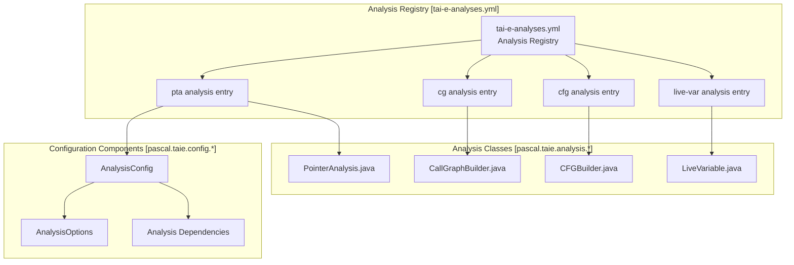
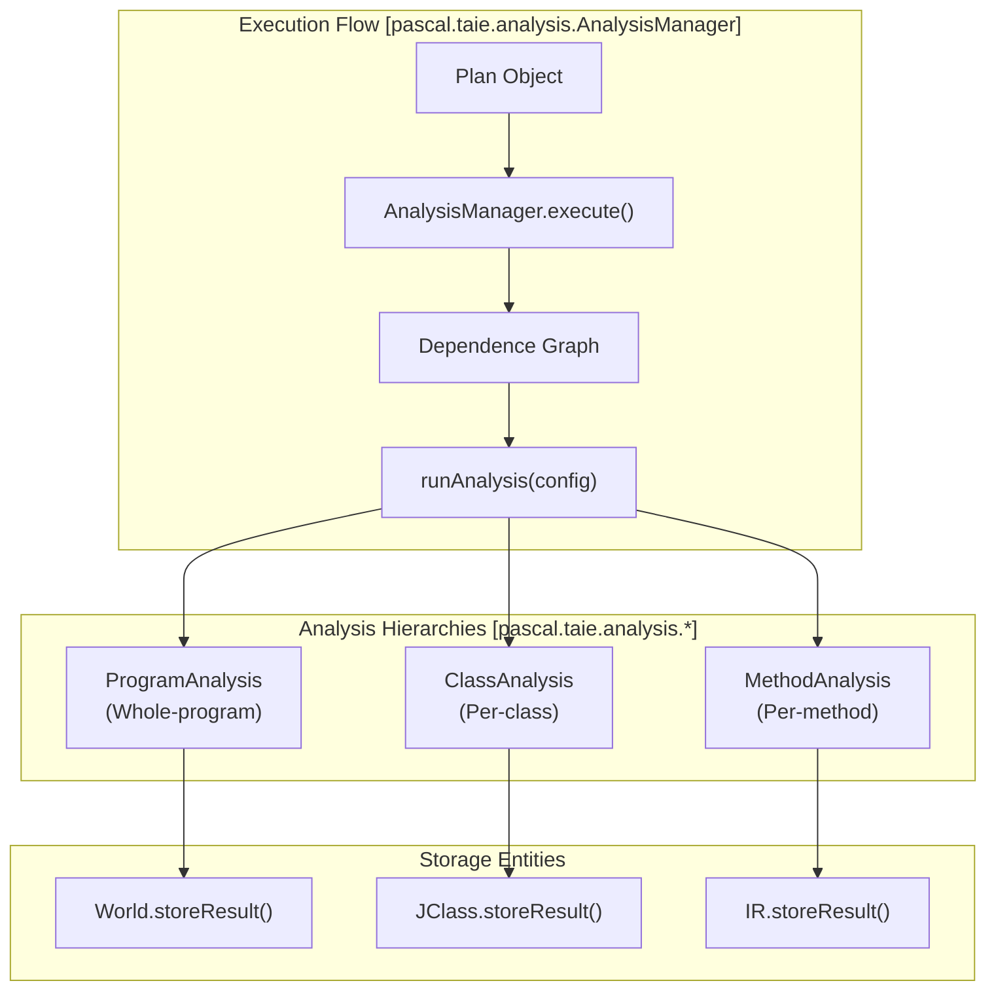

<!-- source: DeepWiki mcp.deepwiki.com · repo pascal-lab/Tai-e · page 2.3 Analysis Management · fetched 2026-10-12 -->

# Analysis Management

Relevant source files

The following files were used as context for generating this wiki page:

- [src/main/java/pascal/taie/Main.java](src/main/java/pascal/taie/Main.java)
- [src/main/java/pascal/taie/analysis/Analysis.java](src/main/java/pascal/taie/analysis/Analysis.java)
- [src/main/java/pascal/taie/analysis/AnalysisManager.java](src/main/java/pascal/taie/analysis/AnalysisManager.java)
- [src/main/java/pascal/taie/analysis/graph/callgraph/CallGraphBuilder.java](src/main/java/pascal/taie/analysis/graph/callgraph/CallGraphBuilder.java)
- [src/main/java/pascal/taie/analysis/graph/callgraph/CallGraphs.java](src/main/java/pascal/taie/analysis/graph/callgraph/CallGraphs.java)
- [src/main/java/pascal/taie/analysis/graph/callgraph/PTABasedBuilder.java](src/main/java/pascal/taie/analysis/graph/callgraph/PTABasedBuilder.java)
- [src/main/java/pascal/taie/analysis/graph/cfg/CFGBuilder.java](src/main/java/pascal/taie/analysis/graph/cfg/CFGBuilder.java)
- [src/main/java/pascal/taie/analysis/graph/cfg/CFGDumper.java](src/main/java/pascal/taie/analysis/graph/cfg/CFGDumper.java)
- [src/main/java/pascal/taie/analysis/graph/flowgraph/FlowGraphDumper.java](src/main/java/pascal/taie/analysis/graph/flowgraph/FlowGraphDumper.java)
- [src/main/java/pascal/taie/analysis/graph/icfg/ICFGBuilder.java](src/main/java/pascal/taie/analysis/graph/icfg/ICFGBuilder.java)
- [src/main/java/pascal/taie/analysis/misc/IRDumper.java](src/main/java/pascal/taie/analysis/misc/IRDumper.java)
- [src/main/java/pascal/taie/analysis/misc/ResultProcessor.java](src/main/java/pascal/taie/analysis/misc/ResultProcessor.java)
- [src/main/java/pascal/taie/analysis/pta/PointerAnalysis.java](src/main/java/pascal/taie/analysis/pta/PointerAnalysis.java)
- [src/main/java/pascal/taie/analysis/pta/client/Collector.java](src/main/java/pascal/taie/analysis/pta/client/Collector.java)
- [src/main/java/pascal/taie/analysis/pta/plugin/AnalysisTimer.java](src/main/java/pascal/taie/analysis/pta/plugin/AnalysisTimer.java)
- [src/main/java/pascal/taie/analysis/pta/plugin/Profiler.java](src/main/java/pascal/taie/analysis/pta/plugin/Profiler.java)
- [src/main/java/pascal/taie/config/AnalysisConfig.java](src/main/java/pascal/taie/config/AnalysisConfig.java)
- [src/main/java/pascal/taie/config/AnalysisOptions.java](src/main/java/pascal/taie/config/AnalysisOptions.java)
- [src/main/java/pascal/taie/config/AnalysisPlanner.java](src/main/java/pascal/taie/config/AnalysisPlanner.java)
- [src/main/java/pascal/taie/config/ConfigManager.java](src/main/java/pascal/taie/config/ConfigManager.java)
- [src/main/java/pascal/taie/config/Configs.java](src/main/java/pascal/taie/config/Configs.java)
- [src/main/java/pascal/taie/config/Plan.java](src/main/java/pascal/taie/config/Plan.java)
- [src/main/java/pascal/taie/config/PlanConfig.java](src/main/java/pascal/taie/config/PlanConfig.java)
- [src/main/java/pascal/taie/util/Timer.java](src/main/java/pascal/taie/util/Timer.java)
- [src/main/java/pascal/taie/util/graph/DotDumper.java](src/main/java/pascal/taie/util/graph/DotDumper.java)
- [src/main/resources/android/tai-e-android-analyses.yml](src/main/resources/android/tai-e-android-analyses.yml)
- [src/main/resources/tai-e-analyses.yml](src/main/resources/tai-e-analyses.yml)
- [src/test/java/pascal/taie/analysis/Tests.java](src/test/java/pascal/taie/analysis/Tests.java)
- [src/test/java/pascal/taie/config/AnalysisOptionsTest.java](src/test/java/pascal/taie/config/AnalysisOptionsTest.java)

This document explains how analyses are registered, planned, and executed within the Tai-e framework. Analysis management encompasses the configuration registry system, dependency resolution, execution orchestration, and result lifecycle management.

For information about configuring specific analyses like pointer analysis, see [Pointer Analysis Configuration](#3.1). For details about the frontend that prepares the program representation before analysis, see [Frontend](#5).

## Analysis Registry System

Tai-e uses a centralized YAML-based registry to define all available analyses and their configurations. The registry file `tai-e-analyses.yml` serves as the authoritative source for analysis metadata, dependencies, and default options.

Each analysis entry in the registry contains several key components:

| Component | Purpose | Example |
|-----------|---------|---------|
| `id` | Unique identifier for the analysis | `pta`, `cg`, `cfg` |
| `analysisClass` | Fully qualified Java class name | `pascal.taie.analysis.pta.PointerAnalysis` |
| `description` | Human-readable description | `"whole-program pointer analysis"` |
| `requires` | List of prerequisite analyses | `[ pta(algorithm=pta) ]` |
| `options` | Default configuration parameters | Context sensitivity, output settings |

**Sources:** [src/main/resources/tai-e-analyses.yml:1-171]()

## Analysis Planning and Configuration

The planning phase bridges the gap between raw `Options` and the final `Plan`. It distinguishes between two types of configurations:
- **`AnalysisConfig`**: Defined in `tai-e-analyses.yml`, containing the implementation class and requirement metadata [src/main/java/pascal/taie/config/PlanConfig.java:42-45]().
- **`PlanConfig`**: Specified via command line or a plan file, containing the `id` and specific `AnalysisOptions` for a run [src/main/java/pascal/taie/config/PlanConfig.java:53-72]().

### AnalysisPlanner Pipeline
The `AnalysisPlanner` resolves dependencies and ensures a valid execution sequence.

1. **Resolution**: Converts `PlanConfig` IDs to full `AnalysisConfig` objects using `ConfigManager` [src/main/java/pascal/taie/config/AnalysisPlanner.java:79-83]().
2. **Expansion**: Automatically adds required prerequisite analyses not explicitly mentioned in the input [src/main/java/pascal/taie/config/AnalysisPlanner.java:151-162]().
3. **Sorting**: Uses a `TopologicalSorter` on the dependence graph to produce a linear `Plan` [src/main/java/pascal/taie/config/AnalysisPlanner.java:165]().
4. **Scope Adjustment**: If `Scope.REACHABLE` is selected, it ensures `CallGraphBuilder` (cg) is placed early in the sequence [src/main/java/pascal/taie/config/AnalysisPlanner.java:166-169]().

**Sources:** [src/main/java/pascal/taie/config/AnalysisPlanner.java:45-170](), [src/main/java/pascal/taie/config/PlanConfig.java:47-72]()

## Analysis Manager and Execution

The `AnalysisManager` class orchestrates the execution of the `Plan`. It handles instantiation via reflection and manages result storage.

The execution process follows these steps:
1. **Dependency Setup**: Builds a `SimpleGraph` of analysis IDs to track result utility [src/main/java/pascal/taie/analysis/AnalysisManager.java:90-98]().
2. **Sequential Invocation**: Iterates through `plan.analyses()`, wrapping each in `Monitor.runAndCount` for performance tracking [src/main/java/pascal/taie/analysis/AnalysisManager.java:102-109]().
3. **Reflection**: Instantiates analysis classes using a constructor that accepts `AnalysisConfig` [src/main/java/pascal/taie/analysis/AnalysisManager.java:115-132]().
4. **Result Lifecycle**: If `keepAllResults` is false, it calls `clearUnusedResults()` after each analysis to free memory [src/main/java/pascal/taie/analysis/AnalysisManager.java:107]().

**Sources:** [src/main/java/pascal/taie/analysis/AnalysisManager.java:51-145]()

## Analysis Types and Execution Contexts

Tai-e supports three distinct analysis types, each with different execution contexts and result storage patterns:

### Program Analysis
Whole-program analyses that operate on the entire program representation. Results are stored in the `World` singleton [src/main/java/pascal/taie/analysis/AnalysisManager.java:147-152]().
*Example*: `PointerAnalysis` [src/main/java/pascal/taie/analysis/pta/PointerAnalysis.java:66]().

### Class Analysis  
Per-class analyses that process each class individually. Results are stored within each `JClass` [src/main/java/pascal/taie/analysis/AnalysisManager.java:154-161]().
*Scope*: Can be `APP`, `ALL`, or `REACHABLE` (based on call graph) [src/main/java/pascal/taie/analysis/AnalysisManager.java:164-188]().

### Method Analysis
Per-method analyses that process individual method IRs. Results are stored in the `IR` object [src/main/java/pascal/taie/analysis/AnalysisManager.java:190-202]().
*Example*: `CFGBuilder` [src/main/java/pascal/taie/analysis/graph/cfg/CFGBuilder.java:49]().

**Sources:** [src/main/java/pascal/taie/analysis/AnalysisManager.java:134-202]()

## Dependency Management and Execution Order

Dependencies are enforced during planning and execution. The registry uses the `requires` field to define these constraints.

| Analysis ID | Prerequisite | Reason |
|-----------|---------|---------|
| `cg` | `pta` | Call graph requires points-to information for resolution [src/main/resources/tai-e-analyses.yml:42]() |
| `cfg` | `throw` | Control flow depends on exception analysis [src/main/resources/tai-e-analyses.yml:83]() |
| `icfg` | `cfg`, `cg` | Interprocedural graph links intraprocedural CFGs via call edges [src/main/resources/tai-e-analyses.yml:91]() |
| `def-use` | `reach-def` | Def-use chains are built from reaching definitions [src/main/resources/tai-e-analyses.yml:122]() |

**Sources:** [src/main/resources/tai-e-analyses.yml:39-138]()

## Result Management and Memory Optimization

The `AnalysisManager` implements an intelligent result cleanup system. If `keep-result` is not set to `all`, results are cleared when their dependent analyses have finished [src/main/java/pascal/taie/analysis/AnalysisManager.java:223-260]().

1. **Dependency Tracking**: Uses `dependenceGraph` to count outgoing edges for each analysis result [src/main/java/pascal/taie/analysis/AnalysisManager.java:91-96]().
2. **Cleanup**: When an analysis finishes, the manager checks all previously executed analyses. If an analysis has no more dependents in the remaining plan, its results are purged from `World`, `JClass`, or `IR` [src/main/java/pascal/taie/analysis/AnalysisManager.java:234-259]().

**Sources:** [src/main/java/pascal/taie/analysis/AnalysisManager.java:82-98](), [src/main/java/pascal/taie/analysis/AnalysisManager.java:223-260]()

## Testing and Validation Framework

The analysis management system integrates with Tai-e's testing infrastructure via the `Tests` utility. It allows running analyses on specific input classes and comparing results against "expected" files [src/test/java/pascal/taie/analysis/Tests.java:135-147]().

*   **`testMain`**: Runs analysis starting from a main method [src/test/java/pascal/taie/analysis/Tests.java:82-85]().
*   **`ResultProcessor`**: A special analysis (`id: process-result`) that either dumps current results to a file or compares them against an existing baseline [src/main/resources/tai-e-analyses.yml:141-149]().

**Sources:** [src/test/java/pascal/taie/analysis/Tests.java:51-147](), [src/main/resources/tai-e-analyses.yml:141-149]()

---

