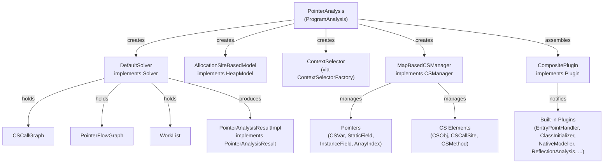
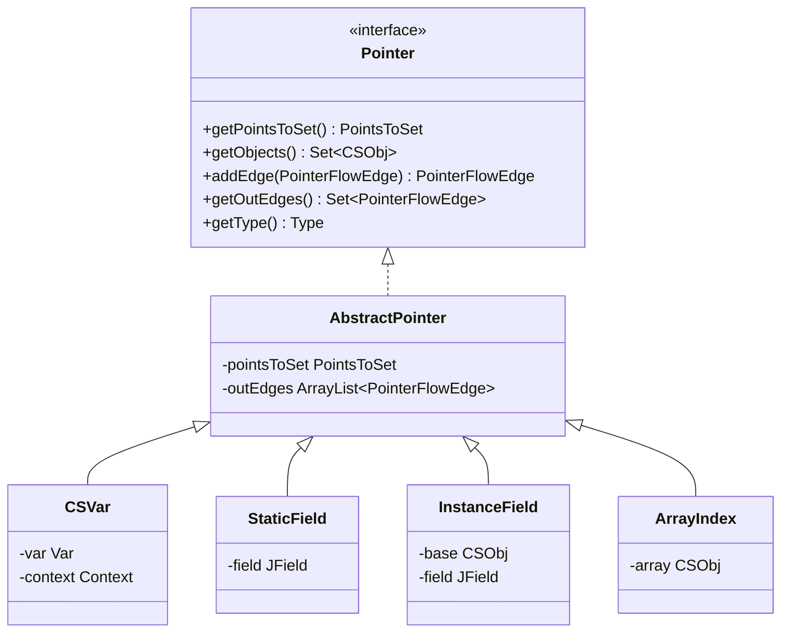
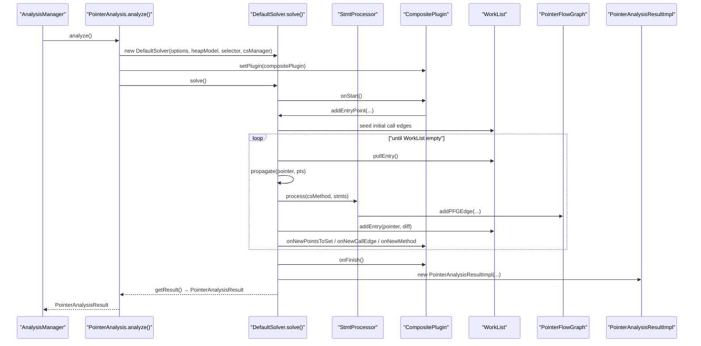

<!-- source: DeepWiki mcp.deepwiki.com · repo pascal-lab/Tai-e · page 3 Pointer Analysis · fetched 2026-10-12 -->

# Pointer Analysis

Relevant source files

The following files were used as context for generating this wiki page:

- [src/main/java/pascal/taie/analysis/graph/callgraph/CallGraphBuilder.java](src/main/java/pascal/taie/analysis/graph/callgraph/CallGraphBuilder.java)
- [src/main/java/pascal/taie/analysis/graph/callgraph/CallGraphs.java](src/main/java/pascal/taie/analysis/graph/callgraph/CallGraphs.java)
- [src/main/java/pascal/taie/analysis/graph/callgraph/PTABasedBuilder.java](src/main/java/pascal/taie/analysis/graph/callgraph/PTABasedBuilder.java)
- [src/main/java/pascal/taie/analysis/graph/cfg/CFGBuilder.java](src/main/java/pascal/taie/analysis/graph/cfg/CFGBuilder.java)
- [src/main/java/pascal/taie/analysis/graph/cfg/CFGDumper.java](src/main/java/pascal/taie/analysis/graph/cfg/CFGDumper.java)
- [src/main/java/pascal/taie/analysis/graph/flowgraph/FlowGraphDumper.java](src/main/java/pascal/taie/analysis/graph/flowgraph/FlowGraphDumper.java)
- [src/main/java/pascal/taie/analysis/graph/icfg/ICFGBuilder.java](src/main/java/pascal/taie/analysis/graph/icfg/ICFGBuilder.java)
- [src/main/java/pascal/taie/analysis/misc/IRDumper.java](src/main/java/pascal/taie/analysis/misc/IRDumper.java)
- [src/main/java/pascal/taie/analysis/misc/ResultProcessor.java](src/main/java/pascal/taie/analysis/misc/ResultProcessor.java)
- [src/main/java/pascal/taie/analysis/pta/PointerAnalysis.java](src/main/java/pascal/taie/analysis/pta/PointerAnalysis.java)
- [src/main/java/pascal/taie/analysis/pta/client/Collector.java](src/main/java/pascal/taie/analysis/pta/client/Collector.java)
- [src/main/java/pascal/taie/analysis/pta/core/cs/element/AbstractPointer.java](src/main/java/pascal/taie/analysis/pta/core/cs/element/AbstractPointer.java)
- [src/main/java/pascal/taie/analysis/pta/core/cs/element/Pointer.java](src/main/java/pascal/taie/analysis/pta/core/cs/element/Pointer.java)
- [src/main/java/pascal/taie/analysis/pta/core/solver/DefaultSolver.java](src/main/java/pascal/taie/analysis/pta/core/solver/DefaultSolver.java)
- [src/main/java/pascal/taie/analysis/pta/core/solver/OtherEdge.java](src/main/java/pascal/taie/analysis/pta/core/solver/OtherEdge.java)
- [src/main/java/pascal/taie/analysis/pta/core/solver/PointerFlowEdge.java](src/main/java/pascal/taie/analysis/pta/core/solver/PointerFlowEdge.java)
- [src/main/java/pascal/taie/analysis/pta/core/solver/PointerFlowGraph.java](src/main/java/pascal/taie/analysis/pta/core/solver/PointerFlowGraph.java)
- [src/main/java/pascal/taie/analysis/pta/core/solver/Solver.java](src/main/java/pascal/taie/analysis/pta/core/solver/Solver.java)
- [src/main/java/pascal/taie/analysis/pta/plugin/Profiler.java](src/main/java/pascal/taie/analysis/pta/plugin/Profiler.java)
- [src/main/java/pascal/taie/analysis/pta/plugin/ThreadHandler.java](src/main/java/pascal/taie/analysis/pta/plugin/ThreadHandler.java)
- [src/main/java/pascal/taie/util/graph/DotDumper.java](src/main/java/pascal/taie/util/graph/DotDumper.java)
- [src/main/resources/tai-e-analyses.yml](src/main/resources/tai-e-analyses.yml)
- [src/test/java/pascal/taie/analysis/Tests.java](src/test/java/pascal/taie/analysis/Tests.java)

This page introduces the pointer analysis subsystem in Tai-e: its role in the framework, the key concepts it builds on, and how its major components relate to each other. Detailed treatment of individual components is deferred to sub-pages:

- For configuration options (context sensitivity, heap merging flags, etc.), see [Pointer Analysis Configuration](#3.1)
- For the propagation algorithm and `DefaultSolver`, see [Solver Architecture](#3.2)
- For the plugin lifecycle and built-in plugins, see [Plugin System](#3.3)
- For heap abstraction and object types, see [Heap Model](#3.4)
- For querying results and client analyses, see [Results and Clients](#3.5)
- For writing and running PTA tests, see [Testing Framework](#3.6)

---

## Role in the Framework

Pointer analysis is Tai-e's central whole-program analysis. It is registered under the ID `"pta"` in [src/main/resources/tai-e-analyses.yml:1-3]() as a `ProgramAnalysis` and is a direct prerequisite for many other analyses:

| Analysis | ID | Depends on `pta` via |
|---|---|---|
| `CallGraphBuilder` | `cg` | `requires: [pta(algorithm=pta)]` |
| `MayFailCast` | `may-fail-cast` | `requires: [pta]` |
| `PolymorphicCallSite` | `poly-call` | `requires: [pta]` |
| `MayAliasPair` | `may-alias-pair` | `requires: [pta]` |
| `SideEffectAnalysis` | `side-effect` | `requires: [pta]` |
| `InterConstantPropagation` | `inter-const-prop` | `requires: [pta(alias-aware=true)]` |

The analysis is implemented by `pascal.taie.analysis.pta.PointerAnalysis` and produces a `PointerAnalysisResult`.

Sources: [src/main/resources/tai-e-analyses.yml:1-130](), [src/main/java/pascal/taie/analysis/pta/PointerAnalysis.java:66-68]()

---

## Key Concepts

**Points-to set.** Each pointer (variable, field, or array element) is associated with a set of abstract heap objects it may reference at runtime. This is managed via `PointsToSet` and `PointsToSetFactory`.

**Heap abstraction.** Concrete heap objects are abstracted by their allocation site (`New` statement). The default is `AllocationSiteBasedModel`. The `HeapModel` manages the `Obj` hierarchy, including `NewObj`, `ConstantObj`, and `MockObj`.

**Context sensitivity.** The analysis can distinguish multiple calling contexts for the same method. Supported variants include context-insensitive (`ci`), k-object (`k-obj`), k-type (`k-type`), and k-call (`k-call`). A `ContextSelector` assigns contexts to call sites and heap objects.

**Pointer Flow Graph (PFG).** The solver constructs a `PointerFlowGraph` where nodes are `Pointer` instances and edges represent value flow. When a new object enters a pointer's points-to set, it is propagated along outgoing `PointerFlowEdge`s.

**On-the-fly call graph construction.** The call graph is not precomputed. Instead, as the points-to set of a receiver variable grows, the solver resolves callees and adds new call edges dynamically via `DefaultSolver.processCall()`.

Sources: [src/main/java/pascal/taie/analysis/pta/PointerAnalysis.java:75-109](), [src/main/java/pascal/taie/analysis/pta/core/solver/DefaultSolver.java:152-185](), [src/main/java/pascal/taie/analysis/pta/core/solver/DefaultSolver.java:467-470]()

---

## Entry Point: `PointerAnalysis`

The class `pascal.taie.analysis.pta.PointerAnalysis` ([src/main/java/pascal/taie/analysis/pta/PointerAnalysis.java:66-123]()) is the top-level orchestrator. Its `analyze()` method:

1. Creates an `AllocationSiteBasedModel` as the default heap model.
2. Optionally runs a pre-analysis (context-insensitive) when an `advanced` mode is specified.
3. Selects a `ContextSelector` via `ContextSelectorFactory`.
4. Instantiates a `DefaultSolver` with `MapBasedCSManager`.
5. Assembles the `CompositePlugin` with all built-in and user-specified plugins.
6. Calls `solver.solve()` and returns `solver.getResult()`.

**Advanced modes.** The `advanced` option controls pre-analysis-driven configuration:

| Value | Behavior |
|---|---|
| `zipper` / `zipper-e` | Runs CI pre-analysis, uses `Zipper` to select precision-critical methods |
| `scaler` | Runs CI pre-analysis, uses `Scaler` to assign per-method context depths |
| `mahjong` | Runs CI pre-analysis, derives a DFA-based heap model via `Mahjong` |
| `collection` | Uses a selective context selector for `CollectionMethods` |

Sources: [src/main/java/pascal/taie/analysis/pta/PointerAnalysis.java:75-109](), [src/main/java/pascal/taie/analysis/pta/PointerAnalysis.java:112-123]()

---

## Component Architecture

**Architecture diagram — main classes and their relationships**

Sources: [src/main/java/pascal/taie/analysis/pta/PointerAnalysis.java:112-123](), [src/main/java/pascal/taie/analysis/pta/core/solver/DefaultSolver.java:113-169]()

---

## Pointer Types

All nodes in the Pointer Flow Graph implement the `Pointer` interface ([src/main/java/pascal/taie/analysis/pta/core/cs/element/Pointer.java:52-212]()). There are four concrete pointer kinds:

| Class | Represents | Key fields |
|---|---|---|
| `CSVar` | A local variable under a calling context | `Var`, `Context` |
| `StaticField` | A static field | `JField` |
| `InstanceField` | An instance field of a specific heap object | `CSObj` (base), `JField` |
| `ArrayIndex` | The element slot of a specific array object | `CSObj` (array) |

Each pointer holds a `PointsToSet` and a set of outgoing `PointerFlowEdge`s. The base implementation is `AbstractPointer`.

**Pointer type hierarchy**

Sources: [src/main/java/pascal/taie/analysis/pta/core/cs/element/Pointer.java:52-212](), [src/main/java/pascal/taie/analysis/pta/core/solver/DefaultSolver.java:36-44]()

---

## Context-Sensitive Elements

The `CSManager` interface ([src/main/java/pascal/taie/analysis/pta/core/cs/element/CSManager.java:52-210]()) acts as a factory and registry for all context-sensitive elements. The default implementation is `MapBasedCSManager`.

| Element type | Factory method | Description |
|---|---|---|
| `CSVar` | `getCSVar(Context, Var)` | Variable under a context |
| `CSObj` | `getCSObj(Context, Obj)` | Heap object under a heap context |
| `CSCallSite` | `getCSCallSite(Context, Invoke)` | Call site under a context |
| `CSMethod` | `getCSMethod(Context, JMethod)` | Method under a context |
| `StaticField` | `getStaticField(JField)` | Static field pointer (context-free) |
| `InstanceField` | `getInstanceField(CSObj, JField)` | Field of a specific CS object |
| `ArrayIndex` | `getArrayIndex(CSObj)` | Element slot of a specific CS array |

Sources: [src/main/java/pascal/taie/analysis/pta/core/cs/element/CSManager.java:52-210](), [src/main/java/pascal/taie/analysis/pta/core/solver/DefaultSolver.java:119-126]()

---

## Propagation and Call Graph Construction

The solver's main loop in `DefaultSolver.solve()` ([src/main/java/pascal/taie/analysis/pta/core/solver/DefaultSolver.java:307-337]()) drains a `WorkList` of entries.

When a `PointerEntry` is dequeued, the solver calls `propagate()`, which:
1. Applies type filters via `PropagateTypes`.
2. Computes the diff against the existing points-to set.
3. Pushes the diff along all outgoing `PointerFlowEdge`s in the `PointerFlowGraph`.

The **on-the-fly call graph** grows in `processCall()` ([src/main/java/pascal/taie/analysis/pta/core/solver/DefaultSolver.java:467-494]()): for each new object in a receiver variable's points-to set, the solver resolves the callee, selects a context via `ContextSelector.selectContext()`, and adds a call edge.

**Statement processing** is handled by the `StmtProcessor` ([src/main/java/pascal/taie/analysis/pta/core/solver/DefaultSolver.java:549-737]()), which implements `StmtVisitor` and translates IR statements into PFG edges:

| IR statement | Action |
|---|---|
| `New` | Creates a heap object via `HeapModel.getObj()`, adds to LHS points-to set |
| `Copy` | Adds a `LOCAL_ASSIGN` PFG edge from RHS to LHS |
| `Cast` | Adds a `CAST` PFG edge with a `TypeFilter` |
| `LoadField` (static) | Adds a `STATIC_LOAD` edge from `StaticField` to LHS |
| `StoreField` (static) | Adds a `STATIC_STORE` edge from RHS to `StaticField` |

Sources: [src/main/java/pascal/taie/analysis/pta/core/solver/DefaultSolver.java:307-494](), [src/main/java/pascal/taie/analysis/pta/core/solver/DefaultSolver.java:549-737]()

---

## Pointer Flow Graph

`PointerFlowGraph` ([src/main/java/pascal/taie/analysis/pta/core/solver/PointerFlowGraph.java:39-90]()) stores flow edges directly on each `Pointer` node. Edges are typed by `FlowKind`:

| `FlowKind` | Meaning |
|---|---|
| `LOCAL_ASSIGN` | `x = y` |
| `CAST` | `x = (T) y` |
| `INSTANCE_LOAD` | `x = o.f` |
| `INSTANCE_STORE` | `o.f = x` |
| `STATIC_LOAD` | `x = T.f` |
| `STATIC_STORE` | `T.f = x` |
| `ARRAY_LOAD` | `x = a[i]` |
| `ARRAY_STORE` | `a[i] = x` |
| `PARAMETER_PASSING` | argument → parameter |
| `RETURN` | return value → LHS |
| `OTHER` | custom edges (e.g., `OtherEdge`) |

Sources: [src/main/java/pascal/taie/analysis/pta/core/solver/PointerFlowGraph.java:39-90](), [src/main/java/pascal/taie/analysis/graph/flowgraph/FlowKind.java:25-31]()

---

## Built-in Plugins

`PointerAnalysis.setPlugin()` ([src/main/java/pascal/taie/analysis/pta/PointerAnalysis.java:125-165]()) assembles a `CompositePlugin` from several components:

**Always active:**
- `AnalysisTimer`: Records elapsed time.
- `EntryPointHandler`: Seeds entry methods and initial objects.
- `ClassInitializer`: Triggers `<clinit>` on first use.
- `ThreadHandler`: Models `Thread.start()` and `currentThread()` ([src/main/java/pascal/taie/analysis/pta/plugin/ThreadHandler.java:53-150]()).
- `NativeModeller`: Models native methods.
- `ExceptionAnalysis`: Models exception propagation.

**Conditionally active:**
- `AndroidAnalysis`: Enabled in Android mode.
- `ReflectionAnalysis`: Enabled when `reflection-inference` or `reflection-log` is set.
- `LambdaAnalysis` / `InvokeDynamicAnalysis`: Enabled for Java 8+ and `handle-invokedynamic=true`.
- `TaintAnalysis`: Enabled when `taint-config` is provided.

Sources: [src/main/java/pascal/taie/analysis/pta/PointerAnalysis.java:125-165](), [src/main/java/pascal/taie/analysis/pta/plugin/ThreadHandler.java:53-150]()

---

## Analysis Results

After solving, `solver.getResult()` returns a `PointerAnalysisResult` ([src/main/java/pascal/taie/analysis/pta/PointerAnalysisResult.java:55-183]()).

Key query methods:
- `getPointsToSet(Var)`: Returns the context-insensitive points-to set.
- `getPointsToSet(Var, JField)`: Returns the points-to set for an instance field.
- `mayAlias(Var, Var)`: Checks if two variables may point to the same object.
- `getCSCallGraph()`: Returns the context-sensitive call graph.
- `getCallGraph()`: Returns the context-insensitive call graph.

Sources: [src/main/java/pascal/taie/analysis/pta/PointerAnalysisResult.java:55-183](), [src/main/java/pascal/taie/analysis/pta/core/solver/DefaultSolver.java:227-230]()

---

## Data Flow Summary

**End-to-end data flow from invocation to result**

Sources: [src/main/java/pascal/taie/analysis/pta/PointerAnalysis.java:112-123](), [src/main/java/pascal/taie/analysis/pta/core/solver/DefaultSolver.java:246-337]()

---

