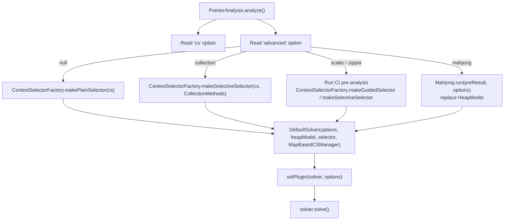
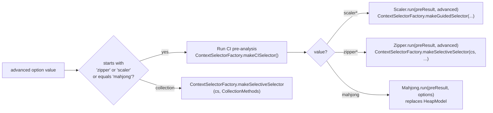
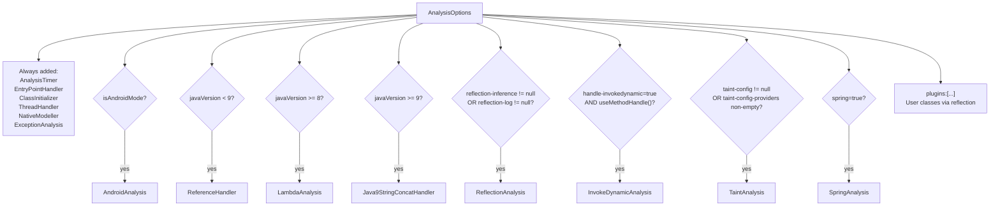

<!-- source: DeepWiki mcp.deepwiki.com · repo pascal-lab/Tai-e · page 3.1 Pointer Analysis Configuration · fetched 2026-10-12 -->

# Pointer Analysis Configuration

<details>
<summary>Relevant source files</summary>

The following files were used as context for generating this wiki page:

- [config/javadoc/header.html](config/javadoc/header.html)
- [config/javadoc/javadoc.css](config/javadoc/javadoc.css)
- [config/javadoc/overview.html](config/javadoc/overview.html)
- [src/main/java/pascal/taie/analysis/graph/callgraph/CallGraphBuilder.java](src/main/java/pascal/taie/analysis/graph/callgraph/CallGraphBuilder.java)
- [src/main/java/pascal/taie/analysis/graph/callgraph/CallGraphs.java](src/main/java/pascal/taie/analysis/graph/callgraph/CallGraphs.java)
- [src/main/java/pascal/taie/analysis/graph/callgraph/PTABasedBuilder.java](src/main/java/pascal/taie/analysis/graph/callgraph/PTABasedBuilder.java)
- [src/main/java/pascal/taie/analysis/graph/cfg/CFGBuilder.java](src/main/java/pascal/taie/analysis/graph/cfg/CFGBuilder.java)
- [src/main/java/pascal/taie/analysis/graph/cfg/CFGDumper.java](src/main/java/pascal/taie/analysis/graph/cfg/CFGDumper.java)
- [src/main/java/pascal/taie/analysis/graph/flowgraph/FlowGraphDumper.java](src/main/java/pascal/taie/analysis/graph/flowgraph/FlowGraphDumper.java)
- [src/main/java/pascal/taie/analysis/graph/icfg/ICFGBuilder.java](src/main/java/pascal/taie/analysis/graph/icfg/ICFGBuilder.java)
- [src/main/java/pascal/taie/analysis/misc/IRDumper.java](src/main/java/pascal/taie/analysis/misc/IRDumper.java)
- [src/main/java/pascal/taie/analysis/misc/ResultProcessor.java](src/main/java/pascal/taie/analysis/misc/ResultProcessor.java)
- [src/main/java/pascal/taie/analysis/pta/PointerAnalysis.java](src/main/java/pascal/taie/analysis/pta/PointerAnalysis.java)
- [src/main/java/pascal/taie/analysis/pta/client/Collector.java](src/main/java/pascal/taie/analysis/pta/client/Collector.java)
- [src/main/java/pascal/taie/analysis/pta/core/solver/PropagateTypes.java](src/main/java/pascal/taie/analysis/pta/core/solver/PropagateTypes.java)
- [src/main/java/pascal/taie/analysis/pta/plugin/Profiler.java](src/main/java/pascal/taie/analysis/pta/plugin/Profiler.java)
- [src/main/java/pascal/taie/analysis/pta/plugin/reflection/OthersModel.java](src/main/java/pascal/taie/analysis/pta/plugin/reflection/OthersModel.java)
- [src/main/java/pascal/taie/util/graph/DotDumper.java](src/main/java/pascal/taie/util/graph/DotDumper.java)
- [src/main/resources/tai-e-analyses.yml](src/main/resources/tai-e-analyses.yml)
- [src/test/java/pascal/taie/analysis/Tests.java](src/test/java/pascal/taie/analysis/Tests.java)

</details>


This page documents all configuration options for the `pta` (pointer analysis) analysis in Tai-e. It covers what each option does, its default value, and how it affects the analysis. For information about the solver that consumes these options at runtime, see [Solver Architecture](#3.2). For information about the plugin system activated by these options, see [Plugin System](#3.3). For information about the heap model options, see [Heap Model](#3.4).

---

## Overview

Pointer analysis in Tai-e is registered under the analysis ID `pta` and implemented in `pascal.taie.analysis.pta.PointerAnalysis` [src/main/java/pascal/taie/analysis/pta/PointerAnalysis.java:66-68](). All options are declared with defaults in `src/main/resources/tai-e-analyses.yml` [src/main/resources/tai-e-analyses.yml:1-36]() and are accessed at runtime via `AnalysisOptions`.

Options are passed on the command line using the `-a` flag:

```bash
-a "pta=cs:2-obj;only-app:true;time-limit:60"
```

The full set of available options and their defaults is declared at [src/main/resources/tai-e-analyses.yml:1-35]().

---

## How Options Are Consumed

`PointerAnalysis.analyze()` reads options and uses them to assemble the solver and its components. The flow is:

**Configuration resolution diagram: `PointerAnalysis.analyze()` to solver construction**



Sources: [src/main/java/pascal/taie/analysis/pta/PointerAnalysis.java:73-121]()

---

## All Configuration Options

### `cs` — Context Sensitivity

| Value | Meaning |
|---|---|
| `ci` | Context-insensitive (default) |
| `k-obj` | k-object-sensitive (e.g., `1-obj`, `2-obj`) |
| `k-type` | k-type-sensitive (e.g., `1-type`, `2-type`) |
| `k-call` | k-call-site-sensitive (e.g., `1-call`, `2-call`) |
| `k-obj-k'h` | k-object-sensitive with explicit heap context limit (e.g., `2-type-2h`) |

- Default heap context depth is `k-1` [src/main/resources/tai-e-analyses.yml:5]().
- The value is passed to `ContextSelectorFactory.makePlainSelector(cs)` when no `advanced` option is set [src/main/java/pascal/taie/analysis/pta/PointerAnalysis.java:106-108]().
- When `advanced` is `zipper` or `collection`, the `cs` value is used to construct a selective or guided selector respectively [src/main/java/pascal/taie/analysis/pta/PointerAnalysis.java:82-96]().

Sources: [src/main/java/pascal/taie/analysis/pta/PointerAnalysis.java:77-107](), [src/main/resources/tai-e-analyses.yml:5]()

---

### `only-app` — Application-Only Analysis

- **Default:** `false` [src/main/resources/tai-e-analyses.yml:6]()
- When `true`, the solver ignores library methods. This affects parameter passing, return value propagation, and call graph construction for library callees.

Sources: [src/main/resources/tai-e-analyses.yml:6]()

---

### `implicit-entries` — Implicit Entry Points

- **Default:** `true` [src/main/resources/tai-e-analyses.yml:7]()
- Controls whether methods implicitly invoked by the JVM (e.g., static initializers, thread `run()` methods) are treated as analysis entry points.
- When `false`, the analysis may be unsound because some code paths are never reached.
- Consumed by the `EntryPointHandler` plugin [src/main/java/pascal/taie/analysis/pta/PointerAnalysis.java:131]().

Sources: [src/main/resources/tai-e-analyses.yml:7]()

---

### `distinguish-string-constants` — String Constant Handling

- **Default:** `reflection` [src/main/resources/tai-e-analyses.yml:8]()
- Controls which string constants are given distinct heap objects (rather than being merged).

| Value | Effect |
|---|---|
| `reflection` | Distinguish only reflection-relevant strings (class, method, and field names) |
| `null` | Merge all string constants into one object |
| `app` | Distinguish string constants appearing in application code |
| `all` | Distinguish every string constant |
| `<predicate-class-name>` | Use a custom `java.util.function.Predicate<String>` implementation |

Sources: [src/main/resources/tai-e-analyses.yml:8-13]()

---

### Object Merging Flags

Three independent boolean flags control whether certain categories of objects are merged into a single representative:

| Option | Default | Objects Affected |
|---|---|---|
| `merge-string-objects` | `true` | `java.lang.String` objects |
| `merge-string-builders` | `true` | `java.lang.StringBuilder` and `java.lang.StringBuffer` objects |
| `merge-exception-objects` | `true` | Exception objects |

When `true`, all objects of the given category are collapsed into one heap object, trading precision for scalability. These options are read by `AllocationSiteBasedModel` [src/main/java/pascal/taie/analysis/pta/PointerAnalysis.java:77]().

Sources: [src/main/resources/tai-e-analyses.yml:14-16]()

---

### `propagate-types` — Type Propagation Filter

- **Default:** `[reference]` [src/main/resources/tai-e-analyses.yml:18]()
- A list of type categories whose values are propagated through the pointer flow graph.
- Possible list elements: `reference`, `null`, `int`, `long`, `float`, `double`, `char`, `boolean`, `byte`, `short`.

Sources: [src/main/resources/tai-e-analyses.yml:18]()

---

### `handle-invokedynamic` — Invokedynamic Support

- **Default:** `false` [src/main/resources/tai-e-analyses.yml:17]()
- When `true` and `InvokeDynamicAnalysis.useMethodHandle()` returns `true`, the `InvokeDynamicAnalysis` plugin is added to handle `invokedynamic` bytecode instructions [src/main/java/pascal/taie/analysis/pta/PointerAnalysis.java:155-158]().

Sources: [src/main/java/pascal/taie/analysis/pta/PointerAnalysis.java:155-158](), [src/main/resources/tai-e-analyses.yml:17]()

---

### `advanced` — Advanced Analysis Modes

- **Default:** `null` [src/main/resources/tai-e-analyses.yml:19]()

This option activates pre-analysis-based precision techniques. When set, `PointerAnalysis.analyze()` first runs a context-insensitive pre-analysis, then uses its result to configure the main analysis [src/main/java/pascal/taie/analysis/pta/PointerAnalysis.java:81-105]().

| Value | Algorithm | Effect |
|---|---|---|
| `zipper` | Zipper (OOPSLA'18) | Selects precision-critical methods; applies `cs` only to those |
| `zipper-e` | Zipper-Express (TOPLAS'20) | Faster approximation of Zipper |
| `scaler` | Scaler (FSE'18) | Assigns a per-method context sensitivity level |
| `mahjong` | Mahjong (PLDI'17) | Replaces the heap model with a DFA-equivalence-based merged model |
| `collection` | Collection heuristic | Applies selective context sensitivity to collection classes only |

**Advanced mode flow:**



Sources: [src/main/java/pascal/taie/analysis/pta/PointerAnalysis.java:77-107](), [src/main/resources/tai-e-analyses.yml:19-22]()

---

### `reflection-inference` — Reflection Resolution Strategy

- **Default:** `string-constant` [src/main/resources/tai-e-analyses.yml:27]()
- Activates `ReflectionAnalysis` plugin when non-null [src/main/java/pascal/taie/analysis/pta/PointerAnalysis.java:151-154]().

| Value | Behavior |
|---|---|
| `string-constant` | Resolve reflective calls by tracking string constants |
| `solar` | Apply the Solar algorithm (TOSEM'19) |
| `null` | Disable static reflection inference entirely |

Sources: [src/main/java/pascal/taie/analysis/pta/PointerAnalysis.java:151-154](), [src/main/resources/tai-e-analyses.yml:27]()

---

### `reflection-log` — Reflection Log File

- **Default:** `null` [src/main/resources/tai-e-analyses.yml:28]()
- Path to a TamiFlex-format reflection log. When provided, `ReflectionAnalysis` uses logged targets to resolve reflective calls directly [src/main/java/pascal/taie/analysis/pta/PointerAnalysis.java:151-154]().

Sources: [src/main/resources/tai-e-analyses.yml:28]()

---

### Taint Analysis Options

These options are consumed by the `TaintAnalysis` plugin. The plugin is added if either `taint-config` is non-null or `taint-config-providers` is non-empty [src/main/java/pascal/taie/analysis/pta/PointerAnalysis.java:159-162]().

| Option | Default | Description |
|---|---|---|
| `taint-config` | `null` | Path to a YAML taint config file or directory |
| `taint-config-providers` | `[]` | List of fully-qualified `TaintConfigProvider` class names |
| `taint-interactive-mode` | `false` | Re-run taint analysis on config file change without restarting PTA |

Sources: [src/main/java/pascal/taie/analysis/pta/PointerAnalysis.java:159-162](), [src/main/resources/tai-e-analyses.yml:29-32]()

---

### `plugins` — User-Defined Plugins

- **Default:** `[]` [src/main/resources/tai-e-analyses.yml:34]()
- A list of fully-qualified class names of additional `Plugin` implementations to load.
- Each class is instantiated via reflection using a no-argument constructor [src/main/java/pascal/taie/analysis/pta/PointerAnalysis.java:166-191]().

Example:
```bash
-a "pta=plugins:[my.example.TaintAnalysis,my.example.AnotherPlugin]"
```

Sources: [src/main/java/pascal/taie/analysis/pta/PointerAnalysis.java:166-191](), [src/main/resources/tai-e-analyses.yml:34]()

---

### `time-limit` — Analysis Time Limit

- **Default:** `-1` (no limit) [src/main/resources/tai-e-analyses.yml:35]()
- Sets a time limit in seconds. When the limit is exceeded, the solver stops its worklist processing early.

Sources: [src/main/resources/tai-e-analyses.yml:35-36]()

---

### Result Dumping Options

These options control whether and how points-to results are written to output files.

| Option | Default | Output |
|---|---|---|
| `dump` | `false` | Dump points-to results with full context information |
| `dump-ci` | `false` | Dump points-to results stripped of context |
| `dump-yaml` | `false` | Dump points-to results in YAML format |
| `expected-file` | `null` | Path to an expected results file for comparison |

Sources: [src/main/resources/tai-e-analyses.yml:23-26]()

---

## Plugin Activation Summary

The following diagram shows which options trigger which built-in plugins.

**Plugin activation by option value:**



Sources: [src/main/java/pascal/taie/analysis/pta/PointerAnalysis.java:125-191]()

---

## Complete Option Reference

| Option | Type | Default | Description |
|---|---|---|---|
| `cs` | string | `ci` | Context sensitivity variant |
| `only-app` | boolean | `false` | Ignore library methods |
| `implicit-entries` | boolean | `true` | Include JVM-implicit entry methods |
| `distinguish-string-constants` | string | `reflection` | String constant heap allocation strategy |
| `merge-string-objects` | boolean | `true` | Merge all `String` objects |
| `merge-string-builders` | boolean | `true` | Merge all `StringBuilder`/`StringBuffer` objects |
| `merge-exception-objects` | boolean | `true` | Merge all exception objects |
| `handle-invokedynamic` | boolean | `false` | Enable `InvokeDynamicAnalysis` plugin |
| `propagate-types` | list | `[reference]` | Types whose values are propagated |
| `advanced` | string | `null` | Advanced precision technique |
| `reflection-inference` | string | `string-constant` | Reflection resolution strategy |
| `reflection-log` | string | `null` | Path to TamiFlex reflection log |
| `taint-config` | string | `null` | Path to taint config file/directory |
| `taint-config-providers` | list | `[]` | Programmatic taint config provider classes |
| `taint-interactive-mode` | boolean | `false` | Interactive taint config re-run mode |
| `plugins` | list | `[]` | Extra `Plugin` implementation class names |
| `time-limit` | int | `-1` | Seconds before forced stop; -1 = unlimited |
| `dump` | boolean | `false` | Dump points-to with context |
| `dump-ci` | boolean | `false` | Dump points-to without context |
| `dump-yaml` | boolean | `false` | Dump points-to in YAML |
| `expected-file` | string | `null` | Path to expected results for comparison |

Sources: [src/main/resources/tai-e-analyses.yml:1-35]()

---

