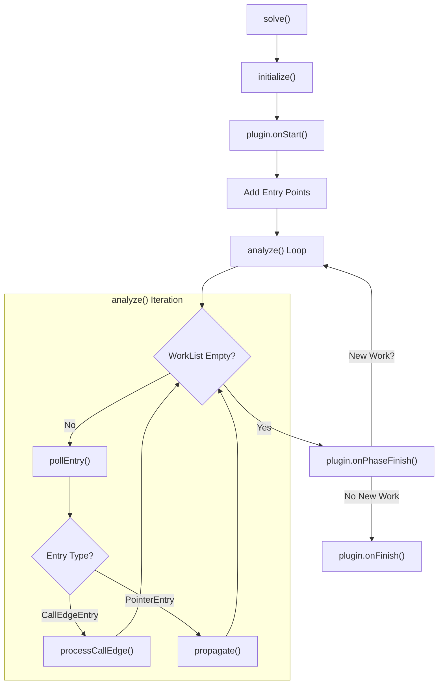

<!-- source: DeepWiki mcp.deepwiki.com · repo pascal-lab/Tai-e · page 3.2 Solver Architecture · fetched 2026-10-12 -->

# Solver Architecture

Relevant source files

The following files were used as context for generating this wiki page:

- [src/main/java/pascal/taie/analysis/graph/callgraph/CallKind.java](src/main/java/pascal/taie/analysis/graph/callgraph/CallKind.java)
- [src/main/java/pascal/taie/analysis/pta/core/cs/element/AbstractPointer.java](src/main/java/pascal/taie/analysis/pta/core/cs/element/AbstractPointer.java)
- [src/main/java/pascal/taie/analysis/pta/core/cs/element/ArrayIndex.java](src/main/java/pascal/taie/analysis/pta/core/cs/element/ArrayIndex.java)
- [src/main/java/pascal/taie/analysis/pta/core/cs/element/CSObj.java](src/main/java/pascal/taie/analysis/pta/core/cs/element/CSObj.java)
- [src/main/java/pascal/taie/analysis/pta/core/cs/element/CSVar.java](src/main/java/pascal/taie/analysis/pta/core/cs/element/CSVar.java)
- [src/main/java/pascal/taie/analysis/pta/core/cs/element/InstanceField.java](src/main/java/pascal/taie/analysis/pta/core/cs/element/InstanceField.java)
- [src/main/java/pascal/taie/analysis/pta/core/cs/element/Pointer.java](src/main/java/pascal/taie/analysis/pta/core/cs/element/Pointer.java)
- [src/main/java/pascal/taie/analysis/pta/core/cs/element/StaticField.java](src/main/java/pascal/taie/analysis/pta/core/cs/element/StaticField.java)
- [src/main/java/pascal/taie/analysis/pta/core/heap/Descriptor.java](src/main/java/pascal/taie/analysis/pta/core/heap/Descriptor.java)
- [src/main/java/pascal/taie/analysis/pta/core/solver/DeclaredParamProvider.java](src/main/java/pascal/taie/analysis/pta/core/solver/DeclaredParamProvider.java)
- [src/main/java/pascal/taie/analysis/pta/core/solver/DefaultSolver.java](src/main/java/pascal/taie/analysis/pta/core/solver/DefaultSolver.java)
- [src/main/java/pascal/taie/analysis/pta/core/solver/EmptyParamProvider.java](src/main/java/pascal/taie/analysis/pta/core/solver/EmptyParamProvider.java)
- [src/main/java/pascal/taie/analysis/pta/core/solver/EntryPoint.java](src/main/java/pascal/taie/analysis/pta/core/solver/EntryPoint.java)
- [src/main/java/pascal/taie/analysis/pta/core/solver/OtherEdge.java](src/main/java/pascal/taie/analysis/pta/core/solver/OtherEdge.java)
- [src/main/java/pascal/taie/analysis/pta/core/solver/ParamProvider.java](src/main/java/pascal/taie/analysis/pta/core/solver/ParamProvider.java)
- [src/main/java/pascal/taie/analysis/pta/core/solver/PointerFlowEdge.java](src/main/java/pascal/taie/analysis/pta/core/solver/PointerFlowEdge.java)
- [src/main/java/pascal/taie/analysis/pta/core/solver/PointerFlowGraph.java](src/main/java/pascal/taie/analysis/pta/core/solver/PointerFlowGraph.java)
- [src/main/java/pascal/taie/analysis/pta/core/solver/Solver.java](src/main/java/pascal/taie/analysis/pta/core/solver/Solver.java)
- [src/main/java/pascal/taie/analysis/pta/core/solver/SpecifiedParamProvider.java](src/main/java/pascal/taie/analysis/pta/core/solver/SpecifiedParamProvider.java)
- [src/main/java/pascal/taie/analysis/pta/core/solver/WorkList.java](src/main/java/pascal/taie/analysis/pta/core/solver/WorkList.java)
- [src/main/java/pascal/taie/analysis/pta/plugin/CompositePlugin.java](src/main/java/pascal/taie/analysis/pta/plugin/CompositePlugin.java)
- [src/main/java/pascal/taie/analysis/pta/plugin/EntryPointHandler.java](src/main/java/pascal/taie/analysis/pta/plugin/EntryPointHandler.java)
- [src/main/java/pascal/taie/analysis/pta/plugin/Plugin.java](src/main/java/pascal/taie/analysis/pta/plugin/Plugin.java)
- [src/main/java/pascal/taie/analysis/pta/plugin/ReferenceHandler.java](src/main/java/pascal/taie/analysis/pta/plugin/ReferenceHandler.java)
- [src/main/java/pascal/taie/analysis/pta/plugin/ThreadHandler.java](src/main/java/pascal/taie/analysis/pta/plugin/ThreadHandler.java)
- [src/main/java/pascal/taie/analysis/pta/pts/DelegatePointsToSet.java](src/main/java/pascal/taie/analysis/pta/pts/DelegatePointsToSet.java)
- [src/main/java/pascal/taie/analysis/pta/pts/PointsToSet.java](src/main/java/pascal/taie/analysis/pta/pts/PointsToSet.java)
- [src/main/java/pascal/taie/analysis/pta/pts/PointsToSetFactory.java](src/main/java/pascal/taie/analysis/pta/pts/PointsToSetFactory.java)

This page describes the architecture of the pointer analysis solver in Tai-e. The solver is the core component responsible for computing points-to information by resolving pointer flow constraints. For information about how to configure pointer analysis, see [Pointer Analysis Configuration](#3.1).

## Overview

The pointer analysis solver in Tai-e implements a flow-insensitive, context-sensitive algorithm that propagates points-to information through a pointer flow graph until a fixed point is reached. The solver architecture is designed to be extensible through a plugin system while maintaining high performance through efficient points-to set representations and constraint propagation mechanisms.

Tai-e's solver uses an on-the-fly call graph construction approach, where method reachability and call edges are discovered as the points-to sets of receiver variables grow.

### System Mapping: Code Entity Space

The following diagram maps high-level solver concepts to their specific implementation classes in the Tai-e codebase.

```mermaid
graph TD
    subgraph "Solver Core Components"
        Solver["Solver Interface <br/> (pascal.taie.analysis.pta.core.solver.Solver)"]
        DefaultSolver["DefaultSolver Implementation <br/> (pascal.taie.analysis.pta.core.solver.DefaultSolver)"]
        PFG["PointerFlowGraph <br/> (pascal.taie.analysis.pta.core.solver.PointerFlowGraph)"]
        WorkList["WorkList <br/> (pascal.taie.analysis.pta.core.solver.WorkList)"]
        CSCallGraph["CSCallGraph <br/> (pascal.taie.analysis.pta.core.cs.CSCallGraph)"]
    end

    subgraph "Context-Sensitive Elements"
        CSManager["CSManager <br/> (pascal.taie.analysis.pta.core.cs.element.CSManager)"]
        CSVar["CSVar <br/> (pascal.taie.analysis.pta.core.cs.element.CSVar)"]
        CSObj["CSObj <br/> (pascal.taie.analysis.pta.core.cs.element.CSObj)"]
        InstanceField["InstanceField <br/> (pascal.taie.analysis.pta.core.cs.element.InstanceField)"]
        ArrayIndex["ArrayIndex <br/> (pascal.taie.analysis.pta.core.cs.element.ArrayIndex)"]
        StaticField["StaticField <br/> (pascal.taie.analysis.pta.core.cs.element.StaticField)"]
    end

    subgraph "Extension Points"
        Plugin["Plugin Interface <br/> (pascal.taie.analysis.pta.plugin.Plugin)"]
        CompositePlugin["CompositePlugin <br/> (pascal.taie.analysis.pta.plugin.CompositePlugin)"]
        Transfer["Transfer Mechanism <br/> (pascal.taie.analysis.pta.core.solver.Transfer)"]
    end

    Solver --> DefaultSolver
    DefaultSolver --> PFG
    DefaultSolver --> WorkList
    DefaultSolver --> CSCallGraph
    DefaultSolver --> CSManager
    DefaultSolver --> Plugin
    Plugin --> CompositePlugin
    
    CSManager --> CSVar
    CSManager --> CSObj
    CSManager --> InstanceField
    CSManager --> ArrayIndex
    CSManager --> StaticField
    
    PFG --> Transfer
```

Sources: [src/main/java/pascal/taie/analysis/pta/core/solver/DefaultSolver.java:99-169](), [src/main/java/pascal/taie/analysis/pta/core/solver/Solver.java:52-89](), [src/main/java/pascal/taie/analysis/pta/plugin/Plugin.java:45-77]()

## Core Components

### Solver Interface

The `Solver` interface [pascal.taie.analysis.pta.core.solver.Solver:52-234]() defines the contract for pointer analysis solvers. It provides the side-effect APIs used by plugins to update points-to information, such as `addPointsTo` [pascal.taie.analysis.pta.core.solver.Solver:95-107]() and `addPFGEdge` [pascal.taie.analysis.pta.core.solver.Solver:133-179]().

### DefaultSolver

`DefaultSolver` [pascal.taie.analysis.pta.core.solver.DefaultSolver:99-169]() is the primary implementation. It manages the analysis lifecycle, including:
- **Time Limiting**: Monitors execution time via `TimeLimiter` and `timeLimit` options [pascal.taie.analysis.pta.core.solver.DefaultSolver:137-144]().
- **Statement Processing**: Uses a `StmtProcessor` to handle IR instructions like `New`, `Copy`, `LoadField`, `StoreField`, and `Invoke` [pascal.taie.analysis.pta.core.solver.DefaultSolver:605-890]().
- **Worklist Management**: Iteratively processes `PointerEntry` and `CallEdgeEntry` items [pascal.taie.analysis.pta.core.solver.WorkList:84-94]().

### PointerFlowGraph and Edges

The `PointerFlowGraph` [pascal.taie.analysis.pta.core.solver.PointerFlowGraph:39-90]() represents the flow of points-to sets.
- **Nodes**: Represented by the `Pointer` interface [pascal.taie.analysis.pta.core.cs.element.Pointer:40-124]().
- **Edges**: `PointerFlowEdge` [pascal.taie.analysis.pta.core.solver.PointerFlowEdge:33-100]() connects a source and target pointer.
- **Transfers**: Edges can have `Transfer` functions [pascal.taie.analysis.pta.core.solver.PointerFlowEdge:71-77]() that transform the points-to set during propagation (e.g., type filtering).

### WorkList Algorithm

The `WorkList` [pascal.taie.analysis.pta.core.solver.WorkList:40-82]() ensures that call edges are processed prior to pointer entries [pascal.taie.analysis.pta.core.solver.WorkList:66-70]() to maintain analysis correctness and prioritize call graph discovery.

Sources: [src/main/java/pascal/taie/analysis/pta/core/solver/DefaultSolver.java:245-337](), [src/main/java/pascal/taie/analysis/pta/core/solver/WorkList.java:40-82](), [src/main/java/pascal/taie/analysis/pta/core/solver/PointerFlowEdge.java:33-47]()

## Pointer Analysis Algorithm

### Main Execution Loop

The `solve()` method in `DefaultSolver` [pascal.taie.analysis.pta.core.solver.DefaultSolver:270-305]() orchestrates the analysis. It initializes entry points, then enters the `analyze()` loop [pascal.taie.analysis.pta.core.solver.DefaultSolver:307-337]().

Sources: [src/main/java/pascal/taie/analysis/pta/core/solver/DefaultSolver.java:270-337](), [src/main/java/pascal/taie/analysis/pta/core/solver/WorkList.java:65-78]()

### Statement Processing Logic

The `StmtProcessor` inside `DefaultSolver` handles the transfer functions for different IR statements.

| Statement Type | Action in Solver | Code Reference |
| :--- | :--- | :--- |
| `New` | Create `CSObj` and add to `CSVar` points-to set. | [DefaultSolver.java:613-625]() |
| `Copy` | Add PFG edge from source `CSVar` to target `CSVar`. | [DefaultSolver.java:632-637]() |
| `LoadField` | If base points to $O$, add PFG edge from $O.f$ to target. | [DefaultSolver.java:664-672]() |
| `StoreField` | If base points to $O$, add PFG edge from source to $O.f$. | [DefaultSolver.java:682-690]() |
| `Invoke` | Resolve target methods and create `CallEdgeEntry`. | [DefaultSolver.java:708-725]() |

Sources: [src/main/java/pascal/taie/analysis/pta/core/solver/DefaultSolver.java:605-725]()

## Extension and Plugins

Tai-e uses a `Plugin` architecture [pascal.taie.analysis.pta.plugin.Plugin:45-132]() to implement features like reflection, thread handling, and GC modeling without bloating the core solver.

### Plugin Lifecycle
1.  `setSolver(Solver)`: Injected at initialization [pascal.taie.analysis.pta.plugin.Plugin:52-53]().
2.  `onStart()`: Triggered before the main loop [pascal.taie.analysis.pta.plugin.Plugin:58-59]().
3.  `onNewPointsToSet(CSVar, PointsToSet)`: Triggered whenever a variable's points-to set grows [pascal.taie.analysis.pta.plugin.Plugin:85-86]().
4.  `onPhaseFinish()`: Allows plugins to add new work after a fixed-point is reached [pascal.taie.analysis.pta.plugin.Plugin:68-69]().

### CompositePlugin
The `CompositePlugin` [pascal.taie.analysis.pta.plugin.CompositePlugin:46-149]() aggregates multiple plugins and uses reflection to efficiently dispatch events only to plugins that override specific callback methods [pascal.taie.analysis.pta.plugin.CompositePlugin:79-91]().

### Example: ThreadHandler
The `ThreadHandler` plugin [pascal.taie.analysis.pta.plugin.ThreadHandler:53-187]() models the JVM's implicit entry points (like the Main Thread and System Thread Groups) and ensures that `Thread.start()` correctly propagates receiver objects to `Thread.currentThread()` [pascal.taie.analysis.pta.plugin.ThreadHandler:152-170]().

Sources: [src/main/java/pascal/taie/analysis/pta/plugin/Plugin.java:45-132](), [src/main/java/pascal/taie/analysis/pta/plugin/CompositePlugin.java:46-149](), [src/main/java/pascal/taie/analysis/pta/plugin/ThreadHandler.java:53-170]()

## Context-Sensitive Elements

The `CSManager` [pascal.taie.analysis.pta.core.cs.element.CSManager:39-127]() ensures canonical representation of context-sensitive elements.

### Pointer Hierarchy
All PFG nodes implement `Pointer` [pascal.taie.analysis.pta.core.cs.element.Pointer:40-124](). The base implementation `AbstractPointer` [pascal.taie.analysis.pta.core.cs.element.AbstractPointer:38-125]() manages:
- **Points-to Sets**: The `PointsToSet` associated with the pointer [pascal.taie.analysis.pta.core.cs.element.AbstractPointer:60-67]().
- **PFG Topology**: Out-edges and successors [pascal.taie.analysis.pta.core.cs.element.AbstractPointer:94-119]().
- **Object Filters**: Predicates to restrict which `CSObj` instances can flow through this pointer [pascal.taie.analysis.pta.core.cs.element.AbstractPointer:70-79]().

### Points-to Sets
`PointsToSet` [pascal.taie.analysis.pta.pts.PointsToSet:36-100]() provides high-performance set operations. The `addAllDiff` method [pascal.taie.analysis.pta.pts.PointsToSet:59]() is critical for the worklist algorithm, as it returns only the new objects that need to be propagated to successors.

Sources: [src/main/java/pascal/taie/analysis/pta/core/cs/element/CSManager.java:39-127](), [src/main/java/pascal/taie/analysis/pta/core/cs/element/AbstractPointer.java:38-125](), [src/main/java/pascal/taie/analysis/pta/pts/PointsToSet.java:36-100]()

---

