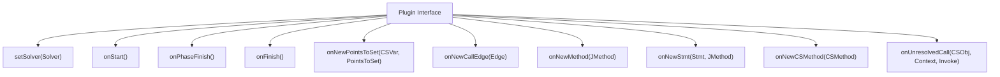
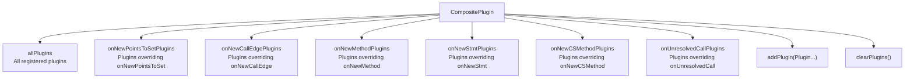
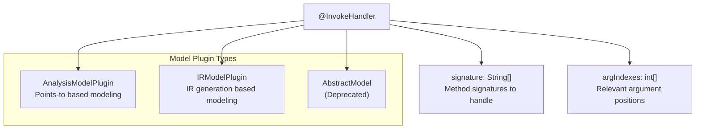
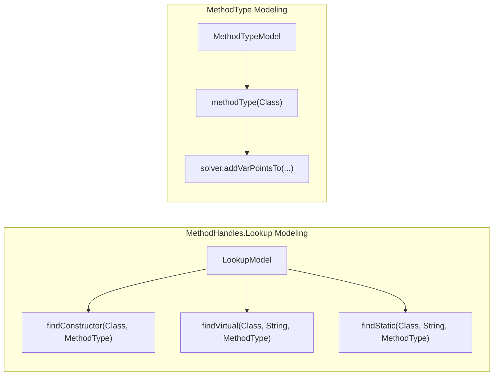

<!-- source: DeepWiki mcp.deepwiki.com · repo pascal-lab/Tai-e · page 3.3 Plugin System · fetched 2026-10-12 -->

# Plugin System

Relevant source files

The following files were used as context for generating this wiki page:

- [src/main/java/pascal/taie/analysis/graph/callgraph/CallKind.java](src/main/java/pascal/taie/analysis/graph/callgraph/CallKind.java)
- [src/main/java/pascal/taie/analysis/pta/core/solver/WorkList.java](src/main/java/pascal/taie/analysis/pta/core/solver/WorkList.java)
- [src/main/java/pascal/taie/analysis/pta/plugin/ClassInitializer.java](src/main/java/pascal/taie/analysis/pta/plugin/ClassInitializer.java)
- [src/main/java/pascal/taie/analysis/pta/plugin/CompositePlugin.java](src/main/java/pascal/taie/analysis/pta/plugin/CompositePlugin.java)
- [src/main/java/pascal/taie/analysis/pta/plugin/NullHandler.java](src/main/java/pascal/taie/analysis/pta/plugin/NullHandler.java)
- [src/main/java/pascal/taie/analysis/pta/plugin/NumberLiteralHandler.java](src/main/java/pascal/taie/analysis/pta/plugin/NumberLiteralHandler.java)
- [src/main/java/pascal/taie/analysis/pta/plugin/Plugin.java](src/main/java/pascal/taie/analysis/pta/plugin/Plugin.java)
- [src/main/java/pascal/taie/analysis/pta/plugin/ReferenceHandler.java](src/main/java/pascal/taie/analysis/pta/plugin/ReferenceHandler.java)
- [src/main/java/pascal/taie/analysis/pta/plugin/invokedynamic/Java9StringConcatHandler.java](src/main/java/pascal/taie/analysis/pta/plugin/invokedynamic/Java9StringConcatHandler.java)
- [src/main/java/pascal/taie/analysis/pta/plugin/invokedynamic/LookupModel.java](src/main/java/pascal/taie/analysis/pta/plugin/invokedynamic/LookupModel.java)
- [src/main/java/pascal/taie/analysis/pta/plugin/invokedynamic/MethodTypeModel.java](src/main/java/pascal/taie/analysis/pta/plugin/invokedynamic/MethodTypeModel.java)
- [src/main/java/pascal/taie/analysis/pta/plugin/natives/ArrayModel.java](src/main/java/pascal/taie/analysis/pta/plugin/natives/ArrayModel.java)
- [src/main/java/pascal/taie/analysis/pta/plugin/natives/DoPriviledgedModel.java](src/main/java/pascal/taie/analysis/pta/plugin/natives/DoPriviledgedModel.java)
- [src/main/java/pascal/taie/analysis/pta/plugin/natives/NativeModeller.java](src/main/java/pascal/taie/analysis/pta/plugin/natives/NativeModeller.java)
- [src/main/java/pascal/taie/analysis/pta/plugin/natives/UnsafeModel.java](src/main/java/pascal/taie/analysis/pta/plugin/natives/UnsafeModel.java)
- [src/main/java/pascal/taie/analysis/pta/plugin/util/AbstractIRModel.java](src/main/java/pascal/taie/analysis/pta/plugin/util/AbstractIRModel.java)
- [src/main/java/pascal/taie/analysis/pta/plugin/util/AbstractModel.java](src/main/java/pascal/taie/analysis/pta/plugin/util/AbstractModel.java)
- [src/main/java/pascal/taie/analysis/pta/plugin/util/AnalysisModelPlugin.java](src/main/java/pascal/taie/analysis/pta/plugin/util/AnalysisModelPlugin.java)
- [src/main/java/pascal/taie/analysis/pta/plugin/util/IRModel.java](src/main/java/pascal/taie/analysis/pta/plugin/util/IRModel.java)
- [src/main/java/pascal/taie/analysis/pta/plugin/util/IRModelPlugin.java](src/main/java/pascal/taie/analysis/pta/plugin/util/IRModelPlugin.java)
- [src/main/java/pascal/taie/analysis/pta/plugin/util/InvokeHandler.java](src/main/java/pascal/taie/analysis/pta/plugin/util/InvokeHandler.java)
- [src/main/java/pascal/taie/analysis/pta/plugin/util/InvokeHandlers.java](src/main/java/pascal/taie/analysis/pta/plugin/util/InvokeHandlers.java)
- [src/main/java/pascal/taie/analysis/pta/plugin/util/Model.java](src/main/java/pascal/taie/analysis/pta/plugin/util/Model.java)
- [src/main/java/pascal/taie/analysis/pta/plugin/util/ModelPlugin.java](src/main/java/pascal/taie/analysis/pta/plugin/util/ModelPlugin.java)
- [src/main/java/pascal/taie/analysis/pta/pts/DelegatePointsToSet.java](src/main/java/pascal/taie/analysis/pta/pts/DelegatePointsToSet.java)
- [src/main/java/pascal/taie/analysis/pta/pts/PointsToSet.java](src/main/java/pascal/taie/analysis/pta/pts/PointsToSet.java)
- [src/main/java/pascal/taie/analysis/pta/pts/PointsToSetFactory.java](src/main/java/pascal/taie/analysis/pta/pts/PointsToSetFactory.java)
- [src/main/java/pascal/taie/ir/stmt/FieldStmt.java](src/main/java/pascal/taie/ir/stmt/FieldStmt.java)
- [src/main/java/pascal/taie/language/classes/Pattern.java](src/main/java/pascal/taie/language/classes/Pattern.java)
- [src/main/java/pascal/taie/language/classes/SignatureMatcher.java](src/main/java/pascal/taie/language/classes/SignatureMatcher.java)
- [src/test/java/pascal/taie/analysis/pta/UnsafeModelTest.java](src/test/java/pascal/taie/analysis/pta/UnsafeModelTest.java)
- [src/test/java/pascal/taie/language/classes/PatternTest.java](src/test/java/pascal/taie/language/classes/PatternTest.java)
- [src/test/java/pascal/taie/language/classes/SignatureMatcherTest.java](src/test/java/pascal/taie/language/classes/SignatureMatcherTest.java)
- [src/test/resources/pta/basic/NativeModel-pta-expected.txt](src/test/resources/pta/basic/NativeModel-pta-expected.txt)
- [src/test/resources/pta/basic/NativeModel.java](src/test/resources/pta/basic/NativeModel.java)
- [src/test/resources/pta/misc/A.class](src/test/resources/pta/misc/A.class)
- [src/test/resources/pta/misc/NonExistStaticField.class](src/test/resources/pta/misc/NonExistStaticField.class)
- [src/test/resources/pta/misc/NonExistStaticField.java](src/test/resources/pta/misc/NonExistStaticField.java)
- [src/test/resources/pta/misc/UnsoundMap.class](src/test/resources/pta/misc/UnsoundMap.class)
- [src/test/resources/pta/misc/UnsoundMap.java](src/test/resources/pta/misc/UnsoundMap.java)

The plugin system provides an extensible architecture for enhancing Tai-e's pointer analysis capabilities. Plugins can respond to analysis events, modify analysis behavior, and implement custom handling for specific APIs or language features. This system enables modular extension of the core pointer analysis without modifying the solver implementation.

For information about configuring pointer analysis options that control plugin behavior, see [Pointer Analysis Configuration](#3.1). For details about implementing custom analyses that use pointer analysis results, see [Heap Model](#3.4).

## Plugin Interface and Lifecycle

The core of the plugin system is the `Plugin` interface, which defines callback methods invoked at specific points during pointer analysis execution.

**Plugin Lifecycle Phases:**

| Phase | Callback | Purpose |
|-------|----------|---------|
| Initialization | `setSolver()` | Receive solver reference for state modification [src/main/java/pascal/taie/analysis/pta/plugin/Plugin.java:52-53]() |
| Start | `onStart()` | Perform initial setup before analysis begins [src/main/java/pascal/taie/analysis/pta/plugin/Plugin.java:58-59]() |
| Execution | Event callbacks | Respond to analysis events like new points-to sets or call edges [src/main/java/pascal/taie/analysis/pta/plugin/Plugin.java:80-131]() |
| Phase End | `onPhaseFinish()` | Process information when the work list empties; can restart analysis [src/main/java/pascal/taie/analysis/pta/plugin/Plugin.java:68-69]() |
| Completion | `onFinish()` | Perform final cleanup (should not modify results) [src/main/java/pascal/taie/analysis/pta/plugin/Plugin.java:76-77]() |

Sources: [src/main/java/pascal/taie/analysis/pta/plugin/Plugin.java:45-132]()

## Plugin Management with CompositePlugin

The `CompositePlugin` manages multiple plugins efficiently by maintaining separate lists for plugins that override specific callback methods, reducing overhead for frequently-invoked callbacks.

The `CompositePlugin` uses reflection in `addPlugin` [src/main/java/pascal/taie/analysis/pta/plugin/CompositePlugin.java:79-91]() to determine which plugins override specific methods, ensuring optimal performance by only calling plugins that actually implement each callback.

Sources: [src/main/java/pascal/taie/analysis/pta/plugin/CompositePlugin.java:46-149]()

## API Modeling Framework

Tai-e provides specialized base classes and annotations to simplify the modeling of complex Java APIs.

### Annotation-Based Handler Registration

The `@InvokeHandler` annotation [src/main/java/pascal/taie/analysis/pta/plugin/util/InvokeHandler.java:39-52]() enables declarative registration of method handlers based on method signatures.

### AnalysisModelPlugin and IRModelPlugin

1.  **AnalysisModelPlugin**: Used for modeling API side-effects by directly manipulating points-to sets. For example, `MethodTypeModel` [src/main/java/pascal/taie/analysis/pta/plugin/invokedynamic/MethodTypeModel.java:42-43]() uses this to handle `MethodType.methodType(...)` calls.
2.  **IRModelPlugin**: Used for modeling APIs by generating "artificial" IR statements that the solver then processes normally. `DoPriviledgedModel` [src/main/java/pascal/taie/analysis/pta/plugin/natives/DoPriviledgedModel.java:42-43]() uses this to generate an artificial `run()` call for `AccessController.doPrivileged(...)` [src/main/java/pascal/taie/analysis/pta/plugin/natives/DoPriviledgedModel.java:76-82]().

### Signature Matching and Patterns

The framework uses `Pattern` [src/main/java/pascal/taie/language/classes/Pattern.java:39]() to parse and match method/class signatures. This supports wildcards (`*`) and subclass markers (`^`) [src/main/java/pascal/taie/language/classes/Pattern.java:41-43]().

Sources: [src/main/java/pascal/taie/analysis/pta/plugin/util/AnalysisModelPlugin.java:27](), [src/main/java/pascal/taie/analysis/pta/plugin/util/IRModelPlugin.java:30](), [src/main/java/pascal/taie/analysis/pta/plugin/util/AbstractModel.java:70-86](), [src/main/java/pascal/taie/language/classes/Pattern.java:39-178]()

## Built-in Plugin Examples

### Method Handle and Type Modeling

The `LookupModel` and `MethodTypeModel` model `java.lang.invoke` APIs by reacting to specific method calls.

`LookupModel` uses `Reflections.getDeclaredMethods` [src/main/java/pascal/taie/analysis/pta/plugin/invokedynamic/LookupModel.java:78-79]() to resolve method handles and adds them to the result variable's points-to set [src/main/java/pascal/taie/analysis/pta/plugin/invokedynamic/LookupModel.java:108-110]().

### Native Modeling

The `NativeModeller` is a `CompositePlugin` [src/main/java/pascal/taie/analysis/pta/plugin/natives/NativeModeller.java:32]() that groups multiple models for native side-effects, such as `ArrayModel`, `UnsafeModel`, and `DoPriviledgedModel` [src/main/java/pascal/taie/analysis/pta/plugin/natives/NativeModeller.java:36-39]().

### GC and Reference Modeling

`ReferenceHandler` [src/main/java/pascal/taie/analysis/pta/plugin/ReferenceHandler.java:45]() models garbage collection behavior by connecting `Reference` initialization to the static field `Reference.pending` [src/main/java/pascal/taie/analysis/pta/plugin/ReferenceHandler.java:73-79](), ensuring that `finalize()` methods are eventually reachable.

Sources: [src/main/java/pascal/taie/analysis/pta/plugin/invokedynamic/LookupModel.java:49-116](), [src/main/java/pascal/taie/analysis/pta/plugin/invokedynamic/MethodTypeModel.java:42-104](), [src/main/java/pascal/taie/analysis/pta/plugin/natives/NativeModeller.java:32-41](), [src/main/java/pascal/taie/analysis/pta/plugin/ReferenceHandler.java:45-81]()

---

