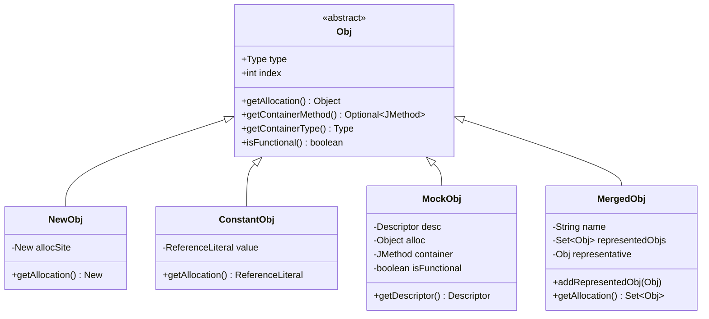
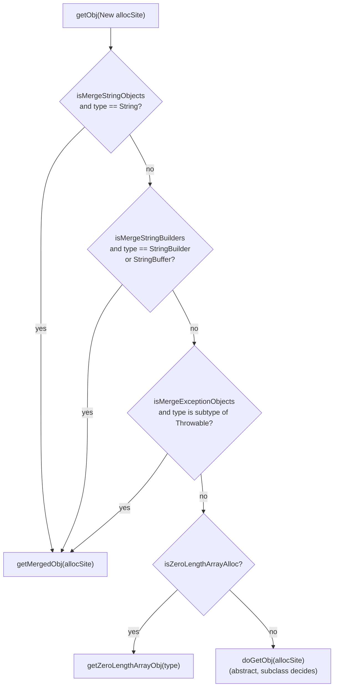
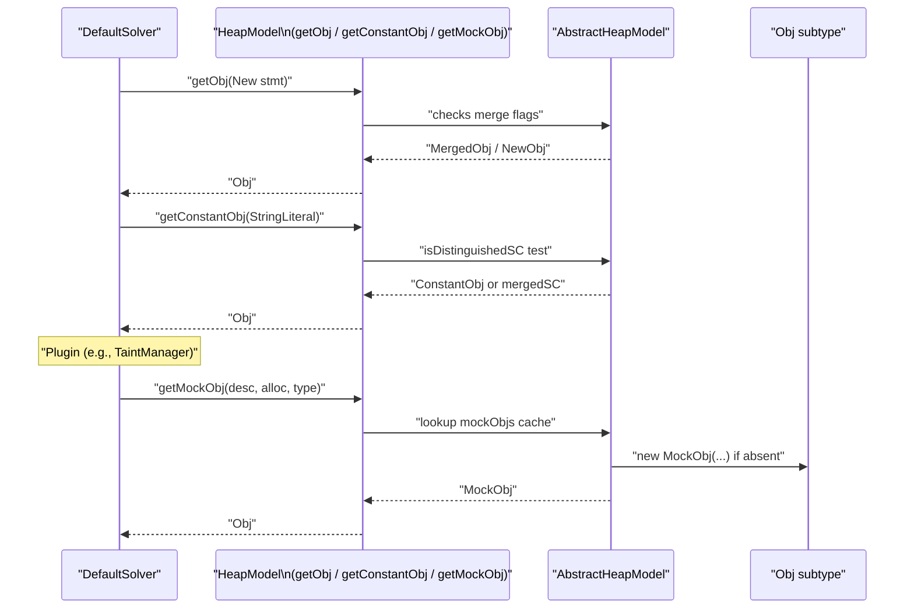

<!-- source: DeepWiki mcp.deepwiki.com · repo pascal-lab/Tai-e · page 3.4 Heap Model · fetched 2026-10-12 -->

# Heap Model

<details>
<summary>Relevant source files</summary>

The following files were used as context for generating this wiki page:

- [src/main/java/pascal/taie/analysis/pta/core/heap/AbstractHeapModel.java](src/main/java/pascal/taie/analysis/pta/core/heap/AbstractHeapModel.java)
- [src/main/java/pascal/taie/analysis/pta/core/heap/ConstantObj.java](src/main/java/pascal/taie/analysis/pta/core/heap/ConstantObj.java)
- [src/main/java/pascal/taie/analysis/pta/core/heap/Descriptor.java](src/main/java/pascal/taie/analysis/pta/core/heap/Descriptor.java)
- [src/main/java/pascal/taie/analysis/pta/core/heap/HeapModel.java](src/main/java/pascal/taie/analysis/pta/core/heap/HeapModel.java)
- [src/main/java/pascal/taie/analysis/pta/core/heap/MergedObj.java](src/main/java/pascal/taie/analysis/pta/core/heap/MergedObj.java)
- [src/main/java/pascal/taie/analysis/pta/core/heap/MockObj.java](src/main/java/pascal/taie/analysis/pta/core/heap/MockObj.java)
- [src/main/java/pascal/taie/analysis/pta/core/heap/NewObj.java](src/main/java/pascal/taie/analysis/pta/core/heap/NewObj.java)
- [src/main/java/pascal/taie/analysis/pta/core/heap/Obj.java](src/main/java/pascal/taie/analysis/pta/core/heap/Obj.java)
- [src/main/java/pascal/taie/analysis/pta/core/solver/DeclaredParamProvider.java](src/main/java/pascal/taie/analysis/pta/core/solver/DeclaredParamProvider.java)
- [src/main/java/pascal/taie/analysis/pta/core/solver/EmptyParamProvider.java](src/main/java/pascal/taie/analysis/pta/core/solver/EmptyParamProvider.java)
- [src/main/java/pascal/taie/analysis/pta/core/solver/EntryPoint.java](src/main/java/pascal/taie/analysis/pta/core/solver/EntryPoint.java)
- [src/main/java/pascal/taie/analysis/pta/core/solver/ParamProvider.java](src/main/java/pascal/taie/analysis/pta/core/solver/ParamProvider.java)
- [src/main/java/pascal/taie/analysis/pta/core/solver/SpecifiedParamProvider.java](src/main/java/pascal/taie/analysis/pta/core/solver/SpecifiedParamProvider.java)
- [src/main/java/pascal/taie/analysis/pta/plugin/EntryPointHandler.java](src/main/java/pascal/taie/analysis/pta/plugin/EntryPointHandler.java)
- [src/main/java/pascal/taie/analysis/pta/plugin/taint/TaintManager.java](src/main/java/pascal/taie/analysis/pta/plugin/taint/TaintManager.java)

</details>


This page documents the heap abstraction layer used by Tai-e's pointer analysis. It covers the `HeapModel` interface, the `AbstractHeapModel` base implementation, the `Obj` type hierarchy, the built-in object merging strategies, and the `MahjongHeapModel` DFA-based advanced merging approach.

For how the solver uses the heap model during analysis (e.g., processing `New` statements), see [Solver Architecture](#3.2). For the Zipper and Mahjong algorithms at a higher level, see [Zipper and Mahjong](#7.4). For pointer analysis configuration options that control merging behavior, see [Pointer Analysis Configuration](#3.1).

---

## Purpose

The heap model answers one fundamental question: *given an allocation site in the program, which abstract object should represent it?* Pointer analysis must never create `Obj` instances directly. Instead, it always goes through the `HeapModel` interface, which applies the configured merging and abstraction strategy before returning an object.

---

## Obj Type Hierarchy

All abstract objects in the pointer analysis extend the abstract class `Obj` [src/main/java/pascal/taie/analysis/pta/core/heap/Obj.java:36-97](). Every `Obj` carries:

- A `Type` (its static Java type) [src/main/java/pascal/taie/analysis/pta/core/heap/Obj.java:38]()
- An integer index assigned by the heap model (see [Object Indexing](#object-indexing)) [src/main/java/pascal/taie/analysis/pta/core/heap/Obj.java:40]()
- An abstract allocation (`getAllocation()`) [src/main/java/pascal/taie/analysis/pta/core/heap/Obj.java:81]()
- An optional container method (`getContainerMethod()`) [src/main/java/pascal/taie/analysis/pta/core/heap/Obj.java:88]()
- A container type (`getContainerType()`, used by type-sensitivity) [src/main/java/pascal/taie/analysis/pta/core/heap/Obj.java:96]()
- An `isFunctional()` flag — when `true` the object can hold fields or array indices [src/main/java/pascal/taie/analysis/pta/core/heap/Obj.java:67]()

There are four concrete subtypes:

| Class | File | Allocation key | Typical source |
|---|---|---|---|
| `NewObj` | [src/main/java/pascal/taie/analysis/pta/core/heap/NewObj.java:34-66]() | `New` statement | `new Foo()` in program |
| `ConstantObj` | [src/main/java/pascal/taie/analysis/pta/core/heap/ConstantObj.java:34-62]() | `ReferenceLiteral` | String/Class/MethodType literals |
| `MockObj` | [src/main/java/pascal/taie/analysis/pta/core/heap/MockObj.java:35-109]() | `Descriptor` + arbitrary `Object` | Model objects, reflection, etc. |
| `MergedObj` | [src/main/java/pascal/taie/analysis/pta/core/heap/MergedObj.java:36-89]() | `Set<Obj>` of represented objs | Merging strategies |

**Obj class hierarchy diagram**



Sources: [src/main/java/pascal/taie/analysis/pta/core/heap/Obj.java](), [src/main/java/pascal/taie/analysis/pta/core/heap/NewObj.java](), [src/main/java/pascal/taie/analysis/pta/core/heap/ConstantObj.java](), [src/main/java/pascal/taie/analysis/pta/core/heap/MockObj.java](), [src/main/java/pascal/taie/analysis/pta/core/heap/MergedObj.java]()

---

## The `HeapModel` Interface

[src/main/java/pascal/taie/analysis/pta/core/heap/HeapModel.java:39-84]()

`HeapModel` extends `Indexer<Obj>` [src/main/java/pascal/taie/analysis/pta/core/heap/HeapModel.java:39](), so it also provides `getIndex(Obj)` and `getObject(int)` for efficient array-backed points-to sets.

| Method | Purpose |
|---|---|
| `getObj(New)` | Return the abstract object for a `new` statement [src/main/java/pascal/taie/analysis/pta/core/heap/HeapModel.java:44]() |
| `getConstantObj(ReferenceLiteral)` | Return the abstract object for a string/class/method-type literal [src/main/java/pascal/taie/analysis/pta/core/heap/HeapModel.java:49]() |
| `isStringConstant(Obj)` | Test whether an object represents a string constant [src/main/java/pascal/taie/analysis/pta/core/heap/HeapModel.java:54]() |
| `getMockObj(Descriptor, Object, Type, ...)` | Create or retrieve a mock object (several overloads) [src/main/java/pascal/taie/analysis/pta/core/heap/HeapModel.java:56-78]() |
| `getObjects()` | Return all objects registered in this model [src/main/java/pascal/taie/analysis/pta/core/heap/HeapModel.java:83]() |

The pointer analysis solver must **always** use this interface rather than constructing `Obj` instances directly [src/main/java/pascal/taie/analysis/pta/core/heap/HeapModel.java:35]().

---

## `AbstractHeapModel`

[src/main/java/pascal/taie/analysis/pta/core/heap/AbstractHeapModel.java:58-274]()

`AbstractHeapModel` provides the shared implementation that all concrete heap models inherit. It reads merging flags from `AnalysisOptions` at construction time [src/main/java/pascal/taie/analysis/pta/core/heap/AbstractHeapModel.java:107-119]() and maintains internal maps for deduplication and indexing.

### Configuration flags read at construction

| Option key | Field | Effect |
|---|---|---|
| `distinguish-string-constants` | `isDistinguishedSC` | Controls which string constants are kept separate vs. merged into `mergedSC` [src/main/java/pascal/taie/analysis/pta/core/heap/AbstractHeapModel.java:108-109]() |
| `merge-string-objects` | `isMergeStringObjects` | Merge all `new String()` allocations into one `MergedObj` [src/main/java/pascal/taie/analysis/pta/core/heap/AbstractHeapModel.java:110]() |
| `merge-string-builders` | `isMergeStringBuilders` | Merge all `StringBuilder`/`StringBuffer` allocations [src/main/java/pascal/taie/analysis/pta/core/heap/AbstractHeapModel.java:111]() |
| `merge-exception-objects` | `isMergeExceptionObjects` | Merge all subtypes of `Throwable` [src/main/java/pascal/taie/analysis/pta/core/heap/AbstractHeapModel.java:112]() |

The `distinguish-string-constants` option accepts: `reflection`, `app`, `all`, or a fully-qualified class name of a custom `Predicate<String>` [src/main/java/pascal/taie/analysis/pta/core/heap/AbstractHeapModel.java:122-145]().

### Internal state

| Field | Type | Purpose |
|---|---|---|
| `newObjs` | `Map<New, NewObj>` | Cache for `NewObj` instances [src/main/java/pascal/taie/analysis/pta/core/heap/AbstractHeapModel.java:82]() |
| `constantObjs` | `TwoKeyMap<Type, ReferenceLiteral, ConstantObj>` | Cache for `ConstantObj` instances [src/main/java/pascal/taie/analysis/pta/core/heap/AbstractHeapModel.java:84-85]() |
| `mergedSC` | `MergedObj` | The single merged object for all non-distinguished string constants [src/main/java/pascal/taie/analysis/pta/core/heap/AbstractHeapModel.java:90]() |
| `mergedObjs` | `Map<Type, MergedObj>` | Per-type merged objects for strings/builders/exceptions [src/main/java/pascal/taie/analysis/pta/core/heap/AbstractHeapModel.java:92]() |
| `mockObjs` | `Map<MockObj, MockObj>` | Cache for `MockObj` instances [src/main/java/pascal/taie/analysis/pta/core/heap/AbstractHeapModel.java:94]() |
| `zeroLengthArrays` | `Map<Type, Obj>` | Merged mock objects for zero-length arrays [src/main/java/pascal/taie/analysis/pta/core/heap/AbstractHeapModel.java:96]() |
| `objs` | `List<Obj>` | Sequential list of all registered objects (used for indexing) [src/main/java/pascal/taie/analysis/pta/core/heap/AbstractHeapModel.java:105]() |
| `counter` | `int` | Next index value to assign [src/main/java/pascal/taie/analysis/pta/core/heap/AbstractHeapModel.java:103]() |

### `getObj(New)` dispatch logic

**Dispatch flow for `getObj`**



Sources: [src/main/java/pascal/taie/analysis/pta/core/heap/AbstractHeapModel.java:148-165]()

### `getConstantObj(ReferenceLiteral)` logic

For `StringLiteral` values, the predicate `isDistinguishedSC` is tested. If the string is **not** distinguished, the underlying `ConstantObj` is registered in `mergedSC` and `mergedSC` is returned instead [src/main/java/pascal/taie/analysis/pta/core/heap/AbstractHeapModel.java:216-231](). All other reference literals (e.g., class constants) are returned as individual `ConstantObj` instances.

### Zero-length array merging

When `allocSite.getRValue()` is a `NewArray` whose length variable holds the constant `0` [src/main/java/pascal/taie/analysis/pta/core/heap/AbstractHeapModel.java:167-175](), `getZeroLengthArrayObj(type)` is called. All zero-length arrays of the same element type share one `MockObj` with descriptor `ZeroLengthArray` [src/main/java/pascal/taie/analysis/pta/core/heap/AbstractHeapModel.java:203-209]().

### `add(Obj)` — object registration and indexing

Every object enters the model through the `add` method:

```java
protected <T extends Obj> T add(T obj) {
    objs.add(obj);
    obj.setIndex(counter++);
    return obj;
}
```

[src/main/java/pascal/taie/analysis/pta/core/heap/AbstractHeapModel.java:249-253]()

An index is assigned exactly once; attempting to re-index an `Obj` throws `IllegalStateException` [src/main/java/pascal/taie/analysis/pta/core/heap/Obj.java:47-49](). The `objs` list provides O(1) access by index via `getObject(int)`.

---

## Object Merging Strategies Summary

```mermaid
flowchart LR
    subgraph "Allocation sites"
        A1["new String()  (site 1)"]
        A2["new String()  (site 2)"]
        A3["new StringBuilder()"]
        A4["new IOException()"]
        A5["new int[0]"]
        A6["\"hello\"  (string constant)"]
        A7["\"world\"  (string constant)"]
    end

    subgraph "AbstractHeapModel output"
        M1["MergedObj {Merged java.lang.String}"]
        M2["MergedObj {Merged java.lang.StringBuilder}"]
        M3["MergedObj {Merged java.io.IOException}"]
        M4["MockObj {ZeroLengthArray int[]}"]
        M5["MergedObj {Merged string constants}"]
        N1["NewObj (site 1)"]
        N2["NewObj (site 2)"]
    end

    A1 -- "merge-string-objects=true" --> M1
    A2 -- "merge-string-objects=true" --> M1
    A1 -- "merge-string-objects=false" --> N1
    A2 -- "merge-string-objects=false" --> N2
    A3 -- "merge-string-builders=true" --> M2
    A4 -- "merge-exception-objects=true" --> M3
    A5 --> M4
    A6 -- "not distinguished" --> M5
    A7 -- "not distinguished" --> M5
```

Sources: [src/main/java/pascal/taie/analysis/pta/core/heap/AbstractHeapModel.java:149-230]()

---

## ParamProvider and Mock Objects

Tai-e uses `MockObj` to represent objects that do not have an explicit allocation site in the source code, such as entry point parameters or taint objects.

### Entry Point Handling

The `EntryPointHandler` plugin initializes the analysis by adding entry points to the solver [src/main/java/pascal/taie/analysis/pta/plugin/EntryPointHandler.java:35-59](). It uses `ParamProvider` implementations to supply initial objects:

- **`DeclaredParamProvider`**: Generates mock objects for method parameters and recursively for their fields up to depth `k` [src/main/java/pascal/taie/analysis/pta/core/solver/DeclaredParamProvider.java:49-150]().
- **`SpecifiedParamProvider`**: Allows manual specification of objects for `this` and parameters [src/main/java/pascal/taie/analysis/pta/core/solver/SpecifiedParamProvider.java:41-161]().

Mock objects for entry points typically use the `ENTRY_DESC` descriptor [src/main/java/pascal/taie/analysis/pta/core/solver/DeclaredParamProvider.java:103-105]().

### Taint Objects

The `TaintManager` creates `MockObj` instances with the `TAINT_DESC` descriptor to represent tainted data flowing through the system [src/main/java/pascal/taie/analysis/pta/plugin/taint/TaintManager.java:39-89]().

```java
Obj makeTaint(SourcePoint sourcePoint, Type type) {
    Obj taint = heapModel.getMockObj(TAINT_DESC, sourcePoint, type, false);
    taintObjs.add(taint);
    return taint;
}
```

[src/main/java/pascal/taie/analysis/pta/plugin/taint/TaintManager.java:58-62]()

---

## Object Indexing

`HeapModel` extends `Indexer<Obj>` [src/main/java/pascal/taie/analysis/pta/core/heap/HeapModel.java:39](), which means it exposes:

- `getIndex(Obj o)` → returns `o.getIndex()` (the sequential counter value assigned at registration) [src/main/java/pascal/taie/analysis/pta/core/heap/Obj.java:59]().
- `getObject(int index)` → returns `objs.get(index)` from the internal list [src/main/java/pascal/taie/analysis/pta/core/heap/AbstractHeapModel.java:267]().

Indices are assigned in registration order (first object registered gets index 0). Bit-vector based points-to sets rely on stable indices for efficient set operations. An object's index is set exactly once by `add()` and is immutable thereafter [src/main/java/pascal/taie/analysis/pta/core/heap/Obj.java:46-55]().

---

## Interaction with the Pointer Analysis Solver

The following diagram summarizes how the solver, plugins, and model layer interact around heap object creation:



Sources: [src/main/java/pascal/taie/analysis/pta/core/heap/HeapModel.java](), [src/main/java/pascal/taie/analysis/pta/core/heap/AbstractHeapModel.java](), [src/main/java/pascal/taie/analysis/pta/plugin/taint/TaintManager.java]()

---

