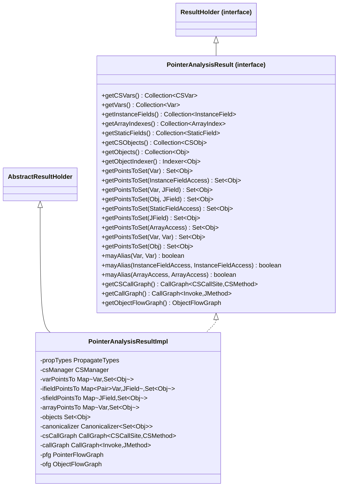
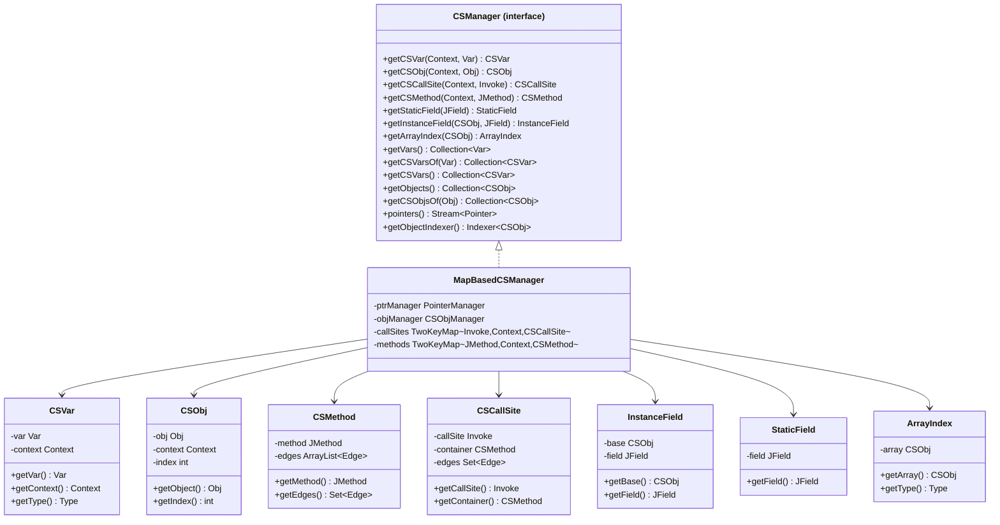
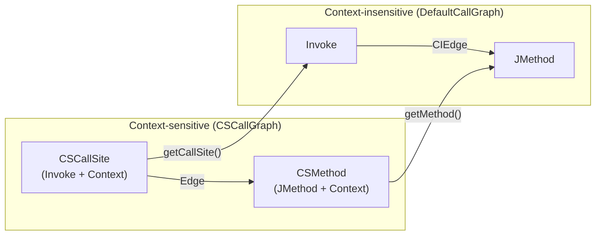

<!-- source: DeepWiki mcp.deepwiki.com · repo pascal-lab/Tai-e · page 3.5 Results and Clients · fetched 2026-10-12 -->

# Results and Clients

Relevant source files

The following files were used as context for generating this wiki page:

- [.gitignore](.gitignore)
- [src/main/java/pascal/taie/analysis/pta/PointerAnalysisResult.java](src/main/java/pascal/taie/analysis/pta/PointerAnalysisResult.java)
- [src/main/java/pascal/taie/analysis/pta/PointerAnalysisResultImpl.java](src/main/java/pascal/taie/analysis/pta/PointerAnalysisResultImpl.java)
- [src/main/java/pascal/taie/analysis/pta/client/MayFailCast.java](src/main/java/pascal/taie/analysis/pta/client/MayFailCast.java)
- [src/main/java/pascal/taie/analysis/pta/client/PolymorphicCallSite.java](src/main/java/pascal/taie/analysis/pta/client/PolymorphicCallSite.java)
- [src/main/java/pascal/taie/analysis/pta/core/cs/CSCallGraph.java](src/main/java/pascal/taie/analysis/pta/core/cs/CSCallGraph.java)
- [src/main/java/pascal/taie/analysis/pta/core/cs/element/ArrayIndex.java](src/main/java/pascal/taie/analysis/pta/core/cs/element/ArrayIndex.java)
- [src/main/java/pascal/taie/analysis/pta/core/cs/element/CSCallSite.java](src/main/java/pascal/taie/analysis/pta/core/cs/element/CSCallSite.java)
- [src/main/java/pascal/taie/analysis/pta/core/cs/element/CSManager.java](src/main/java/pascal/taie/analysis/pta/core/cs/element/CSManager.java)
- [src/main/java/pascal/taie/analysis/pta/core/cs/element/CSMethod.java](src/main/java/pascal/taie/analysis/pta/core/cs/element/CSMethod.java)
- [src/main/java/pascal/taie/analysis/pta/core/cs/element/CSObj.java](src/main/java/pascal/taie/analysis/pta/core/cs/element/CSObj.java)
- [src/main/java/pascal/taie/analysis/pta/core/cs/element/CSVar.java](src/main/java/pascal/taie/analysis/pta/core/cs/element/CSVar.java)
- [src/main/java/pascal/taie/analysis/pta/core/cs/element/InstanceField.java](src/main/java/pascal/taie/analysis/pta/core/cs/element/InstanceField.java)
- [src/main/java/pascal/taie/analysis/pta/core/cs/element/MapBasedCSManager.java](src/main/java/pascal/taie/analysis/pta/core/cs/element/MapBasedCSManager.java)
- [src/main/java/pascal/taie/analysis/pta/core/cs/element/StaticField.java](src/main/java/pascal/taie/analysis/pta/core/cs/element/StaticField.java)
- [src/main/java/pascal/taie/analysis/pta/plugin/ResultProcessor.java](src/main/java/pascal/taie/analysis/pta/plugin/ResultProcessor.java)

This page explains how to access and use the results of pointer analysis in Tai-e. Pointer analysis provides essential information about what objects program variables may point to, which enables many other analyses. Here you'll learn how to access points-to sets, call graphs, and other data structures produced by pointer analysis, as well as how to build client analyses that consume these results.

After pointer analysis completes, the result is registered with the `World` singleton and retrieved by client analyses via `World.get().getResult(PointerAnalysis.ID)`. For information about configuring pointer analysis, see page 3.1, and for details about the internal solver implementation, see page 3.2.

## Pointer Analysis Result Interface

`PointerAnalysisResult` is the primary API for querying pointer analysis output. It provides overloaded `getPointsToSet` methods for every kind of pointer-accessible expression, alias queries, and access to call graphs. `PointerAnalysisResultImpl` is the concrete implementation, extending `AbstractResultHolder` so that plugin-attached sub-results can also be stored on it.

**Class hierarchy: `PointerAnalysisResult` and its implementation**

Sources: [src/main/java/pascal/taie/analysis/pta/PointerAnalysisResult.java:55-183](), [src/main/java/pascal/taie/analysis/pta/PointerAnalysisResultImpl.java:65-136]()

## Accessing Points-to Sets

The primary result of pointer analysis is a collection of abstract objects (`Obj`) that a variable or memory location may point to at runtime. `PointerAnalysisResult` provides overloaded `getPointsToSet` for each kind of expression.

**Before returning a result, every `getPointsToSet` method checks `PropagateTypes.isAllowed` on the expression's type.** If the type was excluded from analysis (e.g., by the `propagate-types` option, see page 3.1), the method returns an empty set immediately. This prevents callers from seeing partial or meaningless results.

| Expression kind | Method signature | Notes |
|---|---|---|
| Local variable | `getPointsToSet(Var)` | Unions over all CS copies of the variable |
| Instance field access | `getPointsToSet(InstanceFieldAccess)` | Resolves field ref, delegates to `getPointsToSet(Var, JField)` |
| Instance field (base var + field) | `getPointsToSet(Var base, JField field)` | Unions over all CS objects pointed to by base |
| Instance field (base obj + field) | `getPointsToSet(Obj base, JField field)` | Unions over all CS wrappers of that `Obj` |
| Static field access | `getPointsToSet(StaticFieldAccess)` | Resolves field ref, delegates to `getPointsToSet(JField)` |
| Static field | `getPointsToSet(JField)` | Reads the single `StaticField` pointer |
| Array access | `getPointsToSet(ArrayAccess)` | Delegates to `getPointsToSet(Var base, Var index)` |
| Array (base + index vars) | `getPointsToSet(Var base, Var index)` | Index variable is unused; models all array elements uniformly |
| Array object | `getPointsToSet(Obj array)` | Unions over all CS wrappers of that array `Obj` |

Results are internally cached in `varPointsTo`, `ifieldPointsTo`, `sfieldPointsTo`, and `arrayPointsTo` maps. The raw context-sensitive points-to data comes from the `CSManager`; `removeContexts` strips the heap context and returns a canonical `Set<Obj>` backed by a `HybridBitSet` indexed by `objIndexer`. Identical point-to sets are de-duplicated through a `Canonicalizer<Set<Obj>>` to reduce memory.

Sources: [src/main/java/pascal/taie/analysis/pta/PointerAnalysisResult.java:98-152](), [src/main/java/pascal/taie/analysis/pta/PointerAnalysisResultImpl.java:177-329]()

## Context-Sensitive Elements

Pointer analysis in Tai-e tracks a *calling context* alongside each variable, object, call site, and method. The `CSManager` interface is the factory and registry for all these context-sensitive wrappers. `MapBasedCSManager` is the only production implementation and stores everything in maps, with two inner helper classes:

- **`PointerManager`** — creates and caches `CSVar`, `StaticField`, `InstanceField`, and `ArrayIndex` instances, assigning each a unique integer index [src/main/java/pascal/taie/analysis/pta/core/cs/element/MapBasedCSManager.java:154-219]().
- **`CSObjManager`** — creates and caches `CSObj` instances. It also implements `Indexer<CSObj>` [src/main/java/pascal/taie/analysis/pta/core/cs/element/MapBasedCSManager.java:54-54]().

**CS element types and the `CSManager` interface**

Sources: [src/main/java/pascal/taie/analysis/pta/core/cs/element/CSManager.java:40-135](), [src/main/java/pascal/taie/analysis/pta/core/cs/element/MapBasedCSManager.java:50-152](), [src/main/java/pascal/taie/analysis/pta/core/cs/element/CSVar.java:23-23](), [src/main/java/pascal/taie/analysis/pta/core/cs/element/CSObj.java:32-60](), [src/main/java/pascal/taie/analysis/pta/core/cs/element/CSMethod.java:41-85](), [src/main/java/pascal/taie/analysis/pta/core/cs/element/CSCallSite.java:36-79](), [src/main/java/pascal/taie/analysis/pta/core/cs/element/InstanceField.java:23-23](), [src/main/java/pascal/taie/analysis/pta/core/cs/element/StaticField.java:23-23](), [src/main/java/pascal/taie/analysis/pta/core/cs/element/ArrayIndex.java:23-23]()

All context-sensitive collections are exposed via `PointerAnalysisResult`: `getCSVars()`, `getCSObjects()`, `getInstanceFields()`, `getStaticFields()`, and `getArrayIndexes()`. Each delegates directly to the corresponding `CSManager` method.

Sources: [src/main/java/pascal/taie/analysis/pta/PointerAnalysisResult.java:60-85](), [src/main/java/pascal/taie/analysis/pta/PointerAnalysisResultImpl.java:139-171]()

## Aliasing Information

`PointerAnalysisResult` exposes three `mayAlias` overloads:

| Method | Returns `true` when… |
|---|---|
| `mayAlias(Var v1, Var v2)` | `getPointsToSet(v1)` and `getPointsToSet(v2)` are not disjoint |
| `mayAlias(InstanceFieldAccess if1, InstanceFieldAccess if2)` | The two accesses resolve to the same `JField` **and** their base variables may alias |
| `mayAlias(ArrayAccess a1, ArrayAccess a2)` | The base variables of both accesses may alias (array index is ignored) |

All three methods work on context-insensitive (projected) points-to sets, since contexts have already been stripped by `getPointsToSet`.

Sources: [src/main/java/pascal/taie/analysis/pta/PointerAnalysisResult.java:157-167](), [src/main/java/pascal/taie/analysis/pta/PointerAnalysisResultImpl.java:302-319]()

## Call Graph Access

The pointer analysis builds a call graph on-the-fly during solving. Two views of it are available through `PointerAnalysisResult`:

**Call graph projection: CS to CI**

Sources: [src/main/java/pascal/taie/analysis/pta/PointerAnalysisResult.java:172-177](), [src/main/java/pascal/taie/analysis/pta/PointerAnalysisResultImpl.java:332-386](), [src/main/java/pascal/taie/analysis/pta/core/cs/CSCallGraph.java:45-152]()

### `getCSCallGraph()`

Returns the `CSCallGraph` built during analysis — a `CallGraph<CSCallSite, CSMethod>`. Each edge connects a `CSCallSite` to a `CSMethod`. The `CSCallSite` holds a reference back to its containing `CSMethod` via `getContainer()` [src/main/java/pascal/taie/analysis/pta/core/cs/element/CSCallSite.java:63-65]().

### `getCallGraph()`

Returns a `CallGraph<Invoke, JMethod>` (a `DefaultCallGraph`). This is lazily created on first access by the private `removeContexts(CallGraph<CSCallSite, CSMethod>)` method in `PointerAnalysisResultImpl` [src/main/java/pascal/taie/analysis/pta/PointerAnalysisResultImpl.java:352-386](), which strips contexts from every entry method, reachable method, and call edge.

The context-insensitive graph is what most client analyses use, since they operate on `JMethod` and `Invoke` directly.

Sources: [src/main/java/pascal/taie/analysis/pta/PointerAnalysisResultImpl.java:332-386](), [src/main/java/pascal/taie/analysis/pta/core/cs/CSCallGraph.java:45-152]()

## Result Processor and Dumping

Tai-e provides a `ResultProcessor` plugin to dump analysis results to files or compare them with expected outputs. It can generate three types of output:
- `pta-results.txt`: Context-sensitive points-to sets [src/main/java/pascal/taie/analysis/pta/plugin/ResultProcessor.java:78-78]().
- `pta-ci-results.txt`: Context-insensitive points-to sets [src/main/java/pascal/taie/analysis/pta/plugin/ResultProcessor.java:82-82]().
- `pta-results.yml`: Results in YAML format [src/main/java/pascal/taie/analysis/pta/plugin/ResultProcessor.java:80-80]().

It also logs detailed statistics about variables, objects, points-to set sizes, and reachable methods at the end of the analysis [src/main/java/pascal/taie/analysis/pta/plugin/ResultProcessor.java:135-168]().

Sources: [src/main/java/pascal/taie/analysis/pta/plugin/ResultProcessor.java:74-173]()

## Client Analyses

The `pascal.taie.analysis.pta.client` package contains analyses that consume `PointerAnalysisResult`. They all share the `Collector` base class.

### The `Collector` Pattern

`Collector` is an abstract `ProgramAnalysis<StmtResult<Boolean>>`. Its `analyze()` method:
1. Retrieves the `PointerAnalysisResult` from `World`.
2. Iterates over all reachable methods in the CI call graph.
3. For each `Stmt` in each method, calls `isRelevant(Stmt)` to filter candidates.
4. Calls `isWanted(Stmt, PointerAnalysisResult)` on candidates to decide if they belong in the result set.

### `MayFailCast` (ID: `may-fail-cast`)

Relevant statement: any `Cast` statement [src/main/java/pascal/taie/analysis/pta/client/MayFailCast.java:43-45](). A cast is *wanted* if any `Obj` in the points-to set of the source variable has a type that is not a subtype of the target cast type [src/main/java/pascal/taie/analysis/pta/client/MayFailCast.java:48-59]().

### `PolymorphicCallSite` (ID: `poly-call`)

Relevant statement: any `Invoke` that is virtual or interface [src/main/java/pascal/taie/analysis/pta/client/PolymorphicCallSite.java:39-42](). A call site is *wanted* if its callee set in the CI call graph has more than one element [src/main/java/pascal/taie/analysis/pta/client/PolymorphicCallSite.java:45-49]().

Sources: [src/main/java/pascal/taie/analysis/pta/client/MayFailCast.java:34-65](), [src/main/java/pascal/taie/analysis/pta/client/PolymorphicCallSite.java:30-54]()

---

