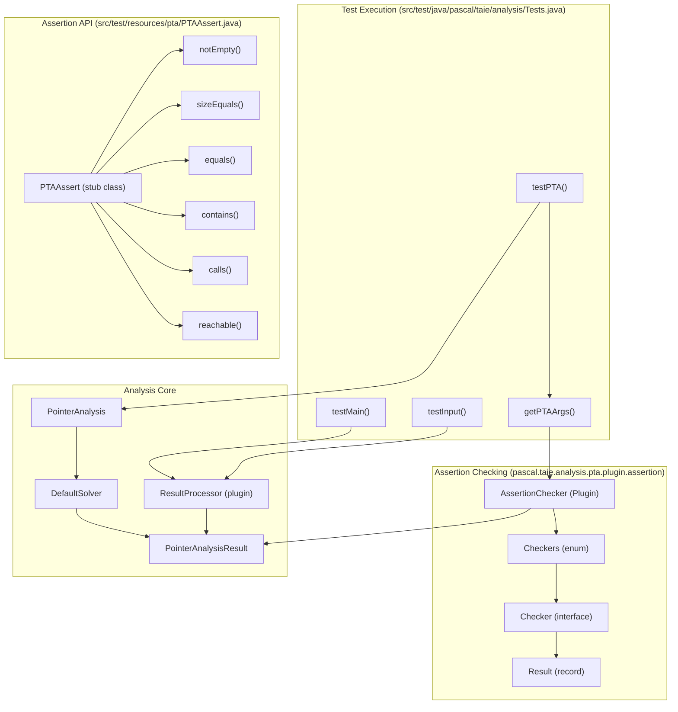
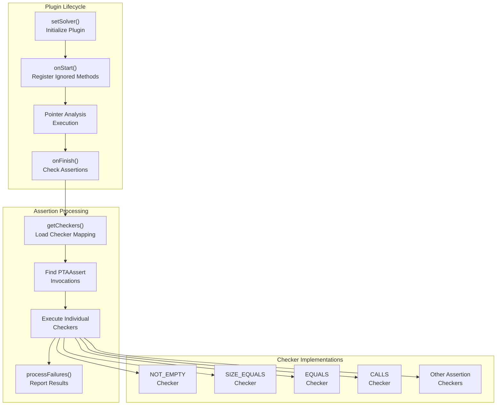
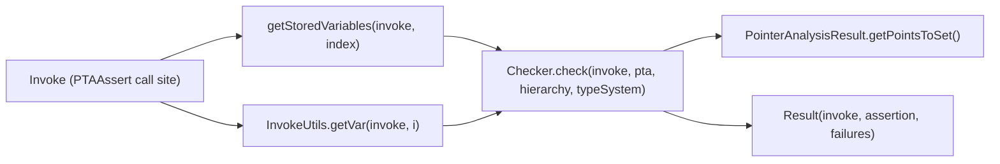
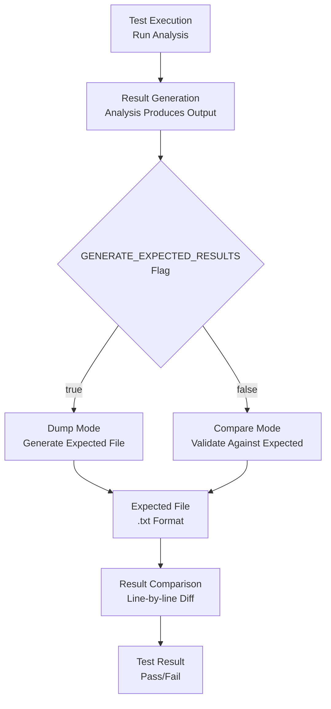

<!-- source: DeepWiki mcp.deepwiki.com · repo pascal-lab/Tai-e · page 3.6 Testing Framework · fetched 2026-10-12 -->

# Testing Framework

<details>
<summary>Relevant source files</summary>

The following files were used as context for generating this wiki page:

- [src/main/java/pascal/taie/analysis/graph/callgraph/CallGraphBuilder.java](src/main/java/pascal/taie/analysis/graph/callgraph/CallGraphBuilder.java)
- [src/main/java/pascal/taie/analysis/graph/callgraph/CallGraphs.java](src/main/java/pascal/taie/analysis/graph/callgraph/CallGraphs.java)
- [src/main/java/pascal/taie/analysis/graph/callgraph/PTABasedBuilder.java](src/main/java/pascal/taie/analysis/graph/callgraph/PTABasedBuilder.java)
- [src/main/java/pascal/taie/analysis/graph/cfg/CFGBuilder.java](src/main/java/pascal/taie/analysis/graph/cfg/CFGBuilder.java)
- [src/main/java/pascal/taie/analysis/graph/cfg/CFGDumper.java](src/main/java/pascal/taie/analysis/graph/cfg/CFGDumper.java)
- [src/main/java/pascal/taie/analysis/graph/flowgraph/FlowGraphDumper.java](src/main/java/pascal/taie/analysis/graph/flowgraph/FlowGraphDumper.java)
- [src/main/java/pascal/taie/analysis/graph/icfg/ICFGBuilder.java](src/main/java/pascal/taie/analysis/graph/icfg/ICFGBuilder.java)
- [src/main/java/pascal/taie/analysis/misc/IRDumper.java](src/main/java/pascal/taie/analysis/misc/IRDumper.java)
- [src/main/java/pascal/taie/analysis/misc/ResultProcessor.java](src/main/java/pascal/taie/analysis/misc/ResultProcessor.java)
- [src/main/java/pascal/taie/analysis/pta/PointerAnalysis.java](src/main/java/pascal/taie/analysis/pta/PointerAnalysis.java)
- [src/main/java/pascal/taie/analysis/pta/client/Collector.java](src/main/java/pascal/taie/analysis/pta/client/Collector.java)
- [src/main/java/pascal/taie/analysis/pta/plugin/Profiler.java](src/main/java/pascal/taie/analysis/pta/plugin/Profiler.java)
- [src/main/java/pascal/taie/analysis/pta/plugin/assertion/AssertionChecker.java](src/main/java/pascal/taie/analysis/pta/plugin/assertion/AssertionChecker.java)
- [src/main/java/pascal/taie/analysis/pta/plugin/assertion/Checker.java](src/main/java/pascal/taie/analysis/pta/plugin/assertion/Checker.java)
- [src/main/java/pascal/taie/analysis/pta/plugin/assertion/Checkers.java](src/main/java/pascal/taie/analysis/pta/plugin/assertion/Checkers.java)
- [src/main/java/pascal/taie/analysis/pta/plugin/assertion/Result.java](src/main/java/pascal/taie/analysis/pta/plugin/assertion/Result.java)
- [src/main/java/pascal/taie/analysis/pta/toolkit/mahjong/MahjongHeapModel.java](src/main/java/pascal/taie/analysis/pta/toolkit/mahjong/MahjongHeapModel.java)
- [src/main/java/pascal/taie/util/graph/DotDumper.java](src/main/java/pascal/taie/util/graph/DotDumper.java)
- [src/main/resources/tai-e-analyses.yml](src/main/resources/tai-e-analyses.yml)
- [src/test/java/pascal/taie/analysis/Tests.java](src/test/java/pascal/taie/analysis/Tests.java)
- [src/test/java/pascal/taie/analysis/pta/BasicTestFull.java](src/test/java/pascal/taie/analysis/pta/BasicTestFull.java)
- [src/test/java/pascal/taie/analysis/pta/ContextSensitivityTest.java](src/test/java/pascal/taie/analysis/pta/ContextSensitivityTest.java)
- [src/test/java/pascal/taie/analysis/pta/ContextSensitivityTestFull.java](src/test/java/pascal/taie/analysis/pta/ContextSensitivityTestFull.java)
- [src/test/java/pascal/taie/analysis/pta/TaintTest.java](src/test/java/pascal/taie/analysis/pta/TaintTest.java)
- [src/test/resources/pta/PTAAssert.java](src/test/resources/pta/PTAAssert.java)
- [src/test/resources/pta/basic/Primitives-pta-expected.txt](src/test/resources/pta/basic/Primitives-pta-expected.txt)
- [src/test/resources/pta/basic/Primitives.java](src/test/resources/pta/basic/Primitives.java)
- [src/test/resources/pta/basic/ZeroLengthArrayWithArraysCopyOf.java](src/test/resources/pta/basic/ZeroLengthArrayWithArraysCopyOf.java)
- [src/test/resources/pta/contextsensitivity/OneCall-pta-expected.txt](src/test/resources/pta/contextsensitivity/OneCall-pta-expected.txt)
- [src/test/resources/pta/contextsensitivity/OneCall.java](src/test/resources/pta/contextsensitivity/OneCall.java)
- [src/test/resources/pta/taint/taint-config-zero-length-array-with-arrays-copy-of.yml](src/test/resources/pta/taint/taint-config-zero-length-array-with-arrays-copy-of.yml)

</details>


The testing framework in Tai-e provides a comprehensive infrastructure for validating pointer analysis results through programmatic assertions and automated result comparison. This system enables developers to write test cases that verify the correctness of pointer analysis computations, call graph construction, and other analysis results.

For information about pointer analysis configuration and execution, see page 3.1. For details about the pointer analysis solver architecture, see page 3.2. For result processing via `ResultProcessor`, see page 7.5.

## Framework Architecture

The testing framework consists of three main components: the `PTAAssert` API for writing assertions, the `AssertionChecker` plugin for validation, and test utilities in `Tests` for execution and result processing.

**Component overview:**



Sources: [src/test/java/pascal/taie/analysis/Tests.java:51-182](), [src/main/java/pascal/taie/analysis/pta/plugin/assertion/AssertionChecker.java:45-122]()

## PTAAssert API

The `PTAAssert` class (located in `src/test/resources/pta/PTAAssert.java`) provides a declarative API for writing pointer analysis assertions directly in test code. These methods are stub implementations that serve as markers for the assertion checker to validate analysis results.

### Points-to Set Assertions

| Method | Purpose | Example Usage |
|--------|---------|---------------|
| `notEmpty(Object... vars)` | Assert variables have non-empty points-to sets | `PTAAssert.notEmpty(x, y, z)` |
| `sizeEquals(int expected, Object... vars)` | Assert points-to sets have specific size | `PTAAssert.sizeEquals(2, x, y)` |
| `equals(Object... vars)` | Assert variables have identical points-to sets | `PTAAssert.equals(x, y)` |
| `contains(Object x, Object... vars)` | Assert x's points-to set contains others' | `PTAAssert.contains(x, y, z)` |
| `notEquals(Object x, Object y)` | Assert different points-to sets | `PTAAssert.notEquals(x, y)` |
| `disjoint(Object x, Object y)` | Assert no common objects in points-to sets | `PTAAssert.disjoint(x, y)` |

### Type-based Assertions

| Method | Purpose |
|--------|---------|
| `instanceOfIn(String className, Object... vars)` | Assert points-to sets contain instances of specified class |
| `hasInstanceOf(Object x, String... classNames)` | Assert variable's points-to set has instances of all specified classes |

### Call Graph Assertions

| Method | Purpose |
|--------|---------|
| `calls(String... methodSigs)` | Assert call site invokes specified methods |
| `callsExact(String... methodSigs)` | Assert call site invokes exactly the specified methods |
| `reachable(String... methodSigs)` | Assert methods are reachable in call graph |

Sources: [src/test/resources/pta/PTAAssert.java:33-102]()

## AssertionChecker Plugin

The `AssertionChecker` plugin integrates into the pointer analysis framework to validate assertions after analysis completion.



The plugin operates in several phases:

1. **Setup Phase**: The plugin registers `PTAAssert` methods as ignored to prevent them from affecting analysis results [src/main/java/pascal/taie/analysis/pta/plugin/assertion/AssertionChecker.java:65-69]().
2. **Analysis Phase**: Normal pointer analysis execution proceeds without interference.
3. **Validation Phase**: After analysis completion (`onFinish`), the plugin locates all `PTAAssert` invocations in reachable methods and validates them against actual results [src/main/java/pascal/taie/analysis/pta/plugin/assertion/AssertionChecker.java:72-81]().
4. **Reporting Phase**: Failed assertions trigger an `AssertionError` with detailed failure information [src/main/java/pascal/taie/analysis/pta/plugin/assertion/AssertionChecker.java:109-121]().

Sources: [src/main/java/pascal/taie/analysis/pta/plugin/assertion/AssertionChecker.java:45-122]()

## Checker Implementations

Each assertion type has a corresponding checker implementation in the `Checkers` enum. These checkers extract parameters from invocation sites and validate them against analysis results.

### Checker Architecture

**Flow from `Invoke` to `Result` for each `Checkers` entry:**



### Checker Enum Members

Each `Checkers` enum member is constructed with the full method subsignature of the corresponding `PTAAssert` method and a `Checker` lambda.

| Enum Constant | PTAAssert subsig | Key Logic |
|---|---|---|
| `NOT_EMPTY` | `void notEmpty(java.lang.Object[])` | checks `pts.isEmpty()` for each var [src/main/java/pascal/taie/analysis/pta/plugin/assertion/Checkers.java:50-62](). |
| `SIZE_EQUALS` | `void sizeEquals(int,java.lang.Object[])` | checks `pts.size() != size` [src/main/java/pascal/taie/analysis/pta/plugin/assertion/Checkers.java:63-76](). |
| `EQUALS` | `void equals(java.lang.Object[])` | checks all sets equal the first [src/main/java/pascal/taie/analysis/pta/plugin/assertion/Checkers.java:77-89](). |
| `CONTAINS` | `void contains(java.lang.Object,java.lang.Object[])` | checks `xPts.containsAll(vPts)` [src/main/java/pascal/taie/analysis/pta/plugin/assertion/Checkers.java:90-105](). |
| `INSTANCEOF_IN` | `void instanceOfIn(java.lang.String,java.lang.Object[])` | checks subtype presence via `TypeSystem` [src/main/java/pascal/taie/analysis/pta/plugin/assertion/Checkers.java:106-122](). |
| `HAS_INSTANCEOF` | `void hasInstanceOf(java.lang.Object,java.lang.String[])` | checks multiple expected types in `pt(x)` [src/main/java/pascal/taie/analysis/pta/plugin/assertion/Checkers.java:123-144](). |
| `NOT_EQUALS` | `void notEquals(java.lang.Object,java.lang.Object)` | checks `xPts.equals(yPts)` negated [src/main/java/pascal/taie/analysis/pta/plugin/assertion/Checkers.java:145-156](). |
| `DISJOINT` | `void disjoint(java.lang.Object,java.lang.Object)` | uses `Collections.disjoint` [src/main/java/pascal/taie/analysis/pta/plugin/assertion/Checkers.java:157-168](). |
| `CALLS` | `void calls(java.lang.String[])` | finds call site before assertion via `findCallSiteBefore()`, checks `actualCallees.containsAll(expected)` [src/main/java/pascal/taie/analysis/pta/plugin/assertion/Checkers.java:169-181](). |
| `CALLS_EXACT` | `void callsExact(java.lang.String[])` | checks `actualCallees.equals(expectedCallees)` [src/main/java/pascal/taie/analysis/pta/plugin/assertion/Checkers.java:182-195](). |
| `REACHABLE` | `void reachable(java.lang.String[])` | checks `pta.getCallGraph().contains(method)` [src/main/java/pascal/taie/analysis/pta/plugin/assertion/Checkers.java:196-209](). |

The `getStoredVariables()` helper [src/main/java/pascal/taie/analysis/pta/plugin/assertion/Checkers.java:229-237]() recovers the actual variables passed as varargs by scanning `StoreArray` statements targeting the array-typed argument in the IR. The `findCallSiteBefore()` helper [src/main/java/pascal/taie/analysis/pta/plugin/assertion/Checkers.java:247-255]() walks backwards through the IR of the containing method to find the `Invoke` statement immediately preceding the assertion call.

Sources: [src/main/java/pascal/taie/analysis/pta/plugin/assertion/Checkers.java:48-256]()

## Test Utilities

The `Tests` class provides utilities for executing pointer analysis tests with proper configuration and result validation.

### Test Execution Methods

| Method | Purpose | Parameters |
|--------|---------|------------|
| `testPTA(String dir, String main, String... opts)` | Execute PTA test with assertion checking | Test directory, main class, options |
| `testMain(String mainClass, String classPath, String id, String... opts)` | Execute analysis on main class | Main class, classpath, analysis ID, options |
| `testInput(String inputClass, String classPath, String id, String... opts)` | Execute analysis on input class | Input class, classpath, analysis ID, options |

### Default PTA Test Configuration

`testPTA` always sets these PTA options [src/test/java/pascal/taie/analysis/Tests.java:198-201]():

| Option | Default value |
|---|---|
| `implicit-entries` | `false` |
| `only-app` | `true` |
| `distinguish-string-constants` | `all` |

`AssertionChecker` is always injected into the `plugins` list [src/test/java/pascal/taie/analysis/Tests.java:207-208](), ensuring every `testPTA` call validates the embedded `PTAAssert` calls. Additional plugins can be supplied via an `opts` entry of the form `plugins:[ClassName,...]` [src/test/java/pascal/taie/analysis/Tests.java:209-213]().

When `processResult` is `true` (the default `testPTA` overload) and `GENERATE_EXPECTED_RESULTS` is `false`, the `expected-file` option is set so `ResultProcessor` compares output against a pre-existing file [src/test/java/pascal/taie/analysis/Tests.java:202-205]().

Sources: [src/test/java/pascal/taie/analysis/Tests.java:73-221]()

## Result Processing and Comparison

The testing framework supports two modes of result processing: generating expected results and comparing against existing expected results.

### Result Processing Workflow



### Configuration Integration (non-PTA tests)

For `testMain` and `testInput`, the framework appends a `ResultProcessor` analysis argument that either dumps or compares results [src/test/java/pascal/taie/analysis/Tests.java:136-148](). The expected file name follows the pattern `<mainClass>-<analysisId>-expected.txt` resolved relative to the class path directory [src/test/java/pascal/taie/analysis/Tests.java:156-159]().

Sources: [src/test/java/pascal/taie/analysis/Tests.java:110-148]()

## Example Usage

A typical test case uses `PTAAssert` to specify expected analysis outcomes:

```java
public class ExampleTest {
    public static void main(String[] args) {
        Object a = new Object();
        Object b = new Object();
        Object c = a;
        
        // Assert that variables have non-empty points-to sets
        PTAAssert.notEmpty(a, b, c);
        
        // Assert that c points to same objects as a
        PTAAssert.equals(a, c);
        
        // Assert that a and b have different points-to sets
        PTAAssert.notEquals(a, b);
        
        // Example method call
        someMethod();
        // Assert the call goes to specific target
        PTAAssert.calls("<ExampleTest: void someMethod()>");
    }
}
```

The test execution would use:
```java
Tests.testPTA("example", "ExampleTest", "cs:ci");
```

Sources: [src/test/java/pascal/taie/analysis/Tests.java:161-182](), [src/test/resources/pta/PTAAssert.java:28-103]()

---

