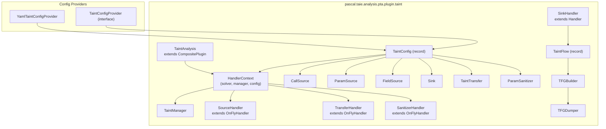
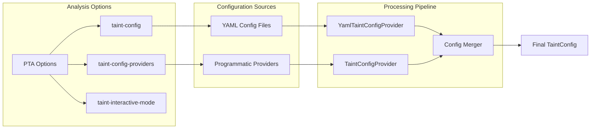
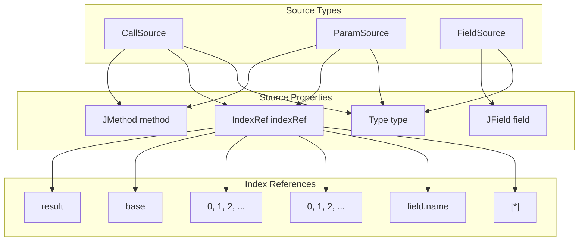
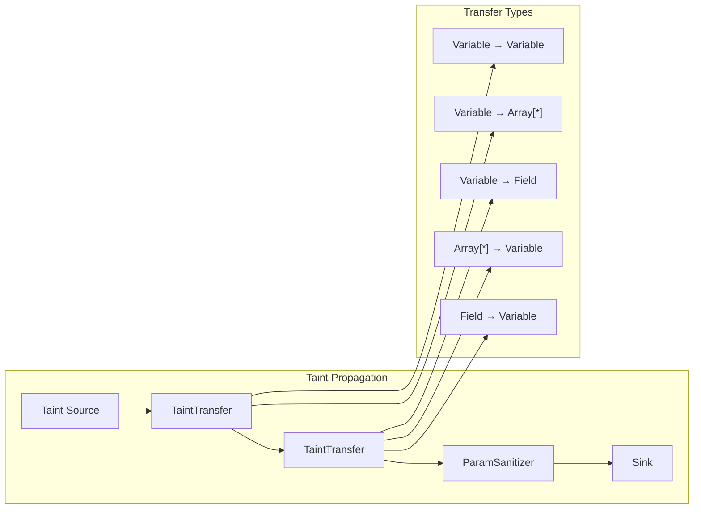
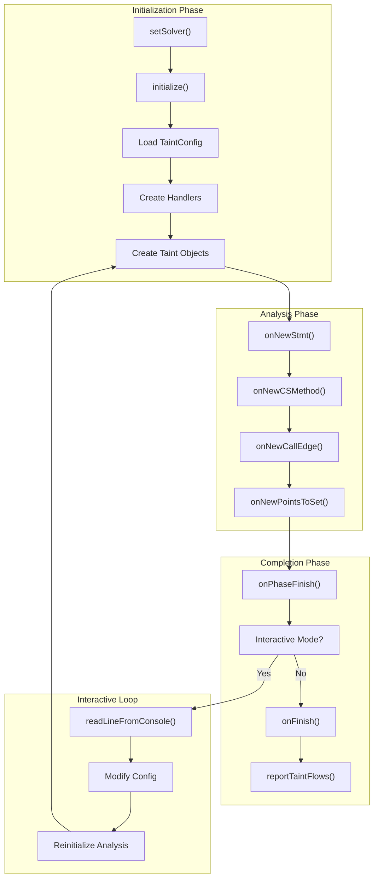
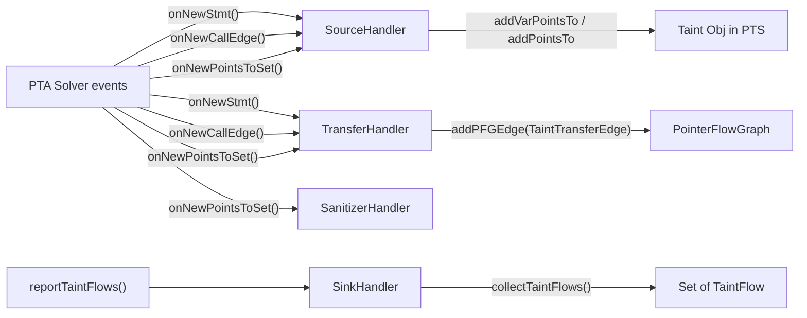

<!-- source: DeepWiki mcp.deepwiki.com · repo pascal-lab/Tai-e · page 4 Taint Analysis · fetched 2026-10-12 -->

# Taint Analysis

Relevant source files

The following files were used as context for generating this wiki page:

- [docs/en/taint-analysis.adoc](docs/en/taint-analysis.adoc)
- [docs/en/types-classes.adoc](docs/en/types-classes.adoc)
- [src/main/java/pascal/taie/analysis/pta/plugin/taint/CallSource.java](src/main/java/pascal/taie/analysis/pta/plugin/taint/CallSource.java)
- [src/main/java/pascal/taie/analysis/pta/plugin/taint/CallSourcePoint.java](src/main/java/pascal/taie/analysis/pta/plugin/taint/CallSourcePoint.java)
- [src/main/java/pascal/taie/analysis/pta/plugin/taint/FieldSource.java](src/main/java/pascal/taie/analysis/pta/plugin/taint/FieldSource.java)
- [src/main/java/pascal/taie/analysis/pta/plugin/taint/FieldSourcePoint.java](src/main/java/pascal/taie/analysis/pta/plugin/taint/FieldSourcePoint.java)
- [src/main/java/pascal/taie/analysis/pta/plugin/taint/IndexRef.java](src/main/java/pascal/taie/analysis/pta/plugin/taint/IndexRef.java)
- [src/main/java/pascal/taie/analysis/pta/plugin/taint/ParamSanitizer.java](src/main/java/pascal/taie/analysis/pta/plugin/taint/ParamSanitizer.java)
- [src/main/java/pascal/taie/analysis/pta/plugin/taint/ParamSource.java](src/main/java/pascal/taie/analysis/pta/plugin/taint/ParamSource.java)
- [src/main/java/pascal/taie/analysis/pta/plugin/taint/ParamSourcePoint.java](src/main/java/pascal/taie/analysis/pta/plugin/taint/ParamSourcePoint.java)
- [src/main/java/pascal/taie/analysis/pta/plugin/taint/Sanitizer.java](src/main/java/pascal/taie/analysis/pta/plugin/taint/Sanitizer.java)
- [src/main/java/pascal/taie/analysis/pta/plugin/taint/Sink.java](src/main/java/pascal/taie/analysis/pta/plugin/taint/Sink.java)
- [src/main/java/pascal/taie/analysis/pta/plugin/taint/SinkHandler.java](src/main/java/pascal/taie/analysis/pta/plugin/taint/SinkHandler.java)
- [src/main/java/pascal/taie/analysis/pta/plugin/taint/SinkPoint.java](src/main/java/pascal/taie/analysis/pta/plugin/taint/SinkPoint.java)
- [src/main/java/pascal/taie/analysis/pta/plugin/taint/Source.java](src/main/java/pascal/taie/analysis/pta/plugin/taint/Source.java)
- [src/main/java/pascal/taie/analysis/pta/plugin/taint/SourceHandler.java](src/main/java/pascal/taie/analysis/pta/plugin/taint/SourceHandler.java)
- [src/main/java/pascal/taie/analysis/pta/plugin/taint/SourcePoint.java](src/main/java/pascal/taie/analysis/pta/plugin/taint/SourcePoint.java)
- [src/main/java/pascal/taie/analysis/pta/plugin/taint/TFGBuilder.java](src/main/java/pascal/taie/analysis/pta/plugin/taint/TFGBuilder.java)
- [src/main/java/pascal/taie/analysis/pta/plugin/taint/TFGDumper.java](src/main/java/pascal/taie/analysis/pta/plugin/taint/TFGDumper.java)
- [src/main/java/pascal/taie/analysis/pta/plugin/taint/TaintAnalysis.java](src/main/java/pascal/taie/analysis/pta/plugin/taint/TaintAnalysis.java)
- [src/main/java/pascal/taie/analysis/pta/plugin/taint/TaintConfig.java](src/main/java/pascal/taie/analysis/pta/plugin/taint/TaintConfig.java)
- [src/main/java/pascal/taie/analysis/pta/plugin/taint/TaintFlow.java](src/main/java/pascal/taie/analysis/pta/plugin/taint/TaintFlow.java)
- [src/main/java/pascal/taie/analysis/pta/plugin/taint/TaintTransfer.java](src/main/java/pascal/taie/analysis/pta/plugin/taint/TaintTransfer.java)
- [src/main/java/pascal/taie/analysis/pta/plugin/taint/TransferHandler.java](src/main/java/pascal/taie/analysis/pta/plugin/taint/TransferHandler.java)
- [src/main/resources/commonly-used-taint-config/sink/infoleak/java-io/README.adoc](src/main/resources/commonly-used-taint-config/sink/infoleak/java-io/README.adoc)
- [src/main/resources/commonly-used-taint-config/sink/infoleak/java-io/java-io.yml](src/main/resources/commonly-used-taint-config/sink/infoleak/java-io/java-io.yml)
- [src/main/resources/commonly-used-taint-config/sink/injection/android/sql-injection/ContentProvider.yml](src/main/resources/commonly-used-taint-config/sink/injection/android/sql-injection/ContentProvider.yml)
- [src/main/resources/commonly-used-taint-config/sink/injection/android/sql-injection/DatabaseUtils.yml](src/main/resources/commonly-used-taint-config/sink/injection/android/sql-injection/DatabaseUtils.yml)
- [src/main/resources/commonly-used-taint-config/sink/injection/android/sql-injection/README.adoc](src/main/resources/commonly-used-taint-config/sink/injection/android/sql-injection/README.adoc)
- [src/main/resources/commonly-used-taint-config/sink/injection/android/sql-injection/SQLiteDatabase.yml](src/main/resources/commonly-used-taint-config/sink/injection/android/sql-injection/SQLiteDatabase.yml)
- [src/main/resources/commonly-used-taint-config/sink/injection/android/sql-injection/SQLiteQueryBuilder.yml](src/main/resources/commonly-used-taint-config/sink/injection/android/sql-injection/SQLiteQueryBuilder.yml)
- [src/main/resources/commonly-used-taint-config/sink/injection/apache-Xalan/xpath-injection/README.adoc](src/main/resources/commonly-used-taint-config/sink/injection/apache-Xalan/xpath-injection/README.adoc)
- [src/main/resources/commonly-used-taint-config/sink/injection/apache-Xalan/xpath-injection/xpath.yml](src/main/resources/commonly-used-taint-config/sink/injection/apache-Xalan/xpath-injection/xpath.yml)
- [src/main/resources/commonly-used-taint-config/sink/injection/apache-log4j/log4j_1x/crlf/Category.yml](src/main/resources/commonly-used-taint-config/sink/injection/apache-log4j/log4j_1x/crlf/Category.yml)

Taint analysis in Tai-e is a security-focused static analysis capability designed to detect data flow vulnerabilities by tracking how untrusted data (taint) propagates through a program from sources to sinks. This analysis is implemented as a plugin for the pointer analysis framework, enabling it to leverage advanced techniques like context sensitivity and precise heap modeling.

This page is an overview of the taint analysis system. Detailed documentation is split into sub-pages:
- **[Taint Analysis Configuration](#4.1)** — `TaintConfig`, YAML configuration, `YamlTaintConfigProvider`, programmatic providers, and `callSiteMode`.
- **[Taint Sources and Sinks](#4.2)** — All `Source` types (`CallSource`, `ParamSource`, `FieldSource`), `Sink`, `TaintTransfer`, `IndexRef` addressing, sanitizers, and handler internals.
- **[Taint Flow Graph](#4.3)** — `TFGBuilder`, `TaintFlowGraph`, `TFGDumper`, and result reporting.

For information about the underlying pointer analysis framework, see [Pointer Analysis](#3). For the plugin lifecycle contract, see [Plugin System](#3.3).

## System Architecture

`TaintAnalysis` extends `CompositePlugin` and orchestrates three on-the-fly handler plugins (`SourceHandler`, `TransferHandler`, `SanitizerHandler`) plus a post-analysis `SinkHandler`. All handlers share a `HandlerContext` record that holds the `Solver`, `TaintManager`, and `TaintConfig`. The `TaintManager` is responsible for creating taint `Obj` instances and mapping them back to their `SourcePoint`.

**TaintAnalysis component map**

Sources: [src/main/java/pascal/taie/analysis/pta/plugin/taint/TaintAnalysis.java:87-107](), [src/main/java/pascal/taie/analysis/pta/plugin/taint/TaintConfig.java:32-36](), [src/main/java/pascal/taie/analysis/pta/plugin/taint/TFGBuilder.java:57-91]()

## Configuration System

Taint analysis supports both YAML-based and programmatic configuration approaches, which can be combined to create comprehensive analysis setups.

### Configuration Loading Process

The configuration system processes multiple input sources through the `initialize()` method in `TaintAnalysis`, which loads YAML configurations via `YamlTaintConfigProvider` and programmatic configurations via custom `TaintConfigProvider` implementations.

Sources: [src/main/java/pascal/taie/analysis/pta/plugin/taint/TaintAnalysis.java:131-153](), [src/main/java/pascal/taie/analysis/pta/plugin/taint/TaintConfig.java:54-61](), [docs/en/taint-analysis.adoc:10-67]()

## IndexRef Addressing Scheme

`IndexRef` is the central addressing mechanism used by sources, sinks, and transfers to identify which variable at a call site (or method parameter) is tainted or sensitive. It combines a positional `index` with a `Kind` to support direct variable references, array element references, and instance field references.

| `IndexRef.Kind` | String Syntax | Description |
|-----------------|---------------|-------------|
| `VAR` | `result`, `base`, `0`, `1`, … | The variable itself |
| `ARRAY` | `result[*]`, `base[*]`, `0[*]`, … | Elements of the array pointed to by the variable |
| `FIELD` | `base.fieldName`, `0.fieldName`, … | A specific instance field of objects pointed to by the variable |

Special index constants from `InvokeUtils`: `result` (-1) refers to the return value; `base` (-2) refers to the receiver object.

Sources: [src/main/java/pascal/taie/analysis/pta/plugin/taint/SourceHandler.java:124-142](), [docs/en/taint-analysis.adoc:110-185]()

## Core Taint Elements

### Sources

Sources generate taint objects at specific program points. The system supports three primary source types:

| Source Type | Description | Key Class | Index Reference Support |
|-------------|-------------|-----------|------------------------|
| Call Sources | Generate taint at method call sites | `CallSource` | result, base, arguments |
| Parameter Sources | Generate taint on method parameters | `ParamSource` | parameter indices |
| Field Sources | Generate taint when loading field values | `FieldSource` | N/A |

Sources: [src/main/java/pascal/taie/analysis/pta/plugin/taint/CallSourcePoint.java:34-40](), [src/main/java/pascal/taie/analysis/pta/plugin/taint/ParamSourcePoint.java:33-39](), [src/main/java/pascal/taie/analysis/pta/plugin/taint/SourcePoint.java:32-50]()

### Sinks and Taint Transfers

Sinks represent program points where tainted data reaching them constitutes a security vulnerability. Taint transfers define how taint propagates between program variables during method calls.

Sources: [src/main/java/pascal/taie/analysis/pta/plugin/taint/TaintTransfer.java:38-45](), [src/main/java/pascal/taie/analysis/pta/plugin/taint/SinkHandler.java:60-71]()

## Analysis Execution Workflow

The taint analysis follows a structured execution model integrated with the pointer analysis lifecycle, illustrated by the diagram in the `TaintAnalysis` class documentation.

The workflow begins when `setSolver()` is called, triggering initialization that loads configuration and creates handler components. During pointer analysis execution, the system responds to events like new statements and call edges to track taint propagation.

Sources: [src/main/java/pascal/taie/analysis/pta/plugin/taint/TaintAnalysis.java:61-85](), [src/main/java/pascal/taie/analysis/pta/plugin/taint/TaintAnalysis.java:109-113]()

## Handler Architecture

The on-the-fly handlers (`SourceHandler`, `TransferHandler`, `SanitizerHandler`) all extend `OnFlyHandler` and receive the shared `HandlerContext`. `SinkHandler` is used at the end to collect flows.

**Handler event routing**

| Handler | Parent Class | Responsibility | Key Methods |
|---------|-------------|----------------|-------------|
| `SourceHandler` | `OnFlyHandler` | Generate taint `Obj`s at sources; handle `CallSource`, `ParamSource`, `FieldSource` | `onNewCallEdge()`, `onNewStmt()`, `onNewPointsToSet()` |
| `TransferHandler` | `OnFlyHandler` | Add `TaintTransferEdge` to PFG; back-propagate taint for mutable objects | `onNewCallEdge()`, `onNewPointsToSet()` |
| `SinkHandler` | `Handler` | Scan call graph edges into sink methods; check for taint in argument points-to sets | `collectTaintFlows()` |

**`callSiteMode`**: When `TaintConfig.callSiteMode()` is `true`, handlers additionally scan reachable `Invoke` statements to handle cases where the resolved callee might not be in the call graph.

**Back propagation in `TransferHandler`**: When taint is transferred to a mutable object (e.g., via an argument), `TransferHandler` handles back-propagation to aliased pointers to ensure consistency.

Sources: [src/main/java/pascal/taie/analysis/pta/plugin/taint/SourceHandler.java:50-165](), [src/main/java/pascal/taie/analysis/pta/plugin/taint/TransferHandler.java:62-170](), [src/main/java/pascal/taie/analysis/pta/plugin/taint/SinkHandler.java:48-90]()

## Output and Results

### Taint Flow Reporting

The analysis generates `TaintFlow` objects representing paths from sources to sinks, which are logged and stored in the analysis results. The `TaintFlowGraph` provides a visual representation of these paths.

Sources: [src/main/java/pascal/taie/analysis/pta/plugin/taint/TaintAnalysis.java:244-258](), [src/main/java/pascal/taie/analysis/pta/plugin/taint/TFGBuilder.java:96-120]()

---

