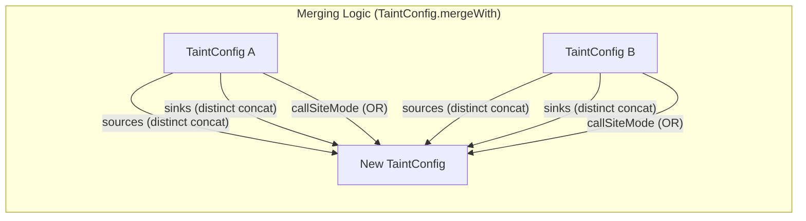

<!-- source: DeepWiki mcp.deepwiki.com · repo pascal-lab/Tai-e · page 4.1 Taint Analysis Configuration · fetched 2026-10-12 -->

# Taint Analysis Configuration

<details>
<summary>Relevant source files</summary>

The following files were used as context for generating this wiki page:

- [docs/en/taint-analysis.adoc](docs/en/taint-analysis.adoc)
- [docs/en/types-classes.adoc](docs/en/types-classes.adoc)
- [src/main/java/pascal/taie/analysis/pta/plugin/taint/CallSource.java](src/main/java/pascal/taie/analysis/pta/plugin/taint/CallSource.java)
- [src/main/java/pascal/taie/analysis/pta/plugin/taint/FieldSource.java](src/main/java/pascal/taie/analysis/pta/plugin/taint/FieldSource.java)
- [src/main/java/pascal/taie/analysis/pta/plugin/taint/IndexRef.java](src/main/java/pascal/taie/analysis/pta/plugin/taint/IndexRef.java)
- [src/main/java/pascal/taie/analysis/pta/plugin/taint/ParamSanitizer.java](src/main/java/pascal/taie/analysis/pta/plugin/taint/ParamSanitizer.java)
- [src/main/java/pascal/taie/analysis/pta/plugin/taint/ParamSource.java](src/main/java/pascal/taie/analysis/pta/plugin/taint/ParamSource.java)
- [src/main/java/pascal/taie/analysis/pta/plugin/taint/Sanitizer.java](src/main/java/pascal/taie/analysis/pta/plugin/taint/Sanitizer.java)
- [src/main/java/pascal/taie/analysis/pta/plugin/taint/Sink.java](src/main/java/pascal/taie/analysis/pta/plugin/taint/Sink.java)
- [src/main/java/pascal/taie/analysis/pta/plugin/taint/Source.java](src/main/java/pascal/taie/analysis/pta/plugin/taint/Source.java)
- [src/main/java/pascal/taie/analysis/pta/plugin/taint/TFGDumper.java](src/main/java/pascal/taie/analysis/pta/plugin/taint/TFGDumper.java)
- [src/main/java/pascal/taie/analysis/pta/plugin/taint/TaintConfig.java](src/main/java/pascal/taie/analysis/pta/plugin/taint/TaintConfig.java)
- [src/main/java/pascal/taie/analysis/pta/plugin/taint/TaintTransfer.java](src/main/java/pascal/taie/analysis/pta/plugin/taint/TaintTransfer.java)
- [src/main/resources/commonly-used-taint-config/sink/infoleak/java-io/README.adoc](src/main/resources/commonly-used-taint-config/sink/infoleak/java-io/README.adoc)
- [src/main/resources/commonly-used-taint-config/sink/infoleak/java-io/java-io.yml](src/main/resources/commonly-used-taint-config/sink/infoleak/java-io/java-io.yml)
- [src/main/resources/commonly-used-taint-config/sink/injection/android/sql-injection/ContentProvider.yml](src/main/resources/commonly-used-taint-config/sink/injection/android/sql-injection/ContentProvider.yml)
- [src/main/resources/commonly-used-taint-config/sink/injection/android/sql-injection/DatabaseUtils.yml](src/main/resources/commonly-used-taint-config/sink/injection/android/sql-injection/DatabaseUtils.yml)
- [src/main/resources/commonly-used-taint-config/sink/injection/android/sql-injection/README.adoc](src/main/resources/commonly-used-taint-config/sink/injection/android/sql-injection/README.adoc)
- [src/main/resources/commonly-used-taint-config/sink/injection/android/sql-injection/SQLiteDatabase.yml](src/main/resources/commonly-used-taint-config/sink/injection/android/sql-injection/SQLiteDatabase.yml)
- [src/main/resources/commonly-used-taint-config/sink/injection/android/sql-injection/SQLiteQueryBuilder.yml](src/main/resources/commonly-used-taint-config/sink/injection/android/sql-injection/SQLiteQueryBuilder.yml)
- [src/main/resources/commonly-used-taint-config/sink/injection/apache-Xalan/xpath-injection/README.adoc](src/main/resources/commonly-used-taint-config/sink/injection/apache-Xalan/xpath-injection/README.adoc)
- [src/main/resources/commonly-used-taint-config/sink/injection/apache-Xalan/xpath-injection/xpath.yml](src/main/resources/commonly-used-taint-config/sink/injection/apache-Xalan/xpath-injection/xpath.yml)
- [src/main/resources/commonly-used-taint-config/sink/injection/apache-log4j/log4j_1x/crlf/Category.yml](src/main/resources/commonly-used-taint-config/sink/injection/apache-log4j/log4j_1x/crlf/Category.yml)
- [src/test/resources/pta/taint/InstanceSourceSink.java](src/test/resources/pta/taint/InstanceSourceSink.java)
- [src/test/resources/pta/taint/Sanitizer.java](src/test/resources/pta/taint/Sanitizer.java)
- [src/test/resources/pta/taint/SimpleTaint-pta-expected.txt](src/test/resources/pta/taint/SimpleTaint-pta-expected.txt)
- [src/test/resources/pta/taint/SimpleTaint.java](src/test/resources/pta/taint/SimpleTaint.java)
- [src/test/resources/pta/taint/SourceSink.java](src/test/resources/pta/taint/SourceSink.java)
- [src/test/resources/pta/taint/TaintCall.java](src/test/resources/pta/taint/TaintCall.java)
- [src/test/resources/pta/taint/TaintParam.java](src/test/resources/pta/taint/TaintParam.java)
- [src/test/resources/pta/taint/taint-config-call-source.yml](src/test/resources/pta/taint/taint-config-call-source.yml)
- [src/test/resources/pta/taint/taint-config-instance-source-sink.yml](src/test/resources/pta/taint/taint-config-instance-source-sink.yml)
- [src/test/resources/pta/taint/taint-config-param-source.yml](src/test/resources/pta/taint/taint-config-param-source.yml)
- [src/test/resources/pta/taint/taint-config-static-taint-transfer.yml](src/test/resources/pta/taint/taint-config-static-taint-transfer.yml)
- [src/test/resources/pta/taint/taint-config.yml](src/test/resources/pta/taint/taint-config.yml)

</details>


Tai-e provides a highly configurable taint analysis built on top of its pointer analysis framework. This page documents the structure of taint configurations, the mechanisms for loading them via YAML or programmatic providers, and how multiple configurations are merged and managed.

## Configuration Structure

The core of the taint analysis configuration is the `TaintConfig` record. It acts as a container for all rules governing how taint is introduced, propagated, and detected.

| Component | Type | Purpose |
|-----------|------|---------|
| `sources` | `List<Source>` | Defines where taint originates (calls, parameters, fields) [src/main/java/pascal/taie/analysis/pta/plugin/taint/TaintConfig.java:32](). |
| `sinks` | `List<Sink>` | Specifies sensitive methods where taint should be detected [src/main/java/pascal/taie/analysis/pta/plugin/taint/TaintConfig.java:33](). |
| `transfers` | `List<TaintTransfer>` | Describes how taint propagates between variables at method calls [src/main/java/pascal/taie/analysis/pta/plugin/taint/TaintConfig.java:34](). |
| `paramSanitizers` | `List<ParamSanitizer>` | Identifies methods that remove taint from specific parameters [src/main/java/pascal/taie/analysis/pta/plugin/taint/TaintConfig.java:35](). |
| `callSiteMode` | `boolean` | If true, enables call-site specific taint tracking (default for Android) [src/main/java/pascal/taie/analysis/pta/plugin/taint/TaintConfig.java:36](). |

### Core Configuration Entities

The following diagram maps the logical configuration concepts to their implementation classes in the `pascal.taie.analysis.pta.plugin.taint` package.

```mermaid
graph TD
    subgraph "Configuration Container"
        TaintConfig["TaintConfig (record)"]
    end

    subgraph "Source Definitions"
        Source["Source (interface)"]
        CallSource["CallSource (record)"]
        ParamSource["ParamSource (record)"]
        FieldSource["FieldSource (record)"]
    end

    subgraph "Propagation & Detection"
        Sink["Sink (record)"]
        TaintTransfer["TaintTransfer (record)"]
        ParamSanitizer["ParamSanitizer (record)"]
    end

    subgraph "Addressing"
        IndexRef["IndexRef (record)"]
    end

    TaintConfig --> Source
    TaintConfig --> Sink
    TaintConfig --> TaintTransfer
    TaintConfig --> ParamSanitizer

    Source <|-- CallSource
    Source <|-- ParamSource
    Source <|-- FieldSource

    CallSource --> IndexRef
    ParamSource --> IndexRef
    Sink --> IndexRef
    TaintTransfer --> IndexRef
```
Sources: [src/main/java/pascal/taie/analysis/pta/plugin/taint/TaintConfig.java:32-36](), [src/main/java/pascal/taie/analysis/pta/plugin/taint/Source.java:30](), [src/main/java/pascal/taie/analysis/pta/plugin/taint/CallSource.java:35](), [src/main/java/pascal/taie/analysis/pta/plugin/taint/ParamSource.java:37](), [src/main/java/pascal/taie/analysis/pta/plugin/taint/FieldSource.java:28](), [src/main/java/pascal/taie/analysis/pta/plugin/taint/Sink.java:34](), [src/main/java/pascal/taie/analysis/pta/plugin/taint/TaintTransfer.java:38]().

## Configuration Providers

Tai-e supports two primary ways to provide configurations: YAML files and programmatic Java classes.

### 1. YAML Configuration (`YamlTaintConfigProvider`)
Users can specify a YAML file or a directory containing YAML files using the `taint-config` option [docs/en/taint-analysis.adoc:22-29](). 

*   **Format**: The YAML structure follows the `TaintConfig` record fields. It supports complex method/field signatures and signature patterns [docs/en/taint-analysis.adoc:89-108]().
*   **Index References**: Used to pinpoint variables at call sites or within methods.
    *   `result`: The LHS variable receiving a call result [docs/en/taint-analysis.adoc:140-142]().
    *   `base`: The receiver object variable [docs/en/taint-analysis.adoc:144-146]().
    *   `0, 1, ...`: Arguments or parameters by index [docs/en/taint-analysis.adoc:148-151]().
    *   **Fields/Arrays**: Supports field access (e.g., `base.f`) and array elements (e.g., `0[*]`) [docs/en/taint-analysis.adoc:183-200]().

### 2. Programmatic Provider (`TaintConfigProvider`)
For dynamic or logic-heavy configurations, users can extend the `TaintConfigProvider` class [docs/en/taint-analysis.adoc:72-83]().

*   **Registration**: Enabled via the `taint-config-providers` option [docs/en/taint-analysis.adoc:59-64]().
*   **Implementation**: Developers override methods like `sources()`, `sinks()`, and `transfers()` to return lists of configuration objects programmatically.

## Configuration Merging and Defaults

Tai-e often combines multiple configuration sources into a single runtime configuration.



*   **`mergeWith(TaintConfig other)`**: This method creates a new configuration by concatenating lists of sources, sinks, transfers, and sanitizers while removing duplicates using `Lists.concatDistinct` [src/main/java/pascal/taie/analysis/pta/plugin/taint/TaintConfig.java:54-61]().
*   **`callSiteMode`**: This flag is merged using a logical OR. If any configuration enables it, the final analysis runs in call-site mode [src/main/java/pascal/taie/analysis/pta/plugin/taint/TaintConfig.java:60]().
*   **Predefined Configs**:
    *   `TaintConfig.EMPTY`: All lists empty, `callSiteMode` is `false` [src/main/java/pascal/taie/analysis/pta/plugin/taint/TaintConfig.java:41-42]().
    *   `TaintConfig.ANDROID_DEFAULT`: All lists empty, but `callSiteMode` is `true` [src/main/java/pascal/taie/analysis/pta/plugin/taint/TaintConfig.java:47-48]().

Sources: [src/main/java/pascal/taie/analysis/pta/plugin/taint/TaintConfig.java:41-61]().

## Analysis Options

Taint analysis behavior is controlled by specific options passed to the pointer analysis (`pta`):

| Option | Description |
|--------|-------------|
| `taint-config` | Path to a YAML file or directory of YAML files [docs/en/taint-analysis.adoc:22-29](). |
| `taint-config-providers` | List of fully qualified class names of `TaintConfigProvider` implementations [docs/en/taint-analysis.adoc:59-64](). |
| `taint-interactive-mode` | Enables a CLI loop where users can modify YAML files and press `r` to re-run analysis without restarting Tai-e [docs/en/taint-analysis.adoc:42-53](). |

## Signature Handling

Tai-e uses a robust signature system to map configuration strings to internal `JMethod` and `JField` objects.

*   **Method Signatures**: Format `<CLASS: RETURN NAME(PARAMS)>` [docs/en/types-classes.adoc:68-73]().
*   **Field Signatures**: Format `<CLASS: TYPE NAME>` [docs/en/types-classes.adoc:109-113]().
*   **Patterns**: Configurations support wildcards (e.g., `source*`) and inheritance markers (e.g., `^` to include sub-classes) to simplify large-scale rules [docs/en/types-classes.adoc:144-147](), [src/test/resources/pta/taint/taint-config.yml:2-17]().

Sources: [docs/en/types-classes.adoc:68-113](), [src/test/resources/pta/taint/taint-config.yml:1-23]().

---

