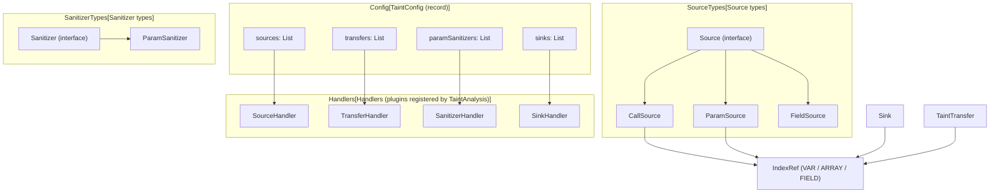
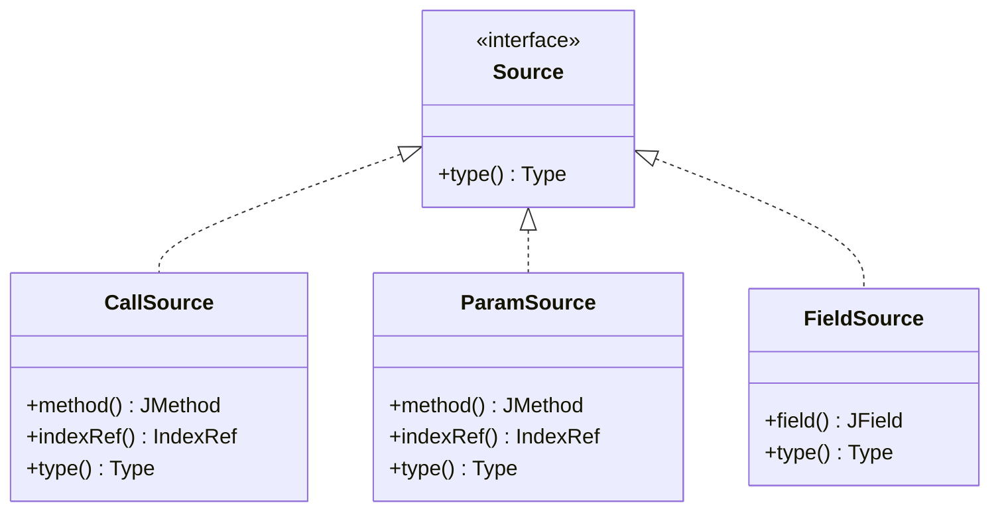
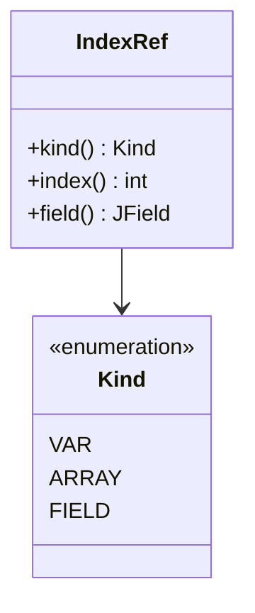
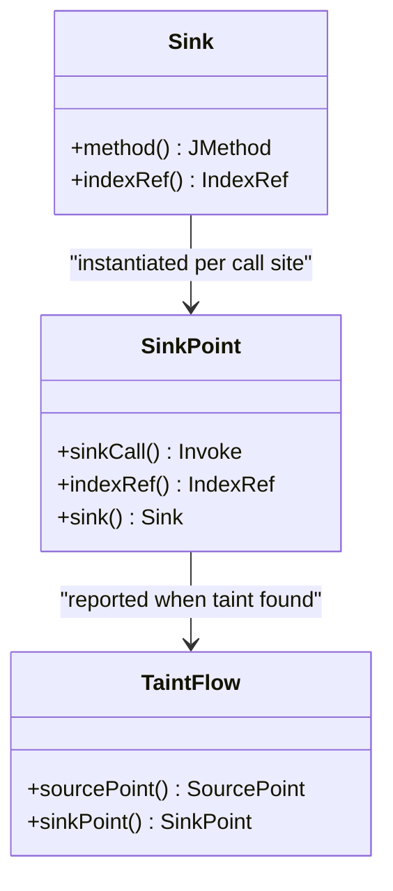
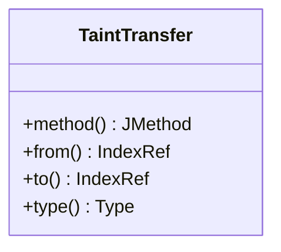
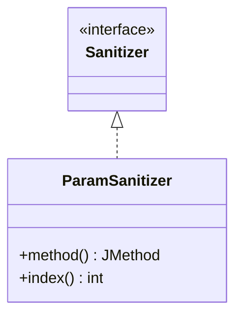
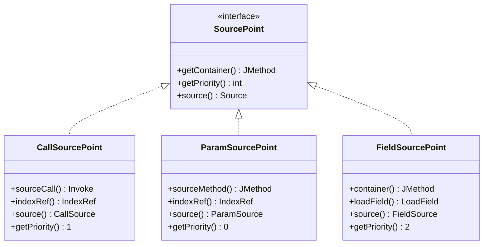
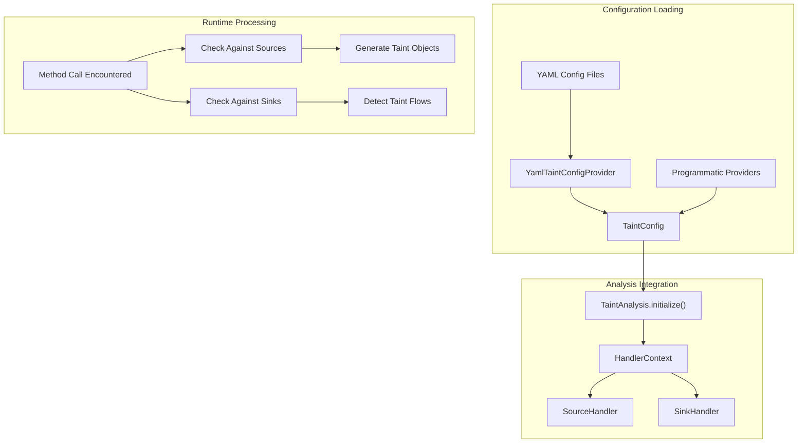

<!-- source: DeepWiki mcp.deepwiki.com · repo pascal-lab/Tai-e · page 4.2 Taint Sources and Sinks · fetched 2026-10-12 -->

# Taint Sources and Sinks

<details>
<summary>Relevant source files</summary>

The following files were used as context for generating this wiki page:

- [src/main/java/pascal/taie/analysis/pta/plugin/taint/CallSource.java](src/main/java/pascal/taie/analysis/pta/plugin/taint/CallSource.java)
- [src/main/java/pascal/taie/analysis/pta/plugin/taint/CallSourcePoint.java](src/main/java/pascal/taie/analysis/pta/plugin/taint/CallSourcePoint.java)
- [src/main/java/pascal/taie/analysis/pta/plugin/taint/FieldSource.java](src/main/java/pascal/taie/analysis/pta/plugin/taint/FieldSource.java)
- [src/main/java/pascal/taie/analysis/pta/plugin/taint/FieldSourcePoint.java](src/main/java/pascal/taie/analysis/pta/plugin/taint/FieldSourcePoint.java)
- [src/main/java/pascal/taie/analysis/pta/plugin/taint/Handler.java](src/main/java/pascal/taie/analysis/pta/plugin/taint/Handler.java)
- [src/main/java/pascal/taie/analysis/pta/plugin/taint/HandlerContext.java](src/main/java/pascal/taie/analysis/pta/plugin/taint/HandlerContext.java)
- [src/main/java/pascal/taie/analysis/pta/plugin/taint/IndexRef.java](src/main/java/pascal/taie/analysis/pta/plugin/taint/IndexRef.java)
- [src/main/java/pascal/taie/analysis/pta/plugin/taint/OnFlyHandler.java](src/main/java/pascal/taie/analysis/pta/plugin/taint/OnFlyHandler.java)
- [src/main/java/pascal/taie/analysis/pta/plugin/taint/ParamSanitizer.java](src/main/java/pascal/taie/analysis/pta/plugin/taint/ParamSanitizer.java)
- [src/main/java/pascal/taie/analysis/pta/plugin/taint/ParamSource.java](src/main/java/pascal/taie/analysis/pta/plugin/taint/ParamSource.java)
- [src/main/java/pascal/taie/analysis/pta/plugin/taint/ParamSourcePoint.java](src/main/java/pascal/taie/analysis/pta/plugin/taint/ParamSourcePoint.java)
- [src/main/java/pascal/taie/analysis/pta/plugin/taint/Sanitizer.java](src/main/java/pascal/taie/analysis/pta/plugin/taint/Sanitizer.java)
- [src/main/java/pascal/taie/analysis/pta/plugin/taint/SanitizerHandler.java](src/main/java/pascal/taie/analysis/pta/plugin/taint/SanitizerHandler.java)
- [src/main/java/pascal/taie/analysis/pta/plugin/taint/Sink.java](src/main/java/pascal/taie/analysis/pta/plugin/taint/Sink.java)
- [src/main/java/pascal/taie/analysis/pta/plugin/taint/SinkHandler.java](src/main/java/pascal/taie/analysis/pta/plugin/taint/SinkHandler.java)
- [src/main/java/pascal/taie/analysis/pta/plugin/taint/SinkPoint.java](src/main/java/pascal/taie/analysis/pta/plugin/taint/SinkPoint.java)
- [src/main/java/pascal/taie/analysis/pta/plugin/taint/Source.java](src/main/java/pascal/taie/analysis/pta/plugin/taint/Source.java)
- [src/main/java/pascal/taie/analysis/pta/plugin/taint/SourceHandler.java](src/main/java/pascal/taie/analysis/pta/plugin/taint/SourceHandler.java)
- [src/main/java/pascal/taie/analysis/pta/plugin/taint/SourcePoint.java](src/main/java/pascal/taie/analysis/pta/plugin/taint/SourcePoint.java)
- [src/main/java/pascal/taie/analysis/pta/plugin/taint/TFGBuilder.java](src/main/java/pascal/taie/analysis/pta/plugin/taint/TFGBuilder.java)
- [src/main/java/pascal/taie/analysis/pta/plugin/taint/TFGDumper.java](src/main/java/pascal/taie/analysis/pta/plugin/taint/TFGDumper.java)
- [src/main/java/pascal/taie/analysis/pta/plugin/taint/TaintAnalysis.java](src/main/java/pascal/taie/analysis/pta/plugin/taint/TaintAnalysis.java)
- [src/main/java/pascal/taie/analysis/pta/plugin/taint/TaintConfig.java](src/main/java/pascal/taie/analysis/pta/plugin/taint/TaintConfig.java)
- [src/main/java/pascal/taie/analysis/pta/plugin/taint/TaintFlow.java](src/main/java/pascal/taie/analysis/pta/plugin/taint/TaintFlow.java)
- [src/main/java/pascal/taie/analysis/pta/plugin/taint/TaintTransfer.java](src/main/java/pascal/taie/analysis/pta/plugin/taint/TaintTransfer.java)
- [src/main/java/pascal/taie/analysis/pta/plugin/taint/TransferHandler.java](src/main/java/pascal/taie/analysis/pta/plugin/taint/TransferHandler.java)
- [src/test/resources/pta/contextsensitivity/RecursiveObj-pta-expected.txt](src/test/resources/pta/contextsensitivity/RecursiveObj-pta-expected.txt)
- [src/test/resources/pta/contextsensitivity/StaticSelect-pta-expected.txt](src/test/resources/pta/contextsensitivity/StaticSelect-pta-expected.txt)
- [src/test/resources/pta/contextsensitivity/TypeSens-pta-expected.txt](src/test/resources/pta/contextsensitivity/TypeSens-pta-expected.txt)
- [src/test/resources/pta/taint/ArgToResult-pta-expected.txt](src/test/resources/pta/taint/ArgToResult-pta-expected.txt)
- [src/test/resources/pta/taint/ArrayTaint-pta-expected.txt](src/test/resources/pta/taint/ArrayTaint-pta-expected.txt)
- [src/test/resources/pta/taint/BackPropagation-pta-expected.txt](src/test/resources/pta/taint/BackPropagation-pta-expected.txt)
- [src/test/resources/pta/taint/BaseToResult-pta-expected.txt](src/test/resources/pta/taint/BaseToResult-pta-expected.txt)
- [src/test/resources/pta/taint/CSBackPropagation-pta-expected.txt](src/test/resources/pta/taint/CSBackPropagation-pta-expected.txt)
- [src/test/resources/pta/taint/CSTaint-pta-expected.txt](src/test/resources/pta/taint/CSTaint-pta-expected.txt)
- [src/test/resources/pta/taint/CallSiteMode-pta-expected.txt](src/test/resources/pta/taint/CallSiteMode-pta-expected.txt)
- [src/test/resources/pta/taint/CharArray-pta-expected.txt](src/test/resources/pta/taint/CharArray-pta-expected.txt)
- [src/test/resources/pta/taint/ComplexTaint-pta-expected.txt](src/test/resources/pta/taint/ComplexTaint-pta-expected.txt)
- [src/test/resources/pta/taint/CycleTaint-pta-expected.txt](src/test/resources/pta/taint/CycleTaint-pta-expected.txt)
- [src/test/resources/pta/taint/FieldTaint-pta-expected.txt](src/test/resources/pta/taint/FieldTaint-pta-expected.txt)
- [src/test/resources/pta/taint/InstanceSourceSink-pta-expected.txt](src/test/resources/pta/taint/InstanceSourceSink-pta-expected.txt)
- [src/test/resources/pta/taint/InterTaintTransfer-pta-expected.txt](src/test/resources/pta/taint/InterTaintTransfer-pta-expected.txt)
- [src/test/resources/pta/taint/LinkedQueue-pta-expected.txt](src/test/resources/pta/taint/LinkedQueue-pta-expected.txt)
- [src/test/resources/pta/taint/StaticTaintTransfer-pta-expected.txt](src/test/resources/pta/taint/StaticTaintTransfer-pta-expected.txt)
- [src/test/resources/pta/taint/StringAppend-pta-expected.txt](src/test/resources/pta/taint/StringAppend-pta-expected.txt)
- [src/test/resources/pta/taint/TaintCall-pta-expected.txt](src/test/resources/pta/taint/TaintCall-pta-expected.txt)
- [src/test/resources/pta/taint/TaintInList-pta-expected.txt](src/test/resources/pta/taint/TaintInList-pta-expected.txt)
- [src/test/resources/pta/taint/TaintParam-pta-expected.txt](src/test/resources/pta/taint/TaintParam-pta-expected.txt)
- [src/test/resources/pta/taint/TwoObjectTaint-pta-expected.txt](src/test/resources/pta/taint/TwoObjectTaint-pta-expected.txt)

</details>


This document explains how to define and configure taint sources and sinks in Tai-e's taint analysis framework. Taint sources specify where tainted data originates in the program, while taint sinks define locations where tainted data should not flow to detect potential security vulnerabilities.

For general taint analysis configuration and setup, see [Taint Analysis Configuration](#4.1). For information about taint flow graphs and output visualization, see [Taint Flow Graph](#4.3).

## Overview

Taint analysis in Tai-e tracks the flow of potentially unsafe data (taint) from sources to sinks through the program. Sources generate taint objects at specific program points, while sinks detect when tainted data reaches sensitive operations. The analysis reports taint flows when data from any source reaches any sink without being sanitized.

### Core Components Architecture

**Data model and handler relationships**



Sources: [src/main/java/pascal/taie/analysis/pta/plugin/taint/TaintAnalysis.java:54-58](), [src/main/java/pascal/taie/analysis/pta/plugin/taint/TaintConfig.java:32-36]()

## Taint Sources

Taint sources define program points where tainted data is introduced into the analysis. Each source specifies a location and generates a taint object of a particular type when the analysis encounters that location.

### Source Interface and Types

The `Source` interface serves as the base for all source types, requiring each implementation to specify the type of taint object it generates:

**Source type hierarchy**



Sources: [src/main/java/pascal/taie/analysis/pta/plugin/taint/Source.java:30-36](), [src/main/java/pascal/taie/analysis/pta/plugin/taint/CallSource.java:29-43](), [src/main/java/pascal/taie/analysis/pta/plugin/taint/ParamSource.java:37-45](), [src/main/java/pascal/taie/analysis/pta/plugin/taint/FieldSource.java:28-36]()

### Call Sources

Call sources generate taint objects at method call sites. They specify a target method and use an `IndexRef` to indicate which variable at the call site should receive the taint object.

| Component | Description | Example |
|-----------|-------------|---------|
| `method` | Target method signature | `<javax.servlet.ServletRequest: java.lang.String getParameter(java.lang.String)>` |
| `indexRef` | Variable location at call site | `result` (return value), `base` (receiver), `0` (first argument) |
| `type` | Type of generated taint object | `java.lang.String` |

**YAML Configuration Example:**
```yaml
sources:
  - { kind: call, method: "<SourceSink: java.lang.String source*(*{0+})>", index: result }
```

Sources: [src/main/java/pascal/taie/analysis/pta/plugin/taint/CallSource.java:29-43]()

### Parameter Sources

Parameter sources generate taint objects for method parameters, typically used for entry points that receive external input.

| Component | Description | Example |
|-----------|-------------|---------|
| `method` | Method containing the parameter | `<Controller: void doGet(HttpServletRequest,HttpServletResponse)>` |
| `indexRef` | Parameter index | `0` (first parameter), `1` (second parameter) |
| `type` | Type of generated taint object | `javax.servlet.http.HttpServletRequest` |

**YAML Configuration Example:**
```yaml
sources:
  - { kind: param, method: "<Controller: void doGet(HttpServletRequest,HttpServletResponse)>", index: 0 }
```

Sources: [src/main/java/pascal/taie/analysis/pta/plugin/taint/ParamSource.java:37-45]()

### Field Sources

Field sources generate taint objects when specific fields are loaded into variables. This is useful for modeling tainted data stored in static fields or instance fields.

| Component | Description | Example |
|-----------|-------------|---------|
| `field` | Target field signature | `<SourceSink: java.lang.String tainted1>` |
| `type` | Type of generated taint object | `java.lang.String` |

**YAML Configuration Example:**
```yaml
sources:
  - { kind: field, field: "<com.example.Config: java.lang.String apiKey>" }
```

Sources: [src/main/java/pascal/taie/analysis/pta/plugin/taint/FieldSource.java:28-36]()

### Index References

`IndexRef` is a record that specifies the precise location of a tainted value relative to a call site or method parameter list. It is used by all source types, `Sink`, and `TaintTransfer`.

**`IndexRef` record structure**



| `Kind` | Meaning | YAML syntax example |
|--------|---------|---------------------|
| `VAR` | The variable itself at the given index | `result`, `base`, `0` |
| `ARRAY` | The array elements of the variable at the given index | `result[*]`, `0[*]` |
| `FIELD` | A specific instance field of the object at the given index | `0.fieldName` |

**Special index names** (resolved by `InvokeUtils`):

| Name | Numeric value | Meaning |
|------|--------------|---------|
| `result` | `InvokeUtils.RESULT` | Return value of the call |
| `base` | `InvokeUtils.BASE` | Receiver object of the call |
| `0`, `1`, … | 0, 1, … | Positional argument / parameter |

When the `Kind` is `FIELD`, the `IndexRef.field()` component holds the resolved `JField`; otherwise it is `null`. The `ARRAY_SUFFIX` constant `"[*]"` marks array-element references in the serialized form.

Sources: [src/main/java/pascal/taie/analysis/pta/plugin/taint/IndexRef.java:30-54]()

## Taint Sinks

Taint sinks define program locations where tainted data should not flow. When the analysis detects that tainted data reaches a sink, it reports a potential security vulnerability.

### Sink Definition

The `Sink` record specifies a method and an `IndexRef` indicating which variable at call sites of that method should be checked for taint:



At analysis end, `SinkHandler.collectTaintFlows()` iterates all call edges into each sink method, retrieves the points-to set for the variable indicated by `indexRef`, and creates a `TaintFlow` record for every taint object found.

Sources: [src/main/java/pascal/taie/analysis/pta/plugin/taint/Sink.java:28-41](), [src/main/java/pascal/taie/analysis/pta/plugin/taint/SinkPoint.java:36-52](), [src/main/java/pascal/taie/analysis/pta/plugin/taint/TaintFlow.java:31-47](), [src/main/java/pascal/taie/analysis/pta/plugin/taint/SinkHandler.java:60-89]()

### Sink Configuration

Sinks are configured by specifying the method signature and the index of the variable to monitor:

**YAML Configuration Example:**
```yaml
sinks:
  - { method: "<SourceSink: void sink(java.lang.String)>", index: 0 }
  - { method: "<java.lang.Runtime: java.lang.Process exec(java.lang.String)>", index: 0 }
```

**Common Sink Patterns:**

| Pattern | Sink method | Monitored index |
|---------|-------------|-----------------|
| Command execution | `Runtime.exec(String)` | `0` (command string) |
| SQL query | `Statement.execute(String)` | `0` (SQL string) |
| File path | `FileInputStream.<init>(String)` | `0` (path) |
| Network output | `OutputStream.write(byte[])` | `0` (data) |

Sources: [src/main/java/pascal/taie/analysis/pta/plugin/taint/Sink.java:28-41](), [src/main/java/pascal/taie/analysis/pta/plugin/taint/SinkHandler.java:60-124]()

## Taint Transfers

`TaintTransfer` models how taint propagates through a method invocation that the analysis cannot directly observe — for example, when a method copies its argument's contents into its return value.

### TaintTransfer Definition



| Field | Description |
|-------|-------------|
| `method` | The method whose invocation causes the transfer |
| `from` | The variable (or field/array element) that carries the incoming taint |
| `to` | The variable (or field/array element) that should receive the taint |
| `type` | The Java type of the newly created taint object at `to` |

A transfer propagates taint by creating a new taint object derived from the original source point and injecting it at `to`. The `type` field allows the transferred taint to match the declared type of the receiving variable.

### Supported Transfer Directions

`TransferHandler` resolves the combination of `from.kind()` and `to.kind()` to one of four internal directions:

| `from` kind | `to` kind | Direction | Implementation |
|-------------|-----------|-----------|----------------|
| `VAR` | `VAR` | Var → Var | PFG edge via `TaintTransferEdge` |
| `VAR` | `ARRAY` | Var → Array elements | PFG edge per array object |
| `VAR` | `FIELD` | Var → Field | PFG edge per object's field |
| `ARRAY` | `VAR` | Array elements → Var | PFG edge per array object |
| `FIELD` | `VAR` | Field → Var | PFG edge per object's field |

Other combinations (e.g., `ARRAY` → `FIELD`) are not supported and produce a warning.

### Back Propagation

When a transfer targets `base` or an argument (not `result`) and `to.kind()` is `VAR`, `TransferHandler` additionally performs *back propagation*: it generates synthetic store statements to propagate the taint back through any aliased pointers, handling mutable objects such as `char[]` that may be shared across multiple references. This behavior is controlled by `enableBackPropagate`.

**YAML Configuration Example:**
```yaml
transfers:
  - { method: "<java.lang.String: void getChars(int,int,char[],int)>", from: base, to: "2", type: char[] }
  - { method: "<java.lang.StringBuilder: java.lang.String toString()>", from: base, to: result, type: java.lang.String }
```

Sources: [src/main/java/pascal/taie/analysis/pta/plugin/taint/TaintTransfer.java:38-45](), [src/main/java/pascal/taie/analysis/pta/plugin/taint/TransferHandler.java:96-101](), [src/main/java/pascal/taie/analysis/pta/plugin/taint/TransferHandler.java:115-170]()

## Sanitizers

Sanitizers suppress taint propagation by removing taint objects from specific variables. The current implementation provides one sanitizer type: `ParamSanitizer`.

### Sanitizer and ParamSanitizer



`ParamSanitizer` specifies that parameter at position `index` of `method` should be treated as sanitized — taint objects are removed from it when the method is called.

**YAML Configuration Example:**
```yaml
sanitizers:
  - { kind: param, method: "<com.example.Validator: void validate(java.lang.String)>", index: 0 }
```

Sanitizer logic is handled by `SanitizerHandler`, which is composed into `TaintAnalysis` alongside `SourceHandler` and `TransferHandler`.

Sources: [src/main/java/pascal/taie/analysis/pta/plugin/taint/Sanitizer.java:28-29](), [src/main/java/pascal/taie/analysis/pta/plugin/taint/ParamSanitizer.java:34-43](), [src/main/java/pascal/taie/analysis/pta/plugin/taint/TaintAnalysis.java:54-58]()

## Source Points and Sink Points

Source points and sink points are runtime records that pinpoint the exact program location where a taint object was generated or where it reached a sink. They are used to build `TaintFlow` reports and the taint flow graph.

### SourcePoint Hierarchy

**SourcePoint types and their program locations**



| Type | Created by | `getContainer()` |
|------|-----------|-----------------|
| `CallSourcePoint` | `SourceHandler.processCallSource()` | Method containing the `Invoke` statement |
| `ParamSourcePoint` | `SourceHandler.handleParamSource()` | The method with the tainted parameter |
| `FieldSourcePoint` | `SourceHandler.handleFieldSource()` | Method containing the `LoadField` statement |

The priority values determine sort order when source points span different types: `ParamSourcePoint` (0) < `CallSourcePoint` (1) < `FieldSourcePoint` (2).

Sources: [src/main/java/pascal/taie/analysis/pta/plugin/taint/SourcePoint.java:32-50](), [src/main/java/pascal/taie/analysis/pta/plugin/taint/CallSourcePoint.java:34-64](), [src/main/java/pascal/taie/analysis/pta/plugin/taint/ParamSourcePoint.java:33-62](), [src/main/java/pascal/taie/analysis/pta/plugin/taint/FieldSourcePoint.java:32-61]()

### SinkPoint

`SinkPoint` is created by `SinkHandler` for each call site where a sink method is invoked. It records the specific `Invoke` statement, the `IndexRef` pointing to the sensitive variable, and the originating `Sink` configuration entry.

Sources: [src/main/java/pascal/taie/analysis/pta/plugin/taint/SinkPoint.java:36-52]()

## Configuration Integration

The taint analysis loads sources and sinks from configuration and integrates them into the analysis workflow:



### Initialization Process

The `TaintAnalysis.initialize()` method loads configuration and creates handlers:

1. **Clean Up**: Clears composited handlers and removes existing taint objects from points-to sets.
2. **Load Configuration**: Read from YAML files (`YamlTaintConfigProvider`) and programmatic providers (`TaintConfigProvider`).
3. **Merge Configurations**: Combine multiple configuration sources using `TaintConfig.mergeWith()`.
4. **Create Context**: Initialize `HandlerContext` with solver and configuration.
5. **Register Handlers**: Add `SourceHandler`, `TransferHandler`, `SanitizerHandler`, and `SinkHandler` to the composite plugin.

Sources: [src/main/java/pascal/taie/analysis/pta/plugin/taint/TaintAnalysis.java:115-185](), [src/main/java/pascal/taie/analysis/pta/plugin/taint/TaintConfig.java:54-61]()

### Handler Interaction with PTA Solver

Handlers interact with the PTA `Solver` to propagate or block taint on-the-fly:

| Handler | PTA Interaction | Mechanism |
|---------|-----------------|-----------|
| `SourceHandler` | `solver.addVarPointsTo()` | Adds taint objects to the points-to set of source variables. |
| `TransferHandler` | `solver.addPFGEdge()` | Adds `TaintTransferEdge` to the Pointer Flow Graph to propagate taint between pointers. |
| `SanitizerHandler` | `PointsToSet.removeIf()` | Removes taint objects from the points-to set of variables at sanitation points. |
| `SinkHandler` | `solver.getResult()` | Queries the final points-to sets to detect if taint reached sensitive variables. |

Sources: [src/main/java/pascal/taie/analysis/pta/plugin/taint/SourceHandler.java:134-135](), [src/main/java/pascal/taie/analysis/pta/plugin/taint/TransferHandler.java:129-131](), [src/main/java/pascal/taie/analysis/pta/plugin/taint/TaintAnalysis.java:122-126](), [src/main/java/pascal/taie/analysis/pta/plugin/taint/SinkHandler.java:60-61]()

---

