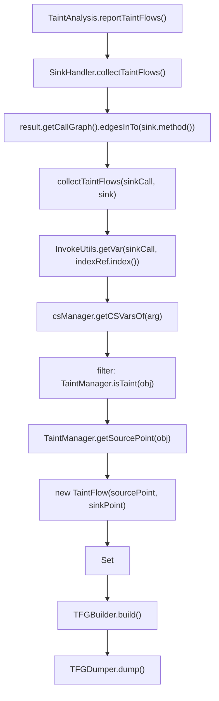
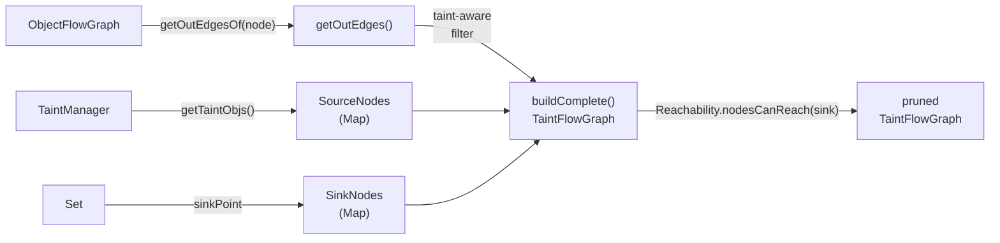
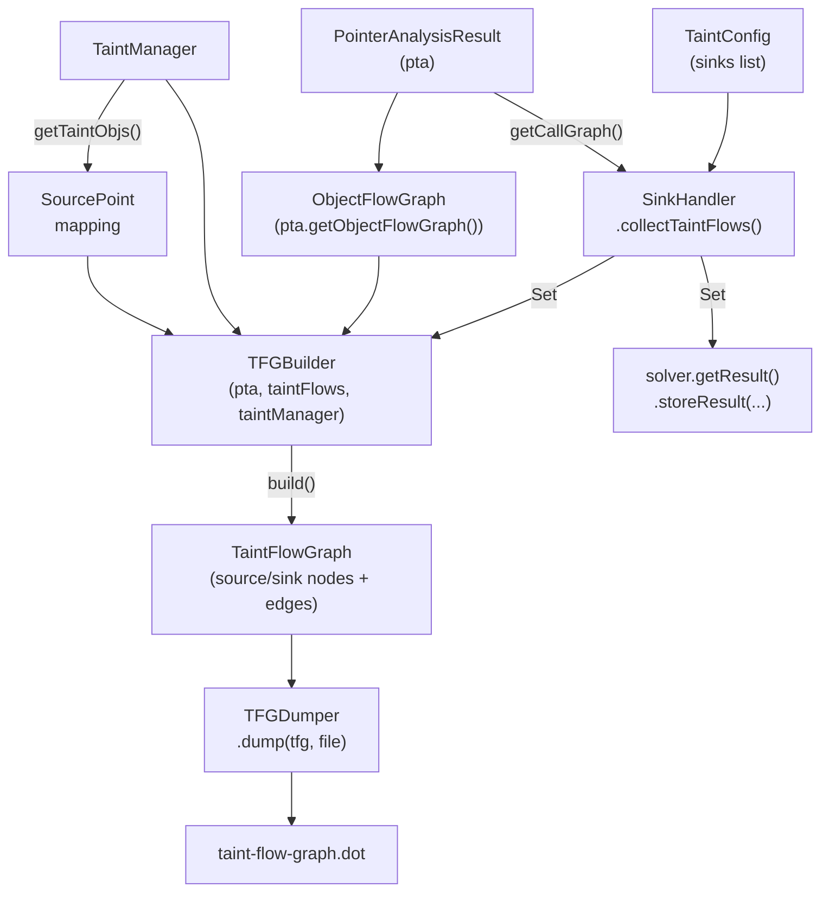

<!-- source: DeepWiki mcp.deepwiki.com · repo pascal-lab/Tai-e · page 4.3 Taint Flow Graph · fetched 2026-10-12 -->

# Taint Flow Graph

<details>
<summary>Relevant source files</summary>

The following files were used as context for generating this wiki page:

- [src/main/java/pascal/taie/analysis/graph/flowgraph/ArrayIndexNode.java](src/main/java/pascal/taie/analysis/graph/flowgraph/ArrayIndexNode.java)
- [src/main/java/pascal/taie/analysis/graph/flowgraph/FlowEdge.java](src/main/java/pascal/taie/analysis/graph/flowgraph/FlowEdge.java)
- [src/main/java/pascal/taie/analysis/graph/flowgraph/InstanceFieldNode.java](src/main/java/pascal/taie/analysis/graph/flowgraph/InstanceFieldNode.java)
- [src/main/java/pascal/taie/analysis/graph/flowgraph/InstanceNode.java](src/main/java/pascal/taie/analysis/graph/flowgraph/InstanceNode.java)
- [src/main/java/pascal/taie/analysis/graph/flowgraph/NodeManager.java](src/main/java/pascal/taie/analysis/graph/flowgraph/NodeManager.java)
- [src/main/java/pascal/taie/analysis/graph/flowgraph/ObjectFlowGraph.java](src/main/java/pascal/taie/analysis/graph/flowgraph/ObjectFlowGraph.java)
- [src/main/java/pascal/taie/analysis/graph/flowgraph/OtherFlowEdge.java](src/main/java/pascal/taie/analysis/graph/flowgraph/OtherFlowEdge.java)
- [src/main/java/pascal/taie/analysis/graph/flowgraph/StaticFieldNode.java](src/main/java/pascal/taie/analysis/graph/flowgraph/StaticFieldNode.java)
- [src/main/java/pascal/taie/analysis/graph/flowgraph/VarNode.java](src/main/java/pascal/taie/analysis/graph/flowgraph/VarNode.java)
- [src/main/java/pascal/taie/analysis/pta/plugin/taint/CallSource.java](src/main/java/pascal/taie/analysis/pta/plugin/taint/CallSource.java)
- [src/main/java/pascal/taie/analysis/pta/plugin/taint/CallSourcePoint.java](src/main/java/pascal/taie/analysis/pta/plugin/taint/CallSourcePoint.java)
- [src/main/java/pascal/taie/analysis/pta/plugin/taint/FieldSource.java](src/main/java/pascal/taie/analysis/pta/plugin/taint/FieldSource.java)
- [src/main/java/pascal/taie/analysis/pta/plugin/taint/FieldSourcePoint.java](src/main/java/pascal/taie/analysis/pta/plugin/taint/FieldSourcePoint.java)
- [src/main/java/pascal/taie/analysis/pta/plugin/taint/IndexRef.java](src/main/java/pascal/taie/analysis/pta/plugin/taint/IndexRef.java)
- [src/main/java/pascal/taie/analysis/pta/plugin/taint/ParamSanitizer.java](src/main/java/pascal/taie/analysis/pta/plugin/taint/ParamSanitizer.java)
- [src/main/java/pascal/taie/analysis/pta/plugin/taint/ParamSource.java](src/main/java/pascal/taie/analysis/pta/plugin/taint/ParamSource.java)
- [src/main/java/pascal/taie/analysis/pta/plugin/taint/ParamSourcePoint.java](src/main/java/pascal/taie/analysis/pta/plugin/taint/ParamSourcePoint.java)
- [src/main/java/pascal/taie/analysis/pta/plugin/taint/Sanitizer.java](src/main/java/pascal/taie/analysis/pta/plugin/taint/Sanitizer.java)
- [src/main/java/pascal/taie/analysis/pta/plugin/taint/Sink.java](src/main/java/pascal/taie/analysis/pta/plugin/taint/Sink.java)
- [src/main/java/pascal/taie/analysis/pta/plugin/taint/SinkHandler.java](src/main/java/pascal/taie/analysis/pta/plugin/taint/SinkHandler.java)
- [src/main/java/pascal/taie/analysis/pta/plugin/taint/SinkPoint.java](src/main/java/pascal/taie/analysis/pta/plugin/taint/SinkPoint.java)
- [src/main/java/pascal/taie/analysis/pta/plugin/taint/Source.java](src/main/java/pascal/taie/analysis/pta/plugin/taint/Source.java)
- [src/main/java/pascal/taie/analysis/pta/plugin/taint/SourceHandler.java](src/main/java/pascal/taie/analysis/pta/plugin/taint/SourceHandler.java)
- [src/main/java/pascal/taie/analysis/pta/plugin/taint/SourcePoint.java](src/main/java/pascal/taie/analysis/pta/plugin/taint/SourcePoint.java)
- [src/main/java/pascal/taie/analysis/pta/plugin/taint/TFGBuilder.java](src/main/java/pascal/taie/analysis/pta/plugin/taint/TFGBuilder.java)
- [src/main/java/pascal/taie/analysis/pta/plugin/taint/TFGDumper.java](src/main/java/pascal/taie/analysis/pta/plugin/taint/TFGDumper.java)
- [src/main/java/pascal/taie/analysis/pta/plugin/taint/TaintAnalysis.java](src/main/java/pascal/taie/analysis/pta/plugin/taint/TaintAnalysis.java)
- [src/main/java/pascal/taie/analysis/pta/plugin/taint/TaintConfig.java](src/main/java/pascal/taie/analysis/pta/plugin/taint/TaintConfig.java)
- [src/main/java/pascal/taie/analysis/pta/plugin/taint/TaintFlow.java](src/main/java/pascal/taie/analysis/pta/plugin/taint/TaintFlow.java)
- [src/main/java/pascal/taie/analysis/pta/plugin/taint/TaintFlowGraph.java](src/main/java/pascal/taie/analysis/pta/plugin/taint/TaintFlowGraph.java)
- [src/main/java/pascal/taie/analysis/pta/plugin/taint/TaintTransfer.java](src/main/java/pascal/taie/analysis/pta/plugin/taint/TaintTransfer.java)
- [src/main/java/pascal/taie/analysis/pta/plugin/taint/TransferHandler.java](src/main/java/pascal/taie/analysis/pta/plugin/taint/TransferHandler.java)
- [src/main/java/pascal/taie/util/graph/Reachability.java](src/main/java/pascal/taie/util/graph/Reachability.java)
- [src/test/resources/pta/taint/ComplexTaint.java](src/test/resources/pta/taint/ComplexTaint.java)

</details>


This page documents the Taint Flow Graph (TFG) subsystem: how taint flows are collected at the end of analysis, how the TFG is constructed from the underlying Object Flow Graph, the node and edge types involved, and how the result is serialized to Graphviz DOT format. For information on how sources, sinks, and transfers are configured and handled *during* analysis, see [Taint Sources and Sinks](#4.2). For the overall taint analysis lifecycle, see [Taint Analysis](#4).

---

## Overview

After pointer analysis completes, `TaintAnalysis.reportTaintFlows()` [src/main/java/pascal/taie/analysis/pta/plugin/taint/TaintAnalysis.java:244-258]() executes once per analysis run. It:

1. Calls `SinkHandler.collectTaintFlows()` to enumerate all `TaintFlow` instances.
2. Stores the result set in the analysis result store.
3. Constructs a `TaintFlowGraph` via `TFGBuilder`.
4. Writes the graph to `taint-flow-graph.dot` in the output directory using `TFGDumper`.

The constant `TAINT_FLOW_GRAPH_FILE = "taint-flow-graph.dot"` is declared at [src/main/java/pascal/taie/analysis/pta/plugin/taint/TaintAnalysis.java:91]().

---

## Key Types

### TaintFlow

`TaintFlow` [src/main/java/pascal/taie/analysis/pta/plugin/taint/TaintFlow.java]() is a record pairing a source location with a sink location:

```java
record TaintFlow(SourcePoint sourcePoint, SinkPoint sinkPoint)
```

It implements `Comparable` using a lexicographic comparator over `sourcePoint` then `sinkPoint`. The full set of detected flows is stored via `solver.getResult().storeResult(...)` and is also the primary input to `TFGBuilder`.

### SourcePoint Hierarchy

A `SourcePoint` [src/main/java/pascal/taie/analysis/pta/plugin/taint/SourcePoint.java:32-50]() identifies where a taint object was created. Three concrete implementations exist:

| Type | Record Components | Description |
|---|---|---|
| `CallSourcePoint` | `Invoke sourceCall`, `IndexRef indexRef`, `CallSource source` | Variable at a method call site (e.g., return value or argument) |
| `ParamSourcePoint` | `JMethod sourceMethod`, `IndexRef indexRef`, `ParamSource source` | A parameter of a method acting as an entry point |
| `FieldSourcePoint` | `JMethod container`, `LoadField loadField`, `FieldSource source` | Left-hand side of a field load statement |

Priority ordering (used for cross-type comparison in `SourcePoint.COMPARATOR`): `ParamSourcePoint` (0) < `CallSourcePoint` (1) < `FieldSourcePoint` (2).

Sources: [src/main/java/pascal/taie/analysis/pta/plugin/taint/SourcePoint.java:32-50](), [src/main/java/pascal/taie/analysis/pta/plugin/taint/CallSourcePoint.java:34-35](), [src/main/java/pascal/taie/analysis/pta/plugin/taint/ParamSourcePoint.java:33-34](), [src/main/java/pascal/taie/analysis/pta/plugin/taint/FieldSourcePoint.java]()

### SinkPoint

`SinkPoint` [src/main/java/pascal/taie/analysis/pta/plugin/taint/SinkPoint.java]() is a record identifying a call site where taint reaches a sink:

```java
record SinkPoint(Invoke sinkCall, IndexRef indexRef, Sink sink)
```

Its string representation is `sinkCall/indexRef`. Ordering is lexicographic on `sinkCall` then `indexRef`.

---

## Collecting Taint Flows

`SinkHandler.collectTaintFlows()` [src/main/java/pascal/taie/analysis/pta/plugin/taint/SinkHandler.java:60-89]() produces the set of `TaintFlow` records. The algorithm:

1. For each configured `Sink`, query the call graph for all call edges targeting the sink method [src/main/java/pascal/taie/analysis/pta/plugin/taint/SinkHandler.java:64-65]().
2. At each call site, resolve the relevant variable (or array element / field) using `IndexRef` [src/main/java/pascal/taie/analysis/pta/plugin/taint/SinkHandler.java:93-94]().
3. Collect the points-to set of that location [src/main/java/pascal/taie/analysis/pta/plugin/taint/SinkHandler.java:97-117]().
4. Filter for objects where `TaintManager.isTaint(obj)` is true [src/main/java/pascal/taie/analysis/pta/plugin/taint/SinkHandler.java:119]().
5. For each taint object, look up its `SourcePoint` via `TaintManager.getSourcePoint(obj)` [src/main/java/pascal/taie/analysis/pta/plugin/taint/SinkHandler.java:120]().
6. Emit a `TaintFlow(sourcePoint, sinkPoint)` [src/main/java/pascal/taie/analysis/pta/plugin/taint/SinkHandler.java:121]().

When `callSiteMode` is active, an additional scan over all reachable call sites supplements the call-graph-based lookup [src/main/java/pascal/taie/analysis/pta/plugin/taint/SinkHandler.java:72-87]().

**Taint Flow Collection – Call Flow**



Sources: [src/main/java/pascal/taie/analysis/pta/plugin/taint/SinkHandler.java:60-124](), [src/main/java/pascal/taie/analysis/pta/plugin/taint/TaintAnalysis.java:244-258]()

---

## TFGBuilder

`TFGBuilder` [src/main/java/pascal/taie/analysis/pta/plugin/taint/TFGBuilder.java:57]() constructs a `TaintFlowGraph` by slicing the `ObjectFlowGraph` (OFG) to paths between source nodes and sink nodes.

### Constructor Inputs

| Parameter | Type | Purpose |
|---|---|---|
| `pta` | `PointerAnalysisResult` | Provides OFG and points-to sets |
| `taintFlows` | `Set<TaintFlow>` | Determines sink nodes |
| `taintManager` | `TaintManager` | Identifies taint objects and their source points |

The OFG is retrieved immediately as `pta.getObjectFlowGraph()` [src/main/java/pascal/taie/analysis/pta/plugin/taint/TFGBuilder.java:88]().

### Build Flags

Two flags control the graph construction [src/main/java/pascal/taie/analysis/pta/plugin/taint/TFGBuilder.java:72-77]():

| Flag | Value | Effect |
|---|---|---|
| `onlyApp` | `true` | Excludes nodes belonging to library methods/classes |
| `onlyReachSink` | `true` | Prunes nodes that cannot reach any sink node |

### Build Algorithm

`TFGBuilder` proceeds in two main phases:

**Phase 1 – `buildComplete()`** [src/main/java/pascal/taie/analysis/pta/plugin/taint/TFGBuilder.java:96-120]()
- Seeds a worklist with all source nodes from `collectSourceNodes()`.
- BFS traverses OFG out-edges using `getOutEdges(node)`.
- Nodes in library code are filtered out when `onlyApp` is set [src/main/java/pascal/taie/analysis/pta/plugin/taint/TFGBuilder.java:109]().
- Edges are added to an intermediate `TaintFlowGraph`.

**Phase 2 – Sink reachability pruning** [src/main/java/pascal/taie/analysis/pta/plugin/taint/TFGBuilder.java:234-261]()
- Uses `Reachability<Node>` over the complete graph to find all nodes from which at least one sink node is reachable.
- Repeats BFS from source nodes, including only edges whose target can reach a sink.

### Source and Sink Node Mapping

**`collectSourceNodes()`** [src/main/java/pascal/taie/analysis/pta/plugin/taint/TFGBuilder.java:122-147]() iterates over all taint objects managed by `TaintManager`, resolves each one's `SourcePoint`, and maps OFG nodes to `SourcePoint` values:
- `CallSourcePoint` → resolves variable via `InvokeUtils.getVar` [src/main/java/pascal/taie/analysis/pta/plugin/taint/TFGBuilder.java:128]().
- `ParamSourcePoint` → resolves parameter via `ir.getParam` [src/main/java/pascal/taie/analysis/pta/plugin/taint/TFGBuilder.java:133]().
- `FieldSourcePoint` → resolves LHS of the `LoadField` statement [src/main/java/pascal/taie/analysis/pta/plugin/taint/TFGBuilder.java:137]().

**`collectSinkNode()`** [src/main/java/pascal/taie/analysis/pta/plugin/taint/TFGBuilder.java:149-161]() iterates over `taintFlows`, extracts each `SinkPoint`, and resolves the OFG node for the sink argument.

### Edge Filtering

`getOutEdges(Node)` [src/main/java/pascal/taie/analysis/pta/plugin/taint/TFGBuilder.java:183-204]() applies taint-aware edge filtering. The rule differs by `FlowKind`:
- `LOCAL_ASSIGN`, `INSTANCE_STORE`, `ARRAY_STORE`, `THIS_PASSING`, `PARAMETER_PASSING`, `OTHER`: Always include [src/main/java/pascal/taie/analysis/pta/plugin/taint/TFGBuilder.java:189-191]().
- `CAST`, `INSTANCE_LOAD`, `ARRAY_LOAD`, `RETURN`: Include only if source and target share at least one taint object [src/main/java/pascal/taie/analysis/pta/plugin/taint/TFGBuilder.java:192-202]().

**TFGBuilder Internal Data Flow**



Sources: [src/main/java/pascal/taie/analysis/pta/plugin/taint/TFGBuilder.java:57-204]()

---

## ObjectFlowGraph

`ObjectFlowGraph` [src/main/java/pascal/taie/analysis/graph/flowgraph/ObjectFlowGraph.java]() is the context-insensitive object flow graph derived from the `PointerFlowGraph` and the call graph. It is constructed once as part of `PointerAnalysisResult` and is reused by `TFGBuilder`.

Node types it manages:

| Node Class | Represents |
|---|---|
| `VarNode` | A local variable (context-insensitive) [src/main/java/pascal/taie/analysis/graph/flowgraph/VarNode.java]() |
| `InstanceFieldNode` | An instance field `o.f` [src/main/java/pascal/taie/analysis/graph/flowgraph/InstanceFieldNode.java]() |
| `ArrayIndexNode` | An array element `a[*]` [src/main/java/pascal/taie/analysis/graph/flowgraph/ArrayIndexNode.java]() |
| `StaticFieldNode` | A static field [src/main/java/pascal/taie/analysis/graph/flowgraph/StaticFieldNode.java]() |

Sources: [src/main/java/pascal/taie/analysis/graph/flowgraph/ObjectFlowGraph.java](), [src/main/java/pascal/taie/analysis/graph/flowgraph/VarNode.java](), [src/main/java/pascal/taie/analysis/graph/flowgraph/InstanceFieldNode.java](), [src/main/java/pascal/taie/analysis/graph/flowgraph/ArrayIndexNode.java]()

---

## TFGDumper

`TFGDumper` [src/main/java/pascal/taie/analysis/pta/plugin/taint/TFGDumper.java:48]() extends `DotDumper<Node>` to serialize a `TaintFlowGraph` to Graphviz DOT format.

### Node Styling

Styling is applied in `nodeAttributer` [src/main/java/pascal/taie/analysis/pta/plugin/taint/TFGDumper.java:124-139]():

| Node Type | Shape | Fill Color |
|---|---|---|
| `VarNode` | `box` | `floralwhite` |
| `InstanceFieldNode` | `box` + `rounded` | `aliceblue` |
| `ArrayIndexNode` | (default) | `khaki1` |
| Source config node (virtual) | `doubleoctagon` | `gold` |
| Sink config node (virtual) | `doubleoctagon` | `deepskyblue` |

### Edge Styling

Styling is applied in `edgeAttributer` [src/main/java/pascal/taie/analysis/pta/plugin/taint/TFGDumper.java:141-169]():

| FlowKind | Color | Style |
|---|---|---|
| `LOCAL_ASSIGN`, `CAST` | (default) | (default) |
| `THIS_PASSING`, `PARAMETER_PASSING` | `blue` | (default) |
| `RETURN` | `blue` | `dashed` |
| `INSTANCE_STORE`, `ARRAY_STORE` | `red` | (default) |
| `INSTANCE_LOAD`, `ARRAY_LOAD` | `red` | `dashed` |
| `OTHER` (TaintTransferEdge) | `green3` | `dashed` + label [src/main/java/pascal/taie/analysis/pta/plugin/taint/TFGDumper.java:154-155]() |

### Virtual Source/Sink Config Nodes

`dumpOthers()` [src/main/java/pascal/taie/analysis/pta/plugin/taint/TFGDumper.java:81-114]() emits additional DOT nodes for each source and sink configuration entry. These virtual nodes connect to their corresponding OFG nodes, showing the `Source`/`Sink` record and the associated `SourcePoint`/`SinkPoint`.

**TFGDumper Node and Edge Visual Encoding**

```mermaid
flowchart LR
    SC["\"<Source config>\"\n(doubleoctagon)"] --> |"unlabeled"| VN["VarNode\n(box)"]
    VN --> |"LOCAL_ASSIGN\nor CAST"| VN2["VarNode\n(box)"]
    VN --> |"THIS_PASSING\nor PARAM_PASSING\n(blue)"| VN3["VarNode\n(box)"]
    VN3 --> |"INSTANCE_STORE\nor ARRAY_STORE\n(red)"| IFN["InstanceFieldNode\nor ArrayIndexNode"]
    IFN --> |"INSTANCE_LOAD\nor ARRAY_LOAD\n(red dashed)"| VN4["VarNode\n(box)"]
    VN4 --> |"RETURN\n(blue dashed)"| VN5["VarNode\n(box)"]
    VN4 --> |"OTHER/TaintTransferEdge\n(green3 dashed + label)"| VN6["VarNode\n(box)"]
    VN6 --> |"unlabeled"| SK["\"<Sink config>\"\n(doubleoctagon)"]
```

Sources: [src/main/java/pascal/taie/analysis/pta/plugin/taint/TFGDumper.java:81-169]()

---

## End-to-End Flow

The following diagram shows the component interactions from pointer analysis completion to final output.



Sources: [src/main/java/pascal/taie/analysis/pta/plugin/taint/TaintAnalysis.java:244-258](), [src/main/java/pascal/taie/analysis/pta/plugin/taint/TFGBuilder.java:57-204](), [src/main/java/pascal/taie/analysis/pta/plugin/taint/TFGDumper.java:48-169](), [src/main/java/pascal/taie/analysis/pta/plugin/taint/SinkHandler.java:60-89]()

---

