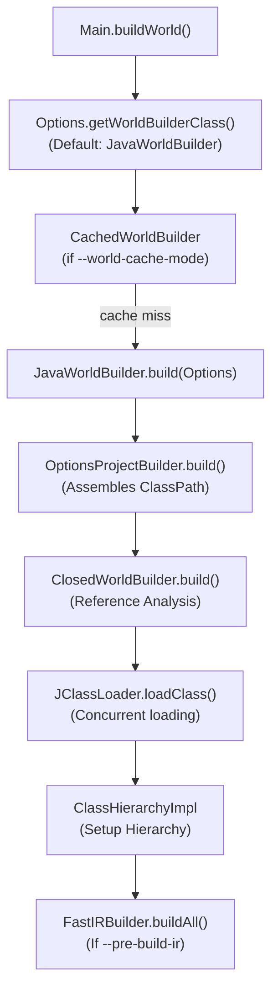

<!-- source: DeepWiki mcp.deepwiki.com · repo pascal-lab/Tai-e · page 5 Frontend · fetched 2026-10-12 -->

# Frontend

Relevant source files

The following files were used as context for generating this wiki page:

- [.gitmodules](.gitmodules)
- [CHANGELOG.md](CHANGELOG.md)
- [src/main/java/pascal/taie/AbstractWorldBuilder.java](src/main/java/pascal/taie/AbstractWorldBuilder.java)
- [src/main/java/pascal/taie/WorldBuilder.java](src/main/java/pascal/taie/WorldBuilder.java)
- [src/main/java/pascal/taie/backend/bytecode/JarTransformer.java](src/main/java/pascal/taie/backend/bytecode/JarTransformer.java)
- [src/main/java/pascal/taie/config/Options.java](src/main/java/pascal/taie/config/Options.java)
- [src/main/java/pascal/taie/frontend/cache/CachedWorldBuilder.java](src/main/java/pascal/taie/frontend/cache/CachedWorldBuilder.java)
- [src/main/java/pascal/taie/frontend/java/JavaWorldBuilder.java](src/main/java/pascal/taie/frontend/java/JavaWorldBuilder.java)
- [src/main/java/pascal/taie/frontend/java/classes/AsmClassSource.java](src/main/java/pascal/taie/frontend/java/classes/AsmClassSource.java)
- [src/main/java/pascal/taie/frontend/java/classes/DefaultClassLoader.java](src/main/java/pascal/taie/frontend/java/classes/DefaultClassLoader.java)
- [src/main/java/pascal/taie/frontend/java/classes/PhantomClassBuilder.java](src/main/java/pascal/taie/frontend/java/classes/PhantomClassBuilder.java)
- [src/main/java/pascal/taie/frontend/java/classes/PhantomClassSource.java](src/main/java/pascal/taie/frontend/java/classes/PhantomClassSource.java)
- [src/main/java/pascal/taie/frontend/java/closedworld/ClosedWorldBuilder.java](src/main/java/pascal/taie/frontend/java/closedworld/ClosedWorldBuilder.java)
- [src/main/java/pascal/taie/frontend/java/closedworld/ConstantTableReader.java](src/main/java/pascal/taie/frontend/java/closedworld/ConstantTableReader.java)
- [src/main/java/pascal/taie/frontend/java/closedworld/DependencyResolver.java](src/main/java/pascal/taie/frontend/java/closedworld/DependencyResolver.java)
- [src/main/java/pascal/taie/frontend/java/closedworld/ResolveResult.java](src/main/java/pascal/taie/frontend/java/closedworld/ResolveResult.java)
- [src/main/java/pascal/taie/frontend/java/project/OptionsProjectBuilder.java](src/main/java/pascal/taie/frontend/java/project/OptionsProjectBuilder.java)
- [src/main/java/pascal/taie/frontend/soot/SootWorldBuilder.java](src/main/java/pascal/taie/frontend/soot/SootWorldBuilder.java)
- [src/main/java/pascal/taie/language/classes/ClassSource.java](src/main/java/pascal/taie/language/classes/ClassSource.java)
- [src/main/java/pascal/taie/language/type/AbstractTypeSystem.java](src/main/java/pascal/taie/language/type/AbstractTypeSystem.java)
- [src/main/java/pascal/taie/language/type/FastTypeSystem.java](src/main/java/pascal/taie/language/type/FastTypeSystem.java)
- [src/test/java/pascal/taie/analysis/pta/BenchmarkInfo.java](src/test/java/pascal/taie/analysis/pta/BenchmarkInfo.java)
- [src/test/java/pascal/taie/analysis/pta/BenchmarkRunner.java](src/test/java/pascal/taie/analysis/pta/BenchmarkRunner.java)
- [src/test/java/pascal/taie/config/OptionsTest.java](src/test/java/pascal/taie/config/OptionsTest.java)
- [src/test/java/pascal/taie/frontend/java/TestBytecodeIRBuilder.java](src/test/java/pascal/taie/frontend/java/TestBytecodeIRBuilder.java)

The frontend pipeline loads Java class files into Tai-e's program model and translates method bodies into Tai-e's IR. While Tai-e originally relied on Soot as its primary parsing backend, it now features a native Java frontend that is significantly faster and more reliable [CHANGELOG.md:8-13]().

The frontend is responsible for initializing the `World` singleton, building the `ClassHierarchy`, and setting up the `IRBuilder` [src/main/java/pascal/taie/frontend/java/JavaWorldBuilder.java:69-144]().

For details on the IR structure produced by the frontend, see page [Intermediate Representation](#2.2). For the `World` singleton and `ClassHierarchy` that the frontend populates, see page [World and Class Hierarchy](#2.1). Details on Soot-specific integration are on page [Soot Integration](#5.1); IR translation details are on page [IR Building](#5.2).

## Frontend Architecture Overview

Tai-e supports multiple frontend implementations through the `WorldBuilder` interface. The default is now `JavaWorldBuilder`, though `SootWorldBuilder` remains available for compatibility [src/main/java/pascal/taie/config/Options.java:85-90]().

**Key Frontend Components:**

| Class | Package | Role |
|---|---|---|
| `JavaWorldBuilder` | `frontend.java` | **Default** entry point; uses a custom native Java frontend [src/main/java/pascal/taie/frontend/java/JavaWorldBuilder.java:55-56]() |
| `SootWorldBuilder` | `frontend.soot` | Legacy entry point; configures Soot and Jimple-to-IR translation [src/main/java/pascal/taie/frontend/soot/SootWorldBuilder.java:57-58]() |
| `AbstractWorldBuilder` | `pascal.taie` | Shared utilities for classpath assembly and native models [src/main/java/pascal/taie/AbstractWorldBuilder.java:48-49]() |
| `CachedWorldBuilder` | `frontend.cache` | Decorator that serializes the built `World` to disk for reuse [src/main/java/pascal/taie/frontend/cache/CachedWorldBuilder.java:53-54]() |
| `ClosedWorldBuilder` | `frontend.java.closedworld` | Performs reference analysis to find all reachable classes [src/main/java/pascal/taie/frontend/java/closedworld/ClosedWorldBuilder.java:53-54]() |
| `FastIRBuilder` | `frontend.java.ir` | The new high-performance IR builder for the native frontend [src/main/java/pascal/taie/frontend/java/JavaWorldBuilder.java:139-140]() |

**High-level Initialization Flow:**

Sources: [src/main/java/pascal/taie/frontend/java/JavaWorldBuilder.java:68-144](), [src/main/java/pascal/taie/frontend/cache/CachedWorldBuilder.java:71-78](), [src/main/java/pascal/taie/frontend/java/closedworld/ClosedWorldBuilder.java:85-116]()

## Classpath and JRE Handling

`AbstractWorldBuilder` provides the logic for resolving the Java runtime and application classpaths. Tai-e can either use the current JRE or a specific version (e.g., Java 8) provided via submodules [src/main/java/pascal/taie/AbstractWorldBuilder.java:72-102]().

- **Current JRE**: Enabled by default or via `-pp` (deprecated) [src/main/java/pascal/taie/config/Options.java:184-193]().
- **Specific JRE**: Resolved using the `java-benchmarks` submodule located at `java-benchmarks/JREs` [src/main/java/pascal/taie/AbstractWorldBuilder.java:52-53]().
- **Android Mode**: When `--android-mode` is active, it uses `android-benchmarks/android-platforms` to resolve framework jars [src/main/java/pascal/taie/AbstractWorldBuilder.java:54-55]().

Sources: [src/main/java/pascal/taie/AbstractWorldBuilder.java:72-102](), [src/main/java/pascal/taie/config/Options.java:162-172]()

## The New Java Frontend (`JavaWorldBuilder`)

Introduced in OOPSLA'25, the new frontend replaces Soot as the default mechanism for class loading and IR generation [CHANGELOG.md:8-13]().

1.  **Project Building**: `OptionsProjectBuilder` converts command-line options into a `Project` model [src/main/java/pascal/taie/frontend/java/JavaWorldBuilder.java:77]().
2.  **Closed World Analysis**: `ClosedWorldBuilder` uses `DependencyResolver` to perform a transitive reference analysis starting from the main class and input classes [src/main/java/pascal/taie/frontend/java/closedworld/ClosedWorldBuilder.java:89-97]().
3.  **ASM-based Loading**: It uses `AsmClassSource` to read bytecode and `BytecodeClassBuilder` to populate the `JClass` model [src/main/java/pascal/taie/frontend/java/JavaWorldBuilder.java:87-98]().
4.  **Phantom Classes**: If a class cannot be found, `PhantomClassBuilder` creates a placeholder to ensure analysis continues [src/main/java/pascal/taie/frontend/java/JavaWorldBuilder.java:92-93]().

Sources: [src/main/java/pascal/taie/frontend/java/JavaWorldBuilder.java:76-101](), [src/main/java/pascal/taie/frontend/java/closedworld/DependencyResolver.java:44-53]()

## Legacy Soot Integration

`SootWorldBuilder` remains available for users requiring Jimple-based processing. It configures the Soot `Scene` with specific options:
- **Phase Options**: Disables Soot's call graph (`cg`) and uses Tai-e's custom `wjtp.tai-e` transformer [src/main/java/pascal/taie/frontend/soot/SootWorldBuilder.java:96](), [src/main/java/pascal/taie/frontend/soot/SootWorldBuilder.java:123-133]().
- **Class Loading**: Loads classes from the Soot `Scene` into Tai-e's `ClassHierarchy` [src/main/java/pascal/taie/frontend/soot/SootWorldBuilder.java:163-168]().

For more details on Soot-specific configuration, see [Soot Integration](#5.1).

Sources: [src/main/java/pascal/taie/frontend/soot/SootWorldBuilder.java:79-133]()

## IR Building and Caching

Tai-e supports pre-building the IR for all reachable methods or building it on-demand when `JMethod.getIR()` is called [src/main/java/pascal/taie/frontend/java/JavaWorldBuilder.java:141-143]().

- **FastIRBuilder**: The native frontend's IR builder [src/main/java/pascal/taie/frontend/java/JavaWorldBuilder.java:139-140]().
- **MethodIRBuilder**: The Soot-based IR builder that translates Jimple to Tai-e IR.
- **Caching**: `CachedWorldBuilder` can save the entire `World` (including IR if pre-built) to a `.bin` file in the `cache/` directory [src/main/java/pascal/taie/frontend/cache/CachedWorldBuilder.java:57-68](). The cache is invalidated if input class paths or the Java version change [src/main/java/pascal/taie/frontend/cache/CachedWorldBuilder.java:147-168]().

For more details on IR translation logic, see [IR Building](#5.2).

Sources: [src/main/java/pascal/taie/frontend/cache/CachedWorldBuilder.java:138-169](), [src/main/java/pascal/taie/frontend/java/JavaWorldBuilder.java:137-144]()

---

