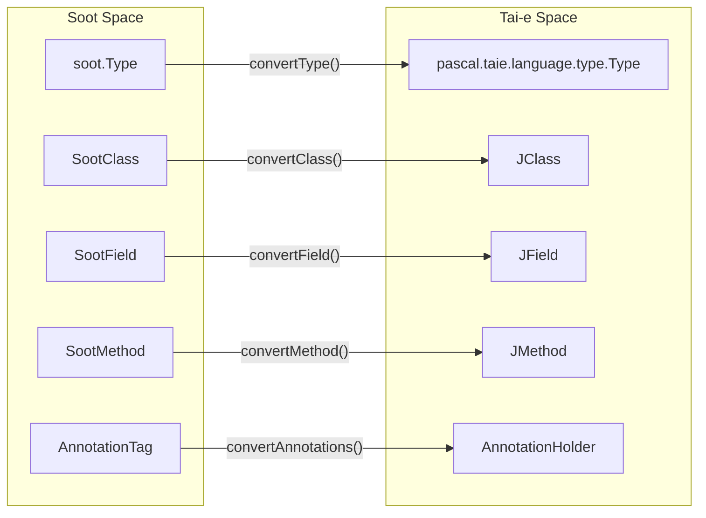

<!-- source: DeepWiki mcp.deepwiki.com · repo pascal-lab/Tai-e · page 5.1 Soot Integration · fetched 2026-10-12 -->

# Soot Integration

<details>
<summary>Relevant source files</summary>

The following files were used as context for generating this wiki page:

- [.gitmodules](.gitmodules)
- [CHANGELOG.md](CHANGELOG.md)
- [src/main/java/pascal/taie/AbstractWorldBuilder.java](src/main/java/pascal/taie/AbstractWorldBuilder.java)
- [src/main/java/pascal/taie/WorldBuilder.java](src/main/java/pascal/taie/WorldBuilder.java)
- [src/main/java/pascal/taie/analysis/graph/callgraph/CHABuilder.java](src/main/java/pascal/taie/analysis/graph/callgraph/CHABuilder.java)
- [src/main/java/pascal/taie/analysis/graph/callgraph/DefaultCallGraph.java](src/main/java/pascal/taie/analysis/graph/callgraph/DefaultCallGraph.java)
- [src/main/java/pascal/taie/android/util/AndroidSystemClassUtil.java](src/main/java/pascal/taie/android/util/AndroidSystemClassUtil.java)
- [src/main/java/pascal/taie/backend/bytecode/JarTransformer.java](src/main/java/pascal/taie/backend/bytecode/JarTransformer.java)
- [src/main/java/pascal/taie/config/Options.java](src/main/java/pascal/taie/config/Options.java)
- [src/main/java/pascal/taie/frontend/cache/CachedWorldBuilder.java](src/main/java/pascal/taie/frontend/cache/CachedWorldBuilder.java)
- [src/main/java/pascal/taie/frontend/java/project/OptionsProjectBuilder.java](src/main/java/pascal/taie/frontend/java/project/OptionsProjectBuilder.java)
- [src/main/java/pascal/taie/frontend/soot/Converter.java](src/main/java/pascal/taie/frontend/soot/Converter.java)
- [src/main/java/pascal/taie/frontend/soot/SootClassBuilder.java](src/main/java/pascal/taie/frontend/soot/SootClassBuilder.java)
- [src/main/java/pascal/taie/frontend/soot/SootClassLoader.java](src/main/java/pascal/taie/frontend/soot/SootClassLoader.java)
- [src/main/java/pascal/taie/frontend/soot/SootWorldBuilder.java](src/main/java/pascal/taie/frontend/soot/SootWorldBuilder.java)
- [src/main/java/pascal/taie/language/classes/ClassHierarchy.java](src/main/java/pascal/taie/language/classes/ClassHierarchy.java)
- [src/main/java/pascal/taie/language/classes/ClassHierarchyImpl.java](src/main/java/pascal/taie/language/classes/ClassHierarchyImpl.java)
- [src/main/java/pascal/taie/language/classes/JClass.java](src/main/java/pascal/taie/language/classes/JClass.java)
- [src/main/java/pascal/taie/language/classes/JClassBuilder.java](src/main/java/pascal/taie/language/classes/JClassBuilder.java)
- [src/main/java/pascal/taie/language/classes/JMethod.java](src/main/java/pascal/taie/language/classes/JMethod.java)
- [src/main/java/pascal/taie/language/classes/StringReps.java](src/main/java/pascal/taie/language/classes/StringReps.java)
- [src/main/java/pascal/taie/language/type/PrimitiveType.java](src/main/java/pascal/taie/language/type/PrimitiveType.java)
- [src/main/java/pascal/taie/language/type/ValueType.java](src/main/java/pascal/taie/language/type/ValueType.java)
- [src/test/java/pascal/taie/analysis/exception/ExceptionTest.java](src/test/java/pascal/taie/analysis/exception/ExceptionTest.java)
- [src/test/java/pascal/taie/analysis/graph/cfg/CFGTest.java](src/test/java/pascal/taie/analysis/graph/cfg/CFGTest.java)
- [src/test/java/pascal/taie/analysis/pta/BenchmarkInfo.java](src/test/java/pascal/taie/analysis/pta/BenchmarkInfo.java)
- [src/test/java/pascal/taie/analysis/pta/BenchmarkRunner.java](src/test/java/pascal/taie/analysis/pta/BenchmarkRunner.java)
- [src/test/java/pascal/taie/config/OptionsTest.java](src/test/java/pascal/taie/config/OptionsTest.java)
- [src/test/java/pascal/taie/frontend/java/TestBytecodeIRBuilder.java](src/test/java/pascal/taie/frontend/java/TestBytecodeIRBuilder.java)
- [src/test/java/pascal/taie/frontend/soot/IRTest.java](src/test/java/pascal/taie/frontend/soot/IRTest.java)
- [src/test/java/pascal/taie/frontend/soot/OuterInnerTest.java](src/test/java/pascal/taie/frontend/soot/OuterInnerTest.java)
- [src/test/java/pascal/taie/frontend/soot/SootFrontendTest.java](src/test/java/pascal/taie/frontend/soot/SootFrontendTest.java)
- [src/test/java/pascal/taie/language/DefaultMethodTest.java](src/test/java/pascal/taie/language/DefaultMethodTest.java)
- [src/test/java/pascal/taie/language/HierarchyTest.java](src/test/java/pascal/taie/language/HierarchyTest.java)
- [src/test/java/pascal/taie/language/TypeTest.java](src/test/java/pascal/taie/language/TypeTest.java)

</details>


## Purpose and Scope

This page documents how Tai-e uses [Soot](https://github.com/soot-oss/soot) as a frontend to load Java class files and construct the `World` program model. It covers the full pipeline from Soot configuration through class loading, type/field/method conversion, and IR construction. For details on the IR structure produced by this pipeline, see [IR Building](#5.2). For the `World` singleton and `ClassHierarchy` model that this pipeline populates, see [World and Class Hierarchy](#2.1).

---

## Overview

The Soot frontend is responsible for:

1. Configuring and invoking Soot to parse class files or Java source.
2. Loading `SootClass` objects into Tai-e's `JClass`/`JMethod`/`JField` model.
3. Converting Soot type representations, annotations, and signatures to Tai-e equivalents.
4. Providing an `IRBuilder` that lazily (or eagerly) translates Jimple method bodies into Tai-e IR.

All classes in this subsystem reside under `src/main/java/pascal/taie/frontend/soot/`.

---

## Entry Point: `SootWorldBuilder`

`SootWorldBuilder` is an implementation of `WorldBuilder`. While Tai-e now defaults to its own `JavaWorldBuilder` [src/main/java/pascal/taie/config/Options.java:85-86](), `SootWorldBuilder` remains available as a legacy option [src/main/java/pascal/taie/config/Options.java:88-89]().

**Invocation chain from `Main`:**

*Diagram: Invocation flow from Main to World construction*

```mermaid
sequenceDiagram
    participant "Main" as Main
    participant "SootWorldBuilder" as SWB
    participant "soot.Main" as SootMain
    participant "SceneTransformer" as ST
    participant "SootWorldBuilder.build(Options,Scene)" as SWBuild

    "Main"->"SootWorldBuilder": "build(options)"
    "SootWorldBuilder"->"SootWorldBuilder": "initSoot(options, builder)"
    "SootWorldBuilder"->"SootMain": "runSoot(args)"
    "SootMain"->"SceneTransformer": "internalTransform(phaseName, opts)"
    "SceneTransformer"->"SootWorldBuilder.build(Options,Scene)": "builder.build(options, Scene.v())"
    "SootWorldBuilder.build(Options,Scene)"->"SootWorldBuilder": "World, ClassHierarchy, TypeSystem, Converter constructed"
```

Sources: [src/main/java/pascal/taie/frontend/soot/SootWorldBuilder.java:70-77](), [src/main/java/pascal/taie/frontend/soot/SootWorldBuilder.java:123-133]()

---

### Soot Configuration (`initSoot`)

`initSoot` [src/main/java/pascal/taie/frontend/soot/SootWorldBuilder.java:79-133]() resets Soot (`G.reset()`) and applies these settings:

| Soot Option | Value | Purpose |
|---|---|---|
| `output_format` | `jimple` | Emit Jimple IR [src/main/java/pascal/taie/frontend/soot/SootWorldBuilder.java:86-87]() |
| `keep_line_number` | `true` | Preserve source line info [src/main/java/pascal/taie/frontend/soot/SootWorldBuilder.java:88]() |
| `set_app` | `true` | Treat input as application code [src/main/java/pascal/taie/frontend/soot/SootWorldBuilder.java:89]() |
| `set_exclude` | `jdk.*`, `apple.laf.*` | Exclude JDK from app classes [src/main/java/pascal/taie/frontend/soot/SootWorldBuilder.java:91]() |
| `set_whole_program` | `true` | Enable whole-program mode [src/main/java/pascal/taie/frontend/soot/SootWorldBuilder.java:92]() |
| `set_no_writeout_body_releasing` | `true` | Keep method bodies in memory [src/main/java/pascal/taie/frontend/soot/SootWorldBuilder.java:93]() |
| `jb` phase: `model-lambdametafactory` | `false` | Disable Soot's lambda modeling [src/main/java/pascal/taie/frontend/soot/SootWorldBuilder.java:95]() |
| `cg` pack | `enabled:false` | Disable Soot's own call-graph [src/main/java/pascal/taie/frontend/soot/SootWorldBuilder.java:96]() |
| `prepend_classpath` | `true` | Prepend classpath for dependencies [src/main/java/pascal/taie/frontend/soot/SootWorldBuilder.java:99]() |
| `allow_phantom_refs` | `true` | Allow unresolved classes [src/main/java/pascal/taie/frontend/soot/SootWorldBuilder.java:101]() |

A `Transform` registered in Soot's `wjtp` pack triggers `build(Options, Scene)` once Soot finishes loading [src/main/java/pascal/taie/frontend/soot/SootWorldBuilder.java:123-133]().

---

### Basic Classes

`SootWorldBuilder` loads foundational classes specified in YAML files to ensure the `Scene` is populated correctly.

- **Standard Java**: `basic-classes.yml` [src/main/java/pascal/taie/frontend/soot/SootWorldBuilder.java:65]()
- **Android**: `android/android-basic-classes.yml` [src/main/java/pascal/taie/frontend/soot/SootWorldBuilder.java:67]()

These are added via `scene.addBasicClass(name, HIERARCHY)` [src/main/java/pascal/taie/frontend/soot/SootWorldBuilder.java:148]().

---

### World Construction (`build(Options, Scene)`)

After Soot's loading phase, `build(Options, Scene)` [src/main/java/pascal/taie/frontend/soot/SootWorldBuilder.java:154-203]() constructs the `World`:

1. `World.reset()` and `World.set(world)` install a fresh singleton [src/main/java/pascal/taie/frontend/soot/SootWorldBuilder.java:155-157]().
2. `ClassHierarchyImpl` and `SootClassLoader` are initialized [src/main/java/pascal/taie/frontend/soot/SootWorldBuilder.java:163-165]().
3. `TypeSystem` is initialized as a `FastTypeSystem` [src/main/java/pascal/taie/frontend/soot/SootWorldBuilder.java:170]().
4. `Converter` is created to bridge Soot and Tai-e entities [src/main/java/pascal/taie/frontend/soot/SootWorldBuilder.java:173]().
5. `buildClasses(hierarchy, scene)` iterates all `SootClass` objects and calls `loader.loadClass(name)` [src/main/java/pascal/taie/frontend/soot/SootWorldBuilder.java:237-243]().

Sources: [src/main/java/pascal/taie/frontend/soot/SootWorldBuilder.java:154-243]()

---

## `AbstractWorldBuilder` Utilities

`SootWorldBuilder` extends `AbstractWorldBuilder` [src/main/java/pascal/taie/AbstractWorldBuilder.java:48](), which provides shared logic:

- **`getClassPath(Options)`**: Assembles the classpath. If `useCurrentJRE` is true, it combines app and library paths [src/main/java/pascal/taie/AbstractWorldBuilder.java:73-77](). Otherwise, it resolves bundled JRE jars from `java-benchmarks/JREs/jre1.{version}` [src/main/java/pascal/taie/AbstractWorldBuilder.java:89-96]().
- **`implicitEntries`**: A list of JVM entry points (e.g., `System.initializeSystemClass`) used for analysis initialization [src/main/java/pascal/taie/AbstractWorldBuilder.java:56-70]().
- **`getNativeModel(...)`**: Returns a `DefaultNativeModel` or `EmptyNativeModel` based on options [src/main/java/pascal/taie/AbstractWorldBuilder.java:147-152]().

Sources: [src/main/java/pascal/taie/AbstractWorldBuilder.java:48-152]()

---

## `SootClassLoader`

`SootClassLoader` implements `JClassLoader` [src/main/java/pascal/taie/frontend/soot/SootClassLoader.java:35]().

**Behavior:**
- Maintains a cache of `JClass` objects [src/main/java/pascal/taie/frontend/soot/SootClassLoader.java:45]().
- `loadClass(name)` [src/main/java/pascal/taie/frontend/soot/SootClassLoader.java:54-72]():
    1. Checks the cache.
    2. If missing, retrieves the `SootClass` from Soot's `Scene`.
    3. Creates a new `JClass` and immediately caches it to prevent infinite recursion during recursive loading [src/main/java/pascal/taie/frontend/soot/SootClassLoader.java:65]().
    4. Delegates building to `SootClassBuilder` [src/main/java/pascal/taie/frontend/soot/SootClassLoader.java:66]().
    5. Adds the class to the `ClassHierarchy` [src/main/java/pascal/taie/frontend/soot/SootClassLoader.java:67]().

Sources: [src/main/java/pascal/taie/frontend/soot/SootClassLoader.java:35-87]()

---

## `SootClassBuilder`

`SootClassBuilder` implements `JClassBuilder` [src/main/java/pascal/taie/frontend/soot/SootClassBuilder.java:47]() to populate `JClass` metadata from a `SootClass`.

| `JClassBuilder` method | Soot Source |
|---|---|
| `getModifiers()` | `Modifiers.convert(sootClass.getModifiers())` [src/main/java/pascal/taie/frontend/soot/SootClassBuilder.java:65]() |
| `getClassType()` | `converter.convertType(sootClass.getType())` [src/main/java/pascal/taie/frontend/soot/SootClassBuilder.java:70]() |
| `getSuperClass()` | `converter.convertClass(sootClass.getSuperclass())` [src/main/java/pascal/taie/frontend/soot/SootClassBuilder.java:78]() |
| `getDeclaredFields()` | `sootClass.getFields()` → `converter.convertField()` [src/main/java/pascal/taie/frontend/soot/SootClassBuilder.java:96]() |
| `getDeclaredMethods()` | `sootClass.getMethods()` → `converter.convertMethod()` [src/main/java/pascal/taie/frontend/soot/SootClassBuilder.java:101]() |
| `isApplication()` | `sootClass.isApplicationClass()` (with Android exclusions) [src/main/java/pascal/taie/frontend/soot/SootClassBuilder.java:111-114]() |

Sources: [src/main/java/pascal/taie/frontend/soot/SootClassBuilder.java:47-131]()

---

## `Converter`

`Converter` [src/main/java/pascal/taie/frontend/soot/Converter.java:113]() is the central translation layer. It uses `ConcurrentMap`s for thread-safe caching of converted entities [src/main/java/pascal/taie/frontend/soot/Converter.java:121-131]().

*Diagram: Converter translation mappings*



### Type Conversion (`convertType`)
Maps Soot primitive types (e.g., `IntType`, `BooleanType`) to Tai-e singletons (e.g., `INT`, `BOOLEAN`) [src/main/java/pascal/taie/frontend/soot/Converter.java:138-159](). Reference types and arrays are resolved via the `TypeSystem` [src/main/java/pascal/taie/frontend/soot/Converter.java:160-165]().

### Annotation Conversion
`convertAnnotations` [src/main/java/pascal/taie/frontend/soot/Converter.java:254-272]() processes `VisibilityAnnotationTag` and `VisibilityParameterAnnotationTag`. It maps Soot's `AnnotationElem` hierarchy to Tai-e's `Element` hierarchy (e.g., `AnnotationStringElem` to `StringElement`) [src/main/java/pascal/taie/frontend/soot/Converter.java:312-343]().

Sources: [src/main/java/pascal/taie/frontend/soot/Converter.java:113-368]()

---

## `CachedWorldBuilder`

`CachedWorldBuilder` [src/main/java/pascal/taie/frontend/cache/CachedWorldBuilder.java:54]() wraps a `WorldBuilder` to provide disk-based persistence for the `World` program model.

- **Loading**: It calculates a hash based on the classpath and options [src/main/java/pascal/taie/frontend/cache/CachedWorldBuilder.java:133-162](). If a corresponding `.bin` file exists in the `cache/` directory, it deserializes the `World` [src/main/java/pascal/taie/frontend/cache/CachedWorldBuilder.java:101-112]().
- **Saving**: If no cache is found, it calls the delegate builder and then serializes the new `World` to disk [src/main/java/pascal/taie/frontend/cache/CachedWorldBuilder.java:114-123]().

Sources: [src/main/java/pascal/taie/frontend/cache/CachedWorldBuilder.java:54-171]()

---

