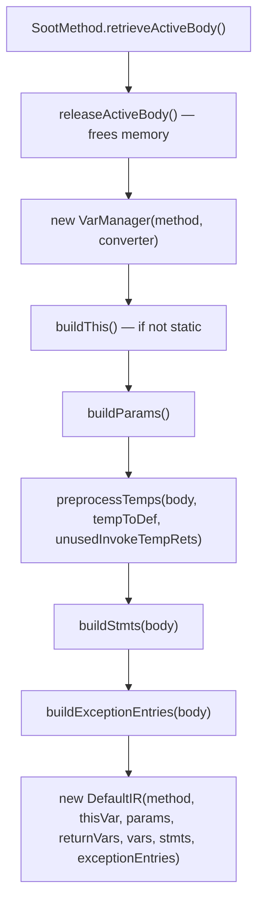
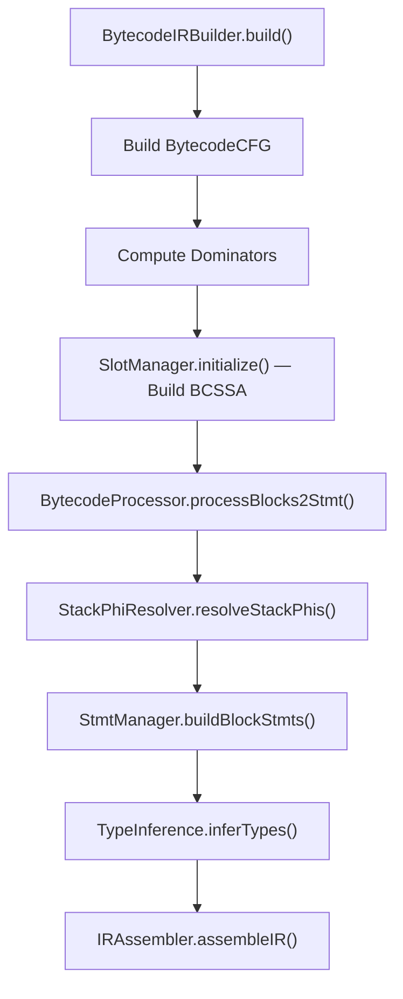

<!-- source: DeepWiki mcp.deepwiki.com · repo pascal-lab/Tai-e · page 5.2 IR Building · fetched 2026-10-12 -->

# IR Building

Relevant source files

The following files were used as context for generating this wiki page:

- [src/main/java/pascal/taie/analysis/pta/plugin/reflection/AnnotationModel.java](src/main/java/pascal/taie/analysis/pta/plugin/reflection/AnnotationModel.java)
- [src/main/java/pascal/taie/analysis/pta/plugin/util/CSObjs.java](src/main/java/pascal/taie/analysis/pta/plugin/util/CSObjs.java)
- [src/main/java/pascal/taie/backend/bytecode/BytecodeEmitter.java](src/main/java/pascal/taie/backend/bytecode/BytecodeEmitter.java)
- [src/main/java/pascal/taie/frontend/java/FrontendTypeSystem.java](src/main/java/pascal/taie/frontend/java/FrontendTypeSystem.java)
- [src/main/java/pascal/taie/frontend/java/JavaWorldBuilder.java](src/main/java/pascal/taie/frontend/java/JavaWorldBuilder.java)
- [src/main/java/pascal/taie/frontend/java/classes/AsmClassSource.java](src/main/java/pascal/taie/frontend/java/classes/AsmClassSource.java)
- [src/main/java/pascal/taie/frontend/java/classes/BytecodeClassBuilder.java](src/main/java/pascal/taie/frontend/java/classes/BytecodeClassBuilder.java)
- [src/main/java/pascal/taie/frontend/java/classes/DefaultClassLoader.java](src/main/java/pascal/taie/frontend/java/classes/DefaultClassLoader.java)
- [src/main/java/pascal/taie/frontend/java/classes/PhantomClassBuilder.java](src/main/java/pascal/taie/frontend/java/classes/PhantomClassBuilder.java)
- [src/main/java/pascal/taie/frontend/java/classes/PhantomClassSource.java](src/main/java/pascal/taie/frontend/java/classes/PhantomClassSource.java)
- [src/main/java/pascal/taie/frontend/java/closedworld/ClosedWorldBuilder.java](src/main/java/pascal/taie/frontend/java/closedworld/ClosedWorldBuilder.java)
- [src/main/java/pascal/taie/frontend/java/closedworld/ConstantTableReader.java](src/main/java/pascal/taie/frontend/java/closedworld/ConstantTableReader.java)
- [src/main/java/pascal/taie/frontend/java/closedworld/DependencyResolver.java](src/main/java/pascal/taie/frontend/java/closedworld/DependencyResolver.java)
- [src/main/java/pascal/taie/frontend/java/closedworld/JavacSourceHandler.java](src/main/java/pascal/taie/frontend/java/closedworld/JavacSourceHandler.java)
- [src/main/java/pascal/taie/frontend/java/closedworld/ResolveResult.java](src/main/java/pascal/taie/frontend/java/closedworld/ResolveResult.java)
- [src/main/java/pascal/taie/frontend/java/ir/AsmValueUtils.java](src/main/java/pascal/taie/frontend/java/ir/AsmValueUtils.java)
- [src/main/java/pascal/taie/frontend/java/ir/BytecodeBlock.java](src/main/java/pascal/taie/frontend/java/ir/BytecodeBlock.java)
- [src/main/java/pascal/taie/frontend/java/ir/BytecodeCFG.java](src/main/java/pascal/taie/frontend/java/ir/BytecodeCFG.java)
- [src/main/java/pascal/taie/frontend/java/ir/BytecodeCFGBuilder.java](src/main/java/pascal/taie/frontend/java/ir/BytecodeCFGBuilder.java)
- [src/main/java/pascal/taie/frontend/java/ir/BytecodeDumper.java](src/main/java/pascal/taie/frontend/java/ir/BytecodeDumper.java)
- [src/main/java/pascal/taie/frontend/java/ir/BytecodeIRBuilder.java](src/main/java/pascal/taie/frontend/java/ir/BytecodeIRBuilder.java)
- [src/main/java/pascal/taie/frontend/java/ir/BytecodeProcessor.java](src/main/java/pascal/taie/frontend/java/ir/BytecodeProcessor.java)
- [src/main/java/pascal/taie/frontend/java/ir/DUInfo.java](src/main/java/pascal/taie/frontend/java/ir/DUInfo.java)
- [src/main/java/pascal/taie/frontend/java/ir/FastIRBuilder.java](src/main/java/pascal/taie/frontend/java/ir/FastIRBuilder.java)
- [src/main/java/pascal/taie/frontend/java/ir/FrontendPhiResolver.java](src/main/java/pascal/taie/frontend/java/ir/FrontendPhiResolver.java)
- [src/main/java/pascal/taie/frontend/java/ir/IRAssembler.java](src/main/java/pascal/taie/frontend/java/ir/IRAssembler.java)
- [src/main/java/pascal/taie/frontend/java/ir/IRBuilderContext.java](src/main/java/pascal/taie/frontend/java/ir/IRBuilderContext.java)
- [src/main/java/pascal/taie/frontend/java/ir/InsnListSlice.java](src/main/java/pascal/taie/frontend/java/ir/InsnListSlice.java)
- [src/main/java/pascal/taie/frontend/java/ir/OperandStack.java](src/main/java/pascal/taie/frontend/java/ir/OperandStack.java)
- [src/main/java/pascal/taie/frontend/java/ir/SlotManager.java](src/main/java/pascal/taie/frontend/java/ir/SlotManager.java)
- [src/main/java/pascal/taie/frontend/java/ir/StackPhiResolver.java](src/main/java/pascal/taie/frontend/java/ir/StackPhiResolver.java)
- [src/main/java/pascal/taie/frontend/java/ir/StmtManager.java](src/main/java/pascal/taie/frontend/java/ir/StmtManager.java)
- [src/main/java/pascal/taie/frontend/java/ir/VarManager.java](src/main/java/pascal/taie/frontend/java/ir/VarManager.java)
- [src/main/java/pascal/taie/frontend/java/ir/ssa/FrontendPhiExp.java](src/main/java/pascal/taie/frontend/java/ir/ssa/FrontendPhiExp.java)
- [src/main/java/pascal/taie/frontend/java/ir/ssa/FrontendPhiStmt.java](src/main/java/pascal/taie/frontend/java/ir/ssa/FrontendPhiStmt.java)
- [src/main/java/pascal/taie/frontend/java/ir/ssa/InternalPhi.java](src/main/java/pascal/taie/frontend/java/ir/ssa/InternalPhi.java)
- [src/main/java/pascal/taie/frontend/java/ir/ssa/SSATransform.java](src/main/java/pascal/taie/frontend/java/ir/ssa/SSATransform.java)
- [src/main/java/pascal/taie/frontend/java/ir/typing/CastInserter.java](src/main/java/pascal/taie/frontend/java/ir/typing/CastInserter.java)
- [src/main/java/pascal/taie/frontend/java/ir/typing/ConstraintFlow.java](src/main/java/pascal/taie/frontend/java/ir/typing/ConstraintFlow.java)
- [src/main/java/pascal/taie/frontend/java/ir/typing/FlowKind.java](src/main/java/pascal/taie/frontend/java/ir/typing/FlowKind.java)
- [src/main/java/pascal/taie/frontend/java/ir/typing/GraphBuilder.java](src/main/java/pascal/taie/frontend/java/ir/typing/GraphBuilder.java)
- [src/main/java/pascal/taie/frontend/java/ir/typing/StmtVarReplacer.java](src/main/java/pascal/taie/frontend/java/ir/typing/StmtVarReplacer.java)
- [src/main/java/pascal/taie/frontend/java/ir/typing/TypeFlow.java](src/main/java/pascal/taie/frontend/java/ir/typing/TypeFlow.java)
- [src/main/java/pascal/taie/frontend/java/ir/typing/TypeFlowEdge.java](src/main/java/pascal/taie/frontend/java/ir/typing/TypeFlowEdge.java)
- [src/main/java/pascal/taie/frontend/java/ir/typing/TypeFlowGraph.java](src/main/java/pascal/taie/frontend/java/ir/typing/TypeFlowGraph.java)
- [src/main/java/pascal/taie/frontend/java/ir/typing/TypeFlowNode.java](src/main/java/pascal/taie/frontend/java/ir/typing/TypeFlowNode.java)
- [src/main/java/pascal/taie/frontend/java/ir/typing/TypeInference.java](src/main/java/pascal/taie/frontend/java/ir/typing/TypeInference.java)
- [src/main/java/pascal/taie/frontend/java/ir/typing/TypeUtils.java](src/main/java/pascal/taie/frontend/java/ir/typing/TypeUtils.java)
- [src/main/java/pascal/taie/frontend/java/project/AbstractClassFile.java](src/main/java/pascal/taie/frontend/java/project/AbstractClassFile.java)
- [src/main/java/pascal/taie/frontend/java/project/AbstractFileContainer.java](src/main/java/pascal/taie/frontend/java/project/AbstractFileContainer.java)
- [src/main/java/pascal/taie/frontend/java/project/ClassFile.java](src/main/java/pascal/taie/frontend/java/project/ClassFile.java)
- [src/main/java/pascal/taie/frontend/java/project/ClassIndex.java](src/main/java/pascal/taie/frontend/java/project/ClassIndex.java)
- [src/main/java/pascal/taie/frontend/java/project/DirContainer.java](src/main/java/pascal/taie/frontend/java/project/DirContainer.java)
- [src/main/java/pascal/taie/frontend/java/project/DotClassFile.java](src/main/java/pascal/taie/frontend/java/project/DotClassFile.java)
- [src/main/java/pascal/taie/frontend/java/project/FileLoader.java](src/main/java/pascal/taie/frontend/java/project/FileLoader.java)
- [src/main/java/pascal/taie/frontend/java/project/Project.java](src/main/java/pascal/taie/frontend/java/project/Project.java)
- [src/main/java/pascal/taie/frontend/soot/IRBuilder.java](src/main/java/pascal/taie/frontend/soot/IRBuilder.java)
- [src/main/java/pascal/taie/frontend/soot/MethodIRBuilder.java](src/main/java/pascal/taie/frontend/soot/MethodIRBuilder.java)
- [src/main/java/pascal/taie/frontend/soot/VarManager.java](src/main/java/pascal/taie/frontend/soot/VarManager.java)
- [src/main/java/pascal/taie/ir/exp/AbstractBinaryExp.java](src/main/java/pascal/taie/ir/exp/AbstractBinaryExp.java)
- [src/main/java/pascal/taie/ir/exp/ArrayAccess.java](src/main/java/pascal/taie/ir/exp/ArrayAccess.java)
- [src/main/java/pascal/taie/ir/exp/ArrayLengthExp.java](src/main/java/pascal/taie/ir/exp/ArrayLengthExp.java)
- [src/main/java/pascal/taie/ir/exp/NegExp.java](src/main/java/pascal/taie/ir/exp/NegExp.java)
- [src/main/java/pascal/taie/ir/exp/Var.java](src/main/java/pascal/taie/ir/exp/Var.java)
- [src/main/java/pascal/taie/language/classes/ClassNames.java](src/main/java/pascal/taie/language/classes/ClassNames.java)
- [src/main/java/pascal/taie/language/classes/ClassSource.java](src/main/java/pascal/taie/language/classes/ClassSource.java)
- [src/main/java/pascal/taie/language/classes/ExceptionNames.java](src/main/java/pascal/taie/language/classes/ExceptionNames.java)
- [src/main/java/pascal/taie/language/type/AbstractTypeSystem.java](src/main/java/pascal/taie/language/type/AbstractTypeSystem.java)
- [src/main/java/pascal/taie/language/type/FastTypeSystem.java](src/main/java/pascal/taie/language/type/FastTypeSystem.java)
- [src/main/java/pascal/taie/util/graph/Dominators.java](src/main/java/pascal/taie/util/graph/Dominators.java)
- [src/main/java/pascal/taie/util/graph/IndexedGraph.java](src/main/java/pascal/taie/util/graph/IndexedGraph.java)
- [src/test/java/pascal/taie/frontend/java/AnnotationTest.java](src/test/java/pascal/taie/frontend/java/AnnotationTest.java)
- [src/test/java/pascal/taie/frontend/java/FieldOrderTest.java](src/test/java/pascal/taie/frontend/java/FieldOrderTest.java)
- [src/test/java/pascal/taie/frontend/java/FrontendTestSuite.java](src/test/java/pascal/taie/frontend/java/FrontendTestSuite.java)
- [src/test/java/pascal/taie/frontend/java/syntax/JavaVersionSyntaxTest.java](src/test/java/pascal/taie/frontend/java/syntax/JavaVersionSyntaxTest.java)
- [src/test/java/pascal/taie/util/graph/DominatorTest.java](src/test/java/pascal/taie/util/graph/DominatorTest.java)
- [src/test/resources/frontend/java/syntax/Java11Syntax.java](src/test/resources/frontend/java/syntax/Java11Syntax.java)
- [src/test/resources/frontend/java/syntax/Java17Syntax.java](src/test/resources/frontend/java/syntax/Java17Syntax.java)
- [src/test/resources/frontend/java/syntax/Java6Syntax.java](src/test/resources/frontend/java/syntax/Java6Syntax.java)
- [src/test/resources/frontend/java/syntax/Java8Syntax.java](src/test/resources/frontend/java/syntax/Java8Syntax.java)
- [src/test/resources/pta/basic/Annotations-pta-expected.txt](src/test/resources/pta/basic/Annotations-pta-expected.txt)
- [src/test/resources/pta/basic/Annotations.java](src/test/resources/pta/basic/Annotations.java)

This document details the process of converting Java bytecode or Soot's Jimple IR into Tai-e's internal IR representation. The IR building system is responsible for transforming program logic into Tai-e's intermediate representation format, which is used throughout the analysis framework.

Tai-e provides two primary IR building paths:
1.  **Soot-based Frontend**: Translates Jimple statements and expressions into Tai-e IR.
2.  **Native Java Frontend**: Directly converts Java bytecode to Tai-e IR using ASM, including SSA transformation and type inference.

## Overview

The IR building process transforms method bodies into a structured collection of statements (`Stmt`), expressions (`Exp`), and variables (`Var`). The result is encapsulated in an `IR` object (typically `DefaultIR`), which contains the control flow, variable definitions, and exception handling information for a method.

## Soot-based IR Building

The Soot-based frontend uses `MethodIRBuilder` to convert Jimple representation into Tai-e IR.

### MethodIRBuilder Process Flow

**`MethodIRBuilder.build()` — sequential steps**

Sources: [src/main/java/pascal/taie/frontend/soot/MethodIRBuilder.java:208-231]()

### Variable Management (Soot)

The `VarManager` (in the Soot frontend) handles the conversion and management of variables:

| Variable Type | Jimple Source | Naming Convention | Notes |
|---------------|---------------|-------------------|-------|
| This variable | `thisLocal` | `%this` | Added via `addThis()` |
| Parameters | `parameterLocals` | Signature name or Jimple name | Added via `addParams()` |
| Local variables | `Local` objects | Preserves Jimple name | Lazily created in `getVar()` |
| Constants | `Constant` values | `%intconst0`, etc. | `%{typeName}const{N}` |
| Null constant | `NullConstant` | `$null` | Singleton per method |

Sources: [src/main/java/pascal/taie/frontend/soot/VarManager.java:42-82](), [src/main/java/pascal/taie/frontend/soot/VarManager.java:84-128]()

## Native Java IR Building

The native frontend (`BytecodeIRBuilder`) converts bytecode directly to Tai-e IR. This process is more complex as it includes stack-to-register conversion and SSA construction.

### Native IR Building Pipeline

Sources: [src/main/java/pascal/taie/frontend/java/ir/BytecodeIRBuilder.java:50-89]()

### Slot and Variable Management

In the native frontend, variables are managed by `SlotManager` and `VarManager`. `SlotManager` handles the mapping of JVM local variable slots to Tai-e `Var` objects, resolving slot reuse through SSA transformation.

*   **`SlotManager`**: Uses `SSATransform` to compute Def-Use chains and handle variable loads/stores from/to slots.
*   **`VarManager`**: Maintains the mapping between slots and `Var` objects, manages temporary variables (`%v0`), and caches constant literals.

Sources: [src/main/java/pascal/taie/frontend/java/ir/SlotManager.java:37-89](), [src/main/java/pascal/taie/frontend/java/ir/VarManager.java:54-179]()

### Operand Stack Simulation

Since JVM bytecode is stack-based, `OperandStack` simulates the stack during conversion. It lifts expressions to variables and generates `StackPhi` nodes when merging stacks from different control flow paths.

Sources: [src/main/java/pascal/taie/frontend/java/ir/OperandStack.java:55-150]()

## Core Statement and Expression Conversion

Both frontends translate program logic into Tai-e's IR components.

### Statement Conversion

The conversion maps source instructions to Tai-e `Stmt` types:

| Tai-e Stmt | Purpose |
|------------|---------|
| `AssignLiteral` | Assigns a constant to a variable. |
| `Copy` | `x = y` assignment. |
| `LoadField` / `StoreField` | Accesses to instance or static fields. |
| `LoadArray` / `StoreArray` | Accesses to array elements. |
| `Invoke` | Method calls (virtual, interface, special, static, dynamic). |
| `New` | Object or array allocation. |
| `If` / `Goto` / `SwitchStmt` | Control flow transitions. |
| `Catch` | Exception handling entry point. |

Sources: [src/main/java/pascal/taie/frontend/soot/MethodIRBuilder.java:545-613](), [src/main/java/pascal/taie/frontend/java/ir/IRAssembler.java:88-130]()

### Expression Conversion

Expressions are converted into `RValue` types:
*   **Binary Expressions**: `ArithmeticExp` (+, -, *, /), `BitwiseExp` (&, |), `ComparisonExp` (==, !=, <), `ShiftExp` (<<, >>).
*   **Unary Expressions**: `NegExp`, `CastExp`, `InstanceOfExp`.
*   **Invoke Expressions**: `InvokeVirtual`, `InvokeInterface`, `InvokeStatic`, `InvokeSpecial`, `InvokeDynamic`.

Sources: [src/main/java/pascal/taie/frontend/soot/MethodIRBuilder.java:744-826](), [src/main/java/pascal/taie/frontend/soot/MethodIRBuilder.java:950-990]()

## Exception Handling and IR Assembly

### Exception Trap Handling

Exception handlers are converted into `ExceptionEntry` objects.
*   In the Soot frontend, Jimple `Trap` objects are mapped to Tai-e entries.
*   In the native frontend, `IRAssembler` converts ASM `TryCatchBlockNode` into `ExceptionEntry`, resolving the start, end, and handler statements.

Sources: [src/main/java/pascal/taie/frontend/soot/MethodIRBuilder.java:256-317](), [src/main/java/pascal/taie/frontend/java/ir/IRAssembler.java:135-164]()

### IR Assembly

The final step is the construction of the `DefaultIR` object. The `IRAssembler` (native) or `MethodIRBuilder` (Soot) collects all generated statements, variables, and exception entries.

**`IRAssembler.assembleIR()` components:**
1.  **`completeStmts()`**: Collects statements from blocks and constant caches, resolves jump targets (setting targets for `Goto`, `If`, and `SwitchStmt`).
2.  **`buildExceptionTable()`**: Finalizes the exception entries.
3.  **`DefaultIR` construction**: Aggregates `thisVar`, `params`, `retVars`, `vars`, `stmts`, and `exceptionEntries`.

Sources: [src/main/java/pascal/taie/frontend/java/ir/IRAssembler.java:75-83](), [src/main/java/pascal/taie/frontend/java/ir/IRAssembler.java:88-130]()

---

