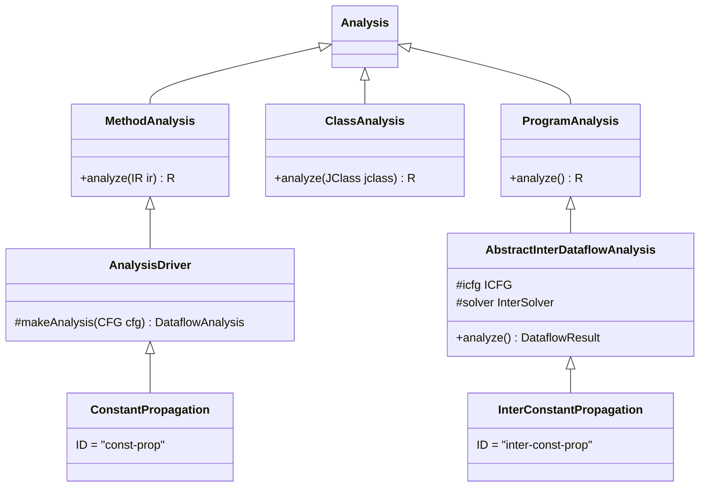
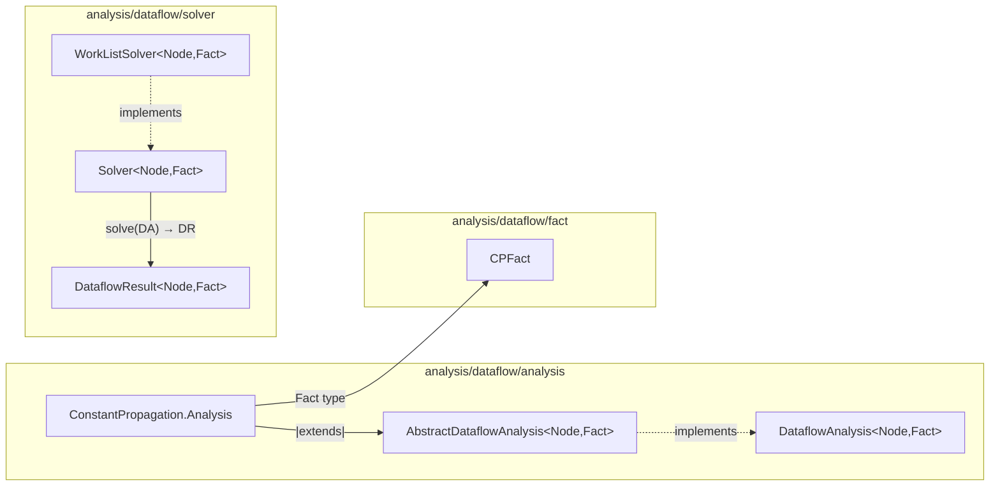
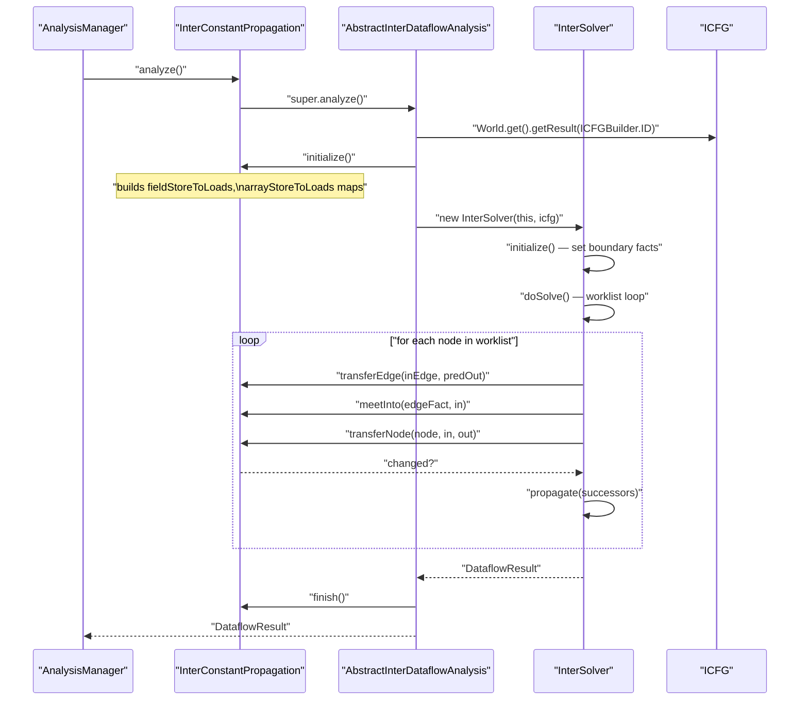

<!-- source: DeepWiki mcp.deepwiki.com · repo pascal-lab/Tai-e · page 6 Dataflow Analysis · fetched 2026-10-12 -->

# Dataflow Analysis

<details>
<summary>Relevant source files</summary>

The following files were used as context for generating this wiki page:

- [src/main/java/pascal/taie/analysis/ClassAnalysis.java](src/main/java/pascal/taie/analysis/ClassAnalysis.java)
- [src/main/java/pascal/taie/analysis/MethodAnalysis.java](src/main/java/pascal/taie/analysis/MethodAnalysis.java)
- [src/main/java/pascal/taie/analysis/ProgramAnalysis.java](src/main/java/pascal/taie/analysis/ProgramAnalysis.java)
- [src/main/java/pascal/taie/analysis/StmtResult.java](src/main/java/pascal/taie/analysis/StmtResult.java)
- [src/main/java/pascal/taie/analysis/dataflow/analysis/AbstractDataflowAnalysis.java](src/main/java/pascal/taie/analysis/dataflow/analysis/AbstractDataflowAnalysis.java)
- [src/main/java/pascal/taie/analysis/dataflow/analysis/DataflowAnalysis.java](src/main/java/pascal/taie/analysis/dataflow/analysis/DataflowAnalysis.java)
- [src/main/java/pascal/taie/analysis/dataflow/analysis/LiveVariable.java](src/main/java/pascal/taie/analysis/dataflow/analysis/LiveVariable.java)
- [src/main/java/pascal/taie/analysis/dataflow/analysis/ReachingDefinition.java](src/main/java/pascal/taie/analysis/dataflow/analysis/ReachingDefinition.java)
- [src/main/java/pascal/taie/analysis/dataflow/analysis/constprop/ConstantPropagation.java](src/main/java/pascal/taie/analysis/dataflow/analysis/constprop/ConstantPropagation.java)
- [src/main/java/pascal/taie/analysis/dataflow/fact/DataflowResult.java](src/main/java/pascal/taie/analysis/dataflow/fact/DataflowResult.java)
- [src/main/java/pascal/taie/analysis/dataflow/fact/NodeResult.java](src/main/java/pascal/taie/analysis/dataflow/fact/NodeResult.java)
- [src/main/java/pascal/taie/analysis/dataflow/inter/AbstractInterDataflowAnalysis.java](src/main/java/pascal/taie/analysis/dataflow/inter/AbstractInterDataflowAnalysis.java)
- [src/main/java/pascal/taie/analysis/dataflow/inter/InterConstantPropagation.java](src/main/java/pascal/taie/analysis/dataflow/inter/InterConstantPropagation.java)
- [src/main/java/pascal/taie/analysis/dataflow/inter/InterDataflowAnalysis.java](src/main/java/pascal/taie/analysis/dataflow/inter/InterDataflowAnalysis.java)
- [src/main/java/pascal/taie/analysis/dataflow/inter/InterSolver.java](src/main/java/pascal/taie/analysis/dataflow/inter/InterSolver.java)
- [src/main/java/pascal/taie/analysis/dataflow/solver/AbstractSolver.java](src/main/java/pascal/taie/analysis/dataflow/solver/AbstractSolver.java)
- [src/main/java/pascal/taie/analysis/dataflow/solver/Solver.java](src/main/java/pascal/taie/analysis/dataflow/solver/Solver.java)
- [src/main/java/pascal/taie/analysis/dataflow/solver/WorkListSolver.java](src/main/java/pascal/taie/analysis/dataflow/solver/WorkListSolver.java)

</details>


This page covers the dataflow analysis framework in Tai-e: the interfaces and abstract base classes that define how to express both intraprocedural and interprocedural dataflow analyses, the solvers that drive them to a fixed point, and the built-in analyses shipped with the framework.

For details on the control-flow and interprocedural control-flow graphs these analyses operate on, see [Graph Construction](#6.3). For intraprocedural analysis specifics (fact types, worklist solver, and the built-in analyses), see [Intraprocedural Analysis](#6.1). For interprocedural analysis details, see [Interprocedural Analysis](#6.2).

---

## Analysis Class Hierarchy

Every analysis in Tai-e inherits from one of three abstract base classes, depending on what scope of the program it processes.

| Base class | Scope | Entry point |
|---|---|---|
| `MethodAnalysis<R>` | One method at a time | `analyze(IR ir)` |
| `ClassAnalysis<R>` | One class at a time | `analyze(JClass jclass)` |
| `ProgramAnalysis<R>` | Whole program | `analyze()` |

- [src/main/java/pascal/taie/analysis/MethodAnalysis.java:27-41]()
- [src/main/java/pascal/taie/analysis/ClassAnalysis.java:27-41]()
- [src/main/java/pascal/taie/analysis/ProgramAnalysis.java:26-40]()

Intraprocedural dataflow analyses are `MethodAnalysis` instances (or wrapped by `AnalysisDriver` which is itself a `MethodAnalysis`). Interprocedural dataflow analyses are `ProgramAnalysis` instances.

**Analysis class hierarchy diagram**



Sources: [src/main/java/pascal/taie/analysis/MethodAnalysis.java:27-41](), [src/main/java/pascal/taie/analysis/ProgramAnalysis.java:26-40](), [src/main/java/pascal/taie/analysis/dataflow/inter/AbstractInterDataflowAnalysis.java:44-46](), [src/main/java/pascal/taie/analysis/dataflow/analysis/constprop/ConstantPropagation.java:43-45](), [src/main/java/pascal/taie/analysis/dataflow/inter/InterConstantPropagation.java:60-63]()

---

## Intraprocedural Dataflow Framework

### `DataflowAnalysis` Interface

[src/main/java/pascal/taie/analysis/dataflow/analysis/DataflowAnalysis.java:34-89]()

`DataflowAnalysis<Node, Fact>` is the core contract for a single-method dataflow analysis. All methods that an implementor must provide:

| Method | Purpose |
|---|---|
| `isForward()` | Direction of analysis |
| `newBoundaryFact()` | Fact for entry (forward) or exit (backward) node |
| `newInitialFact()` | Fact for all other nodes before iteration |
| `meetInto(fact, target)` | Confluence: merge `fact` into `target` in place |
| `transferNode(node, in, out)` | Node transfer; returns `true` if `out` changed |
| `needTransferEdge(edge)` | Whether an edge-level transfer is needed |
| `transferEdge(edge, nodeFact)` | Edge transfer; must not mutate `nodeFact` |
| `getCFG()` | The CFG this analysis is bound to |

### `AbstractDataflowAnalysis`

[src/main/java/pascal/taie/analysis/dataflow/analysis/AbstractDataflowAnalysis.java]()

Provides a default implementation where `needTransferEdge()` always returns `false` and `transferEdge()` throws `UnsupportedOperationException`. Holds a reference to the `CFG<Node>` passed at construction.

### Solvers

[src/main/java/pascal/taie/analysis/dataflow/solver/Solver.java:34-56](), [src/main/java/pascal/taie/analysis/dataflow/solver/WorkListSolver.java:38-125]()

`Solver<Node, Fact>` has a single method `solve(DataflowAnalysis)` returning a `DataflowResult`. The framework provides one concrete solver:

- **`WorkListSolver`** — the default solver, shared as a singleton via `Solver.SOLVER` [src/main/java/pascal/taie/analysis/dataflow/solver/Solver.java:40-40](). It handles both forward and backward analyses. The worklist is ordered by CFG node index (ascending for forward, descending for backward) so nodes are processed in a near-topological order [src/main/java/pascal/taie/analysis/dataflow/solver/WorkListSolver.java:85-86]().

**Forward pass summary** (`doSolveForward` in `WorkListSolver`):
1. Initialize entry with `newBoundaryFact()`; all other nodes get `newInitialFact()` [src/main/java/pascal/taie/analysis/dataflow/solver/WorkListSolver.java:45-49]().
2. For each node polled from the worklist:
   - Merge `OutFact` of predecessors (applying `transferEdge` where needed) into the node's `InFact` via `meetInto` [src/main/java/pascal/taie/analysis/dataflow/solver/WorkListSolver.java:94-117]().
   - Apply `transferNode(node, in, out)` [src/main/java/pascal/taie/analysis/dataflow/solver/WorkListSolver.java:120-120]().
   - If `out` changed, add all successors to the worklist [src/main/java/pascal/taie/analysis/dataflow/solver/WorkListSolver.java:121-123]().

**Intraprocedural dataflow component diagram**



Sources: [src/main/java/pascal/taie/analysis/dataflow/analysis/DataflowAnalysis.java:34-89](), [src/main/java/pascal/taie/analysis/dataflow/solver/Solver.java:34-56](), [src/main/java/pascal/taie/analysis/dataflow/solver/WorkListSolver.java:38-125](), [src/main/java/pascal/taie/analysis/dataflow/analysis/constprop/ConstantPropagation.java:56-181]()

---

## Interprocedural Dataflow Framework

### `InterDataflowAnalysis` Interface

[src/main/java/pascal/taie/analysis/dataflow/inter/InterDataflowAnalysis.java:33-74]()

`InterDataflowAnalysis<Node, Fact>` mirrors `DataflowAnalysis` but operates on an ICFG instead of a per-method CFG. Key differences:

- `newBoundaryFact(Node boundary)` — takes the concrete entry node as an argument [src/main/java/pascal/taie/analysis/dataflow/inter/InterDataflowAnalysis.java:44-44]().
- `transferEdge(ICFGEdge<Node> edge, Fact out)` — operates on `ICFGEdge` [src/main/java/pascal/taie/analysis/dataflow/inter/InterDataflowAnalysis.java:73-73]().

### `AbstractInterDataflowAnalysis`

[src/main/java/pascal/taie/analysis/dataflow/inter/AbstractInterDataflowAnalysis.java:44-129]()

Extends `ProgramAnalysis` and implements `InterDataflowAnalysis`. It:

1. Retrieves the precomputed `ICFG` from `World` during `analyze()` [src/main/java/pascal/taie/analysis/dataflow/inter/AbstractInterDataflowAnalysis.java:122-122]().
2. Calls `initialize()` (hook for subclasses) [src/main/java/pascal/taie/analysis/dataflow/inter/AbstractInterDataflowAnalysis.java:123-123]().
3. Creates and runs an `InterSolver` [src/main/java/pascal/taie/analysis/dataflow/inter/AbstractInterDataflowAnalysis.java:124-125]().
4. Calls `finish()` (hook for subclasses) [src/main/java/pascal/taie/analysis/dataflow/inter/AbstractInterDataflowAnalysis.java:126-126]().

The `transferNode` dispatch splits nodes into **call nodes** and **non-call nodes** [src/main/java/pascal/taie/analysis/dataflow/inter/AbstractInterDataflowAnalysis.java:75-81](). The `transferEdge` dispatch routes to one of four abstract methods based on the concrete `ICFGEdge` subtype: `NormalEdge`, `CallToReturnEdge`, `CallEdge`, or `ReturnEdge` [src/main/java/pascal/taie/analysis/dataflow/inter/AbstractInterDataflowAnalysis.java:98-108]().

### `InterSolver`

[src/main/java/pascal/taie/analysis/dataflow/inter/InterSolver.java:38-104]()

A worklist-based solver for interprocedural analyses. It uses a `SetQueue` worklist [src/main/java/pascal/taie/analysis/dataflow/inter/InterSolver.java:79-79](). The `propagate(Node node)` method is also accessible to the analysis itself [src/main/java/pascal/taie/analysis/dataflow/inter/InterSolver.java:97-99]().

**Interprocedural dataflow component diagram**

```mermaid
flowchart TD
    subgraph "analysis/dataflow/inter"
        IDA["InterDataflowAnalysis&lt;Node,Fact&gt;"]
        AIDA["AbstractInterDataflowAnalysis&lt;Method,Node,Fact&gt;"]
        IS["InterSolver&lt;Method,Node,Fact&gt;"]
        ICP["InterConstantPropagation"]
    end
    subgraph "analysis/graph/icfg"
        ICFG["ICFG&lt;Method,Node&gt;"]
        NE["NormalEdge"]
        CTRE["CallToReturnEdge"]
        CE["CallEdge"]
        RE["ReturnEdge"]
    end
    subgraph "analysis"
        PA["ProgramAnalysis&lt;R&gt;"]
    end

    PA <|-- AIDA
    AIDA -.implements.-> IDA
    ICP --|extends|--> AIDA
    AIDA -- "creates" --> IS
    IS -- "iterates" --> ICFG
    ICFG -- "edge subtypes" --> NE
    ICFG -- "edge subtypes" --> CTRE
    ICFG -- "edge subtypes" --> CE
    ICFG -- "edge subtypes" --> RE
```

Sources: [src/main/java/pascal/taie/analysis/dataflow/inter/InterDataflowAnalysis.java:33-74](), [src/main/java/pascal/taie/analysis/dataflow/inter/AbstractInterDataflowAnalysis.java:44-129](), [src/main/java/pascal/taie/analysis/dataflow/inter/InterSolver.java:38-104]()

---

## Built-in Analyses

### Constant Propagation (`const-prop`)

[src/main/java/pascal/taie/analysis/dataflow/analysis/constprop/ConstantPropagation.java:43-181]()

- ID: `"const-prop"` [src/main/java/pascal/taie/analysis/dataflow/analysis/constprop/ConstantPropagation.java:45-45]()
- Direction: forward [src/main/java/pascal/taie/analysis/dataflow/analysis/constprop/ConstantPropagation.java:69-71]()
- Fact type: `CPFact` (a map from `Var` to `Value`)
- `Value` lattice: `UNDEF` → constant → `NAC` [src/main/java/pascal/taie/analysis/dataflow/analysis/constprop/ConstantPropagation.java:103-115]()
- `transferNode`: for `DefinitionStmt`, evaluates the RHS via `Evaluator.evaluate` [src/main/java/pascal/taie/analysis/dataflow/analysis/constprop/ConstantPropagation.java:118-135]().
- Optional `edge-refine` mode: refines variable values along conditional branches and switch cases [src/main/java/pascal/taie/analysis/dataflow/analysis/constprop/ConstantPropagation.java:148-180]().

### Interprocedural Constant Propagation (`inter-const-prop`)

[src/main/java/pascal/taie/analysis/dataflow/inter/InterConstantPropagation.java:60-173]()

- ID: `"inter-const-prop"` [src/main/java/pascal/taie/analysis/dataflow/inter/InterConstantPropagation.java:63-63]()
- Extends `AbstractInterDataflowAnalysis<JMethod, Stmt, CPFact>` [src/main/java/pascal/taie/analysis/dataflow/inter/InterConstantPropagation.java:60-61]()

**Key options:**

| Option | Type | Effect |
|---|---|---|
| `edge-refine` | boolean | Enables refinement on lattice value via edge transfer [src/main/java/pascal/taie/analysis/dataflow/inter/InterConstantPropagation.java:98-98]() |
| `alias-aware` | boolean | Leverages pointer analysis for instance fields and arrays [src/main/java/pascal/taie/analysis/dataflow/inter/InterConstantPropagation.java:99-99]() |

**Alias-aware mode** (`aliasAware = true`):
During `initialize()`, the analysis precomputes alias maps using `PointerAnalysisResult` [src/main/java/pascal/taie/analysis/dataflow/inter/InterConstantPropagation.java:104-173](). It tracks `fieldStoreToLoads`, `arrayStoreToLoads`, and `arrayLoadToStores` to propagate constants across aliased memory locations.

### Other Built-in Analyses

- **Live Variable Analysis (`live-var`)**: Backward analysis determining if a variable's value is used in the future [src/main/java/pascal/taie/analysis/dataflow/analysis/LiveVariable.java:37-128]().
- **Reaching Definition Analysis (`reach-def`)**: Forward analysis determining which definitions may reach a certain point [src/main/java/pascal/taie/analysis/dataflow/analysis/ReachingDefinition.java:36-115]().

Sources: [src/main/java/pascal/taie/analysis/dataflow/analysis/constprop/ConstantPropagation.java:43-181](), [src/main/java/pascal/taie/analysis/dataflow/inter/InterConstantPropagation.java:60-173](), [src/main/java/pascal/taie/analysis/dataflow/analysis/LiveVariable.java:37-128](), [src/main/java/pascal/taie/analysis/dataflow/analysis/ReachingDefinition.java:36-115]()

---

## How It All Fits Together

The diagram below maps the full execution path from the analysis manager invoking an interprocedural analysis down to individual node transfers.

**End-to-end dataflow execution flow**



Sources: [src/main/java/pascal/taie/analysis/dataflow/inter/AbstractInterDataflowAnalysis.java:121-129](), [src/main/java/pascal/taie/analysis/dataflow/inter/InterSolver.java:54-95](), [src/main/java/pascal/taie/analysis/dataflow/inter/InterConstantPropagation.java:104-173]()

---

## Package Layout

```
src/main/java/pascal/taie/analysis/
├── Analysis.java                          # root base class
├── MethodAnalysis.java                    # per-method analyses
├── ClassAnalysis.java                     # per-class analyses
├── ProgramAnalysis.java                   # whole-program analyses
└── dataflow/
    ├── analysis/
    │   ├── DataflowAnalysis.java          # intraprocedural interface
    │   ├── AbstractDataflowAnalysis.java  # default edge transfer
    │   ├── AnalysisDriver.java            # MethodAnalysis wrapper
    │   └── constprop/
    │       ├── ConstantPropagation.java   # ID: const-prop
    │       └── ...
    ├── inter/
    │   ├── InterDataflowAnalysis.java     # interprocedural interface
    │   ├── AbstractInterDataflowAnalysis.java
    │   ├── InterSolver.java
    │   └── InterConstantPropagation.java  # ID: inter-const-prop
    ├── solver/
    │   ├── Solver.java                    # intraprocedural solver interface
    │   ├── AbstractSolver.java
    │   └── WorkListSolver.java            # default solver
    └── fact/
        └── DataflowResult.java            # per-node in/out fact storage
```

---

