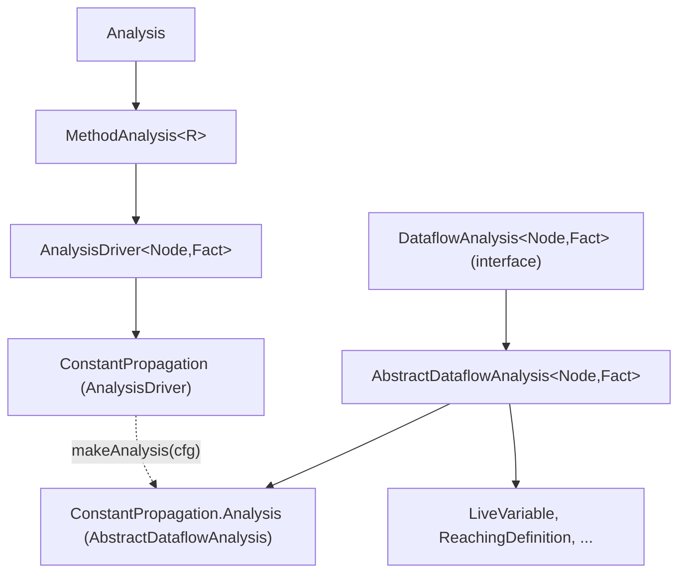
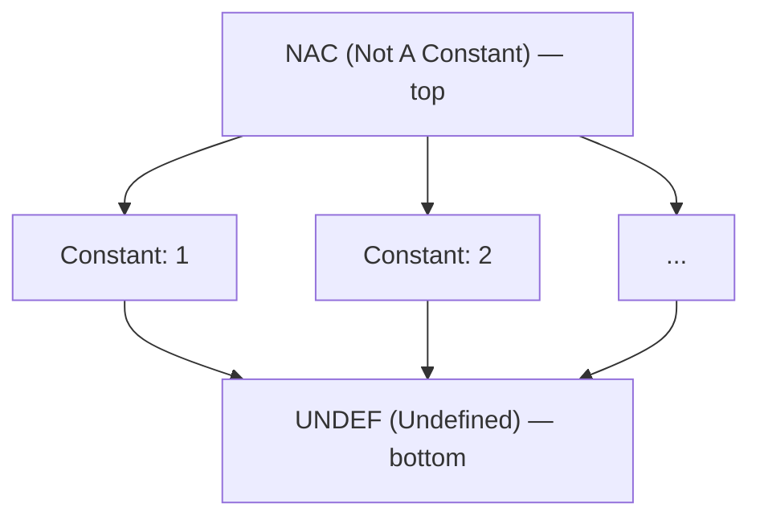
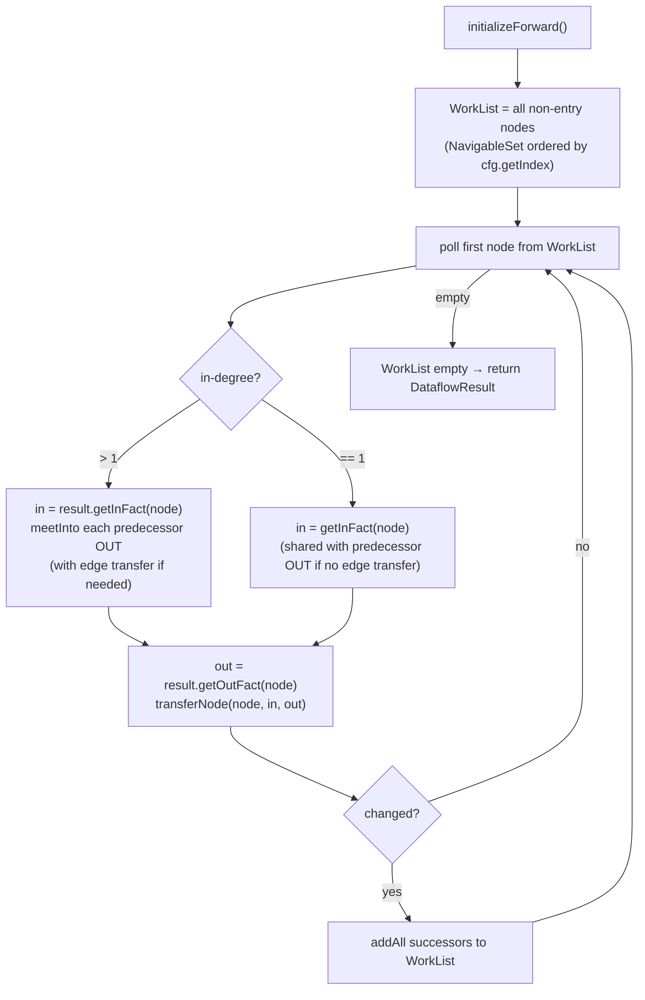
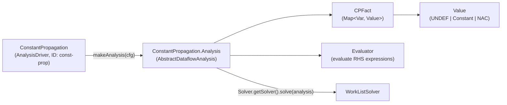
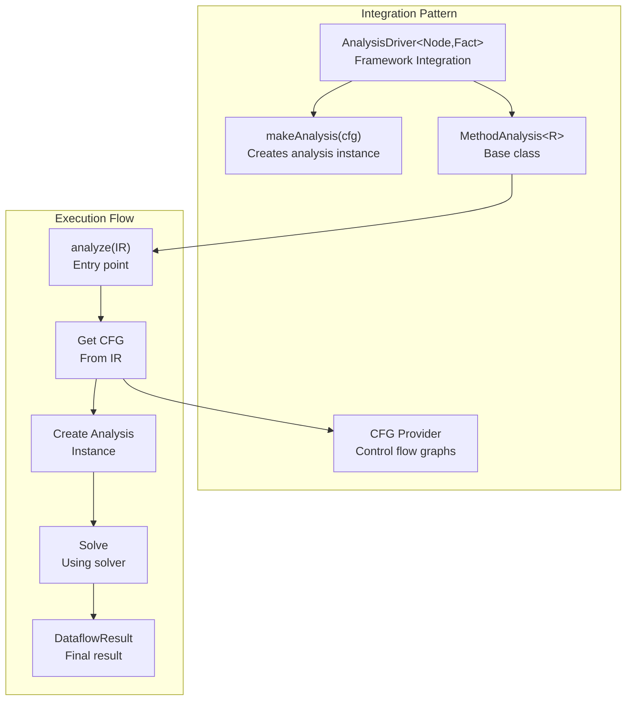

<!-- source: DeepWiki mcp.deepwiki.com · repo pascal-lab/Tai-e · page 6.1 Intraprocedural Analysis · fetched 2026-10-12 -->

# Intraprocedural Analysis

Relevant source files

The following files were used as context for generating this wiki page:

- [src/main/java/pascal/taie/analysis/ClassAnalysis.java](src/main/java/pascal/taie/analysis/ClassAnalysis.java)
- [src/main/java/pascal/taie/analysis/MethodAnalysis.java](src/main/java/pascal/taie/analysis/MethodAnalysis.java)
- [src/main/java/pascal/taie/analysis/ProgramAnalysis.java](src/main/java/pascal/taie/analysis/ProgramAnalysis.java)
- [src/main/java/pascal/taie/analysis/StmtResult.java](src/main/java/pascal/taie/analysis/StmtResult.java)
- [src/main/java/pascal/taie/analysis/dataflow/analysis/AbstractDataflowAnalysis.java](src/main/java/pascal/taie/analysis/dataflow/analysis/AbstractDataflowAnalysis.java)
- [src/main/java/pascal/taie/analysis/dataflow/analysis/DataflowAnalysis.java](src/main/java/pascal/taie/analysis/dataflow/analysis/DataflowAnalysis.java)
- [src/main/java/pascal/taie/analysis/dataflow/analysis/LiveVariable.java](src/main/java/pascal/taie/analysis/dataflow/analysis/LiveVariable.java)
- [src/main/java/pascal/taie/analysis/dataflow/analysis/ReachingDefinition.java](src/main/java/pascal/taie/analysis/dataflow/analysis/ReachingDefinition.java)
- [src/main/java/pascal/taie/analysis/dataflow/analysis/availexp/AvailableExpression.java](src/main/java/pascal/taie/analysis/dataflow/analysis/availexp/AvailableExpression.java)
- [src/main/java/pascal/taie/analysis/dataflow/analysis/constprop/CPFact.java](src/main/java/pascal/taie/analysis/dataflow/analysis/constprop/CPFact.java)
- [src/main/java/pascal/taie/analysis/dataflow/analysis/constprop/ConstantPropagation.java](src/main/java/pascal/taie/analysis/dataflow/analysis/constprop/ConstantPropagation.java)
- [src/main/java/pascal/taie/analysis/dataflow/analysis/constprop/Evaluator.java](src/main/java/pascal/taie/analysis/dataflow/analysis/constprop/Evaluator.java)
- [src/main/java/pascal/taie/analysis/dataflow/analysis/constprop/Value.java](src/main/java/pascal/taie/analysis/dataflow/analysis/constprop/Value.java)
- [src/main/java/pascal/taie/analysis/dataflow/fact/DataflowResult.java](src/main/java/pascal/taie/analysis/dataflow/fact/DataflowResult.java)
- [src/main/java/pascal/taie/analysis/dataflow/fact/MapFact.java](src/main/java/pascal/taie/analysis/dataflow/fact/MapFact.java)
- [src/main/java/pascal/taie/analysis/dataflow/fact/NodeResult.java](src/main/java/pascal/taie/analysis/dataflow/fact/NodeResult.java)
- [src/main/java/pascal/taie/analysis/dataflow/fact/SetFact.java](src/main/java/pascal/taie/analysis/dataflow/fact/SetFact.java)
- [src/main/java/pascal/taie/analysis/dataflow/inter/AbstractInterDataflowAnalysis.java](src/main/java/pascal/taie/analysis/dataflow/inter/AbstractInterDataflowAnalysis.java)
- [src/main/java/pascal/taie/analysis/dataflow/inter/InterConstantPropagation.java](src/main/java/pascal/taie/analysis/dataflow/inter/InterConstantPropagation.java)
- [src/main/java/pascal/taie/analysis/dataflow/inter/InterDataflowAnalysis.java](src/main/java/pascal/taie/analysis/dataflow/inter/InterDataflowAnalysis.java)
- [src/main/java/pascal/taie/analysis/dataflow/inter/InterSolver.java](src/main/java/pascal/taie/analysis/dataflow/inter/InterSolver.java)
- [src/main/java/pascal/taie/analysis/dataflow/solver/AbstractSolver.java](src/main/java/pascal/taie/analysis/dataflow/solver/AbstractSolver.java)
- [src/main/java/pascal/taie/analysis/dataflow/solver/Solver.java](src/main/java/pascal/taie/analysis/dataflow/solver/Solver.java)
- [src/main/java/pascal/taie/analysis/dataflow/solver/WorkListSolver.java](src/main/java/pascal/taie/analysis/dataflow/solver/WorkListSolver.java)
- [src/main/java/pascal/taie/util/Strings.java](src/main/java/pascal/taie/util/Strings.java)
- [src/main/java/pascal/taie/util/collection/CollectionUtils.java](src/main/java/pascal/taie/util/collection/CollectionUtils.java)
- [src/main/java/pascal/taie/util/collection/IndexMap.java](src/main/java/pascal/taie/util/collection/IndexMap.java)
- [src/main/java/pascal/taie/util/collection/Streams.java](src/main/java/pascal/taie/util/collection/Streams.java)
- [src/test/java/pascal/taie/analysis/dataflow/DataflowTestSuite.java](src/test/java/pascal/taie/analysis/dataflow/DataflowTestSuite.java)
- [src/test/java/pascal/taie/analysis/dataflow/analysis/AvailExpTest.java](src/test/java/pascal/taie/analysis/dataflow/analysis/AvailExpTest.java)
- [src/test/java/pascal/taie/analysis/dataflow/analysis/LiveVarTest.java](src/test/java/pascal/taie/analysis/dataflow/analysis/LiveVarTest.java)
- [src/test/java/pascal/taie/analysis/dataflow/analysis/LiveVarTestFull.java](src/test/java/pascal/taie/analysis/dataflow/analysis/LiveVarTestFull.java)
- [src/test/java/pascal/taie/analysis/dataflow/analysis/ReachDefTest.java](src/test/java/pascal/taie/analysis/dataflow/analysis/ReachDefTest.java)
- [src/test/java/pascal/taie/analysis/dataflow/analysis/constprop/CPTest.java](src/test/java/pascal/taie/analysis/dataflow/analysis/constprop/CPTest.java)
- [src/test/java/pascal/taie/analysis/dataflow/analysis/constprop/CPTestFull.java](src/test/java/pascal/taie/analysis/dataflow/analysis/constprop/CPTestFull.java)
- [src/test/java/pascal/taie/analysis/dataflow/analysis/constprop/EdgeRefineTest.java](src/test/java/pascal/taie/analysis/dataflow/analysis/constprop/EdgeRefineTest.java)
- [src/test/java/pascal/taie/analysis/dataflow/analysis/constprop/InterCPAliasTest.java](src/test/java/pascal/taie/analysis/dataflow/analysis/constprop/InterCPAliasTest.java)
- [src/test/java/pascal/taie/analysis/dataflow/analysis/constprop/InterCPAliasTestFull.java](src/test/java/pascal/taie/analysis/dataflow/analysis/constprop/InterCPAliasTestFull.java)
- [src/test/java/pascal/taie/analysis/dataflow/analysis/constprop/InterCPTest.java](src/test/java/pascal/taie/analysis/dataflow/analysis/constprop/InterCPTest.java)
- [src/test/java/pascal/taie/analysis/dataflow/analysis/constprop/ValueTest.java](src/test/java/pascal/taie/analysis/dataflow/analysis/constprop/ValueTest.java)
- [src/test/java/pascal/taie/analysis/dataflow/fact/FactTest.java](src/test/java/pascal/taie/analysis/dataflow/fact/FactTest.java)
- [src/test/java/pascal/taie/analysis/deadcode/DeadCodeTest.java](src/test/java/pascal/taie/analysis/deadcode/DeadCodeTest.java)
- [src/test/java/pascal/taie/analysis/deadcode/DeadCodeTestFull.java](src/test/java/pascal/taie/analysis/deadcode/DeadCodeTestFull.java)
- [src/test/java/pascal/taie/analysis/graph/callgraph/cha/CHATest.java](src/test/java/pascal/taie/analysis/graph/callgraph/cha/CHATest.java)
- [src/test/java/pascal/taie/analysis/graph/callgraph/cha/CHATestFull.java](src/test/java/pascal/taie/analysis/graph/callgraph/cha/CHATestFull.java)
- [src/test/java/pascal/taie/analysis/pta/WorldCacheTest.java](src/test/java/pascal/taie/analysis/pta/WorldCacheTest.java)
- [src/test/java/pascal/taie/frontend/soot/ConstVarTest.java](src/test/java/pascal/taie/frontend/soot/ConstVarTest.java)
- [src/test/java/pascal/taie/util/UtilTestSuite.java](src/test/java/pascal/taie/util/UtilTestSuite.java)
- [src/test/java/pascal/taie/util/collection/IndexMapTest.java](src/test/java/pascal/taie/util/collection/IndexMapTest.java)
- [src/test/java/pascal/taie/util/collection/StreamsTest.java](src/test/java/pascal/taie/util/collection/StreamsTest.java)
- [src/test/java/pascal/taie/util/graph/GraphTestSuite.java](src/test/java/pascal/taie/util/graph/GraphTestSuite.java)
- [src/test/resources/cha/Array.java](src/test/resources/cha/Array.java)
- [src/test/resources/dataflow/constprop/MultiplyByZero.java](src/test/resources/dataflow/constprop/MultiplyByZero.java)
- [src/test/resources/world/ConstVar.java](src/test/resources/world/ConstVar.java)

This page covers the intraprocedural dataflow analysis framework in Tai-e, which performs analysis within individual methods using Control Flow Graphs (CFGs). Intraprocedural analysis operates on a single procedure at a time, as opposed to interprocedural analysis which analyzes across method boundaries. For information about interprocedural analysis, see page 6.2. For details on CFG and call graph construction, see page 6.3.

The framework provides a template-based approach for implementing dataflow analyses such as constant propagation, live variable analysis, reaching definitions, and available expressions. It supports both forward and backward analysis directions with configurable transfer functions and lattice operations.

## Core Architecture

The intraprocedural dataflow analysis framework is built around the `DataflowAnalysis` interface, which defines the contract for all dataflow analyses operating on CFGs.

### Analysis Class Hierarchy

**`DataflowAnalysis<Node, Fact>` class hierarchy and integration points:**

Sources: [src/main/java/pascal/taie/analysis/dataflow/analysis/DataflowAnalysis.java:34-89](), [src/main/java/pascal/taie/analysis/dataflow/analysis/AbstractDataflowAnalysis.java:28-55](), [src/main/java/pascal/taie/analysis/MethodAnalysis.java:33-49](), [src/main/java/pascal/taie/analysis/dataflow/analysis/constprop/ConstantPropagation.java:43-54]()

- `AnalysisDriver` is a `MethodAnalysis` subclass that drives the solve loop for a CFG-based analysis. Concrete analysis classes (e.g., `ConstantPropagation`) extend `AnalysisDriver` and implement `makeAnalysis(cfg)` to return a configured `AbstractDataflowAnalysis` instance.
- `AbstractDataflowAnalysis` holds the `CFG`, provides default no-op edge transfer, and is extended by the actual analysis logic.
- `DataflowAnalysis` is the core interface consumed by solvers.

### DataflowAnalysis Interface

**`DataflowAnalysis<Node, Fact>` interface methods:**

| Method | Description | Forward | Backward |
|---|---|---|---|
| `isForward()` | Analysis direction | returns `true` | returns `false` |
| `newBoundaryFact()` | Fact for boundary node | entry node | exit node |
| `newInitialFact()` | Fact for all other nodes | conservative init | conservative init |
| `meetInto(fact, target)` | Merge at confluence points | merge predecessors' OUT | merge successors' IN |
| `transferNode(node, in, out)` | Node transfer function | IN → OUT | OUT → IN; returns `true` if changed |
| `needTransferEdge(edge)` | Whether edge transfer is needed | optional | optional |
| `transferEdge(edge, nodeFact)` | Edge transfer function | refines edge fact | refines edge fact |
| `getCFG()` | Returns the associated CFG | — | — |

Sources: [src/main/java/pascal/taie/analysis/dataflow/analysis/DataflowAnalysis.java:36-88]()

`AbstractDataflowAnalysis` provides default implementations where `needTransferEdge` always returns `false` and `transferEdge` throws `UnsupportedOperationException`, so analyses that do not require edge transfer do not need to override them.

Sources: [src/main/java/pascal/taie/analysis/dataflow/analysis/AbstractDataflowAnalysis.java:42-54]()

## Analysis Components

### Facts and Lattices

Dataflow analyses operate on *facts* which represent the analysis state at each program point. Facts must form a lattice structure with meet (join) operations defined by `meetInto`.

In constant propagation, facts are represented by `CPFact` (a map from `Var` to `Value`) and the lattice is:

**Constant Propagation lattice (`Value` type):**

Sources: [src/main/java/pascal/taie/analysis/dataflow/analysis/constprop/ConstantPropagation.java:94-115]()

- `Value.getUndef()` — bottom, used as initial value for uninitialized variables.
- `Value.getNAC()` — top, used when a variable cannot be determined constant.
- `Value.makeConstant(int)` — a specific constant value.
- `CPFact` stores only non-`UNDEF` mappings; `get(var)` returns `UNDEF` if the variable is absent.
- The `meetValue` method in `ConstantPropagation.Analysis` computes the greatest lower bound of two `Value` instances for use in `meetInto`.

Sources: [src/main/java/pascal/taie/analysis/dataflow/analysis/constprop/ConstantPropagation.java:99-115]()

### Transfer Functions

The framework supports two types of transfer functions: node transfer and edge transfer.

#### Node Transfer

`transferNode(node, in, out)` applies the statement's effect to compute `out` from `in`. It must return `true` if `out` changed.

In constant propagation, `transferNode` copies all variables except the LHS from `in` to `out`, then evaluates the RHS expression using `Evaluator.evaluate(rhs, in)` and updates the LHS.

Sources: [src/main/java/pascal/taie/analysis/dataflow/analysis/constprop/ConstantPropagation.java:118-135]()

#### Edge Transfer

Edge transfer functions provide additional precision by refining facts based on control-flow conditions. An analysis opts in by overriding `needTransferEdge` to return `true` for specific edges, and then implementing `transferEdge`.

**`ConstantPropagation.Analysis` edge transfer cases:**

| Edge Kind | Condition | Refinement Applied |
|---|---|---|
| `IF_TRUE` with `==` | `if (v1 == v2)` true branch | `v1` and `v2` joined to their least upper bound |
| `IF_FALSE` with `!=` | `if (v1 != v2)` false branch | Same as above |
| `SWITCH_CASE` | `case n:` branch | Switch variable updated to `makeConstant(n)` |

The `edge-refine` option (a boolean analysis option) controls whether edge refinement is activated in both `ConstantPropagation` and `InterConstantPropagation`.

Sources: [src/main/java/pascal/taie/analysis/dataflow/analysis/constprop/ConstantPropagation.java:138-180]()

## Solver Architecture

The `Solver<Node, Fact>` interface defines the contract for computing dataflow fixpoints. The default and only implementation is `WorkListSolver`, exposed through the static factory `Solver.getSolver()`.

Sources: [src/main/java/pascal/taie/analysis/dataflow/solver/Solver.java:34-56]()

### WorkListSolver

**`WorkListSolver` solve loop (forward analysis):**

Sources: [src/main/java/pascal/taie/analysis/dataflow/solver/WorkListSolver.java:41-125]()

Key implementation details:

- The work list is a `NavigableSet` sorted by `cfg.getIndex(node)`, which causes nodes to be processed in index order (approximating topological order for forward analysis, reverse for backward).
- For nodes with in-degree 1 and no edge transfer needed, the `in` fact is aliased directly to the predecessor's `out` fact, avoiding unnecessary copies.
- Backward analysis mirrors the forward algorithm: the work list is sorted in reverse index order; `getOutFact` and `getInFact` roles are swapped; predecessors are enqueued on change.

Sources: [src/main/java/pascal/taie/analysis/dataflow/solver/WorkListSolver.java:82-125](), [src/main/java/pascal/taie/analysis/dataflow/solver/WorkListSolver.java:168-212]()

The `DataflowResult<Node, Fact>` object returned by `solve()` stores per-node IN and OUT facts and is attached to the `IR` for use by downstream analyses.

## Built-in Analyses

### Constant Propagation

`ConstantPropagation` (ID: `const-prop`) is the primary built-in intraprocedural dataflow analysis. It is a forward analysis tracking integer constant values.

**Structure:**

Sources: [src/main/java/pascal/taie/analysis/dataflow/analysis/constprop/ConstantPropagation.java:43-66](), [src/main/java/pascal/taie/analysis/dataflow/solver/Solver.java:39-48]()

**Boundary fact:** All method parameters that hold `int` values are initialized to `NAC` (conservative assumption). All other variables start as `UNDEF`.

Sources: [src/main/java/pascal/taie/analysis/dataflow/analysis/constprop/ConstantPropagation.java:74-86]()

**`transferNode` logic:**
- For a `DefinitionStmt` whose LHS is a `Var`:
  - Copy all `in` variables except LHS into `out`.
  - If LHS holds an `int` type, call `Evaluator.evaluate(rhs, in)` and update LHS in `out`.
- For all other statements, copy `in` to `out` unchanged.

Sources: [src/main/java/pascal/taie/analysis/dataflow/analysis/constprop/ConstantPropagation.java:118-135]()

**Options:**

| Option | Type | Description |
|---|---|---|
| `edge-refine` | boolean | Enable edge transfer for `if`/`switch` branches |

### Other Built-in Intraprocedural Analyses

Tai-e includes additional intraprocedural analyses under `pascal.taie.analysis.dataflow.analysis`:

| Analysis | ID | Direction | Fact type |
|---|---|---|---|
| Constant Propagation | `const-prop` | Forward | `CPFact` (`Var → Value`) |
| Live Variable | `live-var` | Backward | `SetFact<Var>` |
| Reaching Definition | `reach-def` | Forward | `SetFact<Stmt>` |
| Available Expression | `avail-exp` | Forward | `SetFact<Exp>` |

Each of these extends `AbstractDataflowAnalysis` and is driven by an `AnalysisDriver` that builds the CFG and invokes `WorkListSolver`.

`ReachingDefinition` specifically utilizes `IndexMap` and `IndexerBitSet` to optimize set operations over the universe of statements in a method.

Sources: [src/main/java/pascal/taie/analysis/dataflow/analysis/ReachingDefinition.java:36-115](), [src/main/java/pascal/taie/util/collection/IndexMap.java:58-82]()

## Integration with Method Analysis

Intraprocedural dataflow analyses integrate with Tai-e's method analysis framework through the `AnalysisDriver` pattern:

### Analysis Driver Pattern

Sources: [src/main/java/pascal/taie/analysis/dataflow/analysis/constprop/ConstantPropagation.java:47-54](), [src/main/java/pascal/taie/analysis/MethodAnalysis.java:33-49]()

The framework automatically handles:
- CFG construction from IR (Intermediate Representation)
- Solver instantiation and configuration
- Result storage and retrieval
- Integration with the broader analysis pipeline

Sources: [src/main/java/pascal/taie/analysis/dataflow/solver/Solver.java:39-48]()

---

