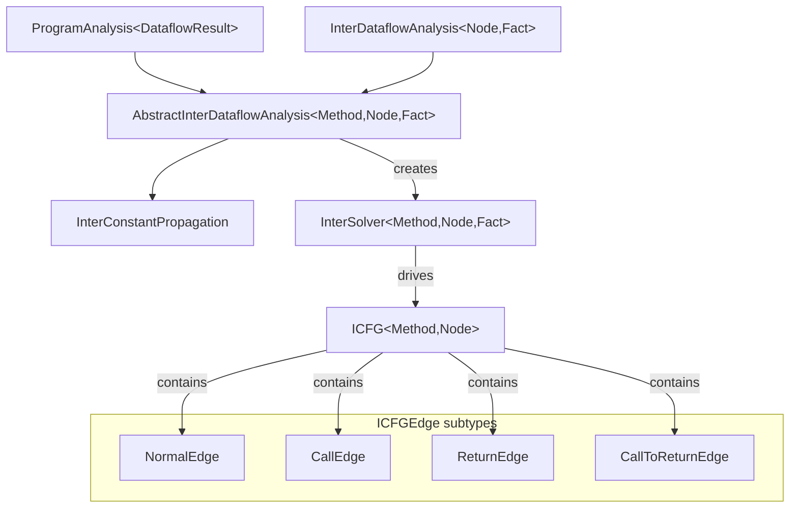
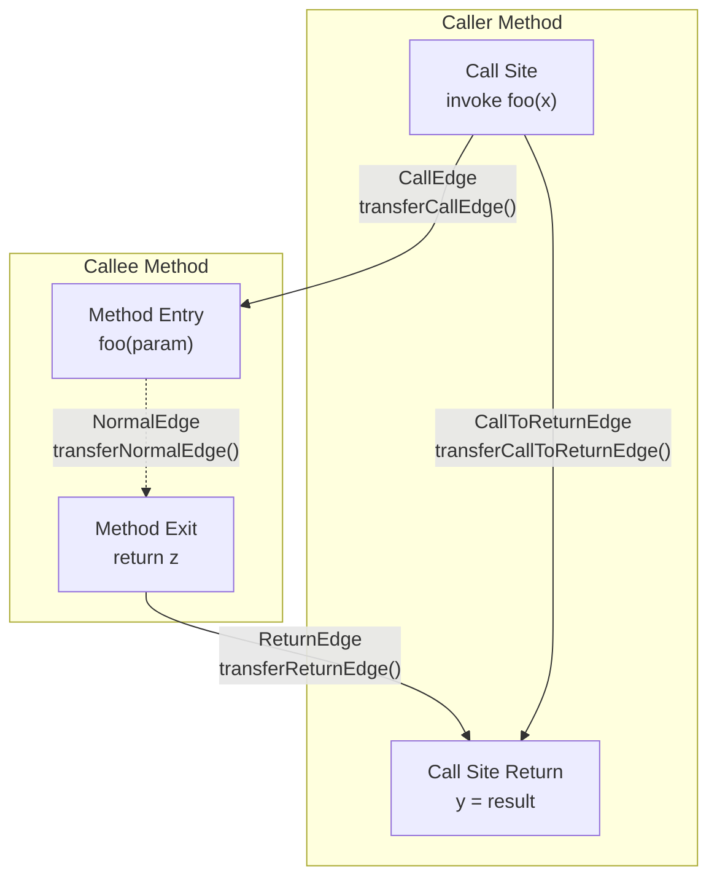
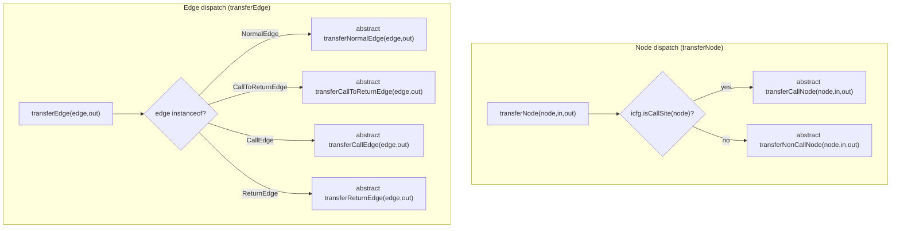
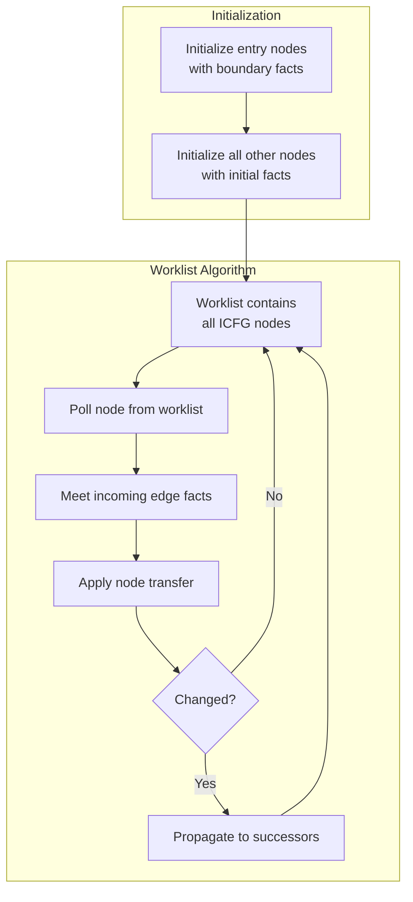

<!-- source: DeepWiki mcp.deepwiki.com · repo pascal-lab/Tai-e · page 6.2 Interprocedural Analysis · fetched 2026-10-12 -->

# Interprocedural Analysis

Relevant source files

The following files were used as context for generating this wiki page:

- [src/main/java/pascal/taie/analysis/ClassAnalysis.java](src/main/java/pascal/taie/analysis/ClassAnalysis.java)
- [src/main/java/pascal/taie/analysis/MethodAnalysis.java](src/main/java/pascal/taie/analysis/MethodAnalysis.java)
- [src/main/java/pascal/taie/analysis/ProgramAnalysis.java](src/main/java/pascal/taie/analysis/ProgramAnalysis.java)
- [src/main/java/pascal/taie/analysis/dataflow/analysis/DataflowAnalysis.java](src/main/java/pascal/taie/analysis/dataflow/analysis/DataflowAnalysis.java)
- [src/main/java/pascal/taie/analysis/dataflow/analysis/constprop/ConstantPropagation.java](src/main/java/pascal/taie/analysis/dataflow/analysis/constprop/ConstantPropagation.java)
- [src/main/java/pascal/taie/analysis/dataflow/inter/AbstractInterDataflowAnalysis.java](src/main/java/pascal/taie/analysis/dataflow/inter/AbstractInterDataflowAnalysis.java)
- [src/main/java/pascal/taie/analysis/dataflow/inter/InterConstantPropagation.java](src/main/java/pascal/taie/analysis/dataflow/inter/InterConstantPropagation.java)
- [src/main/java/pascal/taie/analysis/dataflow/inter/InterDataflowAnalysis.java](src/main/java/pascal/taie/analysis/dataflow/inter/InterDataflowAnalysis.java)
- [src/main/java/pascal/taie/analysis/dataflow/inter/InterSolver.java](src/main/java/pascal/taie/analysis/dataflow/inter/InterSolver.java)
- [src/main/java/pascal/taie/analysis/dataflow/solver/Solver.java](src/main/java/pascal/taie/analysis/dataflow/solver/Solver.java)
- [src/main/java/pascal/taie/analysis/dataflow/solver/WorkListSolver.java](src/main/java/pascal/taie/analysis/dataflow/solver/WorkListSolver.java)
- [src/test/java/pascal/taie/analysis/dataflow/DataflowTestSuite.java](src/test/java/pascal/taie/analysis/dataflow/DataflowTestSuite.java)
- [src/test/java/pascal/taie/analysis/dataflow/analysis/AvailExpTest.java](src/test/java/pascal/taie/analysis/dataflow/analysis/AvailExpTest.java)
- [src/test/java/pascal/taie/analysis/dataflow/analysis/LiveVarTest.java](src/test/java/pascal/taie/analysis/dataflow/analysis/LiveVarTest.java)
- [src/test/java/pascal/taie/analysis/dataflow/analysis/LiveVarTestFull.java](src/test/java/pascal/taie/analysis/dataflow/analysis/LiveVarTestFull.java)
- [src/test/java/pascal/taie/analysis/dataflow/analysis/ReachDefTest.java](src/test/java/pascal/taie/analysis/dataflow/analysis/ReachDefTest.java)
- [src/test/java/pascal/taie/analysis/dataflow/analysis/constprop/CPTest.java](src/test/java/pascal/taie/analysis/dataflow/analysis/constprop/CPTest.java)
- [src/test/java/pascal/taie/analysis/dataflow/analysis/constprop/EdgeRefineTest.java](src/test/java/pascal/taie/analysis/dataflow/analysis/constprop/EdgeRefineTest.java)
- [src/test/java/pascal/taie/analysis/dataflow/analysis/constprop/InterCPAliasTest.java](src/test/java/pascal/taie/analysis/dataflow/analysis/constprop/InterCPAliasTest.java)
- [src/test/java/pascal/taie/analysis/dataflow/analysis/constprop/InterCPAliasTestFull.java](src/test/java/pascal/taie/analysis/dataflow/analysis/constprop/InterCPAliasTestFull.java)
- [src/test/java/pascal/taie/analysis/dataflow/analysis/constprop/InterCPTest.java](src/test/java/pascal/taie/analysis/dataflow/analysis/constprop/InterCPTest.java)
- [src/test/java/pascal/taie/analysis/dataflow/analysis/constprop/InterCPTestFull.java](src/test/java/pascal/taie/analysis/dataflow/analysis/constprop/InterCPTestFull.java)
- [src/test/java/pascal/taie/analysis/graph/callgraph/cha/CHATest.java](src/test/java/pascal/taie/analysis/graph/callgraph/cha/CHATest.java)
- [src/test/java/pascal/taie/analysis/graph/callgraph/cha/CHATestFull.java](src/test/java/pascal/taie/analysis/graph/callgraph/cha/CHATestFull.java)
- [src/test/resources/cha/Array.java](src/test/resources/cha/Array.java)
- [src/test/resources/dataflow/constprop/alias/Array.java](src/test/resources/dataflow/constprop/alias/Array.java)
- [src/test/resources/dataflow/constprop/alias/ArrayCorner-inter-const-prop-expected.txt](src/test/resources/dataflow/constprop/alias/ArrayCorner-inter-const-prop-expected.txt)
- [src/test/resources/dataflow/constprop/alias/ArrayCorner.java](src/test/resources/dataflow/constprop/alias/ArrayCorner.java)
- [src/test/resources/dataflow/constprop/alias/ArrayInField.java](src/test/resources/dataflow/constprop/alias/ArrayInField.java)
- [src/test/resources/dataflow/constprop/alias/FieldCorner-inter-const-prop-expected.txt](src/test/resources/dataflow/constprop/alias/FieldCorner-inter-const-prop-expected.txt)
- [src/test/resources/dataflow/constprop/alias/FieldCorner.java](src/test/resources/dataflow/constprop/alias/FieldCorner.java)
- [src/test/resources/dataflow/constprop/alias/InheritedField-inter-const-prop-expected.txt](src/test/resources/dataflow/constprop/alias/InheritedField-inter-const-prop-expected.txt)
- [src/test/resources/dataflow/constprop/alias/InheritedField.java](src/test/resources/dataflow/constprop/alias/InheritedField.java)
- [src/test/resources/dataflow/constprop/alias/Reference-inter-const-prop-expected.txt](src/test/resources/dataflow/constprop/alias/Reference-inter-const-prop-expected.txt)
- [src/test/resources/dataflow/constprop/alias/Reference.java](src/test/resources/dataflow/constprop/alias/Reference.java)
- [src/test/resources/dataflow/constprop/inter/Fibonacci-inter-const-prop-expected.txt](src/test/resources/dataflow/constprop/inter/Fibonacci-inter-const-prop-expected.txt)
- [src/test/resources/dataflow/constprop/inter/Fibonacci.java](src/test/resources/dataflow/constprop/inter/Fibonacci.java)
- [src/test/resources/dataflow/constprop/inter/MultiIntArgs-inter-const-prop-expected.txt](src/test/resources/dataflow/constprop/inter/MultiIntArgs-inter-const-prop-expected.txt)
- [src/test/resources/dataflow/constprop/inter/MultiIntArgs.java](src/test/resources/dataflow/constprop/inter/MultiIntArgs.java)
- [src/test/resources/dataflow/constprop/inter/PlusPlus-inter-const-prop-expected.txt](src/test/resources/dataflow/constprop/inter/PlusPlus-inter-const-prop-expected.txt)
- [src/test/resources/dataflow/constprop/inter/PlusPlus.java](src/test/resources/dataflow/constprop/inter/PlusPlus.java)

This document covers Tai-e's interprocedural dataflow analysis framework, which extends dataflow analysis across method boundaries to analyze entire programs. This framework builds upon the intraprocedural dataflow analysis covered in [Intraprocedural Analysis](6.1) and utilizes the interprocedural control flow graph (ICFG) described in [Graph Construction](6.3).

## Overview

Interprocedural dataflow analysis extends traditional intraprocedural analysis by propagating dataflow facts across method calls and returns. Unlike intraprocedural analysis that operates on individual method CFGs, interprocedural analysis operates on the entire program using an ICFG that connects all methods through call and return edges.

The framework provides a template for implementing various interprocedural analyses, with `InterConstantPropagation` serving as the primary concrete implementation that demonstrates constant propagation across method boundaries.

**Class Hierarchy and Relationships**

Sources: [src/main/java/pascal/taie/analysis/dataflow/inter/InterDataflowAnalysis.java:33-74](), [src/main/java/pascal/taie/analysis/dataflow/inter/AbstractInterDataflowAnalysis.java:44-128](), [src/main/java/pascal/taie/analysis/dataflow/inter/InterConstantPropagation.java:60-61]()

## ICFG Edge Types and Transfer Functions

The interprocedural analysis framework handles four distinct types of ICFG edges, each requiring specialized transfer functions:

| Edge Type | Purpose | Transfer Function |
|-----------|---------|------------------|
| `NormalEdge` | Regular control flow within methods | `transferNormalEdge()` |
| `CallEdge` | From call site to method entry | `transferCallEdge()` |
| `ReturnEdge` | From method exit to call site | `transferReturnEdge()` |
| `CallToReturnEdge` | Direct flow past call site | `transferCallToReturnEdge()` |

**ICFG Edge Transfer Flow**

Sources: [src/main/java/pascal/taie/analysis/dataflow/inter/AbstractInterDataflowAnalysis.java:97-118](), [src/main/java/pascal/taie/analysis/graph/icfg/CallEdge.java](), [src/main/java/pascal/taie/analysis/graph/icfg/ReturnEdge.java]()

## Framework Architecture

### InterDataflowAnalysis Interface

`InterDataflowAnalysis` ([src/main/java/pascal/taie/analysis/dataflow/inter/InterDataflowAnalysis.java:33-74]()) defines the core contract for interprocedural analyses. Compared to `DataflowAnalysis` ([src/main/java/pascal/taie/analysis/dataflow/analysis/DataflowAnalysis.java:34-89]()), the key difference is that `newBoundaryFact` takes a `Node` argument because the ICFG may have multiple entry nodes, and `transferEdge` operates on `ICFGEdge` rather than `CFGEdge`.

| Method | Signature | Purpose |
|--------|-----------|---------|
| `isForward` | `boolean isForward()` | Determines analysis direction |
| `newBoundaryFact` | `Fact newBoundaryFact(Node boundary)` | Boundary fact for each entry (or exit) node |
| `newInitialFact` | `Fact newInitialFact()` | Initial fact for non-boundary nodes |
| `meetInto` | `void meetInto(Fact fact, Fact target)` | Merge at control-flow confluences |
| `transferNode` | `boolean transferNode(Node node, Fact in, Fact out)` | Node transfer function; returns `true` if `out` changed |
| `transferEdge` | `Fact transferEdge(ICFGEdge<Node> edge, Fact out)` | Edge transfer function; returns a new fact (must not modify input) |

Sources: [src/main/java/pascal/taie/analysis/dataflow/inter/InterDataflowAnalysis.java:33-74]()

### AbstractInterDataflowAnalysis

`AbstractInterDataflowAnalysis` ([src/main/java/pascal/taie/analysis/dataflow/inter/AbstractInterDataflowAnalysis.java:44-128]()) extends `ProgramAnalysis` and implements `InterDataflowAnalysis`. It handles two levels of dispatch so that concrete subclasses only need to implement focused, typed methods.

**Dispatch logic in AbstractInterDataflowAnalysis**

The `analyze()` method ([src/main/java/pascal/taie/analysis/dataflow/inter/AbstractInterDataflowAnalysis.java:121-128]()) orchestrates the full lifecycle:

1. Retrieves the `ICFG` result from `World` via `ICFGBuilder.ID` ([src/main/java/pascal/taie/analysis/dataflow/inter/AbstractInterDataflowAnalysis.java:122]())
2. Calls `initialize()` — hook for subclass setup (default: no-op) ([src/main/java/pascal/taie/analysis/dataflow/inter/AbstractInterDataflowAnalysis.java:123]())
3. Creates and runs `InterSolver` ([src/main/java/pascal/taie/analysis/dataflow/inter/AbstractInterDataflowAnalysis.java:124-125]())
4. Calls `finish()` — hook for subclass cleanup (default: no-op) ([src/main/java/pascal/taie/analysis/dataflow/inter/AbstractInterDataflowAnalysis.java:126]())
5. Returns the `DataflowResult` ([src/main/java/pascal/taie/analysis/dataflow/inter/AbstractInterDataflowAnalysis.java:127]())

Subclasses also have access to the `icfg` and `solver` fields directly ([src/main/java/pascal/taie/analysis/dataflow/inter/AbstractInterDataflowAnalysis.java:48-50]()).

Sources: [src/main/java/pascal/taie/analysis/dataflow/inter/AbstractInterDataflowAnalysis.java:44-128]()

## InterConstantPropagation Implementation

`InterConstantPropagation` demonstrates interprocedural constant propagation for integer values, extending the intraprocedural `ConstantPropagation` analysis across method boundaries.

### Configuration Options

| Option | Type | Purpose |
|--------|------|---------|
| `edge-refine` | `boolean` | Apply CFG edge transfer from intraprocedural constant propagation on `NormalEdge` transitions (e.g., refine variable values on `if`-true/false branches and `switch` cases) |
| `alias-aware` | `boolean` | Use pointer analysis results to precisely correlate field/array stores and loads through aliased variables |

### Core Transfer Functions

The four edge transfer methods each serve a distinct purpose:

| Method | Edge Direction | Behavior |
|--------|---------------|----------|
| `transferCallEdge` | Call site → callee entry | Copies argument values to callee parameter variables ([src/main/java/pascal/taie/analysis/dataflow/inter/InterConstantPropagation.java:327-350]()) |
| `transferReturnEdge` | Callee exit → call site | Meets return variable values and writes to the LHS of the call site ([src/main/java/pascal/taie/analysis/dataflow/inter/InterConstantPropagation.java:352-365]()) |
| `transferCallToReturnEdge` | Call site → call site return | Passes through all facts except the LHS variable, which is killed ([src/main/java/pascal/taie/analysis/dataflow/inter/InterConstantPropagation.java:313-325]()) |
| `transferNormalEdge` | Intra-method | If `edge-refine` is on, delegates to `ConstantPropagation.Analysis.transferEdge()`; otherwise passes through unchanged ([src/main/java/pascal/taie/analysis/dataflow/inter/InterConstantPropagation.java:307-311]()) |

Sources: [src/main/java/pascal/taie/analysis/dataflow/inter/InterConstantPropagation.java:307-365]()

### Alias-Aware Analysis

When `alias-aware` is enabled, `initialize()` ([src/main/java/pascal/taie/analysis/dataflow/inter/InterConstantPropagation.java:103-173]()) pre-computes three index structures:

| Field | Type | Contents |
|-------|------|----------|
| `fieldStoreToLoads` | `MultiMap<StoreField, LoadField>` | Maps each `StoreField` to all `LoadField` stmts that may read the same field (static: same `JField`; instance: aliased base via PTA) |
| `arrayStoreToLoads` | `MultiMap<StoreArray, LoadArray>` | Maps each `StoreArray` to `LoadArray` stmts through aliased base variables |
| `arrayLoadToStores` | `MultiMap<LoadArray, StoreArray>` | Reverse of `arrayStoreToLoads` |

These maps are populated by inspecting `PointerAnalysisResult` from `World.get().getResult(PointerAnalysis.ID)` ([src/main/java/pascal/taie/analysis/dataflow/inter/InterConstantPropagation.java:132]()). 

During `transferNonCallNode`, `transferAliasAware()` ([src/main/java/pascal/taie/analysis/dataflow/inter/InterConstantPropagation.java:216-305]()) handles each statement type:

- **`StoreField`**: After normal transfer, looks up `fieldStoreToLoads` and directly updates the OUT fact of each aliased `LoadField`. If changed, calls `solver.propagate(load)` to re-queue the load statement ([src/main/java/pascal/taie/analysis/dataflow/inter/InterConstantPropagation.java:246]()).
- **`StoreArray`**: After normal transfer, looks up `arrayStoreToLoads`. For each aliased `LoadArray`, calls `transferLoadArray()` and, if changed, calls `solver.propagate(load)` ([src/main/java/pascal/taie/analysis/dataflow/inter/InterConstantPropagation.java:272]()).
- **`LoadField` / `LoadArray`**: Passes through all `in` facts except the LHS variable (which is computed from aliased stores rather than from `in`).

The `solver.propagate(node)` call ([src/main/java/pascal/taie/analysis/dataflow/inter/InterSolver.java:97-99]()) adds the given node's successors to the worklist, causing dependent nodes to be re-analyzed.

Sources: [src/main/java/pascal/taie/analysis/dataflow/inter/InterConstantPropagation.java:78-173](), [src/main/java/pascal/taie/analysis/dataflow/inter/InterConstantPropagation.java:216-305](), [src/main/java/pascal/taie/analysis/dataflow/inter/InterSolver.java:97-99]()

## InterSolver Architecture

The `InterSolver` ([src/main/java/pascal/taie/analysis/dataflow/inter/InterSolver.java:38-104]()) implements a worklist-based algorithm optimized for the heavy workload of interprocedural analysis:

**Solver Algorithm Flow**

Key characteristics:
- Uses `SetQueue` ([src/main/java/pascal/taie/analysis/dataflow/inter/InterSolver.java:79]()) so each node appears at most once in the queue at any time.
- Initializes entry nodes (via `icfg.entryMethods()`) with boundary facts; all others with `newInitialFact()` ([src/main/java/pascal/taie/analysis/dataflow/inter/InterSolver.java:61-76]()).
- Processes incoming edges by calling `analysis.transferEdge()` on each, then `analysis.meetInto()` to combine them into the node's IN fact ([src/main/java/pascal/taie/analysis/dataflow/inter/InterSolver.java:85-88]()).
- The `propagate(Node node)` method ([src/main/java/pascal/taie/analysis/dataflow/inter/InterSolver.java:97-99]()) and `getOutFact(Node node)` method ([src/main/java/pascal/taie/analysis/dataflow/inter/InterSolver.java:101-103]()) are package-visible and used by analyses (e.g., `InterConstantPropagation`) to trigger re-propagation from within transfer functions when alias-aware updates occur.

Sources: [src/main/java/pascal/taie/analysis/dataflow/inter/InterSolver.java:38-104]()

## Integration with Analysis Framework

Interprocedural analyses integrate with Tai-e's analysis management system by extending `ProgramAnalysis` and following the standard analysis lifecycle:

1. **Analysis Registration**: Analyses are registered in `tai-e-analyses.yml`.
2. **ICFG Construction**: The analysis obtains the ICFG from `ICFGBuilder` ([src/main/java/pascal/taie/analysis/dataflow/inter/AbstractInterDataflowAnalysis.java:122]()).
3. **Initialization**: Custom initialization logic via `initialize()`.
4. **Solving**: `InterSolver` runs the worklist algorithm.
5. **Cleanup**: Custom cleanup logic via `finish()`.
6. **Result Storage**: Results are stored in the `World` for use by subsequent analyses.

Sources: [src/main/java/pascal/taie/analysis/dataflow/inter/AbstractInterDataflowAnalysis.java:120-128](), [src/main/java/pascal/taie/analysis/ProgramAnalysis.java:32-47]()

---

