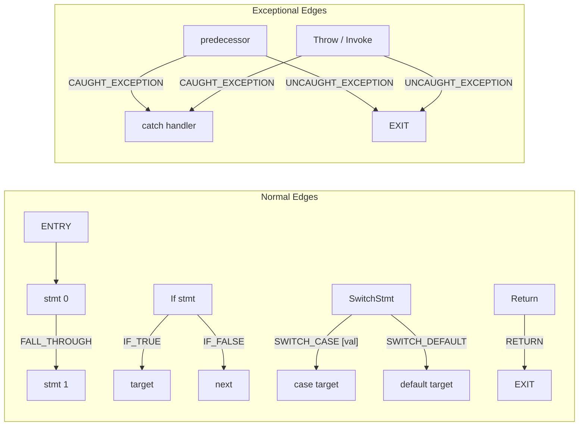
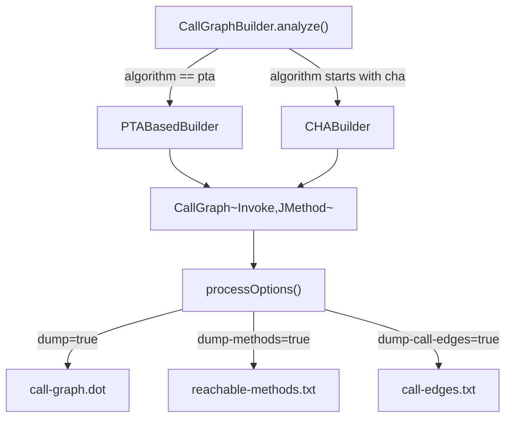
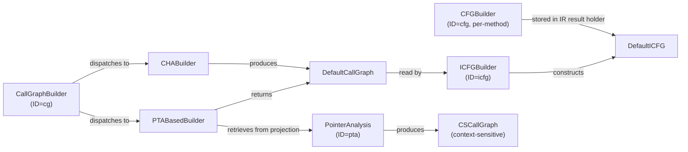

<!-- source: DeepWiki mcp.deepwiki.com · repo pascal-lab/Tai-e · page 6.3 Graph Construction · fetched 2026-10-12 -->

# Graph Construction

<details>
<summary>Relevant source files</summary>

The following files were used as context for generating this wiki page:

- [src/main/java/pascal/taie/analysis/exception/CatchAnalysis.java](src/main/java/pascal/taie/analysis/exception/CatchAnalysis.java)
- [src/main/java/pascal/taie/analysis/exception/CatchResult.java](src/main/java/pascal/taie/analysis/exception/CatchResult.java)
- [src/main/java/pascal/taie/analysis/exception/ImplicitThrowAnalysis.java](src/main/java/pascal/taie/analysis/exception/ImplicitThrowAnalysis.java)
- [src/main/java/pascal/taie/analysis/exception/PTABasedExplicitThrowAnalysis.java](src/main/java/pascal/taie/analysis/exception/PTABasedExplicitThrowAnalysis.java)
- [src/main/java/pascal/taie/analysis/exception/ThrowAnalysis.java](src/main/java/pascal/taie/analysis/exception/ThrowAnalysis.java)
- [src/main/java/pascal/taie/analysis/exception/ThrowResult.java](src/main/java/pascal/taie/analysis/exception/ThrowResult.java)
- [src/main/java/pascal/taie/analysis/graph/callgraph/AbstractCallGraph.java](src/main/java/pascal/taie/analysis/graph/callgraph/AbstractCallGraph.java)
- [src/main/java/pascal/taie/analysis/graph/callgraph/CHABuilder.java](src/main/java/pascal/taie/analysis/graph/callgraph/CHABuilder.java)
- [src/main/java/pascal/taie/analysis/graph/callgraph/CallGraph.java](src/main/java/pascal/taie/analysis/graph/callgraph/CallGraph.java)
- [src/main/java/pascal/taie/analysis/graph/callgraph/CallGraphBuilder.java](src/main/java/pascal/taie/analysis/graph/callgraph/CallGraphBuilder.java)
- [src/main/java/pascal/taie/analysis/graph/callgraph/CallGraphs.java](src/main/java/pascal/taie/analysis/graph/callgraph/CallGraphs.java)
- [src/main/java/pascal/taie/analysis/graph/callgraph/DefaultCallGraph.java](src/main/java/pascal/taie/analysis/graph/callgraph/DefaultCallGraph.java)
- [src/main/java/pascal/taie/analysis/graph/callgraph/Edge.java](src/main/java/pascal/taie/analysis/graph/callgraph/Edge.java)
- [src/main/java/pascal/taie/analysis/graph/callgraph/PTABasedBuilder.java](src/main/java/pascal/taie/analysis/graph/callgraph/PTABasedBuilder.java)
- [src/main/java/pascal/taie/analysis/graph/cfg/AbstractCFG.java](src/main/java/pascal/taie/analysis/graph/cfg/AbstractCFG.java)
- [src/main/java/pascal/taie/analysis/graph/cfg/CFG.java](src/main/java/pascal/taie/analysis/graph/cfg/CFG.java)
- [src/main/java/pascal/taie/analysis/graph/cfg/CFGBuilder.java](src/main/java/pascal/taie/analysis/graph/cfg/CFGBuilder.java)
- [src/main/java/pascal/taie/analysis/graph/cfg/CFGDumper.java](src/main/java/pascal/taie/analysis/graph/cfg/CFGDumper.java)
- [src/main/java/pascal/taie/analysis/graph/cfg/ExceptionalEdge.java](src/main/java/pascal/taie/analysis/graph/cfg/ExceptionalEdge.java)
- [src/main/java/pascal/taie/analysis/graph/cfg/StmtCFG.java](src/main/java/pascal/taie/analysis/graph/cfg/StmtCFG.java)
- [src/main/java/pascal/taie/analysis/graph/cfg/SwitchCaseEdge.java](src/main/java/pascal/taie/analysis/graph/cfg/SwitchCaseEdge.java)
- [src/main/java/pascal/taie/analysis/graph/flowgraph/FlowGraphDumper.java](src/main/java/pascal/taie/analysis/graph/flowgraph/FlowGraphDumper.java)
- [src/main/java/pascal/taie/analysis/graph/icfg/AbstractICFG.java](src/main/java/pascal/taie/analysis/graph/icfg/AbstractICFG.java)
- [src/main/java/pascal/taie/analysis/graph/icfg/CallEdge.java](src/main/java/pascal/taie/analysis/graph/icfg/CallEdge.java)
- [src/main/java/pascal/taie/analysis/graph/icfg/CallToReturnEdge.java](src/main/java/pascal/taie/analysis/graph/icfg/CallToReturnEdge.java)
- [src/main/java/pascal/taie/analysis/graph/icfg/DefaultICFG.java](src/main/java/pascal/taie/analysis/graph/icfg/DefaultICFG.java)
- [src/main/java/pascal/taie/analysis/graph/icfg/ICFG.java](src/main/java/pascal/taie/analysis/graph/icfg/ICFG.java)
- [src/main/java/pascal/taie/analysis/graph/icfg/ICFGBuilder.java](src/main/java/pascal/taie/analysis/graph/icfg/ICFGBuilder.java)
- [src/main/java/pascal/taie/analysis/graph/icfg/ICFGEdge.java](src/main/java/pascal/taie/analysis/graph/icfg/ICFGEdge.java)
- [src/main/java/pascal/taie/analysis/graph/icfg/NormalEdge.java](src/main/java/pascal/taie/analysis/graph/icfg/NormalEdge.java)
- [src/main/java/pascal/taie/analysis/graph/icfg/ReturnEdge.java](src/main/java/pascal/taie/analysis/graph/icfg/ReturnEdge.java)
- [src/main/java/pascal/taie/analysis/misc/IRDumper.java](src/main/java/pascal/taie/analysis/misc/IRDumper.java)
- [src/main/java/pascal/taie/analysis/misc/ResultProcessor.java](src/main/java/pascal/taie/analysis/misc/ResultProcessor.java)
- [src/main/java/pascal/taie/analysis/pta/PointerAnalysis.java](src/main/java/pascal/taie/analysis/pta/PointerAnalysis.java)
- [src/main/java/pascal/taie/analysis/pta/client/Collector.java](src/main/java/pascal/taie/analysis/pta/client/Collector.java)
- [src/main/java/pascal/taie/analysis/pta/plugin/Profiler.java](src/main/java/pascal/taie/analysis/pta/plugin/Profiler.java)
- [src/main/java/pascal/taie/analysis/pta/plugin/exception/CSMethodThrowResult.java](src/main/java/pascal/taie/analysis/pta/plugin/exception/CSMethodThrowResult.java)
- [src/main/java/pascal/taie/analysis/pta/plugin/exception/ExceptionAnalysis.java](src/main/java/pascal/taie/analysis/pta/plugin/exception/ExceptionAnalysis.java)
- [src/main/java/pascal/taie/analysis/pta/plugin/exception/MethodThrowResult.java](src/main/java/pascal/taie/analysis/pta/plugin/exception/MethodThrowResult.java)
- [src/main/java/pascal/taie/android/util/AndroidSystemClassUtil.java](src/main/java/pascal/taie/android/util/AndroidSystemClassUtil.java)
- [src/main/java/pascal/taie/frontend/soot/Converter.java](src/main/java/pascal/taie/frontend/soot/Converter.java)
- [src/main/java/pascal/taie/frontend/soot/SootClassBuilder.java](src/main/java/pascal/taie/frontend/soot/SootClassBuilder.java)
- [src/main/java/pascal/taie/frontend/soot/SootClassLoader.java](src/main/java/pascal/taie/frontend/soot/SootClassLoader.java)
- [src/main/java/pascal/taie/language/classes/ClassHierarchy.java](src/main/java/pascal/taie/language/classes/ClassHierarchy.java)
- [src/main/java/pascal/taie/language/classes/ClassHierarchyImpl.java](src/main/java/pascal/taie/language/classes/ClassHierarchyImpl.java)
- [src/main/java/pascal/taie/language/classes/JClass.java](src/main/java/pascal/taie/language/classes/JClass.java)
- [src/main/java/pascal/taie/language/classes/JClassBuilder.java](src/main/java/pascal/taie/language/classes/JClassBuilder.java)
- [src/main/java/pascal/taie/language/classes/JMethod.java](src/main/java/pascal/taie/language/classes/JMethod.java)
- [src/main/java/pascal/taie/language/classes/StringReps.java](src/main/java/pascal/taie/language/classes/StringReps.java)
- [src/main/java/pascal/taie/util/graph/DotDumper.java](src/main/java/pascal/taie/util/graph/DotDumper.java)
- [src/main/java/pascal/taie/util/graph/Graph.java](src/main/java/pascal/taie/util/graph/Graph.java)
- [src/main/java/pascal/taie/util/graph/MergedSCCGraph.java](src/main/java/pascal/taie/util/graph/MergedSCCGraph.java)
- [src/main/java/pascal/taie/util/graph/ReverseGraph.java](src/main/java/pascal/taie/util/graph/ReverseGraph.java)
- [src/main/java/pascal/taie/util/graph/SimpleGraph.java](src/main/java/pascal/taie/util/graph/SimpleGraph.java)
- [src/main/resources/tai-e-analyses.yml](src/main/resources/tai-e-analyses.yml)
- [src/test/java/pascal/taie/analysis/Tests.java](src/test/java/pascal/taie/analysis/Tests.java)
- [src/test/java/pascal/taie/frontend/soot/OuterInnerTest.java](src/test/java/pascal/taie/frontend/soot/OuterInnerTest.java)

</details>


This page covers the construction of control-flow graphs (CFGs), interprocedural control-flow graphs (ICFGs), and call graphs in Tai-e. These graph structures underpin the dataflow framework described in pages [6.1]() and [6.2](). For the pointer analysis that produces the most precise call graphs, see [3](). For the ICFG-driven interprocedural solver, see [6.2]().

---

## Overview

Tai-e exposes three independently runnable graph analyses, each registered with a string ID in `tai-e-analyses.yml` [src/main/resources/tai-e-analyses.yml:80-94]() and accessible via `World.get().getResult(...)`:

| Analysis class | ID | Output type | Scope |
|---|---|---|---|
| `CFGBuilder` | `"cfg"` | `CFG<Stmt>` | Per-method (MethodAnalysis) |
| `CallGraphBuilder` | `"cg"` | `CallGraph<Invoke, JMethod>` | Whole program (ProgramAnalysis) |
| `ICFGBuilder` | `"icfg"` | `ICFG<JMethod, Stmt>` | Whole program (ProgramAnalysis) |

All three can optionally emit Graphviz DOT files for visual inspection.

**Class hierarchy overview**

```mermaid
classDiagram
    class "MethodAnalysis" {
    }
    class "ProgramAnalysis" {
    }
    class "CFGBuilder" {
        +ID = cfg
        +analyze(IR) CFG~Stmt~
    }
    class "CallGraphBuilder" {
        +ID = cg
        +analyze() CallGraph~Invoke,JMethod~
    }
    class "ICFGBuilder" {
        +ID = icfg
        +analyze() ICFG~JMethod,Stmt~
    }
    MethodAnalysis <|-- CFGBuilder
    ProgramAnalysis <|-- CallGraphBuilder
    ProgramAnalysis <|-- ICFGBuilder
```

Sources: [src/main/java/pascal/taie/analysis/graph/cfg/CFGBuilder.java:49-51](), [src/main/java/pascal/taie/analysis/graph/callgraph/CallGraphBuilder.java:37-39](), [src/main/java/pascal/taie/analysis/graph/icfg/ICFGBuilder.java:44-46]()

---

## Control Flow Graph (CFG)

### CFGBuilder

`CFGBuilder` is a `MethodAnalysis` that runs once per method and stores its result in the method's IR result holder (retrievable via `ir.getResult(CFGBuilder.ID)`).

**Configuration options:**

| Option | Type | Effect |
|---|---|---|
| `exception` | String / null | If `null`, no exceptional edges are built |
| `dump` | Boolean | If `true`, writes one `.dot` file per method into `<output>/cfg/` |

[src/main/java/pascal/taie/analysis/graph/cfg/CFGBuilder.java:63-76]()

The `analyze(IR ir)` method creates a `StmtCFG` (backed by the IR), attaches synthetic `Entry` and `Exit` nodes, then delegates to two private helpers. [src/main/java/pascal/taie/analysis/graph/cfg/CFGBuilder.java:79-91]()

### Normal edges

`buildNormalEdges` iterates the IR statement list sequentially. The first statement is connected from `Entry`. For each statement it emits edges according to the statement type:

| Statement type | Edge kind(s) emitted |
|---|---|
| `Goto` | `GOTO` → target |
| `If` | `IF_TRUE` → target, `IF_FALSE` → next |
| `SwitchStmt` | `SWITCH_CASE` (per case value), `SWITCH_DEFAULT` |
| `Return` | `RETURN` → `Exit` node |
| Any other (fall-through) | `FALL_THROUGH` → next statement |

[src/main/java/pascal/taie/analysis/graph/cfg/CFGBuilder.java:93-124]()

### Exceptional edges

`buildExceptionalEdges` uses two subordinate analyses:

- **`ThrowAnalysis`** (retrieved via `ir.getResult(ThrowAnalysis.ID)`) classifies which exception types each statement can throw. [src/main/java/pascal/taie/analysis/graph/cfg/CFGBuilder.java:152]()
- **`CatchAnalysis.analyze(ir, throwResult)`** maps those exceptions to catch handlers or the method exit. [src/main/java/pascal/taie/analysis/graph/cfg/CFGBuilder.java:153]()

**Implicit exceptions** (e.g., `NullPointerException` on a dereference) produce edges from the *predecessor* of the throwing statement, because the throwing statement itself did not complete. **Explicit exceptions** (`throw` statements and `Invoke` statements) produce edges from the statement itself. [src/main/java/pascal/taie/analysis/graph/cfg/CFGBuilder.java:126-146]()

Two edge kinds are used: `CAUGHT_EXCEPTION` (to a catch handler) and `UNCAUGHT_EXCEPTION` (to the `Exit` node). [src/main/java/pascal/taie/analysis/graph/cfg/CFGBuilder.java:162-174]()

**CFG edge kinds at a glance**



Sources: [src/main/java/pascal/taie/analysis/graph/cfg/CFGBuilder.java:93-191]()

### CFGDumper

`CFGDumper.dumpDotFile(cfg, dumpDir)` is a static utility used by `CFGBuilder` (when `dump=true`). [src/main/java/pascal/taie/analysis/graph/cfg/CFGBuilder.java:88]()

Key behaviors:
- Node labels are produced by `toLabel(node, cfg)`, which writes `"Entry<method>"`, `"Exit<method>"`, or `"<index>: <stmt>"` for ordinary statements. [src/main/java/pascal/taie/analysis/graph/cfg/CFGDumper.java:80-92]()
- Exceptional edges are annotated with the exception class simple names. [src/main/java/pascal/taie/analysis/graph/cfg/CFGDumper.java:70-73]()
- File names are derived from the method's declaring class, name, and parameter types. [src/main/java/pascal/taie/analysis/graph/cfg/CFGDumper.java:95-107]()

---

## Call Graph

### CallGraphBuilder: dispatch

`CallGraphBuilder` (`ID = "cg"`) reads the `algorithm` option and delegates to one of two builders:



Sources: [src/main/java/pascal/taie/analysis/graph/callgraph/CallGraphBuilder.java:57-95]()

### CHABuilder

`CHABuilder` implements `CGBuilder<Invoke, JMethod>` using Class Hierarchy Analysis. It supports three algorithm variants:

| Algorithm string | `ignoreObjectMethods` | `calleeLimit` |
|---|---|---|
| `"cha"` | `true` | unlimited |
| `"cha-full"` | `false` | unlimited |
| `"cha-N"` (e.g. `"cha-10"`) | `false` | N |

[src/main/java/pascal/taie/analysis/graph/callgraph/CHABuilder.java:83-102]()

**Build algorithm:** BFS worklist starting from `World.get().getMainMethod()`. [src/main/java/pascal/taie/analysis/graph/callgraph/CHABuilder.java:106-128]() For each newly reachable method, all call sites are processed:

- `INTERFACE` / `VIRTUAL`: resolves via `hierarchy.getAllSubclassesOf(cls)` filtered to non-abstract classes, then `hierarchy.dispatch(c, methodRef)`. [src/main/java/pascal/taie/analysis/graph/callgraph/CHABuilder.java:153-178]()
- `SPECIAL` / `STATIC`: resolved directly with `callSite.getMethodRef().resolveNullable()`. [src/main/java/pascal/taie/analysis/graph/callgraph/CHABuilder.java:179-182]()

When `ignoreObjectMethods` is enabled, any virtual/interface call whose method ref matches a method declared in `java.lang.Object` is skipped entirely. [src/main/java/pascal/taie/analysis/graph/callgraph/CHABuilder.java:155-157]()

### PTABasedBuilder

`PTABasedBuilder` is a thin adapter that retrieves an already-computed call graph from the pointer analysis result:
`World.get().getResult(PointerAnalysis.ID).getCallGraph()`. [src/main/java/pascal/taie/analysis/graph/callgraph/PTABasedBuilder.java:37-44]()

### DefaultCallGraph

`DefaultCallGraph` is the concrete implementation used by both CHA and the PTA projection. It manages reachable methods and edges between `Invoke` statements and `JMethod` targets. [src/main/java/pascal/taie/analysis/graph/callgraph/DefaultCallGraph.java:34-40]()

---

## Interprocedural Control Flow Graph (ICFG)

### ICFGBuilder

`ICFGBuilder` (`ID = "icfg"`) is a `ProgramAnalysis` that:

1. Reads the call graph: `World.get().getResult(CallGraphBuilder.ID)`. [src/main/java/pascal/taie/analysis/graph/icfg/ICFGBuilder.java:58]()
2. Constructs `DefaultICFG(callGraph)`, which stitches together the per-method CFGs (obtained via `method.getIR().getResult(CFGBuilder.ID)`) using call and return edges. [src/main/java/pascal/taie/analysis/graph/icfg/ICFGBuilder.java:61-65]()
3. Optionally dumps the whole ICFG to a DOT file. [src/main/java/pascal/taie/analysis/graph/icfg/ICFGBuilder.java:67-95]()

**Data flow between graph builders**



Sources: [src/main/java/pascal/taie/analysis/graph/icfg/ICFGBuilder.java:58-65](), [src/main/java/pascal/taie/analysis/graph/callgraph/CallGraphBuilder.java:57-70]()

---

## Graph Visualization with DotDumper

All three graph analyses share a common output infrastructure built on `DotDumper<N>` in `src/main/java/pascal/taie/util/graph/DotDumper.java`.

`DotDumper<N>` is a fluent builder that writes a Graphviz `digraph` to a file. It allows setting node labels, edge labels, and custom attributes for styling. [src/main/java/pascal/taie/util/graph/DotDumper.java:40-198]()

**Analysis Configuration Reference**

- **CFGBuilder (`cfg`)**: Options `exception` (ThrowAnalysis ID) and `dump` (boolean). [src/main/resources/tai-e-analyses.yml:80-86]()
- **CallGraphBuilder (`cg`)**: Options `algorithm` (`cha`|`pta`), `dump`, `dump-methods`, `dump-call-edges`. [src/main/resources/tai-e-analyses.yml:39-47]()
- **ICFGBuilder (`icfg`)**: Option `dump` (boolean). [src/main/resources/tai-e-analyses.yml:89-93]()

Sources: [src/main/resources/tai-e-analyses.yml:39-93](), [src/main/java/pascal/taie/analysis/graph/cfg/CFGBuilder.java:63-76](), [src/main/java/pascal/taie/analysis/graph/callgraph/CallGraphBuilder.java:50-95](), [src/main/java/pascal/taie/analysis/graph/icfg/ICFGBuilder.java:52-65]()

---

