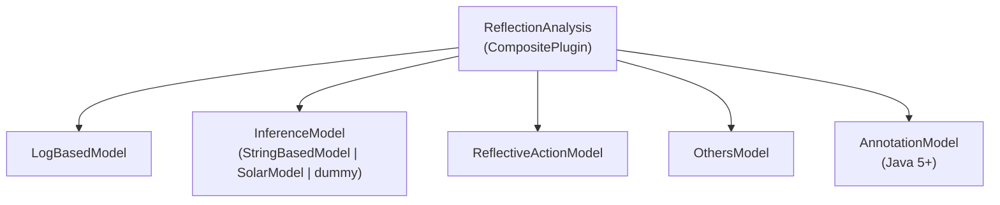
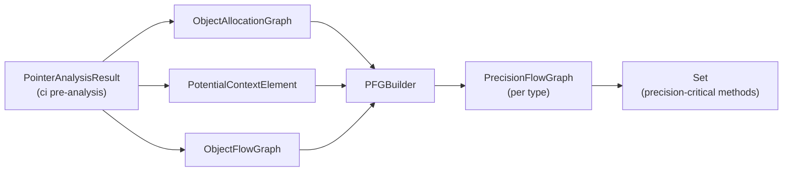
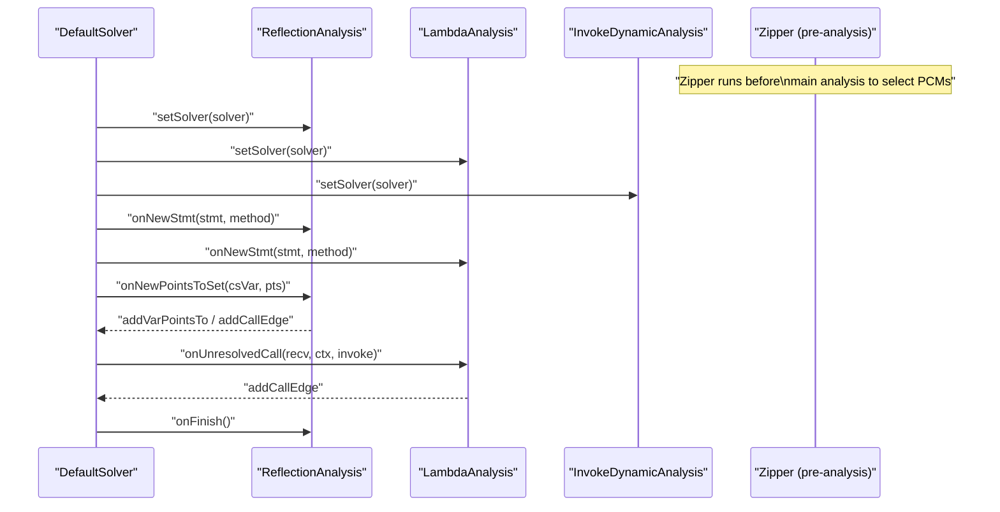

<!-- source: DeepWiki mcp.deepwiki.com · repo pascal-lab/Tai-e · page 7 Advanced Features · fetched 2026-10-12 -->

# Advanced Features

<details>
<summary>Relevant source files</summary>

The following files were used as context for generating this wiki page:

- [src/main/java/pascal/taie/analysis/deadcode/DeadCodeDetection.java](src/main/java/pascal/taie/analysis/deadcode/DeadCodeDetection.java)
- [src/main/java/pascal/taie/analysis/graph/flowgraph/Node.java](src/main/java/pascal/taie/analysis/graph/flowgraph/Node.java)
- [src/main/java/pascal/taie/analysis/pta/plugin/invokedynamic/InvokeDynamicAnalysis.java](src/main/java/pascal/taie/analysis/pta/plugin/invokedynamic/InvokeDynamicAnalysis.java)
- [src/main/java/pascal/taie/analysis/pta/plugin/invokedynamic/LambdaAnalysis.java](src/main/java/pascal/taie/analysis/pta/plugin/invokedynamic/LambdaAnalysis.java)
- [src/main/java/pascal/taie/analysis/pta/plugin/reflection/InferenceModel.java](src/main/java/pascal/taie/analysis/pta/plugin/reflection/InferenceModel.java)
- [src/main/java/pascal/taie/analysis/pta/plugin/reflection/MetaObjHelper.java](src/main/java/pascal/taie/analysis/pta/plugin/reflection/MetaObjHelper.java)
- [src/main/java/pascal/taie/analysis/pta/plugin/reflection/MethodInfo.java](src/main/java/pascal/taie/analysis/pta/plugin/reflection/MethodInfo.java)
- [src/main/java/pascal/taie/analysis/pta/plugin/reflection/ReflectionAnalysis.java](src/main/java/pascal/taie/analysis/pta/plugin/reflection/ReflectionAnalysis.java)
- [src/main/java/pascal/taie/analysis/pta/plugin/reflection/ReflectiveActionModel.java](src/main/java/pascal/taie/analysis/pta/plugin/reflection/ReflectiveActionModel.java)
- [src/main/java/pascal/taie/analysis/pta/plugin/reflection/SolarModel.java](src/main/java/pascal/taie/analysis/pta/plugin/reflection/SolarModel.java)
- [src/main/java/pascal/taie/analysis/pta/plugin/reflection/StringBasedModel.java](src/main/java/pascal/taie/analysis/pta/plugin/reflection/StringBasedModel.java)
- [src/main/java/pascal/taie/analysis/pta/toolkit/PointerAnalysisResultEx.java](src/main/java/pascal/taie/analysis/pta/toolkit/PointerAnalysisResultEx.java)
- [src/main/java/pascal/taie/analysis/pta/toolkit/PointerAnalysisResultExImpl.java](src/main/java/pascal/taie/analysis/pta/toolkit/PointerAnalysisResultExImpl.java)
- [src/main/java/pascal/taie/analysis/pta/toolkit/util/OAGs.java](src/main/java/pascal/taie/analysis/pta/toolkit/util/OAGs.java)
- [src/main/java/pascal/taie/analysis/pta/toolkit/zipper/ObjectAllocationGraph.java](src/main/java/pascal/taie/analysis/pta/toolkit/zipper/ObjectAllocationGraph.java)
- [src/main/java/pascal/taie/analysis/pta/toolkit/zipper/PFGBuilder.java](src/main/java/pascal/taie/analysis/pta/toolkit/zipper/PFGBuilder.java)
- [src/main/java/pascal/taie/analysis/pta/toolkit/zipper/PotentialContextElement.java](src/main/java/pascal/taie/analysis/pta/toolkit/zipper/PotentialContextElement.java)
- [src/main/java/pascal/taie/analysis/pta/toolkit/zipper/PrecisionFlowGraph.java](src/main/java/pascal/taie/analysis/pta/toolkit/zipper/PrecisionFlowGraph.java)
- [src/main/java/pascal/taie/analysis/pta/toolkit/zipper/Zipper.java](src/main/java/pascal/taie/analysis/pta/toolkit/zipper/Zipper.java)
- [src/main/java/pascal/taie/util/Canonicalizer.java](src/main/java/pascal/taie/util/Canonicalizer.java)
- [src/main/java/pascal/taie/util/graph/TopologicalSorter.java](src/main/java/pascal/taie/util/graph/TopologicalSorter.java)
- [src/test/java/pascal/taie/analysis/pta/toolkit/zipper/ZipperTest.java](src/test/java/pascal/taie/analysis/pta/toolkit/zipper/ZipperTest.java)

</details>


This page is an overview of the advanced and specialized analysis capabilities in Tai-e that extend the core pointer analysis beyond basic heap/flow modeling. The subsections cover: Java reflection handling, lambda and `invokedynamic` modeling, API pattern matching, the Zipper precision-critical method selector, and post-analysis result processing.

For the underlying pointer analysis solver and plugin lifecycle that all of these features hook into, see [Solver Architecture](#3.2) and [Plugin System](#3.3). For the core heap model that many of these features extend, see [Heap Model](#3.4).

---

## Overview

The advanced features are all implemented as pointer analysis **plugins** or **toolkit utilities** that activate on demand. They connect to the solver through the `Plugin` interface lifecycle and contribute additional call edges, pointer flow edges, or points-to facts that ordinary statement processing cannot produce.

**Advanced features summary:**

| Feature | Key Classes | Location |
|---|---|---|
| Reflection analysis | `ReflectionAnalysis`, `LogBasedModel`, `SolarModel`, `StringBasedModel`, `ReflectiveActionModel` | `analysis/pta/plugin/reflection/` |
| Lambda & invokedynamic | `LambdaAnalysis`, `InvokeDynamicAnalysis` | `analysis/pta/plugin/invokedynamic/` |
| API modeling / pattern matching | `AnalysisModelPlugin`, `InvokeHandler` | `analysis/pta/plugin/util/` |
| Zipper (precision selection) | `Zipper`, `PFGBuilder`, `ObjectAllocationGraph`, `PotentialContextElement` | `analysis/pta/toolkit/zipper/` |
| Mahjong (heap merging) | `MahjongHeapModel`, `DFAFactory`, `DFAEquivChecker` | `analysis/pta/toolkit/mahjong/` |
| Result processing | `ResultProcessor` | `analysis/pta/plugin/` |

---

## Reflection Analysis

Java reflection allows programs to load classes, invoke methods, and access fields at runtime using string names or `Class` objects. Tai-e handles this through `ReflectionAnalysis`, a `CompositePlugin` that composes several sub-models. See [Reflection Analysis](#7.1) for full detail.

### Plugin Composition

`ReflectionAnalysis` is instantiated as a `CompositePlugin`. In `setSolver`, it creates the following sub-models and registers them via `addPlugin`:

**Reflection sub-model structure:**



Sources: [src/main/java/pascal/taie/analysis/pta/plugin/reflection/ReflectionAnalysis.java:68-99]()

### Sub-model Responsibilities

| Sub-model | Handles |
|---|---|
| `LogBasedModel` | Reads a reflection log file; injects known targets for `Class.forName`, `Class.newInstance`, `Constructor.newInstance`, `Method.invoke`, `Field.get/set`, `Array.newInstance` |
| `StringBasedModel` | Infers `Class.forName` / `getMethod` / `getConstructor` targets from string constant arguments |
| `SolarModel` | Implements the Solar algorithm (TOSEM 2019): uses cast types and argument arrays as type hints; generates "unknown" meta-objects for unresolvable targets |
| `ReflectiveActionModel` | Models the actual reflective invocations (`Method.invoke`, `Constructor.newInstance`, `Field.get/set`, etc.) by inserting call edges and pointer flow edges |
| `OthersModel` | Models remaining reflection APIs not covered above |
| `AnnotationModel` | Models annotation retrieval APIs (Java 5+) |

### Meta-object Management

`MetaObjHelper` centralizes creation and lookup of reflection meta-objects — heap objects that represent `java.lang.Class`, `java.lang.reflect.Method`, `java.lang.reflect.Constructor`, and `java.lang.reflect.Field` instances. It uses distinct `Descriptor` values to distinguish log-sourced objects from inference-generated ones.

| Descriptor | Purpose |
|---|---|
| `ReflectionMetaObj` | Meta objects from inference |
| `ReflectionLogMetaObj` | Meta objects sourced from the reflection log |
| `UnknownReflectionMetaObj` | Unknown meta objects in Solar |
| `ReflectionMetaObjArray` | Arrays returned by `getMethods()`, etc. |
| `AnnotationObj` | Annotation objects |

Sources: [src/main/java/pascal/taie/analysis/pta/plugin/reflection/MetaObjHelper.java:52-77]()

### Reflective Action Modeling

`ReflectiveActionModel` uses `@InvokeHandler` annotations to register handlers for specific reflection API signatures. When the points-to set of a receiver variable or argument changes, the handler fires. The following APIs are modeled:

| API signature | Handler |
|---|---|
| `<java.lang.Class: java.lang.Object newInstance()>` | `classNewInstance` |
| `<java.lang.reflect.Constructor: java.lang.Object newInstance(java.lang.Object[])>` | `constructorNewInstance` |
| `<java.lang.reflect.Method: java.lang.Object invoke(java.lang.Object,java.lang.Object[])>` | `methodInvoke` |
| `<java.lang.reflect.Field: java.lang.Object get(java.lang.Object)>` | `fieldGet` |
| `<java.lang.reflect.Field: void set(java.lang.Object,java.lang.Object)>` | `fieldSet` |

For each resolved target, reflective call edges are added to the solver. Argument passing and return value propagation are handled via `PointerFlowEdge` with kinds like `PARAMETER_PASSING` or `RETURN`.

Sources: [src/main/java/pascal/taie/analysis/pta/plugin/reflection/ReflectiveActionModel.java:122-179]()

### Imprecision Reporting

After analysis completes, `ReflectionAnalysis.onFinish` calls `reportImpreciseCalls`, which flags any reflective call site (not covered by the log) that resolved to more than a threshold (default 50, or 5 for Android) of targets.

Sources: [src/main/java/pascal/taie/analysis/pta/plugin/reflection/ReflectionAnalysis.java:116-146]()

---

## Lambda and Invokedynamic

Java lambda expressions and method references compile to `invokedynamic` instructions. Two separate plugins handle these. See [Lambda and Invokedynamic](#7.2) for full detail.

### LambdaAnalysis

`LambdaAnalysis` handles `invokedynamic` instructions whose bootstrap method is `LambdaMetafactory.metafactory` or `LambdaMetafactory.altMetafactory`. It:

1. Creates a `MockObj` (with descriptor `LambdaObj`) at each `invokedynamic` allocation site [src/main/java/pascal/taie/analysis/pta/plugin/invokedynamic/LambdaAnalysis.java:106-115]().
2. On `onUnresolvedCall`, matches the lambda object to the invocation site via method name [src/main/java/pascal/taie/analysis/pta/plugin/invokedynamic/LambdaAnalysis.java:151-163]().
3. Dispatches to the actual target method (constructor, instance, or static) and adds a call edge.

### InvokeDynamicAnalysis

`InvokeDynamicAnalysis` handles non-lambda, non-string-concat `invokedynamic` instructions (e.g., custom `CallSite`-based dispatch). It:

1. Adds a call edge to the bootstrap method (BSM) for each `invokedynamic` site [src/main/java/pascal/taie/analysis/pta/plugin/invokedynamic/InvokeDynamicAnalysis.java:182-192]().
2. Tracks `MethodHandle` objects flowing through BSM variables; when a `MethodHandle` is resolved, adds an `InvokeDynamicCallEdge`.

Sources: [src/main/java/pascal/taie/analysis/pta/plugin/invokedynamic/InvokeDynamicAnalysis.java:73-139]()

---

## Pattern Matching and API Modeling

Tai-e provides a reusable mechanism for matching Java API signatures and registering handlers. See [Pattern Matching and API Modeling](#7.3) for full detail.

### InvokeHandler Annotation

The `@InvokeHandler` annotation (in `analysis/pta/plugin/util/`) is placed on methods inside an `AnalysisModelPlugin`. It declares:
- `signature`: one or more full Java method signatures to match.
- `argIndexes`: which argument variables (or `BASE` for the receiver) to pass as points-to sets.

The `AnalysisModelPlugin` base class processes these annotations at setup time, so when the solver triggers `onNewPointsToSet` for a relevant variable, the annotated handler method fires automatically.

Example usage from `ReflectiveActionModel`:

```java
@InvokeHandler(signature = "<java.lang.Class: java.lang.Object newInstance()>", argIndexes = {BASE})
public void classNewInstance(Context context, Invoke invoke, PointsToSet classes)
```

Sources: [src/main/java/pascal/taie/analysis/pta/plugin/reflection/ReflectiveActionModel.java:122-123]()

---

## Zipper: Precision-Critical Method Selection

Zipper is a pre-analysis toolkit that determines which methods should be analyzed with full context sensitivity. It runs after a preliminary context-insensitive pointer analysis and produces a set of *precision-critical methods* (PCMs).

See [Zipper and Mahjong](#7.4) for the full treatment.

### Activation

Zipper is activated via the `advanced` option in the pointer analysis configuration:
- `advanced:zipper` — full Zipper
- `advanced:zipper-e` — Zipper-e with default percentage value (5%)

`Zipper.run(PointerAnalysisResult, String)` is the static entry point. It parses the argument string and returns the set of PCMs.

Sources: [src/main/java/pascal/taie/analysis/pta/toolkit/zipper/Zipper.java:90-107]()

### Algorithm Components

**Zipper data flow:**



Sources: [src/main/java/pascal/taie/analysis/pta/toolkit/zipper/Zipper.java:109-122]()

| Component | Class | Role |
|---|---|---|
| Object Allocation Graph | `ObjectAllocationGraph` | Directed graph: object → objects allocated within methods invoked on it [src/main/java/pascal/taie/analysis/pta/toolkit/zipper/ObjectAllocationGraph.java:45-69](). |
| Potential Context Element | `PotentialContextElement` | For each type, computes the set of methods where objects of that type can appear as context element. |
| Precision Flow Graph builder | `PFGBuilder` | For each object type, builds a PFG from the OFG by selecting relevant IN/OUT nodes [src/main/java/pascal/taie/analysis/pta/toolkit/zipper/PFGBuilder.java:105-114](). |
| Precision Flow Graph | `PrecisionFlowGraph` | Graph over `Node` (VarNode or InstanceNode) with OFG edges filtered to visited nodes [src/main/java/pascal/taie/analysis/pta/toolkit/zipper/PrecisionFlowGraph.java:38-66](). |

### Zipper-e Threshold

In express mode, after collecting PCMs for a type, Zipper checks whether the sum of points-to sizes of all PCMs in the group exceeds `pv * totalPts`. If it does, the group is discarded to prevent analysis explosion.

Sources: [src/main/java/pascal/taie/analysis/pta/toolkit/zipper/Zipper.java:186-201]()

---

## Result Processing

The `ResultProcessor` plugin collects and serializes pointer analysis results after the analysis completes. It supports:
- Plain text and YAML dump modes.
- Comparison against expected results for regression testing.
- Taint flow reporting.

See [Result Processing](#7.5) for the full treatment.

---

## Interaction Diagram: Advanced Features and the Solver

The following diagram shows how the advanced plugins interact with the core solver during analysis:



Sources: [src/main/java/pascal/taie/analysis/pta/plugin/reflection/ReflectionAnalysis.java:68-99](), [src/main/java/pascal/taie/analysis/pta/plugin/invokedynamic/LambdaAnalysis.java:96-115](), [src/main/java/pascal/taie/analysis/pta/plugin/invokedynamic/InvokeDynamicAnalysis.java:162-177](), [src/main/java/pascal/taie/analysis/pta/toolkit/zipper/Zipper.java:90-107]()

---

