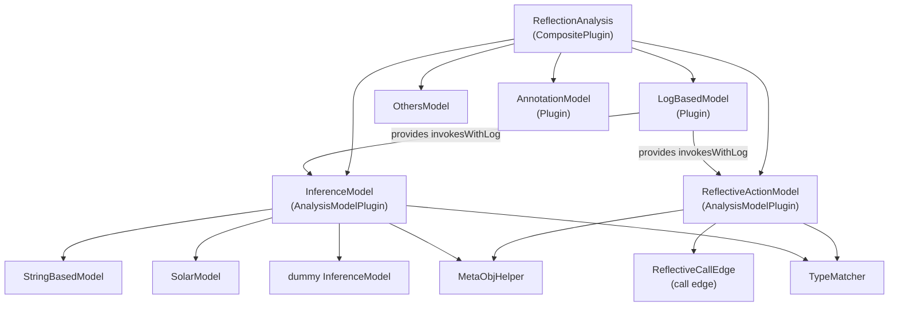
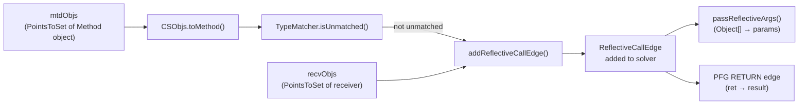
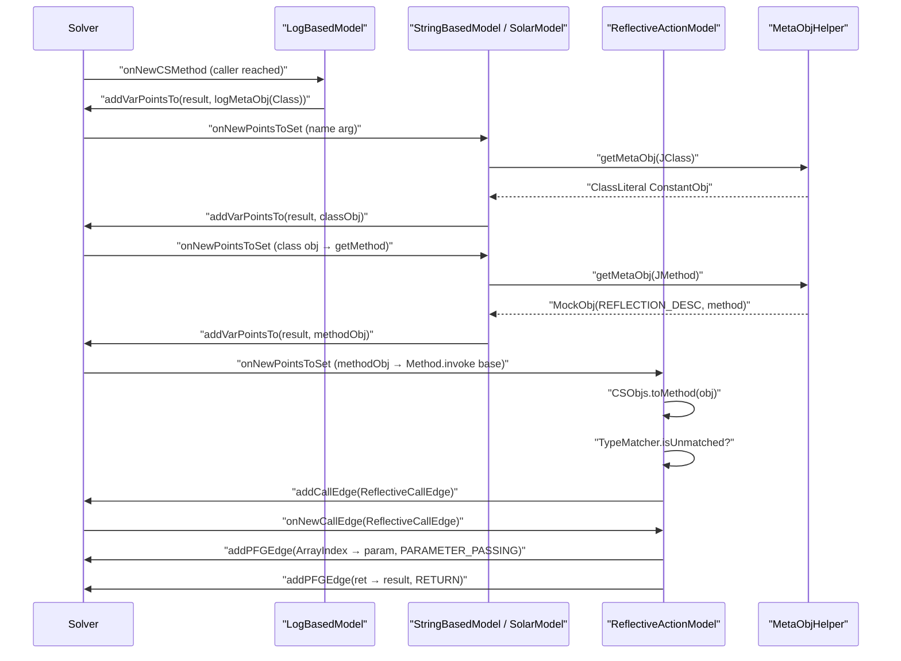

<!-- source: DeepWiki mcp.deepwiki.com · repo pascal-lab/Tai-e · page 7.1 Reflection Analysis · fetched 2026-10-12 -->

# Reflection Analysis

<details>
<summary>Relevant source files</summary>

The following files were used as context for generating this wiki page:

- [src/main/java/pascal/taie/analysis/pta/plugin/invokedynamic/InvokeDynamicAnalysis.java](src/main/java/pascal/taie/analysis/pta/plugin/invokedynamic/InvokeDynamicAnalysis.java)
- [src/main/java/pascal/taie/analysis/pta/plugin/invokedynamic/LambdaAnalysis.java](src/main/java/pascal/taie/analysis/pta/plugin/invokedynamic/LambdaAnalysis.java)
- [src/main/java/pascal/taie/analysis/pta/plugin/reflection/AnnotationModel.java](src/main/java/pascal/taie/analysis/pta/plugin/reflection/AnnotationModel.java)
- [src/main/java/pascal/taie/analysis/pta/plugin/reflection/InferenceModel.java](src/main/java/pascal/taie/analysis/pta/plugin/reflection/InferenceModel.java)
- [src/main/java/pascal/taie/analysis/pta/plugin/reflection/LogBasedModel.java](src/main/java/pascal/taie/analysis/pta/plugin/reflection/LogBasedModel.java)
- [src/main/java/pascal/taie/analysis/pta/plugin/reflection/MetaObjHelper.java](src/main/java/pascal/taie/analysis/pta/plugin/reflection/MetaObjHelper.java)
- [src/main/java/pascal/taie/analysis/pta/plugin/reflection/MethodInfo.java](src/main/java/pascal/taie/analysis/pta/plugin/reflection/MethodInfo.java)
- [src/main/java/pascal/taie/analysis/pta/plugin/reflection/ReflectionAnalysis.java](src/main/java/pascal/taie/analysis/pta/plugin/reflection/ReflectionAnalysis.java)
- [src/main/java/pascal/taie/analysis/pta/plugin/reflection/ReflectiveActionModel.java](src/main/java/pascal/taie/analysis/pta/plugin/reflection/ReflectiveActionModel.java)
- [src/main/java/pascal/taie/analysis/pta/plugin/reflection/SolarModel.java](src/main/java/pascal/taie/analysis/pta/plugin/reflection/SolarModel.java)
- [src/main/java/pascal/taie/analysis/pta/plugin/reflection/StringBasedModel.java](src/main/java/pascal/taie/analysis/pta/plugin/reflection/StringBasedModel.java)
- [src/main/java/pascal/taie/analysis/pta/plugin/util/CSObjs.java](src/main/java/pascal/taie/analysis/pta/plugin/util/CSObjs.java)
- [src/main/java/pascal/taie/ir/proginfo/FieldRef.java](src/main/java/pascal/taie/ir/proginfo/FieldRef.java)
- [src/main/java/pascal/taie/ir/proginfo/MethodRef.java](src/main/java/pascal/taie/ir/proginfo/MethodRef.java)
- [src/main/java/pascal/taie/language/classes/ClassNames.java](src/main/java/pascal/taie/language/classes/ClassNames.java)
- [src/main/java/pascal/taie/language/classes/ExceptionNames.java](src/main/java/pascal/taie/language/classes/ExceptionNames.java)
- [src/main/java/pascal/taie/language/classes/Subsignature.java](src/main/java/pascal/taie/language/classes/Subsignature.java)
- [src/main/java/pascal/taie/util/ClassNameExtractor.java](src/main/java/pascal/taie/util/ClassNameExtractor.java)
- [src/main/resources/log4j2.yml](src/main/resources/log4j2.yml)
- [src/test/java/pascal/taie/analysis/pta/ReflectionTest.java](src/test/java/pascal/taie/analysis/pta/ReflectionTest.java)
- [src/test/java/pascal/taie/frontend/java/AnnotationTest.java](src/test/java/pascal/taie/frontend/java/AnnotationTest.java)
- [src/test/java/pascal/taie/frontend/java/FieldOrderTest.java](src/test/java/pascal/taie/frontend/java/FieldOrderTest.java)
- [src/test/java/pascal/taie/frontend/java/FrontendTestSuite.java](src/test/java/pascal/taie/frontend/java/FrontendTestSuite.java)
- [src/test/java/pascal/taie/frontend/java/syntax/JavaVersionSyntaxTest.java](src/test/java/pascal/taie/frontend/java/syntax/JavaVersionSyntaxTest.java)
- [src/test/resources/frontend/java/syntax/Java11Syntax.java](src/test/resources/frontend/java/syntax/Java11Syntax.java)
- [src/test/resources/frontend/java/syntax/Java17Syntax.java](src/test/resources/frontend/java/syntax/Java17Syntax.java)
- [src/test/resources/frontend/java/syntax/Java6Syntax.java](src/test/resources/frontend/java/syntax/Java6Syntax.java)
- [src/test/resources/frontend/java/syntax/Java8Syntax.java](src/test/resources/frontend/java/syntax/Java8Syntax.java)
- [src/test/resources/pta/basic/Annotations-pta-expected.txt](src/test/resources/pta/basic/Annotations-pta-expected.txt)
- [src/test/resources/pta/basic/Annotations.java](src/test/resources/pta/basic/Annotations.java)
- [src/test/resources/pta/reflection/ArgsRefine-pta-expected.txt](src/test/resources/pta/reflection/ArgsRefine-pta-expected.txt)
- [src/test/resources/pta/reflection/ArgsRefine.java](src/test/resources/pta/reflection/ArgsRefine.java)
- [src/test/resources/pta/reflection/GetMember-pta-expected.txt](src/test/resources/pta/reflection/GetMember-pta-expected.txt)
- [src/test/resources/pta/reflection/GetMember.java](src/test/resources/pta/reflection/GetMember.java)
- [src/test/resources/pta/reflection/GetMethods-pta-expected.txt](src/test/resources/pta/reflection/GetMethods-pta-expected.txt)
- [src/test/resources/pta/reflection/GetMethods.java](src/test/resources/pta/reflection/GetMethods.java)
- [src/test/resources/pta/reflection/LazyHeapModeling-pta-expected.txt](src/test/resources/pta/reflection/LazyHeapModeling-pta-expected.txt)
- [src/test/resources/pta/reflection/LazyHeapModeling.java](src/test/resources/pta/reflection/LazyHeapModeling.java)
- [src/test/resources/pta/reflection/ReflectiveAction-pta-expected.txt](src/test/resources/pta/reflection/ReflectiveAction-pta-expected.txt)
- [src/test/resources/pta/reflection/ReflectiveAction.java](src/test/resources/pta/reflection/ReflectiveAction.java)
- [src/test/resources/pta/reflection/ReflectiveAction.log](src/test/resources/pta/reflection/ReflectiveAction.log)
- [src/test/resources/pta/reflection/UnknownMethodName-pta-expected.txt](src/test/resources/pta/reflection/UnknownMethodName-pta-expected.txt)
- [src/test/resources/pta/reflection/UnknownMethodName.java](src/test/resources/pta/reflection/UnknownMethodName.java)

</details>


This page documents the reflection analysis subsystem in Tai-e, implemented as a pointer analysis plugin. It covers the `ReflectionAnalysis` orchestrator, all sub-models it composes, the meta-object representation, type-matching utilities, and how reflective call edges are added to the pointer flow graph. For information on how PTA plugins in general are structured and composed, see [3.3](). For configuration options that activate reflection inference, see [3.1]().

---

## Overview

Java reflection allows programs to dynamically load classes, look up methods and fields by name, and invoke them at runtime. Standard pointer analysis cannot resolve these calls statically without explicit modeling. The `ReflectionAnalysis` plugin intercepts the relevant Java reflection API calls and injects the appropriate points-to facts and call edges into the pointer analysis solver.

`ReflectionAnalysis` extends `CompositePlugin` and is itself composed of several specialized sub-models, each handling a distinct portion of the reflection API or a distinct inference strategy.

**Sub-model structure (initialized in `setSolver`):**

| Sub-model | Class | Role |
|---|---|---|
| Log-based | `LogBasedModel` | Reads a runtime reflection log; injects pre-known targets |
| Inference | `StringBasedModel` or `SolarModel` | Infers targets from string constants or type information |
| Reflective actions | `ReflectiveActionModel` | Models `invoke`, `newInstance`, `Field.get/set`, `Array.newInstance` |
| Others | `OthersModel` | Handles remaining reflection APIs not covered above |
| Annotation | `AnnotationModel` | Models `annotationType()` and annotation element accessors |

Sources: [src/main/java/pascal/taie/analysis/pta/plugin/reflection/ReflectionAnalysis.java:51-98]()

---

## Architecture

**Diagram: ReflectionAnalysis plugin composition**



Sources: [src/main/java/pascal/taie/analysis/pta/plugin/reflection/ReflectionAnalysis.java:68-98]()

---

## Configuration

`ReflectionAnalysis` reads two options from the solver configuration during `setSolver`:

| Option key | Type | Effect |
|---|---|---|
| `reflection-log` | `String` (file path) | Loads a runtime reflection log into `LogBasedModel` |
| `reflection-inference` | `"string-constant"` / `"solar"` / absent | Selects the active `InferenceModel` implementation |

If `reflection-inference` is absent (null), a no-op dummy `InferenceModel` is used via `InferenceModel.getDummy(solver)`.

The `AnnotationModel` is only added when the analyzed Java version is ≥ 5 (i.e., annotations exist): [src/main/java/pascal/taie/analysis/pta/plugin/reflection/ReflectionAnalysis.java:96-98]()

Sources: [src/main/java/pascal/taie/analysis/pta/plugin/reflection/ReflectionAnalysis.java:71-83]()

---

## LogBasedModel

`LogBasedModel` provides ground-truth reflection targets obtained from a runtime execution trace. When a log path is supplied, it parses log entries using `LogItem.load(logPath)` and associates each entry with the matching `Invoke` statements in the IR.

**Supported log APIs:**

```
Class.forName       Class.newInstance     Constructor.newInstance
Method.invoke       Field.get             Field.set
Array.newInstance
```

For each log entry, the model:
1. Resolves the reflective target (a `JClass`, `JMethod`, `JField`, or array type) from the hierarchy.
2. Matches the entry to specific `Invoke` statements inside the caller method identified in the log.
3. Records the invoke in `loggedInvokes` (exposed as `getInvokesWithLog()`).

When a context-sensitive method (`CSMethod`) becomes reachable, `LogBasedModel.onNewCSMethod` injects points-to facts: for `Class.forName`, it calls `solver.initializeClass(target)` and adds a class meta-object to the result variable; for other APIs, it adds the target's meta-object to the base variable (`BASE`) using `helper.getLogMetaObj(target)`.

**Key distinction:** Objects injected by `LogBasedModel` use `REFLECTION_LOG_DESC` as their heap descriptor, distinguishing them from inference-generated objects. This allows `ReflectiveActionModel` to enforce that if a call site has a log entry, only log-generated meta-objects are treated as valid targets (`isInvalidTarget`).

Sources: [src/main/java/pascal/taie/analysis/pta/plugin/reflection/LogBasedModel.java:61-170](), [src/main/java/pascal/taie/analysis/pta/plugin/reflection/LogBasedModel.java:222-257]()

---

## InferenceModel and Sub-classes

`InferenceModel` is an abstract base (extending `AnalysisModelPlugin`) for statically inferring reflective targets without a runtime log. It provides shared helper methods for the "known" case (class name and target are fully determined):

| Method | Purpose |
|---|---|
| `classForNameKnown(context, invoke, className)` | Initializes the class, adds class meta-object to result |
| `classGetConstructorKnown(context, invoke, clazz)` | Adds constructor meta-objects to result |
| `classGetMethodKnown(context, invoke, clazz, name)` | Adds method meta-objects to result |

Both concrete sub-classes skip invocations already covered by `logBasedModel.getInvokesWithLog()`.

### StringBasedModel

`StringBasedModel` handles the common case where class and method names are string constants in the program. It registers `@InvokeHandler` methods for:

- `Class.forName(String)` and `Class.forName(String, boolean, ClassLoader)` — extracts the class name from the points-to set of the name argument using `CSObjs.toString`.
- `Class.getConstructor(Class[])` and `Class.getDeclaredConstructor(Class[])` — extracts the class from the receiver's points-to set using `CSObjs.toClass`.
- `Class.getMethod(String, Class[])` and `Class.getDeclaredMethod(String, Class[])` — combines class and name from points-to sets.

Sources: [src/main/java/pascal/taie/analysis/pta/plugin/reflection/StringBasedModel.java:38-101]()

### SolarModel

`SolarModel` implements the Solar reflection analysis algorithm (Li, Tan, Xue — TOSEM 2019). It extends `InferenceModel` and introduces two mechanisms beyond string-constant inference:

**1. Unknown meta-objects.** When a class name argument is not a string constant, Solar generates an *unknown class object* (`getUnknownClass`) or an *unknown method object* (`getUnknownMethod`). These carry partial information: a possibly-null `JClass` and a possibly-null name, encoded as `MethodInfo` records.

**2. Collective inference (lazy heap modeling).** When `Method.invoke` is called on an unknown method object, Solar checks if type information is available at the call site (via `TypeMatcher.hasTypeInfo`). If so, it resolves the unknown class to concrete subclasses and upgrades the unknown method object to known method meta-objects.

**3. Cast-based type propagation.** `SolarModel.onNewStmt` collects cast statements (`Cast`) on the return variable of `Class.newInstance`. When an unknown object flows into such a cast, Solar uses the cast type's subclasses to refine the unknown class meta-object.

Solar operates only on application classes (`ONLY_APP = true`). It tracks reflective calls that it cannot soundly resolve in `unsoundInvokes` and logs them at `onFinish`.

**Diagram: SolarModel inference states for method objects**

```mermaid
stateDiagram-v2
  [*] --> "m^t_s" : "class known, name known\n(string constant)"
  [*] --> "m^t_u" : "class known, name unknown"
  [*] --> "m^u_s" : "class unknown, name known"
  [*] --> "m^u_u" : "class unknown, name unknown"
  "m^t_u" --> "m^t_s" : "TypeMatcher resolves\nname at Method.invoke"
  "m^u_s" --> "m^t_s" : "cast type narrows class"
  "m^u_u" --> "m^t_u" : "cast type narrows class"
```

Sources: [src/main/java/pascal/taie/analysis/pta/plugin/reflection/SolarModel.java:67-105](), [src/main/java/pascal/taie/analysis/pta/plugin/reflection/SolarModel.java:108-166]()

---

## ReflectiveActionModel

`ReflectiveActionModel` handles the *action* side of reflection: after a `Class`, `Constructor`, `Method`, or `Field` meta-object has been resolved (by either `LogBasedModel` or `InferenceModel`), this model uses those objects to drive actual pointer flow and call graph construction.

**Modeled APIs (via `@InvokeHandler`):**

| API signature | Handler method | Effect |
|---|---|---|
| `Class.newInstance()` | `classNewInstance` | Creates `ReflectiveObj`, dispatches to no-arg `<init>` |
| `Constructor.newInstance(Object[])` | `constructorNewInstance` | Creates `ReflectiveObj`, adds reflective call edge |
| `Method.invoke(Object, Object[])` | `methodInvoke` | Adds reflective call edge for static or instance method |
| `Field.get(Object)` | `fieldGet` | Adds PFG edge from field to result variable |
| `Field.set(Object, Object)` | `fieldSet` | Adds PFG edge from argument to field |
| `Array.newInstance(Class, int)` | `arrayNewInstance` | Creates `ReflectiveObj` of the appropriate array type |

**Call edge creation.** `addReflectiveCallEdge` builds a `ReflectiveCallEdge` (a specialized call edge type that carries an optional `args` variable) and calls `solver.addCallEdge`. The context selector is invoked to pick the callee context.

**Argument passing.** When a `ReflectiveCallEdge` is discovered (`onNewCallEdge`), `passReflectiveArgs` connects each element of the `Object[]` argument array (via `ArrayIndex`) to the callee's parameters using `PARAMETER_PASSING` pointer flow edges. Return values are wired back to the result variable using `RETURN` flow edges.

**Target filtering.** If a call site is covered by the log (`invokesWithLog`), only meta-objects tagged with `REFLECTION_LOG_DESC` (i.e., log-generated objects) are treated as valid targets — inference-generated objects are ignored for that call site.

**Diagram: Data flow for Method.invoke resolution**



Sources: [src/main/java/pascal/taie/analysis/pta/plugin/reflection/ReflectiveActionModel.java:85-170](), [src/main/java/pascal/taie/analysis/pta/plugin/reflection/ReflectiveActionModel.java:273-352]()

---

## AnnotationModel

`AnnotationModel` handles annotation-related reflective calls. Annotation objects are of interface types, so standard virtual dispatch cannot resolve calls on them. `AnnotationModel.onUnresolvedCall` intercepts:

- `Annotation.annotationType()` — returns the class meta-object for the annotation's type.
- Methods on concrete annotation subtypes (e.g., `ClassAnno.value()`) — retrieves the corresponding `Element` from the `Annotation` and, if it is a `ClassElement`, adds the class meta-object to the result.

Annotation meta-objects are created by `MetaObjHelper.getAnnotationObj(annotation)`, which uses `ANNOTATION_DESC` as the heap descriptor.

Sources: [src/main/java/pascal/taie/analysis/pta/plugin/reflection/AnnotationModel.java:47-114]()

---

## MetaObjHelper

`MetaObjHelper` centralizes the creation and identification of meta-objects that represent `java.lang.Class`, `java.lang.reflect.Constructor`, `java.lang.reflect.Method`, and `java.lang.reflect.Field` values inside the pointer analysis heap.

**Heap descriptors used:**

| Descriptor constant | Meaning |
|---|---|
| `REFLECTION_DESC` | Standard inference-generated meta-object |
| `REFLECTION_LOG_DESC` | Log-generated meta-object (distinguishable via `isLogMetaObj`) |
| `REFLECTION_ARRAY_DESC` | Array of meta-objects (e.g., result of `getMethods()`) |
| `UNKNOWN_REFLECTION_DESC` | Unknown class or method in Solar (carries `MethodInfo`) |
| `ANNOTATION_DESC` | Annotation instance objects |

**Key methods:**

| Method | Returns |
|---|---|
| `getMetaObj(JClass)` | `ConstantObj` wrapping a `ClassLiteral` |
| `getMetaObj(JMethod)` | `MockObj` of type `Constructor` or `Method` |
| `getMetaObj(JField)` | `MockObj` of type `Field` |
| `getLogMetaObj(target)` | Same shapes but with `REFLECTION_LOG_DESC` |
| `getUnknownClass(invoke)` | `MockObj` of type `Class` with `UNKNOWN_REFLECTION_DESC` |
| `getUnknownMethod(invoke, clazz, name)` | `MockObj` of type `Method` encoding a `MethodInfo` record |
| `getAnnotationObj(annotation)` | `MockObj` of the annotation's interface type |

`CSObjs` provides the inverse conversions from `CSObj` back to the represented program entity:

| `CSObjs` method | Result type |
|---|---|
| `CSObjs.toClass(csObj)` | `JClass` |
| `CSObjs.toConstructor(csObj)` | `JMethod` (constructor) |
| `CSObjs.toMethod(csObj)` | `JMethod` (non-constructor) |
| `CSObjs.toField(csObj)` | `JField` |
| `CSObjs.toString(csObj)` | `String` (from `StringLiteral`) |
| `CSObjs.toType(csObj)` | `Type` (from `ClassLiteral`) |

Sources: [src/main/java/pascal/taie/analysis/pta/plugin/reflection/MetaObjHelper.java:50-176](), [src/main/java/pascal/taie/analysis/pta/plugin/util/CSObjs.java:47-165]()

---

## TypeMatcher

`TypeMatcher` performs a lightweight intra-procedural analysis to collect type hints at a reflective call site, and uses them to filter out methods/constructors whose signatures cannot match the observed usage.

**Type information collected (per `Invoke`):**

- **Return type**: The cast type applied to the return value of the invocation (searched forward in the enclosing method's statement list from the invoke's index).
- **Argument types**: The declared types of elements stored into the `Object[]` argument array, obtained by backward search for the array's creation (`new Object[N]`) and forward scan of `StoreArray` statements.

**Matching logic (`isUnmatched`):**

1. If the return type is known: checks subtype compatibility between the inferred return type and the candidate method's return type (or the constructed class type for constructors).
2. If argument types are known: checks that argument count matches parameter count, and each argument type is assignment-compatible with the corresponding parameter type.

`TypeMatcher` is used by both `ReflectiveActionModel` and `SolarModel` to prune imprecise targets before adding reflective call edges.

Sources: [src/main/java/pascal/taie/analysis/pta/plugin/reflection/TypeMatcher.java:62-261]()

---

## ReflectiveCallEdge

`ReflectiveCallEdge` is a custom call edge type (referenced in `ReflectiveActionModel`) that extends the standard PTA call edge representation. It carries:
- The `CSCallSite` (context-sensitive call site).
- The `CSMethod` (context-sensitive callee).
- The `args` variable — the `Var` holding the `Object[]` passed to `Method.invoke` or `Constructor.newInstance`. This can be `null` for calls like `Class.newInstance()` which take no argument array.

`onNewCallEdge` in `ReflectiveActionModel` checks `instanceof ReflectiveCallEdge` to handle argument-passing and return-value wiring once the callee becomes reachable.

Sources: [src/main/java/pascal/taie/analysis/pta/plugin/reflection/ReflectiveActionModel.java:273-298](), [src/main/java/pascal/taie/analysis/pta/plugin/reflection/ReflectiveActionModel.java:300-352]()

---

## Imprecision Reporting

After analysis finishes, `ReflectionAnalysis.onFinish` calls `reportImpreciseCalls`. This collects all reflective targets resolved by `LogBasedModel`, the active `InferenceModel`, and `ReflectiveActionModel`, then identifies call sites not covered by the log that resolved to more than `IMPRECISE_THRESHOLD = 50` distinct targets. Those sites are logged (sorted by decreasing target count) as a warning that the analysis result at those sites may be imprecise.

Sources: [src/main/java/pascal/taie/analysis/pta/plugin/reflection/ReflectionAnalysis.java:116-146]()

---

## End-to-End Flow Summary

**Diagram: Class.forName → Method.invoke resolution pipeline**



Sources: [src/main/java/pascal/taie/analysis/pta/plugin/reflection/LogBasedModel.java:222-257](), [src/main/java/pascal/taie/analysis/pta/plugin/reflection/StringBasedModel.java:73-85](), [src/main/java/pascal/taie/analysis/pta/plugin/reflection/ReflectiveActionModel.java:168-179](), [src/main/java/pascal/taie/analysis/pta/plugin/reflection/ReflectiveActionModel.java:300-352]()

---

