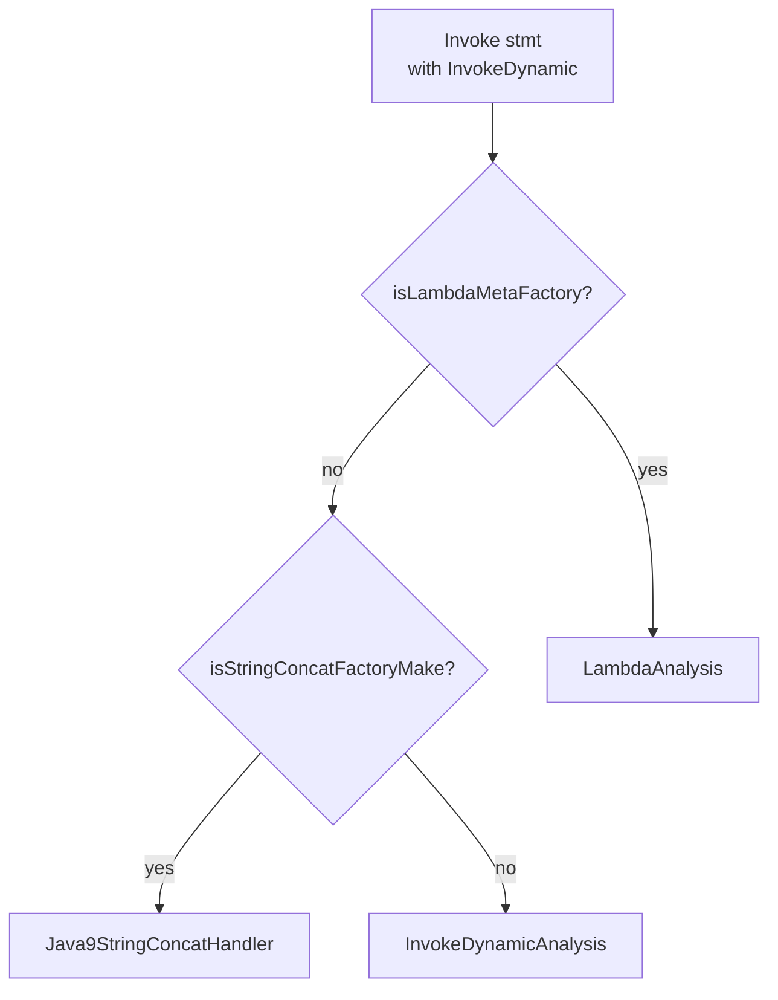
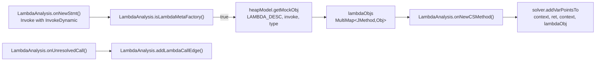
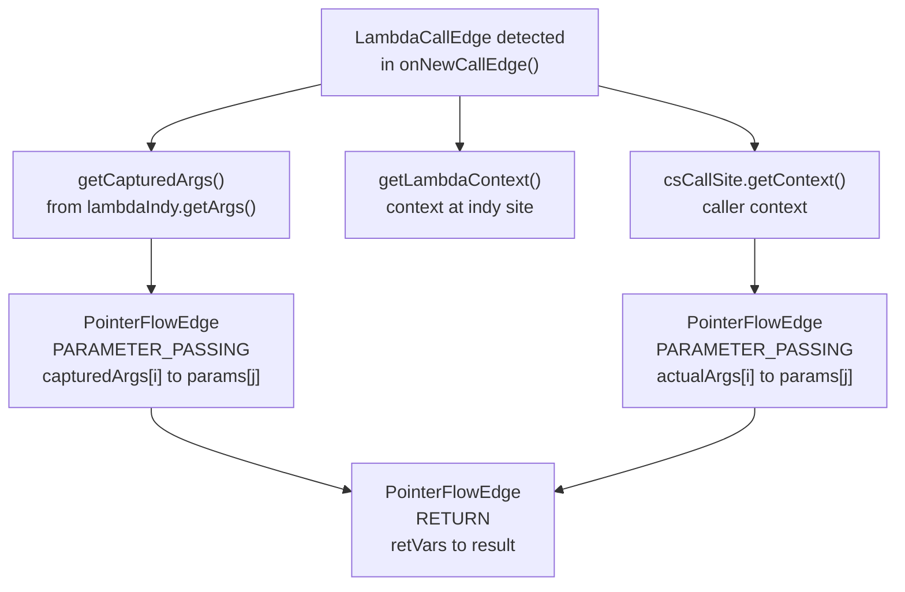
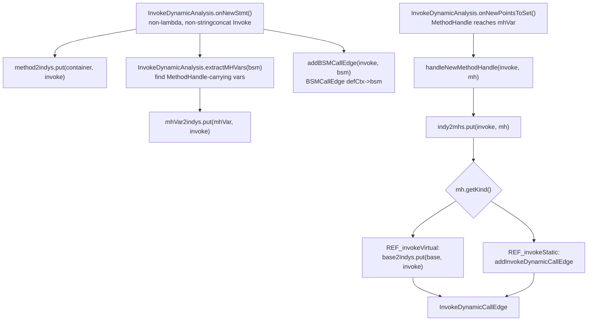
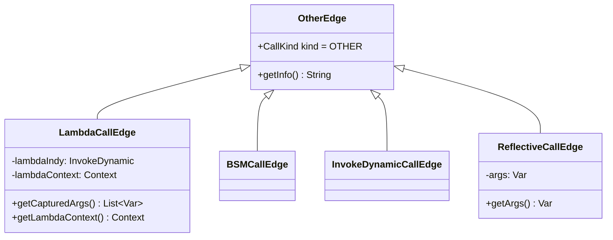

<!-- source: DeepWiki mcp.deepwiki.com · repo pascal-lab/Tai-e · page 7.2 Lambda and Invokedynamic · fetched 2026-10-12 -->

# Lambda and Invokedynamic

Relevant source files

The following files were used as context for generating this wiki page:

- [src/main/java/pascal/taie/analysis/graph/callgraph/OtherEdge.java](src/main/java/pascal/taie/analysis/graph/callgraph/OtherEdge.java)
- [src/main/java/pascal/taie/analysis/pta/plugin/invokedynamic/BSMCallEdge.java](src/main/java/pascal/taie/analysis/pta/plugin/invokedynamic/BSMCallEdge.java)
- [src/main/java/pascal/taie/analysis/pta/plugin/invokedynamic/InvokeDynamicAnalysis.java](src/main/java/pascal/taie/analysis/pta/plugin/invokedynamic/InvokeDynamicAnalysis.java)
- [src/main/java/pascal/taie/analysis/pta/plugin/invokedynamic/InvokeDynamicCallEdge.java](src/main/java/pascal/taie/analysis/pta/plugin/invokedynamic/InvokeDynamicCallEdge.java)
- [src/main/java/pascal/taie/analysis/pta/plugin/invokedynamic/LambdaAnalysis.java](src/main/java/pascal/taie/analysis/pta/plugin/invokedynamic/LambdaAnalysis.java)
- [src/main/java/pascal/taie/analysis/pta/plugin/invokedynamic/LambdaCallEdge.java](src/main/java/pascal/taie/analysis/pta/plugin/invokedynamic/LambdaCallEdge.java)
- [src/main/java/pascal/taie/analysis/pta/plugin/invokedynamic/LookupModel.java](src/main/java/pascal/taie/analysis/pta/plugin/invokedynamic/LookupModel.java)
- [src/main/java/pascal/taie/analysis/pta/plugin/invokedynamic/MethodTypeModel.java](src/main/java/pascal/taie/analysis/pta/plugin/invokedynamic/MethodTypeModel.java)
- [src/main/java/pascal/taie/analysis/pta/plugin/reflection/InferenceModel.java](src/main/java/pascal/taie/analysis/pta/plugin/reflection/InferenceModel.java)
- [src/main/java/pascal/taie/analysis/pta/plugin/reflection/MetaObjHelper.java](src/main/java/pascal/taie/analysis/pta/plugin/reflection/MetaObjHelper.java)
- [src/main/java/pascal/taie/analysis/pta/plugin/reflection/MethodInfo.java](src/main/java/pascal/taie/analysis/pta/plugin/reflection/MethodInfo.java)
- [src/main/java/pascal/taie/analysis/pta/plugin/reflection/ReflectionAnalysis.java](src/main/java/pascal/taie/analysis/pta/plugin/reflection/ReflectionAnalysis.java)
- [src/main/java/pascal/taie/analysis/pta/plugin/reflection/ReflectiveActionModel.java](src/main/java/pascal/taie/analysis/pta/plugin/reflection/ReflectiveActionModel.java)
- [src/main/java/pascal/taie/analysis/pta/plugin/reflection/ReflectiveCallEdge.java](src/main/java/pascal/taie/analysis/pta/plugin/reflection/ReflectiveCallEdge.java)
- [src/main/java/pascal/taie/analysis/pta/plugin/reflection/SolarModel.java](src/main/java/pascal/taie/analysis/pta/plugin/reflection/SolarModel.java)
- [src/main/java/pascal/taie/analysis/pta/plugin/reflection/StringBasedModel.java](src/main/java/pascal/taie/analysis/pta/plugin/reflection/StringBasedModel.java)
- [src/main/java/pascal/taie/analysis/pta/plugin/util/AbstractIRModel.java](src/main/java/pascal/taie/analysis/pta/plugin/util/AbstractIRModel.java)
- [src/main/java/pascal/taie/analysis/pta/plugin/util/AbstractModel.java](src/main/java/pascal/taie/analysis/pta/plugin/util/AbstractModel.java)
- [src/main/java/pascal/taie/analysis/pta/plugin/util/IRModel.java](src/main/java/pascal/taie/analysis/pta/plugin/util/IRModel.java)
- [src/main/java/pascal/taie/analysis/pta/plugin/util/InvokeHandler.java](src/main/java/pascal/taie/analysis/pta/plugin/util/InvokeHandler.java)
- [src/main/java/pascal/taie/analysis/pta/plugin/util/InvokeHandlers.java](src/main/java/pascal/taie/analysis/pta/plugin/util/InvokeHandlers.java)
- [src/main/java/pascal/taie/ir/exp/ExpVisitor.java](src/main/java/pascal/taie/ir/exp/ExpVisitor.java)
- [src/main/java/pascal/taie/ir/exp/InvokeDynamic.java](src/main/java/pascal/taie/ir/exp/InvokeDynamic.java)
- [src/main/java/pascal/taie/ir/exp/MethodHandle.java](src/main/java/pascal/taie/ir/exp/MethodHandle.java)
- [src/main/java/pascal/taie/ir/exp/MethodType.java](src/main/java/pascal/taie/ir/exp/MethodType.java)
- [src/main/java/pascal/taie/ir/exp/PhiExp.java](src/main/java/pascal/taie/ir/exp/PhiExp.java)
- [src/main/java/pascal/taie/ir/stmt/StmtVisitor.java](src/main/java/pascal/taie/ir/stmt/StmtVisitor.java)
- [src/test/resources/pta/lambda/Args-pta-expected.txt](src/test/resources/pta/lambda/Args-pta-expected.txt)
- [src/test/resources/pta/lambda/DispatchBugDueToLackOfSubclassCheck-pta-expected.txt](src/test/resources/pta/lambda/DispatchBugDueToLackOfSubclassCheck-pta-expected.txt)
- [src/test/resources/pta/lambda/ImpreciseLambdas-pta-expected.txt](src/test/resources/pta/lambda/ImpreciseLambdas-pta-expected.txt)
- [src/test/resources/pta/lambda/LambdaConstructor-pta-expected.txt](src/test/resources/pta/lambda/LambdaConstructor-pta-expected.txt)
- [src/test/resources/pta/lambda/LambdaInstanceMethod-pta-expected.txt](src/test/resources/pta/lambda/LambdaInstanceMethod-pta-expected.txt)
- [src/test/resources/pta/lambda/LambdaStaticMethod-pta-expected.txt](src/test/resources/pta/lambda/LambdaStaticMethod-pta-expected.txt)
- [src/test/resources/pta/lambda/NativeModelWithLambda-pta-expected.txt](src/test/resources/pta/lambda/NativeModelWithLambda-pta-expected.txt)

This document covers Tai-e's support for Java lambda expressions and invokedynamic instructions. This includes modeling lambda functional objects, resolving their target methods, and integrating with pointer analysis to build accurate call graphs. For information about method handle modeling and lookup operations, the relevant components are also covered here as they are integral to invokedynamic resolution.

## Overview

All `invokedynamic` instructions in Java bytecode are routed through one of three dedicated handlers in Tai-e. The partitioning happens in `InvokeDynamicAnalysis.getInvokeDynamic()`:

| Invokedynamic Category | Handler Class | Detection Method |
|---|---|---|
| Lambda expressions | `LambdaAnalysis` | `LambdaAnalysis.isLambdaMetaFactory()` |
| Java 9+ string concatenation | `Java9StringConcatHandler` | `Java9StringConcatHandler.isStringConcatFactoryMake()` |
| All other invokedynamic | `InvokeDynamicAnalysis` | (default) |

All three implement the `Plugin` interface and integrate with the pointer analysis solver. The lambda and general invokedynamic analyses share the same `invokedynamic` IR representation (`InvokeDynamic` expression type) but handle different bootstrap method conventions.

**Dispatch overview:**

Sources: [src/main/java/pascal/taie/analysis/pta/plugin/invokedynamic/InvokeDynamicAnalysis.java:206-218](), [src/main/java/pascal/taie/analysis/pta/plugin/invokedynamic/LambdaAnalysis.java:117-132]()

## Lambda Expression Analysis

### Lambda Object Creation and Modeling

`LambdaAnalysis.isLambdaMetaFactory()` identifies lambda meta-factory calls by checking whether the bootstrap method's signature matches `Signatures.LAMBDA_METAFACTORY` or `Signatures.LAMBDA_ALTMETAFACTORY` [src/main/java/pascal/taie/analysis/pta/plugin/invokedynamic/LambdaAnalysis.java:117-132](). When such a call is found in `onNewStmt()`, a `MockObj` with descriptor `LAMBDA_DESC` is created to represent the lambda functional object, using the `invokedynamic` invoke statement as the allocation site and the functional interface type as the object type [src/main/java/pascal/taie/analysis/pta/plugin/invokedynamic/LambdaAnalysis.java:105-115]().

**Lambda object lifecycle in LambdaAnalysis:**

Lambda objects are stored in `lambdaObjs` (`MultiMap<JMethod, Obj>`) [src/main/java/pascal/taie/analysis/pta/plugin/invokedynamic/LambdaAnalysis.java:86-86](). When a context-sensitive method instance becomes reachable via `onNewCSMethod()`, the analysis propagates each lambda object created in that method to the result variable of the invokedynamic call, using the method context as the heap context [src/main/java/pascal/taie/analysis/pta/plugin/invokedynamic/LambdaAnalysis.java:135-148]().

Sources: [src/main/java/pascal/taie/analysis/pta/plugin/invokedynamic/LambdaAnalysis.java:104-148](), [src/main/java/pascal/taie/analysis/pta/plugin/invokedynamic/LambdaAnalysis.java:61-92]()

### Call Resolution and Method Dispatch

Lambda method invocation is handled through `onUnresolvedCall()` [src/main/java/pascal/taie/analysis/pta/plugin/invokedynamic/LambdaAnalysis.java:151-151](). When the solver encounters a call on a receiver object with the `LAMBDA_DESC` descriptor, `LambdaAnalysis` extracts the `MethodHandle` from bootstrap argument index 1 of the original invokedynamic (`getMethodHandle(indy)`) and dispatches on its kind [src/main/java/pascal/taie/analysis/pta/plugin/invokedynamic/LambdaAnalysis.java:166-169]():

| `MethodHandle.Kind` | Target Type | Receiver / Object Handling |
|---|---|---|
| `REF_newInvokeSpecial` | Constructor | Creates `MockObj` with `LAMBDA_NEW_DESC` at invokedynamic allocation site [src/main/java/pascal/taie/analysis/pta/plugin/invokedynamic/LambdaAnalysis.java:170-184]() |
| `REF_invokeInterface` | Instance method | First captured arg (if any) or first actual arg is receiver [src/main/java/pascal/taie/analysis/pta/plugin/invokedynamic/LambdaAnalysis.java:185-188]() |
| `REF_invokeVirtual` | Instance method | First captured arg (if any) or first actual arg is receiver [src/main/java/pascal/taie/analysis/pta/plugin/invokedynamic/LambdaAnalysis.java:185-188]() |
| `REF_invokeSpecial` | Instance method | First captured arg (if any) or first actual arg is receiver [src/main/java/pascal/taie/analysis/pta/plugin/invokedynamic/LambdaAnalysis.java:185-188]() |
| `REF_invokeStatic` | Static method | No receiver; calls `addLambdaCallEdge` with `null` recv [src/main/java/pascal/taie/analysis/pta/plugin/invokedynamic/LambdaAnalysis.java:189-192]() |

After receiver resolution, `addLambdaCallEdge()` dispatches the callee method, selects a context via `ContextSelector.selectContext()`, passes the receiver to `this`, and adds a `LambdaCallEdge` to the solver [src/main/java/pascal/taie/analysis/pta/plugin/invokedynamic/LambdaAnalysis.java:214-253]().

For instance methods, new receiver objects that arrive later are tracked in `invoInfos` (`MultiMap<CSVar, InstanceInvoInfo>`) and handled in `onNewPointsToSet()` [src/main/java/pascal/taie/analysis/pta/plugin/invokedynamic/LambdaAnalysis.java:93-93]().

Sources: [src/main/java/pascal/taie/analysis/pta/plugin/invokedynamic/LambdaAnalysis.java:150-253]()

### Argument Passing via LambdaCallEdge

**Argument passing through LambdaCallEdge in onNewCallEdge():**

`LambdaCallEdge` stores `lambdaIndy` (`InvokeDynamic`) and `lambdaContext` (`Context`) to represent the two argument sources [src/main/java/pascal/taie/analysis/pta/plugin/invokedynamic/LambdaCallEdge.java:39-55](). In `onNewCallEdge()`, the analysis computes shifts (`shiftC` for captured args, `shiftA` for actual args) to skip receiver objects that were already passed to `this`. Pointer flow edges of kind `PARAMETER_PASSING` are added for each argument [src/main/java/pascal/taie/analysis/pta/plugin/invokedynamic/LambdaAnalysis.java:256-324](). The target parameter's declared type is used as the filter type to suppress spurious objects from imprecise lambda object propagation.

Sources: [src/main/java/pascal/taie/analysis/pta/plugin/invokedynamic/LambdaCallEdge.java:39-83](), [src/main/java/pascal/taie/analysis/pta/plugin/invokedynamic/LambdaAnalysis.java:256-324]()

## InvokeDynamic Analysis

### Bootstrap Method Resolution

`InvokeDynamicAnalysis` handles invokedynamic instructions that are neither lambda meta-factory calls nor string concatenation. In `onNewStmt()`, when such an instruction is encountered, the analysis:

1. Records the invokedynamic site in `method2indys` (`MultiMap<JMethod, Invoke>`) [src/main/java/pascal/taie/analysis/pta/plugin/invokedynamic/InvokeDynamicAnalysis.java:191-191]()
2. Calls `extractMHVars()` to find variables in the bootstrap method that may receive a `MethodHandle` (specifically, args to `new *CallSite(target)` or `callSite.setTarget(target)`) [src/main/java/pascal/taie/analysis/pta/plugin/invokedynamic/InvokeDynamicAnalysis.java:192-205]()
3. Adds a `BSMCallEdge` from the default context to the bootstrap method [src/main/java/pascal/taie/analysis/pta/plugin/invokedynamic/InvokeDynamicAnalysis.java:231-231]()

**Bootstrap method argument passing (in onNewCallEdge for BSMCallEdge):**

| Parameter Index | Value Passed |
|---|---|
| `param[0]` | `MethodHandles.Lookup` mock object (`LOOKUP_DESC`) for the calling class [src/main/java/pascal/taie/analysis/pta/plugin/invokedynamic/InvokeDynamicAnalysis.java:264-273]() |
| `param[1]` | `StringLiteral` constant for `indy.getMethodName()` [src/main/java/pascal/taie/analysis/pta/plugin/invokedynamic/InvokeDynamicAnalysis.java:274-275]() |
| `param[2]` | `indy.getMethodType()` as constant object [src/main/java/pascal/taie/analysis/pta/plugin/invokedynamic/InvokeDynamicAnalysis.java:276-277]() |
| `param[3+]` | `ReferenceLiteral` bootstrap args from `indy.getBootstrapArgs()` [src/main/java/pascal/taie/analysis/pta/plugin/invokedynamic/InvokeDynamicAnalysis.java:278-285]() |

**Invokedynamic resolution flow in InvokeDynamicAnalysis:**

Sources: [src/main/java/pascal/taie/analysis/pta/plugin/invokedynamic/InvokeDynamicAnalysis.java:179-261](), [src/main/java/pascal/taie/analysis/pta/plugin/invokedynamic/InvokeDynamicAnalysis.java:264-291](), [src/main/java/pascal/taie/analysis/pta/plugin/invokedynamic/InvokeDynamicAnalysis.java:371-427]()

### Method Handle Tracking

The analysis maintains three maps to track the relationship between variables, method handles, and invokedynamic sites:

| Field | Type | Purpose |
|---|---|---|
| `mhVar2indys` | `MultiMap<Var, Invoke>` | Maps BSM variables that may hold `MethodHandle` to their associated invokedynamic sites [src/main/java/pascal/taie/analysis/pta/plugin/invokedynamic/InvokeDynamicAnalysis.java:125-125]() |
| `indy2mhs` | `MultiMap<Invoke, MethodHandle>` | Maps invokedynamic sites to discovered `MethodHandle` objects [src/main/java/pascal/taie/analysis/pta/plugin/invokedynamic/InvokeDynamicAnalysis.java:132-132]() |
| `base2Indys` | `MultiMap<Var, Invoke>` | Maps base (receiver) variables to invokedynamic sites for virtual dispatch [src/main/java/pascal/taie/analysis/pta/plugin/invokedynamic/InvokeDynamicAnalysis.java:139-139]() |

When new `MethodHandle` objects are discovered in `onNewPointsToSet()`, `handleNewMethodHandle()` is called [src/main/java/pascal/taie/analysis/pta/plugin/invokedynamic/InvokeDynamicAnalysis.java:346-350](). For `REF_invokeVirtual`, the base variable is tracked in `base2Indys` and existing receiver objects are iterated to build call edges immediately [src/main/java/pascal/taie/analysis/pta/plugin/invokedynamic/InvokeDynamicAnalysis.java:393-413](). For `REF_invokeStatic`, the call edge is added directly [src/main/java/pascal/taie/analysis/pta/plugin/invokedynamic/InvokeDynamicAnalysis.java:414-418](). New receiver objects arriving later are handled again in `onNewPointsToSet()` [src/main/java/pascal/taie/analysis/pta/plugin/invokedynamic/InvokeDynamicAnalysis.java:351-369]().

Sources: [src/main/java/pascal/taie/analysis/pta/plugin/invokedynamic/InvokeDynamicAnalysis.java:111-140](), [src/main/java/pascal/taie/analysis/pta/plugin/invokedynamic/InvokeDynamicAnalysis.java:340-427]()

## MethodTypeModel

`MethodTypeModel` models calls to `java.lang.invoke.MethodType.methodType(*)`. It extends `AnalysisModelPlugin` and uses `@InvokeHandler` annotations to register handlers for three overloads [src/main/java/pascal/taie/analysis/pta/plugin/invokedynamic/MethodTypeModel.java:42-42]():

| Modeled Method Signature | Handler | Result |
|---|---|---|
| `methodType(Class)` | `methodType1Class` | `MethodType` with no params, given return type [src/main/java/pascal/taie/analysis/pta/plugin/invokedynamic/MethodTypeModel.java:48-61]() |
| `methodType(Class, Class)` | `methodType2Classes` | `MethodType` with one param, given return type [src/main/java/pascal/taie/analysis/pta/plugin/invokedynamic/MethodTypeModel.java:63-82]() |
| `methodType(Class, MethodType)` | `methodTypeClassMT` | `MethodType` combining a new return type with existing param types [src/main/java/pascal/taie/analysis/pta/plugin/invokedynamic/MethodTypeModel.java:84-103]() |

Each handler reads `Class` objects from the points-to set using `CSObjs.toType()`, constructs a `MethodType` value via `MethodType.get(...)`, and adds the result as a constant object via `heapModel.getConstantObj(mt)`.

Note: In the current implementation, `methodTypeModel` inside `InvokeDynamicAnalysis` is set to `Plugin.DUMMY` (disabled by default) [src/main/java/pascal/taie/analysis/pta/plugin/invokedynamic/InvokeDynamicAnalysis.java:175-175]().

Sources: [src/main/java/pascal/taie/analysis/pta/plugin/invokedynamic/MethodTypeModel.java:1-104](), [src/main/java/pascal/taie/analysis/pta/plugin/invokedynamic/InvokeDynamicAnalysis.java:173-177]()

## LookupModel

`LookupModel` models the `java.lang.invoke.MethodHandles$Lookup.find*(...)` family of methods, which are used to obtain `MethodHandle` objects programmatically. It extends `AnalysisModelPlugin` [src/main/java/pascal/taie/analysis/pta/plugin/invokedynamic/LookupModel.java:49-49]().

| Modeled Method | Handler | Produces |
|---|---|---|
| `findConstructor(Class, MethodType)` | `findConstructor` | `MethodHandle` with kind `REF_newInvokeSpecial` for each declared constructor [src/main/java/pascal/taie/analysis/pta/plugin/invokedynamic/LookupModel.java:55-71]() |
| `findVirtual(Class, String, MethodType)` | `findVirtual` | `MethodHandle` with kind `REF_invokeVirtual` for matching non-static methods [src/main/java/pascal/taie/analysis/pta/plugin/invokedynamic/LookupModel.java:73-81]() |
| `findStatic(Class, String, MethodType)` | `findStatic` | `MethodHandle` with kind `REF_invokeStatic` for matching static methods [src/main/java/pascal/taie/analysis/pta/plugin/invokedynamic/LookupModel.java:83-91]() |

Each handler reads the class object via `CSObjs.toClass()` and the method name via `CSObjs.toString()`, then looks up matching methods using `Reflections.getDeclaredConstructors()` or `Reflections.getDeclaredMethods()`. For each found method, it calls `MethodHandle.get(kind, method.getRef())` and adds the result via `heapModel.getConstantObj()` [src/main/java/pascal/taie/analysis/pta/plugin/invokedynamic/LookupModel.java:93-115]().

`LookupModel` is instantiated and activated within `InvokeDynamicAnalysis.setSolver()` [src/main/java/pascal/taie/analysis/pta/plugin/invokedynamic/InvokeDynamicAnalysis.java:176-176](). Its `onNewStmt` and `onNewPointsToSet` events are forwarded from `InvokeDynamicAnalysis` [src/main/java/pascal/taie/analysis/pta/plugin/invokedynamic/InvokeDynamicAnalysis.java:185-185], [src/main/java/pascal/taie/analysis/pta/plugin/invokedynamic/InvokeDynamicAnalysis.java:342-342]().

Sources: [src/main/java/pascal/taie/analysis/pta/plugin/invokedynamic/LookupModel.java:1-116](), [src/main/java/pascal/taie/analysis/pta/plugin/invokedynamic/InvokeDynamicAnalysis.java:175-177](), [src/main/java/pascal/taie/analysis/pta/plugin/invokedynamic/InvokeDynamicAnalysis.java:183-186](), [src/main/java/pascal/taie/analysis/pta/plugin/invokedynamic/InvokeDynamicAnalysis.java:342-344]()

## Call Edge Types

The lambda and invokedynamic analyses define specialized call edge types, all extending `OtherEdge<CSCallSite, CSMethod>` [src/main/java/pascal/taie/analysis/graph/callgraph/OtherEdge.java:32-32]():

**Call edge class hierarchy:**

| Edge Class | Created By | Purpose |
|---|---|---|
| `LambdaCallEdge` | `LambdaAnalysis.addLambdaCallEdge()` | Call from an invocation site on a lambda object to its target method [src/main/java/pascal/taie/analysis/pta/plugin/invokedynamic/LambdaCallEdge.java:39-55]() |
| `BSMCallEdge` | `InvokeDynamicAnalysis.addBSMCallEdge()` | Call from an invokedynamic site to its bootstrap method [src/main/java/pascal/taie/analysis/pta/plugin/invokedynamic/BSMCallEdge.java:32-37]() |
| `InvokeDynamicCallEdge` | `InvokeDynamicAnalysis.addInvokeDynamicCallEdge()` | Call from an invokedynamic site to the resolved target method after bootstrap completes [src/main/java/pascal/taie/analysis/pta/plugin/invokedynamic/InvokeDynamicCallEdge.java:32-37]() |
| `ReflectiveCallEdge` | `ReflectiveActionModel.addReflectiveCallEdge()` | Call from a reflective invocation (e.g. `Method.invoke`) to the reflectively resolved target [src/main/java/pascal/taie/analysis/pta/plugin/reflection/ReflectiveCallEdge.java:35-55]() |

Each edge type is recognized in the corresponding `onNewCallEdge()` handler via `instanceof` checks, triggering the appropriate argument-passing logic.

Sources: [src/main/java/pascal/taie/analysis/graph/callgraph/OtherEdge.java:32-48](), [src/main/java/pascal/taie/analysis/pta/plugin/invokedynamic/LambdaCallEdge.java:39-83](), [src/main/java/pascal/taie/analysis/pta/plugin/invokedynamic/BSMCallEdge.java:32-37](), [src/main/java/pascal/taie/analysis/pta/plugin/invokedynamic/InvokeDynamicCallEdge.java:32-37](), [src/main/java/pascal/taie/analysis/pta/plugin/reflection/ReflectiveCallEdge.java:35-55]()

## Integration with Pointer Analysis

### Plugin Architecture Integration

Both `LambdaAnalysis` and `InvokeDynamicAnalysis` implement the `Plugin` interface and integrate with Tai-e's pointer analysis framework [src/main/java/pascal/taie/analysis/pta/plugin/invokedynamic/LambdaAnalysis.java:61-61], [src/main/java/pascal/taie/analysis/pta/plugin/invokedynamic/InvokeDynamicAnalysis.java:73-73](). They register callbacks for new statements, new context-sensitive methods, and new points-to sets to incrementally build call graphs as the analysis progresses.

The analyses coordinate with the pointer analysis solver to:
- Add call edges when lambda objects or method handles are resolved.
- Propagate objects to appropriate variables based on call semantics.
- Create mock objects for lambda instances and constructed objects.
- Manage context sensitivity for both lambda creation and invocation sites.

Sources: [src/main/java/pascal/taie/analysis/pta/plugin/invokedynamic/LambdaAnalysis.java:95-103](), [src/main/java/pascal/taie/analysis/pta/plugin/invokedynamic/InvokeDynamicAnalysis.java:161-177]()

### Conditional Analysis Enablement

The `InvokeDynamicAnalysis` includes the `useMethodHandle()` method to determine whether invokedynamic support is needed for a particular program by checking if `java.lang.invoke.MethodHandle` is loaded in the class hierarchy [src/main/java/pascal/taie/analysis/pta/plugin/invokedynamic/InvokeDynamicAnalysis.java:155-159]().

Sources: [src/main/java/pascal/taie/analysis/pta/plugin/invokedynamic/InvokeDynamicAnalysis.java:155-159]()

---

