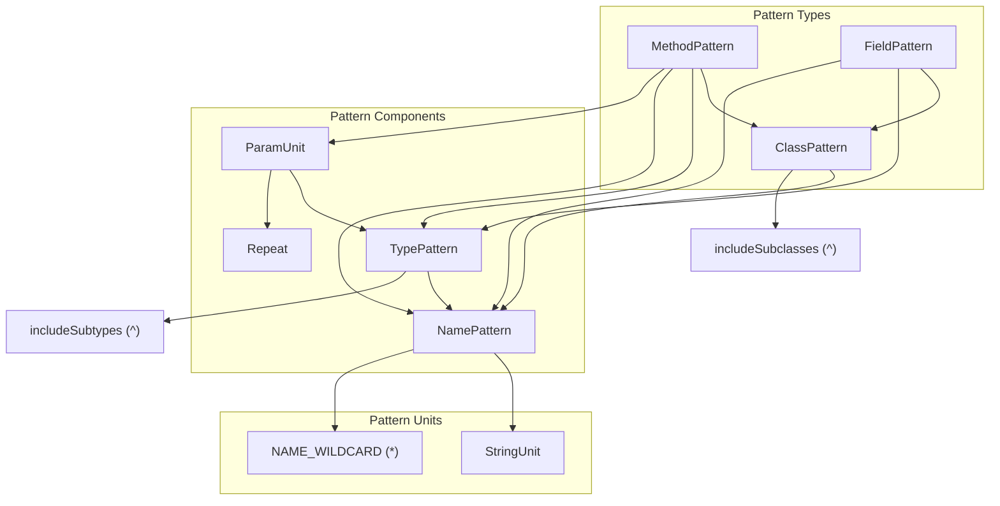
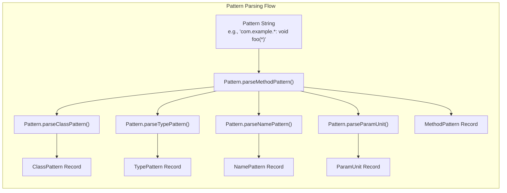
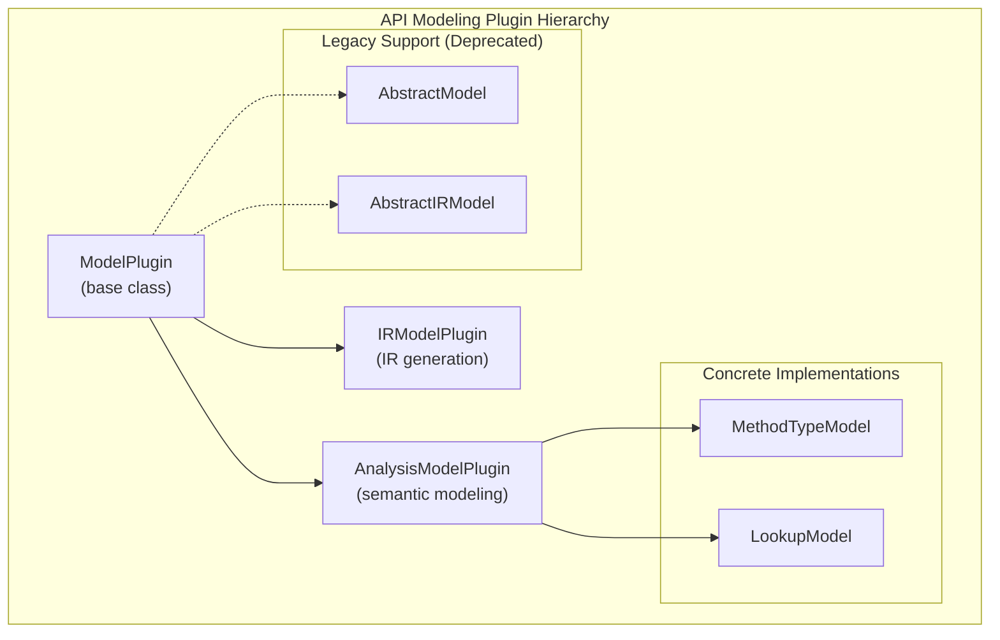
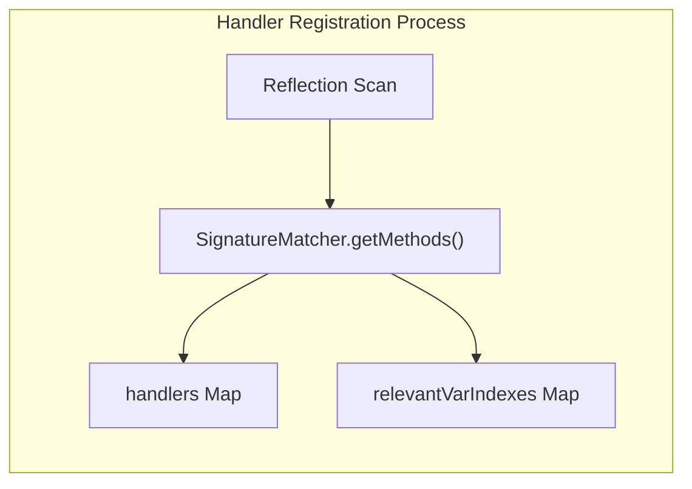

<!-- source: DeepWiki mcp.deepwiki.com · repo pascal-lab/Tai-e · page 7.3 Pattern Matching and API Modeling · fetched 2026-10-12 -->

# Pattern Matching and API Modeling

<details>
<summary>Relevant source files</summary>

The following files were used as context for generating this wiki page:

- [src/main/java/pascal/taie/analysis/pta/plugin/invokedynamic/LookupModel.java](src/main/java/pascal/taie/analysis/pta/plugin/invokedynamic/LookupModel.java)
- [src/main/java/pascal/taie/analysis/pta/plugin/invokedynamic/MethodTypeModel.java](src/main/java/pascal/taie/analysis/pta/plugin/invokedynamic/MethodTypeModel.java)
- [src/main/java/pascal/taie/analysis/pta/plugin/util/AbstractIRModel.java](src/main/java/pascal/taie/analysis/pta/plugin/util/AbstractIRModel.java)
- [src/main/java/pascal/taie/analysis/pta/plugin/util/AbstractModel.java](src/main/java/pascal/taie/analysis/pta/plugin/util/AbstractModel.java)
- [src/main/java/pascal/taie/analysis/pta/plugin/util/AnalysisModelPlugin.java](src/main/java/pascal/taie/analysis/pta/plugin/util/AnalysisModelPlugin.java)
- [src/main/java/pascal/taie/analysis/pta/plugin/util/IRModel.java](src/main/java/pascal/taie/analysis/pta/plugin/util/IRModel.java)
- [src/main/java/pascal/taie/analysis/pta/plugin/util/IRModelPlugin.java](src/main/java/pascal/taie/analysis/pta/plugin/util/IRModelPlugin.java)
- [src/main/java/pascal/taie/analysis/pta/plugin/util/InvokeHandler.java](src/main/java/pascal/taie/analysis/pta/plugin/util/InvokeHandler.java)
- [src/main/java/pascal/taie/analysis/pta/plugin/util/InvokeHandlers.java](src/main/java/pascal/taie/analysis/pta/plugin/util/InvokeHandlers.java)
- [src/main/java/pascal/taie/analysis/pta/plugin/util/Model.java](src/main/java/pascal/taie/analysis/pta/plugin/util/Model.java)
- [src/main/java/pascal/taie/analysis/pta/plugin/util/ModelPlugin.java](src/main/java/pascal/taie/analysis/pta/plugin/util/ModelPlugin.java)
- [src/main/java/pascal/taie/ir/stmt/FieldStmt.java](src/main/java/pascal/taie/ir/stmt/FieldStmt.java)
- [src/main/java/pascal/taie/language/classes/Pattern.java](src/main/java/pascal/taie/language/classes/Pattern.java)
- [src/main/java/pascal/taie/language/classes/SignatureMatcher.java](src/main/java/pascal/taie/language/classes/SignatureMatcher.java)
- [src/test/java/pascal/taie/language/classes/PatternTest.java](src/test/java/pascal/taie/language/classes/PatternTest.java)
- [src/test/java/pascal/taie/language/classes/SignatureMatcherTest.java](src/test/java/pascal/taie/language/classes/SignatureMatcherTest.java)
- [src/test/resources/sigmatcher/com/example/X.java](src/test/resources/sigmatcher/com/example/X.java)
- [src/test/resources/sigmatcher/com/example/X1.java](src/test/resources/sigmatcher/com/example/X1.java)
- [src/test/resources/sigmatcher/com/example/XFather.java](src/test/resources/sigmatcher/com/example/XFather.java)
- [src/test/resources/sigmatcher/com/example/Y.java](src/test/resources/sigmatcher/com/example/Y.java)
- [src/test/resources/sigmatcher/com/example1/X.java](src/test/resources/sigmatcher/com/example1/X.java)
- [src/test/resources/sigmatcher/com/example1/X1.java](src/test/resources/sigmatcher/com/example1/X1.java)

</details>


This section describes Tai-e's pattern matching system for class, method, and field signatures, and the API modeling framework that extends analysis capabilities by modeling the behavior of specific APIs. The pattern matching system provides flexible signature matching using wildcards and inheritance relationships, while the API modeling framework allows plugins to inject custom semantics into pointer analysis.

For information about the broader plugin system, see [Plugin System](#3.3). For details about reflection analysis which heavily uses these patterns, see [Reflection Analysis](#7.1).

## Pattern Matching System

Tai-e provides a sophisticated pattern matching system for matching Java signatures using wildcards and inheritance relationships. This system is primarily used for configuring analyses and defining API models.

### Pattern Syntax and Structure

The pattern system supports three main types of patterns defined in `pascal.taie.language.classes.Pattern` [src/main/java/pascal/taie/language/classes/Pattern.java:39-306]():



**Pattern Syntax Elements:**

| Element | Symbol | Description |
|---------|--------|-------------|
| Wildcard | `*` | Matches any sequence of characters [src/main/java/pascal/taie/language/classes/Pattern.java:43-43]() |
| Subclass/Subtype | `^` | Include all subclasses/subtypes [src/main/java/pascal/taie/language/classes/Pattern.java:41-41]() |
| Parameter repetition | `{N}` | Exact count of parameters [src/main/java/pascal/taie/language/classes/Pattern.java:271-271]() |
| Parameter range | `{N-M}` | Range of parameter counts [src/main/java/pascal/taie/language/classes/Pattern.java:273-273]() |
| Parameter minimum | `{N+}` | At least N parameters [src/main/java/pascal/taie/language/classes/Pattern.java:275-275]() |

**Example Patterns:**
- Class: `com.example.*^` (all classes in com.example package and subclasses) [src/test/java/pascal/taie/language/classes/PatternTest.java:105-106]()
- Method: `<com.example.*: int foo(java.lang.String,*{0+})>` (foo methods with String first parameter and any additional parameters) [src/test/java/pascal/taie/language/classes/PatternTest.java:164-165]()
- Field: `<*: java.util.Collection^ field*>` (fields of Collection subtypes with names starting with "field") [src/main/java/pascal/taie/language/classes/Pattern.java:214-232]()

Sources: [src/main/java/pascal/taie/language/classes/Pattern.java:39-306](), [src/test/java/pascal/taie/language/classes/PatternTest.java:61-185]()

### Pattern Parsing and Matching

The pattern parsing process converts string patterns into structured pattern objects using static methods like `parseMethodPattern` [src/main/java/pascal/taie/language/classes/Pattern.java:137-158]():



The `SignatureMatcher` class [src/main/java/pascal/taie/language/classes/SignatureMatcher.java:40-249]() uses these parsed patterns to match against actual program elements by resolving names and types within the `World`'s class hierarchy.

Sources: [src/main/java/pascal/taie/language/classes/Pattern.java:48-232](), [src/main/java/pascal/taie/language/classes/SignatureMatcher.java:40-249]()

## API Modeling Framework

The API modeling framework allows plugins to define custom semantics for specific APIs during pointer analysis. This is essential for handling complex library APIs that cannot be analyzed precisely using standard flow-sensitive analysis.

### Plugin Architecture Overview

Tai-e provides a hierarchical structure for modeling plugins, rooted at `ModelPlugin` [src/main/java/pascal/taie/analysis/pta/plugin/util/ModelPlugin.java:35-54]():



The framework provides two main approaches for API modeling:
1. **Analysis Model Plugins**: Analyze API semantics and directly manipulate points-to sets [src/main/java/pascal/taie/analysis/pta/plugin/util/AnalysisModelPlugin.java:52-54]().
2. **IR Model Plugins**: Generate equivalent IR statements to model API behavior [src/main/java/pascal/taie/analysis/pta/plugin/util/IRModelPlugin.java:49-51]().

Sources: [src/main/java/pascal/taie/analysis/pta/plugin/util/ModelPlugin.java:35-54](), [src/main/java/pascal/taie/analysis/pta/plugin/util/AnalysisModelPlugin.java:52-54](), [src/main/java/pascal/taie/analysis/pta/plugin/util/IRModelPlugin.java:49-51]()

### Analysis Model Plugins

`AnalysisModelPlugin` [src/main/java/pascal/taie/analysis/pta/plugin/util/AnalysisModelPlugin.java:52-169]() directly manipulates the analysis state when specific API methods are invoked. They use the `@InvokeHandler` annotation to specify which methods to handle.

**Mechanism:**
- **Statement Tracking**: On `onNewStmt`, the plugin identifies calls to modeled APIs and tracks the `Var` objects at those call sites [src/main/java/pascal/taie/analysis/pta/plugin/util/AnalysisModelPlugin.java:102-114]().
- **Points-to Updates**: When the points-to set of a tracked `Var` changes, `onNewPointsToSet` triggers the registered handler [src/main/java/pascal/taie/analysis/pta/plugin/util/AnalysisModelPlugin.java:117-126]().

**Example Handler (MethodTypeModel):**
```java
@InvokeHandler(signature = "<java.lang.invoke.MethodType: java.lang.invoke.MethodType methodType(java.lang.Class)>", argIndexes = {0})
public void methodType1Class(Context context, Invoke invoke, PointsToSet clsObjs) {
    // Logic to create MethodType objects and add to points-to set
}
```
Sources: [src/main/java/pascal/taie/analysis/pta/plugin/util/AnalysisModelPlugin.java:52-169](), [src/main/java/pascal/taie/analysis/pta/plugin/invokedynamic/MethodTypeModel.java:42-104]()

### IR Model Plugins

`IRModelPlugin` [src/main/java/pascal/taie/analysis/pta/plugin/util/IRModelPlugin.java:49-133]() generates semantically-equivalent IR statements to replace API calls.

**Key Components:**
- **Method Masking**: Modeled APIs are added to the solver's ignored methods list [src/main/java/pascal/taie/analysis/pta/plugin/util/IRModelPlugin.java:95-97]().
- **Statement Injection**: When a call to a modeled API is found, the handler generates a `Collection<Stmt>` which is then associated with the container method [src/main/java/pascal/taie/analysis/pta/plugin/util/IRModelPlugin.java:100-115]().
- **Context Handling**: When a context-sensitive method is created, the generated statements are added to that specific `CSMethod` in the solver [src/main/java/pascal/taie/analysis/pta/plugin/util/IRModelPlugin.java:127-132]().

Sources: [src/main/java/pascal/taie/analysis/pta/plugin/util/IRModelPlugin.java:49-133]()

### InvokeHandler Annotation System

The `InvokeHandler` annotation [src/main/java/pascal/taie/analysis/pta/plugin/util/InvokeHandler.java:39-52]() provides a declarative way to specify which API methods a plugin should handle.

| Attribute | Type | Description |
|-----------|------|-------------|
| `signature` | `String[]` | Method signature patterns to match [src/main/java/pascal/taie/analysis/pta/plugin/util/InvokeHandler.java:46-46]() |
| `argIndexes` | `int[]` | Argument indexes (including receiver at -1) used by the handler [src/main/java/pascal/taie/analysis/pta/plugin/util/InvokeHandler.java:51-51]() |

**Registration Logic:**
The `ModelPlugin.registerHandlers()` method uses reflection to find annotated methods and uses `SignatureMatcher` to resolve the patterns against the actual `JMethod` objects in the program [src/main/java/pascal/taie/analysis/pta/plugin/util/AnalysisModelPlugin.java:66-80]().



Sources: [src/main/java/pascal/taie/analysis/pta/plugin/util/InvokeHandler.java:39-52](), [src/main/java/pascal/taie/analysis/pta/plugin/util/AnalysisModelPlugin.java:66-80](), [src/main/java/pascal/taie/analysis/pta/plugin/util/IRModelPlugin.java:61-74]()

## Integration with Pointer Analysis

Modeling plugins integrate with the `Solver` through the standard plugin lifecycle. 

- **Initialization**: `AnalysisModelPlugin` and `IRModelPlugin` validate handler method signatures (e.g., checking if parameters are `Context`, `Invoke`, and `PointsToSet`) [src/main/java/pascal/taie/analysis/pta/plugin/util/AnalysisModelPlugin.java:85-99]().
- **Data Flow**: `AnalysisModelPlugin` uses `getArgs` to fetch the current points-to sets of relevant variables from the `Solver` when a handler is triggered [src/main/java/pascal/taie/analysis/pta/plugin/util/AnalysisModelPlugin.java:154-168]().
- **Legacy Support**: Deprecated classes like `AbstractModel` [src/main/java/pascal/taie/analysis/pta/plugin/util/AbstractModel.java:52-180]() and `AbstractIRModel` [src/main/java/pascal/taie/analysis/pta/plugin/util/AbstractIRModel.java:52-156]() use `LambdaMetafactory` to create high-performance handlers, but have been replaced by the more robust `ModelPlugin` hierarchy.

Sources: [src/main/java/pascal/taie/analysis/pta/plugin/util/AnalysisModelPlugin.java:85-168](), [src/main/java/pascal/taie/analysis/pta/plugin/util/AbstractModel.java:52-180](), [src/main/java/pascal/taie/analysis/pta/plugin/util/AbstractIRModel.java:52-156]()

---

