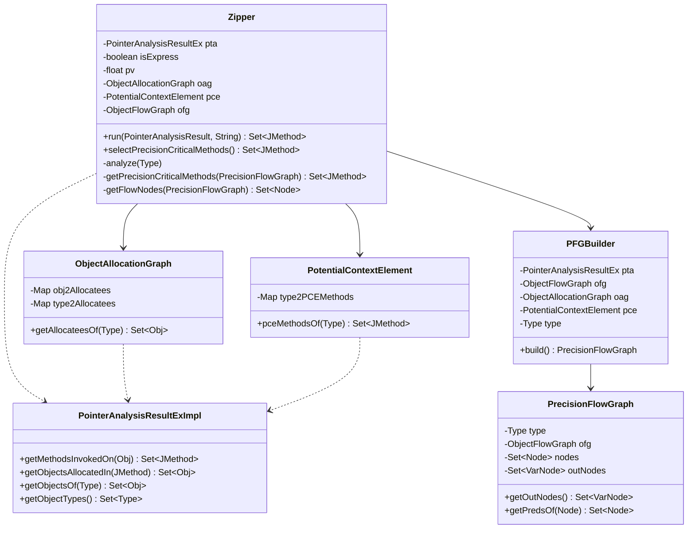
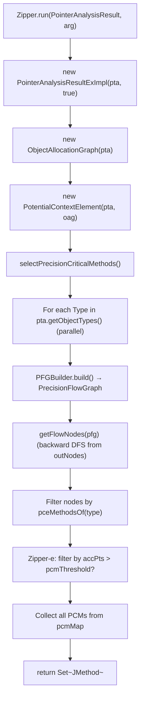
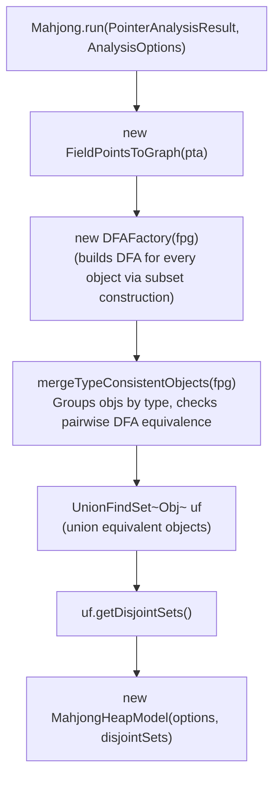
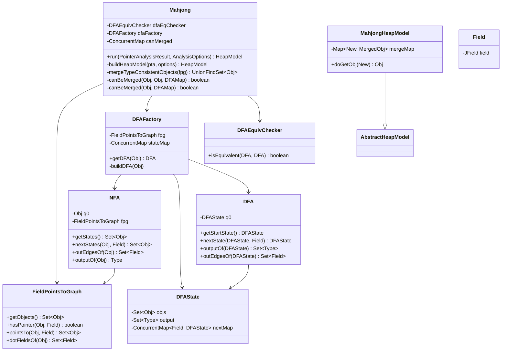
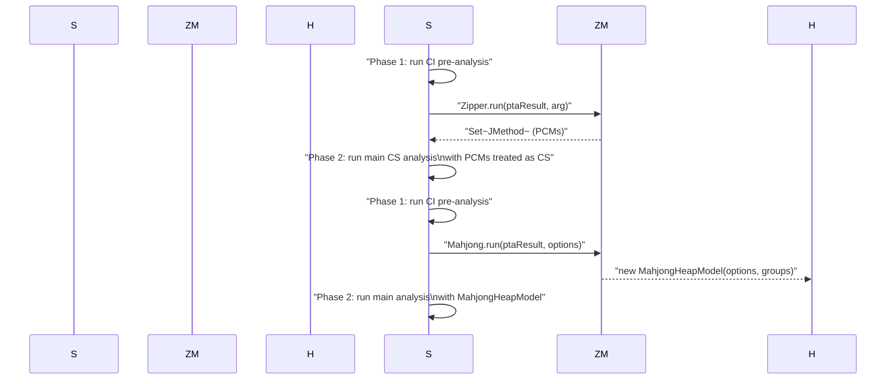

<!-- source: DeepWiki mcp.deepwiki.com · repo pascal-lab/Tai-e · page 7.4 Zipper and Mahjong · fetched 2026-10-12 -->

# Zipper and Mahjong

<details>
<summary>Relevant source files</summary>

The following files were used as context for generating this wiki page:

- [src/main/java/pascal/taie/analysis/deadcode/DeadCodeDetection.java](src/main/java/pascal/taie/analysis/deadcode/DeadCodeDetection.java)
- [src/main/java/pascal/taie/analysis/graph/flowgraph/Node.java](src/main/java/pascal/taie/analysis/graph/flowgraph/Node.java)
- [src/main/java/pascal/taie/analysis/pta/plugin/assertion/AssertionChecker.java](src/main/java/pascal/taie/analysis/pta/plugin/assertion/AssertionChecker.java)
- [src/main/java/pascal/taie/analysis/pta/plugin/assertion/Checker.java](src/main/java/pascal/taie/analysis/pta/plugin/assertion/Checker.java)
- [src/main/java/pascal/taie/analysis/pta/plugin/assertion/Checkers.java](src/main/java/pascal/taie/analysis/pta/plugin/assertion/Checkers.java)
- [src/main/java/pascal/taie/analysis/pta/plugin/assertion/Result.java](src/main/java/pascal/taie/analysis/pta/plugin/assertion/Result.java)
- [src/main/java/pascal/taie/analysis/pta/toolkit/PointerAnalysisResultEx.java](src/main/java/pascal/taie/analysis/pta/toolkit/PointerAnalysisResultEx.java)
- [src/main/java/pascal/taie/analysis/pta/toolkit/PointerAnalysisResultExImpl.java](src/main/java/pascal/taie/analysis/pta/toolkit/PointerAnalysisResultExImpl.java)
- [src/main/java/pascal/taie/analysis/pta/toolkit/mahjong/DFA.java](src/main/java/pascal/taie/analysis/pta/toolkit/mahjong/DFA.java)
- [src/main/java/pascal/taie/analysis/pta/toolkit/mahjong/DFAEquivChecker.java](src/main/java/pascal/taie/analysis/pta/toolkit/mahjong/DFAEquivChecker.java)
- [src/main/java/pascal/taie/analysis/pta/toolkit/mahjong/DFAFactory.java](src/main/java/pascal/taie/analysis/pta/toolkit/mahjong/DFAFactory.java)
- [src/main/java/pascal/taie/analysis/pta/toolkit/mahjong/DFAState.java](src/main/java/pascal/taie/analysis/pta/toolkit/mahjong/DFAState.java)
- [src/main/java/pascal/taie/analysis/pta/toolkit/mahjong/Field.java](src/main/java/pascal/taie/analysis/pta/toolkit/mahjong/Field.java)
- [src/main/java/pascal/taie/analysis/pta/toolkit/mahjong/FieldPointsToGraph.java](src/main/java/pascal/taie/analysis/pta/toolkit/mahjong/FieldPointsToGraph.java)
- [src/main/java/pascal/taie/analysis/pta/toolkit/mahjong/Mahjong.java](src/main/java/pascal/taie/analysis/pta/toolkit/mahjong/Mahjong.java)
- [src/main/java/pascal/taie/analysis/pta/toolkit/mahjong/MahjongHeapModel.java](src/main/java/pascal/taie/analysis/pta/toolkit/mahjong/MahjongHeapModel.java)
- [src/main/java/pascal/taie/analysis/pta/toolkit/mahjong/NFA.java](src/main/java/pascal/taie/analysis/pta/toolkit/mahjong/NFA.java)
- [src/main/java/pascal/taie/analysis/pta/toolkit/scaler/ContextComputer.java](src/main/java/pascal/taie/analysis/pta/toolkit/scaler/ContextComputer.java)
- [src/main/java/pascal/taie/analysis/pta/toolkit/scaler/Scaler.java](src/main/java/pascal/taie/analysis/pta/toolkit/scaler/Scaler.java)
- [src/main/java/pascal/taie/analysis/pta/toolkit/scaler/_1ObjContextComputer.java](src/main/java/pascal/taie/analysis/pta/toolkit/scaler/_1ObjContextComputer.java)
- [src/main/java/pascal/taie/analysis/pta/toolkit/scaler/_1TypeContextComputer.java](src/main/java/pascal/taie/analysis/pta/toolkit/scaler/_1TypeContextComputer.java)
- [src/main/java/pascal/taie/analysis/pta/toolkit/scaler/_2ObjContextComputer.java](src/main/java/pascal/taie/analysis/pta/toolkit/scaler/_2ObjContextComputer.java)
- [src/main/java/pascal/taie/analysis/pta/toolkit/scaler/_2TypeContextComputer.java](src/main/java/pascal/taie/analysis/pta/toolkit/scaler/_2TypeContextComputer.java)
- [src/main/java/pascal/taie/analysis/pta/toolkit/scaler/_InsensitiveContextComputer.java](src/main/java/pascal/taie/analysis/pta/toolkit/scaler/_InsensitiveContextComputer.java)
- [src/main/java/pascal/taie/analysis/pta/toolkit/util/OAGs.java](src/main/java/pascal/taie/analysis/pta/toolkit/util/OAGs.java)
- [src/main/java/pascal/taie/analysis/pta/toolkit/zipper/ObjectAllocationGraph.java](src/main/java/pascal/taie/analysis/pta/toolkit/zipper/ObjectAllocationGraph.java)
- [src/main/java/pascal/taie/analysis/pta/toolkit/zipper/PFGBuilder.java](src/main/java/pascal/taie/analysis/pta/toolkit/zipper/PFGBuilder.java)
- [src/main/java/pascal/taie/analysis/pta/toolkit/zipper/PotentialContextElement.java](src/main/java/pascal/taie/analysis/pta/toolkit/zipper/PotentialContextElement.java)
- [src/main/java/pascal/taie/analysis/pta/toolkit/zipper/PrecisionFlowGraph.java](src/main/java/pascal/taie/analysis/pta/toolkit/zipper/PrecisionFlowGraph.java)
- [src/main/java/pascal/taie/analysis/pta/toolkit/zipper/Zipper.java](src/main/java/pascal/taie/analysis/pta/toolkit/zipper/Zipper.java)
- [src/main/java/pascal/taie/util/Canonicalizer.java](src/main/java/pascal/taie/util/Canonicalizer.java)
- [src/main/java/pascal/taie/util/collection/UnionFindSet.java](src/main/java/pascal/taie/util/collection/UnionFindSet.java)
- [src/main/java/pascal/taie/util/graph/TopologicalSorter.java](src/main/java/pascal/taie/util/graph/TopologicalSorter.java)
- [src/test/java/pascal/taie/analysis/pta/PointerAnalysisResultTest.java](src/test/java/pascal/taie/analysis/pta/PointerAnalysisResultTest.java)
- [src/test/java/pascal/taie/analysis/pta/toolkit/mahjong/MahjongTest.java](src/test/java/pascal/taie/analysis/pta/toolkit/mahjong/MahjongTest.java)
- [src/test/java/pascal/taie/analysis/pta/toolkit/zipper/ZipperTest.java](src/test/java/pascal/taie/analysis/pta/toolkit/zipper/ZipperTest.java)
- [src/test/resources/pta/PTAAssert.java](src/test/resources/pta/PTAAssert.java)
- [src/test/resources/pta/toolkit/mahjong/Mahjong.java](src/test/resources/pta/toolkit/mahjong/Mahjong.java)
- [src/test/resources/pta/toolkit/mahjong/MultipleZeroLengthArrays.java](src/test/resources/pta/toolkit/mahjong/MultipleZeroLengthArrays.java)

</details>


This page documents two precision-tuning toolkit algorithms that run as post-processors on a context-insensitive (CI) pre-analysis and feed results back into the main pointer analysis: **Zipper**, which selects precision-critical methods to analyze context-sensitively, and **Mahjong**, which builds a DFA-equivalence-based heap model that merges indistinguishable heap objects. Both live under `src/main/java/pascal/taie/analysis/pta/toolkit/`.

For how these are enabled as PTA configuration options (`advanced:zipper`, `advanced:zipper-e`, `advanced:mahjong`), see the pointer analysis configuration page [3.1](). For the heap model abstraction they extend, see the heap model page [3.4]().

---

## Zipper

### Purpose

Zipper identifies which methods are *precision-critical*, i.e., analyzing them context-sensitively has a meaningful impact on analysis precision. All other methods can remain context-insensitive, saving cost. The result of `Zipper.run()` is a `Set<JMethod>` passed to the main pointer analysis so it can apply selective context sensitivity.

### Algorithm Overview

The algorithm operates over each object **type** in the pre-analysis results:

1. Build an **Object Allocation Graph (OAG)** — a graph where an edge `obj1 → obj2` means `obj2` is allocated in a method invoked on `obj1`.
2. Compute **Potential Context Elements (PCE)** per type — the set of methods that objects of a given type could potentially be used as context elements for.
3. For each object type, build a **Precision Flow Graph (PFG)** by extracting the subset of the Object Flow Graph (OFG) relevant to that type, augmented with *wrapped* and *unwrapped* flow edges.
4. Traverse the PFG backward from its *out-nodes* (return variable nodes). Any method encountered whose variables appear on this backward-reachable path, and which is also in the PCE set for the type, is a precision-critical method.

**Zipper class diagram**



Sources: [src/main/java/pascal/taie/analysis/pta/toolkit/zipper/Zipper.java:56-121](), [src/main/java/pascal/taie/analysis/pta/toolkit/zipper/PFGBuilder.java:57-103](), [src/main/java/pascal/taie/analysis/pta/toolkit/zipper/ObjectAllocationGraph.java:45-69](), [src/main/java/pascal/taie/analysis/pta/toolkit/zipper/PotentialContextElement.java:43-75](), [src/main/java/pascal/taie/analysis/pta/toolkit/zipper/PrecisionFlowGraph.java:38-115]()

---

### Entry Point and Configuration

The static method `Zipper.run(PointerAnalysisResult pta, String arg)` is the primary entry point:

```
arg = "zipper"         → full Zipper, pv = 1.0 (include all)
arg = "zipper-e"       → Zipper-e express, pv = 0.05 (default)
arg = "zipper-e=0.10"  → Zipper-e express, pv = 0.10 (custom)
```

Sources: [src/main/java/pascal/taie/analysis/pta/toolkit/zipper/Zipper.java:90-107]()

The test uses: `Tests.testPTA(false, MISC, "Zipper", "advanced:zipper")` — confirming the option string passed to the PTA solver.

Sources: [src/test/java/pascal/taie/analysis/pta/toolkit/zipper/ZipperTest.java:83-85]()

---

### Object Allocation Graph (OAG)

`ObjectAllocationGraph` extends `SimpleGraph<Obj>`. It builds edges `obj1 → obj2` when `obj2` is allocated in a method invoked on `obj1`, as determined via `PointerAnalysisResultEx.getObjectsAllocatedIn()` and the invoked-methods relation.

After edge construction, `computeAllocatees()` runs a topological traversal over SCCs to compute transitive allocatee sets — both per-object (`obj2Allocatees`) and per-type (`type2Allocatees`). These sets are canonicalized using `Canonicalizer<Set<Obj>>` to share identical sets across objects.

| Method | Returns |
|--------|---------|
| `getAllocateesOf(Type)` | Aggregate set of objects transitively allocated by any object of this type |
| (internal) `getAllocateesOf(Obj)` | Transitive allocatees for one specific object |

Sources: [src/main/java/pascal/taie/analysis/pta/toolkit/zipper/ObjectAllocationGraph.java:45-115]()

---

### Potential Context Element (PCE)

`PotentialContextElement` computes, for each object type `t`, the set of methods that objects of type `t` might serve as a context element for. A method `m` is in the PCE set of type `t` if:

- An object of type `t` is a receiver in a call to `m`, **or**
- An allocatee of objects of type `t` is a receiver in a call to `m`.

This is computed in parallel over all object types using `PointerAnalysisResultEx` and the OAG.

Sources: [src/main/java/pascal/taie/analysis/pta/toolkit/zipper/PotentialContextElement.java:50-75]()

---

### Precision Flow Graph (PFG) and PFGBuilder

For a given object type, `PFGBuilder.build()` extracts a subgraph of the OFG:

**In-nodes** — `VarNode` objects for non-empty parameter variables of non-private methods invoked on objects of this type.

**Out-nodes** — `VarNode` objects for non-empty return variables of out-methods (public methods + special inner-class and `access$*` methods).

The DFS from in-nodes processes OFG edges as follows:

| Edge kind | Behavior |
|-----------|----------|
| `LOCAL_ASSIGN`, `CAST` | Always follow |
| `INSTANCE_LOAD`, `ARRAY_LOAD`, `THIS_PASSING`, `PARAMETER_PASSING`, `RETURN` | Follow only if target var's method is in PCE |
| `INSTANCE_STORE`, `ARRAY_STORE` to object of this type | Add **wrapped** flow edge from the instance node back to `this` vars of invoked methods |
| `INSTANCE_STORE`, `ARRAY_STORE` to allocatee | Add **wrapped** flow edge to the LHS variable of the allocatee's `new` statement |

**Unwrapped flow edges** are added when a variable's return sites can reach an out-node while sharing points-to overlap with an in-node variable.

`WrappedFlowEdge` and `UnwrappedFlowEdge` are custom `FlowEdge` subtypes stored in `wuEdges` (a `MultiMap<Node, FlowEdge>`).

Sources: [src/main/java/pascal/taie/analysis/pta/toolkit/zipper/PFGBuilder.java:104-295](), [src/main/java/pascal/taie/analysis/pta/toolkit/zipper/PrecisionFlowGraph.java:38-115]()

---

### Zipper-e Express Mode

Zipper-e adds a cost threshold to skip overly expensive method groups. Before processing types, it accumulates the total points-to set size across all variables. The threshold is `pv * totalPts` (where `pv` defaults to `0.05`).

For each type, after computing the candidate PCM set, the accumulated points-to size of all candidate methods is compared against the threshold. If the accumulated size exceeds the threshold, the entire PCM group is discarded (returns empty set for that type). This avoids applying context sensitivity to "hot" methods whose contexts would explode the analysis cost.

`methodPts` (`Map<JMethod, MutableInt>`) tracks points-to size per method during the express-mode setup phase.

Sources: [src/main/java/pascal/taie/analysis/pta/toolkit/zipper/Zipper.java:132-200]()

---

**Zipper execution flow**



Sources: [src/main/java/pascal/taie/analysis/pta/toolkit/zipper/Zipper.java:90-164]()

---

## Mahjong

### Purpose

Mahjong reduces the number of heap objects by merging *behaviorally equivalent* objects. Two objects are equivalent when their **field-reachable object structure** is indistinguishable — formally, when their DFAs (derived from field-points-to NFAs) are language-equivalent. Merging reduces points-to set sizes, which speeds up the main pointer analysis. The result of `Mahjong.run()` is a `HeapModel` used by the main analysis.

---

### Algorithm Overview



Sources: [src/main/java/pascal/taie/analysis/pta/toolkit/mahjong/Mahjong.java:51-68]()

---

### Key Classes

**Mahjong class relationships**



Sources: [src/main/java/pascal/taie/analysis/pta/toolkit/mahjong/Mahjong.java](), [src/main/java/pascal/taie/analysis/pta/toolkit/mahjong/NFA.java](), [src/main/java/pascal/taie/analysis/pta/toolkit/mahjong/DFA.java](), [src/main/java/pascal/taie/analysis/pta/toolkit/mahjong/DFAFactory.java](), [src/main/java/pascal/taie/analysis/pta/toolkit/mahjong/DFAEquivChecker.java](), [src/main/java/pascal/taie/analysis/pta/toolkit/mahjong/DFAState.java](), [src/main/java/pascal/taie/analysis/pta/toolkit/mahjong/MahjongHeapModel.java](), [src/main/java/pascal/taie/analysis/pta/toolkit/mahjong/Field.java]()

---

#### `FieldPointsToGraph`

Represents the heap as a labeled graph where:
- Nodes = heap `Obj` instances
- Edges = labeled by `Field` (either a `JField` or the mock array-index field `@ARRAY-INDEX`)

Used as the underlying data structure for NFA construction.

Sources: [src/main/java/pascal/taie/analysis/pta/toolkit/mahjong/NFA.java:46-105](), [src/main/java/pascal/taie/analysis/pta/toolkit/mahjong/Field.java:36-67]()

---

#### `NFA` — Non-deterministic Finite Automaton

Each `Obj` in the field points-to graph becomes the start state of an NFA:

| Component | Meaning |
|-----------|---------|
| States | Heap `Obj` instances + dead state (a `MockObj`) |
| Start state `q0` | The initial heap object |
| Transitions | `nextStates(obj, field)` — follows `field` label in `FieldPointsToGraph`; returns dead state if no edge |
| Output | `outputOf(obj)` — the `Type` of the object |

Sources: [src/main/java/pascal/taie/analysis/pta/toolkit/mahjong/NFA.java:36-106]()

---

#### `DFAFactory` — Subset Construction

`DFAFactory` converts NFAs to DFAs via the standard **subset construction** algorithm, applied in parallel to all objects. Key design points:

- `stateMap: ConcurrentMap<Set<Obj>, DFAState>` — deduplicated DFA states; a `DFAState` with the same object set is shared across DFAs.
- `buildDFA(Obj obj)` — performs subset construction for the NFA rooted at `obj`.
- `getDFA(Obj obj)` — returns the prebuilt `DFA` for an object.

Sources: [src/main/java/pascal/taie/analysis/pta/toolkit/mahjong/DFAFactory.java:37-123]()

---

#### `DFAState`

A state in the DFA represents a **set of NFA states** (i.e., a set of `Obj`):

- `objs: Set<Obj>` — the NFA state set
- `output: Set<Type>` — the union of types of all objects in this state
- `nextMap: ConcurrentMap<Field, DFAState>` — outgoing transitions

Identity is based on `objs`, allowing state deduplication across multiple DFAs.

Sources: [src/main/java/pascal/taie/analysis/pta/toolkit/mahjong/DFAState.java:35-93]()

---

#### `DFAEquivChecker`

Checks DFA language equivalence using the **Hopcroft-Karp algorithm**:

1. Create a `CombinedDFA` view over both input DFAs.
2. Initialize `UnionFindSet<DFAState>` and union the two start states.
3. Process pairs from a stack: for each outgoing field label `f`, find roots of `nextState(q1, f)` and `nextState(q2, f)`; if different, union them and push the pair.
4. **Validate**: for each merged state set, check that no two states in the set have conflicting outputs (different types). If any state set has `unionSize > minSize`, the DFAs are not equivalent.

Sources: [src/main/java/pascal/taie/analysis/pta/toolkit/mahjong/DFAEquivChecker.java:36-131]()

---

#### Merging Logic in `Mahjong`

Objects are candidates for merging only if all states in their DFA have a **single-type output** (`canBeMerged(Obj, DFAMap)` check). This is a precondition that prevents merging objects pointing to structurally ambiguous heaps. The `canMerged: ConcurrentMap<Obj, Boolean>` caches this check.

After filtering, pairs of objects of the same type are tested for DFA equivalence. Equivalent pairs are union-ed in a `UnionFindSet<Obj>`. Parallelism is achieved by grouping objects by type and using `parallelStream()`.

The inner class `DFAMap` is a per-thread cache that avoids redundant DFA lookups during the parallel merging loop.

Sources: [src/main/java/pascal/taie/analysis/pta/toolkit/mahjong/Mahjong.java:70-143]()

---

### `MahjongHeapModel`

`MahjongHeapModel` extends `AbstractHeapModel` and overrides only `doGetObj(New allocSite)`:

- During construction, it inspects the disjoint object groups from Mahjong. For each group with more than one object, it creates a `MergedObj` and builds `mergeMap: Map<New, MergedObj>` mapping each allocation site to its merged representative.
- `doGetObj(New allocSite)` returns the `MergedObj` from `mergeMap` if one exists; otherwise falls through to create a normal `NewObj`.

This means Mahjong-merged objects are transparently substituted into the pointer analysis via the standard `HeapModel` interface — no solver changes are needed.

Sources: [src/main/java/pascal/taie/analysis/pta/toolkit/mahjong/MahjongHeapModel.java:40-74]()

---

## Integration with Pointer Analysis

Both Zipper and Mahjong follow a two-phase pattern:



| Feature | Entry Point | Input | Output |
|---------|-------------|-------|--------|
| Zipper (full) | `Zipper.run(pta, "zipper")` | `PointerAnalysisResult` | `Set<JMethod>` |
| Zipper-e | `Zipper.run(pta, "zipper-e")` or `"zipper-e=pv"` | `PointerAnalysisResult` | `Set<JMethod>` (filtered by pv threshold) |
| Mahjong | `Mahjong.run(pta, options)` | `PointerAnalysisResult`, `AnalysisOptions` | `HeapModel` (a `MahjongHeapModel`) |

The `PointerAnalysisResultEx` / `PointerAnalysisResultExImpl` wrapper adds derived queries (`getMethodsInvokedOn`, `getObjectsAllocatedIn`, `getObjectsOf`, `getObjectTypes`) needed by both Zipper and Mahjong that are not available directly from the base `PointerAnalysisResult`.

Sources: [src/main/java/pascal/taie/analysis/pta/toolkit/PointerAnalysisResultEx.java](), [src/main/java/pascal/taie/analysis/pta/toolkit/PointerAnalysisResultExImpl.java](), [src/main/java/pascal/taie/analysis/pta/toolkit/zipper/Zipper.java:90-107](), [src/main/java/pascal/taie/analysis/pta/toolkit/mahjong/Mahjong.java:51-53]()

---

