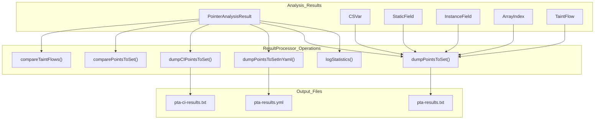
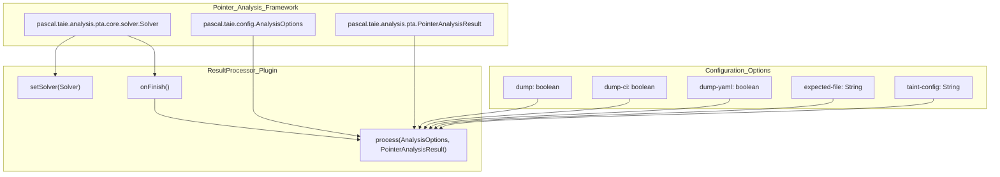
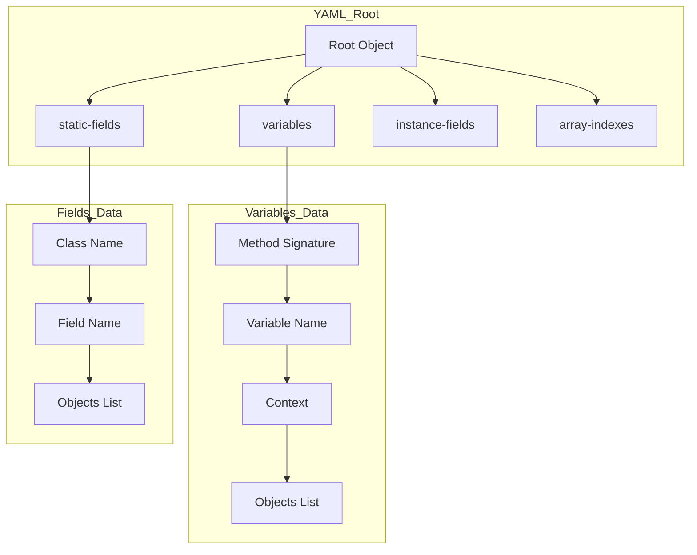
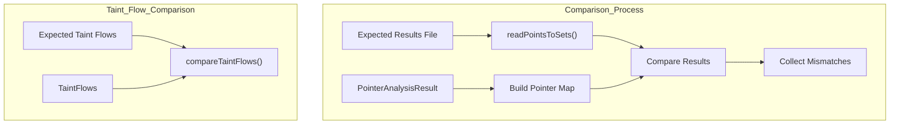

<!-- source: DeepWiki mcp.deepwiki.com · repo pascal-lab/Tai-e · page 7.5 Result Processing · fetched 2026-10-12 -->

# Result Processing

Relevant source files

The following files were used as context for generating this wiki page:

- [src/main/java/pascal/taie/analysis/dataflow/analysis/availexp/AvailableExpression.java](src/main/java/pascal/taie/analysis/dataflow/analysis/availexp/AvailableExpression.java)
- [src/main/java/pascal/taie/analysis/pta/PointerAnalysisResult.java](src/main/java/pascal/taie/analysis/pta/PointerAnalysisResult.java)
- [src/main/java/pascal/taie/analysis/pta/PointerAnalysisResultImpl.java](src/main/java/pascal/taie/analysis/pta/PointerAnalysisResultImpl.java)
- [src/main/java/pascal/taie/analysis/pta/core/cs/CSCallGraph.java](src/main/java/pascal/taie/analysis/pta/core/cs/CSCallGraph.java)
- [src/main/java/pascal/taie/analysis/pta/core/cs/element/CSCallSite.java](src/main/java/pascal/taie/analysis/pta/core/cs/element/CSCallSite.java)
- [src/main/java/pascal/taie/analysis/pta/core/cs/element/CSManager.java](src/main/java/pascal/taie/analysis/pta/core/cs/element/CSManager.java)
- [src/main/java/pascal/taie/analysis/pta/core/cs/element/CSMethod.java](src/main/java/pascal/taie/analysis/pta/core/cs/element/CSMethod.java)
- [src/main/java/pascal/taie/analysis/pta/core/cs/element/MapBasedCSManager.java](src/main/java/pascal/taie/analysis/pta/core/cs/element/MapBasedCSManager.java)
- [src/main/java/pascal/taie/analysis/pta/plugin/ResultProcessor.java](src/main/java/pascal/taie/analysis/pta/plugin/ResultProcessor.java)
- [src/main/java/pascal/taie/analysis/pta/pts/HybridBitPointsToSet.java](src/main/java/pascal/taie/analysis/pta/pts/HybridBitPointsToSet.java)
- [src/main/java/pascal/taie/analysis/pta/pts/HybridHashPointsToSet.java](src/main/java/pascal/taie/analysis/pta/pts/HybridHashPointsToSet.java)
- [src/main/java/pascal/taie/analysis/sideeffect/CachedCallGraph.java](src/main/java/pascal/taie/analysis/sideeffect/CachedCallGraph.java)
- [src/main/java/pascal/taie/analysis/sideeffect/SideEffect.java](src/main/java/pascal/taie/analysis/sideeffect/SideEffect.java)
- [src/main/java/pascal/taie/analysis/sideeffect/SideEffectAnalysis.java](src/main/java/pascal/taie/analysis/sideeffect/SideEffectAnalysis.java)
- [src/main/java/pascal/taie/analysis/sideeffect/TopologicalSolver.java](src/main/java/pascal/taie/analysis/sideeffect/TopologicalSolver.java)
- [src/main/java/pascal/taie/analysis/sideeffect/package-info.java](src/main/java/pascal/taie/analysis/sideeffect/package-info.java)
- [src/main/java/pascal/taie/util/Strings.java](src/main/java/pascal/taie/util/Strings.java)
- [src/main/java/pascal/taie/util/collection/AbstractBitSet.java](src/main/java/pascal/taie/util/collection/AbstractBitSet.java)
- [src/main/java/pascal/taie/util/collection/AbstractHybridMap.java](src/main/java/pascal/taie/util/collection/AbstractHybridMap.java)
- [src/main/java/pascal/taie/util/collection/AbstractHybridSet.java](src/main/java/pascal/taie/util/collection/AbstractHybridSet.java)
- [src/main/java/pascal/taie/util/collection/AbstractMultiMap.java](src/main/java/pascal/taie/util/collection/AbstractMultiMap.java)
- [src/main/java/pascal/taie/util/collection/AbstractSetEx.java](src/main/java/pascal/taie/util/collection/AbstractSetEx.java)
- [src/main/java/pascal/taie/util/collection/AbstractTwoKeyMap.java](src/main/java/pascal/taie/util/collection/AbstractTwoKeyMap.java)
- [src/main/java/pascal/taie/util/collection/CollectionUtils.java](src/main/java/pascal/taie/util/collection/CollectionUtils.java)
- [src/main/java/pascal/taie/util/collection/GenericBitSet.java](src/main/java/pascal/taie/util/collection/GenericBitSet.java)
- [src/main/java/pascal/taie/util/collection/HybridBitSet.java](src/main/java/pascal/taie/util/collection/HybridBitSet.java)
- [src/main/java/pascal/taie/util/collection/HybridHashMap.java](src/main/java/pascal/taie/util/collection/HybridHashMap.java)
- [src/main/java/pascal/taie/util/collection/HybridHashSet.java](src/main/java/pascal/taie/util/collection/HybridHashSet.java)
- [src/main/java/pascal/taie/util/collection/HybridIndexableSet.java](src/main/java/pascal/taie/util/collection/HybridIndexableSet.java)
- [src/main/java/pascal/taie/util/collection/HybridLinkedHashSet.java](src/main/java/pascal/taie/util/collection/HybridLinkedHashSet.java)
- [src/main/java/pascal/taie/util/collection/IBitSet.java](src/main/java/pascal/taie/util/collection/IBitSet.java)
- [src/main/java/pascal/taie/util/collection/IndexMap.java](src/main/java/pascal/taie/util/collection/IndexMap.java)
- [src/main/java/pascal/taie/util/collection/IndexableSet.java](src/main/java/pascal/taie/util/collection/IndexableSet.java)
- [src/main/java/pascal/taie/util/collection/IndexerBitSet.java](src/main/java/pascal/taie/util/collection/IndexerBitSet.java)
- [src/main/java/pascal/taie/util/collection/MapEntry.java](src/main/java/pascal/taie/util/collection/MapEntry.java)
- [src/main/java/pascal/taie/util/collection/MapMapTwoKeyMap.java](src/main/java/pascal/taie/util/collection/MapMapTwoKeyMap.java)
- [src/main/java/pascal/taie/util/collection/MapSetMultiMap.java](src/main/java/pascal/taie/util/collection/MapSetMultiMap.java)
- [src/main/java/pascal/taie/util/collection/Maps.java](src/main/java/pascal/taie/util/collection/Maps.java)
- [src/main/java/pascal/taie/util/collection/MultiMap.java](src/main/java/pascal/taie/util/collection/MultiMap.java)
- [src/main/java/pascal/taie/util/collection/MultiMapCollector.java](src/main/java/pascal/taie/util/collection/MultiMapCollector.java)
- [src/main/java/pascal/taie/util/collection/Pair.java](src/main/java/pascal/taie/util/collection/Pair.java)
- [src/main/java/pascal/taie/util/collection/RegularBitSet.java](src/main/java/pascal/taie/util/collection/RegularBitSet.java)
- [src/main/java/pascal/taie/util/collection/Sets.java](src/main/java/pascal/taie/util/collection/Sets.java)
- [src/main/java/pascal/taie/util/collection/SparseBitSet.java](src/main/java/pascal/taie/util/collection/SparseBitSet.java)
- [src/main/java/pascal/taie/util/collection/Streams.java](src/main/java/pascal/taie/util/collection/Streams.java)
- [src/main/java/pascal/taie/util/collection/Triple.java](src/main/java/pascal/taie/util/collection/Triple.java)
- [src/main/java/pascal/taie/util/collection/TwoKeyMap.java](src/main/java/pascal/taie/util/collection/TwoKeyMap.java)
- [src/main/java/pascal/taie/util/collection/UnmodifiableMultiMap.java](src/main/java/pascal/taie/util/collection/UnmodifiableMultiMap.java)
- [src/main/java/pascal/taie/util/collection/Views.java](src/main/java/pascal/taie/util/collection/Views.java)
- [src/main/java/pascal/taie/util/graph/MergedNode.java](src/main/java/pascal/taie/util/graph/MergedNode.java)
- [src/test/java/pascal/taie/analysis/dataflow/analysis/constprop/ValueTest.java](src/test/java/pascal/taie/analysis/dataflow/analysis/constprop/ValueTest.java)
- [src/test/java/pascal/taie/analysis/dataflow/fact/FactTest.java](src/test/java/pascal/taie/analysis/dataflow/fact/FactTest.java)
- [src/test/java/pascal/taie/analysis/deadcode/DeadCodeTest.java](src/test/java/pascal/taie/analysis/deadcode/DeadCodeTest.java)
- [src/test/java/pascal/taie/analysis/deadcode/DeadCodeTestFull.java](src/test/java/pascal/taie/analysis/deadcode/DeadCodeTestFull.java)
- [src/test/java/pascal/taie/analysis/pta/WorldCacheTest.java](src/test/java/pascal/taie/analysis/pta/WorldCacheTest.java)
- [src/test/java/pascal/taie/analysis/sideeffect/SideEffectTest.java](src/test/java/pascal/taie/analysis/sideeffect/SideEffectTest.java)
- [src/test/java/pascal/taie/util/UtilTestSuite.java](src/test/java/pascal/taie/util/UtilTestSuite.java)
- [src/test/java/pascal/taie/util/collection/IBitSetTest.java](src/test/java/pascal/taie/util/collection/IBitSetTest.java)
- [src/test/java/pascal/taie/util/collection/IndexMapTest.java](src/test/java/pascal/taie/util/collection/IndexMapTest.java)
- [src/test/java/pascal/taie/util/collection/MultiMapTest.java](src/test/java/pascal/taie/util/collection/MultiMapTest.java)
- [src/test/java/pascal/taie/util/collection/RegularBitSetTest.java](src/test/java/pascal/taie/util/collection/RegularBitSetTest.java)
- [src/test/java/pascal/taie/util/collection/SparseBitSetTest.java](src/test/java/pascal/taie/util/collection/SparseBitSetTest.java)
- [src/test/java/pascal/taie/util/collection/StreamsTest.java](src/test/java/pascal/taie/util/collection/StreamsTest.java)
- [src/test/java/pascal/taie/util/collection/TwoKeyMapTest.java](src/test/java/pascal/taie/util/collection/TwoKeyMapTest.java)
- [src/test/java/pascal/taie/util/collection/ViewsTest.java](src/test/java/pascal/taie/util/collection/ViewsTest.java)
- [src/test/java/pascal/taie/util/graph/GraphTestSuite.java](src/test/java/pascal/taie/util/graph/GraphTestSuite.java)

The Result Processing system in Tai-e handles the output, serialization, and validation of analysis results, particularly from pointer analysis. It provides capabilities for dumping analysis results to various file formats, logging comprehensive statistics, comparing results against expected outputs for regression testing, and reporting taint flows. Several collection utility classes (`CollectionUtils`, `Streams`, `IndexMap`, and the `Indexer` interface) underpin the data handling throughout this system.

For information about the pointer analysis framework that generates these results, see [Pointer Analysis](#3). For details about taint analysis results specifically, see [Taint Analysis](#4).

## Purpose and Core Functionality

The `ResultProcessor` class [src/main/java/pascal/taie/analysis/pta/plugin/ResultProcessor.java:74-74]() serves as the central component for post-analysis result handling. It operates as a plugin within the pointer analysis framework and provides several key capabilities:

**ResultProcessor Operations and Data Flow**

Sources: [src/main/java/pascal/taie/analysis/pta/plugin/ResultProcessor.java:74-133](), [src/main/java/pascal/taie/analysis/pta/PointerAnalysisResult.java:55-183]()

## Integration with Pointer Analysis

The `ResultProcessor` implements the `Plugin` interface [src/main/java/pascal/taie/analysis/pta/plugin/ResultProcessor.java:74-74]() and integrates with the pointer analysis framework through the `Solver` [src/main/java/pascal/taie/analysis/pta/core/solver/Solver.java]():

**Integration Architecture**

Sources: [src/main/java/pascal/taie/analysis/pta/plugin/ResultProcessor.java:95-103](), [src/main/java/pascal/taie/analysis/pta/plugin/ResultProcessor.java:105-133]()

## Output Formats

### Text Format Output
The primary text format dumps all pointer analysis results with context information to `pta-results.txt` [src/main/java/pascal/taie/analysis/pta/plugin/ResultProcessor.java:78-78](). The format follows a consistent pattern:

| Component | Format | Example |
|-----------|--------|---------|
| Variables | `pointer -> [objects]` | `[]:$r1 -> [[], []:NewObj{<A: A m()>[0@L1] new A}]` |
| Static Fields | `field -> [objects]` | `[]:<A: String sField> -> [[], []:ConstantObj{...}]` |
| Instance Fields | `base.field -> [objects]` | `[]:NewObj{...}.<A: String iField> -> [objects]` |
| Array Indexes | `array[*] -> [objects]` | `[]:NewObj{...}[*] -> [objects]` |

Sources: [src/main/java/pascal/taie/analysis/pta/plugin/ResultProcessor.java:174-199]()

### YAML Format Output
The YAML format provides a structured, hierarchical representation in `pta-results.yml` [src/main/java/pascal/taie/analysis/pta/plugin/ResultProcessor.java:80-80](). It uses Jackson's `YAMLFactory` [src/main/java/pascal/taie/analysis/pta/plugin/ResultProcessor.java:26-26]() for serialization.

**YAML Hierarchy Structure**

Sources: [src/main/java/pascal/taie/analysis/pta/plugin/ResultProcessor.java:201-332]()

### Context-Insensitive Format
The context-insensitive output in `pta-ci-results.txt` [src/main/java/pascal/taie/analysis/pta/plugin/ResultProcessor.java:82-82]() provides a simplified view where contexts are projected out using `PointerAnalysisResult.getPointsToSet(Var)` [src/main/java/pascal/taie/analysis/pta/PointerAnalysisResult.java:100-100]().

Sources: [src/main/java/pascal/taie/analysis/pta/plugin/ResultProcessor.java:337-357]()

## Statistics Logging

`ResultProcessor` logs comprehensive statistics [src/main/java/pascal/taie/analysis/pta/plugin/ResultProcessor.java:135-168]() using a `DecimalFormat` [src/main/java/pascal/taie/analysis/pta/plugin/ResultProcessor.java:91-91]():

| Statistic | Source Logic | Description |
|-----------|--------------|-------------|
| Variable Pointers | `result.getVars().size()` / `result.getCSVars().size()` | Insensitive vs. Sensitive variables [src/main/java/pascal/taie/analysis/pta/plugin/ResultProcessor.java:138-141]() |
| Objects | `result.getObjects().size()` / `result.getCSObjects().size()` | Insensitive vs. Sensitive objects [src/main/java/pascal/taie/analysis/pta/plugin/ResultProcessor.java:142-145]() |
| Variable Points-to | `sum(result.getVars(), v -> result.getPointsToSet(v).size())` | Total points-to relations for variables [src/main/java/pascal/taie/analysis/pta/plugin/ResultProcessor.java:146-149]() |
| Field Points-to | `sum(result.getStaticFields(), getSize)` | Static and Instance field points-to relations [src/main/java/pascal/taie/analysis/pta/plugin/ResultProcessor.java:150-155]() |
| Reachable Methods | `result.getCallGraph().getNumberOfMethods()` | Method reachability in Call Graph [src/main/java/pascal/taie/analysis/pta/plugin/ResultProcessor.java:159-162]() |
| Call Graph Edges | `result.getCallGraph().edges().count()` | Edge count in Call Graph [src/main/java/pascal/taie/analysis/pta/plugin/ResultProcessor.java:163-166]() |

Sources: [src/main/java/pascal/taie/analysis/pta/plugin/ResultProcessor.java:135-168](), [src/main/java/pascal/taie/util/collection/CollectionUtils.java:92-98]()

## Result Comparison and Validation

The system supports automated comparison of analysis results against expected outputs for regression testing. If `taint-config` is present, it switches to `compareTaintFlows` [src/main/java/pascal/taie/analysis/pta/plugin/ResultProcessor.java:125-128]().

**Validation Logic Flow**

Sources: [src/main/java/pascal/taie/analysis/pta/plugin/ResultProcessor.java:359-388](), [src/main/java/pascal/taie/analysis/pta/plugin/ResultProcessor.java:429-461]()

## Collection Utilities

The result processing system relies on a suite of specialized collection classes:

- **IndexMap**: An array-based `Map` implementation [src/main/java/pascal/taie/util/collection/IndexMap.java:58-59]() that uses an `Indexer` [src/main/java/pascal/taie/util/Indexer.java]() to map keys to unique integer indexes. This is used for memory-efficient mapping when the key universe is known.
- **CollectionUtils**: Provides `sum()` [src/main/java/pascal/taie/util/collection/CollectionUtils.java:92-98]() for aggregating statistics and `toString()` [src/main/java/pascal/taie/util/collection/CollectionUtils.java:107-109]() for deterministic sorting of collections during comparison.
- **Streams**: Utility for converting streams to strings [src/main/java/pascal/taie/util/collection/Streams.java:61-65]() used in result dumping.
- **Maps**: Factory class [src/main/java/pascal/taie/util/collection/Maps.java:41-41]() providing `newTwoKeyMap()` [src/main/java/pascal/taie/util/collection/Maps.java:134-136]() and `newMultiMap()` [src/main/java/pascal/taie/util/collection/Maps.java:110-112]() used by `MapBasedCSManager` [src/main/java/pascal/taie/analysis/pta/core/cs/element/MapBasedCSManager.java:50-50]() to track context-sensitive elements.

Sources: [src/main/java/pascal/taie/util/collection/IndexMap.java:58-83](), [src/main/java/pascal/taie/util/collection/CollectionUtils.java:39-121](), [src/main/java/pascal/taie/util/collection/Maps.java:41-170]()

---

