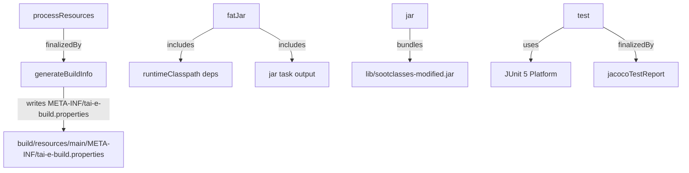
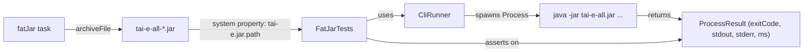
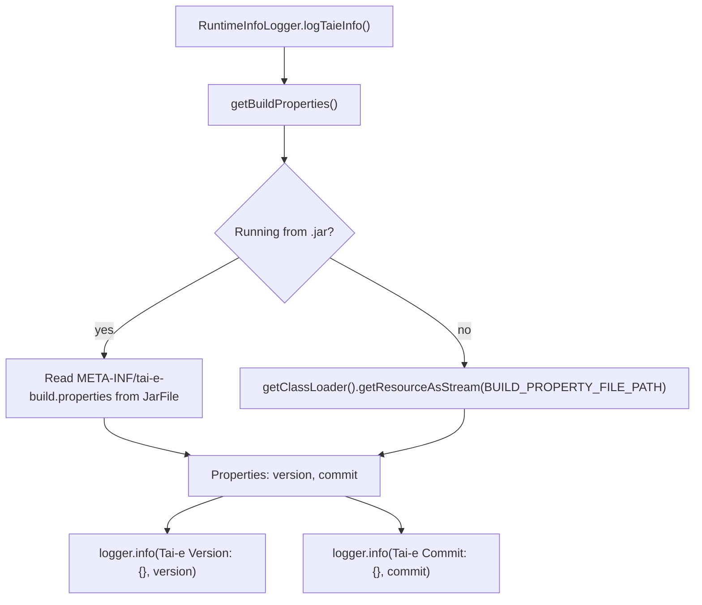

<!-- source: DeepWiki mcp.deepwiki.com · repo pascal-lab/Tai-e · page 8 Build and Development · fetched 2026-10-12 -->

# Build and Development

<details>
<summary>Relevant source files</summary>

The following files were used as context for generating this wiki page:

- [.github/ISSUE_TEMPLATE/ask_question.yml](.github/ISSUE_TEMPLATE/ask_question.yml)
- [.github/ISSUE_TEMPLATE/bug_report.yml](.github/ISSUE_TEMPLATE/bug_report.yml)
- [.github/ISSUE_TEMPLATE/config.yml](.github/ISSUE_TEMPLATE/config.yml)
- [.github/ISSUE_TEMPLATE/feature_request.yml](.github/ISSUE_TEMPLATE/feature_request.yml)
- [.github/workflows/checkstyle.yml](.github/workflows/checkstyle.yml)
- [.github/workflows/release.yml](.github/workflows/release.yml)
- [.github/workflows/test.yml](.github/workflows/test.yml)
- [README.md](README.md)
- [build.gradle.kts](build.gradle.kts)
- [buildSrc/src/main/kotlin/CheckstyleUtils.kt](buildSrc/src/main/kotlin/CheckstyleUtils.kt)
- [buildSrc/src/main/kotlin/GitCommitValueSource.kt](buildSrc/src/main/kotlin/GitCommitValueSource.kt)
- [buildSrc/src/main/kotlin/ProjectExtensions.kt](buildSrc/src/main/kotlin/ProjectExtensions.kt)
- [buildSrc/src/main/kotlin/checkstyle.conventions.gradle.kts](buildSrc/src/main/kotlin/checkstyle.conventions.gradle.kts)
- [buildSrc/src/main/kotlin/java.conventions.gradle.kts](buildSrc/src/main/kotlin/java.conventions.gradle.kts)
- [buildSrc/src/main/kotlin/maven-publish.conventions.gradle.kts](buildSrc/src/main/kotlin/maven-publish.conventions.gradle.kts)
- [config/checkstyle/checkstyle.xml](config/checkstyle/checkstyle.xml)
- [config/checkstyle/import-control.xml](config/checkstyle/import-control.xml)
- [config/checkstyle/java.header](config/checkstyle/java.header)
- [config/javadoc/footer.html](config/javadoc/footer.html)
- [docs/README.adoc](docs/README.adoc)
- [docs/build.gradle.kts](docs/build.gradle.kts)
- [docs/common/css/custom.css](docs/common/css/custom.css)
- [docs/en/command-line-options.adoc](docs/en/command-line-options.adoc)
- [docs/en/docinfo.html](docs/en/docinfo.html)
- [gradle.properties](gradle.properties)
- [gradle/wrapper/gradle-wrapper.jar](gradle/wrapper/gradle-wrapper.jar)
- [gradle/wrapper/gradle-wrapper.properties](gradle/wrapper/gradle-wrapper.properties)
- [gradlew](gradlew)
- [gradlew.bat](gradlew.bat)
- [lib/sootclasses-modified.jar](lib/sootclasses-modified.jar)
- [release-tests/README.md](release-tests/README.md)
- [release-tests/build.gradle.kts](release-tests/build.gradle.kts)
- [release-tests/src/test/java/pascal/taie/release/CliRunner.java](release-tests/src/test/java/pascal/taie/release/CliRunner.java)
- [release-tests/src/test/java/pascal/taie/release/DistributionTests.java](release-tests/src/test/java/pascal/taie/release/DistributionTests.java)
- [release-tests/src/test/java/pascal/taie/release/DocsTests.java](release-tests/src/test/java/pascal/taie/release/DocsTests.java)
- [release-tests/src/test/java/pascal/taie/release/FatJarTests.java](release-tests/src/test/java/pascal/taie/release/FatJarTests.java)
- [release-tests/src/test/java/pascal/taie/release/InvocationTests.java](release-tests/src/test/java/pascal/taie/release/InvocationTests.java)
- [release-tests/src/test/java/pascal/taie/release/ProcessResult.java](release-tests/src/test/java/pascal/taie/release/ProcessResult.java)
- [release-tests/src/test/java/pascal/taie/release/package-info.java](release-tests/src/test/java/pascal/taie/release/package-info.java)
- [settings.gradle.kts](settings.gradle.kts)
- [src/main/java/pascal/taie/analysis/pta/core/heap/IsReflectionString.java](src/main/java/pascal/taie/analysis/pta/core/heap/IsReflectionString.java)
- [src/main/java/pascal/taie/config/LoggerConfigs.java](src/main/java/pascal/taie/config/LoggerConfigs.java)
- [src/main/java/pascal/taie/util/RuntimeInfoLogger.java](src/main/java/pascal/taie/util/RuntimeInfoLogger.java)
- [src/test/java/pascal/taie/config/LoggerConfigsTest.java](src/test/java/pascal/taie/config/LoggerConfigsTest.java)

</details>


This page documents the Gradle build system structure, available build tasks, test infrastructure, code style enforcement, CI/CD workflows, and the Maven publishing process for Tai-e. For information about running Tai-e as a user (command-line options, analysis configuration), see [Overview](#1) and [Getting Started](#1.1). For adding new analyses to the framework, see [Analysis Management](#2.3).

---

## Project Structure

Tai-e is a Gradle multi-project build. The subprojects are declared in [settings.gradle.kts]().

**Subprojects:**

| Subproject | Directory | Purpose |
|---|---|---|
| Root project (`:`) | `/` | Main Tai-e source and analysis code |
| `docs` | `docs/` | AsciiDoc reference documentation |
| `release-tests` | `release-tests/` | Fat JAR and distribution integration tests |

The build convention plugins shared across subprojects are defined under `buildSrc/`:

| Convention plugin | File |
|---|---|
| `java.conventions` | [buildSrc/src/main/kotlin/java.conventions.gradle.kts]() |
| `checkstyle.conventions` | [buildSrc/src/main/kotlin/checkstyle.conventions.gradle.kts]() |
| `maven-publish.conventions` | [buildSrc/src/main/kotlin/maven-publish.conventions.gradle.kts]() |

**Project properties** (group ID, artifact ID, version) are declared in [gradle.properties]():

```
projectGroupId=net.pascal-lab
projectArtifactId=tai-e
projectVersion=0.5.5-SNAPSHOT
```

The `isSnapshot` property is derived automatically from whether `projectVersion` ends with `-SNAPSHOT` — this flag controls signing requirements and the Maven repository target during publishing.

Sources: [settings.gradle.kts](), [gradle.properties](), [buildSrc/src/main/kotlin/ProjectExtensions.kt]()

---

## Gradle Wrapper and Version

The Gradle wrapper is pinned to a specific version via [gradle/wrapper/gradle-wrapper.properties]():

- **Gradle version**: `9.6.0` [gradle/wrapper/gradle-wrapper.properties:3]()
- Wrapper scripts: `gradlew` (Unix) and `gradlew.bat` (Windows)

The project requires **Java 17** or higher. The JVM toolchain is locked to Java 17 via the `java.conventions` plugin [buildSrc/src/main/kotlin/java.conventions.gradle.kts]():

```kotlin
java {
    toolchain {
        languageVersion.set(javaVersion)  // JavaLanguageVersion.of(17)
    }
}
```

Gradle daemon, caching, parallel execution, and configuration cache are all enabled by default in [gradle.properties]():

```
org.gradle.caching=true
org.gradle.daemon=true
org.gradle.parallel=true
org.gradle.configuration-cache=true
```

Sources: [gradle/wrapper/gradle-wrapper.properties](), [buildSrc/src/main/kotlin/java.conventions.gradle.kts](), [gradle.properties]()

---

## Key Build Tasks

The root project's [build.gradle.kts]() defines several important Gradle tasks.

**Task overview:**



Sources: [build.gradle.kts]()

### `fatJar` — Runnable Fat JAR

[build.gradle.kts:116-134]()

Produces a single self-contained JAR containing Tai-e and all runtime dependencies. Output is placed in the root project's `build/` directory.

- Archive name: `tai-e-all-<version>.jar` [build.gradle.kts:122]()
- `Main-Class` manifest attribute: `pascal.taie.Main` [build.gradle.kts:120]()
- Includes `COPYING` and `COPYING.LESSER` license files [build.gradle.kts:130]()
- `DuplicatesStrategy.EXCLUDE` is used to resolve conflicting entries from merged JARs [build.gradle.kts:132]()

### `generateBuildInfo` — Build Metadata

[build.gradle.kts:98-114]()

Generates `META-INF/tai-e-build.properties` containing:

```
version=<projectVersion>
commit=<gitCommit>
```

This task is automatically triggered as a finalizer of `processResources` [build.gradle.kts:145](), so the build metadata is always included in the classpath. The Git commit hash is resolved by `GitCommitValueSource` [buildSrc/src/main/kotlin/GitCommitValueSource.kt](), which reads directly from `.git` directory files.

At runtime, `RuntimeInfoLogger` [src/main/java/pascal/taie/util/RuntimeInfoLogger.java]() reads this properties file from the classpath or JAR to log version and commit information on startup.

### `jar` — Library JAR

[build.gradle.kts:136-140]()

Produces the standard library JAR (without bundling all dependencies). Embeds `lib/sootclasses-modified.jar` directly and outputs to the root project's `build/` directory. This is the artifact published to Maven Central.

### `test` — Unit Tests

[build.gradle.kts:148-178]()

Configured to:

| Setting | Value |
|---|---|
| Test framework | JUnit 5 (`useJUnitPlatform()`) [build.gradle.kts:150]() |
| Max heap size | `2G` [build.gradle.kts:153]() |
| Max parallel forks | `(availableProcessors / 2)` [build.gradle.kts:155]() |
| Default behavior | Excludes `*TestSuite` classes when running all tests [build.gradle.kts:174]() |

Run with:
```shell
./gradlew test
```

Sources: [build.gradle.kts:98-178](), [buildSrc/src/main/kotlin/GitCommitValueSource.kt]()

---

## Dependencies

Core runtime dependencies declared in [build.gradle.kts:12-55]():

| Dependency | Use |
|---|---|
| `info.picocli:picocli:4.7.7` | Command-line option parsing [build.gradle.kts:14]() |
| `org.apache.logging.log4j:log4j-api/core:2.24.3` | Logging [build.gradle.kts:16-19]() |
| `com.fasterxml.jackson.dataformat:jackson-dataformat-yaml:2.19.0` | YAML config file parsing [build.gradle.kts:21]() |
| `lib/sootclasses-modified.jar` | Modified Soot classes (local file) [build.gradle.kts:23]() |
| `org.soot-oss:soot:4.4.1` | Soot frontend [build.gradle.kts:24]() |
| `org.ow2.asm:asm:9.8` | Direct bytecode reading [build.gradle.kts:33-37]() |
| `lib/flowdroidclasses-modified.jar` | Modified FlowDroid for Android [build.gradle.kts:39]() |
| `de.fraunhofer.sit.sse.flowdroid:soot-infoflow-android:2.14.1` | Android analysis support [build.gradle.kts:40]() |
| `com.google.code.findbugs:jsr305:3.0.2` | JSR-305 annotations [build.gradle.kts:31]() |

Sources: [build.gradle.kts:12-55]()

---

## Code Coverage with JaCoCo

JaCoCo is enabled via the `java.conventions` plugin [buildSrc/src/main/kotlin/java.conventions.gradle.kts](). In CI, coverage reports are uploaded to Codecov after each test run [.github/workflows/test.yml:39-43]().

Run locally with:
```shell
./gradlew test jacocoTestReport
```

Sources: [buildSrc/src/main/kotlin/java.conventions.gradle.kts](), [.github/workflows/test.yml]()

---

## Checkstyle Code Style Enforcement

The `checkstyle.conventions` plugin [buildSrc/src/main/kotlin/checkstyle.conventions.gradle.kts]() automatically runs Checkstyle after compilation. The `summarizeStyleViolations` function in [buildSrc/src/main/kotlin/CheckstyleUtils.kt]() parses reports and prints violations with clickable links.

Run manually:
```shell
./gradlew checkstyleMain checkstyleTest
```

Sources: [buildSrc/src/main/kotlin/checkstyle.conventions.gradle.kts](), [buildSrc/src/main/kotlin/CheckstyleUtils.kt]()

---

## Integration Tests

The `release-tests` subproject runs end-to-end tests against the built artifacts.

**Diagram: Integration Test Execution Model**



Sources: [release-tests/src/test/java/pascal/taie/release/FatJarTests.java](), [release-tests/src/test/java/pascal/taie/release/CliRunner.java](), [release-tests/src/test/java/pascal/taie/release/ProcessResult.java]()

---

## Documentation Build

The `docs` subproject [docs/build.gradle.kts]() builds reference documentation from AsciiDoc sources.

**Available tasks:**

| Task | Output |
|---|---|
| `./gradlew :docs:asciidoctor` | HTML docs in `docs/build/docs/asciidoc/` [docs/build.gradle.kts:46]() |
| `./gradlew :docs:asciidoctorPdf` | PDF in `docs/build/docs/asciidocPdf/` [docs/build.gradle.kts:69]() |
| `./gradlew :docs:all` | ZIP archive combining HTML docs and Javadoc [docs/build.gradle.kts:75]() |

Sources: [docs/build.gradle.kts]()

---

## CI/CD — GitHub Actions Workflows

### Test Workflow (`.github/workflows/test.yml`)

Triggered on every push and pull request. Runs on a matrix of Ubuntu, macOS, and Windows [.github/workflows/test.yml:12]().

### Release Workflow (`.github/workflows/release.yml`)

Manually triggered. It builds release artifacts, creates a GitHub Release, and deploys documentation to an OSS bucket [.github/workflows/release.yml:41-68]().

---

## Maven Publishing

The `maven-publish.conventions` plugin [buildSrc/src/main/kotlin/maven-publish.conventions.gradle.kts]() configures artifact publication to Maven Central.

**Using Tai-e as a dependency (Stable Version):**
```kotlin
dependencies {
    implementation("net.pascal-lab:tai-e:0.5.4")
}
```
Sources: [README.md:112-116](), [buildSrc/src/main/kotlin/maven-publish.conventions.gradle.kts]()

---

## RuntimeInfoLogger

`RuntimeInfoLogger` [src/main/java/pascal/taie/util/RuntimeInfoLogger.java]() logs version and git commit hash at startup, read from `META-INF/tai-e-build.properties`.

**How build metadata is located at runtime:**



Sources: [src/main/java/pascal/taie/util/RuntimeInfoLogger.java](), [build.gradle.kts:98-114]()

---

## Scoping
For details on specific analysis domains, see:
- [Android Analysis](#8.1)
- [Bug Finders](#8.2)

---

