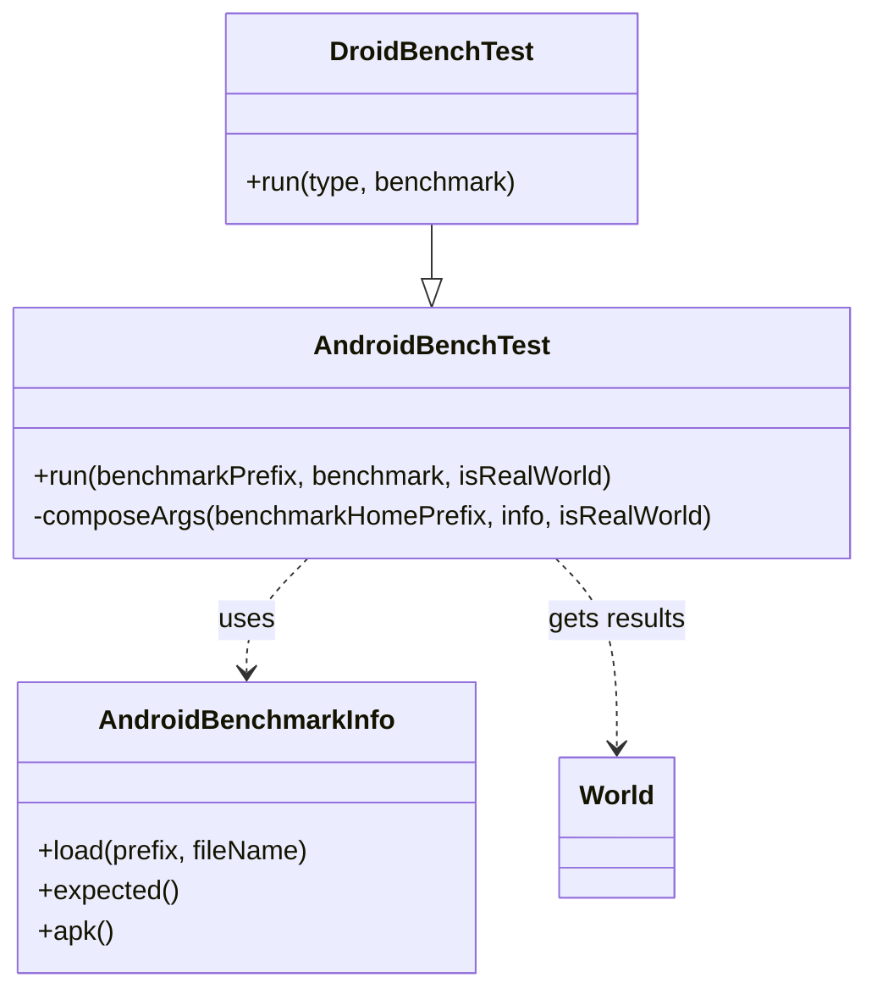

<!-- source: DeepWiki mcp.deepwiki.com · repo pascal-lab/Tai-e · page 8.1 Android Analysis · fetched 2026-10-12 -->

# Android Analysis

<details>
<summary>Relevant source files</summary>

The following files were used as context for generating this wiki page:

- [docs/en/analysis-management.adoc](docs/en/analysis-management.adoc)
- [docs/en/android-analysis.adoc](docs/en/android-analysis.adoc)
- [docs/en/attributes.adoc](docs/en/attributes.adoc)
- [docs/en/develop-new-analysis.adoc](docs/en/develop-new-analysis.adoc)
- [docs/en/index-single.adoc](docs/en/index-single.adoc)
- [docs/en/index.adoc](docs/en/index.adoc)
- [docs/en/pointer-analysis-framework.adoc](docs/en/pointer-analysis-framework.adoc)
- [docs/en/program-abstraction.adoc](docs/en/program-abstraction.adoc)
- [docs/en/publications.adoc](docs/en/publications.adoc)
- [docs/en/setup-in-intellij-idea.adoc](docs/en/setup-in-intellij-idea.adoc)
- [lib/flowdroidclasses-modified.jar](lib/flowdroidclasses-modified.jar)
- [src/main/java/pascal/taie/analysis/pta/plugin/android/AndroidAnalysis.java](src/main/java/pascal/taie/analysis/pta/plugin/android/AndroidAnalysis.java)
- [src/main/java/pascal/taie/analysis/pta/plugin/android/AndroidContext.java](src/main/java/pascal/taie/analysis/pta/plugin/android/AndroidContext.java)
- [src/main/java/pascal/taie/analysis/pta/plugin/android/AndroidHandler.java](src/main/java/pascal/taie/analysis/pta/plugin/android/AndroidHandler.java)
- [src/main/java/pascal/taie/analysis/pta/plugin/android/AndroidModelEdge.java](src/main/java/pascal/taie/analysis/pta/plugin/android/AndroidModelEdge.java)
- [src/main/java/pascal/taie/analysis/pta/plugin/android/AndroidObjManager.java](src/main/java/pascal/taie/analysis/pta/plugin/android/AndroidObjManager.java)
- [src/main/java/pascal/taie/analysis/pta/plugin/android/icc/AidlHandler.java](src/main/java/pascal/taie/analysis/pta/plugin/android/icc/AidlHandler.java)
- [src/main/java/pascal/taie/analysis/pta/plugin/android/icc/ComponentICCHandler.java](src/main/java/pascal/taie/analysis/pta/plugin/android/icc/ComponentICCHandler.java)
- [src/main/java/pascal/taie/analysis/pta/plugin/android/icc/ComponentNameInfoModel.java](src/main/java/pascal/taie/analysis/pta/plugin/android/icc/ComponentNameInfoModel.java)
- [src/main/java/pascal/taie/analysis/pta/plugin/android/icc/ICCAnalysis.java](src/main/java/pascal/taie/analysis/pta/plugin/android/icc/ICCAnalysis.java)
- [src/main/java/pascal/taie/analysis/pta/plugin/android/icc/ICCContext.java](src/main/java/pascal/taie/analysis/pta/plugin/android/icc/ICCContext.java)
- [src/main/java/pascal/taie/analysis/pta/plugin/android/icc/ICCEdge.java](src/main/java/pascal/taie/analysis/pta/plugin/android/icc/ICCEdge.java)
- [src/main/java/pascal/taie/analysis/pta/plugin/android/icc/ICCHandler.java](src/main/java/pascal/taie/analysis/pta/plugin/android/icc/ICCHandler.java)
- [src/main/java/pascal/taie/analysis/pta/plugin/android/icc/ICCInfo.java](src/main/java/pascal/taie/analysis/pta/plugin/android/icc/ICCInfo.java)
- [src/main/java/pascal/taie/analysis/pta/plugin/android/icc/IntentTargetResolver.java](src/main/java/pascal/taie/analysis/pta/plugin/android/icc/IntentTargetResolver.java)
- [src/main/java/pascal/taie/analysis/pta/plugin/android/icc/MessageHandler.java](src/main/java/pascal/taie/analysis/pta/plugin/android/icc/MessageHandler.java)
- [src/main/java/pascal/taie/analysis/pta/plugin/android/icc/SendAndReplyICCHandler.java](src/main/java/pascal/taie/analysis/pta/plugin/android/icc/SendAndReplyICCHandler.java)
- [src/main/java/pascal/taie/analysis/pta/plugin/android/icc/StartICCModel.java](src/main/java/pascal/taie/analysis/pta/plugin/android/icc/StartICCModel.java)
- [src/main/java/pascal/taie/analysis/pta/plugin/android/icc/intentattribute/IntentAttribute.java](src/main/java/pascal/taie/analysis/pta/plugin/android/icc/intentattribute/IntentAttribute.java)
- [src/main/java/pascal/taie/analysis/pta/plugin/android/icc/intentattribute/IntentAttributeCollector.java](src/main/java/pascal/taie/analysis/pta/plugin/android/icc/intentattribute/IntentAttributeCollector.java)
- [src/main/java/pascal/taie/analysis/pta/plugin/android/icc/intentattribute/IntentAttributeHandler.java](src/main/java/pascal/taie/analysis/pta/plugin/android/icc/intentattribute/IntentAttributeHandler.java)
- [src/main/java/pascal/taie/analysis/pta/plugin/android/icc/intentattribute/IntentAttributeKind.java](src/main/java/pascal/taie/analysis/pta/plugin/android/icc/intentattribute/IntentAttributeKind.java)
- [src/main/java/pascal/taie/analysis/pta/plugin/android/icc/intentattribute/IntentFilterAttributeModel.java](src/main/java/pascal/taie/analysis/pta/plugin/android/icc/intentattribute/IntentFilterAttributeModel.java)
- [src/main/java/pascal/taie/analysis/pta/plugin/android/lifecycle/CallbackHandler.java](src/main/java/pascal/taie/analysis/pta/plugin/android/lifecycle/CallbackHandler.java)
- [src/main/java/pascal/taie/analysis/pta/plugin/android/lifecycle/DynamicFragmentModel.java](src/main/java/pascal/taie/analysis/pta/plugin/android/lifecycle/DynamicFragmentModel.java)
- [src/main/java/pascal/taie/analysis/pta/plugin/android/lifecycle/DynamicReceiverModel.java](src/main/java/pascal/taie/analysis/pta/plugin/android/lifecycle/DynamicReceiverModel.java)
- [src/main/java/pascal/taie/analysis/pta/plugin/android/lifecycle/EntryPointHandler.java](src/main/java/pascal/taie/analysis/pta/plugin/android/lifecycle/EntryPointHandler.java)
- [src/main/java/pascal/taie/analysis/pta/plugin/android/lifecycle/LayoutModel.java](src/main/java/pascal/taie/analysis/pta/plugin/android/lifecycle/LayoutModel.java)
- [src/main/java/pascal/taie/analysis/pta/plugin/android/lifecycle/LayoutResourceResolver.java](src/main/java/pascal/taie/analysis/pta/plugin/android/lifecycle/LayoutResourceResolver.java)
- [src/main/java/pascal/taie/analysis/pta/plugin/android/lifecycle/LifecycleAnalysis.java](src/main/java/pascal/taie/analysis/pta/plugin/android/lifecycle/LifecycleAnalysis.java)
- [src/main/java/pascal/taie/analysis/pta/plugin/android/lifecycle/LifecycleContext.java](src/main/java/pascal/taie/analysis/pta/plugin/android/lifecycle/LifecycleContext.java)
- [src/main/java/pascal/taie/analysis/pta/plugin/android/lifecycle/LifecycleHandler.java](src/main/java/pascal/taie/analysis/pta/plugin/android/lifecycle/LifecycleHandler.java)
- [src/main/java/pascal/taie/analysis/pta/plugin/android/misc/AndroidMiscAnalysis.java](src/main/java/pascal/taie/analysis/pta/plugin/android/misc/AndroidMiscAnalysis.java)
- [src/main/java/pascal/taie/analysis/pta/plugin/android/misc/AndroidMiscContext.java](src/main/java/pascal/taie/analysis/pta/plugin/android/misc/AndroidMiscContext.java)
- [src/main/java/pascal/taie/analysis/pta/plugin/android/misc/AndroidMiscHandler.java](src/main/java/pascal/taie/analysis/pta/plugin/android/misc/AndroidMiscHandler.java)
- [src/main/java/pascal/taie/analysis/pta/plugin/android/misc/ApplicationModel.java](src/main/java/pascal/taie/analysis/pta/plugin/android/misc/ApplicationModel.java)
- [src/main/java/pascal/taie/analysis/pta/plugin/android/misc/AsyncTaskModel.java](src/main/java/pascal/taie/analysis/pta/plugin/android/misc/AsyncTaskModel.java)
- [src/main/java/pascal/taie/analysis/pta/plugin/android/misc/HandlerModel.java](src/main/java/pascal/taie/analysis/pta/plugin/android/misc/HandlerModel.java)
- [src/main/java/pascal/taie/analysis/pta/plugin/android/misc/MapLikeHandler.java](src/main/java/pascal/taie/analysis/pta/plugin/android/misc/MapLikeHandler.java)
- [src/main/java/pascal/taie/analysis/pta/plugin/android/misc/OtherMiscModel.java](src/main/java/pascal/taie/analysis/pta/plugin/android/misc/OtherMiscModel.java)
- [src/main/java/pascal/taie/analysis/pta/plugin/android/misc/SharedPreferencesModel.java](src/main/java/pascal/taie/analysis/pta/plugin/android/misc/SharedPreferencesModel.java)
- [src/main/java/pascal/taie/android/config/AndroidLifecycleConfig.java](src/main/java/pascal/taie/android/config/AndroidLifecycleConfig.java)
- [src/main/java/pascal/taie/android/info/ApkInfo.java](src/main/java/pascal/taie/android/info/ApkInfo.java)
- [src/main/java/pascal/taie/android/info/ApkInfoCreator.java](src/main/java/pascal/taie/android/info/ApkInfoCreator.java)
- [src/main/java/pascal/taie/android/info/IntentDataInfo.java](src/main/java/pascal/taie/android/info/IntentDataInfo.java)
- [src/main/java/pascal/taie/android/info/ManifestIntentFilterResolver.java](src/main/java/pascal/taie/android/info/ManifestIntentFilterResolver.java)
- [src/main/java/pascal/taie/android/info/RawApkInfo.java](src/main/java/pascal/taie/android/info/RawApkInfo.java)
- [src/main/java/pascal/taie/android/info/UriData.java](src/main/java/pascal/taie/android/info/UriData.java)
- [src/main/java/pascal/taie/android/util/AndroidJavaVersionInfer.java](src/main/java/pascal/taie/android/util/AndroidJavaVersionInfer.java)
- [src/main/java/pascal/taie/android/util/AndroidLifecycleHelper.java](src/main/java/pascal/taie/android/util/AndroidLifecycleHelper.java)
- [src/main/java/pascal/taie/android/util/IntentAttributeMatcher.java](src/main/java/pascal/taie/android/util/IntentAttributeMatcher.java)
- [src/main/resources/android/android-basic-classes.yml](src/main/resources/android/android-basic-classes.yml)
- [src/main/resources/android/android-callbacks.yml](src/main/resources/android/android-callbacks.yml)
- [src/main/resources/android/android-lifecycle.yml](src/main/resources/android/android-lifecycle.yml)
- [src/main/resources/basic-classes.yml](src/main/resources/basic-classes.yml)
- [src/test/java/pascal/taie/android/AndroidBenchTest.java](src/test/java/pascal/taie/android/AndroidBenchTest.java)
- [src/test/java/pascal/taie/android/AndroidBenchTestSuite.java](src/test/java/pascal/taie/android/AndroidBenchTestSuite.java)
- [src/test/java/pascal/taie/android/AndroidBenchmarkInfo.java](src/test/java/pascal/taie/android/AndroidBenchmarkInfo.java)
- [src/test/java/pascal/taie/android/ExtraICCTest.java](src/test/java/pascal/taie/android/ExtraICCTest.java)
- [src/test/java/pascal/taie/android/ICCBenchTest.java](src/test/java/pascal/taie/android/ICCBenchTest.java)
- [src/test/java/pascal/taie/android/RealWorldTest.java](src/test/java/pascal/taie/android/RealWorldTest.java)
- [src/test/java/pascal/taie/android/UBCBenchTest.java](src/test/java/pascal/taie/android/UBCBenchTest.java)
- [src/test/java/pascal/taie/android/droidbench/AliasingTest.java](src/test/java/pascal/taie/android/droidbench/AliasingTest.java)
- [src/test/java/pascal/taie/android/droidbench/AndroidSpecificTest.java](src/test/java/pascal/taie/android/droidbench/AndroidSpecificTest.java)
- [src/test/java/pascal/taie/android/droidbench/ArraysAndListsTest.java](src/test/java/pascal/taie/android/droidbench/ArraysAndListsTest.java)
- [src/test/java/pascal/taie/android/droidbench/CallbackTest.java](src/test/java/pascal/taie/android/droidbench/CallbackTest.java)
- [src/test/java/pascal/taie/android/droidbench/DroidBenchTest.java](src/test/java/pascal/taie/android/droidbench/DroidBenchTest.java)
- [src/test/java/pascal/taie/android/droidbench/DroidBenchTestSuite.java](src/test/java/pascal/taie/android/droidbench/DroidBenchTestSuite.java)
- [src/test/java/pascal/taie/android/droidbench/DynamicLoadingTest.java](src/test/java/pascal/taie/android/droidbench/DynamicLoadingTest.java)
- [src/test/java/pascal/taie/android/droidbench/EmulatorDetectionTest.java](src/test/java/pascal/taie/android/droidbench/EmulatorDetectionTest.java)
- [src/test/java/pascal/taie/android/droidbench/FieldAndObjectSensitivityTest.java](src/test/java/pascal/taie/android/droidbench/FieldAndObjectSensitivityTest.java)
- [src/test/java/pascal/taie/android/droidbench/GeneralJavaTest.java](src/test/java/pascal/taie/android/droidbench/GeneralJavaTest.java)
- [src/test/java/pascal/taie/android/droidbench/ImplicitFlowsTest.java](src/test/java/pascal/taie/android/droidbench/ImplicitFlowsTest.java)
- [src/test/java/pascal/taie/android/droidbench/InterAppCommunicationTest.java](src/test/java/pascal/taie/android/droidbench/InterAppCommunicationTest.java)
- [src/test/java/pascal/taie/android/droidbench/InterComponentCommunicationTest.java](src/test/java/pascal/taie/android/droidbench/InterComponentCommunicationTest.java)
- [src/test/java/pascal/taie/android/droidbench/NativeTest.java](src/test/java/pascal/taie/android/droidbench/NativeTest.java)
- [src/test/java/pascal/taie/android/droidbench/ReflectionICCTest.java](src/test/java/pascal/taie/android/droidbench/ReflectionICCTest.java)
- [src/test/java/pascal/taie/android/droidbench/SelfModificationTest.java](src/test/java/pascal/taie/android/droidbench/SelfModificationTest.java)
- [src/test/java/pascal/taie/frontend/soot/ApkWorldBuilderTest.java](src/test/java/pascal/taie/frontend/soot/ApkWorldBuilderTest.java)
- [src/test/java/pascal/taie/frontend/soot/JClassExaminer.java](src/test/java/pascal/taie/frontend/soot/JClassExaminer.java)

</details>


Tai-e provides comprehensive support for analyzing Android APKs by modeling the complex semantics of the Android framework. The Android analysis is implemented as a specialized plugin within the pointer analysis framework, allowing it to leverage context-sensitivity, heap abstraction, and reflection inference while providing the necessary foundations for high-precision taint analysis on mobile applications [docs/en/android-analysis.adoc:6-14]().

## Overview and Configuration

Android analysis is triggered by enabling Android mode (`-am` or `--android-mode`) in the command line [docs/en/android-analysis.adoc:52-64](). In this mode, Tai-e performs several automatic configurations:
* **Frontend**: Uses `SootWorldBuilder` to load APKs, leveraging FlowDroid's `ProcessManifest` and `ARSCFileParser` to extract metadata [src/main/java/pascal/taie/android/info/ApkInfo.java:36-40]().
* **Environment**: Automatically infers the Java version, enables phantom references, and sets `implicit-entries:false` [docs/en/android-analysis.adoc:74-77]().
* **Pointer Analysis Defaults**: Sets `distinguish-string-constants:app` and propagates multiple primitive types (int, long, etc.) to improve precision in resource and Intent matching [docs/en/android-analysis.adoc:78-79]().

### Android Analysis Plugin Architecture
The `AndroidAnalysis` class serves as the coordinator for three primary sub-analyses that model different aspects of the framework:
1. `LifecycleAnalysis`: Models component lifecycles and callbacks.
2. `ICCAnalysis`: Models Inter-Component Communication via Intents.
3. `AndroidMiscAnalysis`: Models asynchronous execution (Handlers, AsyncTask) and keyed containers (Bundles, SharedPreferences).

**Sources:** [src/main/java/pascal/taie/analysis/pta/plugin/android/AndroidAnalysis.java](), [docs/en/android-analysis.adoc:19-25]()

---

## Lifecycle and Callback Modeling

Tai-e models the non-deterministic execution of Android components by generating synthetic entry points and connecting them to lifecycle methods.

### Implementation Flow
1. **Metadata Extraction**: `ApkInfo` aggregates data from the manifest (Activities, Services, Receivers, Providers) and layout XMLs [src/main/java/pascal/taie/android/info/ApkInfo.java:59-73]().
2. **Layout Resolution**: `LayoutModel` uses `LayoutResourceResolver` to identify UI components (Views, Fragments) and their associated callbacks (e.g., `android:onClick`) [src/main/java/pascal/taie/analysis/pta/plugin/android/lifecycle/LayoutModel.java:54-61]().
3. **Entry Point Generation**: `EntryPointHandler` and `CallbackHandler` register lifecycle methods (e.g., `onCreate`, `onStart`) and registered listeners as reachable in the Pointer Analysis solver [src/main/java/pascal/taie/analysis/pta/plugin/android/lifecycle/CallbackHandler.java]().

### System-to-Code Mapping: Lifecycle
| System Concept | Code Entity | Role |
| :--- | :--- | :--- |
| Manifest Parser | `soot.jimple.infoflow.android.manifest.ProcessManifest` | Extracts component declarations [src/main/java/pascal/taie/android/info/ApkInfo.java:138](). |
| Layout Resolver | `pascal.taie.analysis.pta.plugin.android.lifecycle.LayoutResourceResolver` | Maps resource IDs to classes/strings [src/main/java/pascal/taie/analysis/pta/plugin/android/lifecycle/LayoutModel.java:60](). |
| UI Callbacks | `pascal.taie.analysis.pta.plugin.android.lifecycle.LayoutModel#addLayoutCallback` | Models `onClick` handlers from XML [src/main/java/pascal/taie/analysis/pta/plugin/android/lifecycle/LayoutModel.java:126-130](). |

**Sources:** [src/main/java/pascal/taie/android/info/ApkInfo.java:78-97](), [src/main/java/pascal/taie/analysis/pta/plugin/android/lifecycle/LayoutModel.java:73-82]()

---

## Inter-Component Communication (ICC) Analysis

ICC analysis tracks the flow of `Intent` objects across component boundaries.

### Intent Resolution Logic
The `IntentTargetResolver` determines the destination of an ICC call by matching `Intent` attributes (Action, Category, Data, Component) against `IntentFilter` declarations in the manifest [src/main/java/pascal/taie/analysis/pta/plugin/android/icc/IntentTargetResolver.java]().

### Send and Reply Handling
The `SendAndReplyICCHandler` manages the actual connection between the source call site and the target component lifecycle:
* **Phase Finish Processing**: At the end of each PTA phase, it matches recorded `Intent` objects to target components [src/main/java/pascal/taie/analysis/pta/plugin/android/icc/SendAndReplyICCHandler.java:71-82]().
* **Call Edge Creation**: It injects `ICCCallEdge` into the call graph, connecting the source to target methods like `onNewIntent` or `onStartCommand` [src/main/java/pascal/taie/analysis/pta/plugin/android/icc/SendAndReplyICCHandler.java:131-142]().
* **Data Propagation**: It uses `ICCEdge` (a PFG edge) to propagate the `Intent` object from the caller to the parameter of the callee [src/main/java/pascal/taie/analysis/pta/plugin/android/icc/SendAndReplyICCHandler.java:94-105]().

### ICC Data Flow Diagram
```mermaid
graph TD
    subgraph "Source Component"
        [InvokeStmt] -->|putExtra| [MapLikeHandler]
        [InvokeStmt] -->|startActivity| [ComponentICCHandler]
    end

    [ComponentICCHandler] -->|Record ICCInfo| [ICCContext]
    [MapLikeHandler] -->|Store Extras| [MapHolder]

    subgraph "Resolution Phase (SendAndReplyICCHandler)"
        [ICCContext] --> [IntentTargetResolver]
        [IntentTargetResolver] -->|Match Filter| [TargetComponent]
    end

    subgraph "Target Component"
        [TargetComponent] -->|Inject Call Edge| [onNewIntent]
        [MapHolder] -->|Propagate| [getIntent/getExtra]
    end

    [SendAndReplyICCHandler] -.->|ICCCallEdge| [onNewIntent]
    [SendAndReplyICCHandler] -.->|ICCEdge| [onNewIntent_Param]
```
**Sources:** [src/main/java/pascal/taie/analysis/pta/plugin/android/icc/SendAndReplyICCHandler.java:43-51](), [src/main/java/pascal/taie/analysis/pta/plugin/android/misc/MapLikeHandler.java:44-48]()

---

## Miscellaneous Framework Modeling

### Map-like Containers
Android uses specialized containers like `Bundle`, `Intent` extras, and `SharedPreferences`. Tai-e models these via `MapLikeHandler`:
* **Key-Value Tracking**: It tracks data flow through `put*` and `get*` methods [src/main/java/pascal/taie/analysis/pta/plugin/android/misc/MapLikeHandler.java:85-113]().
* **Constant Propagation**: If the key is a constant string, the analysis precisely retrieves the corresponding value; otherwise, it falls back to a conservative merge of all values in the container [src/main/java/pascal/taie/analysis/pta/plugin/android/misc/MapLikeHandler.java:67-74]().

### SharedPreferences
`SharedPreferencesModel` canonicalizes preference objects by their file name, ensuring that writes to an `Editor` in one part of the app are visible to readers or `OnSharedPreferenceChangeListener` callbacks elsewhere [src/main/java/pascal/taie/analysis/pta/plugin/android/misc/SharedPreferencesModel.java:66-75]().

**Sources:** [src/main/java/pascal/taie/analysis/pta/plugin/android/misc/MapLikeHandler.java:51-57](), [src/main/java/pascal/taie/analysis/pta/plugin/android/misc/SharedPreferencesModel.java:47-54]()

---

## DroidBench Integration

Tai-e includes integration for the DroidBench test suite to validate Android analysis and taint propagation.

### Test Execution
The `AndroidBenchTest` class provides the infrastructure for running APKs and asserting on discovered `TaintFlow` results [src/test/java/pascal/taie/android/AndroidBenchTest.java:44-54]().
* **Configuration**: It loads benchmark-specific expectations from `benchmark-info.yml` [src/test/java/pascal/taie/android/AndroidBenchTest.java:57-58]().
* **Taint Config**: Uses predefined configurations such as `android-benchmarks/suite/taint-config.yml` for micro-benchmarks [src/test/java/pascal/taie/android/AndroidBenchTest.java:50]().

### System-to-Code Mapping: Testing

**Sources:** [src/test/java/pascal/taie/android/AndroidBenchTest.java:97-121](), [src/test/java/pascal/taie/android/droidbench/DroidBenchTest.java:29-35]()

---

