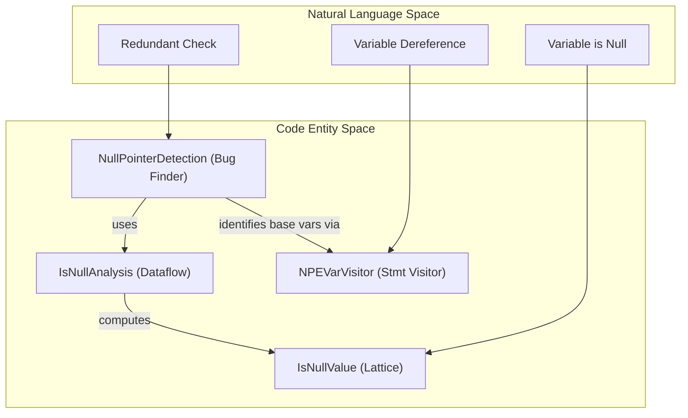

<!-- source: DeepWiki mcp.deepwiki.com · repo pascal-lab/Tai-e · page 8.2 Bug Finders · fetched 2026-10-12 -->

# Bug Finders

<details>
<summary>Relevant source files</summary>

The following files were used as context for generating this wiki page:

- [src/main/java/pascal/taie/analysis/bugfinder/BugInstance.java](src/main/java/pascal/taie/analysis/bugfinder/BugInstance.java)
- [src/main/java/pascal/taie/analysis/bugfinder/BugType.java](src/main/java/pascal/taie/analysis/bugfinder/BugType.java)
- [src/main/java/pascal/taie/analysis/bugfinder/CloneIdiom.java](src/main/java/pascal/taie/analysis/bugfinder/CloneIdiom.java)
- [src/main/java/pascal/taie/analysis/bugfinder/DroppedException.java](src/main/java/pascal/taie/analysis/bugfinder/DroppedException.java)
- [src/main/java/pascal/taie/analysis/bugfinder/Severity.java](src/main/java/pascal/taie/analysis/bugfinder/Severity.java)
- [src/main/java/pascal/taie/analysis/bugfinder/nullpointer/IsNullAnalysis.java](src/main/java/pascal/taie/analysis/bugfinder/nullpointer/IsNullAnalysis.java)
- [src/main/java/pascal/taie/analysis/bugfinder/nullpointer/IsNullConditionDecision.java](src/main/java/pascal/taie/analysis/bugfinder/nullpointer/IsNullConditionDecision.java)
- [src/main/java/pascal/taie/analysis/bugfinder/nullpointer/IsNullFact.java](src/main/java/pascal/taie/analysis/bugfinder/nullpointer/IsNullFact.java)
- [src/main/java/pascal/taie/analysis/bugfinder/nullpointer/IsNullValue.java](src/main/java/pascal/taie/analysis/bugfinder/nullpointer/IsNullValue.java)
- [src/main/java/pascal/taie/analysis/bugfinder/nullpointer/NPEVarVisitor.java](src/main/java/pascal/taie/analysis/bugfinder/nullpointer/NPEVarVisitor.java)
- [src/main/java/pascal/taie/analysis/bugfinder/nullpointer/NullPointerDetection.java](src/main/java/pascal/taie/analysis/bugfinder/nullpointer/NullPointerDetection.java)
- [src/main/java/pascal/taie/analysis/pta/plugin/spring/SpringAnalysis.java](src/main/java/pascal/taie/analysis/pta/plugin/spring/SpringAnalysis.java)
- [src/main/java/pascal/taie/analysis/pta/plugin/spring/di/BeanDefinitionCollector.java](src/main/java/pascal/taie/analysis/pta/plugin/spring/di/BeanDefinitionCollector.java)
- [src/main/java/pascal/taie/analysis/pta/plugin/spring/di/CommonBeanCollector.java](src/main/java/pascal/taie/analysis/pta/plugin/spring/di/CommonBeanCollector.java)
- [src/main/java/pascal/taie/analysis/pta/plugin/spring/di/DiAnalysis.java](src/main/java/pascal/taie/analysis/pta/plugin/spring/di/DiAnalysis.java)
- [src/main/java/pascal/taie/analysis/pta/plugin/spring/di/DiResultProcessor.java](src/main/java/pascal/taie/analysis/pta/plugin/spring/di/DiResultProcessor.java)
- [src/main/java/pascal/taie/analysis/pta/plugin/spring/di/FactoryBeanCollector.java](src/main/java/pascal/taie/analysis/pta/plugin/spring/di/FactoryBeanCollector.java)
- [src/main/java/pascal/taie/analysis/pta/plugin/spring/util/AbstractResultProcessor.java](src/main/java/pascal/taie/analysis/pta/plugin/spring/util/AbstractResultProcessor.java)
- [src/main/java/pascal/taie/analysis/pta/plugin/spring/wec/WecCollector.java](src/main/java/pascal/taie/analysis/pta/plugin/spring/wec/WecCollector.java)
- [src/main/java/pascal/taie/analysis/pta/plugin/util/SolverHolder.java](src/main/java/pascal/taie/analysis/pta/plugin/util/SolverHolder.java)
- [src/test/java/pascal/taie/analysis/bugfinder/BugFinderTestSuite.java](src/test/java/pascal/taie/analysis/bugfinder/BugFinderTestSuite.java)
- [src/test/java/pascal/taie/analysis/bugfinder/CloneIdiomTest.java](src/test/java/pascal/taie/analysis/bugfinder/CloneIdiomTest.java)
- [src/test/java/pascal/taie/analysis/bugfinder/DroppedExceptionTest.java](src/test/java/pascal/taie/analysis/bugfinder/DroppedExceptionTest.java)
- [src/test/java/pascal/taie/analysis/bugfinder/IsNullTest.java](src/test/java/pascal/taie/analysis/bugfinder/IsNullTest.java)
- [src/test/java/pascal/taie/analysis/bugfinder/NullPointerDetectionTest.java](src/test/java/pascal/taie/analysis/bugfinder/NullPointerDetectionTest.java)
- [src/test/java/pascal/taie/analysis/pta/plugin/spring/TestMain.java](src/test/java/pascal/taie/analysis/pta/plugin/spring/TestMain.java)
- [src/test/resources/bugfinder/NullDeref2-is-null-expected.txt](src/test/resources/bugfinder/NullDeref2-is-null-expected.txt)

</details>


Tai-e provides a suite of bug-finding analyses designed to identify common programming errors, such as null pointer dereferences, ignored exceptions, and incorrect implementation of standard Java idioms. These analyses are typically implemented as `MethodAnalysis` instances and often leverage dataflow analysis results.

## Overview of Bug Detection

Bug finders in Tai-e are registered as analyses that produce a set of `BugInstance` objects [src/main/java/pascal/taie/analysis/bugfinder/BugInstance.java:31-42](). Each `BugInstance` contains:
*   **BugType**: A specific identifier for the type of bug (e.g., `NP_ALWAYS_NULL`) [src/main/java/pascal/taie/analysis/bugfinder/BugInstance.java:33]().
*   **Severity**: The impact level of the bug [src/main/java/pascal/taie/analysis/bugfinder/Severity.java:23-29]().
*   **Location**: The class, method, and source line numbers where the bug was detected [src/main/java/pascal/taie/analysis/bugfinder/BugInstance.java:37-43]().

### Severity Levels
Tai-e defines four severity levels for reported bugs:
1.  **BLOCKER**: Critical issues that will almost certainly cause a crash.
2.  **CRITICAL**: Serious issues that should be addressed immediately.
3.  **MAJOR**: Significant issues that may cause unexpected behavior.
4.  **MINOR**: Code smells or minor deviations from best practices.

Sources: [src/main/java/pascal/taie/analysis/bugfinder/BugInstance.java:31-57](), [src/main/java/pascal/taie/analysis/bugfinder/Severity.java:23-29]()

---

## Null Pointer Detection

The Null Pointer Detection system consists of two primary components: `IsNullAnalysis` (the dataflow engine) and `NullPointerDetection` (the bug reporter).

### IsNullAnalysis
`IsNullAnalysis` is an intraprocedural dataflow analysis that tracks the "nullness" of variables [src/main/java/pascal/taie/analysis/bugfinder/nullpointer/IsNullAnalysis.java:56-69]().

*   **Lattice Values (`IsNullValue`)**:
    *   `NULL` / `CHECKED_NULL`: Definitely null [src/main/java/pascal/taie/analysis/bugfinder/nullpointer/IsNullValue.java:28-35]().
    *   `NONNULL` / `CHECKED_NN` / `NO_KABOOM_NN`: Definitely not null [src/main/java/pascal/taie/analysis/bugfinder/nullpointer/IsNullValue.java:38-50]().
    *   `NSP` (Null on Some Path): Potential nullness from annotations like `@CheckForNull` [src/main/java/pascal/taie/analysis/bugfinder/nullpointer/IsNullValue.java:53-55]().
    *   `UNKNOWN` / `NCP`: Nullness cannot be determined or is complex [src/main/java/pascal/taie/analysis/bugfinder/nullpointer/IsNullValue.java:58-65]().
*   **Transfer Functions**: Handled by `IsNullVisitor`, which processes assignments, method calls, and field loads [src/main/java/pascal/taie/analysis/bugfinder/nullpointer/IsNullAnalysis.java:143-150]().
*   **Edge Transfer**: Special logic handles `IF_TRUE` and `IF_FALSE` edges to refine nullness based on comparisons (e.g., `if (x != null)`) [src/main/java/pascal/taie/analysis/bugfinder/nullpointer/IsNullAnalysis.java:188-190]().

### NullPointerDetection
This class uses the results from `IsNullAnalysis` to find two types of issues:
1.  **Null Dereferences**: Uses `NPEVarVisitor` to identify statements that dereference a variable (e.g., `x.f`, `x.m()`, `x[i]`, `throw x`) [src/main/java/pascal/taie/analysis/bugfinder/nullpointer/NPEVarVisitor.java:39-84](). If the variable is `NULL` or `NSP`, a bug is reported [src/main/java/pascal/taie/analysis/bugfinder/nullpointer/NullPointerDetection.java:94-102]().
2.  **Redundant Comparisons**: Identifies checks like `if (x != null)` where `x` is already known to be `NONNULL` or `NULL` [src/main/java/pascal/taie/analysis/bugfinder/nullpointer/NullPointerDetection.java:107-156]().

### Null Pointer Analysis Logic
Title: Null Pointer Detection Data Flow

Sources: [src/main/java/pascal/taie/analysis/bugfinder/nullpointer/IsNullAnalysis.java:56-69](), [src/main/java/pascal/taie/analysis/bugfinder/nullpointer/IsNullValue.java:25-70](), [src/main/java/pascal/taie/analysis/bugfinder/nullpointer/NullPointerDetection.java:42-57](), [src/main/java/pascal/taie/analysis/bugfinder/nullpointer/NPEVarVisitor.java:39-84]()

---

## Dropped Exception Analysis

The `DroppedException` analysis detects anti-patterns in exception handling blocks [src/main/java/pascal/taie/analysis/bugfinder/DroppedException.java:47-78]().

### Detection Patterns
1.  **DE_MIGHT_IGNORE**: A `catch` block that does not use the caught exception variable at all, effectively swallowing the error [src/main/java/pascal/taie/analysis/bugfinder/DroppedException.java:52-53]().
2.  **DE_MIGHT_DROP**: A `catch` block that throws a new exception but fails to chain the original exception as a cause (e.g., `throw new RuntimeException("error")` instead of `throw new RuntimeException(e)`) [src/main/java/pascal/taie/analysis/bugfinder/DroppedException.java:54-55]().

### Implementation Details
*   **Finally Handler Filtering**: The analysis identifies compiler-generated `catch(Throwable)` blocks used for `finally` blocks (which simply rethrow the exception) and excludes them to avoid false positives [src/main/java/pascal/taie/analysis/bugfinder/DroppedException.java:100-110]().
*   **Block Scoping**: It determines the boundaries of the `catch` block by analyzing the IR statement indices and control flow [src/main/java/pascal/taie/analysis/bugfinder/DroppedException.java:128-129]().
*   **Usage Tracking**: It checks if the `Var` representing the caught exception is used as an argument in any `Invoke` expression within the block [src/main/java/pascal/taie/analysis/bugfinder/DroppedException.java:132-134]().

Sources: [src/main/java/pascal/taie/analysis/bugfinder/DroppedException.java:47-154]()

---

## Clone Idiom Analysis

The `CloneIdiom` analysis checks for common mistakes when overriding the `Object.clone()` method.

### Key Checks
*   **Missing super.clone()**: Ensures that the `clone()` method calls `super.clone()`. Failing to do so can lead to returning an object of the wrong class if the class is subtyped.
*   **Cloneable Interface**: Checks if a class that implements `clone()` also implements the `java.lang.Cloneable` interface.
*   **ReturnType**: Verifies that the return type of the `clone()` method is appropriate.

Sources: [src/main/java/pascal/taie/analysis/bugfinder/CloneIdiom.java:1-50]()

---

## Analysis Registration and Execution

Bug finders are typically implemented as `MethodAnalysis` and registered in the analysis framework. They are executed by the `AnalysisManager` as part of the analysis plan.

Title: Bug Finder Execution Pipeline
```mermaid
graph TD
    subgraph "Framework Execution"
        Plan["Analysis Plan (Topological Sort)"]
        Manager["AnalysisManager"]
    end

    subgraph "Bug Finder Entities"
        MA["MethodAnalysis&lt;Set&lt;BugInstance&gt;&gt;"]
        IR["Tai-e IR"]
        Results["BugInstance Set"]
    end

    Manager -- "executes" --> Plan
    Plan -- "triggers" --> MA
    MA -- "reads" --> IR
    MA -- "produces" --> Results
    
    subgraph "Specific Implementations"
        NPD["NullPointerDetection"]
        DE["DroppedException"]
        CI["CloneIdiom"]
    end

    MA <|-- NPD
    MA <|-- DE
    MA <|-- CI
```

### Registration Mechanism
Analyses are registered via the `tai-e-analyses.yml` configuration file. When a bug finder (like `NullPointerDetection`) is requested, the `AnalysisPlanner` ensures its dependencies (like `IsNullAnalysis` and `CFGBuilder`) are executed first [src/main/java/pascal/taie/analysis/bugfinder/nullpointer/NullPointerDetection.java:51-53]().

Sources: [src/main/java/pascal/taie/analysis/bugfinder/nullpointer/NullPointerDetection.java:42-57](), [src/main/java/pascal/taie/analysis/bugfinder/DroppedException.java:79-88]()

---

