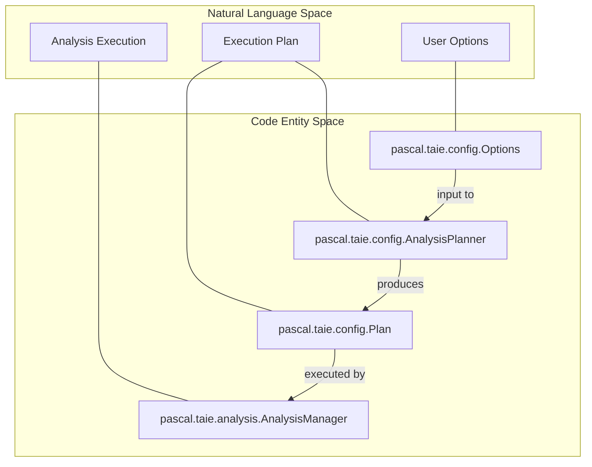
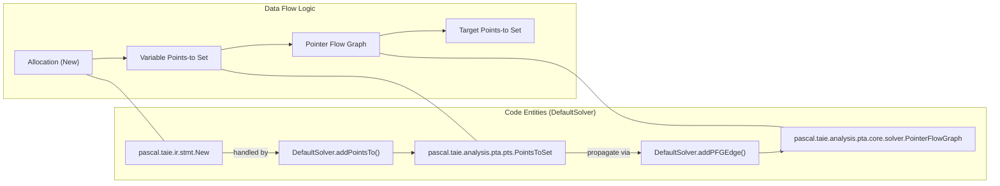

<!-- source: DeepWiki mcp.deepwiki.com · repo pascal-lab/Tai-e · page 9 Glossary · fetched 2026-10-12 -->

# Glossary

Relevant source files

The following files were used as context for generating this wiki page:

- [.gitmodules](.gitmodules)
- [CHANGELOG.md](CHANGELOG.md)
- [src/main/java/pascal/taie/AbstractWorldBuilder.java](src/main/java/pascal/taie/AbstractWorldBuilder.java)
- [src/main/java/pascal/taie/Main.java](src/main/java/pascal/taie/Main.java)
- [src/main/java/pascal/taie/WorldBuilder.java](src/main/java/pascal/taie/WorldBuilder.java)
- [src/main/java/pascal/taie/analysis/AnalysisManager.java](src/main/java/pascal/taie/analysis/AnalysisManager.java)
- [src/main/java/pascal/taie/analysis/ClassAnalysis.java](src/main/java/pascal/taie/analysis/ClassAnalysis.java)
- [src/main/java/pascal/taie/analysis/MethodAnalysis.java](src/main/java/pascal/taie/analysis/MethodAnalysis.java)
- [src/main/java/pascal/taie/analysis/ProgramAnalysis.java](src/main/java/pascal/taie/analysis/ProgramAnalysis.java)
- [src/main/java/pascal/taie/analysis/dataflow/analysis/DataflowAnalysis.java](src/main/java/pascal/taie/analysis/dataflow/analysis/DataflowAnalysis.java)
- [src/main/java/pascal/taie/analysis/dataflow/analysis/constprop/ConstantPropagation.java](src/main/java/pascal/taie/analysis/dataflow/analysis/constprop/ConstantPropagation.java)
- [src/main/java/pascal/taie/analysis/dataflow/inter/AbstractInterDataflowAnalysis.java](src/main/java/pascal/taie/analysis/dataflow/inter/AbstractInterDataflowAnalysis.java)
- [src/main/java/pascal/taie/analysis/dataflow/inter/InterConstantPropagation.java](src/main/java/pascal/taie/analysis/dataflow/inter/InterConstantPropagation.java)
- [src/main/java/pascal/taie/analysis/dataflow/inter/InterDataflowAnalysis.java](src/main/java/pascal/taie/analysis/dataflow/inter/InterDataflowAnalysis.java)
- [src/main/java/pascal/taie/analysis/dataflow/inter/InterSolver.java](src/main/java/pascal/taie/analysis/dataflow/inter/InterSolver.java)
- [src/main/java/pascal/taie/analysis/dataflow/solver/Solver.java](src/main/java/pascal/taie/analysis/dataflow/solver/Solver.java)
- [src/main/java/pascal/taie/analysis/dataflow/solver/WorkListSolver.java](src/main/java/pascal/taie/analysis/dataflow/solver/WorkListSolver.java)
- [src/main/java/pascal/taie/analysis/deadcode/DeadCodeDetection.java](src/main/java/pascal/taie/analysis/deadcode/DeadCodeDetection.java)
- [src/main/java/pascal/taie/analysis/graph/callgraph/CHABuilder.java](src/main/java/pascal/taie/analysis/graph/callgraph/CHABuilder.java)
- [src/main/java/pascal/taie/analysis/graph/callgraph/DefaultCallGraph.java](src/main/java/pascal/taie/analysis/graph/callgraph/DefaultCallGraph.java)
- [src/main/java/pascal/taie/analysis/graph/flowgraph/Node.java](src/main/java/pascal/taie/analysis/graph/flowgraph/Node.java)
- [src/main/java/pascal/taie/analysis/pta/core/cs/element/AbstractPointer.java](src/main/java/pascal/taie/analysis/pta/core/cs/element/AbstractPointer.java)
- [src/main/java/pascal/taie/analysis/pta/core/cs/element/Pointer.java](src/main/java/pascal/taie/analysis/pta/core/cs/element/Pointer.java)
- [src/main/java/pascal/taie/analysis/pta/core/solver/DefaultSolver.java](src/main/java/pascal/taie/analysis/pta/core/solver/DefaultSolver.java)
- [src/main/java/pascal/taie/analysis/pta/core/solver/OtherEdge.java](src/main/java/pascal/taie/analysis/pta/core/solver/OtherEdge.java)
- [src/main/java/pascal/taie/analysis/pta/core/solver/PointerFlowEdge.java](src/main/java/pascal/taie/analysis/pta/core/solver/PointerFlowEdge.java)
- [src/main/java/pascal/taie/analysis/pta/core/solver/PointerFlowGraph.java](src/main/java/pascal/taie/analysis/pta/core/solver/PointerFlowGraph.java)
- [src/main/java/pascal/taie/analysis/pta/core/solver/Solver.java](src/main/java/pascal/taie/analysis/pta/core/solver/Solver.java)
- [src/main/java/pascal/taie/analysis/pta/plugin/AnalysisTimer.java](src/main/java/pascal/taie/analysis/pta/plugin/AnalysisTimer.java)
- [src/main/java/pascal/taie/analysis/pta/plugin/ThreadHandler.java](src/main/java/pascal/taie/analysis/pta/plugin/ThreadHandler.java)
- [src/main/java/pascal/taie/analysis/pta/plugin/taint/CallSourcePoint.java](src/main/java/pascal/taie/analysis/pta/plugin/taint/CallSourcePoint.java)
- [src/main/java/pascal/taie/analysis/pta/plugin/taint/FieldSourcePoint.java](src/main/java/pascal/taie/analysis/pta/plugin/taint/FieldSourcePoint.java)
- [src/main/java/pascal/taie/analysis/pta/plugin/taint/ParamSourcePoint.java](src/main/java/pascal/taie/analysis/pta/plugin/taint/ParamSourcePoint.java)
- [src/main/java/pascal/taie/analysis/pta/plugin/taint/SinkHandler.java](src/main/java/pascal/taie/analysis/pta/plugin/taint/SinkHandler.java)
- [src/main/java/pascal/taie/analysis/pta/plugin/taint/SinkPoint.java](src/main/java/pascal/taie/analysis/pta/plugin/taint/SinkPoint.java)
- [src/main/java/pascal/taie/analysis/pta/plugin/taint/SourceHandler.java](src/main/java/pascal/taie/analysis/pta/plugin/taint/SourceHandler.java)
- [src/main/java/pascal/taie/analysis/pta/plugin/taint/SourcePoint.java](src/main/java/pascal/taie/analysis/pta/plugin/taint/SourcePoint.java)
- [src/main/java/pascal/taie/analysis/pta/plugin/taint/TFGBuilder.java](src/main/java/pascal/taie/analysis/pta/plugin/taint/TFGBuilder.java)
- [src/main/java/pascal/taie/analysis/pta/plugin/taint/TaintAnalysis.java](src/main/java/pascal/taie/analysis/pta/plugin/taint/TaintAnalysis.java)
- [src/main/java/pascal/taie/analysis/pta/plugin/taint/TaintFlow.java](src/main/java/pascal/taie/analysis/pta/plugin/taint/TaintFlow.java)
- [src/main/java/pascal/taie/analysis/pta/plugin/taint/TransferHandler.java](src/main/java/pascal/taie/analysis/pta/plugin/taint/TransferHandler.java)
- [src/main/java/pascal/taie/analysis/pta/toolkit/PointerAnalysisResultEx.java](src/main/java/pascal/taie/analysis/pta/toolkit/PointerAnalysisResultEx.java)
- [src/main/java/pascal/taie/analysis/pta/toolkit/PointerAnalysisResultExImpl.java](src/main/java/pascal/taie/analysis/pta/toolkit/PointerAnalysisResultExImpl.java)
- [src/main/java/pascal/taie/analysis/pta/toolkit/util/OAGs.java](src/main/java/pascal/taie/analysis/pta/toolkit/util/OAGs.java)
- [src/main/java/pascal/taie/analysis/pta/toolkit/zipper/ObjectAllocationGraph.java](src/main/java/pascal/taie/analysis/pta/toolkit/zipper/ObjectAllocationGraph.java)
- [src/main/java/pascal/taie/analysis/pta/toolkit/zipper/PFGBuilder.java](src/main/java/pascal/taie/analysis/pta/toolkit/zipper/PFGBuilder.java)
- [src/main/java/pascal/taie/analysis/pta/toolkit/zipper/PotentialContextElement.java](src/main/java/pascal/taie/analysis/pta/toolkit/zipper/PotentialContextElement.java)
- [src/main/java/pascal/taie/analysis/pta/toolkit/zipper/PrecisionFlowGraph.java](src/main/java/pascal/taie/analysis/pta/toolkit/zipper/PrecisionFlowGraph.java)
- [src/main/java/pascal/taie/analysis/pta/toolkit/zipper/Zipper.java](src/main/java/pascal/taie/analysis/pta/toolkit/zipper/Zipper.java)
- [src/main/java/pascal/taie/android/util/AndroidSystemClassUtil.java](src/main/java/pascal/taie/android/util/AndroidSystemClassUtil.java)
- [src/main/java/pascal/taie/backend/bytecode/JarTransformer.java](src/main/java/pascal/taie/backend/bytecode/JarTransformer.java)
- [src/main/java/pascal/taie/config/AnalysisConfig.java](src/main/java/pascal/taie/config/AnalysisConfig.java)
- [src/main/java/pascal/taie/config/AnalysisOptions.java](src/main/java/pascal/taie/config/AnalysisOptions.java)
- [src/main/java/pascal/taie/config/AnalysisPlanner.java](src/main/java/pascal/taie/config/AnalysisPlanner.java)
- [src/main/java/pascal/taie/config/ConfigManager.java](src/main/java/pascal/taie/config/ConfigManager.java)
- [src/main/java/pascal/taie/config/Configs.java](src/main/java/pascal/taie/config/Configs.java)
- [src/main/java/pascal/taie/config/Options.java](src/main/java/pascal/taie/config/Options.java)
- [src/main/java/pascal/taie/config/Plan.java](src/main/java/pascal/taie/config/Plan.java)
- [src/main/java/pascal/taie/config/PlanConfig.java](src/main/java/pascal/taie/config/PlanConfig.java)
- [src/main/java/pascal/taie/frontend/cache/CachedWorldBuilder.java](src/main/java/pascal/taie/frontend/cache/CachedWorldBuilder.java)
- [src/main/java/pascal/taie/frontend/java/ir/BytecodeIRBuilder.java](src/main/java/pascal/taie/frontend/java/ir/BytecodeIRBuilder.java)
- [src/main/java/pascal/taie/frontend/java/ir/BytecodeProcessor.java](src/main/java/pascal/taie/frontend/java/ir/BytecodeProcessor.java)
- [src/main/java/pascal/taie/frontend/java/ir/DUInfo.java](src/main/java/pascal/taie/frontend/java/ir/DUInfo.java)
- [src/main/java/pascal/taie/frontend/java/ir/IRAssembler.java](src/main/java/pascal/taie/frontend/java/ir/IRAssembler.java)
- [src/main/java/pascal/taie/frontend/java/ir/IRBuilderContext.java](src/main/java/pascal/taie/frontend/java/ir/IRBuilderContext.java)
- [src/main/java/pascal/taie/frontend/java/ir/OperandStack.java](src/main/java/pascal/taie/frontend/java/ir/OperandStack.java)
- [src/main/java/pascal/taie/frontend/java/ir/SlotManager.java](src/main/java/pascal/taie/frontend/java/ir/SlotManager.java)
- [src/main/java/pascal/taie/frontend/java/ir/StackPhiResolver.java](src/main/java/pascal/taie/frontend/java/ir/StackPhiResolver.java)
- [src/main/java/pascal/taie/frontend/java/ir/StmtManager.java](src/main/java/pascal/taie/frontend/java/ir/StmtManager.java)
- [src/main/java/pascal/taie/frontend/java/ir/VarManager.java](src/main/java/pascal/taie/frontend/java/ir/VarManager.java)
- [src/main/java/pascal/taie/frontend/java/ir/typing/TypeInference.java](src/main/java/pascal/taie/frontend/java/ir/typing/TypeInference.java)
- [src/main/java/pascal/taie/frontend/java/project/OptionsProjectBuilder.java](src/main/java/pascal/taie/frontend/java/project/OptionsProjectBuilder.java)
- [src/main/java/pascal/taie/frontend/soot/Converter.java](src/main/java/pascal/taie/frontend/soot/Converter.java)
- [src/main/java/pascal/taie/frontend/soot/SootClassBuilder.java](src/main/java/pascal/taie/frontend/soot/SootClassBuilder.java)
- [src/main/java/pascal/taie/frontend/soot/SootClassLoader.java](src/main/java/pascal/taie/frontend/soot/SootClassLoader.java)
- [src/main/java/pascal/taie/frontend/soot/SootWorldBuilder.java](src/main/java/pascal/taie/frontend/soot/SootWorldBuilder.java)
- [src/main/java/pascal/taie/language/classes/ClassHierarchy.java](src/main/java/pascal/taie/language/classes/ClassHierarchy.java)
- [src/main/java/pascal/taie/language/classes/ClassHierarchyImpl.java](src/main/java/pascal/taie/language/classes/ClassHierarchyImpl.java)
- [src/main/java/pascal/taie/language/classes/JClass.java](src/main/java/pascal/taie/language/classes/JClass.java)
- [src/main/java/pascal/taie/language/classes/JClassBuilder.java](src/main/java/pascal/taie/language/classes/JClassBuilder.java)
- [src/main/java/pascal/taie/language/classes/JMethod.java](src/main/java/pascal/taie/language/classes/JMethod.java)
- [src/main/java/pascal/taie/language/classes/StringReps.java](src/main/java/pascal/taie/language/classes/StringReps.java)
- [src/main/java/pascal/taie/util/Canonicalizer.java](src/main/java/pascal/taie/util/Canonicalizer.java)
- [src/main/java/pascal/taie/util/Timer.java](src/main/java/pascal/taie/util/Timer.java)
- [src/main/java/pascal/taie/util/collection/AbstractBitSet.java](src/main/java/pascal/taie/util/collection/AbstractBitSet.java)
- [src/main/java/pascal/taie/util/collection/AbstractSetEx.java](src/main/java/pascal/taie/util/collection/AbstractSetEx.java)
- [src/main/java/pascal/taie/util/collection/GenericBitSet.java](src/main/java/pascal/taie/util/collection/GenericBitSet.java)
- [src/main/java/pascal/taie/util/collection/IBitSet.java](src/main/java/pascal/taie/util/collection/IBitSet.java)
- [src/main/java/pascal/taie/util/collection/IndexableSet.java](src/main/java/pascal/taie/util/collection/IndexableSet.java)
- [src/main/java/pascal/taie/util/collection/IndexerBitSet.java](src/main/java/pascal/taie/util/collection/IndexerBitSet.java)
- [src/main/java/pascal/taie/util/collection/RegularBitSet.java](src/main/java/pascal/taie/util/collection/RegularBitSet.java)
- [src/main/java/pascal/taie/util/collection/Sets.java](src/main/java/pascal/taie/util/collection/Sets.java)
- [src/main/java/pascal/taie/util/collection/SparseBitSet.java](src/main/java/pascal/taie/util/collection/SparseBitSet.java)
- [src/main/java/pascal/taie/util/graph/TopologicalSorter.java](src/main/java/pascal/taie/util/graph/TopologicalSorter.java)
- [src/main/resources/android/tai-e-android-analyses.yml](src/main/resources/android/tai-e-android-analyses.yml)
- [src/test/java/pascal/taie/analysis/pta/BenchmarkInfo.java](src/test/java/pascal/taie/analysis/pta/BenchmarkInfo.java)
- [src/test/java/pascal/taie/analysis/pta/BenchmarkRunner.java](src/test/java/pascal/taie/analysis/pta/BenchmarkRunner.java)
- [src/test/java/pascal/taie/analysis/pta/toolkit/zipper/ZipperTest.java](src/test/java/pascal/taie/analysis/pta/toolkit/zipper/ZipperTest.java)
- [src/test/java/pascal/taie/config/AnalysisOptionsTest.java](src/test/java/pascal/taie/config/AnalysisOptionsTest.java)
- [src/test/java/pascal/taie/config/OptionsTest.java](src/test/java/pascal/taie/config/OptionsTest.java)
- [src/test/java/pascal/taie/frontend/java/TestBytecodeIRBuilder.java](src/test/java/pascal/taie/frontend/java/TestBytecodeIRBuilder.java)
- [src/test/java/pascal/taie/frontend/soot/OuterInnerTest.java](src/test/java/pascal/taie/frontend/soot/OuterInnerTest.java)
- [src/test/java/pascal/taie/util/collection/IBitSetTest.java](src/test/java/pascal/taie/util/collection/IBitSetTest.java)
- [src/test/java/pascal/taie/util/collection/RegularBitSetTest.java](src/test/java/pascal/taie/util/collection/RegularBitSetTest.java)
- [src/test/java/pascal/taie/util/collection/SparseBitSetTest.java](src/test/java/pascal/taie/util/collection/SparseBitSetTest.java)

This page provides definitions for codebase-specific terminology, domain concepts, and architectural abbreviations used throughout the Tai-e framework.

## Core Program Model

### World
The central program model in Tai-e. It is a singleton that holds the `ClassHierarchy`, `TypeSystem`, and entry point information (e.g., the main method). It serves as the primary gateway for analyses to access program metadata.
*   **Implementation:** `pascal.taie.World`
*   **Key Pointer:** `[src/main/java/pascal/taie/frontend/soot/SootWorldBuilder.java:155-168]()`

### JClass / JMethod / JField
Tai-e's language-agnostic representation of Java classes, methods, and fields. These classes encapsulate metadata such as modifiers, annotations, and signatures.
*   **Implementation:** `pascal.taie.language.classes.JClass`, `pascal.taie.language.classes.JMethod`, `pascal.taie.language.classes.JField`
*   **Key Pointer:** `[src/main/java/pascal/taie/language/classes/JClass.java:61-93]()`

### Phantom Class/Member
A class, method, or field that is referenced by the analyzed code but whose definition is missing from the classpath. Tai-e creates "phantom" entities to allow analysis to continue despite incomplete classpaths.
*   **Implementation:** `[src/main/java/pascal/taie/language/classes/JClass.java:171-180]()`

---

## Analysis Management

### Plan & PlanConfig
A `Plan` is a topologically sorted list of analyses to be executed. A `PlanConfig` represents the configuration for an analysis as defined in a plan file or command line.
*   **Implementation:** `pascal.taie.config.Plan`, `pascal.taie.config.PlanConfig`
*   **Logic:** `[src/main/java/pascal/taie/Main.java:79-116]()`

### AnalysisManager
The component responsible for executing the analysis `Plan`. It tracks analysis results and ensures dependencies are met before an analysis runs.
*   **Implementation:** `pascal.taie.analysis.AnalysisManager`
*   **Call Site:** `[src/main/java/pascal/taie/Main.java:154-156]()`

### Analysis Lifecycle to Code Mapping
The following diagram bridges the high-level analysis planning concepts to the specific classes managing the execution flow.

*Sources: [src/main/java/pascal/taie/Main.java:50-62](), [src/main/java/pascal/taie/config/AnalysisPlanner.java:1-50]()*

---

## Intermediate Representation (IR)

### Tai-e IR
A high-level intermediate representation converted from Java bytecode. It simplifies complex instructions into a standard set of `Stmt` (Statements) and `Exp` (Expressions).
*   **Building Process:** `[src/main/java/pascal/taie/frontend/java/ir/BytecodeIRBuilder.java:50-89]()`

### SlotManager
Used during IR construction to manage local variable slots. It handles the mapping of bytecode local variables to Tai-e `Var` entities and is responsible for SSA (Static Single Assignment) transformation.
*   **Implementation:** `pascal.taie.frontend.java.ir.SlotManager`
*   **Key Pointer:** `[src/main/java/pascal/taie/frontend/java/ir/SlotManager.java:37-56]()`

---

## Pointer Analysis (PTA)

### CS (Context Sensitivity)
A technique to improve analysis precision by distinguishing between different calls to the same method based on their calling context.
*   **Key Classes:** `Context`, `CSVar`, `CSObj`, `CSMethod`
*   **Management:** `pascal.taie.analysis.pta.core.cs.element.CSManager`

### PFG (Pointer Flow Graph)
A directed graph where nodes represent pointers (variables, fields) and edges represent the flow of objects between them.
*   **Implementation:** `pascal.taie.analysis.pta.core.solver.PointerFlowGraph`
*   **Edge Type:** `pascal.taie.analysis.pta.core.solver.PointerFlowEdge`
*   **Logic:** `[src/main/java/pascal/taie/analysis/pta/core/solver/DefaultSolver.java:152-153]()`

### Points-to Set (PTS)
The set of heap objects that a specific pointer can point to at runtime.
*   **Implementation:** `pascal.taie.analysis.pta.pts.PointsToSet`
*   **Creation:** `[src/main/java/pascal/taie/analysis/pta/core/solver/DefaultSolver.java:179]()`

### Solver
The engine that computes points-to information. It iterates through a `WorkList`, processing statements and propagating points-to sets through the PFG.
*   **Implementation:** `pascal.taie.analysis.pta.core.solver.DefaultSolver`
*   **Contract:** `pascal.taie.analysis.pta.core.solver.Solver`
*   **Logic:** `[src/main/java/pascal/taie/analysis/pta/core/solver/Solver.java:52-114]()`

### PTA Data Flow Diagram
This diagram maps the abstract concept of pointer propagation to the concrete `Solver` methods and data structures.

*Sources: [src/main/java/pascal/taie/analysis/pta/core/solver/Solver.java:94-114](), [src/main/java/pascal/taie/analysis/pta/core/solver/DefaultSolver.java:166-185]()*

---

## Taint Analysis

### Source / Sink / TaintTransfer
*   **Source:** A program point where untrusted "tainted" data enters the system.
*   **Sink:** A sensitive program point where tainted data should not flow (e.g., a database query).
*   **TaintTransfer:** A rule defining how taint propagates from one variable to another (e.g., via string concatenation).
*   **Handlers:** `SourceHandler`, `SinkHandler`, `TransferHandler`
*   **Implementation:** `[src/main/java/pascal/taie/analysis/pta/plugin/taint/TaintAnalysis.java:54-58]()`

### TFG (Taint Flow Graph)
A graph representing the flow of tainted data from sources to sinks, constructed on top of the pointer analysis results.
*   **Implementation:** `pascal.taie.analysis.pta.plugin.taint.TFGBuilder`
*   **Key Pointer:** `[src/main/java/pascal/taie/analysis/pta/plugin/taint/TaintAnalysis.java:91]()`

---

## Frontend & Build

### SootWorldBuilder
The component that uses the Soot framework as a frontend to load Java classes and prepare the `World`.
*   **Implementation:** `pascal.taie.frontend.soot.SootWorldBuilder`
*   **Logic:** `[src/main/java/pascal/taie/frontend/soot/SootWorldBuilder.java:70-77]()`

### BytecodeIRBuilder
The primary class for converting Java bytecode into Tai-e's internal IR.
*   **Implementation:** `pascal.taie.frontend.java.ir.BytecodeIRBuilder`
*   **Pipeline:** `[src/main/java/pascal/taie/frontend/java/ir/BytecodeIRBuilder.java:50-89]()`

---

## Miscellaneous

### SSA (Static Single Assignment)
A property of the IR where each variable is assigned exactly once. Tai-e's IR can be transformed into SSA form to simplify dataflow analysis.
*   **Implementation:** `pascal.taie.frontend.java.ir.ssa.SSATransform`
*   **Usage:** `[src/main/java/pascal/taie/frontend/java/ir/SlotManager.java:34-41]()`

### InvokeHandler
An annotation used within PTA plugins to register specialized logic for handling specific method calls (e.g., modeling `System.arraycopy`).
*   **Usage:** `[src/main/java/pascal/taie/analysis/pta/plugin/taint/TaintAnalysis.java:78-82]()` (contextual use in plugins).

### Options
Command-line and file-based configuration settings for the entire framework.
*   **Implementation:** `pascal.taie.config.Options`
*   **Key Pointer:** `[src/main/java/pascal/taie/config/Options.java:77-115]()`