# Page: Overview

# Overview

<details>
<summary>Relevant source files</summary>

The following files were used as context for generating this wiki page:

- [.github/workflows/release.yml](.github/workflows/release.yml)
- [.github/workflows/test.yml](.github/workflows/test.yml)
- [README.md](README.md)
- [build.gradle.kts](build.gradle.kts)
- [config/javadoc/footer.html](config/javadoc/footer.html)
- [docs/en/analysis-management.adoc](docs/en/analysis-management.adoc)
- [docs/en/android-analysis.adoc](docs/en/android-analysis.adoc)
- [docs/en/attributes.adoc](docs/en/attributes.adoc)
- [docs/en/command-line-options.adoc](docs/en/command-line-options.adoc)
- [docs/en/develop-new-analysis.adoc](docs/en/develop-new-analysis.adoc)
- [docs/en/index-single.adoc](docs/en/index-single.adoc)
- [docs/en/index.adoc](docs/en/index.adoc)
- [docs/en/pointer-analysis-framework.adoc](docs/en/pointer-analysis-framework.adoc)
- [docs/en/program-abstraction.adoc](docs/en/program-abstraction.adoc)
- [docs/en/publications.adoc](docs/en/publications.adoc)
- [docs/en/setup-in-intellij-idea.adoc](docs/en/setup-in-intellij-idea.adoc)
- [gradle.properties](gradle.properties)
- [src/main/java/pascal/taie/Main.java](src/main/java/pascal/taie/Main.java)
- [src/main/java/pascal/taie/analysis/AnalysisManager.java](src/main/java/pascal/taie/analysis/AnalysisManager.java)
- [src/main/java/pascal/taie/analysis/graph/callgraph/CallGraphBuilder.java](src/main/java/pascal/taie/analysis/graph/callgraph/CallGraphBuilder.java)
- [src/main/java/pascal/taie/analysis/graph/callgraph/CallGraphs.java](src/main/java/pascal/taie/analysis/graph/callgraph/CallGraphs.java)
- [src/main/java/pascal/taie/analysis/graph/callgraph/PTABasedBuilder.java](src/main/java/pascal/taie/analysis/graph/callgraph/PTABasedBuilder.java)
- [src/main/java/pascal/taie/analysis/graph/cfg/CFGBuilder.java](src/main/java/pascal/taie/analysis/graph/cfg/CFGBuilder.java)
- [src/main/java/pascal/taie/analysis/graph/cfg/CFGDumper.java](src/main/java/pascal/taie/analysis/graph/cfg/CFGDumper.java)
- [src/main/java/pascal/taie/analysis/graph/flowgraph/FlowGraphDumper.java](src/main/java/pascal/taie/analysis/graph/flowgraph/FlowGraphDumper.java)
- [src/main/java/pascal/taie/analysis/graph/icfg/ICFGBuilder.java](src/main/java/pascal/taie/analysis/graph/icfg/ICFGBuilder.java)
- [src/main/java/pascal/taie/analysis/misc/IRDumper.java](src/main/java/pascal/taie/analysis/misc/IRDumper.java)
- [src/main/java/pascal/taie/analysis/misc/ResultProcessor.java](src/main/java/pascal/taie/analysis/misc/ResultProcessor.java)
- [src/main/java/pascal/taie/analysis/pta/PointerAnalysis.java](src/main/java/pascal/taie/analysis/pta/PointerAnalysis.java)
- [src/main/java/pascal/taie/analysis/pta/client/Collector.java](src/main/java/pascal/taie/analysis/pta/client/Collector.java)
- [src/main/java/pascal/taie/analysis/pta/plugin/AnalysisTimer.java](src/main/java/pascal/taie/analysis/pta/plugin/AnalysisTimer.java)
- [src/main/java/pascal/taie/analysis/pta/plugin/Profiler.java](src/main/java/pascal/taie/analysis/pta/plugin/Profiler.java)
- [src/main/java/pascal/taie/config/AnalysisConfig.java](src/main/java/pascal/taie/config/AnalysisConfig.java)
- [src/main/java/pascal/taie/config/AnalysisOptions.java](src/main/java/pascal/taie/config/AnalysisOptions.java)
- [src/main/java/pascal/taie/config/AnalysisPlanner.java](src/main/java/pascal/taie/config/AnalysisPlanner.java)
- [src/main/java/pascal/taie/config/ConfigManager.java](src/main/java/pascal/taie/config/ConfigManager.java)
- [src/main/java/pascal/taie/config/Configs.java](src/main/java/pascal/taie/config/Configs.java)
- [src/main/java/pascal/taie/config/Plan.java](src/main/java/pascal/taie/config/Plan.java)
- [src/main/java/pascal/taie/config/PlanConfig.java](src/main/java/pascal/taie/config/PlanConfig.java)
- [src/main/java/pascal/taie/util/Timer.java](src/main/java/pascal/taie/util/Timer.java)
- [src/main/java/pascal/taie/util/graph/DotDumper.java](src/main/java/pascal/taie/util/graph/DotDumper.java)
- [src/main/resources/android/tai-e-android-analyses.yml](src/main/resources/android/tai-e-android-analyses.yml)
- [src/main/resources/tai-e-analyses.yml](src/main/resources/tai-e-analyses.yml)
- [src/test/java/pascal/taie/analysis/Tests.java](src/test/java/pascal/taie/analysis/Tests.java)
- [src/test/java/pascal/taie/config/AnalysisOptionsTest.java](src/test/java/pascal/taie/config/AnalysisOptionsTest.java)

</details>


Tai-e (Chinese: 太阿; pronunciation: [ˈtaɪə:]) is a modern static analysis framework for Java, described in the ISSTA 2023 paper *"Tai-e: A Developer-Friendly Static Analysis Framework for Java by Harnessing the Good Designs of Classics"* [README.md:72-74](). It features designs inspired by classic frameworks such as Soot, WALA, Doop, and SpotBugs while introducing novel optimizations for speed and precision [README.md:42-43]().

The framework targets both analysis consumers (running existing analyses) and analysis developers (building new analyses). Key capabilities include pointer analysis, taint analysis, dataflow analysis, call graph construction, reflection handling, and bug detection [README.md:45-66]().

For setup and running instructions, see page [Getting Started](#1.1). For core architectural components, see page [Core Architecture](#2). For the pointer analysis subsystem, see page [Pointer Analysis](#3).

## Major Subsystems

| Subsystem | Wiki Page | Key Packages / Entry Points |
|---|---|---|
| Program model (World, classes, types, IR) | [World and Class Hierarchy](#2.1), [Intermediate Representation](#2.2) | `pascal.taie.World`, `pascal.taie.language.*`, `pascal.taie.ir.*` |
| Analysis management (planning, execution) | [Analysis Management](#2.3) | `pascal.taie.config.*`, `pascal.taie.analysis.AnalysisManager` |
| Frontend (Soot integration, IR building) | [Frontend](#5) | `pascal.taie.frontend.soot.*` |
| Pointer analysis | [Pointer Analysis](#3) | `pascal.taie.analysis.pta.PointerAnalysis` |
| Taint analysis | [Taint Analysis](#4) | `pascal.taie.analysis.pta.plugin.taint.*` |
| Dataflow analysis | [Dataflow Analysis](#6) | `pascal.taie.analysis.dataflow.*` |
| Advanced features (Zipper, Mahjong, reflection) | [Advanced Features](#7) | `pascal.taie.analysis.pta.plugin.*` |

Sources: [README.md:45-66](), [src/main/resources/tai-e-analyses.yml:1-171]()

## Framework Architecture

Tai-e follows a layered architecture with clear separation between frontend processing, core analysis infrastructure, and extensible analysis implementations.

### High-Level Execution Flow

**Diagram: End-to-end execution pipeline from CLI to analysis results**

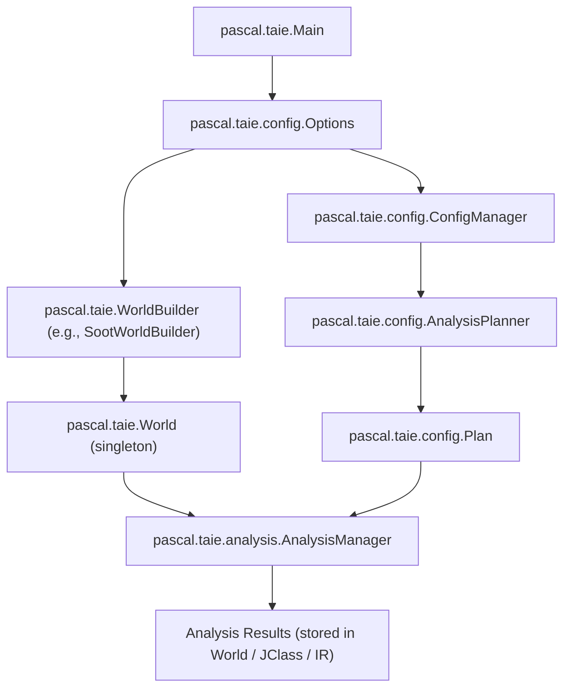

The execution starts in `pascal.taie.Main` [src/main/java/pascal/taie/Main.java:50-62](), which parses command-line arguments into an `Options` object [src/main/java/pascal/taie/Main.java:70-77](). It then builds the `World` (the central program model) and executes a `Plan` (a topologically sorted sequence of analyses) via the `AnalysisManager` [src/main/java/pascal/taie/Main.java:128-156]().

Sources: [src/main/java/pascal/taie/Main.java:50-62](), [src/main/java/pascal/taie/analysis/AnalysisManager.java:88-110]()

## Core Framework Components

### Program Representation Layer

**Diagram: World singleton and the program model it exposes**

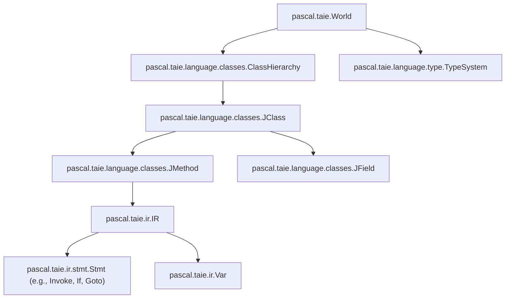

`World` is the singleton program model [src/main/java/pascal/taie/analysis/AnalysisManager.java:150-151](). It provides access to the `ClassHierarchy` and `TypeSystem`. Method bodies are represented as `IR` (Intermediate Representation) [src/main/java/pascal/taie/analysis/AnalysisManager.java:190-205](), which contains a list of 3-address code statements (`Stmt`) and variables (`Var`).

Sources: [src/main/java/pascal/taie/Main.java:138-147](), [src/main/java/pascal/taie/analysis/AnalysisManager.java:147-188]()

### Analysis Management System

All available analyses are declared in `src/main/resources/tai-e-analyses.yml` [src/main/resources/tai-e-analyses.yml:1-171](). `AnalysisPlanner` resolves dependencies (e.g., `cg` requires `pta`) and produces a `Plan` [src/main/java/pascal/taie/Main.java:83-96](). `AnalysisManager` executes the plan, supporting three levels of analysis:
- `ProgramAnalysis`: Whole-program scope [src/main/java/pascal/taie/analysis/AnalysisManager.java:147-152]().
- `ClassAnalysis`: Analyzes each class in scope [src/main/java/pascal/taie/analysis/AnalysisManager.java:154-162]().
- `MethodAnalysis`: Analyzes each method in scope [src/main/java/pascal/taie/analysis/AnalysisManager.java:190-205]().

Sources: [src/main/resources/tai-e-analyses.yml:1-171](), [src/main/java/pascal/taie/analysis/AnalysisManager.java:112-145]()

## Core Analysis Framework

### Pointer Analysis Infrastructure

Pointer analysis is the foundation of Tai-e's whole-program analysis [src/main/resources/tai-e-analyses.yml:1-36](). It uses a plugin-based architecture [src/main/java/pascal/taie/analysis/pta/PointerAnalysis.java:125-165]().

**Diagram: Pointer analysis solver and its plugin system**

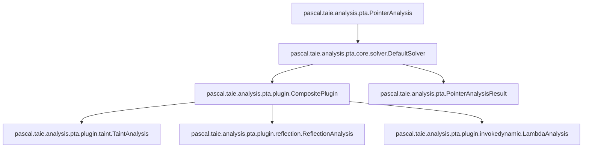

`DefaultSolver` implements the fixpoint algorithm [src/main/java/pascal/taie/analysis/pta/PointerAnalysis.java:115-122](). Plugins like `TaintAnalysis` and `ReflectionAnalysis` register with the solver to extend its logic during propagation [src/main/java/pascal/taie/analysis/pta/PointerAnalysis.java:125-165]().

Sources: [src/main/java/pascal/taie/analysis/pta/PointerAnalysis.java:75-123](), [src/main/resources/tai-e-analyses.yml:1-36]()

## Build and Testing

Tai-e uses Gradle for builds [build.gradle.kts:1-6](). It includes a robust testing utility `Tests` for regression testing [src/test/java/pascal/taie/analysis/Tests.java:51-147]().
- **Fat JAR**: Can be built via `./gradlew fatJar` [build.gradle.kts:116-134]().
- **CI**: Automated testing via GitHub Actions [test.yml:1-43]().
- **Coverage**: Code coverage reporting via Jacoco and Codecov [test.yml:35-43]().

Sources: [build.gradle.kts:116-134](), [src/test/java/pascal/taie/analysis/Tests.java:110-147](), [.github/workflows/test.yml:1-43]()

---

# Page: Getting Started

# Getting Started

<details>
<summary>Relevant source files</summary>

The following files were used as context for generating this wiki page:

- [.github/workflows/checkstyle.yml](.github/workflows/checkstyle.yml)
- [.github/workflows/release.yml](.github/workflows/release.yml)
- [.github/workflows/test.yml](.github/workflows/test.yml)
- [.gitmodules](.gitmodules)
- [CHANGELOG.md](CHANGELOG.md)
- [README.md](README.md)
- [build.gradle.kts](build.gradle.kts)
- [config/javadoc/footer.html](config/javadoc/footer.html)
- [docs/en/command-line-options.adoc](docs/en/command-line-options.adoc)
- [gradle.properties](gradle.properties)
- [gradle/wrapper/gradle-wrapper.jar](gradle/wrapper/gradle-wrapper.jar)
- [gradle/wrapper/gradle-wrapper.properties](gradle/wrapper/gradle-wrapper.properties)
- [gradlew](gradlew)
- [gradlew.bat](gradlew.bat)
- [lib/sootclasses-modified.jar](lib/sootclasses-modified.jar)
- [src/main/java/pascal/taie/AbstractWorldBuilder.java](src/main/java/pascal/taie/AbstractWorldBuilder.java)
- [src/main/java/pascal/taie/WorldBuilder.java](src/main/java/pascal/taie/WorldBuilder.java)
- [src/main/java/pascal/taie/backend/bytecode/JarTransformer.java](src/main/java/pascal/taie/backend/bytecode/JarTransformer.java)
- [src/main/java/pascal/taie/config/Options.java](src/main/java/pascal/taie/config/Options.java)
- [src/main/java/pascal/taie/frontend/cache/CachedWorldBuilder.java](src/main/java/pascal/taie/frontend/cache/CachedWorldBuilder.java)
- [src/main/java/pascal/taie/frontend/java/project/OptionsProjectBuilder.java](src/main/java/pascal/taie/frontend/java/project/OptionsProjectBuilder.java)
- [src/main/java/pascal/taie/frontend/soot/SootWorldBuilder.java](src/main/java/pascal/taie/frontend/soot/SootWorldBuilder.java)
- [src/test/java/pascal/taie/analysis/pta/BenchmarkInfo.java](src/test/java/pascal/taie/analysis/pta/BenchmarkInfo.java)
- [src/test/java/pascal/taie/analysis/pta/BenchmarkRunner.java](src/test/java/pascal/taie/analysis/pta/BenchmarkRunner.java)
- [src/test/java/pascal/taie/config/OptionsTest.java](src/test/java/pascal/taie/config/OptionsTest.java)
- [src/test/java/pascal/taie/frontend/java/TestBytecodeIRBuilder.java](src/test/java/pascal/taie/frontend/java/TestBytecodeIRBuilder.java)

</details>


This page covers how to obtain Tai-e, invoke it from the command line, and interpret its basic output. It focuses on the mechanics of installation and invocation. For a conceptual overview of what Tai-e is and how its subsystems relate, see the [Overview](#1). For deep dives into specific analyses, see [Pointer Analysis](#3), [Taint Analysis](#4), or [Dataflow Analysis](#6).

---

## Prerequisites

- **Java 17 or higher** — Tai-e is compiled for and requires Java 17+. It runs on Windows, Linux, and macOS [README.md:7-10]().
- **`java-benchmarks` submodule** — Tai-e resolves the Java standard library from this submodule by default. Clone it with:

```shell
git submodule update --init --recursive
```

The submodule provides JRE jars for Java versions under `java-benchmarks/JREs/` [AbstractWorldBuilder.java:52-52]().

---

## Obtaining Tai-e

There are three ways to get a runnable Tai-e.

### Option 1 — Prebuilt Distribution from GitHub Releases

The recommended way is to download the distribution ZIP from [GitHub Releases](https://github.com/pascal-lab/Tai-e/releases). The ZIP contains Tai-e, all runtime dependencies, offline documentation, and startup scripts (`bin/tai-e` and `bin/tai-e.bat`) [README.md:78-80]().

### Option 2 — Build from Source

With Java 17+ available, use the Gradle wrapper from the repository root to build a distribution or a fat JAR:

```shell
./gradlew distZip        # Creates distribution ZIP in build/distributions/
./gradlew fatJar        # Creates a single legacy JAR in build/
```

The `fatJar` task is defined in [build.gradle.kts:116-134](). It sets `pascal.taie.Main` as the entry point [build.gradle.kts:120-120]().

### Option 3 — Maven / Gradle Dependency

Tai-e is published to Maven Central under the coordinates `net.pascal-lab:tai-e` [README.md:104-125]().

| Build tool | Coordinate |
|---|---|
| Gradle | `implementation("net.pascal-lab:tai-e:0.5.4")` |
| Maven | `<groupId>net.pascal-lab</groupId><artifactId>tai-e</artifactId><version>0.5.4</version>` |

Sources: [README.md:78-125](), [build.gradle.kts:116-134](), [gradle.properties:6-8]()

---

## Execution Flow

The entry point is `pascal.taie.Main`. Every invocation passes through sequential phases to transform command-line arguments into analysis results.

**Diagram: Invocation Flow Through `Main`**

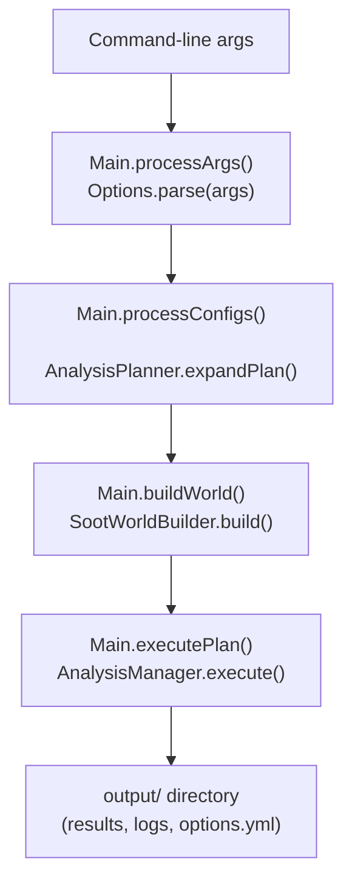

Sources: [src/main/java/pascal/taie/Main.java:51-65]() (Note: File not provided in full but logic described in README/CHANGELOG)

---

## Command-Line Options

All options are managed by the `Options` class using the `picocli` framework [Options.java:73-77]().

**Diagram: Option Categories and Key Flags**

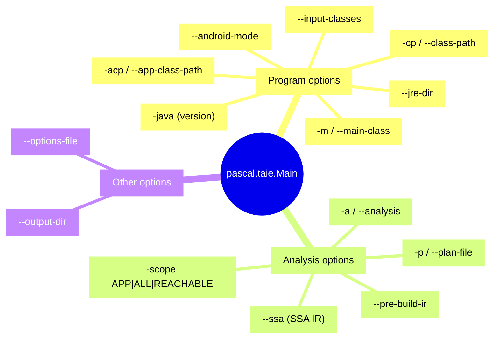

Sources: [Options.java:93-288](), [CHANGELOG.md:8-28]()

### Program Options

These identify the Java program to analyze and the environment setup.

| Flag | Description |
|---|---|
| `-cp <path>` | Class path for program classes. Repeatable [Options.java:118-122](). |
| `-acp <path>` | Application class path. Repeatable [Options.java:130-134](). |
| `-m <class>` | Fully-qualified name of the main class [Options.java:141-142](). |
| `-java <version>` | Java version for the analyzed program (e.g., `8`). Used to find JRE jars [Options.java:162-164](). |
| `--jre-dir <path>` | Explicit directory for the JRE selected by `-java` [CHANGELOG.md:13-13](). |
| `--android-mode` | Enables Android analysis mode [CHANGELOG.md:16-16](). |
| `--ssa` | Enables Static Single Assignment (SSA) IR generation [CHANGELOG.md:10-10](). |

### Analysis Options

Analyses are specified using the `-a` flag. The format is `-a <id>[=<options>]`.

```shell
# Example: Run Pointer Analysis with context sensitivity and dump results
java -jar tai-e-all.jar -cp app.jar -m Main -a pta=cs:ci;dump:true
```

Multiple `-a` flags can be used to chain analyses. Alternatively, a YAML plan file can be passed via `-p` [OptionsTest.java:145-148]().

---

## World Building and Frontends

Tai-e uses a "World Builder" to load classes and construct the program model. As of v0.5.4, the default is `JavaWorldBuilder` [CHANGELOG.md:30-31]().

**Diagram: Frontend Components and Class Loading**

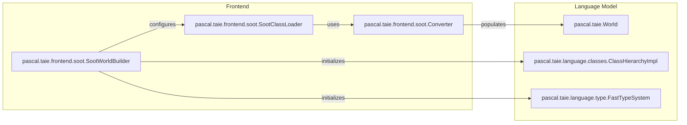

Sources: [SootWorldBuilder.java:154-175](), [AbstractWorldBuilder.java:48-70]()

### Classpath Resolution
The framework automatically resolves JRE jars if `useCurrentJRE` is false, looking into the `java-benchmarks` directory [AbstractWorldBuilder.java:78-90](). If `--android-mode` is active, it also validates Android platform jars [AbstractWorldBuilder.java:131-145]().

---

## Output

Results are stored in the directory specified by `--output-dir` (default: `output`).

| File / Directory | Contents |
|---|---|
| `options.yml` | The resolved configuration used for the run [Options.java:81-81](). |
| `sootOutput/` | Jimple IR files if using the Soot frontend [SootWorldBuilder.java:84-87](). |
| `tai-e.log` | Execution logs and performance monitoring (CPU/Memory) [CHANGELOG.md:39-39](). |
| `pta/` | Pointer analysis results (e.g., points-to sets) if `dump:true` is set. |

---

## What to Read Next

| Topic | Wiki page |
|---|---|
| Program model and loading | [World and Class Hierarchy](#2.1) |
| IR structure and Stmts | [Intermediate Representation](#2.2) |
| Analysis planning logic | [Analysis Management](#2.3) |
| Context sensitivity modes | [Pointer Analysis Configuration](#3.1) |

Sources: [CHANGELOG.md:1-28](), [Options.java:77-171](), [SootWorldBuilder.java:70-133](), [AbstractWorldBuilder.java:48-152]()

---

# Page: Core Architecture

# Core Architecture

<details>
<summary>Relevant source files</summary>

The following files were used as context for generating this wiki page:

- [src/main/java/pascal/taie/Main.java](src/main/java/pascal/taie/Main.java)
- [src/main/java/pascal/taie/World.java](src/main/java/pascal/taie/World.java)
- [src/main/java/pascal/taie/analysis/AnalysisManager.java](src/main/java/pascal/taie/analysis/AnalysisManager.java)
- [src/main/java/pascal/taie/analysis/graph/callgraph/CallGraphBuilder.java](src/main/java/pascal/taie/analysis/graph/callgraph/CallGraphBuilder.java)
- [src/main/java/pascal/taie/analysis/graph/callgraph/CallGraphs.java](src/main/java/pascal/taie/analysis/graph/callgraph/CallGraphs.java)
- [src/main/java/pascal/taie/analysis/graph/callgraph/PTABasedBuilder.java](src/main/java/pascal/taie/analysis/graph/callgraph/PTABasedBuilder.java)
- [src/main/java/pascal/taie/analysis/graph/cfg/CFGBuilder.java](src/main/java/pascal/taie/analysis/graph/cfg/CFGBuilder.java)
- [src/main/java/pascal/taie/analysis/graph/cfg/CFGDumper.java](src/main/java/pascal/taie/analysis/graph/cfg/CFGDumper.java)
- [src/main/java/pascal/taie/analysis/graph/flowgraph/FlowGraphDumper.java](src/main/java/pascal/taie/analysis/graph/flowgraph/FlowGraphDumper.java)
- [src/main/java/pascal/taie/analysis/graph/icfg/ICFGBuilder.java](src/main/java/pascal/taie/analysis/graph/icfg/ICFGBuilder.java)
- [src/main/java/pascal/taie/analysis/misc/IRDumper.java](src/main/java/pascal/taie/analysis/misc/IRDumper.java)
- [src/main/java/pascal/taie/analysis/misc/ResultProcessor.java](src/main/java/pascal/taie/analysis/misc/ResultProcessor.java)
- [src/main/java/pascal/taie/analysis/pta/PointerAnalysis.java](src/main/java/pascal/taie/analysis/pta/PointerAnalysis.java)
- [src/main/java/pascal/taie/analysis/pta/client/Collector.java](src/main/java/pascal/taie/analysis/pta/client/Collector.java)
- [src/main/java/pascal/taie/analysis/pta/plugin/AnalysisTimer.java](src/main/java/pascal/taie/analysis/pta/plugin/AnalysisTimer.java)
- [src/main/java/pascal/taie/analysis/pta/plugin/Profiler.java](src/main/java/pascal/taie/analysis/pta/plugin/Profiler.java)
- [src/main/java/pascal/taie/config/AnalysisConfig.java](src/main/java/pascal/taie/config/AnalysisConfig.java)
- [src/main/java/pascal/taie/config/AnalysisOptions.java](src/main/java/pascal/taie/config/AnalysisOptions.java)
- [src/main/java/pascal/taie/config/AnalysisPlanner.java](src/main/java/pascal/taie/config/AnalysisPlanner.java)
- [src/main/java/pascal/taie/config/ConfigManager.java](src/main/java/pascal/taie/config/ConfigManager.java)
- [src/main/java/pascal/taie/config/Configs.java](src/main/java/pascal/taie/config/Configs.java)
- [src/main/java/pascal/taie/config/Plan.java](src/main/java/pascal/taie/config/Plan.java)
- [src/main/java/pascal/taie/config/PlanConfig.java](src/main/java/pascal/taie/config/PlanConfig.java)
- [src/main/java/pascal/taie/ir/DefaultIR.java](src/main/java/pascal/taie/ir/DefaultIR.java)
- [src/main/java/pascal/taie/ir/IR.java](src/main/java/pascal/taie/ir/IR.java)
- [src/main/java/pascal/taie/util/Timer.java](src/main/java/pascal/taie/util/Timer.java)
- [src/main/java/pascal/taie/util/graph/DotDumper.java](src/main/java/pascal/taie/util/graph/DotDumper.java)
- [src/main/java/pascal/taie/util/graph/SCC.java](src/main/java/pascal/taie/util/graph/SCC.java)
- [src/main/resources/android/tai-e-android-analyses.yml](src/main/resources/android/tai-e-android-analyses.yml)
- [src/main/resources/tai-e-analyses.yml](src/main/resources/tai-e-analyses.yml)
- [src/test/java/pascal/taie/TaieTestSuite.java](src/test/java/pascal/taie/TaieTestSuite.java)
- [src/test/java/pascal/taie/analysis/Tests.java](src/test/java/pascal/taie/analysis/Tests.java)
- [src/test/java/pascal/taie/config/AnalysisOptionsTest.java](src/test/java/pascal/taie/config/AnalysisOptionsTest.java)
- [src/test/java/pascal/taie/frontend/soot/InvokeDynamicTest.java](src/test/java/pascal/taie/frontend/soot/InvokeDynamicTest.java)
- [src/test/java/pascal/taie/ir/IRTest.java](src/test/java/pascal/taie/ir/IRTest.java)
- [src/test/java/pascal/taie/language/classes/StringRepsTest.java](src/test/java/pascal/taie/language/classes/StringRepsTest.java)
- [src/test/java/pascal/taie/util/graph/GraphTest.java](src/test/java/pascal/taie/util/graph/GraphTest.java)

</details>


This page describes how Tai-e's major subsystems fit together: the `World` singleton as the central program model, the configuration and planning pipeline, and the execution flow from command-line invocation through world construction to analysis results.

For details on what `World` contains (class hierarchy, type system, IR), see [World and Class Hierarchy](#2.1). For the analysis management details specific to individual analysis types, see [Analysis Management](#2.3). For the frontend pipeline that populates `World`, see [Frontend](#5).

---

## Startup and Execution Flow

The entry point is `pascal.taie.Main` [src/main/java/pascal/taie/Main.java:46-46](), which performs four sequential steps:

1. **Parse arguments** — `Options.parse(args)` [src/main/java/pascal/taie/Main.java:71-71]() populates an `Options` instance via picocli.
2. **Process configs** — reads `tai-e-analyses.yml` [src/main/java/pascal/taie/Main.java:80-81](), resolves dependencies, and produces a `Plan` [src/main/java/pascal/taie/Main.java:95-96]().
3. **Build the world** — invokes a `WorldBuilder` to construct the global `World` singleton [src/main/java/pascal/taie/Main.java:128-151]().
4. **Execute the plan** — `AnalysisManager` runs each analysis in topological order [src/main/java/pascal/taie/Main.java:154-156]().

**Startup sequence in `Main.main`**

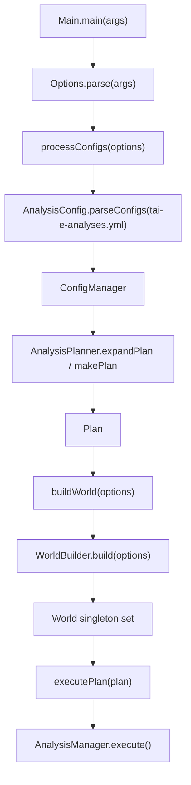

Sources: [src/main/java/pascal/taie/Main.java:50-64](), [src/main/java/pascal/taie/Main.java:128-151]()

---

## Configuration System

### `Options` — Global CLI Options

`Options` is populated by picocli at startup. It controls the analysis scope, class paths, and which analyses to execute. Options can also be read from a YAML file via `--options-file`.

| Field / Flag | Purpose |
|---|---|
| `-cp` / `--class-path` | Library class path |
| `-m` / `--main-class` | Entry class for analysis |
| `--input-classes` | Additional classes to include |
| `--world-builder` | `WorldBuilder` class (default: `SootWorldBuilder`) |
| `--output-dir` | Output directory |
| `-wc` / `--world-cache-mode` | Serialize/deserialize `World` to disk |
| `-scope` | `APP`, `ALL`, or `REACHABLE` |
| `-a` / `--analysis` | Analyses to run (id=options pairs) |
| `-p` / `--plan-file` | Path to a plan YAML file |
| `-kr` / `--keep-result` | Analysis IDs whose results are retained |

Sources: [src/main/java/pascal/taie/Main.java:70-77](), [src/main/java/pascal/taie/config/PlanConfig.java:107-116]()

---

### `AnalysisConfig` vs `PlanConfig`

Two config types serve different purposes:

| | `AnalysisConfig` | `PlanConfig` |
|---|---|---|
| **Source** | `tai-e-analyses.yml` (static registry) | CLI `-a` flags or a plan YAML file |
| **Contains** | `id`, `analysisClass`, `requires`, default `options` | `id`, user-supplied `options` |
| **Role** | Declares what an analysis is | Declares what the user wants to run |

`AnalysisOptions` [src/main/java/pascal/taie/config/AnalysisOptions.java]() wraps a `Map<String, Object>` and provides typed accessors (`getString`, `getBoolean`, `getInt`).

Sources: [src/main/java/pascal/taie/config/PlanConfig.java:47-72](), [src/main/java/pascal/taie/config/AnalysisConfig.java]()

---

### Analysis Registry: `tai-e-analyses.yml`

Every built-in analysis is declared in [src/main/resources/tai-e-analyses.yml](). Each entry defines the implementing class, a unique ID, and optional dependencies.

```yaml
- description: whole-program pointer analysis
  analysisClass: pascal.taie.analysis.pta.PointerAnalysis
  id: pta
  options:
    cs: ci
    ...
```

The `requires` field [src/main/resources/tai-e-analyses.yml:42-42]() allows for conditional dependencies, such as `cg` requiring `pta` only when a specific algorithm is selected.

Sources: [src/main/resources/tai-e-analyses.yml:1-171]()

---

### `ConfigManager` and `AnalysisPlanner`

`ConfigManager` holds all `AnalysisConfig` objects and merges user-supplied `PlanConfig` options. `AnalysisPlanner` [src/main/java/pascal/taie/config/AnalysisPlanner.java:45-45]() converts requested analyses into a topologically sorted `Plan`:

- **`expandPlan`** [src/main/java/pascal/taie/config/AnalysisPlanner.java:151-170]() — Automatically adds missing required analyses by traversing the dependency graph.
- **`makePlan`** [src/main/java/pascal/taie/config/AnalysisPlanner.java:67-74]() — Validates a pre-defined sequence (e.g., from a plan file).

**Planning pipeline**

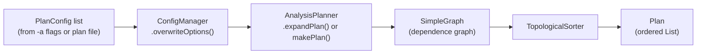

Sources: [src/main/java/pascal/taie/config/AnalysisPlanner.java:71-73](), [src/main/java/pascal/taie/config/Plan.java]()

---

## World Building

### `WorldBuilder` and `SootWorldBuilder`

The `WorldBuilder` interface defines the contract for constructing the program model. `SootWorldBuilder` uses Soot to load Java class files and translate them into Tai-e's internal representation.

`SootWorldBuilder` performs the following in its `build` method [src/main/java/pascal/taie/frontend/soot/SootWorldBuilder.java:69-84]():
- Initializes the Soot `Scene`.
- Populates the `ClassHierarchy` and `TypeSystem`.
- Sets the `mainMethod` and entry points.
- Initializes the `IRBuilder` for converting method bodies to Tai-e IR.

The resulting `World` singleton is set via `World.set(world)` [src/main/java/pascal/taie/World.java:91-93]().

Sources: [src/main/java/pascal/taie/World.java:49-196](), [src/main/java/pascal/taie/Main.java:128-152]()

### `CachedWorldBuilder` — World Caching

When `--world-cache-mode` is enabled, `Main` wraps the builder with `CachedWorldBuilder` [src/main/java/pascal/taie/Main.java:134-136](). This implementation attempts to load a serialized `World` from disk based on a hash of the input options to skip the expensive frontend phase.

Sources: [src/main/java/pascal/taie/Main.java:134-137]()

---

## Analysis Execution

### `AnalysisManager`

`AnalysisManager` [src/main/java/pascal/taie/analysis/AnalysisManager.java:51-51]() executes the `Plan`. It instantiates analyses via reflection [src/main/java/pascal/taie/analysis/AnalysisManager.java:116-118]() and dispatches them based on their granularity:

| Type | Dispatch method | Scope | Result stored on |
|---|---|---|---|
| `ProgramAnalysis<R>` | `runProgramAnalysis` | Whole program | `World` |
| `ClassAnalysis<R>` | `runClassAnalysis` | Per `JClass` | `JClass` |
| `MethodAnalysis<R>` | `runMethodAnalysis` | Per `JMethod` | `IR` |

The analysis scope (which classes/methods to process) is determined by `getClassScope()` [src/main/java/pascal/taie/analysis/AnalysisManager.java:164-188]() and `getMethodScope()`, respecting the `-scope` option (APP, ALL, or REACHABLE).

**Analysis dispatch flow**

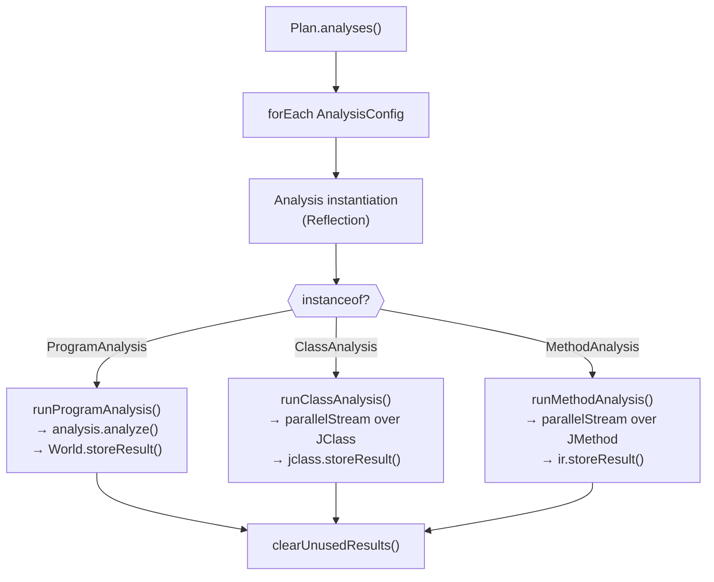

Sources: [src/main/java/pascal/taie/analysis/AnalysisManager.java:88-109](), [src/main/java/pascal/taie/analysis/AnalysisManager.java:147-162]()

---

## The `World` Singleton

`World` [src/main/java/pascal/taie/World.java:49-49]() is the central hub for all global information. It holds the `ClassHierarchy`, `TypeSystem`, and analysis results.

| Accessor | Type | Purpose |
|---|---|---|
| `getClassHierarchy()` | `ClassHierarchy` | Access to `JClass`, `JMethod`, `JField` |
| `getTypeSystem()` | `TypeSystem` | Java type model and hierarchy |
| `getIRBuilder()` | `IRBuilder` | Logic to build Tai-e IR from bytecode |
| `getResult(id)` | `Object` | Retrieve result of a completed analysis |

Sources: [src/main/java/pascal/taie/World.java:119-166]()

---

# Page: World and Class Hierarchy

# World and Class Hierarchy

<details>
<summary>Relevant source files</summary>

The following files were used as context for generating this wiki page:

- [src/main/java/pascal/taie/World.java](src/main/java/pascal/taie/World.java)
- [src/main/java/pascal/taie/analysis/graph/callgraph/CHABuilder.java](src/main/java/pascal/taie/analysis/graph/callgraph/CHABuilder.java)
- [src/main/java/pascal/taie/analysis/graph/callgraph/DefaultCallGraph.java](src/main/java/pascal/taie/analysis/graph/callgraph/DefaultCallGraph.java)
- [src/main/java/pascal/taie/android/util/AndroidSystemClassUtil.java](src/main/java/pascal/taie/android/util/AndroidSystemClassUtil.java)
- [src/main/java/pascal/taie/frontend/java/classes/Modifiers.java](src/main/java/pascal/taie/frontend/java/classes/Modifiers.java)
- [src/main/java/pascal/taie/frontend/soot/Converter.java](src/main/java/pascal/taie/frontend/soot/Converter.java)
- [src/main/java/pascal/taie/frontend/soot/SootClassBuilder.java](src/main/java/pascal/taie/frontend/soot/SootClassBuilder.java)
- [src/main/java/pascal/taie/frontend/soot/SootClassLoader.java](src/main/java/pascal/taie/frontend/soot/SootClassLoader.java)
- [src/main/java/pascal/taie/ir/DefaultIR.java](src/main/java/pascal/taie/ir/DefaultIR.java)
- [src/main/java/pascal/taie/ir/IR.java](src/main/java/pascal/taie/ir/IR.java)
- [src/main/java/pascal/taie/ir/proginfo/MemberRef.java](src/main/java/pascal/taie/ir/proginfo/MemberRef.java)
- [src/main/java/pascal/taie/language/annotation/Annotated.java](src/main/java/pascal/taie/language/annotation/Annotated.java)
- [src/main/java/pascal/taie/language/annotation/Annotation.java](src/main/java/pascal/taie/language/annotation/Annotation.java)
- [src/main/java/pascal/taie/language/annotation/AnnotationElement.java](src/main/java/pascal/taie/language/annotation/AnnotationElement.java)
- [src/main/java/pascal/taie/language/annotation/AnnotationHolder.java](src/main/java/pascal/taie/language/annotation/AnnotationHolder.java)
- [src/main/java/pascal/taie/language/annotation/ArrayElement.java](src/main/java/pascal/taie/language/annotation/ArrayElement.java)
- [src/main/java/pascal/taie/language/annotation/BooleanElement.java](src/main/java/pascal/taie/language/annotation/BooleanElement.java)
- [src/main/java/pascal/taie/language/annotation/ClassElement.java](src/main/java/pascal/taie/language/annotation/ClassElement.java)
- [src/main/java/pascal/taie/language/annotation/DoubleElement.java](src/main/java/pascal/taie/language/annotation/DoubleElement.java)
- [src/main/java/pascal/taie/language/annotation/Element.java](src/main/java/pascal/taie/language/annotation/Element.java)
- [src/main/java/pascal/taie/language/annotation/EnumElement.java](src/main/java/pascal/taie/language/annotation/EnumElement.java)
- [src/main/java/pascal/taie/language/annotation/FloatElement.java](src/main/java/pascal/taie/language/annotation/FloatElement.java)
- [src/main/java/pascal/taie/language/annotation/IntElement.java](src/main/java/pascal/taie/language/annotation/IntElement.java)
- [src/main/java/pascal/taie/language/annotation/LongElement.java](src/main/java/pascal/taie/language/annotation/LongElement.java)
- [src/main/java/pascal/taie/language/annotation/StringElement.java](src/main/java/pascal/taie/language/annotation/StringElement.java)
- [src/main/java/pascal/taie/language/annotation/package-info.java](src/main/java/pascal/taie/language/annotation/package-info.java)
- [src/main/java/pascal/taie/language/classes/ClassHierarchy.java](src/main/java/pascal/taie/language/classes/ClassHierarchy.java)
- [src/main/java/pascal/taie/language/classes/ClassHierarchyImpl.java](src/main/java/pascal/taie/language/classes/ClassHierarchyImpl.java)
- [src/main/java/pascal/taie/language/classes/ClassMember.java](src/main/java/pascal/taie/language/classes/ClassMember.java)
- [src/main/java/pascal/taie/language/classes/JClass.java](src/main/java/pascal/taie/language/classes/JClass.java)
- [src/main/java/pascal/taie/language/classes/JClassBuilder.java](src/main/java/pascal/taie/language/classes/JClassBuilder.java)
- [src/main/java/pascal/taie/language/classes/JField.java](src/main/java/pascal/taie/language/classes/JField.java)
- [src/main/java/pascal/taie/language/classes/JMethod.java](src/main/java/pascal/taie/language/classes/JMethod.java)
- [src/main/java/pascal/taie/language/classes/StringReps.java](src/main/java/pascal/taie/language/classes/StringReps.java)
- [src/main/java/pascal/taie/language/classes/package-info.java](src/main/java/pascal/taie/language/classes/package-info.java)
- [src/main/java/pascal/taie/util/graph/SCC.java](src/main/java/pascal/taie/util/graph/SCC.java)
- [src/main/resources/android/android-basic-classes.yml](src/main/resources/android/android-basic-classes.yml)
- [src/main/resources/android/android-callbacks.yml](src/main/resources/android/android-callbacks.yml)
- [src/main/resources/android/android-lifecycle.yml](src/main/resources/android/android-lifecycle.yml)
- [src/main/resources/basic-classes.yml](src/main/resources/basic-classes.yml)
- [src/test/java/pascal/taie/TaieTestSuite.java](src/test/java/pascal/taie/TaieTestSuite.java)
- [src/test/java/pascal/taie/frontend/soot/InvokeDynamicTest.java](src/test/java/pascal/taie/frontend/soot/InvokeDynamicTest.java)
- [src/test/java/pascal/taie/frontend/soot/OuterInnerTest.java](src/test/java/pascal/taie/frontend/soot/OuterInnerTest.java)
- [src/test/java/pascal/taie/ir/IRTest.java](src/test/java/pascal/taie/ir/IRTest.java)
- [src/test/java/pascal/taie/language/classes/StringRepsTest.java](src/test/java/pascal/taie/language/classes/StringRepsTest.java)
- [src/test/java/pascal/taie/util/graph/GraphTest.java](src/test/java/pascal/taie/util/graph/GraphTest.java)

</details>


This page documents the central program model in Tai-e: the `World` singleton, the `ClassHierarchy` interface and its implementation, the `JClass`/`JMethod`/`JField` language model, the `TypeSystem`, class loading, method dispatch, field resolution, and the annotation subsystem.

For how Soot is configured and how class files are translated into this model, see [Soot Integration](#5.1). For how the IR is built on top of this model, see [Intermediate Representation](#2.2). For how analyses are run against the built world, see [Analysis Management](#2.3).

---

## The World Singleton

`World` ([src/main/java/pascal/taie/World.java:49-50]()) is the root of the entire program model. It holds references to every subsystem that analyses need, and is accessed globally via the static method `World.get()` ([src/main/java/pascal/taie/World.java:98-100]()).

**Lifecycle:**
- `World.reset()` clears the current instance and invokes registered callbacks to clear class-level caches ([src/main/java/pascal/taie/World.java:106-109]()).
- `World.set(world)` installs a newly built instance ([src/main/java/pascal/taie/World.java:91-93]()).
- After construction, `World.get()` is valid for the lifetime of the analysis run.

**Key components stored in World:**

| Method | Type | Description |
|---|---|---|
| `getOptions()` | `Options` | Parsed command-line options [src/main/java/pascal/taie/World.java:111-113]() |
| `getClassHierarchy()` | `ClassHierarchy` | All loaded classes and hierarchy relations [src/main/java/pascal/taie/World.java:127-129]() |
| `getTypeSystem()` | `TypeSystem` | Type creation and subtype checking [src/main/java/pascal/taie/World.java:119-121]() |
| `getMainMethod()` | `JMethod` | Entry point of the analyzed program [src/main/java/pascal/taie/World.java:151-153]() |
| `getIRBuilder()` | `IRBuilder` | Lazily builds method IRs on demand [src/main/java/pascal/taie/World.java:135-137]() |
| `getNativeModel()` | `NativeModel` | Provides IR stubs for native methods [src/main/java/pascal/taie/World.java:143-145]() |
| `getImplicitEntries()`| `Collection<JMethod>`| JVM-internal entry points [src/main/java/pascal/taie/World.java:159-161]() |

**Diagram: World singleton and its major dependencies**

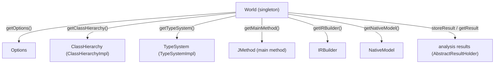
Sources: [src/main/java/pascal/taie/World.java:49-167]()

---

## World Building Pipeline

The world is built by a `WorldBuilder` implementation. The default is `SootWorldBuilder`, which uses Soot as the Java frontend.

**Construction sequence in `SootWorldBuilder`:**

1. Reset Soot and configure Soot options.
2. Pre-register basic classes (from `basic-classes.yml`) and reflection log classes into the Soot `Scene`.
3. Register a Soot `SceneTransformer` that runs the building logic after Soot finishes class loading.
4. Inside the transformer:
   - `World.reset()` then `World.set(new World())`.
   - Create `ClassHierarchyImpl`, then `SootClassLoader(scene, hierarchy, allowPhantom)`.
   - Create `TypeSystemImpl(hierarchy)`.
   - Create `Converter(loader, typeSystem)` for bridging Soot ↔ Tai-e types.
   - Walk all Soot classes and call `hierarchy.getDefaultClassLoader().loadClass(name)` for each.
   - Set the main method, implicit entries, native model, and `IRBuilder`.

**Diagram: World building sequence**

```mermaid
sequenceDiagram
    participant SWB as SootWorldBuilder
    participant Scene as SootScene
    participant CH as ClassHierarchyImpl
    participant SCL as SootClassLoader
    participant World as World

    SWB->>Scene: "runSoot()"
    Scene-->>SWB: "SceneTransformer callback"
    SWB->>World: "World.reset(); World.set(new World())"
    SWB->>CH: "new ClassHierarchyImpl(SootClassLoader)"
    SWB->>SCL: "setConverter(Converter)"
    SWB->>SCL: "loadClass(name) for all SootClasses"
    SCL->>CH: "addClass(jclass)"
    CH->>CH: "setIndex(classCounter++)"
    SWB->>World: "setClassHierarchy / setTypeSystem / setMainMethod"
```
Sources: [src/main/java/pascal/taie/frontend/soot/SootClassLoader.java:54-69](), [src/main/java/pascal/taie/language/classes/ClassHierarchyImpl.java:133-161]()

---

## ClassHierarchy

`ClassHierarchy` ([src/main/java/pascal/taie/language/classes/ClassHierarchy.java:37]()) manages all loaded classes and provides resolution services. `ClassHierarchyImpl` ([src/main/java/pascal/taie/language/classes/ClassHierarchyImpl.java:46]()) is the core implementation.

### ClassHierarchy Interface

**Key methods:**

| Method | Description |
|---|---|
| `addClass(JClass)` | Registers a class; updates subclass/interface/inner-class maps [src/main/java/pascal/taie/language/classes/ClassHierarchyImpl.java:133-161]() |
| `allClasses()` | `Stream<JClass>` over all loaded classes [src/main/java/pascal/taie/language/classes/ClassHierarchyImpl.java:174-176]() |
| `getClass(String name)` | Returns a class by name via the default loader [src/main/java/pascal/taie/language/classes/ClassHierarchyImpl.java:197-200]() |
| `resolveMethod(MethodRef)` | Resolves a method reference following JVM Spec §5.4.3.3 [src/main/java/pascal/taie/language/classes/ClassHierarchyImpl.java:249-261]() |
| `resolveField(FieldRef)` | Resolves a field reference following JVM Spec §5.4.3.2 [src/main/java/pascal/taie/language/classes/ClassHierarchyImpl.java:401-412]() |
| `dispatch(JClass, MethodRef)` | Virtual dispatch on a receiver class [src/main/java/pascal/taie/language/classes/ClassHierarchyImpl.java:353-376]() |
| `getAllSubclassesOf(JClass)` | Returns all subclasses/implementors (cached) [src/main/java/pascal/taie/language/classes/ClassHierarchyImpl.java:470-490]() |

`ClassHierarchy` also extends `Indexer<JClass>`, providing integer-indexed access to classes for efficient set operations via `getIndex(JClass)` and `getObject(int)` ([src/main/java/pascal/taie/language/classes/ClassHierarchyImpl.java:164-171]()).

### ClassHierarchyImpl Internals

`ClassHierarchyImpl` maintains several maps updated via `addClass(jclass)`:

| Field | Type | Purpose |
|---|---|---|
| `directSubinterfaces` | `MultiMap<JClass, JClass>` | Direct subinterfaces [src/main/java/pascal/taie/language/classes/ClassHierarchyImpl.java:66]() |
| `directImplementors` | `MultiMap<JClass, JClass>` | Direct implementors [src/main/java/pascal/taie/language/classes/ClassHierarchyImpl.java:71]() |
| `directSubclasses` | `MultiMap<JClass, JClass>` | Direct subclasses [src/main/java/pascal/taie/language/classes/ClassHierarchyImpl.java:76]() |
| `dispatchTable` | `TwoKeyMap<JClass, Subsignature, JMethod>` | Cache for virtual dispatch [src/main/java/pascal/taie/language/classes/ClassHierarchyImpl.java:86]() |

The `allSubclasses` cache is cleared whenever `addClass` is called to ensure consistency ([src/main/java/pascal/taie/language/classes/ClassHierarchyImpl.java:160]()).

Sources: [src/main/java/pascal/taie/language/classes/ClassHierarchyImpl.java:46-161]()

---

## Method Dispatch and Field Resolution

### Method Resolution (`resolveMethod`)

Follows JVM Spec §5.4.3.3. It utilizes `lookupMethod` ([src/main/java/pascal/taie/language/classes/ClassHierarchyImpl.java:271-314]()):
1. Scan class `C` and its superclasses for a matching `Subsignature`.
2. If not found, scan superinterfaces recursively.
3. Returns `null` if no match is found.

### Field Resolution (`resolveField`)

Follows JVM Spec §5.4.3.2 ([src/main/java/pascal/taie/language/classes/ClassHierarchyImpl.java:401-412]()):
1. If the class is phantom, create/retrieve a `phantomField` stub ([src/main/java/pascal/taie/language/classes/JClass.java:286-297]()).
2. Check if the class declares the field.
3. Recursively check superinterfaces and then the superclass.

### Virtual Dispatch (`dispatch`)

- Converts receiver `Type` to `JClass` (arrays dispatch to `java.lang.Object`).
- Checks `dispatchTable` cache ([src/main/java/pascal/taie/language/classes/ClassHierarchyImpl.java:363]()).
- On miss, calls `lookupMethod` with `allowAbstract=false` ([src/main/java/pascal/taie/language/classes/ClassHierarchyImpl.java:371]()).

Sources: [src/main/java/pascal/taie/language/classes/ClassHierarchyImpl.java:249-412]()

---

## Language Model: JClass, JMethod, JField

Tai-e represents program entities using a hierarchical model.

**Diagram: Language Model Entities**

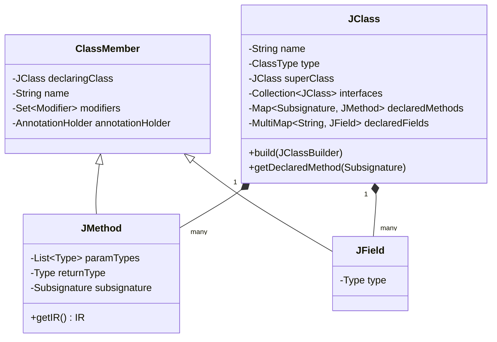

### JClass
`JClass` ([src/main/java/pascal/taie/language/classes/JClass.java:61]()) uses a two-phase initialization. The constructor creates the shell ([src/main/java/pascal/taie/language/classes/JClass.java:117-132]()), and `build(JClassBuilder)` populates fields like `superClass`, `interfaces`, and members ([src/main/java/pascal/taie/language/classes/JClass.java:146-180]()). This avoids recursion issues during class loading.

### JMethod
`JMethod` ([src/main/java/pascal/taie/language/classes/JMethod.java:47]()) holds signature and parameter info. The `IR` is built lazily via `getIR()` ([src/main/java/pascal/taie/language/classes/JMethod.java:185-201]()). If the method is native, it uses the `NativeModel` ([src/main/java/pascal/taie/language/classes/JMethod.java:192]()).

### JField
`JField` ([src/main/java/pascal/taie/language/classes/JField.java:38]()) represents a class field, storing its `Type` and providing a `FieldRef` for IR references ([src/main/java/pascal/taie/language/classes/JField.java:76-78]()).

Sources: [src/main/java/pascal/taie/language/classes/JClass.java:61-180](), [src/main/java/pascal/taie/language/classes/JMethod.java:47-201](), [src/main/java/pascal/taie/language/classes/JField.java:38-79]()

---

## Class Loading and Converter

### SootClassLoader
`SootClassLoader` ([src/main/java/pascal/taie/frontend/soot/SootClassLoader.java:35]()) delegates to Soot's `Scene`. It caches `JClass` instances to ensure uniqueness ([src/main/java/pascal/taie/frontend/soot/SootClassLoader.java:45]()).

### Converter
`Converter` ([src/main/java/pascal/taie/frontend/soot/Converter.java:113]()) translates Soot types and members to Tai-e.
- `convertType(soot.Type)`: Maps Soot primitives and `RefType` to Tai-e `Type` ([src/main/java/pascal/taie/frontend/soot/Converter.java:138-172]()).
- `convertMethod(SootMethod)`: Uses a `methodMap` to cache and return `JMethod` ([src/main/java/pascal/taie/frontend/soot/Converter.java:204-228]()).

Sources: [src/main/java/pascal/taie/frontend/soot/SootClassLoader.java:35-87](), [src/main/java/pascal/taie/frontend/soot/Converter.java:113-228]()

---

## Annotation Subsystem

Annotations are managed via `AnnotationHolder` ([src/main/java/pascal/taie/language/annotation/AnnotationHolder.java:36]()).

- **`Annotated` Interface**: Implemented by `JClass`, `JMethod`, and `JField` to provide annotation access ([src/main/java/pascal/taie/language/annotation/Annotated.java:39]()).
- **`Annotation`**: Represents a single annotation with a type and a map of `Element` values ([src/main/java/pascal/taie/language/annotation/Annotation.java:44]()).
- **`Element`**: Hierarchical values including `StringElement`, `IntElement`, `EnumElement`, etc. ([src/main/java/pascal/taie/language/annotation/Element.java:34]()).

Methods also support parameter annotations via `paramAnnotations` in `JMethod`, indexed by parameter position ([src/main/java/pascal/taie/language/classes/JMethod.java:131-156]()).

Sources: [src/main/java/pascal/taie/language/annotation/Annotation.java:44-60](), [src/main/java/pascal/taie/language/annotation/AnnotationHolder.java:36-50](), [src/main/java/pascal/taie/language/classes/JMethod.java:131-156]()

---

# Page: Intermediate Representation

# Intermediate Representation

<details>
<summary>Relevant source files</summary>

The following files were used as context for generating this wiki page:

- [src/main/java/pascal/taie/World.java](src/main/java/pascal/taie/World.java)
- [src/main/java/pascal/taie/analysis/exception/IntraExplicitThrowAnalysis.java](src/main/java/pascal/taie/analysis/exception/IntraExplicitThrowAnalysis.java)
- [src/main/java/pascal/taie/analysis/pta/plugin/reflection/LogItem.java](src/main/java/pascal/taie/analysis/pta/plugin/reflection/LogItem.java)
- [src/main/java/pascal/taie/ir/DefaultIR.java](src/main/java/pascal/taie/ir/DefaultIR.java)
- [src/main/java/pascal/taie/ir/IR.java](src/main/java/pascal/taie/ir/IR.java)
- [src/main/java/pascal/taie/ir/IRBuildHelper.java](src/main/java/pascal/taie/ir/IRBuildHelper.java)
- [src/main/java/pascal/taie/ir/IRPrinter.java](src/main/java/pascal/taie/ir/IRPrinter.java)
- [src/main/java/pascal/taie/ir/exp/ArithmeticExp.java](src/main/java/pascal/taie/ir/exp/ArithmeticExp.java)
- [src/main/java/pascal/taie/ir/exp/BinaryExp.java](src/main/java/pascal/taie/ir/exp/BinaryExp.java)
- [src/main/java/pascal/taie/ir/exp/BitwiseExp.java](src/main/java/pascal/taie/ir/exp/BitwiseExp.java)
- [src/main/java/pascal/taie/ir/exp/CastExp.java](src/main/java/pascal/taie/ir/exp/CastExp.java)
- [src/main/java/pascal/taie/ir/exp/ClassLiteral.java](src/main/java/pascal/taie/ir/exp/ClassLiteral.java)
- [src/main/java/pascal/taie/ir/exp/ComparisonExp.java](src/main/java/pascal/taie/ir/exp/ComparisonExp.java)
- [src/main/java/pascal/taie/ir/exp/ConditionExp.java](src/main/java/pascal/taie/ir/exp/ConditionExp.java)
- [src/main/java/pascal/taie/ir/exp/DoubleLiteral.java](src/main/java/pascal/taie/ir/exp/DoubleLiteral.java)
- [src/main/java/pascal/taie/ir/exp/Exp.java](src/main/java/pascal/taie/ir/exp/Exp.java)
- [src/main/java/pascal/taie/ir/exp/ExpVisitor.java](src/main/java/pascal/taie/ir/exp/ExpVisitor.java)
- [src/main/java/pascal/taie/ir/exp/FieldAccess.java](src/main/java/pascal/taie/ir/exp/FieldAccess.java)
- [src/main/java/pascal/taie/ir/exp/FloatLiteral.java](src/main/java/pascal/taie/ir/exp/FloatLiteral.java)
- [src/main/java/pascal/taie/ir/exp/FloatingPointLiteral.java](src/main/java/pascal/taie/ir/exp/FloatingPointLiteral.java)
- [src/main/java/pascal/taie/ir/exp/InstanceFieldAccess.java](src/main/java/pascal/taie/ir/exp/InstanceFieldAccess.java)
- [src/main/java/pascal/taie/ir/exp/InstanceOfExp.java](src/main/java/pascal/taie/ir/exp/InstanceOfExp.java)
- [src/main/java/pascal/taie/ir/exp/IntLiteral.java](src/main/java/pascal/taie/ir/exp/IntLiteral.java)
- [src/main/java/pascal/taie/ir/exp/IntegerLiteral.java](src/main/java/pascal/taie/ir/exp/IntegerLiteral.java)
- [src/main/java/pascal/taie/ir/exp/InvokeDynamic.java](src/main/java/pascal/taie/ir/exp/InvokeDynamic.java)
- [src/main/java/pascal/taie/ir/exp/InvokeExp.java](src/main/java/pascal/taie/ir/exp/InvokeExp.java)
- [src/main/java/pascal/taie/ir/exp/InvokeInstanceExp.java](src/main/java/pascal/taie/ir/exp/InvokeInstanceExp.java)
- [src/main/java/pascal/taie/ir/exp/InvokeInterface.java](src/main/java/pascal/taie/ir/exp/InvokeInterface.java)
- [src/main/java/pascal/taie/ir/exp/InvokeSpecial.java](src/main/java/pascal/taie/ir/exp/InvokeSpecial.java)
- [src/main/java/pascal/taie/ir/exp/InvokeStatic.java](src/main/java/pascal/taie/ir/exp/InvokeStatic.java)
- [src/main/java/pascal/taie/ir/exp/InvokeVirtual.java](src/main/java/pascal/taie/ir/exp/InvokeVirtual.java)
- [src/main/java/pascal/taie/ir/exp/LValue.java](src/main/java/pascal/taie/ir/exp/LValue.java)
- [src/main/java/pascal/taie/ir/exp/Literal.java](src/main/java/pascal/taie/ir/exp/Literal.java)
- [src/main/java/pascal/taie/ir/exp/LongLiteral.java](src/main/java/pascal/taie/ir/exp/LongLiteral.java)
- [src/main/java/pascal/taie/ir/exp/MethodHandle.java](src/main/java/pascal/taie/ir/exp/MethodHandle.java)
- [src/main/java/pascal/taie/ir/exp/MethodType.java](src/main/java/pascal/taie/ir/exp/MethodType.java)
- [src/main/java/pascal/taie/ir/exp/NewArray.java](src/main/java/pascal/taie/ir/exp/NewArray.java)
- [src/main/java/pascal/taie/ir/exp/NewExp.java](src/main/java/pascal/taie/ir/exp/NewExp.java)
- [src/main/java/pascal/taie/ir/exp/NewInstance.java](src/main/java/pascal/taie/ir/exp/NewInstance.java)
- [src/main/java/pascal/taie/ir/exp/NewMultiArray.java](src/main/java/pascal/taie/ir/exp/NewMultiArray.java)
- [src/main/java/pascal/taie/ir/exp/NullLiteral.java](src/main/java/pascal/taie/ir/exp/NullLiteral.java)
- [src/main/java/pascal/taie/ir/exp/NumberLiteral.java](src/main/java/pascal/taie/ir/exp/NumberLiteral.java)
- [src/main/java/pascal/taie/ir/exp/PhiExp.java](src/main/java/pascal/taie/ir/exp/PhiExp.java)
- [src/main/java/pascal/taie/ir/exp/RValue.java](src/main/java/pascal/taie/ir/exp/RValue.java)
- [src/main/java/pascal/taie/ir/exp/ReferenceLiteral.java](src/main/java/pascal/taie/ir/exp/ReferenceLiteral.java)
- [src/main/java/pascal/taie/ir/exp/ShiftExp.java](src/main/java/pascal/taie/ir/exp/ShiftExp.java)
- [src/main/java/pascal/taie/ir/exp/StringLiteral.java](src/main/java/pascal/taie/ir/exp/StringLiteral.java)
- [src/main/java/pascal/taie/ir/exp/UnaryExp.java](src/main/java/pascal/taie/ir/exp/UnaryExp.java)
- [src/main/java/pascal/taie/ir/stmt/AbstractStmt.java](src/main/java/pascal/taie/ir/stmt/AbstractStmt.java)
- [src/main/java/pascal/taie/ir/stmt/ArrayStmt.java](src/main/java/pascal/taie/ir/stmt/ArrayStmt.java)
- [src/main/java/pascal/taie/ir/stmt/AssignLiteral.java](src/main/java/pascal/taie/ir/stmt/AssignLiteral.java)
- [src/main/java/pascal/taie/ir/stmt/AssignStmt.java](src/main/java/pascal/taie/ir/stmt/AssignStmt.java)
- [src/main/java/pascal/taie/ir/stmt/Binary.java](src/main/java/pascal/taie/ir/stmt/Binary.java)
- [src/main/java/pascal/taie/ir/stmt/Cast.java](src/main/java/pascal/taie/ir/stmt/Cast.java)
- [src/main/java/pascal/taie/ir/stmt/Catch.java](src/main/java/pascal/taie/ir/stmt/Catch.java)
- [src/main/java/pascal/taie/ir/stmt/Copy.java](src/main/java/pascal/taie/ir/stmt/Copy.java)
- [src/main/java/pascal/taie/ir/stmt/DefinitionStmt.java](src/main/java/pascal/taie/ir/stmt/DefinitionStmt.java)
- [src/main/java/pascal/taie/ir/stmt/Goto.java](src/main/java/pascal/taie/ir/stmt/Goto.java)
- [src/main/java/pascal/taie/ir/stmt/If.java](src/main/java/pascal/taie/ir/stmt/If.java)
- [src/main/java/pascal/taie/ir/stmt/InstanceOf.java](src/main/java/pascal/taie/ir/stmt/InstanceOf.java)
- [src/main/java/pascal/taie/ir/stmt/Invoke.java](src/main/java/pascal/taie/ir/stmt/Invoke.java)
- [src/main/java/pascal/taie/ir/stmt/JumpStmt.java](src/main/java/pascal/taie/ir/stmt/JumpStmt.java)
- [src/main/java/pascal/taie/ir/stmt/LoadArray.java](src/main/java/pascal/taie/ir/stmt/LoadArray.java)
- [src/main/java/pascal/taie/ir/stmt/LoadField.java](src/main/java/pascal/taie/ir/stmt/LoadField.java)
- [src/main/java/pascal/taie/ir/stmt/LookupSwitch.java](src/main/java/pascal/taie/ir/stmt/LookupSwitch.java)
- [src/main/java/pascal/taie/ir/stmt/Monitor.java](src/main/java/pascal/taie/ir/stmt/Monitor.java)
- [src/main/java/pascal/taie/ir/stmt/New.java](src/main/java/pascal/taie/ir/stmt/New.java)
- [src/main/java/pascal/taie/ir/stmt/Nop.java](src/main/java/pascal/taie/ir/stmt/Nop.java)
- [src/main/java/pascal/taie/ir/stmt/Return.java](src/main/java/pascal/taie/ir/stmt/Return.java)
- [src/main/java/pascal/taie/ir/stmt/Stmt.java](src/main/java/pascal/taie/ir/stmt/Stmt.java)
- [src/main/java/pascal/taie/ir/stmt/StmtVisitor.java](src/main/java/pascal/taie/ir/stmt/StmtVisitor.java)
- [src/main/java/pascal/taie/ir/stmt/StoreArray.java](src/main/java/pascal/taie/ir/stmt/StoreArray.java)
- [src/main/java/pascal/taie/ir/stmt/StoreField.java](src/main/java/pascal/taie/ir/stmt/StoreField.java)
- [src/main/java/pascal/taie/ir/stmt/SwitchStmt.java](src/main/java/pascal/taie/ir/stmt/SwitchStmt.java)
- [src/main/java/pascal/taie/ir/stmt/TableSwitch.java](src/main/java/pascal/taie/ir/stmt/TableSwitch.java)
- [src/main/java/pascal/taie/ir/stmt/Throw.java](src/main/java/pascal/taie/ir/stmt/Throw.java)
- [src/main/java/pascal/taie/ir/stmt/Unary.java](src/main/java/pascal/taie/ir/stmt/Unary.java)
- [src/main/java/pascal/taie/language/natives/DefaultNativeModel.java](src/main/java/pascal/taie/language/natives/DefaultNativeModel.java)
- [src/main/java/pascal/taie/util/Indexable.java](src/main/java/pascal/taie/util/Indexable.java)
- [src/main/java/pascal/taie/util/graph/SCC.java](src/main/java/pascal/taie/util/graph/SCC.java)
- [src/test/java/pascal/taie/TaieTestSuite.java](src/test/java/pascal/taie/TaieTestSuite.java)
- [src/test/java/pascal/taie/frontend/soot/InvokeDynamicTest.java](src/test/java/pascal/taie/frontend/soot/InvokeDynamicTest.java)
- [src/test/java/pascal/taie/ir/IRTest.java](src/test/java/pascal/taie/ir/IRTest.java)
- [src/test/java/pascal/taie/language/classes/StringRepsTest.java](src/test/java/pascal/taie/language/classes/StringRepsTest.java)
- [src/test/java/pascal/taie/util/graph/GraphTest.java](src/test/java/pascal/taie/util/graph/GraphTest.java)
- [src/test/resources/dataflow/constprop/ComparisonOp.java](src/test/resources/dataflow/constprop/ComparisonOp.java)

</details>


The Intermediate Representation (IR) is the core data structure in Tai-e that represents Java methods in a form suitable for static analysis. The IR converts Java bytecode (via Soot's Jimple representation) into Tai-e's internal statement-based format. Each method is represented as a `DefaultIR` object containing variables, statements, and exception handling information.

## Core IR Concepts

Tai-e's IR represents each method using statements, variables, and other supporting elements. The IR provides a uniform interface for all analyses, making it easier to implement and compose them.

### IR Structure

**DefaultIR Class Composition**

Each method's IR is represented by a `DefaultIR` object. It implements the `IR` interface [src/main/java/pascal/taie/ir/IR.java:43-44]() and holds immutable data structures representing the method body [src/main/java/pascal/taie/ir/DefaultIR.java:42]().

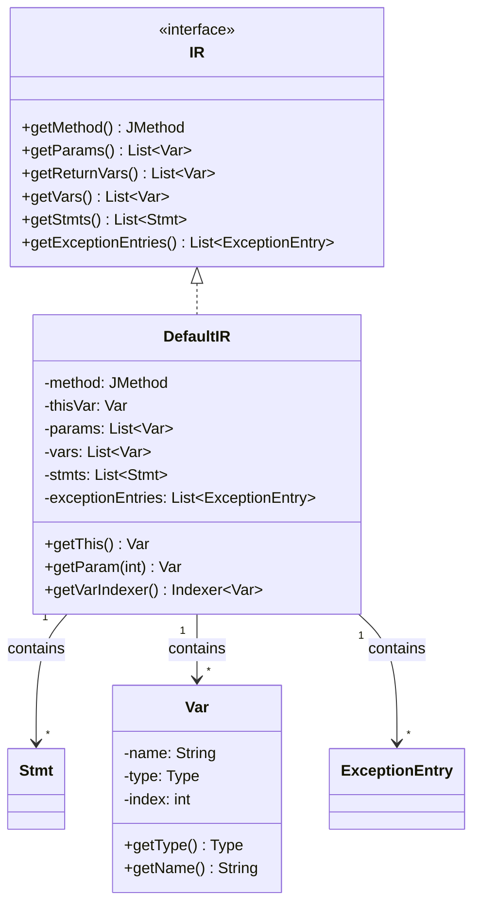

Sources: [src/main/java/pascal/taie/ir/IR.java:43-145](), [src/main/java/pascal/taie/ir/DefaultIR.java:42-72]()

### Statements

Statements (`Stmt`) are the fundamental components of Tai-e's IR. Every statement implements the `Stmt` interface [src/main/java/pascal/taie/ir/stmt/Stmt.java:36](), which extends `Indexable` for efficient storage in collections.

Key characteristics of a `Stmt`:
- **Index**: Its position in the container IR [src/main/java/pascal/taie/ir/stmt/Stmt.java:42]().
- **Line Number**: The original source code line [src/main/java/pascal/taie/ir/stmt/Stmt.java:50]().
- **Def/Use**: Each statement can define at most one `LValue` and use multiple `RValue` expressions [src/main/java/pascal/taie/ir/stmt/Stmt.java:58-63]().
- **Control Flow**: `canFallThrough()` indicates if execution can proceed to the next sequential statement [src/main/java/pascal/taie/ir/stmt/Stmt.java:69]().

Sources: [src/main/java/pascal/taie/ir/stmt/Stmt.java:36-72](), [src/main/java/pascal/taie/ir/stmt/AbstractStmt.java:31-79]()

### Variables

Variables (`Var`) represent all values (locals, parameters, constants) within a method.
- **Naming**: Parameters retain original names; `this` is named `%this` [src/main/java/pascal/taie/ir/IR.java:55-56]().
- **Indexing**: `DefaultIR` provides a `VarIndexer` to map variables to unique integers [src/main/java/pascal/taie/ir/DefaultIR.java:125-136]().
- **Types**: Every variable has a `Type` from the Tai-e `TypeSystem` [src/main/java/pascal/taie/ir/exp/Var.java]().

Sources: [src/main/java/pascal/taie/ir/DefaultIR.java:80-123](), [src/main/java/pascal/taie/ir/IR.java:88-100]()

## Statement Hierarchy

Tai-e uses a structured hierarchy for statements to simplify visitor implementation and analysis logic.

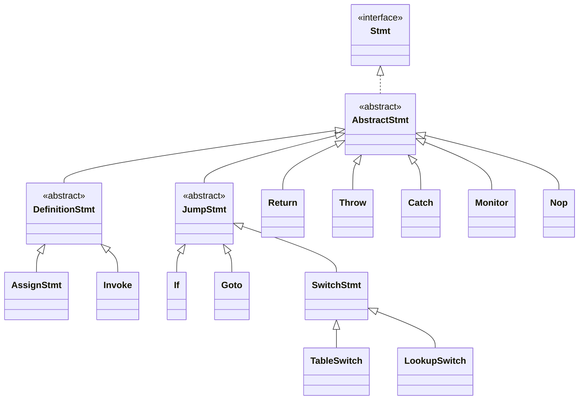

Sources: [src/main/java/pascal/taie/ir/stmt/Stmt.java](), [src/main/java/pascal/taie/ir/stmt/DefinitionStmt.java](), [src/main/java/pascal/taie/ir/stmt/JumpStmt.java](), [src/main/java/pascal/taie/ir/stmt/Invoke.java](), [src/main/java/pascal/taie/ir/stmt/SwitchStmt.java]()

## Major Statement and Expression Types

### Method Invocation (`Invoke`)

The `Invoke` statement represents calls like `r = o.m(...)`. It encapsulates an `InvokeExp` [src/main/java/pascal/taie/ir/stmt/Invoke.java:48-61]().

- **InvokeExp**: An `RValue` representing the call site. Subtypes include `InvokeStatic`, `InvokeSpecial`, `InvokeVirtual`, `InvokeInterface`, and `InvokeDynamic` [src/main/java/pascal/taie/ir/stmt/Invoke.java:25-31]().
- **Result**: An optional `Var` (LValue) that receives the return value [src/main/java/pascal/taie/ir/stmt/Invoke.java:55-57]().
- **Dispatch**: Helper methods like `isVirtual()`, `isStatic()`, and `isDynamic()` identify the call type [src/main/java/pascal/taie/ir/stmt/Invoke.java:114-132]().

Sources: [src/main/java/pascal/taie/ir/stmt/Invoke.java:48-173](), [src/main/java/pascal/taie/ir/exp/InvokeExp.java:36-100]()

### Control Flow and Jumps

- **If**: Contains a `ConditionExp` and a target `Stmt`. If the condition is false, it falls through [src/main/java/pascal/taie/ir/stmt/If.java]().
- **Goto**: Unconditional jump to a target `Stmt`. `canFallThrough()` returns `false` [src/main/java/pascal/taie/ir/stmt/Goto.java]().
- **SwitchStmt**: Handles `lookupswitch` and `tableswitch`. It provides a list of case values and corresponding target statements [src/main/java/pascal/taie/ir/stmt/SwitchStmt.java]().
- **Return**: Exits the method. May contain a `Var` for the return value [src/main/java/pascal/taie/ir/stmt/Return.java]().

Sources: [src/main/java/pascal/taie/ir/stmt/If.java](), [src/main/java/pascal/taie/ir/stmt/Goto.java](), [src/main/java/pascal/taie/ir/stmt/SwitchStmt.java](), [src/main/java/pascal/taie/ir/stmt/Return.java]()

### Expressions (LValue and RValue)

Tai-e distinguishes between expressions that can appear on the left-hand side (`LValue`) and right-hand side (`RValue`) of an assignment.

| Category | Types |
| :--- | :--- |
| **LValue** | `Var`, `InstanceFieldAccess`, `StaticFieldAccess`, `ArrayAccess` |
| **RValue** | `Var`, `Literal` (String, Int, etc.), `BinaryExp`, `UnaryExp`, `CastExp`, `InvokeExp`, `NewExp` |

Sources: [src/main/java/pascal/taie/ir/stmt/AssignStmt.java](), [src/main/java/pascal/taie/ir/exp/LValue.java](), [src/main/java/pascal/taie/ir/exp/RValue.java]()

## StmtVisitor Pattern

Tai-e uses the Visitor pattern for statement processing. The `StmtVisitor<T>` interface [src/main/java/pascal/taie/ir/stmt/StmtVisitor.java]() allows analyses to define custom logic for each concrete statement type without modifying the statement classes.

```java
// Example usage in a dataflow analysis
public class MyAnalysis implements StmtVisitor<Void> {
    @Override
    public Void visit(Invoke stmt) {
        // Handle method calls
        return null;
    }
    // ... other visit methods
}
```

Sources: [src/main/java/pascal/taie/ir/stmt/StmtVisitor.java](), [src/main/java/pascal/taie/ir/stmt/Stmt.java:71]()

## IR Building and Native Modeling

While the frontend handles the translation from Jimple, Tai-e provides a `NativeModel` to generate IR for native methods that cannot be analyzed directly.

**DefaultNativeModel**
This class provides hardcoded IR models for critical JDK native methods like `System.arraycopy`, `Object.clone`, and reflection-related methods [src/main/java/pascal/taie/language/natives/DefaultNativeModel.java:68-146](). It uses `IRBuildHelper` to programmatically construct `DefaultIR` instances [src/main/java/pascal/taie/language/natives/DefaultNativeModel.java:99-103]().

Sources: [src/main/java/pascal/taie/language/natives/DefaultNativeModel.java:68-164](), [src/main/java/pascal/taie/World.java:135-141]()

## IR Printing

The `IRPrinter` utility [src/main/java/pascal/taie/ir/IRPrinter.java:36]() converts the internal IR structure into a human-readable string format, which is essential for debugging.

**Format Example**:
```text
---------- <java.lang.Object: java.lang.Object clone()> ----------
Parameters: 
Variables:
java.lang.Object %this
java.lang.Object %return
Statements:
[0@L-1] %return = %this;
[1@L-1] return %return;
```
The printer iterates through all statements [src/main/java/pascal/taie/ir/IRPrinter.java:52](), formatting them with their index and line number [src/main/java/pascal/taie/ir/IRPrinter.java:97-102]().

Sources: [src/main/java/pascal/taie/ir/IRPrinter.java:36-103]()

---

# Page: Analysis Management

# Analysis Management

<details>
<summary>Relevant source files</summary>

The following files were used as context for generating this wiki page:

- [src/main/java/pascal/taie/Main.java](src/main/java/pascal/taie/Main.java)
- [src/main/java/pascal/taie/analysis/Analysis.java](src/main/java/pascal/taie/analysis/Analysis.java)
- [src/main/java/pascal/taie/analysis/AnalysisManager.java](src/main/java/pascal/taie/analysis/AnalysisManager.java)
- [src/main/java/pascal/taie/analysis/graph/callgraph/CallGraphBuilder.java](src/main/java/pascal/taie/analysis/graph/callgraph/CallGraphBuilder.java)
- [src/main/java/pascal/taie/analysis/graph/callgraph/CallGraphs.java](src/main/java/pascal/taie/analysis/graph/callgraph/CallGraphs.java)
- [src/main/java/pascal/taie/analysis/graph/callgraph/PTABasedBuilder.java](src/main/java/pascal/taie/analysis/graph/callgraph/PTABasedBuilder.java)
- [src/main/java/pascal/taie/analysis/graph/cfg/CFGBuilder.java](src/main/java/pascal/taie/analysis/graph/cfg/CFGBuilder.java)
- [src/main/java/pascal/taie/analysis/graph/cfg/CFGDumper.java](src/main/java/pascal/taie/analysis/graph/cfg/CFGDumper.java)
- [src/main/java/pascal/taie/analysis/graph/flowgraph/FlowGraphDumper.java](src/main/java/pascal/taie/analysis/graph/flowgraph/FlowGraphDumper.java)
- [src/main/java/pascal/taie/analysis/graph/icfg/ICFGBuilder.java](src/main/java/pascal/taie/analysis/graph/icfg/ICFGBuilder.java)
- [src/main/java/pascal/taie/analysis/misc/IRDumper.java](src/main/java/pascal/taie/analysis/misc/IRDumper.java)
- [src/main/java/pascal/taie/analysis/misc/ResultProcessor.java](src/main/java/pascal/taie/analysis/misc/ResultProcessor.java)
- [src/main/java/pascal/taie/analysis/pta/PointerAnalysis.java](src/main/java/pascal/taie/analysis/pta/PointerAnalysis.java)
- [src/main/java/pascal/taie/analysis/pta/client/Collector.java](src/main/java/pascal/taie/analysis/pta/client/Collector.java)
- [src/main/java/pascal/taie/analysis/pta/plugin/AnalysisTimer.java](src/main/java/pascal/taie/analysis/pta/plugin/AnalysisTimer.java)
- [src/main/java/pascal/taie/analysis/pta/plugin/Profiler.java](src/main/java/pascal/taie/analysis/pta/plugin/Profiler.java)
- [src/main/java/pascal/taie/config/AnalysisConfig.java](src/main/java/pascal/taie/config/AnalysisConfig.java)
- [src/main/java/pascal/taie/config/AnalysisOptions.java](src/main/java/pascal/taie/config/AnalysisOptions.java)
- [src/main/java/pascal/taie/config/AnalysisPlanner.java](src/main/java/pascal/taie/config/AnalysisPlanner.java)
- [src/main/java/pascal/taie/config/ConfigManager.java](src/main/java/pascal/taie/config/ConfigManager.java)
- [src/main/java/pascal/taie/config/Configs.java](src/main/java/pascal/taie/config/Configs.java)
- [src/main/java/pascal/taie/config/Plan.java](src/main/java/pascal/taie/config/Plan.java)
- [src/main/java/pascal/taie/config/PlanConfig.java](src/main/java/pascal/taie/config/PlanConfig.java)
- [src/main/java/pascal/taie/util/Timer.java](src/main/java/pascal/taie/util/Timer.java)
- [src/main/java/pascal/taie/util/graph/DotDumper.java](src/main/java/pascal/taie/util/graph/DotDumper.java)
- [src/main/resources/android/tai-e-android-analyses.yml](src/main/resources/android/tai-e-android-analyses.yml)
- [src/main/resources/tai-e-analyses.yml](src/main/resources/tai-e-analyses.yml)
- [src/test/java/pascal/taie/analysis/Tests.java](src/test/java/pascal/taie/analysis/Tests.java)
- [src/test/java/pascal/taie/config/AnalysisOptionsTest.java](src/test/java/pascal/taie/config/AnalysisOptionsTest.java)

</details>


This document explains how analyses are registered, planned, and executed within the Tai-e framework. Analysis management encompasses the configuration registry system, dependency resolution, execution orchestration, and result lifecycle management.

For information about configuring specific analyses like pointer analysis, see [Pointer Analysis Configuration](#3.1). For details about the frontend that prepares the program representation before analysis, see [Frontend](#5).

## Analysis Registry System

Tai-e uses a centralized YAML-based registry to define all available analyses and their configurations. The registry file `tai-e-analyses.yml` serves as the authoritative source for analysis metadata, dependencies, and default options.

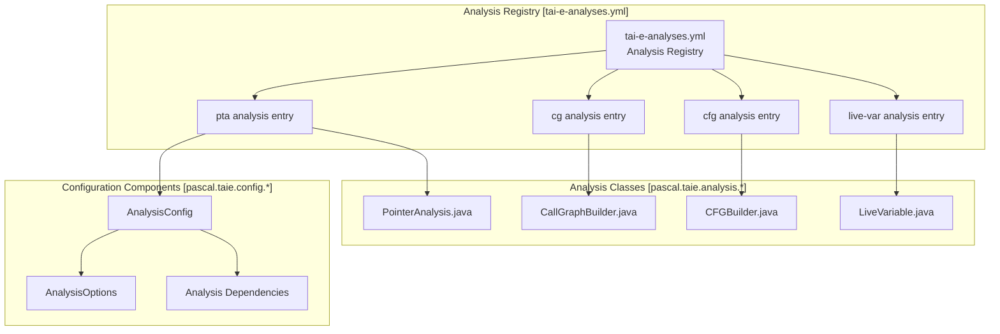

Each analysis entry in the registry contains several key components:

| Component | Purpose | Example |
|-----------|---------|---------|
| `id` | Unique identifier for the analysis | `pta`, `cg`, `cfg` |
| `analysisClass` | Fully qualified Java class name | `pascal.taie.analysis.pta.PointerAnalysis` |
| `description` | Human-readable description | `"whole-program pointer analysis"` |
| `requires` | List of prerequisite analyses | `[ pta(algorithm=pta) ]` |
| `options` | Default configuration parameters | Context sensitivity, output settings |

**Sources:** [src/main/resources/tai-e-analyses.yml:1-171]()

## Analysis Planning and Configuration

The planning phase bridges the gap between raw `Options` and the final `Plan`. It distinguishes between two types of configurations:
- **`AnalysisConfig`**: Defined in `tai-e-analyses.yml`, containing the implementation class and requirement metadata [src/main/java/pascal/taie/config/PlanConfig.java:42-45]().
- **`PlanConfig`**: Specified via command line or a plan file, containing the `id` and specific `AnalysisOptions` for a run [src/main/java/pascal/taie/config/PlanConfig.java:53-72]().

### AnalysisPlanner Pipeline
The `AnalysisPlanner` resolves dependencies and ensures a valid execution sequence.

1. **Resolution**: Converts `PlanConfig` IDs to full `AnalysisConfig` objects using `ConfigManager` [src/main/java/pascal/taie/config/AnalysisPlanner.java:79-83]().
2. **Expansion**: Automatically adds required prerequisite analyses not explicitly mentioned in the input [src/main/java/pascal/taie/config/AnalysisPlanner.java:151-162]().
3. **Sorting**: Uses a `TopologicalSorter` on the dependence graph to produce a linear `Plan` [src/main/java/pascal/taie/config/AnalysisPlanner.java:165]().
4. **Scope Adjustment**: If `Scope.REACHABLE` is selected, it ensures `CallGraphBuilder` (cg) is placed early in the sequence [src/main/java/pascal/taie/config/AnalysisPlanner.java:166-169]().

**Sources:** [src/main/java/pascal/taie/config/AnalysisPlanner.java:45-170](), [src/main/java/pascal/taie/config/PlanConfig.java:47-72]()

## Analysis Manager and Execution

The `AnalysisManager` class orchestrates the execution of the `Plan`. It handles instantiation via reflection and manages result storage.

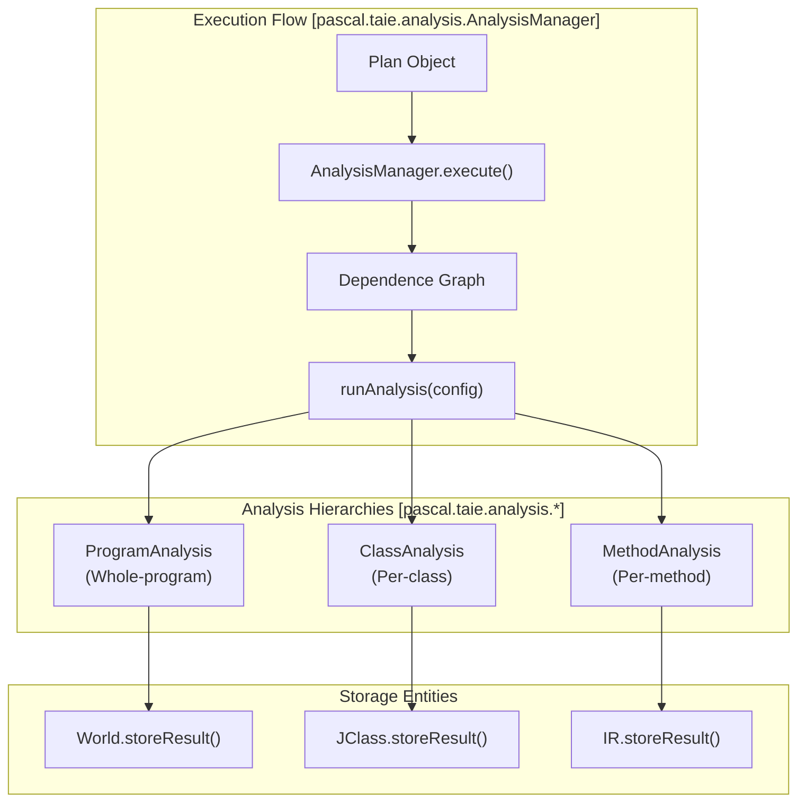

The execution process follows these steps:
1. **Dependency Setup**: Builds a `SimpleGraph` of analysis IDs to track result utility [src/main/java/pascal/taie/analysis/AnalysisManager.java:90-98]().
2. **Sequential Invocation**: Iterates through `plan.analyses()`, wrapping each in `Monitor.runAndCount` for performance tracking [src/main/java/pascal/taie/analysis/AnalysisManager.java:102-109]().
3. **Reflection**: Instantiates analysis classes using a constructor that accepts `AnalysisConfig` [src/main/java/pascal/taie/analysis/AnalysisManager.java:115-132]().
4. **Result Lifecycle**: If `keepAllResults` is false, it calls `clearUnusedResults()` after each analysis to free memory [src/main/java/pascal/taie/analysis/AnalysisManager.java:107]().

**Sources:** [src/main/java/pascal/taie/analysis/AnalysisManager.java:51-145]()

## Analysis Types and Execution Contexts

Tai-e supports three distinct analysis types, each with different execution contexts and result storage patterns:

### Program Analysis
Whole-program analyses that operate on the entire program representation. Results are stored in the `World` singleton [src/main/java/pascal/taie/analysis/AnalysisManager.java:147-152]().
*Example*: `PointerAnalysis` [src/main/java/pascal/taie/analysis/pta/PointerAnalysis.java:66]().

### Class Analysis  
Per-class analyses that process each class individually. Results are stored within each `JClass` [src/main/java/pascal/taie/analysis/AnalysisManager.java:154-161]().
*Scope*: Can be `APP`, `ALL`, or `REACHABLE` (based on call graph) [src/main/java/pascal/taie/analysis/AnalysisManager.java:164-188]().

### Method Analysis
Per-method analyses that process individual method IRs. Results are stored in the `IR` object [src/main/java/pascal/taie/analysis/AnalysisManager.java:190-202]().
*Example*: `CFGBuilder` [src/main/java/pascal/taie/analysis/graph/cfg/CFGBuilder.java:49]().

**Sources:** [src/main/java/pascal/taie/analysis/AnalysisManager.java:134-202]()

## Dependency Management and Execution Order

Dependencies are enforced during planning and execution. The registry uses the `requires` field to define these constraints.

| Analysis ID | Prerequisite | Reason |
|-----------|---------|---------|
| `cg` | `pta` | Call graph requires points-to information for resolution [src/main/resources/tai-e-analyses.yml:42]() |
| `cfg` | `throw` | Control flow depends on exception analysis [src/main/resources/tai-e-analyses.yml:83]() |
| `icfg` | `cfg`, `cg` | Interprocedural graph links intraprocedural CFGs via call edges [src/main/resources/tai-e-analyses.yml:91]() |
| `def-use` | `reach-def` | Def-use chains are built from reaching definitions [src/main/resources/tai-e-analyses.yml:122]() |

**Sources:** [src/main/resources/tai-e-analyses.yml:39-138]()

## Result Management and Memory Optimization

The `AnalysisManager` implements an intelligent result cleanup system. If `keep-result` is not set to `all`, results are cleared when their dependent analyses have finished [src/main/java/pascal/taie/analysis/AnalysisManager.java:223-260]().

1. **Dependency Tracking**: Uses `dependenceGraph` to count outgoing edges for each analysis result [src/main/java/pascal/taie/analysis/AnalysisManager.java:91-96]().
2. **Cleanup**: When an analysis finishes, the manager checks all previously executed analyses. If an analysis has no more dependents in the remaining plan, its results are purged from `World`, `JClass`, or `IR` [src/main/java/pascal/taie/analysis/AnalysisManager.java:234-259]().

**Sources:** [src/main/java/pascal/taie/analysis/AnalysisManager.java:82-98](), [src/main/java/pascal/taie/analysis/AnalysisManager.java:223-260]()

## Testing and Validation Framework

The analysis management system integrates with Tai-e's testing infrastructure via the `Tests` utility. It allows running analyses on specific input classes and comparing results against "expected" files [src/test/java/pascal/taie/analysis/Tests.java:135-147]().

*   **`testMain`**: Runs analysis starting from a main method [src/test/java/pascal/taie/analysis/Tests.java:82-85]().
*   **`ResultProcessor`**: A special analysis (`id: process-result`) that either dumps current results to a file or compares them against an existing baseline [src/main/resources/tai-e-analyses.yml:141-149]().

**Sources:** [src/test/java/pascal/taie/analysis/Tests.java:51-147](), [src/main/resources/tai-e-analyses.yml:141-149]()

---

# Page: Pointer Analysis

# Pointer Analysis

<details>
<summary>Relevant source files</summary>

The following files were used as context for generating this wiki page:

- [src/main/java/pascal/taie/analysis/graph/callgraph/CallGraphBuilder.java](src/main/java/pascal/taie/analysis/graph/callgraph/CallGraphBuilder.java)
- [src/main/java/pascal/taie/analysis/graph/callgraph/CallGraphs.java](src/main/java/pascal/taie/analysis/graph/callgraph/CallGraphs.java)
- [src/main/java/pascal/taie/analysis/graph/callgraph/PTABasedBuilder.java](src/main/java/pascal/taie/analysis/graph/callgraph/PTABasedBuilder.java)
- [src/main/java/pascal/taie/analysis/graph/cfg/CFGBuilder.java](src/main/java/pascal/taie/analysis/graph/cfg/CFGBuilder.java)
- [src/main/java/pascal/taie/analysis/graph/cfg/CFGDumper.java](src/main/java/pascal/taie/analysis/graph/cfg/CFGDumper.java)
- [src/main/java/pascal/taie/analysis/graph/flowgraph/FlowGraphDumper.java](src/main/java/pascal/taie/analysis/graph/flowgraph/FlowGraphDumper.java)
- [src/main/java/pascal/taie/analysis/graph/icfg/ICFGBuilder.java](src/main/java/pascal/taie/analysis/graph/icfg/ICFGBuilder.java)
- [src/main/java/pascal/taie/analysis/misc/IRDumper.java](src/main/java/pascal/taie/analysis/misc/IRDumper.java)
- [src/main/java/pascal/taie/analysis/misc/ResultProcessor.java](src/main/java/pascal/taie/analysis/misc/ResultProcessor.java)
- [src/main/java/pascal/taie/analysis/pta/PointerAnalysis.java](src/main/java/pascal/taie/analysis/pta/PointerAnalysis.java)
- [src/main/java/pascal/taie/analysis/pta/client/Collector.java](src/main/java/pascal/taie/analysis/pta/client/Collector.java)
- [src/main/java/pascal/taie/analysis/pta/core/cs/element/AbstractPointer.java](src/main/java/pascal/taie/analysis/pta/core/cs/element/AbstractPointer.java)
- [src/main/java/pascal/taie/analysis/pta/core/cs/element/Pointer.java](src/main/java/pascal/taie/analysis/pta/core/cs/element/Pointer.java)
- [src/main/java/pascal/taie/analysis/pta/core/solver/DefaultSolver.java](src/main/java/pascal/taie/analysis/pta/core/solver/DefaultSolver.java)
- [src/main/java/pascal/taie/analysis/pta/core/solver/OtherEdge.java](src/main/java/pascal/taie/analysis/pta/core/solver/OtherEdge.java)
- [src/main/java/pascal/taie/analysis/pta/core/solver/PointerFlowEdge.java](src/main/java/pascal/taie/analysis/pta/core/solver/PointerFlowEdge.java)
- [src/main/java/pascal/taie/analysis/pta/core/solver/PointerFlowGraph.java](src/main/java/pascal/taie/analysis/pta/core/solver/PointerFlowGraph.java)
- [src/main/java/pascal/taie/analysis/pta/core/solver/Solver.java](src/main/java/pascal/taie/analysis/pta/core/solver/Solver.java)
- [src/main/java/pascal/taie/analysis/pta/plugin/Profiler.java](src/main/java/pascal/taie/analysis/pta/plugin/Profiler.java)
- [src/main/java/pascal/taie/analysis/pta/plugin/ThreadHandler.java](src/main/java/pascal/taie/analysis/pta/plugin/ThreadHandler.java)
- [src/main/java/pascal/taie/util/graph/DotDumper.java](src/main/java/pascal/taie/util/graph/DotDumper.java)
- [src/main/resources/tai-e-analyses.yml](src/main/resources/tai-e-analyses.yml)
- [src/test/java/pascal/taie/analysis/Tests.java](src/test/java/pascal/taie/analysis/Tests.java)

</details>


This page introduces the pointer analysis subsystem in Tai-e: its role in the framework, the key concepts it builds on, and how its major components relate to each other. Detailed treatment of individual components is deferred to sub-pages:

- For configuration options (context sensitivity, heap merging flags, etc.), see [Pointer Analysis Configuration](#3.1)
- For the propagation algorithm and `DefaultSolver`, see [Solver Architecture](#3.2)
- For the plugin lifecycle and built-in plugins, see [Plugin System](#3.3)
- For heap abstraction and object types, see [Heap Model](#3.4)
- For querying results and client analyses, see [Results and Clients](#3.5)
- For writing and running PTA tests, see [Testing Framework](#3.6)

---

## Role in the Framework

Pointer analysis is Tai-e's central whole-program analysis. It is registered under the ID `"pta"` in [src/main/resources/tai-e-analyses.yml:1-3]() as a `ProgramAnalysis` and is a direct prerequisite for many other analyses:

| Analysis | ID | Depends on `pta` via |
|---|---|---|
| `CallGraphBuilder` | `cg` | `requires: [pta(algorithm=pta)]` |
| `MayFailCast` | `may-fail-cast` | `requires: [pta]` |
| `PolymorphicCallSite` | `poly-call` | `requires: [pta]` |
| `MayAliasPair` | `may-alias-pair` | `requires: [pta]` |
| `SideEffectAnalysis` | `side-effect` | `requires: [pta]` |
| `InterConstantPropagation` | `inter-const-prop` | `requires: [pta(alias-aware=true)]` |

The analysis is implemented by `pascal.taie.analysis.pta.PointerAnalysis` and produces a `PointerAnalysisResult`.

Sources: [src/main/resources/tai-e-analyses.yml:1-130](), [src/main/java/pascal/taie/analysis/pta/PointerAnalysis.java:66-68]()

---

## Key Concepts

**Points-to set.** Each pointer (variable, field, or array element) is associated with a set of abstract heap objects it may reference at runtime. This is managed via `PointsToSet` and `PointsToSetFactory`.

**Heap abstraction.** Concrete heap objects are abstracted by their allocation site (`New` statement). The default is `AllocationSiteBasedModel`. The `HeapModel` manages the `Obj` hierarchy, including `NewObj`, `ConstantObj`, and `MockObj`.

**Context sensitivity.** The analysis can distinguish multiple calling contexts for the same method. Supported variants include context-insensitive (`ci`), k-object (`k-obj`), k-type (`k-type`), and k-call (`k-call`). A `ContextSelector` assigns contexts to call sites and heap objects.

**Pointer Flow Graph (PFG).** The solver constructs a `PointerFlowGraph` where nodes are `Pointer` instances and edges represent value flow. When a new object enters a pointer's points-to set, it is propagated along outgoing `PointerFlowEdge`s.

**On-the-fly call graph construction.** The call graph is not precomputed. Instead, as the points-to set of a receiver variable grows, the solver resolves callees and adds new call edges dynamically via `DefaultSolver.processCall()`.

Sources: [src/main/java/pascal/taie/analysis/pta/PointerAnalysis.java:75-109](), [src/main/java/pascal/taie/analysis/pta/core/solver/DefaultSolver.java:152-185](), [src/main/java/pascal/taie/analysis/pta/core/solver/DefaultSolver.java:467-470]()

---

## Entry Point: `PointerAnalysis`

The class `pascal.taie.analysis.pta.PointerAnalysis` ([src/main/java/pascal/taie/analysis/pta/PointerAnalysis.java:66-123]()) is the top-level orchestrator. Its `analyze()` method:

1. Creates an `AllocationSiteBasedModel` as the default heap model.
2. Optionally runs a pre-analysis (context-insensitive) when an `advanced` mode is specified.
3. Selects a `ContextSelector` via `ContextSelectorFactory`.
4. Instantiates a `DefaultSolver` with `MapBasedCSManager`.
5. Assembles the `CompositePlugin` with all built-in and user-specified plugins.
6. Calls `solver.solve()` and returns `solver.getResult()`.

**Advanced modes.** The `advanced` option controls pre-analysis-driven configuration:

| Value | Behavior |
|---|---|
| `zipper` / `zipper-e` | Runs CI pre-analysis, uses `Zipper` to select precision-critical methods |
| `scaler` | Runs CI pre-analysis, uses `Scaler` to assign per-method context depths |
| `mahjong` | Runs CI pre-analysis, derives a DFA-based heap model via `Mahjong` |
| `collection` | Uses a selective context selector for `CollectionMethods` |

Sources: [src/main/java/pascal/taie/analysis/pta/PointerAnalysis.java:75-109](), [src/main/java/pascal/taie/analysis/pta/PointerAnalysis.java:112-123]()

---

## Component Architecture

**Architecture diagram — main classes and their relationships**

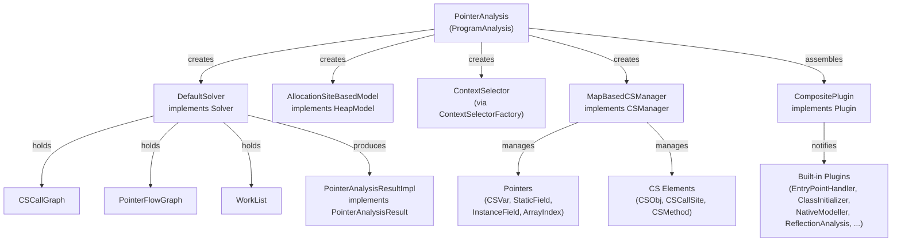

Sources: [src/main/java/pascal/taie/analysis/pta/PointerAnalysis.java:112-123](), [src/main/java/pascal/taie/analysis/pta/core/solver/DefaultSolver.java:113-169]()

---

## Pointer Types

All nodes in the Pointer Flow Graph implement the `Pointer` interface ([src/main/java/pascal/taie/analysis/pta/core/cs/element/Pointer.java:52-212]()). There are four concrete pointer kinds:

| Class | Represents | Key fields |
|---|---|---|
| `CSVar` | A local variable under a calling context | `Var`, `Context` |
| `StaticField` | A static field | `JField` |
| `InstanceField` | An instance field of a specific heap object | `CSObj` (base), `JField` |
| `ArrayIndex` | The element slot of a specific array object | `CSObj` (array) |

Each pointer holds a `PointsToSet` and a set of outgoing `PointerFlowEdge`s. The base implementation is `AbstractPointer`.

**Pointer type hierarchy**

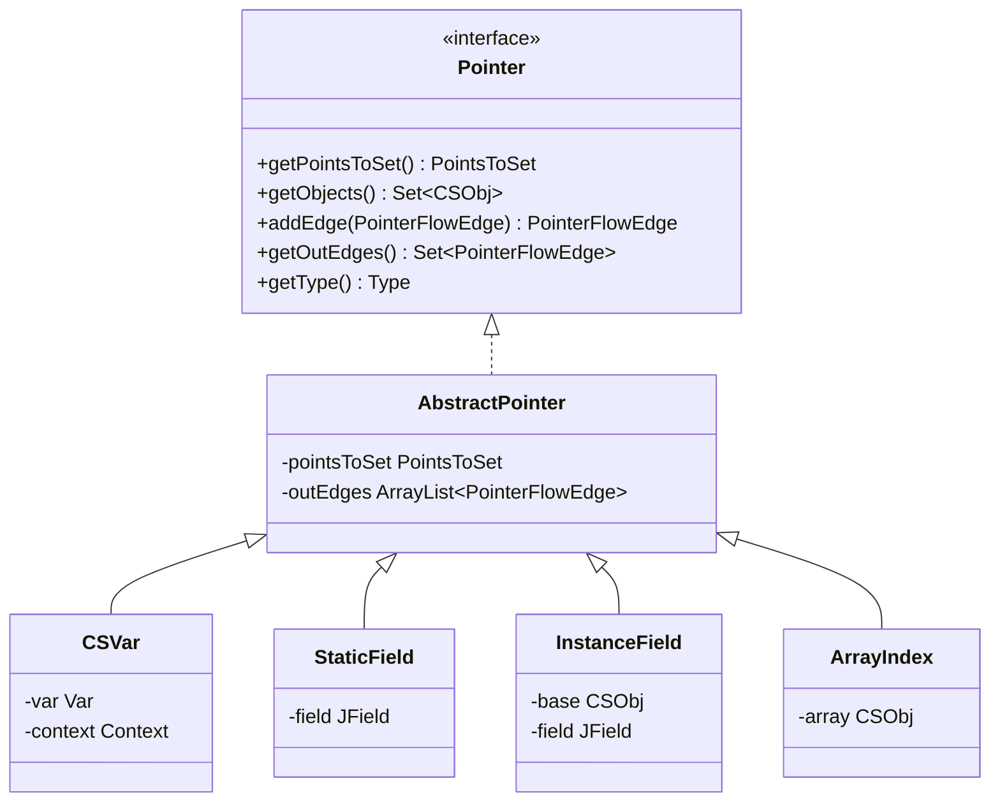

Sources: [src/main/java/pascal/taie/analysis/pta/core/cs/element/Pointer.java:52-212](), [src/main/java/pascal/taie/analysis/pta/core/solver/DefaultSolver.java:36-44]()

---

## Context-Sensitive Elements

The `CSManager` interface ([src/main/java/pascal/taie/analysis/pta/core/cs/element/CSManager.java:52-210]()) acts as a factory and registry for all context-sensitive elements. The default implementation is `MapBasedCSManager`.

| Element type | Factory method | Description |
|---|---|---|
| `CSVar` | `getCSVar(Context, Var)` | Variable under a context |
| `CSObj` | `getCSObj(Context, Obj)` | Heap object under a heap context |
| `CSCallSite` | `getCSCallSite(Context, Invoke)` | Call site under a context |
| `CSMethod` | `getCSMethod(Context, JMethod)` | Method under a context |
| `StaticField` | `getStaticField(JField)` | Static field pointer (context-free) |
| `InstanceField` | `getInstanceField(CSObj, JField)` | Field of a specific CS object |
| `ArrayIndex` | `getArrayIndex(CSObj)` | Element slot of a specific CS array |

Sources: [src/main/java/pascal/taie/analysis/pta/core/cs/element/CSManager.java:52-210](), [src/main/java/pascal/taie/analysis/pta/core/solver/DefaultSolver.java:119-126]()

---

## Propagation and Call Graph Construction

The solver's main loop in `DefaultSolver.solve()` ([src/main/java/pascal/taie/analysis/pta/core/solver/DefaultSolver.java:307-337]()) drains a `WorkList` of entries.

When a `PointerEntry` is dequeued, the solver calls `propagate()`, which:
1. Applies type filters via `PropagateTypes`.
2. Computes the diff against the existing points-to set.
3. Pushes the diff along all outgoing `PointerFlowEdge`s in the `PointerFlowGraph`.

The **on-the-fly call graph** grows in `processCall()` ([src/main/java/pascal/taie/analysis/pta/core/solver/DefaultSolver.java:467-494]()): for each new object in a receiver variable's points-to set, the solver resolves the callee, selects a context via `ContextSelector.selectContext()`, and adds a call edge.

**Statement processing** is handled by the `StmtProcessor` ([src/main/java/pascal/taie/analysis/pta/core/solver/DefaultSolver.java:549-737]()), which implements `StmtVisitor` and translates IR statements into PFG edges:

| IR statement | Action |
|---|---|
| `New` | Creates a heap object via `HeapModel.getObj()`, adds to LHS points-to set |
| `Copy` | Adds a `LOCAL_ASSIGN` PFG edge from RHS to LHS |
| `Cast` | Adds a `CAST` PFG edge with a `TypeFilter` |
| `LoadField` (static) | Adds a `STATIC_LOAD` edge from `StaticField` to LHS |
| `StoreField` (static) | Adds a `STATIC_STORE` edge from RHS to `StaticField` |

Sources: [src/main/java/pascal/taie/analysis/pta/core/solver/DefaultSolver.java:307-494](), [src/main/java/pascal/taie/analysis/pta/core/solver/DefaultSolver.java:549-737]()

---

## Pointer Flow Graph

`PointerFlowGraph` ([src/main/java/pascal/taie/analysis/pta/core/solver/PointerFlowGraph.java:39-90]()) stores flow edges directly on each `Pointer` node. Edges are typed by `FlowKind`:

| `FlowKind` | Meaning |
|---|---|
| `LOCAL_ASSIGN` | `x = y` |
| `CAST` | `x = (T) y` |
| `INSTANCE_LOAD` | `x = o.f` |
| `INSTANCE_STORE` | `o.f = x` |
| `STATIC_LOAD` | `x = T.f` |
| `STATIC_STORE` | `T.f = x` |
| `ARRAY_LOAD` | `x = a[i]` |
| `ARRAY_STORE` | `a[i] = x` |
| `PARAMETER_PASSING` | argument → parameter |
| `RETURN` | return value → LHS |
| `OTHER` | custom edges (e.g., `OtherEdge`) |

Sources: [src/main/java/pascal/taie/analysis/pta/core/solver/PointerFlowGraph.java:39-90](), [src/main/java/pascal/taie/analysis/graph/flowgraph/FlowKind.java:25-31]()

---

## Built-in Plugins

`PointerAnalysis.setPlugin()` ([src/main/java/pascal/taie/analysis/pta/PointerAnalysis.java:125-165]()) assembles a `CompositePlugin` from several components:

**Always active:**
- `AnalysisTimer`: Records elapsed time.
- `EntryPointHandler`: Seeds entry methods and initial objects.
- `ClassInitializer`: Triggers `<clinit>` on first use.
- `ThreadHandler`: Models `Thread.start()` and `currentThread()` ([src/main/java/pascal/taie/analysis/pta/plugin/ThreadHandler.java:53-150]()).
- `NativeModeller`: Models native methods.
- `ExceptionAnalysis`: Models exception propagation.

**Conditionally active:**
- `AndroidAnalysis`: Enabled in Android mode.
- `ReflectionAnalysis`: Enabled when `reflection-inference` or `reflection-log` is set.
- `LambdaAnalysis` / `InvokeDynamicAnalysis`: Enabled for Java 8+ and `handle-invokedynamic=true`.
- `TaintAnalysis`: Enabled when `taint-config` is provided.

Sources: [src/main/java/pascal/taie/analysis/pta/PointerAnalysis.java:125-165](), [src/main/java/pascal/taie/analysis/pta/plugin/ThreadHandler.java:53-150]()

---

## Analysis Results

After solving, `solver.getResult()` returns a `PointerAnalysisResult` ([src/main/java/pascal/taie/analysis/pta/PointerAnalysisResult.java:55-183]()).

Key query methods:
- `getPointsToSet(Var)`: Returns the context-insensitive points-to set.
- `getPointsToSet(Var, JField)`: Returns the points-to set for an instance field.
- `mayAlias(Var, Var)`: Checks if two variables may point to the same object.
- `getCSCallGraph()`: Returns the context-sensitive call graph.
- `getCallGraph()`: Returns the context-insensitive call graph.

Sources: [src/main/java/pascal/taie/analysis/pta/PointerAnalysisResult.java:55-183](), [src/main/java/pascal/taie/analysis/pta/core/solver/DefaultSolver.java:227-230]()

---

## Data Flow Summary

**End-to-end data flow from invocation to result**

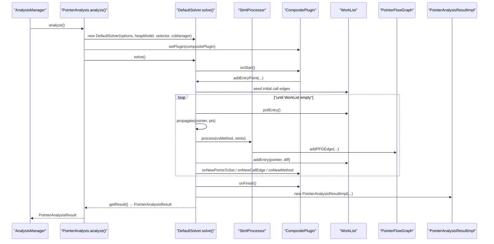

Sources: [src/main/java/pascal/taie/analysis/pta/PointerAnalysis.java:112-123](), [src/main/java/pascal/taie/analysis/pta/core/solver/DefaultSolver.java:246-337]()

---

# Page: Pointer Analysis Configuration

# Pointer Analysis Configuration

<details>
<summary>Relevant source files</summary>

The following files were used as context for generating this wiki page:

- [config/javadoc/header.html](config/javadoc/header.html)
- [config/javadoc/javadoc.css](config/javadoc/javadoc.css)
- [config/javadoc/overview.html](config/javadoc/overview.html)
- [src/main/java/pascal/taie/analysis/graph/callgraph/CallGraphBuilder.java](src/main/java/pascal/taie/analysis/graph/callgraph/CallGraphBuilder.java)
- [src/main/java/pascal/taie/analysis/graph/callgraph/CallGraphs.java](src/main/java/pascal/taie/analysis/graph/callgraph/CallGraphs.java)
- [src/main/java/pascal/taie/analysis/graph/callgraph/PTABasedBuilder.java](src/main/java/pascal/taie/analysis/graph/callgraph/PTABasedBuilder.java)
- [src/main/java/pascal/taie/analysis/graph/cfg/CFGBuilder.java](src/main/java/pascal/taie/analysis/graph/cfg/CFGBuilder.java)
- [src/main/java/pascal/taie/analysis/graph/cfg/CFGDumper.java](src/main/java/pascal/taie/analysis/graph/cfg/CFGDumper.java)
- [src/main/java/pascal/taie/analysis/graph/flowgraph/FlowGraphDumper.java](src/main/java/pascal/taie/analysis/graph/flowgraph/FlowGraphDumper.java)
- [src/main/java/pascal/taie/analysis/graph/icfg/ICFGBuilder.java](src/main/java/pascal/taie/analysis/graph/icfg/ICFGBuilder.java)
- [src/main/java/pascal/taie/analysis/misc/IRDumper.java](src/main/java/pascal/taie/analysis/misc/IRDumper.java)
- [src/main/java/pascal/taie/analysis/misc/ResultProcessor.java](src/main/java/pascal/taie/analysis/misc/ResultProcessor.java)
- [src/main/java/pascal/taie/analysis/pta/PointerAnalysis.java](src/main/java/pascal/taie/analysis/pta/PointerAnalysis.java)
- [src/main/java/pascal/taie/analysis/pta/client/Collector.java](src/main/java/pascal/taie/analysis/pta/client/Collector.java)
- [src/main/java/pascal/taie/analysis/pta/core/solver/PropagateTypes.java](src/main/java/pascal/taie/analysis/pta/core/solver/PropagateTypes.java)
- [src/main/java/pascal/taie/analysis/pta/plugin/Profiler.java](src/main/java/pascal/taie/analysis/pta/plugin/Profiler.java)
- [src/main/java/pascal/taie/analysis/pta/plugin/reflection/OthersModel.java](src/main/java/pascal/taie/analysis/pta/plugin/reflection/OthersModel.java)
- [src/main/java/pascal/taie/util/graph/DotDumper.java](src/main/java/pascal/taie/util/graph/DotDumper.java)
- [src/main/resources/tai-e-analyses.yml](src/main/resources/tai-e-analyses.yml)
- [src/test/java/pascal/taie/analysis/Tests.java](src/test/java/pascal/taie/analysis/Tests.java)

</details>


This page documents all configuration options for the `pta` (pointer analysis) analysis in Tai-e. It covers what each option does, its default value, and how it affects the analysis. For information about the solver that consumes these options at runtime, see [Solver Architecture](#3.2). For information about the plugin system activated by these options, see [Plugin System](#3.3). For information about the heap model options, see [Heap Model](#3.4).

---

## Overview

Pointer analysis in Tai-e is registered under the analysis ID `pta` and implemented in `pascal.taie.analysis.pta.PointerAnalysis` [src/main/java/pascal/taie/analysis/pta/PointerAnalysis.java:66-68](). All options are declared with defaults in `src/main/resources/tai-e-analyses.yml` [src/main/resources/tai-e-analyses.yml:1-36]() and are accessed at runtime via `AnalysisOptions`.

Options are passed on the command line using the `-a` flag:

```bash
-a "pta=cs:2-obj;only-app:true;time-limit:60"
```

The full set of available options and their defaults is declared at [src/main/resources/tai-e-analyses.yml:1-35]().

---

## How Options Are Consumed

`PointerAnalysis.analyze()` reads options and uses them to assemble the solver and its components. The flow is:

**Configuration resolution diagram: `PointerAnalysis.analyze()` to solver construction**

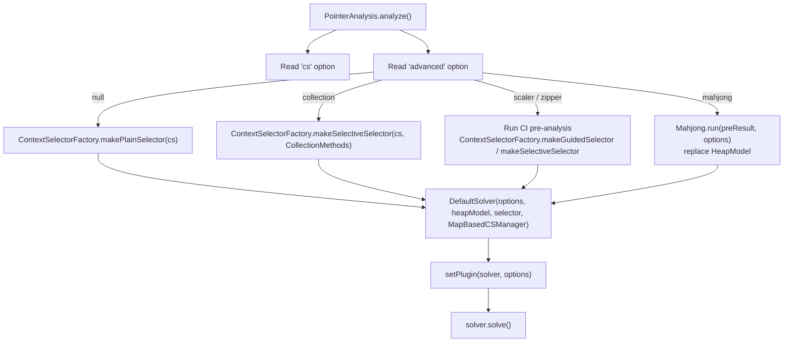

Sources: [src/main/java/pascal/taie/analysis/pta/PointerAnalysis.java:73-121]()

---

## All Configuration Options

### `cs` — Context Sensitivity

| Value | Meaning |
|---|---|
| `ci` | Context-insensitive (default) |
| `k-obj` | k-object-sensitive (e.g., `1-obj`, `2-obj`) |
| `k-type` | k-type-sensitive (e.g., `1-type`, `2-type`) |
| `k-call` | k-call-site-sensitive (e.g., `1-call`, `2-call`) |
| `k-obj-k'h` | k-object-sensitive with explicit heap context limit (e.g., `2-type-2h`) |

- Default heap context depth is `k-1` [src/main/resources/tai-e-analyses.yml:5]().
- The value is passed to `ContextSelectorFactory.makePlainSelector(cs)` when no `advanced` option is set [src/main/java/pascal/taie/analysis/pta/PointerAnalysis.java:106-108]().
- When `advanced` is `zipper` or `collection`, the `cs` value is used to construct a selective or guided selector respectively [src/main/java/pascal/taie/analysis/pta/PointerAnalysis.java:82-96]().

Sources: [src/main/java/pascal/taie/analysis/pta/PointerAnalysis.java:77-107](), [src/main/resources/tai-e-analyses.yml:5]()

---

### `only-app` — Application-Only Analysis

- **Default:** `false` [src/main/resources/tai-e-analyses.yml:6]()
- When `true`, the solver ignores library methods. This affects parameter passing, return value propagation, and call graph construction for library callees.

Sources: [src/main/resources/tai-e-analyses.yml:6]()

---

### `implicit-entries` — Implicit Entry Points

- **Default:** `true` [src/main/resources/tai-e-analyses.yml:7]()
- Controls whether methods implicitly invoked by the JVM (e.g., static initializers, thread `run()` methods) are treated as analysis entry points.
- When `false`, the analysis may be unsound because some code paths are never reached.
- Consumed by the `EntryPointHandler` plugin [src/main/java/pascal/taie/analysis/pta/PointerAnalysis.java:131]().

Sources: [src/main/resources/tai-e-analyses.yml:7]()

---

### `distinguish-string-constants` — String Constant Handling

- **Default:** `reflection` [src/main/resources/tai-e-analyses.yml:8]()
- Controls which string constants are given distinct heap objects (rather than being merged).

| Value | Effect |
|---|---|
| `reflection` | Distinguish only reflection-relevant strings (class, method, and field names) |
| `null` | Merge all string constants into one object |
| `app` | Distinguish string constants appearing in application code |
| `all` | Distinguish every string constant |
| `<predicate-class-name>` | Use a custom `java.util.function.Predicate<String>` implementation |

Sources: [src/main/resources/tai-e-analyses.yml:8-13]()

---

### Object Merging Flags

Three independent boolean flags control whether certain categories of objects are merged into a single representative:

| Option | Default | Objects Affected |
|---|---|---|
| `merge-string-objects` | `true` | `java.lang.String` objects |
| `merge-string-builders` | `true` | `java.lang.StringBuilder` and `java.lang.StringBuffer` objects |
| `merge-exception-objects` | `true` | Exception objects |

When `true`, all objects of the given category are collapsed into one heap object, trading precision for scalability. These options are read by `AllocationSiteBasedModel` [src/main/java/pascal/taie/analysis/pta/PointerAnalysis.java:77]().

Sources: [src/main/resources/tai-e-analyses.yml:14-16]()

---

### `propagate-types` — Type Propagation Filter

- **Default:** `[reference]` [src/main/resources/tai-e-analyses.yml:18]()
- A list of type categories whose values are propagated through the pointer flow graph.
- Possible list elements: `reference`, `null`, `int`, `long`, `float`, `double`, `char`, `boolean`, `byte`, `short`.

Sources: [src/main/resources/tai-e-analyses.yml:18]()

---

### `handle-invokedynamic` — Invokedynamic Support

- **Default:** `false` [src/main/resources/tai-e-analyses.yml:17]()
- When `true` and `InvokeDynamicAnalysis.useMethodHandle()` returns `true`, the `InvokeDynamicAnalysis` plugin is added to handle `invokedynamic` bytecode instructions [src/main/java/pascal/taie/analysis/pta/PointerAnalysis.java:155-158]().

Sources: [src/main/java/pascal/taie/analysis/pta/PointerAnalysis.java:155-158](), [src/main/resources/tai-e-analyses.yml:17]()

---

### `advanced` — Advanced Analysis Modes

- **Default:** `null` [src/main/resources/tai-e-analyses.yml:19]()

This option activates pre-analysis-based precision techniques. When set, `PointerAnalysis.analyze()` first runs a context-insensitive pre-analysis, then uses its result to configure the main analysis [src/main/java/pascal/taie/analysis/pta/PointerAnalysis.java:81-105]().

| Value | Algorithm | Effect |
|---|---|---|
| `zipper` | Zipper (OOPSLA'18) | Selects precision-critical methods; applies `cs` only to those |
| `zipper-e` | Zipper-Express (TOPLAS'20) | Faster approximation of Zipper |
| `scaler` | Scaler (FSE'18) | Assigns a per-method context sensitivity level |
| `mahjong` | Mahjong (PLDI'17) | Replaces the heap model with a DFA-equivalence-based merged model |
| `collection` | Collection heuristic | Applies selective context sensitivity to collection classes only |

**Advanced mode flow:**

```mermaid
flowchart LR
    start["advanced option value"] --> ci_check{"starts with\n'zipper' or 'scaler'\nor equals 'mahjong'?"}
    ci_check -- "yes" --> preanalysis["Run CI pre-analysis\nContextSelectorFactory.makeCISelector()"]
    ci_check -- "collection" --> col["ContextSelectorFactory.makeSelectiveSelector\n(cs, CollectionMethods)"]
    preanalysis --> zipper_check{"value?"}
    zipper_check -- "scaler*" --> scaler["Scaler.run(preResult, advanced)\nContextSelectorFactory.makeGuidedSelector(...)"]
    zipper_check -- "zipper*" --> zipper["Zipper.run(preResult, advanced)\nContextSelectorFactory.makeSelectiveSelector(cs, ...)"]
    zipper_check -- "mahjong" --> mahjong["Mahjong.run(preResult, options)\nreplaces HeapModel"]
```

Sources: [src/main/java/pascal/taie/analysis/pta/PointerAnalysis.java:77-107](), [src/main/resources/tai-e-analyses.yml:19-22]()

---

### `reflection-inference` — Reflection Resolution Strategy

- **Default:** `string-constant` [src/main/resources/tai-e-analyses.yml:27]()
- Activates `ReflectionAnalysis` plugin when non-null [src/main/java/pascal/taie/analysis/pta/PointerAnalysis.java:151-154]().

| Value | Behavior |
|---|---|
| `string-constant` | Resolve reflective calls by tracking string constants |
| `solar` | Apply the Solar algorithm (TOSEM'19) |
| `null` | Disable static reflection inference entirely |

Sources: [src/main/java/pascal/taie/analysis/pta/PointerAnalysis.java:151-154](), [src/main/resources/tai-e-analyses.yml:27]()

---

### `reflection-log` — Reflection Log File

- **Default:** `null` [src/main/resources/tai-e-analyses.yml:28]()
- Path to a TamiFlex-format reflection log. When provided, `ReflectionAnalysis` uses logged targets to resolve reflective calls directly [src/main/java/pascal/taie/analysis/pta/PointerAnalysis.java:151-154]().

Sources: [src/main/resources/tai-e-analyses.yml:28]()

---

### Taint Analysis Options

These options are consumed by the `TaintAnalysis` plugin. The plugin is added if either `taint-config` is non-null or `taint-config-providers` is non-empty [src/main/java/pascal/taie/analysis/pta/PointerAnalysis.java:159-162]().

| Option | Default | Description |
|---|---|---|
| `taint-config` | `null` | Path to a YAML taint config file or directory |
| `taint-config-providers` | `[]` | List of fully-qualified `TaintConfigProvider` class names |
| `taint-interactive-mode` | `false` | Re-run taint analysis on config file change without restarting PTA |

Sources: [src/main/java/pascal/taie/analysis/pta/PointerAnalysis.java:159-162](), [src/main/resources/tai-e-analyses.yml:29-32]()

---

### `plugins` — User-Defined Plugins

- **Default:** `[]` [src/main/resources/tai-e-analyses.yml:34]()
- A list of fully-qualified class names of additional `Plugin` implementations to load.
- Each class is instantiated via reflection using a no-argument constructor [src/main/java/pascal/taie/analysis/pta/PointerAnalysis.java:166-191]().

Example:
```bash
-a "pta=plugins:[my.example.TaintAnalysis,my.example.AnotherPlugin]"
```

Sources: [src/main/java/pascal/taie/analysis/pta/PointerAnalysis.java:166-191](), [src/main/resources/tai-e-analyses.yml:34]()

---

### `time-limit` — Analysis Time Limit

- **Default:** `-1` (no limit) [src/main/resources/tai-e-analyses.yml:35]()
- Sets a time limit in seconds. When the limit is exceeded, the solver stops its worklist processing early.

Sources: [src/main/resources/tai-e-analyses.yml:35-36]()

---

### Result Dumping Options

These options control whether and how points-to results are written to output files.

| Option | Default | Output |
|---|---|---|
| `dump` | `false` | Dump points-to results with full context information |
| `dump-ci` | `false` | Dump points-to results stripped of context |
| `dump-yaml` | `false` | Dump points-to results in YAML format |
| `expected-file` | `null` | Path to an expected results file for comparison |

Sources: [src/main/resources/tai-e-analyses.yml:23-26]()

---

## Plugin Activation Summary

The following diagram shows which options trigger which built-in plugins.

**Plugin activation by option value:**

```mermaid
flowchart TD
    opts["AnalysisOptions"] --> always["Always added:\nAnalysisTimer\nEntryPointHandler\nClassInitializer\nThreadHandler\nNativeModeller\nExceptionAnalysis"]
    opts --> android{"isAndroidMode?"}
    android -- "yes" --> android_p["AndroidAnalysis"]
    opts --> java_lt9{"javaVersion < 9?"}
    java_lt9 -- "yes" --> ref_handler["ReferenceHandler"]
    opts --> java_gte8{"javaVersion >= 8?"}
    java_gte8 -- "yes" --> lambda["LambdaAnalysis"]
    opts --> java_gte9{"javaVersion >= 9?"}
    java_gte9 -- "yes" --> strconcat["Java9StringConcatHandler"]
    opts --> refl{"reflection-inference != null\nOR reflection-log != null?"}
    refl -- "yes" --> reflanalysis["ReflectionAnalysis"]
    opts --> idyn{"handle-invokedynamic=true\nAND useMethodHandle()?"}
    idyn -- "yes" --> idynanalysis["InvokeDynamicAnalysis"]
    opts --> taint{"taint-config != null\nOR taint-config-providers non-empty?"}
    taint -- "yes" --> taintanalysis["TaintAnalysis"]
    opts --> spring{"spring=true?"}
    spring -- "yes" --> springanalysis["SpringAnalysis"]
    opts --> plugins["plugins:[...]\nUser classes via reflection"]
```

Sources: [src/main/java/pascal/taie/analysis/pta/PointerAnalysis.java:125-191]()

---

## Complete Option Reference

| Option | Type | Default | Description |
|---|---|---|---|
| `cs` | string | `ci` | Context sensitivity variant |
| `only-app` | boolean | `false` | Ignore library methods |
| `implicit-entries` | boolean | `true` | Include JVM-implicit entry methods |
| `distinguish-string-constants` | string | `reflection` | String constant heap allocation strategy |
| `merge-string-objects` | boolean | `true` | Merge all `String` objects |
| `merge-string-builders` | boolean | `true` | Merge all `StringBuilder`/`StringBuffer` objects |
| `merge-exception-objects` | boolean | `true` | Merge all exception objects |
| `handle-invokedynamic` | boolean | `false` | Enable `InvokeDynamicAnalysis` plugin |
| `propagate-types` | list | `[reference]` | Types whose values are propagated |
| `advanced` | string | `null` | Advanced precision technique |
| `reflection-inference` | string | `string-constant` | Reflection resolution strategy |
| `reflection-log` | string | `null` | Path to TamiFlex reflection log |
| `taint-config` | string | `null` | Path to taint config file/directory |
| `taint-config-providers` | list | `[]` | Programmatic taint config provider classes |
| `taint-interactive-mode` | boolean | `false` | Interactive taint config re-run mode |
| `plugins` | list | `[]` | Extra `Plugin` implementation class names |
| `time-limit` | int | `-1` | Seconds before forced stop; -1 = unlimited |
| `dump` | boolean | `false` | Dump points-to with context |
| `dump-ci` | boolean | `false` | Dump points-to without context |
| `dump-yaml` | boolean | `false` | Dump points-to in YAML |
| `expected-file` | string | `null` | Path to expected results for comparison |

Sources: [src/main/resources/tai-e-analyses.yml:1-35]()

---

# Page: Solver Architecture

# Solver Architecture

<details>
<summary>Relevant source files</summary>

The following files were used as context for generating this wiki page:

- [src/main/java/pascal/taie/analysis/graph/callgraph/CallKind.java](src/main/java/pascal/taie/analysis/graph/callgraph/CallKind.java)
- [src/main/java/pascal/taie/analysis/pta/core/cs/element/AbstractPointer.java](src/main/java/pascal/taie/analysis/pta/core/cs/element/AbstractPointer.java)
- [src/main/java/pascal/taie/analysis/pta/core/cs/element/ArrayIndex.java](src/main/java/pascal/taie/analysis/pta/core/cs/element/ArrayIndex.java)
- [src/main/java/pascal/taie/analysis/pta/core/cs/element/CSObj.java](src/main/java/pascal/taie/analysis/pta/core/cs/element/CSObj.java)
- [src/main/java/pascal/taie/analysis/pta/core/cs/element/CSVar.java](src/main/java/pascal/taie/analysis/pta/core/cs/element/CSVar.java)
- [src/main/java/pascal/taie/analysis/pta/core/cs/element/InstanceField.java](src/main/java/pascal/taie/analysis/pta/core/cs/element/InstanceField.java)
- [src/main/java/pascal/taie/analysis/pta/core/cs/element/Pointer.java](src/main/java/pascal/taie/analysis/pta/core/cs/element/Pointer.java)
- [src/main/java/pascal/taie/analysis/pta/core/cs/element/StaticField.java](src/main/java/pascal/taie/analysis/pta/core/cs/element/StaticField.java)
- [src/main/java/pascal/taie/analysis/pta/core/heap/Descriptor.java](src/main/java/pascal/taie/analysis/pta/core/heap/Descriptor.java)
- [src/main/java/pascal/taie/analysis/pta/core/solver/DeclaredParamProvider.java](src/main/java/pascal/taie/analysis/pta/core/solver/DeclaredParamProvider.java)
- [src/main/java/pascal/taie/analysis/pta/core/solver/DefaultSolver.java](src/main/java/pascal/taie/analysis/pta/core/solver/DefaultSolver.java)
- [src/main/java/pascal/taie/analysis/pta/core/solver/EmptyParamProvider.java](src/main/java/pascal/taie/analysis/pta/core/solver/EmptyParamProvider.java)
- [src/main/java/pascal/taie/analysis/pta/core/solver/EntryPoint.java](src/main/java/pascal/taie/analysis/pta/core/solver/EntryPoint.java)
- [src/main/java/pascal/taie/analysis/pta/core/solver/OtherEdge.java](src/main/java/pascal/taie/analysis/pta/core/solver/OtherEdge.java)
- [src/main/java/pascal/taie/analysis/pta/core/solver/ParamProvider.java](src/main/java/pascal/taie/analysis/pta/core/solver/ParamProvider.java)
- [src/main/java/pascal/taie/analysis/pta/core/solver/PointerFlowEdge.java](src/main/java/pascal/taie/analysis/pta/core/solver/PointerFlowEdge.java)
- [src/main/java/pascal/taie/analysis/pta/core/solver/PointerFlowGraph.java](src/main/java/pascal/taie/analysis/pta/core/solver/PointerFlowGraph.java)
- [src/main/java/pascal/taie/analysis/pta/core/solver/Solver.java](src/main/java/pascal/taie/analysis/pta/core/solver/Solver.java)
- [src/main/java/pascal/taie/analysis/pta/core/solver/SpecifiedParamProvider.java](src/main/java/pascal/taie/analysis/pta/core/solver/SpecifiedParamProvider.java)
- [src/main/java/pascal/taie/analysis/pta/core/solver/WorkList.java](src/main/java/pascal/taie/analysis/pta/core/solver/WorkList.java)
- [src/main/java/pascal/taie/analysis/pta/plugin/CompositePlugin.java](src/main/java/pascal/taie/analysis/pta/plugin/CompositePlugin.java)
- [src/main/java/pascal/taie/analysis/pta/plugin/EntryPointHandler.java](src/main/java/pascal/taie/analysis/pta/plugin/EntryPointHandler.java)
- [src/main/java/pascal/taie/analysis/pta/plugin/Plugin.java](src/main/java/pascal/taie/analysis/pta/plugin/Plugin.java)
- [src/main/java/pascal/taie/analysis/pta/plugin/ReferenceHandler.java](src/main/java/pascal/taie/analysis/pta/plugin/ReferenceHandler.java)
- [src/main/java/pascal/taie/analysis/pta/plugin/ThreadHandler.java](src/main/java/pascal/taie/analysis/pta/plugin/ThreadHandler.java)
- [src/main/java/pascal/taie/analysis/pta/pts/DelegatePointsToSet.java](src/main/java/pascal/taie/analysis/pta/pts/DelegatePointsToSet.java)
- [src/main/java/pascal/taie/analysis/pta/pts/PointsToSet.java](src/main/java/pascal/taie/analysis/pta/pts/PointsToSet.java)
- [src/main/java/pascal/taie/analysis/pta/pts/PointsToSetFactory.java](src/main/java/pascal/taie/analysis/pta/pts/PointsToSetFactory.java)

</details>


This page describes the architecture of the pointer analysis solver in Tai-e. The solver is the core component responsible for computing points-to information by resolving pointer flow constraints. For information about how to configure pointer analysis, see [Pointer Analysis Configuration](#3.1).

## Overview

The pointer analysis solver in Tai-e implements a flow-insensitive, context-sensitive algorithm that propagates points-to information through a pointer flow graph until a fixed point is reached. The solver architecture is designed to be extensible through a plugin system while maintaining high performance through efficient points-to set representations and constraint propagation mechanisms.

Tai-e's solver uses an on-the-fly call graph construction approach, where method reachability and call edges are discovered as the points-to sets of receiver variables grow.

### System Mapping: Code Entity Space

The following diagram maps high-level solver concepts to their specific implementation classes in the Tai-e codebase.

```mermaid
graph TD
    subgraph "Solver Core Components"
        Solver["Solver Interface <br/> (pascal.taie.analysis.pta.core.solver.Solver)"]
        DefaultSolver["DefaultSolver Implementation <br/> (pascal.taie.analysis.pta.core.solver.DefaultSolver)"]
        PFG["PointerFlowGraph <br/> (pascal.taie.analysis.pta.core.solver.PointerFlowGraph)"]
        WorkList["WorkList <br/> (pascal.taie.analysis.pta.core.solver.WorkList)"]
        CSCallGraph["CSCallGraph <br/> (pascal.taie.analysis.pta.core.cs.CSCallGraph)"]
    end

    subgraph "Context-Sensitive Elements"
        CSManager["CSManager <br/> (pascal.taie.analysis.pta.core.cs.element.CSManager)"]
        CSVar["CSVar <br/> (pascal.taie.analysis.pta.core.cs.element.CSVar)"]
        CSObj["CSObj <br/> (pascal.taie.analysis.pta.core.cs.element.CSObj)"]
        InstanceField["InstanceField <br/> (pascal.taie.analysis.pta.core.cs.element.InstanceField)"]
        ArrayIndex["ArrayIndex <br/> (pascal.taie.analysis.pta.core.cs.element.ArrayIndex)"]
        StaticField["StaticField <br/> (pascal.taie.analysis.pta.core.cs.element.StaticField)"]
    end

    subgraph "Extension Points"
        Plugin["Plugin Interface <br/> (pascal.taie.analysis.pta.plugin.Plugin)"]
        CompositePlugin["CompositePlugin <br/> (pascal.taie.analysis.pta.plugin.CompositePlugin)"]
        Transfer["Transfer Mechanism <br/> (pascal.taie.analysis.pta.core.solver.Transfer)"]
    end

    Solver --> DefaultSolver
    DefaultSolver --> PFG
    DefaultSolver --> WorkList
    DefaultSolver --> CSCallGraph
    DefaultSolver --> CSManager
    DefaultSolver --> Plugin
    Plugin --> CompositePlugin
    
    CSManager --> CSVar
    CSManager --> CSObj
    CSManager --> InstanceField
    CSManager --> ArrayIndex
    CSManager --> StaticField
    
    PFG --> Transfer
```

Sources: [src/main/java/pascal/taie/analysis/pta/core/solver/DefaultSolver.java:99-169](), [src/main/java/pascal/taie/analysis/pta/core/solver/Solver.java:52-89](), [src/main/java/pascal/taie/analysis/pta/plugin/Plugin.java:45-77]()

## Core Components

### Solver Interface

The `Solver` interface [pascal.taie.analysis.pta.core.solver.Solver:52-234]() defines the contract for pointer analysis solvers. It provides the side-effect APIs used by plugins to update points-to information, such as `addPointsTo` [pascal.taie.analysis.pta.core.solver.Solver:95-107]() and `addPFGEdge` [pascal.taie.analysis.pta.core.solver.Solver:133-179]().

### DefaultSolver

`DefaultSolver` [pascal.taie.analysis.pta.core.solver.DefaultSolver:99-169]() is the primary implementation. It manages the analysis lifecycle, including:
- **Time Limiting**: Monitors execution time via `TimeLimiter` and `timeLimit` options [pascal.taie.analysis.pta.core.solver.DefaultSolver:137-144]().
- **Statement Processing**: Uses a `StmtProcessor` to handle IR instructions like `New`, `Copy`, `LoadField`, `StoreField`, and `Invoke` [pascal.taie.analysis.pta.core.solver.DefaultSolver:605-890]().
- **Worklist Management**: Iteratively processes `PointerEntry` and `CallEdgeEntry` items [pascal.taie.analysis.pta.core.solver.WorkList:84-94]().

### PointerFlowGraph and Edges

The `PointerFlowGraph` [pascal.taie.analysis.pta.core.solver.PointerFlowGraph:39-90]() represents the flow of points-to sets.
- **Nodes**: Represented by the `Pointer` interface [pascal.taie.analysis.pta.core.cs.element.Pointer:40-124]().
- **Edges**: `PointerFlowEdge` [pascal.taie.analysis.pta.core.solver.PointerFlowEdge:33-100]() connects a source and target pointer.
- **Transfers**: Edges can have `Transfer` functions [pascal.taie.analysis.pta.core.solver.PointerFlowEdge:71-77]() that transform the points-to set during propagation (e.g., type filtering).

### WorkList Algorithm

The `WorkList` [pascal.taie.analysis.pta.core.solver.WorkList:40-82]() ensures that call edges are processed prior to pointer entries [pascal.taie.analysis.pta.core.solver.WorkList:66-70]() to maintain analysis correctness and prioritize call graph discovery.

Sources: [src/main/java/pascal/taie/analysis/pta/core/solver/DefaultSolver.java:245-337](), [src/main/java/pascal/taie/analysis/pta/core/solver/WorkList.java:40-82](), [src/main/java/pascal/taie/analysis/pta/core/solver/PointerFlowEdge.java:33-47]()

## Pointer Analysis Algorithm

### Main Execution Loop

The `solve()` method in `DefaultSolver` [pascal.taie.analysis.pta.core.solver.DefaultSolver:270-305]() orchestrates the analysis. It initializes entry points, then enters the `analyze()` loop [pascal.taie.analysis.pta.core.solver.DefaultSolver:307-337]().

```mermaid
flowchart TD
    Start["solve()"] --> Init["initialize()"]
    Init --> StartPlugin["plugin.onStart()"]
    StartPlugin --> EntryPoints["Add Entry Points"]
    EntryPoints --> Analyze["analyze() Loop"]
    
    subgraph "analyze() Iteration"
        direction TB
        Empty{"WorkList Empty?"} -- No --> Poll["pollEntry()"]
        Poll --> Type{"Entry Type?"}
        Type -- CallEdgeEntry --> ProcCall["processCallEdge()"]
        Type -- PointerEntry --> Propagate["propagate()"]
        ProcCall --> Empty
        Propagate --> Empty
    end
    
    Analyze --> Empty
    Empty -- Yes --> PhaseFinish["plugin.onPhaseFinish()"]
    PhaseFinish -- New Work? --> Analyze
    PhaseFinish -- No New Work --> Finish["plugin.onFinish()"]
```

Sources: [src/main/java/pascal/taie/analysis/pta/core/solver/DefaultSolver.java:270-337](), [src/main/java/pascal/taie/analysis/pta/core/solver/WorkList.java:65-78]()

### Statement Processing Logic

The `StmtProcessor` inside `DefaultSolver` handles the transfer functions for different IR statements.

| Statement Type | Action in Solver | Code Reference |
| :--- | :--- | :--- |
| `New` | Create `CSObj` and add to `CSVar` points-to set. | [DefaultSolver.java:613-625]() |
| `Copy` | Add PFG edge from source `CSVar` to target `CSVar`. | [DefaultSolver.java:632-637]() |
| `LoadField` | If base points to $O$, add PFG edge from $O.f$ to target. | [DefaultSolver.java:664-672]() |
| `StoreField` | If base points to $O$, add PFG edge from source to $O.f$. | [DefaultSolver.java:682-690]() |
| `Invoke` | Resolve target methods and create `CallEdgeEntry`. | [DefaultSolver.java:708-725]() |

Sources: [src/main/java/pascal/taie/analysis/pta/core/solver/DefaultSolver.java:605-725]()

## Extension and Plugins

Tai-e uses a `Plugin` architecture [pascal.taie.analysis.pta.plugin.Plugin:45-132]() to implement features like reflection, thread handling, and GC modeling without bloating the core solver.

### Plugin Lifecycle
1.  `setSolver(Solver)`: Injected at initialization [pascal.taie.analysis.pta.plugin.Plugin:52-53]().
2.  `onStart()`: Triggered before the main loop [pascal.taie.analysis.pta.plugin.Plugin:58-59]().
3.  `onNewPointsToSet(CSVar, PointsToSet)`: Triggered whenever a variable's points-to set grows [pascal.taie.analysis.pta.plugin.Plugin:85-86]().
4.  `onPhaseFinish()`: Allows plugins to add new work after a fixed-point is reached [pascal.taie.analysis.pta.plugin.Plugin:68-69]().

### CompositePlugin
The `CompositePlugin` [pascal.taie.analysis.pta.plugin.CompositePlugin:46-149]() aggregates multiple plugins and uses reflection to efficiently dispatch events only to plugins that override specific callback methods [pascal.taie.analysis.pta.plugin.CompositePlugin:79-91]().

### Example: ThreadHandler
The `ThreadHandler` plugin [pascal.taie.analysis.pta.plugin.ThreadHandler:53-187]() models the JVM's implicit entry points (like the Main Thread and System Thread Groups) and ensures that `Thread.start()` correctly propagates receiver objects to `Thread.currentThread()` [pascal.taie.analysis.pta.plugin.ThreadHandler:152-170]().

Sources: [src/main/java/pascal/taie/analysis/pta/plugin/Plugin.java:45-132](), [src/main/java/pascal/taie/analysis/pta/plugin/CompositePlugin.java:46-149](), [src/main/java/pascal/taie/analysis/pta/plugin/ThreadHandler.java:53-170]()

## Context-Sensitive Elements

The `CSManager` [pascal.taie.analysis.pta.core.cs.element.CSManager:39-127]() ensures canonical representation of context-sensitive elements.

### Pointer Hierarchy
All PFG nodes implement `Pointer` [pascal.taie.analysis.pta.core.cs.element.Pointer:40-124](). The base implementation `AbstractPointer` [pascal.taie.analysis.pta.core.cs.element.AbstractPointer:38-125]() manages:
- **Points-to Sets**: The `PointsToSet` associated with the pointer [pascal.taie.analysis.pta.core.cs.element.AbstractPointer:60-67]().
- **PFG Topology**: Out-edges and successors [pascal.taie.analysis.pta.core.cs.element.AbstractPointer:94-119]().
- **Object Filters**: Predicates to restrict which `CSObj` instances can flow through this pointer [pascal.taie.analysis.pta.core.cs.element.AbstractPointer:70-79]().

### Points-to Sets
`PointsToSet` [pascal.taie.analysis.pta.pts.PointsToSet:36-100]() provides high-performance set operations. The `addAllDiff` method [pascal.taie.analysis.pta.pts.PointsToSet:59]() is critical for the worklist algorithm, as it returns only the new objects that need to be propagated to successors.

Sources: [src/main/java/pascal/taie/analysis/pta/core/cs/element/CSManager.java:39-127](), [src/main/java/pascal/taie/analysis/pta/core/cs/element/AbstractPointer.java:38-125](), [src/main/java/pascal/taie/analysis/pta/pts/PointsToSet.java:36-100]()

---

# Page: Plugin System

# Plugin System

<details>
<summary>Relevant source files</summary>

The following files were used as context for generating this wiki page:

- [src/main/java/pascal/taie/analysis/graph/callgraph/CallKind.java](src/main/java/pascal/taie/analysis/graph/callgraph/CallKind.java)
- [src/main/java/pascal/taie/analysis/pta/core/solver/WorkList.java](src/main/java/pascal/taie/analysis/pta/core/solver/WorkList.java)
- [src/main/java/pascal/taie/analysis/pta/plugin/ClassInitializer.java](src/main/java/pascal/taie/analysis/pta/plugin/ClassInitializer.java)
- [src/main/java/pascal/taie/analysis/pta/plugin/CompositePlugin.java](src/main/java/pascal/taie/analysis/pta/plugin/CompositePlugin.java)
- [src/main/java/pascal/taie/analysis/pta/plugin/NullHandler.java](src/main/java/pascal/taie/analysis/pta/plugin/NullHandler.java)
- [src/main/java/pascal/taie/analysis/pta/plugin/NumberLiteralHandler.java](src/main/java/pascal/taie/analysis/pta/plugin/NumberLiteralHandler.java)
- [src/main/java/pascal/taie/analysis/pta/plugin/Plugin.java](src/main/java/pascal/taie/analysis/pta/plugin/Plugin.java)
- [src/main/java/pascal/taie/analysis/pta/plugin/ReferenceHandler.java](src/main/java/pascal/taie/analysis/pta/plugin/ReferenceHandler.java)
- [src/main/java/pascal/taie/analysis/pta/plugin/invokedynamic/Java9StringConcatHandler.java](src/main/java/pascal/taie/analysis/pta/plugin/invokedynamic/Java9StringConcatHandler.java)
- [src/main/java/pascal/taie/analysis/pta/plugin/invokedynamic/LookupModel.java](src/main/java/pascal/taie/analysis/pta/plugin/invokedynamic/LookupModel.java)
- [src/main/java/pascal/taie/analysis/pta/plugin/invokedynamic/MethodTypeModel.java](src/main/java/pascal/taie/analysis/pta/plugin/invokedynamic/MethodTypeModel.java)
- [src/main/java/pascal/taie/analysis/pta/plugin/natives/ArrayModel.java](src/main/java/pascal/taie/analysis/pta/plugin/natives/ArrayModel.java)
- [src/main/java/pascal/taie/analysis/pta/plugin/natives/DoPriviledgedModel.java](src/main/java/pascal/taie/analysis/pta/plugin/natives/DoPriviledgedModel.java)
- [src/main/java/pascal/taie/analysis/pta/plugin/natives/NativeModeller.java](src/main/java/pascal/taie/analysis/pta/plugin/natives/NativeModeller.java)
- [src/main/java/pascal/taie/analysis/pta/plugin/natives/UnsafeModel.java](src/main/java/pascal/taie/analysis/pta/plugin/natives/UnsafeModel.java)
- [src/main/java/pascal/taie/analysis/pta/plugin/util/AbstractIRModel.java](src/main/java/pascal/taie/analysis/pta/plugin/util/AbstractIRModel.java)
- [src/main/java/pascal/taie/analysis/pta/plugin/util/AbstractModel.java](src/main/java/pascal/taie/analysis/pta/plugin/util/AbstractModel.java)
- [src/main/java/pascal/taie/analysis/pta/plugin/util/AnalysisModelPlugin.java](src/main/java/pascal/taie/analysis/pta/plugin/util/AnalysisModelPlugin.java)
- [src/main/java/pascal/taie/analysis/pta/plugin/util/IRModel.java](src/main/java/pascal/taie/analysis/pta/plugin/util/IRModel.java)
- [src/main/java/pascal/taie/analysis/pta/plugin/util/IRModelPlugin.java](src/main/java/pascal/taie/analysis/pta/plugin/util/IRModelPlugin.java)
- [src/main/java/pascal/taie/analysis/pta/plugin/util/InvokeHandler.java](src/main/java/pascal/taie/analysis/pta/plugin/util/InvokeHandler.java)
- [src/main/java/pascal/taie/analysis/pta/plugin/util/InvokeHandlers.java](src/main/java/pascal/taie/analysis/pta/plugin/util/InvokeHandlers.java)
- [src/main/java/pascal/taie/analysis/pta/plugin/util/Model.java](src/main/java/pascal/taie/analysis/pta/plugin/util/Model.java)
- [src/main/java/pascal/taie/analysis/pta/plugin/util/ModelPlugin.java](src/main/java/pascal/taie/analysis/pta/plugin/util/ModelPlugin.java)
- [src/main/java/pascal/taie/analysis/pta/pts/DelegatePointsToSet.java](src/main/java/pascal/taie/analysis/pta/pts/DelegatePointsToSet.java)
- [src/main/java/pascal/taie/analysis/pta/pts/PointsToSet.java](src/main/java/pascal/taie/analysis/pta/pts/PointsToSet.java)
- [src/main/java/pascal/taie/analysis/pta/pts/PointsToSetFactory.java](src/main/java/pascal/taie/analysis/pta/pts/PointsToSetFactory.java)
- [src/main/java/pascal/taie/ir/stmt/FieldStmt.java](src/main/java/pascal/taie/ir/stmt/FieldStmt.java)
- [src/main/java/pascal/taie/language/classes/Pattern.java](src/main/java/pascal/taie/language/classes/Pattern.java)
- [src/main/java/pascal/taie/language/classes/SignatureMatcher.java](src/main/java/pascal/taie/language/classes/SignatureMatcher.java)
- [src/test/java/pascal/taie/analysis/pta/UnsafeModelTest.java](src/test/java/pascal/taie/analysis/pta/UnsafeModelTest.java)
- [src/test/java/pascal/taie/language/classes/PatternTest.java](src/test/java/pascal/taie/language/classes/PatternTest.java)
- [src/test/java/pascal/taie/language/classes/SignatureMatcherTest.java](src/test/java/pascal/taie/language/classes/SignatureMatcherTest.java)
- [src/test/resources/pta/basic/NativeModel-pta-expected.txt](src/test/resources/pta/basic/NativeModel-pta-expected.txt)
- [src/test/resources/pta/basic/NativeModel.java](src/test/resources/pta/basic/NativeModel.java)
- [src/test/resources/pta/misc/A.class](src/test/resources/pta/misc/A.class)
- [src/test/resources/pta/misc/NonExistStaticField.class](src/test/resources/pta/misc/NonExistStaticField.class)
- [src/test/resources/pta/misc/NonExistStaticField.java](src/test/resources/pta/misc/NonExistStaticField.java)
- [src/test/resources/pta/misc/UnsoundMap.class](src/test/resources/pta/misc/UnsoundMap.class)
- [src/test/resources/pta/misc/UnsoundMap.java](src/test/resources/pta/misc/UnsoundMap.java)

</details>


The plugin system provides an extensible architecture for enhancing Tai-e's pointer analysis capabilities. Plugins can respond to analysis events, modify analysis behavior, and implement custom handling for specific APIs or language features. This system enables modular extension of the core pointer analysis without modifying the solver implementation.

For information about configuring pointer analysis options that control plugin behavior, see [Pointer Analysis Configuration](#3.1). For details about implementing custom analyses that use pointer analysis results, see [Heap Model](#3.4).

## Plugin Interface and Lifecycle

The core of the plugin system is the `Plugin` interface, which defines callback methods invoked at specific points during pointer analysis execution.

```mermaid
graph TD
    Plugin["Plugin Interface"] --> setSolver["setSolver(Solver)"]
    Plugin --> onStart["onStart()"]
    Plugin --> onPhaseFinish["onPhaseFinish()"]
    Plugin --> onFinish["onFinish()"]
    Plugin --> onNewPointsToSet["onNewPointsToSet(CSVar, PointsToSet)"]
    Plugin --> onNewCallEdge["onNewCallEdge(Edge)"]
    Plugin --> onNewMethod["onNewMethod(JMethod)"]
    Plugin --> onNewStmt["onNewStmt(Stmt, JMethod)"]
    Plugin --> onNewCSMethod["onNewCSMethod(CSMethod)"]
    Plugin --> onUnresolvedCall["onUnresolvedCall(CSObj, Context, Invoke)"]
```

**Plugin Lifecycle Phases:**

| Phase | Callback | Purpose |
|-------|----------|---------|
| Initialization | `setSolver()` | Receive solver reference for state modification [src/main/java/pascal/taie/analysis/pta/plugin/Plugin.java:52-53]() |
| Start | `onStart()` | Perform initial setup before analysis begins [src/main/java/pascal/taie/analysis/pta/plugin/Plugin.java:58-59]() |
| Execution | Event callbacks | Respond to analysis events like new points-to sets or call edges [src/main/java/pascal/taie/analysis/pta/plugin/Plugin.java:80-131]() |
| Phase End | `onPhaseFinish()` | Process information when the work list empties; can restart analysis [src/main/java/pascal/taie/analysis/pta/plugin/Plugin.java:68-69]() |
| Completion | `onFinish()` | Perform final cleanup (should not modify results) [src/main/java/pascal/taie/analysis/pta/plugin/Plugin.java:76-77]() |

Sources: [src/main/java/pascal/taie/analysis/pta/plugin/Plugin.java:45-132]()

## Plugin Management with CompositePlugin

The `CompositePlugin` manages multiple plugins efficiently by maintaining separate lists for plugins that override specific callback methods, reducing overhead for frequently-invoked callbacks.

```mermaid
graph TB
    CompositePlugin["CompositePlugin"] --> allPlugins["allPlugins<br/>All registered plugins"]
    CompositePlugin --> onNewPointsToSetPlugins["onNewPointsToSetPlugins<br/>Plugins overriding onNewPointsToSet"]
    CompositePlugin --> onNewCallEdgePlugins["onNewCallEdgePlugins<br/>Plugins overriding onNewCallEdge"]
    CompositePlugin --> onNewMethodPlugins["onNewMethodPlugins<br/>Plugins overriding onNewMethod"]
    CompositePlugin --> onNewStmtPlugins["onNewStmtPlugins<br/>Plugins overriding onNewStmt"]
    CompositePlugin --> onNewCSMethodPlugins["onNewCSMethodPlugins<br/>Plugins overriding onNewCSMethod"]
    CompositePlugin --> onUnresolvedCallPlugins["onUnresolvedCallPlugins<br/>Plugins overriding onUnresolvedCall"]
    
    CompositePlugin --> addPlugin["addPlugin(Plugin...)"]
    CompositePlugin --> clearPlugins["clearPlugins()"]
```

The `CompositePlugin` uses reflection in `addPlugin` [src/main/java/pascal/taie/analysis/pta/plugin/CompositePlugin.java:79-91]() to determine which plugins override specific methods, ensuring optimal performance by only calling plugins that actually implement each callback.

Sources: [src/main/java/pascal/taie/analysis/pta/plugin/CompositePlugin.java:46-149]()

## API Modeling Framework

Tai-e provides specialized base classes and annotations to simplify the modeling of complex Java APIs.

### Annotation-Based Handler Registration

The `@InvokeHandler` annotation [src/main/java/pascal/taie/analysis/pta/plugin/util/InvokeHandler.java:39-52]() enables declarative registration of method handlers based on method signatures.

```mermaid
graph TD
    InvokeHandler["@InvokeHandler"] --> signature["signature: String[]<br/>Method signatures to handle"]
    InvokeHandler --> argIndexes["argIndexes: int[]<br/>Relevant argument positions"]
    
    subgraph "Model Plugin Types"
        AnalysisModelPlugin["AnalysisModelPlugin<br/>Points-to based modeling"]
        IRModelPlugin["IRModelPlugin<br/>IR generation based modeling"]
        AbstractModel["AbstractModel<br/>(Deprecated)"]
    end
    
    InvokeHandler --> AnalysisModelPlugin
    InvokeHandler --> IRModelPlugin
    InvokeHandler --> AbstractModel
```

### AnalysisModelPlugin and IRModelPlugin

1.  **AnalysisModelPlugin**: Used for modeling API side-effects by directly manipulating points-to sets. For example, `MethodTypeModel` [src/main/java/pascal/taie/analysis/pta/plugin/invokedynamic/MethodTypeModel.java:42-43]() uses this to handle `MethodType.methodType(...)` calls.
2.  **IRModelPlugin**: Used for modeling APIs by generating "artificial" IR statements that the solver then processes normally. `DoPriviledgedModel` [src/main/java/pascal/taie/analysis/pta/plugin/natives/DoPriviledgedModel.java:42-43]() uses this to generate an artificial `run()` call for `AccessController.doPrivileged(...)` [src/main/java/pascal/taie/analysis/pta/plugin/natives/DoPriviledgedModel.java:76-82]().

### Signature Matching and Patterns

The framework uses `Pattern` [src/main/java/pascal/taie/language/classes/Pattern.java:39]() to parse and match method/class signatures. This supports wildcards (`*`) and subclass markers (`^`) [src/main/java/pascal/taie/language/classes/Pattern.java:41-43]().

Sources: [src/main/java/pascal/taie/analysis/pta/plugin/util/AnalysisModelPlugin.java:27](), [src/main/java/pascal/taie/analysis/pta/plugin/util/IRModelPlugin.java:30](), [src/main/java/pascal/taie/analysis/pta/plugin/util/AbstractModel.java:70-86](), [src/main/java/pascal/taie/language/classes/Pattern.java:39-178]()

## Built-in Plugin Examples

### Method Handle and Type Modeling

The `LookupModel` and `MethodTypeModel` model `java.lang.invoke` APIs by reacting to specific method calls.

```mermaid
graph LR
    subgraph "MethodHandles.Lookup Modeling"
        LookupModel["LookupModel"] --> findConstructor["findConstructor(Class, MethodType)"]
        LookupModel --> findVirtual["findVirtual(Class, String, MethodType)"]
        LookupModel --> findStatic["findStatic(Class, String, MethodType)"]
    end
    
    subgraph "MethodType Modeling"
        MethodTypeModel["MethodTypeModel"] --> methodType1["methodType(Class)"]
        methodType1 --> addVarPointsTo["solver.addVarPointsTo(...)"]
    end
```

`LookupModel` uses `Reflections.getDeclaredMethods` [src/main/java/pascal/taie/analysis/pta/plugin/invokedynamic/LookupModel.java:78-79]() to resolve method handles and adds them to the result variable's points-to set [src/main/java/pascal/taie/analysis/pta/plugin/invokedynamic/LookupModel.java:108-110]().

### Native Modeling

The `NativeModeller` is a `CompositePlugin` [src/main/java/pascal/taie/analysis/pta/plugin/natives/NativeModeller.java:32]() that groups multiple models for native side-effects, such as `ArrayModel`, `UnsafeModel`, and `DoPriviledgedModel` [src/main/java/pascal/taie/analysis/pta/plugin/natives/NativeModeller.java:36-39]().

### GC and Reference Modeling

`ReferenceHandler` [src/main/java/pascal/taie/analysis/pta/plugin/ReferenceHandler.java:45]() models garbage collection behavior by connecting `Reference` initialization to the static field `Reference.pending` [src/main/java/pascal/taie/analysis/pta/plugin/ReferenceHandler.java:73-79](), ensuring that `finalize()` methods are eventually reachable.

Sources: [src/main/java/pascal/taie/analysis/pta/plugin/invokedynamic/LookupModel.java:49-116](), [src/main/java/pascal/taie/analysis/pta/plugin/invokedynamic/MethodTypeModel.java:42-104](), [src/main/java/pascal/taie/analysis/pta/plugin/natives/NativeModeller.java:32-41](), [src/main/java/pascal/taie/analysis/pta/plugin/ReferenceHandler.java:45-81]()

---

# Page: Heap Model

# Heap Model

<details>
<summary>Relevant source files</summary>

The following files were used as context for generating this wiki page:

- [src/main/java/pascal/taie/analysis/pta/core/heap/AbstractHeapModel.java](src/main/java/pascal/taie/analysis/pta/core/heap/AbstractHeapModel.java)
- [src/main/java/pascal/taie/analysis/pta/core/heap/ConstantObj.java](src/main/java/pascal/taie/analysis/pta/core/heap/ConstantObj.java)
- [src/main/java/pascal/taie/analysis/pta/core/heap/Descriptor.java](src/main/java/pascal/taie/analysis/pta/core/heap/Descriptor.java)
- [src/main/java/pascal/taie/analysis/pta/core/heap/HeapModel.java](src/main/java/pascal/taie/analysis/pta/core/heap/HeapModel.java)
- [src/main/java/pascal/taie/analysis/pta/core/heap/MergedObj.java](src/main/java/pascal/taie/analysis/pta/core/heap/MergedObj.java)
- [src/main/java/pascal/taie/analysis/pta/core/heap/MockObj.java](src/main/java/pascal/taie/analysis/pta/core/heap/MockObj.java)
- [src/main/java/pascal/taie/analysis/pta/core/heap/NewObj.java](src/main/java/pascal/taie/analysis/pta/core/heap/NewObj.java)
- [src/main/java/pascal/taie/analysis/pta/core/heap/Obj.java](src/main/java/pascal/taie/analysis/pta/core/heap/Obj.java)
- [src/main/java/pascal/taie/analysis/pta/core/solver/DeclaredParamProvider.java](src/main/java/pascal/taie/analysis/pta/core/solver/DeclaredParamProvider.java)
- [src/main/java/pascal/taie/analysis/pta/core/solver/EmptyParamProvider.java](src/main/java/pascal/taie/analysis/pta/core/solver/EmptyParamProvider.java)
- [src/main/java/pascal/taie/analysis/pta/core/solver/EntryPoint.java](src/main/java/pascal/taie/analysis/pta/core/solver/EntryPoint.java)
- [src/main/java/pascal/taie/analysis/pta/core/solver/ParamProvider.java](src/main/java/pascal/taie/analysis/pta/core/solver/ParamProvider.java)
- [src/main/java/pascal/taie/analysis/pta/core/solver/SpecifiedParamProvider.java](src/main/java/pascal/taie/analysis/pta/core/solver/SpecifiedParamProvider.java)
- [src/main/java/pascal/taie/analysis/pta/plugin/EntryPointHandler.java](src/main/java/pascal/taie/analysis/pta/plugin/EntryPointHandler.java)
- [src/main/java/pascal/taie/analysis/pta/plugin/taint/TaintManager.java](src/main/java/pascal/taie/analysis/pta/plugin/taint/TaintManager.java)

</details>


This page documents the heap abstraction layer used by Tai-e's pointer analysis. It covers the `HeapModel` interface, the `AbstractHeapModel` base implementation, the `Obj` type hierarchy, the built-in object merging strategies, and the `MahjongHeapModel` DFA-based advanced merging approach.

For how the solver uses the heap model during analysis (e.g., processing `New` statements), see [Solver Architecture](#3.2). For the Zipper and Mahjong algorithms at a higher level, see [Zipper and Mahjong](#7.4). For pointer analysis configuration options that control merging behavior, see [Pointer Analysis Configuration](#3.1).

---

## Purpose

The heap model answers one fundamental question: *given an allocation site in the program, which abstract object should represent it?* Pointer analysis must never create `Obj` instances directly. Instead, it always goes through the `HeapModel` interface, which applies the configured merging and abstraction strategy before returning an object.

---

## Obj Type Hierarchy

All abstract objects in the pointer analysis extend the abstract class `Obj` [src/main/java/pascal/taie/analysis/pta/core/heap/Obj.java:36-97](). Every `Obj` carries:

- A `Type` (its static Java type) [src/main/java/pascal/taie/analysis/pta/core/heap/Obj.java:38]()
- An integer index assigned by the heap model (see [Object Indexing](#object-indexing)) [src/main/java/pascal/taie/analysis/pta/core/heap/Obj.java:40]()
- An abstract allocation (`getAllocation()`) [src/main/java/pascal/taie/analysis/pta/core/heap/Obj.java:81]()
- An optional container method (`getContainerMethod()`) [src/main/java/pascal/taie/analysis/pta/core/heap/Obj.java:88]()
- A container type (`getContainerType()`, used by type-sensitivity) [src/main/java/pascal/taie/analysis/pta/core/heap/Obj.java:96]()
- An `isFunctional()` flag — when `true` the object can hold fields or array indices [src/main/java/pascal/taie/analysis/pta/core/heap/Obj.java:67]()

There are four concrete subtypes:

| Class | File | Allocation key | Typical source |
|---|---|---|---|
| `NewObj` | [src/main/java/pascal/taie/analysis/pta/core/heap/NewObj.java:34-66]() | `New` statement | `new Foo()` in program |
| `ConstantObj` | [src/main/java/pascal/taie/analysis/pta/core/heap/ConstantObj.java:34-62]() | `ReferenceLiteral` | String/Class/MethodType literals |
| `MockObj` | [src/main/java/pascal/taie/analysis/pta/core/heap/MockObj.java:35-109]() | `Descriptor` + arbitrary `Object` | Model objects, reflection, etc. |
| `MergedObj` | [src/main/java/pascal/taie/analysis/pta/core/heap/MergedObj.java:36-89]() | `Set<Obj>` of represented objs | Merging strategies |

**Obj class hierarchy diagram**

```mermaid
classDiagram
    class Obj {
        <<abstract>>
        +Type type
        +int index
        +getAllocation() Object
        +getContainerMethod() Optional~JMethod~
        +getContainerType() Type
        +isFunctional() boolean
    }
    class NewObj {
        -New allocSite
        +getAllocation() New
    }
    class ConstantObj {
        -ReferenceLiteral value
        +getAllocation() ReferenceLiteral
    }
    class MockObj {
        -Descriptor desc
        -Object alloc
        -JMethod container
        -boolean isFunctional
        +getDescriptor() Descriptor
    }
    class MergedObj {
        -String name
        -Set~Obj~ representedObjs
        -Obj representative
        +addRepresentedObj(Obj)
        +getAllocation() Set~Obj~
    }
    Obj <|-- NewObj
    Obj <|-- ConstantObj
    Obj <|-- MockObj
    Obj <|-- MergedObj
```

Sources: [src/main/java/pascal/taie/analysis/pta/core/heap/Obj.java](), [src/main/java/pascal/taie/analysis/pta/core/heap/NewObj.java](), [src/main/java/pascal/taie/analysis/pta/core/heap/ConstantObj.java](), [src/main/java/pascal/taie/analysis/pta/core/heap/MockObj.java](), [src/main/java/pascal/taie/analysis/pta/core/heap/MergedObj.java]()

---

## The `HeapModel` Interface

[src/main/java/pascal/taie/analysis/pta/core/heap/HeapModel.java:39-84]()

`HeapModel` extends `Indexer<Obj>` [src/main/java/pascal/taie/analysis/pta/core/heap/HeapModel.java:39](), so it also provides `getIndex(Obj)` and `getObject(int)` for efficient array-backed points-to sets.

| Method | Purpose |
|---|---|
| `getObj(New)` | Return the abstract object for a `new` statement [src/main/java/pascal/taie/analysis/pta/core/heap/HeapModel.java:44]() |
| `getConstantObj(ReferenceLiteral)` | Return the abstract object for a string/class/method-type literal [src/main/java/pascal/taie/analysis/pta/core/heap/HeapModel.java:49]() |
| `isStringConstant(Obj)` | Test whether an object represents a string constant [src/main/java/pascal/taie/analysis/pta/core/heap/HeapModel.java:54]() |
| `getMockObj(Descriptor, Object, Type, ...)` | Create or retrieve a mock object (several overloads) [src/main/java/pascal/taie/analysis/pta/core/heap/HeapModel.java:56-78]() |
| `getObjects()` | Return all objects registered in this model [src/main/java/pascal/taie/analysis/pta/core/heap/HeapModel.java:83]() |

The pointer analysis solver must **always** use this interface rather than constructing `Obj` instances directly [src/main/java/pascal/taie/analysis/pta/core/heap/HeapModel.java:35]().

---

## `AbstractHeapModel`

[src/main/java/pascal/taie/analysis/pta/core/heap/AbstractHeapModel.java:58-274]()

`AbstractHeapModel` provides the shared implementation that all concrete heap models inherit. It reads merging flags from `AnalysisOptions` at construction time [src/main/java/pascal/taie/analysis/pta/core/heap/AbstractHeapModel.java:107-119]() and maintains internal maps for deduplication and indexing.

### Configuration flags read at construction

| Option key | Field | Effect |
|---|---|---|
| `distinguish-string-constants` | `isDistinguishedSC` | Controls which string constants are kept separate vs. merged into `mergedSC` [src/main/java/pascal/taie/analysis/pta/core/heap/AbstractHeapModel.java:108-109]() |
| `merge-string-objects` | `isMergeStringObjects` | Merge all `new String()` allocations into one `MergedObj` [src/main/java/pascal/taie/analysis/pta/core/heap/AbstractHeapModel.java:110]() |
| `merge-string-builders` | `isMergeStringBuilders` | Merge all `StringBuilder`/`StringBuffer` allocations [src/main/java/pascal/taie/analysis/pta/core/heap/AbstractHeapModel.java:111]() |
| `merge-exception-objects` | `isMergeExceptionObjects` | Merge all subtypes of `Throwable` [src/main/java/pascal/taie/analysis/pta/core/heap/AbstractHeapModel.java:112]() |

The `distinguish-string-constants` option accepts: `reflection`, `app`, `all`, or a fully-qualified class name of a custom `Predicate<String>` [src/main/java/pascal/taie/analysis/pta/core/heap/AbstractHeapModel.java:122-145]().

### Internal state

| Field | Type | Purpose |
|---|---|---|
| `newObjs` | `Map<New, NewObj>` | Cache for `NewObj` instances [src/main/java/pascal/taie/analysis/pta/core/heap/AbstractHeapModel.java:82]() |
| `constantObjs` | `TwoKeyMap<Type, ReferenceLiteral, ConstantObj>` | Cache for `ConstantObj` instances [src/main/java/pascal/taie/analysis/pta/core/heap/AbstractHeapModel.java:84-85]() |
| `mergedSC` | `MergedObj` | The single merged object for all non-distinguished string constants [src/main/java/pascal/taie/analysis/pta/core/heap/AbstractHeapModel.java:90]() |
| `mergedObjs` | `Map<Type, MergedObj>` | Per-type merged objects for strings/builders/exceptions [src/main/java/pascal/taie/analysis/pta/core/heap/AbstractHeapModel.java:92]() |
| `mockObjs` | `Map<MockObj, MockObj>` | Cache for `MockObj` instances [src/main/java/pascal/taie/analysis/pta/core/heap/AbstractHeapModel.java:94]() |
| `zeroLengthArrays` | `Map<Type, Obj>` | Merged mock objects for zero-length arrays [src/main/java/pascal/taie/analysis/pta/core/heap/AbstractHeapModel.java:96]() |
| `objs` | `List<Obj>` | Sequential list of all registered objects (used for indexing) [src/main/java/pascal/taie/analysis/pta/core/heap/AbstractHeapModel.java:105]() |
| `counter` | `int` | Next index value to assign [src/main/java/pascal/taie/analysis/pta/core/heap/AbstractHeapModel.java:103]() |

### `getObj(New)` dispatch logic

**Dispatch flow for `getObj`**

```mermaid
flowchart TD
    A["getObj(New allocSite)"] --> B{"isMergeStringObjects\nand type == String?"}
    B -- yes --> C["getMergedObj(allocSite)"]
    B -- no --> D{"isMergeStringBuilders\nand type == StringBuilder\nor StringBuffer?"}
    D -- yes --> C
    D -- no --> E{"isMergeExceptionObjects\nand type is subtype of Throwable?"}
    E -- yes --> C
    E -- no --> F{"isZeroLengthArrayAlloc?"}
    F -- yes --> G["getZeroLengthArrayObj(type)"]
    F -- no --> H["doGetObj(allocSite)\n(abstract, subclass decides)"]
```

Sources: [src/main/java/pascal/taie/analysis/pta/core/heap/AbstractHeapModel.java:148-165]()

### `getConstantObj(ReferenceLiteral)` logic

For `StringLiteral` values, the predicate `isDistinguishedSC` is tested. If the string is **not** distinguished, the underlying `ConstantObj` is registered in `mergedSC` and `mergedSC` is returned instead [src/main/java/pascal/taie/analysis/pta/core/heap/AbstractHeapModel.java:216-231](). All other reference literals (e.g., class constants) are returned as individual `ConstantObj` instances.

### Zero-length array merging

When `allocSite.getRValue()` is a `NewArray` whose length variable holds the constant `0` [src/main/java/pascal/taie/analysis/pta/core/heap/AbstractHeapModel.java:167-175](), `getZeroLengthArrayObj(type)` is called. All zero-length arrays of the same element type share one `MockObj` with descriptor `ZeroLengthArray` [src/main/java/pascal/taie/analysis/pta/core/heap/AbstractHeapModel.java:203-209]().

### `add(Obj)` — object registration and indexing

Every object enters the model through the `add` method:

```java
protected <T extends Obj> T add(T obj) {
    objs.add(obj);
    obj.setIndex(counter++);
    return obj;
}
```

[src/main/java/pascal/taie/analysis/pta/core/heap/AbstractHeapModel.java:249-253]()

An index is assigned exactly once; attempting to re-index an `Obj` throws `IllegalStateException` [src/main/java/pascal/taie/analysis/pta/core/heap/Obj.java:47-49](). The `objs` list provides O(1) access by index via `getObject(int)`.

---

## Object Merging Strategies Summary

```mermaid
flowchart LR
    subgraph "Allocation sites"
        A1["new String()  (site 1)"]
        A2["new String()  (site 2)"]
        A3["new StringBuilder()"]
        A4["new IOException()"]
        A5["new int[0]"]
        A6["\"hello\"  (string constant)"]
        A7["\"world\"  (string constant)"]
    end

    subgraph "AbstractHeapModel output"
        M1["MergedObj {Merged java.lang.String}"]
        M2["MergedObj {Merged java.lang.StringBuilder}"]
        M3["MergedObj {Merged java.io.IOException}"]
        M4["MockObj {ZeroLengthArray int[]}"]
        M5["MergedObj {Merged string constants}"]
        N1["NewObj (site 1)"]
        N2["NewObj (site 2)"]
    end

    A1 -- "merge-string-objects=true" --> M1
    A2 -- "merge-string-objects=true" --> M1
    A1 -- "merge-string-objects=false" --> N1
    A2 -- "merge-string-objects=false" --> N2
    A3 -- "merge-string-builders=true" --> M2
    A4 -- "merge-exception-objects=true" --> M3
    A5 --> M4
    A6 -- "not distinguished" --> M5
    A7 -- "not distinguished" --> M5
```

Sources: [src/main/java/pascal/taie/analysis/pta/core/heap/AbstractHeapModel.java:149-230]()

---

## ParamProvider and Mock Objects

Tai-e uses `MockObj` to represent objects that do not have an explicit allocation site in the source code, such as entry point parameters or taint objects.

### Entry Point Handling

The `EntryPointHandler` plugin initializes the analysis by adding entry points to the solver [src/main/java/pascal/taie/analysis/pta/plugin/EntryPointHandler.java:35-59](). It uses `ParamProvider` implementations to supply initial objects:

- **`DeclaredParamProvider`**: Generates mock objects for method parameters and recursively for their fields up to depth `k` [src/main/java/pascal/taie/analysis/pta/core/solver/DeclaredParamProvider.java:49-150]().
- **`SpecifiedParamProvider`**: Allows manual specification of objects for `this` and parameters [src/main/java/pascal/taie/analysis/pta/core/solver/SpecifiedParamProvider.java:41-161]().

Mock objects for entry points typically use the `ENTRY_DESC` descriptor [src/main/java/pascal/taie/analysis/pta/core/solver/DeclaredParamProvider.java:103-105]().

### Taint Objects

The `TaintManager` creates `MockObj` instances with the `TAINT_DESC` descriptor to represent tainted data flowing through the system [src/main/java/pascal/taie/analysis/pta/plugin/taint/TaintManager.java:39-89]().

```java
Obj makeTaint(SourcePoint sourcePoint, Type type) {
    Obj taint = heapModel.getMockObj(TAINT_DESC, sourcePoint, type, false);
    taintObjs.add(taint);
    return taint;
}
```

[src/main/java/pascal/taie/analysis/pta/plugin/taint/TaintManager.java:58-62]()

---

## Object Indexing

`HeapModel` extends `Indexer<Obj>` [src/main/java/pascal/taie/analysis/pta/core/heap/HeapModel.java:39](), which means it exposes:

- `getIndex(Obj o)` → returns `o.getIndex()` (the sequential counter value assigned at registration) [src/main/java/pascal/taie/analysis/pta/core/heap/Obj.java:59]().
- `getObject(int index)` → returns `objs.get(index)` from the internal list [src/main/java/pascal/taie/analysis/pta/core/heap/AbstractHeapModel.java:267]().

Indices are assigned in registration order (first object registered gets index 0). Bit-vector based points-to sets rely on stable indices for efficient set operations. An object's index is set exactly once by `add()` and is immutable thereafter [src/main/java/pascal/taie/analysis/pta/core/heap/Obj.java:46-55]().

---

## Interaction with the Pointer Analysis Solver

The following diagram summarizes how the solver, plugins, and model layer interact around heap object creation:

```mermaid
sequenceDiagram
    participant Solver as "DefaultSolver"
    participant HM as "HeapModel\n(getObj / getConstantObj / getMockObj)"
    participant AM as "AbstractHeapModel"
    participant Obj as "Obj subtype"

    Solver ->> HM: "getObj(New stmt)"
    HM ->> AM: "checks merge flags"
    AM -->> HM: "MergedObj / NewObj"
    HM -->> Solver: "Obj"

    Solver ->> HM: "getConstantObj(StringLiteral)"
    HM ->> AM: "isDistinguishedSC test"
    AM -->> HM: "ConstantObj or mergedSC"
    HM -->> Solver: "Obj"

    note over Solver: "Plugin (e.g., TaintManager)"
    Solver ->> HM: "getMockObj(desc, alloc, type)"
    HM ->> AM: "lookup mockObjs cache"
    AM ->> Obj: "new MockObj(...) if absent"
    AM -->> HM: "MockObj"
    HM -->> Solver: "Obj"
```

Sources: [src/main/java/pascal/taie/analysis/pta/core/heap/HeapModel.java](), [src/main/java/pascal/taie/analysis/pta/core/heap/AbstractHeapModel.java](), [src/main/java/pascal/taie/analysis/pta/plugin/taint/TaintManager.java]()

---

# Page: Results and Clients

# Results and Clients

<details>
<summary>Relevant source files</summary>

The following files were used as context for generating this wiki page:

- [.gitignore](.gitignore)
- [src/main/java/pascal/taie/analysis/pta/PointerAnalysisResult.java](src/main/java/pascal/taie/analysis/pta/PointerAnalysisResult.java)
- [src/main/java/pascal/taie/analysis/pta/PointerAnalysisResultImpl.java](src/main/java/pascal/taie/analysis/pta/PointerAnalysisResultImpl.java)
- [src/main/java/pascal/taie/analysis/pta/client/MayFailCast.java](src/main/java/pascal/taie/analysis/pta/client/MayFailCast.java)
- [src/main/java/pascal/taie/analysis/pta/client/PolymorphicCallSite.java](src/main/java/pascal/taie/analysis/pta/client/PolymorphicCallSite.java)
- [src/main/java/pascal/taie/analysis/pta/core/cs/CSCallGraph.java](src/main/java/pascal/taie/analysis/pta/core/cs/CSCallGraph.java)
- [src/main/java/pascal/taie/analysis/pta/core/cs/element/ArrayIndex.java](src/main/java/pascal/taie/analysis/pta/core/cs/element/ArrayIndex.java)
- [src/main/java/pascal/taie/analysis/pta/core/cs/element/CSCallSite.java](src/main/java/pascal/taie/analysis/pta/core/cs/element/CSCallSite.java)
- [src/main/java/pascal/taie/analysis/pta/core/cs/element/CSManager.java](src/main/java/pascal/taie/analysis/pta/core/cs/element/CSManager.java)
- [src/main/java/pascal/taie/analysis/pta/core/cs/element/CSMethod.java](src/main/java/pascal/taie/analysis/pta/core/cs/element/CSMethod.java)
- [src/main/java/pascal/taie/analysis/pta/core/cs/element/CSObj.java](src/main/java/pascal/taie/analysis/pta/core/cs/element/CSObj.java)
- [src/main/java/pascal/taie/analysis/pta/core/cs/element/CSVar.java](src/main/java/pascal/taie/analysis/pta/core/cs/element/CSVar.java)
- [src/main/java/pascal/taie/analysis/pta/core/cs/element/InstanceField.java](src/main/java/pascal/taie/analysis/pta/core/cs/element/InstanceField.java)
- [src/main/java/pascal/taie/analysis/pta/core/cs/element/MapBasedCSManager.java](src/main/java/pascal/taie/analysis/pta/core/cs/element/MapBasedCSManager.java)
- [src/main/java/pascal/taie/analysis/pta/core/cs/element/StaticField.java](src/main/java/pascal/taie/analysis/pta/core/cs/element/StaticField.java)
- [src/main/java/pascal/taie/analysis/pta/plugin/ResultProcessor.java](src/main/java/pascal/taie/analysis/pta/plugin/ResultProcessor.java)

</details>


This page explains how to access and use the results of pointer analysis in Tai-e. Pointer analysis provides essential information about what objects program variables may point to, which enables many other analyses. Here you'll learn how to access points-to sets, call graphs, and other data structures produced by pointer analysis, as well as how to build client analyses that consume these results.

After pointer analysis completes, the result is registered with the `World` singleton and retrieved by client analyses via `World.get().getResult(PointerAnalysis.ID)`. For information about configuring pointer analysis, see page 3.1, and for details about the internal solver implementation, see page 3.2.

## Pointer Analysis Result Interface

`PointerAnalysisResult` is the primary API for querying pointer analysis output. It provides overloaded `getPointsToSet` methods for every kind of pointer-accessible expression, alias queries, and access to call graphs. `PointerAnalysisResultImpl` is the concrete implementation, extending `AbstractResultHolder` so that plugin-attached sub-results can also be stored on it.

**Class hierarchy: `PointerAnalysisResult` and its implementation**

```mermaid
classDiagram
    class ResultHolder["ResultHolder (interface)"]
    class PointerAnalysisResult["PointerAnalysisResult (interface)"] {
        +getCSVars() Collection~CSVar~
        +getVars() Collection~Var~
        +getInstanceFields() Collection~InstanceField~
        +getArrayIndexes() Collection~ArrayIndex~
        +getStaticFields() Collection~StaticField~
        +getCSObjects() Collection~CSObj~
        +getObjects() Collection~Obj~
        +getObjectIndexer() Indexer~Obj~
        +getPointsToSet(Var) Set~Obj~
        +getPointsToSet(InstanceFieldAccess) Set~Obj~
        +getPointsToSet(Var, JField) Set~Obj~
        +getPointsToSet(Obj, JField) Set~Obj~
        +getPointsToSet(StaticFieldAccess) Set~Obj~
        +getPointsToSet(JField) Set~Obj~
        +getPointsToSet(ArrayAccess) Set~Obj~
        +getPointsToSet(Var, Var) Set~Obj~
        +getPointsToSet(Obj) Set~Obj~
        +mayAlias(Var, Var) boolean
        +mayAlias(InstanceFieldAccess, InstanceFieldAccess) boolean
        +mayAlias(ArrayAccess, ArrayAccess) boolean
        +getCSCallGraph() CallGraph~CSCallSite,CSMethod~
        +getCallGraph() CallGraph~Invoke,JMethod~
        +getObjectFlowGraph() ObjectFlowGraph
    }
    class AbstractResultHolder["AbstractResultHolder"]
    class PointerAnalysisResultImpl["PointerAnalysisResultImpl"] {
        -propTypes PropagateTypes
        -csManager CSManager
        -varPointsTo Map~Var,Set~Obj~~
        -ifieldPointsTo Map~Pair~Var,JField~,Set~Obj~~
        -sfieldPointsTo Map~JField,Set~Obj~~
        -arrayPointsTo Map~Var,Set~Obj~~
        -objects Set~Obj~
        -canonicalizer Canonicalizer~Set~Obj~~
        -csCallGraph CallGraph~CSCallSite,CSMethod~
        -callGraph CallGraph~Invoke,JMethod~
        -pfg PointerFlowGraph
        -ofg ObjectFlowGraph
    }

    ResultHolder <|-- PointerAnalysisResult
    AbstractResultHolder <|-- PointerAnalysisResultImpl
    PointerAnalysisResult <|.. PointerAnalysisResultImpl
```

Sources: [src/main/java/pascal/taie/analysis/pta/PointerAnalysisResult.java:55-183](), [src/main/java/pascal/taie/analysis/pta/PointerAnalysisResultImpl.java:65-136]()

## Accessing Points-to Sets

The primary result of pointer analysis is a collection of abstract objects (`Obj`) that a variable or memory location may point to at runtime. `PointerAnalysisResult` provides overloaded `getPointsToSet` for each kind of expression.

**Before returning a result, every `getPointsToSet` method checks `PropagateTypes.isAllowed` on the expression's type.** If the type was excluded from analysis (e.g., by the `propagate-types` option, see page 3.1), the method returns an empty set immediately. This prevents callers from seeing partial or meaningless results.

| Expression kind | Method signature | Notes |
|---|---|---|
| Local variable | `getPointsToSet(Var)` | Unions over all CS copies of the variable |
| Instance field access | `getPointsToSet(InstanceFieldAccess)` | Resolves field ref, delegates to `getPointsToSet(Var, JField)` |
| Instance field (base var + field) | `getPointsToSet(Var base, JField field)` | Unions over all CS objects pointed to by base |
| Instance field (base obj + field) | `getPointsToSet(Obj base, JField field)` | Unions over all CS wrappers of that `Obj` |
| Static field access | `getPointsToSet(StaticFieldAccess)` | Resolves field ref, delegates to `getPointsToSet(JField)` |
| Static field | `getPointsToSet(JField)` | Reads the single `StaticField` pointer |
| Array access | `getPointsToSet(ArrayAccess)` | Delegates to `getPointsToSet(Var base, Var index)` |
| Array (base + index vars) | `getPointsToSet(Var base, Var index)` | Index variable is unused; models all array elements uniformly |
| Array object | `getPointsToSet(Obj array)` | Unions over all CS wrappers of that array `Obj` |

Results are internally cached in `varPointsTo`, `ifieldPointsTo`, `sfieldPointsTo`, and `arrayPointsTo` maps. The raw context-sensitive points-to data comes from the `CSManager`; `removeContexts` strips the heap context and returns a canonical `Set<Obj>` backed by a `HybridBitSet` indexed by `objIndexer`. Identical point-to sets are de-duplicated through a `Canonicalizer<Set<Obj>>` to reduce memory.

Sources: [src/main/java/pascal/taie/analysis/pta/PointerAnalysisResult.java:98-152](), [src/main/java/pascal/taie/analysis/pta/PointerAnalysisResultImpl.java:177-329]()

## Context-Sensitive Elements

Pointer analysis in Tai-e tracks a *calling context* alongside each variable, object, call site, and method. The `CSManager` interface is the factory and registry for all these context-sensitive wrappers. `MapBasedCSManager` is the only production implementation and stores everything in maps, with two inner helper classes:

- **`PointerManager`** — creates and caches `CSVar`, `StaticField`, `InstanceField`, and `ArrayIndex` instances, assigning each a unique integer index [src/main/java/pascal/taie/analysis/pta/core/cs/element/MapBasedCSManager.java:154-219]().
- **`CSObjManager`** — creates and caches `CSObj` instances. It also implements `Indexer<CSObj>` [src/main/java/pascal/taie/analysis/pta/core/cs/element/MapBasedCSManager.java:54-54]().

**CS element types and the `CSManager` interface**

```mermaid
classDiagram
    class CSManager["CSManager (interface)"] {
        +getCSVar(Context, Var) CSVar
        +getCSObj(Context, Obj) CSObj
        +getCSCallSite(Context, Invoke) CSCallSite
        +getCSMethod(Context, JMethod) CSMethod
        +getStaticField(JField) StaticField
        +getInstanceField(CSObj, JField) InstanceField
        +getArrayIndex(CSObj) ArrayIndex
        +getVars() Collection~Var~
        +getCSVarsOf(Var) Collection~CSVar~
        +getCSVars() Collection~CSVar~
        +getObjects() Collection~CSObj~
        +getCSObjsOf(Obj) Collection~CSObj~
        +pointers() Stream~Pointer~
        +getObjectIndexer() Indexer~CSObj~
    }
    class MapBasedCSManager["MapBasedCSManager"] {
        -ptrManager PointerManager
        -objManager CSObjManager
        -callSites TwoKeyMap~Invoke,Context,CSCallSite~
        -methods TwoKeyMap~JMethod,Context,CSMethod~
    }
    class CSVar["CSVar"] {
        -var Var
        -context Context
        +getVar() Var
        +getContext() Context
        +getType() Type
    }
    class CSObj["CSObj"] {
        -obj Obj
        -context Context
        -index int
        +getObject() Obj
        +getIndex() int
    }
    class CSMethod["CSMethod"] {
        -method JMethod
        -edges ArrayList~Edge~
        +getMethod() JMethod
        +getEdges() Set~Edge~
    }
    class CSCallSite["CSCallSite"] {
        -callSite Invoke
        -container CSMethod
        -edges Set~Edge~
        +getCallSite() Invoke
        +getContainer() CSMethod
    }
    class InstanceField["InstanceField"] {
        -base CSObj
        -field JField
        +getBase() CSObj
        +getField() JField
    }
    class StaticField["StaticField"] {
        -field JField
        +getField() JField
    }
    class ArrayIndex["ArrayIndex"] {
        -array CSObj
        +getArray() CSObj
        +getType() Type
    }

    CSManager <|.. MapBasedCSManager
    MapBasedCSManager --> CSVar
    MapBasedCSManager --> CSObj
    MapBasedCSManager --> CSMethod
    MapBasedCSManager --> CSCallSite
    MapBasedCSManager --> InstanceField
    MapBasedCSManager --> StaticField
    MapBasedCSManager --> ArrayIndex
```

Sources: [src/main/java/pascal/taie/analysis/pta/core/cs/element/CSManager.java:40-135](), [src/main/java/pascal/taie/analysis/pta/core/cs/element/MapBasedCSManager.java:50-152](), [src/main/java/pascal/taie/analysis/pta/core/cs/element/CSVar.java:23-23](), [src/main/java/pascal/taie/analysis/pta/core/cs/element/CSObj.java:32-60](), [src/main/java/pascal/taie/analysis/pta/core/cs/element/CSMethod.java:41-85](), [src/main/java/pascal/taie/analysis/pta/core/cs/element/CSCallSite.java:36-79](), [src/main/java/pascal/taie/analysis/pta/core/cs/element/InstanceField.java:23-23](), [src/main/java/pascal/taie/analysis/pta/core/cs/element/StaticField.java:23-23](), [src/main/java/pascal/taie/analysis/pta/core/cs/element/ArrayIndex.java:23-23]()

All context-sensitive collections are exposed via `PointerAnalysisResult`: `getCSVars()`, `getCSObjects()`, `getInstanceFields()`, `getStaticFields()`, and `getArrayIndexes()`. Each delegates directly to the corresponding `CSManager` method.

Sources: [src/main/java/pascal/taie/analysis/pta/PointerAnalysisResult.java:60-85](), [src/main/java/pascal/taie/analysis/pta/PointerAnalysisResultImpl.java:139-171]()

## Aliasing Information

`PointerAnalysisResult` exposes three `mayAlias` overloads:

| Method | Returns `true` when… |
|---|---|
| `mayAlias(Var v1, Var v2)` | `getPointsToSet(v1)` and `getPointsToSet(v2)` are not disjoint |
| `mayAlias(InstanceFieldAccess if1, InstanceFieldAccess if2)` | The two accesses resolve to the same `JField` **and** their base variables may alias |
| `mayAlias(ArrayAccess a1, ArrayAccess a2)` | The base variables of both accesses may alias (array index is ignored) |

All three methods work on context-insensitive (projected) points-to sets, since contexts have already been stripped by `getPointsToSet`.

Sources: [src/main/java/pascal/taie/analysis/pta/PointerAnalysisResult.java:157-167](), [src/main/java/pascal/taie/analysis/pta/PointerAnalysisResultImpl.java:302-319]()

## Call Graph Access

The pointer analysis builds a call graph on-the-fly during solving. Two views of it are available through `PointerAnalysisResult`:

**Call graph projection: CS to CI**

```mermaid
flowchart LR
    subgraph "Context-sensitive (CSCallGraph)"
        CS1["CSCallSite\n(Invoke + Context)"]
        CS2["CSMethod\n(JMethod + Context)"]
        CS1 -->|"Edge"| CS2
    end
    subgraph "Context-insensitive (DefaultCallGraph)"
        CI1["Invoke"]
        CI2["JMethod"]
        CI1 -->|"CIEdge"| CI2
    end
    CS1 -->|"getCallSite()"| CI1
    CS2 -->|"getMethod()"| CI2
```

Sources: [src/main/java/pascal/taie/analysis/pta/PointerAnalysisResult.java:172-177](), [src/main/java/pascal/taie/analysis/pta/PointerAnalysisResultImpl.java:332-386](), [src/main/java/pascal/taie/analysis/pta/core/cs/CSCallGraph.java:45-152]()

### `getCSCallGraph()`

Returns the `CSCallGraph` built during analysis — a `CallGraph<CSCallSite, CSMethod>`. Each edge connects a `CSCallSite` to a `CSMethod`. The `CSCallSite` holds a reference back to its containing `CSMethod` via `getContainer()` [src/main/java/pascal/taie/analysis/pta/core/cs/element/CSCallSite.java:63-65]().

### `getCallGraph()`

Returns a `CallGraph<Invoke, JMethod>` (a `DefaultCallGraph`). This is lazily created on first access by the private `removeContexts(CallGraph<CSCallSite, CSMethod>)` method in `PointerAnalysisResultImpl` [src/main/java/pascal/taie/analysis/pta/PointerAnalysisResultImpl.java:352-386](), which strips contexts from every entry method, reachable method, and call edge.

The context-insensitive graph is what most client analyses use, since they operate on `JMethod` and `Invoke` directly.

Sources: [src/main/java/pascal/taie/analysis/pta/PointerAnalysisResultImpl.java:332-386](), [src/main/java/pascal/taie/analysis/pta/core/cs/CSCallGraph.java:45-152]()

## Result Processor and Dumping

Tai-e provides a `ResultProcessor` plugin to dump analysis results to files or compare them with expected outputs. It can generate three types of output:
- `pta-results.txt`: Context-sensitive points-to sets [src/main/java/pascal/taie/analysis/pta/plugin/ResultProcessor.java:78-78]().
- `pta-ci-results.txt`: Context-insensitive points-to sets [src/main/java/pascal/taie/analysis/pta/plugin/ResultProcessor.java:82-82]().
- `pta-results.yml`: Results in YAML format [src/main/java/pascal/taie/analysis/pta/plugin/ResultProcessor.java:80-80]().

It also logs detailed statistics about variables, objects, points-to set sizes, and reachable methods at the end of the analysis [src/main/java/pascal/taie/analysis/pta/plugin/ResultProcessor.java:135-168]().

Sources: [src/main/java/pascal/taie/analysis/pta/plugin/ResultProcessor.java:74-173]()

## Client Analyses

The `pascal.taie.analysis.pta.client` package contains analyses that consume `PointerAnalysisResult`. They all share the `Collector` base class.

### The `Collector` Pattern

`Collector` is an abstract `ProgramAnalysis<StmtResult<Boolean>>`. Its `analyze()` method:
1. Retrieves the `PointerAnalysisResult` from `World`.
2. Iterates over all reachable methods in the CI call graph.
3. For each `Stmt` in each method, calls `isRelevant(Stmt)` to filter candidates.
4. Calls `isWanted(Stmt, PointerAnalysisResult)` on candidates to decide if they belong in the result set.

### `MayFailCast` (ID: `may-fail-cast`)

Relevant statement: any `Cast` statement [src/main/java/pascal/taie/analysis/pta/client/MayFailCast.java:43-45](). A cast is *wanted* if any `Obj` in the points-to set of the source variable has a type that is not a subtype of the target cast type [src/main/java/pascal/taie/analysis/pta/client/MayFailCast.java:48-59]().

### `PolymorphicCallSite` (ID: `poly-call`)

Relevant statement: any `Invoke` that is virtual or interface [src/main/java/pascal/taie/analysis/pta/client/PolymorphicCallSite.java:39-42](). A call site is *wanted* if its callee set in the CI call graph has more than one element [src/main/java/pascal/taie/analysis/pta/client/PolymorphicCallSite.java:45-49]().

Sources: [src/main/java/pascal/taie/analysis/pta/client/MayFailCast.java:34-65](), [src/main/java/pascal/taie/analysis/pta/client/PolymorphicCallSite.java:30-54]()

---

# Page: Testing Framework

# Testing Framework

<details>
<summary>Relevant source files</summary>

The following files were used as context for generating this wiki page:

- [src/main/java/pascal/taie/analysis/graph/callgraph/CallGraphBuilder.java](src/main/java/pascal/taie/analysis/graph/callgraph/CallGraphBuilder.java)
- [src/main/java/pascal/taie/analysis/graph/callgraph/CallGraphs.java](src/main/java/pascal/taie/analysis/graph/callgraph/CallGraphs.java)
- [src/main/java/pascal/taie/analysis/graph/callgraph/PTABasedBuilder.java](src/main/java/pascal/taie/analysis/graph/callgraph/PTABasedBuilder.java)
- [src/main/java/pascal/taie/analysis/graph/cfg/CFGBuilder.java](src/main/java/pascal/taie/analysis/graph/cfg/CFGBuilder.java)
- [src/main/java/pascal/taie/analysis/graph/cfg/CFGDumper.java](src/main/java/pascal/taie/analysis/graph/cfg/CFGDumper.java)
- [src/main/java/pascal/taie/analysis/graph/flowgraph/FlowGraphDumper.java](src/main/java/pascal/taie/analysis/graph/flowgraph/FlowGraphDumper.java)
- [src/main/java/pascal/taie/analysis/graph/icfg/ICFGBuilder.java](src/main/java/pascal/taie/analysis/graph/icfg/ICFGBuilder.java)
- [src/main/java/pascal/taie/analysis/misc/IRDumper.java](src/main/java/pascal/taie/analysis/misc/IRDumper.java)
- [src/main/java/pascal/taie/analysis/misc/ResultProcessor.java](src/main/java/pascal/taie/analysis/misc/ResultProcessor.java)
- [src/main/java/pascal/taie/analysis/pta/PointerAnalysis.java](src/main/java/pascal/taie/analysis/pta/PointerAnalysis.java)
- [src/main/java/pascal/taie/analysis/pta/client/Collector.java](src/main/java/pascal/taie/analysis/pta/client/Collector.java)
- [src/main/java/pascal/taie/analysis/pta/plugin/Profiler.java](src/main/java/pascal/taie/analysis/pta/plugin/Profiler.java)
- [src/main/java/pascal/taie/analysis/pta/plugin/assertion/AssertionChecker.java](src/main/java/pascal/taie/analysis/pta/plugin/assertion/AssertionChecker.java)
- [src/main/java/pascal/taie/analysis/pta/plugin/assertion/Checker.java](src/main/java/pascal/taie/analysis/pta/plugin/assertion/Checker.java)
- [src/main/java/pascal/taie/analysis/pta/plugin/assertion/Checkers.java](src/main/java/pascal/taie/analysis/pta/plugin/assertion/Checkers.java)
- [src/main/java/pascal/taie/analysis/pta/plugin/assertion/Result.java](src/main/java/pascal/taie/analysis/pta/plugin/assertion/Result.java)
- [src/main/java/pascal/taie/analysis/pta/toolkit/mahjong/MahjongHeapModel.java](src/main/java/pascal/taie/analysis/pta/toolkit/mahjong/MahjongHeapModel.java)
- [src/main/java/pascal/taie/util/graph/DotDumper.java](src/main/java/pascal/taie/util/graph/DotDumper.java)
- [src/main/resources/tai-e-analyses.yml](src/main/resources/tai-e-analyses.yml)
- [src/test/java/pascal/taie/analysis/Tests.java](src/test/java/pascal/taie/analysis/Tests.java)
- [src/test/java/pascal/taie/analysis/pta/BasicTestFull.java](src/test/java/pascal/taie/analysis/pta/BasicTestFull.java)
- [src/test/java/pascal/taie/analysis/pta/ContextSensitivityTest.java](src/test/java/pascal/taie/analysis/pta/ContextSensitivityTest.java)
- [src/test/java/pascal/taie/analysis/pta/ContextSensitivityTestFull.java](src/test/java/pascal/taie/analysis/pta/ContextSensitivityTestFull.java)
- [src/test/java/pascal/taie/analysis/pta/TaintTest.java](src/test/java/pascal/taie/analysis/pta/TaintTest.java)
- [src/test/resources/pta/PTAAssert.java](src/test/resources/pta/PTAAssert.java)
- [src/test/resources/pta/basic/Primitives-pta-expected.txt](src/test/resources/pta/basic/Primitives-pta-expected.txt)
- [src/test/resources/pta/basic/Primitives.java](src/test/resources/pta/basic/Primitives.java)
- [src/test/resources/pta/basic/ZeroLengthArrayWithArraysCopyOf.java](src/test/resources/pta/basic/ZeroLengthArrayWithArraysCopyOf.java)
- [src/test/resources/pta/contextsensitivity/OneCall-pta-expected.txt](src/test/resources/pta/contextsensitivity/OneCall-pta-expected.txt)
- [src/test/resources/pta/contextsensitivity/OneCall.java](src/test/resources/pta/contextsensitivity/OneCall.java)
- [src/test/resources/pta/taint/taint-config-zero-length-array-with-arrays-copy-of.yml](src/test/resources/pta/taint/taint-config-zero-length-array-with-arrays-copy-of.yml)

</details>


The testing framework in Tai-e provides a comprehensive infrastructure for validating pointer analysis results through programmatic assertions and automated result comparison. This system enables developers to write test cases that verify the correctness of pointer analysis computations, call graph construction, and other analysis results.

For information about pointer analysis configuration and execution, see page 3.1. For details about the pointer analysis solver architecture, see page 3.2. For result processing via `ResultProcessor`, see page 7.5.

## Framework Architecture

The testing framework consists of three main components: the `PTAAssert` API for writing assertions, the `AssertionChecker` plugin for validation, and test utilities in `Tests` for execution and result processing.

**Component overview:**

```mermaid
graph TB
    subgraph "Test Execution (src/test/java/pascal/taie/analysis/Tests.java)"
        testPTA["testPTA()"]
        testMain["testMain()"]
        testInput["testInput()"]
        getPTAArgs["getPTAArgs()"]
    end

    subgraph "Assertion API (src/test/resources/pta/PTAAssert.java)"
        PTAAssert["PTAAssert (stub class)"]
        notEmpty["notEmpty()"]
        sizeEquals["sizeEquals()"]
        equals["equals()"]
        contains["contains()"]
        calls["calls()"]
        reachable["reachable()"]
    end

    subgraph "Assertion Checking (pascal.taie.analysis.pta.plugin.assertion)"
        AssertionChecker["AssertionChecker (Plugin)"]
        Checkers["Checkers (enum)"]
        CheckerIface["Checker (interface)"]
        Result["Result (record)"]
    end

    subgraph "Analysis Core"
        PointerAnalysis["PointerAnalysis"]
        DefaultSolver["DefaultSolver"]
        PointerAnalysisResult["PointerAnalysisResult"]
        ResultProcessor["ResultProcessor (plugin)"]
    end

    testPTA --> getPTAArgs
    getPTAArgs --> AssertionChecker
    testPTA --> PointerAnalysis
    testMain --> ResultProcessor
    testInput --> ResultProcessor

    PTAAssert --> notEmpty
    PTAAssert --> sizeEquals
    PTAAssert --> equals
    PTAAssert --> contains
    PTAAssert --> calls
    PTAAssert --> reachable

    AssertionChecker --> Checkers
    Checkers --> CheckerIface
    CheckerIface --> Result

    PointerAnalysis --> DefaultSolver
    DefaultSolver --> PointerAnalysisResult
    AssertionChecker --> PointerAnalysisResult
    ResultProcessor --> PointerAnalysisResult
```

Sources: [src/test/java/pascal/taie/analysis/Tests.java:51-182](), [src/main/java/pascal/taie/analysis/pta/plugin/assertion/AssertionChecker.java:45-122]()

## PTAAssert API

The `PTAAssert` class (located in `src/test/resources/pta/PTAAssert.java`) provides a declarative API for writing pointer analysis assertions directly in test code. These methods are stub implementations that serve as markers for the assertion checker to validate analysis results.

### Points-to Set Assertions

| Method | Purpose | Example Usage |
|--------|---------|---------------|
| `notEmpty(Object... vars)` | Assert variables have non-empty points-to sets | `PTAAssert.notEmpty(x, y, z)` |
| `sizeEquals(int expected, Object... vars)` | Assert points-to sets have specific size | `PTAAssert.sizeEquals(2, x, y)` |
| `equals(Object... vars)` | Assert variables have identical points-to sets | `PTAAssert.equals(x, y)` |
| `contains(Object x, Object... vars)` | Assert x's points-to set contains others' | `PTAAssert.contains(x, y, z)` |
| `notEquals(Object x, Object y)` | Assert different points-to sets | `PTAAssert.notEquals(x, y)` |
| `disjoint(Object x, Object y)` | Assert no common objects in points-to sets | `PTAAssert.disjoint(x, y)` |

### Type-based Assertions

| Method | Purpose |
|--------|---------|
| `instanceOfIn(String className, Object... vars)` | Assert points-to sets contain instances of specified class |
| `hasInstanceOf(Object x, String... classNames)` | Assert variable's points-to set has instances of all specified classes |

### Call Graph Assertions

| Method | Purpose |
|--------|---------|
| `calls(String... methodSigs)` | Assert call site invokes specified methods |
| `callsExact(String... methodSigs)` | Assert call site invokes exactly the specified methods |
| `reachable(String... methodSigs)` | Assert methods are reachable in call graph |

Sources: [src/test/resources/pta/PTAAssert.java:33-102]()

## AssertionChecker Plugin

The `AssertionChecker` plugin integrates into the pointer analysis framework to validate assertions after analysis completion.

```mermaid
graph TB
    subgraph "Plugin Lifecycle"
        PluginSetup["setSolver()<br/>Initialize Plugin"]
        OnStart["onStart()<br/>Register Ignored Methods"]
        AnalysisExecution["Pointer Analysis<br/>Execution"]
        OnFinish["onFinish()<br/>Check Assertions"]
    end
    
    subgraph "Assertion Processing"
        LoadCheckers["getCheckers()<br/>Load Checker Mapping"]
        FindInvocations["Find PTAAssert<br/>Invocations"]
        ExecuteCheckers["Execute Individual<br/>Checkers"]
        ProcessFailures["processFailures()<br/>Report Results"]
    end
    
    subgraph "Checker Implementations"
        NotEmptyChecker["NOT_EMPTY<br/>Checker"]
        SizeEqualsChecker["SIZE_EQUALS<br/>Checker"]
        EqualsChecker["EQUALS<br/>Checker"]
        CallsChecker["CALLS<br/>Checker"]
        OtherCheckers["Other Assertion<br/>Checkers"]
    end
    
    PluginSetup --> OnStart
    OnStart --> AnalysisExecution
    AnalysisExecution --> OnFinish
    
    OnFinish --> LoadCheckers
    LoadCheckers --> FindInvocations
    FindInvocations --> ExecuteCheckers
    ExecuteCheckers --> ProcessFailures
    
    ExecuteCheckers --> NotEmptyChecker
    ExecuteCheckers --> SizeEqualsChecker
    ExecuteCheckers --> EqualsChecker
    ExecuteCheckers --> CallsChecker
    ExecuteCheckers --> OtherCheckers
```

The plugin operates in several phases:

1. **Setup Phase**: The plugin registers `PTAAssert` methods as ignored to prevent them from affecting analysis results [src/main/java/pascal/taie/analysis/pta/plugin/assertion/AssertionChecker.java:65-69]().
2. **Analysis Phase**: Normal pointer analysis execution proceeds without interference.
3. **Validation Phase**: After analysis completion (`onFinish`), the plugin locates all `PTAAssert` invocations in reachable methods and validates them against actual results [src/main/java/pascal/taie/analysis/pta/plugin/assertion/AssertionChecker.java:72-81]().
4. **Reporting Phase**: Failed assertions trigger an `AssertionError` with detailed failure information [src/main/java/pascal/taie/analysis/pta/plugin/assertion/AssertionChecker.java:109-121]().

Sources: [src/main/java/pascal/taie/analysis/pta/plugin/assertion/AssertionChecker.java:45-122]()

## Checker Implementations

Each assertion type has a corresponding checker implementation in the `Checkers` enum. These checkers extract parameters from invocation sites and validate them against analysis results.

### Checker Architecture

**Flow from `Invoke` to `Result` for each `Checkers` entry:**

```mermaid
graph LR
    invoke["Invoke (PTAAssert call site)"]
    getStoredVariables["getStoredVariables(invoke, index)"]
    InvokeUtils["InvokeUtils.getVar(invoke, i)"]
    CheckerLambda["Checker.check(invoke, pta, hierarchy, typeSystem)"]
    PointerAnalysisResult["PointerAnalysisResult.getPointsToSet()"]
    ResultRecord["Result(invoke, assertion, failures)"]

    invoke --> getStoredVariables
    invoke --> InvokeUtils
    getStoredVariables --> CheckerLambda
    InvokeUtils --> CheckerLambda
    CheckerLambda --> PointerAnalysisResult
    CheckerLambda --> ResultRecord
```

### Checker Enum Members

Each `Checkers` enum member is constructed with the full method subsignature of the corresponding `PTAAssert` method and a `Checker` lambda.

| Enum Constant | PTAAssert subsig | Key Logic |
|---|---|---|
| `NOT_EMPTY` | `void notEmpty(java.lang.Object[])` | checks `pts.isEmpty()` for each var [src/main/java/pascal/taie/analysis/pta/plugin/assertion/Checkers.java:50-62](). |
| `SIZE_EQUALS` | `void sizeEquals(int,java.lang.Object[])` | checks `pts.size() != size` [src/main/java/pascal/taie/analysis/pta/plugin/assertion/Checkers.java:63-76](). |
| `EQUALS` | `void equals(java.lang.Object[])` | checks all sets equal the first [src/main/java/pascal/taie/analysis/pta/plugin/assertion/Checkers.java:77-89](). |
| `CONTAINS` | `void contains(java.lang.Object,java.lang.Object[])` | checks `xPts.containsAll(vPts)` [src/main/java/pascal/taie/analysis/pta/plugin/assertion/Checkers.java:90-105](). |
| `INSTANCEOF_IN` | `void instanceOfIn(java.lang.String,java.lang.Object[])` | checks subtype presence via `TypeSystem` [src/main/java/pascal/taie/analysis/pta/plugin/assertion/Checkers.java:106-122](). |
| `HAS_INSTANCEOF` | `void hasInstanceOf(java.lang.Object,java.lang.String[])` | checks multiple expected types in `pt(x)` [src/main/java/pascal/taie/analysis/pta/plugin/assertion/Checkers.java:123-144](). |
| `NOT_EQUALS` | `void notEquals(java.lang.Object,java.lang.Object)` | checks `xPts.equals(yPts)` negated [src/main/java/pascal/taie/analysis/pta/plugin/assertion/Checkers.java:145-156](). |
| `DISJOINT` | `void disjoint(java.lang.Object,java.lang.Object)` | uses `Collections.disjoint` [src/main/java/pascal/taie/analysis/pta/plugin/assertion/Checkers.java:157-168](). |
| `CALLS` | `void calls(java.lang.String[])` | finds call site before assertion via `findCallSiteBefore()`, checks `actualCallees.containsAll(expected)` [src/main/java/pascal/taie/analysis/pta/plugin/assertion/Checkers.java:169-181](). |
| `CALLS_EXACT` | `void callsExact(java.lang.String[])` | checks `actualCallees.equals(expectedCallees)` [src/main/java/pascal/taie/analysis/pta/plugin/assertion/Checkers.java:182-195](). |
| `REACHABLE` | `void reachable(java.lang.String[])` | checks `pta.getCallGraph().contains(method)` [src/main/java/pascal/taie/analysis/pta/plugin/assertion/Checkers.java:196-209](). |

The `getStoredVariables()` helper [src/main/java/pascal/taie/analysis/pta/plugin/assertion/Checkers.java:229-237]() recovers the actual variables passed as varargs by scanning `StoreArray` statements targeting the array-typed argument in the IR. The `findCallSiteBefore()` helper [src/main/java/pascal/taie/analysis/pta/plugin/assertion/Checkers.java:247-255]() walks backwards through the IR of the containing method to find the `Invoke` statement immediately preceding the assertion call.

Sources: [src/main/java/pascal/taie/analysis/pta/plugin/assertion/Checkers.java:48-256]()

## Test Utilities

The `Tests` class provides utilities for executing pointer analysis tests with proper configuration and result validation.

### Test Execution Methods

| Method | Purpose | Parameters |
|--------|---------|------------|
| `testPTA(String dir, String main, String... opts)` | Execute PTA test with assertion checking | Test directory, main class, options |
| `testMain(String mainClass, String classPath, String id, String... opts)` | Execute analysis on main class | Main class, classpath, analysis ID, options |
| `testInput(String inputClass, String classPath, String id, String... opts)` | Execute analysis on input class | Input class, classpath, analysis ID, options |

### Default PTA Test Configuration

`testPTA` always sets these PTA options [src/test/java/pascal/taie/analysis/Tests.java:198-201]():

| Option | Default value |
|---|---|
| `implicit-entries` | `false` |
| `only-app` | `true` |
| `distinguish-string-constants` | `all` |

`AssertionChecker` is always injected into the `plugins` list [src/test/java/pascal/taie/analysis/Tests.java:207-208](), ensuring every `testPTA` call validates the embedded `PTAAssert` calls. Additional plugins can be supplied via an `opts` entry of the form `plugins:[ClassName,...]` [src/test/java/pascal/taie/analysis/Tests.java:209-213]().

When `processResult` is `true` (the default `testPTA` overload) and `GENERATE_EXPECTED_RESULTS` is `false`, the `expected-file` option is set so `ResultProcessor` compares output against a pre-existing file [src/test/java/pascal/taie/analysis/Tests.java:202-205]().

Sources: [src/test/java/pascal/taie/analysis/Tests.java:73-221]()

## Result Processing and Comparison

The testing framework supports two modes of result processing: generating expected results and comparing against existing expected results.

### Result Processing Workflow

```mermaid
graph TB
    TestExecution["Test Execution<br/>Run Analysis"]
    ResultGeneration["Result Generation<br/>Analysis Produces Output"]
    
    ModeDecision{"GENERATE_EXPECTED_RESULTS<br/>Flag"}
    
    DumpMode["Dump Mode<br/>Generate Expected File"]
    CompareMode["Compare Mode<br/>Validate Against Expected"]
    
    ExpectedFile["Expected File<br/>.txt Format"]
    Comparison["Result Comparison<br/>Line-by-line Diff"]
    TestResult["Test Result<br/>Pass/Fail"]
    
    TestExecution --> ResultGeneration
    ResultGeneration --> ModeDecision
    
    ModeDecision -->|true| DumpMode
    ModeDecision -->|false| CompareMode
    
    DumpMode --> ExpectedFile
    CompareMode --> ExpectedFile
    ExpectedFile --> Comparison
    Comparison --> TestResult
```

### Configuration Integration (non-PTA tests)

For `testMain` and `testInput`, the framework appends a `ResultProcessor` analysis argument that either dumps or compares results [src/test/java/pascal/taie/analysis/Tests.java:136-148](). The expected file name follows the pattern `<mainClass>-<analysisId>-expected.txt` resolved relative to the class path directory [src/test/java/pascal/taie/analysis/Tests.java:156-159]().

Sources: [src/test/java/pascal/taie/analysis/Tests.java:110-148]()

## Example Usage

A typical test case uses `PTAAssert` to specify expected analysis outcomes:

```java
public class ExampleTest {
    public static void main(String[] args) {
        Object a = new Object();
        Object b = new Object();
        Object c = a;
        
        // Assert that variables have non-empty points-to sets
        PTAAssert.notEmpty(a, b, c);
        
        // Assert that c points to same objects as a
        PTAAssert.equals(a, c);
        
        // Assert that a and b have different points-to sets
        PTAAssert.notEquals(a, b);
        
        // Example method call
        someMethod();
        // Assert the call goes to specific target
        PTAAssert.calls("<ExampleTest: void someMethod()>");
    }
}
```

The test execution would use:
```java
Tests.testPTA("example", "ExampleTest", "cs:ci");
```

Sources: [src/test/java/pascal/taie/analysis/Tests.java:161-182](), [src/test/resources/pta/PTAAssert.java:28-103]()

---

# Page: Taint Analysis

# Taint Analysis

<details>
<summary>Relevant source files</summary>

The following files were used as context for generating this wiki page:

- [docs/en/taint-analysis.adoc](docs/en/taint-analysis.adoc)
- [docs/en/types-classes.adoc](docs/en/types-classes.adoc)
- [src/main/java/pascal/taie/analysis/pta/plugin/taint/CallSource.java](src/main/java/pascal/taie/analysis/pta/plugin/taint/CallSource.java)
- [src/main/java/pascal/taie/analysis/pta/plugin/taint/CallSourcePoint.java](src/main/java/pascal/taie/analysis/pta/plugin/taint/CallSourcePoint.java)
- [src/main/java/pascal/taie/analysis/pta/plugin/taint/FieldSource.java](src/main/java/pascal/taie/analysis/pta/plugin/taint/FieldSource.java)
- [src/main/java/pascal/taie/analysis/pta/plugin/taint/FieldSourcePoint.java](src/main/java/pascal/taie/analysis/pta/plugin/taint/FieldSourcePoint.java)
- [src/main/java/pascal/taie/analysis/pta/plugin/taint/IndexRef.java](src/main/java/pascal/taie/analysis/pta/plugin/taint/IndexRef.java)
- [src/main/java/pascal/taie/analysis/pta/plugin/taint/ParamSanitizer.java](src/main/java/pascal/taie/analysis/pta/plugin/taint/ParamSanitizer.java)
- [src/main/java/pascal/taie/analysis/pta/plugin/taint/ParamSource.java](src/main/java/pascal/taie/analysis/pta/plugin/taint/ParamSource.java)
- [src/main/java/pascal/taie/analysis/pta/plugin/taint/ParamSourcePoint.java](src/main/java/pascal/taie/analysis/pta/plugin/taint/ParamSourcePoint.java)
- [src/main/java/pascal/taie/analysis/pta/plugin/taint/Sanitizer.java](src/main/java/pascal/taie/analysis/pta/plugin/taint/Sanitizer.java)
- [src/main/java/pascal/taie/analysis/pta/plugin/taint/Sink.java](src/main/java/pascal/taie/analysis/pta/plugin/taint/Sink.java)
- [src/main/java/pascal/taie/analysis/pta/plugin/taint/SinkHandler.java](src/main/java/pascal/taie/analysis/pta/plugin/taint/SinkHandler.java)
- [src/main/java/pascal/taie/analysis/pta/plugin/taint/SinkPoint.java](src/main/java/pascal/taie/analysis/pta/plugin/taint/SinkPoint.java)
- [src/main/java/pascal/taie/analysis/pta/plugin/taint/Source.java](src/main/java/pascal/taie/analysis/pta/plugin/taint/Source.java)
- [src/main/java/pascal/taie/analysis/pta/plugin/taint/SourceHandler.java](src/main/java/pascal/taie/analysis/pta/plugin/taint/SourceHandler.java)
- [src/main/java/pascal/taie/analysis/pta/plugin/taint/SourcePoint.java](src/main/java/pascal/taie/analysis/pta/plugin/taint/SourcePoint.java)
- [src/main/java/pascal/taie/analysis/pta/plugin/taint/TFGBuilder.java](src/main/java/pascal/taie/analysis/pta/plugin/taint/TFGBuilder.java)
- [src/main/java/pascal/taie/analysis/pta/plugin/taint/TFGDumper.java](src/main/java/pascal/taie/analysis/pta/plugin/taint/TFGDumper.java)
- [src/main/java/pascal/taie/analysis/pta/plugin/taint/TaintAnalysis.java](src/main/java/pascal/taie/analysis/pta/plugin/taint/TaintAnalysis.java)
- [src/main/java/pascal/taie/analysis/pta/plugin/taint/TaintConfig.java](src/main/java/pascal/taie/analysis/pta/plugin/taint/TaintConfig.java)
- [src/main/java/pascal/taie/analysis/pta/plugin/taint/TaintFlow.java](src/main/java/pascal/taie/analysis/pta/plugin/taint/TaintFlow.java)
- [src/main/java/pascal/taie/analysis/pta/plugin/taint/TaintTransfer.java](src/main/java/pascal/taie/analysis/pta/plugin/taint/TaintTransfer.java)
- [src/main/java/pascal/taie/analysis/pta/plugin/taint/TransferHandler.java](src/main/java/pascal/taie/analysis/pta/plugin/taint/TransferHandler.java)
- [src/main/resources/commonly-used-taint-config/sink/infoleak/java-io/README.adoc](src/main/resources/commonly-used-taint-config/sink/infoleak/java-io/README.adoc)
- [src/main/resources/commonly-used-taint-config/sink/infoleak/java-io/java-io.yml](src/main/resources/commonly-used-taint-config/sink/infoleak/java-io/java-io.yml)
- [src/main/resources/commonly-used-taint-config/sink/injection/android/sql-injection/ContentProvider.yml](src/main/resources/commonly-used-taint-config/sink/injection/android/sql-injection/ContentProvider.yml)
- [src/main/resources/commonly-used-taint-config/sink/injection/android/sql-injection/DatabaseUtils.yml](src/main/resources/commonly-used-taint-config/sink/injection/android/sql-injection/DatabaseUtils.yml)
- [src/main/resources/commonly-used-taint-config/sink/injection/android/sql-injection/README.adoc](src/main/resources/commonly-used-taint-config/sink/injection/android/sql-injection/README.adoc)
- [src/main/resources/commonly-used-taint-config/sink/injection/android/sql-injection/SQLiteDatabase.yml](src/main/resources/commonly-used-taint-config/sink/injection/android/sql-injection/SQLiteDatabase.yml)
- [src/main/resources/commonly-used-taint-config/sink/injection/android/sql-injection/SQLiteQueryBuilder.yml](src/main/resources/commonly-used-taint-config/sink/injection/android/sql-injection/SQLiteQueryBuilder.yml)
- [src/main/resources/commonly-used-taint-config/sink/injection/apache-Xalan/xpath-injection/README.adoc](src/main/resources/commonly-used-taint-config/sink/injection/apache-Xalan/xpath-injection/README.adoc)
- [src/main/resources/commonly-used-taint-config/sink/injection/apache-Xalan/xpath-injection/xpath.yml](src/main/resources/commonly-used-taint-config/sink/injection/apache-Xalan/xpath-injection/xpath.yml)
- [src/main/resources/commonly-used-taint-config/sink/injection/apache-log4j/log4j_1x/crlf/Category.yml](src/main/resources/commonly-used-taint-config/sink/injection/apache-log4j/log4j_1x/crlf/Category.yml)

</details>


Taint analysis in Tai-e is a security-focused static analysis capability designed to detect data flow vulnerabilities by tracking how untrusted data (taint) propagates through a program from sources to sinks. This analysis is implemented as a plugin for the pointer analysis framework, enabling it to leverage advanced techniques like context sensitivity and precise heap modeling.

This page is an overview of the taint analysis system. Detailed documentation is split into sub-pages:
- **[Taint Analysis Configuration](#4.1)** — `TaintConfig`, YAML configuration, `YamlTaintConfigProvider`, programmatic providers, and `callSiteMode`.
- **[Taint Sources and Sinks](#4.2)** — All `Source` types (`CallSource`, `ParamSource`, `FieldSource`), `Sink`, `TaintTransfer`, `IndexRef` addressing, sanitizers, and handler internals.
- **[Taint Flow Graph](#4.3)** — `TFGBuilder`, `TaintFlowGraph`, `TFGDumper`, and result reporting.

For information about the underlying pointer analysis framework, see [Pointer Analysis](#3). For the plugin lifecycle contract, see [Plugin System](#3.3).

## System Architecture

`TaintAnalysis` extends `CompositePlugin` and orchestrates three on-the-fly handler plugins (`SourceHandler`, `TransferHandler`, `SanitizerHandler`) plus a post-analysis `SinkHandler`. All handlers share a `HandlerContext` record that holds the `Solver`, `TaintManager`, and `TaintConfig`. The `TaintManager` is responsible for creating taint `Obj` instances and mapping them back to their `SourcePoint`.

**TaintAnalysis component map**

```mermaid
graph TB
    subgraph "pascal.taie.analysis.pta.plugin.taint"
        TaintAnalysis["TaintAnalysis\nextends CompositePlugin"]
        HandlerContext["HandlerContext\n(solver, manager, config)"]
        TaintManager["TaintManager"]

        SourceHandler["SourceHandler\nextends OnFlyHandler"]
        TransferHandler["TransferHandler\nextends OnFlyHandler"]
        SanitizerHandler["SanitizerHandler\nextends OnFlyHandler"]
        SinkHandler["SinkHandler\nextends Handler"]

        TaintConfig["TaintConfig (record)"]
        CallSource["CallSource"]
        ParamSource["ParamSource"]
        FieldSource["FieldSource"]
        Sink["Sink"]
        TaintTransfer["TaintTransfer"]
        ParamSanitizer["ParamSanitizer"]

        TaintFlow["TaintFlow (record)"]
        TFGBuilder["TFGBuilder"]
        TFGDumper["TFGDumper"]
    end

    subgraph "Config Providers"
        YamlProvider["YamlTaintConfigProvider"]
        ProgProvider["TaintConfigProvider (interface)"]
    end

    YamlProvider --> TaintConfig
    ProgProvider --> TaintConfig
    TaintConfig --> HandlerContext
    TaintConfig --> CallSource
    TaintConfig --> ParamSource
    TaintConfig --> FieldSource
    TaintConfig --> Sink
    TaintConfig --> TaintTransfer
    TaintConfig --> ParamSanitizer

    TaintAnalysis --> HandlerContext
    HandlerContext --> TaintManager
    HandlerContext --> SourceHandler
    HandlerContext --> TransferHandler
    HandlerContext --> SanitizerHandler

    SinkHandler --> TaintFlow
    TaintFlow --> TFGBuilder
    TFGBuilder --> TFGDumper
```

Sources: [src/main/java/pascal/taie/analysis/pta/plugin/taint/TaintAnalysis.java:87-107](), [src/main/java/pascal/taie/analysis/pta/plugin/taint/TaintConfig.java:32-36](), [src/main/java/pascal/taie/analysis/pta/plugin/taint/TFGBuilder.java:57-91]()

## Configuration System

Taint analysis supports both YAML-based and programmatic configuration approaches, which can be combined to create comprehensive analysis setups.

### Configuration Loading Process

```mermaid
graph LR
    subgraph "Configuration Sources"
        YamlFiles["YAML Config Files"]
        ProgProviders["Programmatic Providers"]
    end
    
    subgraph "Processing Pipeline"
        YamlTaintConfigProvider["YamlTaintConfigProvider"]
        TaintConfigProvider["TaintConfigProvider"]
        Merger["Config Merger"]
    end
    
    subgraph "Analysis Options"
        PTAOptions["PTA Options"]
        TaintConfigPath["taint-config"]
        TaintConfigProviders["taint-config-providers"]
        InteractiveMode["taint-interactive-mode"]
    end
    
    PTAOptions --> TaintConfigPath
    PTAOptions --> TaintConfigProviders
    PTAOptions --> InteractiveMode
    
    TaintConfigPath --> YamlFiles
    TaintConfigProviders --> ProgProviders
    
    YamlFiles --> YamlTaintConfigProvider
    ProgProviders --> TaintConfigProvider
    
    YamlTaintConfigProvider --> Merger
    TaintConfigProvider --> Merger
    
    Merger --> TaintConfig["Final TaintConfig"]
```

The configuration system processes multiple input sources through the `initialize()` method in `TaintAnalysis`, which loads YAML configurations via `YamlTaintConfigProvider` and programmatic configurations via custom `TaintConfigProvider` implementations.

Sources: [src/main/java/pascal/taie/analysis/pta/plugin/taint/TaintAnalysis.java:131-153](), [src/main/java/pascal/taie/analysis/pta/plugin/taint/TaintConfig.java:54-61](), [docs/en/taint-analysis.adoc:10-67]()

## IndexRef Addressing Scheme

`IndexRef` is the central addressing mechanism used by sources, sinks, and transfers to identify which variable at a call site (or method parameter) is tainted or sensitive. It combines a positional `index` with a `Kind` to support direct variable references, array element references, and instance field references.

| `IndexRef.Kind` | String Syntax | Description |
|-----------------|---------------|-------------|
| `VAR` | `result`, `base`, `0`, `1`, … | The variable itself |
| `ARRAY` | `result[*]`, `base[*]`, `0[*]`, … | Elements of the array pointed to by the variable |
| `FIELD` | `base.fieldName`, `0.fieldName`, … | A specific instance field of objects pointed to by the variable |

Special index constants from `InvokeUtils`: `result` (-1) refers to the return value; `base` (-2) refers to the receiver object.

Sources: [src/main/java/pascal/taie/analysis/pta/plugin/taint/SourceHandler.java:124-142](), [docs/en/taint-analysis.adoc:110-185]()

## Core Taint Elements

### Sources

Sources generate taint objects at specific program points. The system supports three primary source types:

| Source Type | Description | Key Class | Index Reference Support |
|-------------|-------------|-----------|------------------------|
| Call Sources | Generate taint at method call sites | `CallSource` | result, base, arguments |
| Parameter Sources | Generate taint on method parameters | `ParamSource` | parameter indices |
| Field Sources | Generate taint when loading field values | `FieldSource` | N/A |

```mermaid
graph TB
    subgraph "Source Types"
        CallSource["CallSource"]
        ParamSource["ParamSource"]
        FieldSource["FieldSource"]
    end
    
    subgraph "Source Properties"
        Method["JMethod method"]
        IndexRef["IndexRef indexRef"]
        Field["JField field"]
        Type["Type type"]
    end
    
    subgraph "Index References"
        ResultIdx["result"]
        BaseIdx["base"]
        ArgIdx["0, 1, 2, ..."]
        ParamIdx["0, 1, 2, ..."]
        FieldRef["field.name"]
        ArrayRef["[*]"]
    end
    
    CallSource --> Method
    CallSource --> IndexRef
    CallSource --> Type
    
    ParamSource --> Method
    ParamSource --> IndexRef
    ParamSource --> Type
    
    FieldSource --> Field
    FieldSource --> Type
    
    IndexRef --> ResultIdx
    IndexRef --> BaseIdx
    IndexRef --> ArgIdx
    IndexRef --> ParamIdx
    IndexRef --> FieldRef
    IndexRef --> ArrayRef
```

Sources: [src/main/java/pascal/taie/analysis/pta/plugin/taint/CallSourcePoint.java:34-40](), [src/main/java/pascal/taie/analysis/pta/plugin/taint/ParamSourcePoint.java:33-39](), [src/main/java/pascal/taie/analysis/pta/plugin/taint/SourcePoint.java:32-50]()

### Sinks and Taint Transfers

Sinks represent program points where tainted data reaching them constitutes a security vulnerability. Taint transfers define how taint propagates between program variables during method calls.

```mermaid
graph LR
    subgraph "Taint Propagation"
        Source["Taint Source"]
        Transfer1["TaintTransfer"]
        Transfer2["TaintTransfer"] 
        Sanitizer["ParamSanitizer"]
        Sink["Sink"]
    end
    
    subgraph "Transfer Types"
        VarToVar["Variable → Variable"]
        VarToArray["Variable → Array[*]"]
        VarToField["Variable → Field"]
        ArrayToVar["Array[*] → Variable"]
        FieldToVar["Field → Variable"]
    end
    
    Source --> Transfer1
    Transfer1 --> Transfer2
    Transfer2 --> Sanitizer
    Sanitizer --> Sink
    
    Transfer1 --> VarToVar
    Transfer1 --> VarToArray
    Transfer2 --> VarToField
    Transfer2 --> ArrayToVar
    Transfer2 --> FieldToVar
```

Sources: [src/main/java/pascal/taie/analysis/pta/plugin/taint/TaintTransfer.java:38-45](), [src/main/java/pascal/taie/analysis/pta/plugin/taint/SinkHandler.java:60-71]()

## Analysis Execution Workflow

The taint analysis follows a structured execution model integrated with the pointer analysis lifecycle, illustrated by the diagram in the `TaintAnalysis` class documentation.

```mermaid
graph TB
    subgraph "Initialization Phase"
        SetSolver["setSolver()"]
        Initialize["initialize()"]
        LoadConfig["Load TaintConfig"]
        CreateHandlers["Create Handlers"]
        CreateTaintObjects["Create Taint Objects"]
    end
    
    subgraph "Analysis Phase"
        OnNewStmt["onNewStmt()"]
        OnNewCSMethod["onNewCSMethod()"]
        OnNewCallEdge["onNewCallEdge()"]
        OnNewPointsToSet["onNewPointsToSet()"]
    end
    
    subgraph "Completion Phase"
        OnPhaseFinish["onPhaseFinish()"]
        InteractiveCheck["Interactive Mode?"]
        OnFinish["onFinish()"]
        ReportFlows["reportTaintFlows()"]
    end
    
    subgraph "Interactive Loop"
        ReadInput["readLineFromConsole()"]
        ModifyConfig["Modify Config"]
        Reinitialize["Reinitialize Analysis"]
    end
    
    SetSolver --> Initialize
    Initialize --> LoadConfig
    LoadConfig --> CreateHandlers
    CreateHandlers --> CreateTaintObjects
    
    CreateTaintObjects --> OnNewStmt
    OnNewStmt --> OnNewCSMethod
    OnNewCSMethod --> OnNewCallEdge
    OnNewCallEdge --> OnNewPointsToSet
    
    OnNewPointsToSet --> OnPhaseFinish
    OnPhaseFinish --> InteractiveCheck
    InteractiveCheck -->|Yes| ReadInput
    ReadInput --> ModifyConfig
    ModifyConfig --> Reinitialize
    Reinitialize --> CreateTaintObjects
    InteractiveCheck -->|No| OnFinish
    OnFinish --> ReportFlows
```

The workflow begins when `setSolver()` is called, triggering initialization that loads configuration and creates handler components. During pointer analysis execution, the system responds to events like new statements and call edges to track taint propagation.

Sources: [src/main/java/pascal/taie/analysis/pta/plugin/taint/TaintAnalysis.java:61-85](), [src/main/java/pascal/taie/analysis/pta/plugin/taint/TaintAnalysis.java:109-113]()

## Handler Architecture

The on-the-fly handlers (`SourceHandler`, `TransferHandler`, `SanitizerHandler`) all extend `OnFlyHandler` and receive the shared `HandlerContext`. `SinkHandler` is used at the end to collect flows.

**Handler event routing**

```mermaid
graph LR
    PTASolver["PTA Solver events"]

    PTASolver -->|"onNewStmt()"| SourceHandler["SourceHandler"]
    PTASolver -->|"onNewStmt()"| TransferHandler["TransferHandler"]
    PTASolver -->|"onNewCallEdge()"| SourceHandler
    PTASolver -->|"onNewCallEdge()"| TransferHandler
    PTASolver -->|"onNewPointsToSet()"| SourceHandler
    PTASolver -->|"onNewPointsToSet()"| TransferHandler
    PTASolver -->|"onNewPointsToSet()"| SanitizerHandler["SanitizerHandler"]

    SourceHandler -->|"addVarPointsTo / addPointsTo"| TaintObjects["Taint Obj in PTS"]
    TransferHandler -->|"addPFGEdge(TaintTransferEdge)"| PFG["PointerFlowGraph"]

    ReportPhase["reportTaintFlows()"] --> SinkHandler["SinkHandler"]
    SinkHandler -->|"collectTaintFlows()"| TaintFlows["Set of TaintFlow"]
```

| Handler | Parent Class | Responsibility | Key Methods |
|---------|-------------|----------------|-------------|
| `SourceHandler` | `OnFlyHandler` | Generate taint `Obj`s at sources; handle `CallSource`, `ParamSource`, `FieldSource` | `onNewCallEdge()`, `onNewStmt()`, `onNewPointsToSet()` |
| `TransferHandler` | `OnFlyHandler` | Add `TaintTransferEdge` to PFG; back-propagate taint for mutable objects | `onNewCallEdge()`, `onNewPointsToSet()` |
| `SinkHandler` | `Handler` | Scan call graph edges into sink methods; check for taint in argument points-to sets | `collectTaintFlows()` |

**`callSiteMode`**: When `TaintConfig.callSiteMode()` is `true`, handlers additionally scan reachable `Invoke` statements to handle cases where the resolved callee might not be in the call graph.

**Back propagation in `TransferHandler`**: When taint is transferred to a mutable object (e.g., via an argument), `TransferHandler` handles back-propagation to aliased pointers to ensure consistency.

Sources: [src/main/java/pascal/taie/analysis/pta/plugin/taint/SourceHandler.java:50-165](), [src/main/java/pascal/taie/analysis/pta/plugin/taint/TransferHandler.java:62-170](), [src/main/java/pascal/taie/analysis/pta/plugin/taint/SinkHandler.java:48-90]()

## Output and Results

### Taint Flow Reporting

The analysis generates `TaintFlow` objects representing paths from sources to sinks, which are logged and stored in the analysis results. The `TaintFlowGraph` provides a visual representation of these paths.

Sources: [src/main/java/pascal/taie/analysis/pta/plugin/taint/TaintAnalysis.java:244-258](), [src/main/java/pascal/taie/analysis/pta/plugin/taint/TFGBuilder.java:96-120]()

---

# Page: Taint Analysis Configuration

# Taint Analysis Configuration

<details>
<summary>Relevant source files</summary>

The following files were used as context for generating this wiki page:

- [docs/en/taint-analysis.adoc](docs/en/taint-analysis.adoc)
- [docs/en/types-classes.adoc](docs/en/types-classes.adoc)
- [src/main/java/pascal/taie/analysis/pta/plugin/taint/CallSource.java](src/main/java/pascal/taie/analysis/pta/plugin/taint/CallSource.java)
- [src/main/java/pascal/taie/analysis/pta/plugin/taint/FieldSource.java](src/main/java/pascal/taie/analysis/pta/plugin/taint/FieldSource.java)
- [src/main/java/pascal/taie/analysis/pta/plugin/taint/IndexRef.java](src/main/java/pascal/taie/analysis/pta/plugin/taint/IndexRef.java)
- [src/main/java/pascal/taie/analysis/pta/plugin/taint/ParamSanitizer.java](src/main/java/pascal/taie/analysis/pta/plugin/taint/ParamSanitizer.java)
- [src/main/java/pascal/taie/analysis/pta/plugin/taint/ParamSource.java](src/main/java/pascal/taie/analysis/pta/plugin/taint/ParamSource.java)
- [src/main/java/pascal/taie/analysis/pta/plugin/taint/Sanitizer.java](src/main/java/pascal/taie/analysis/pta/plugin/taint/Sanitizer.java)
- [src/main/java/pascal/taie/analysis/pta/plugin/taint/Sink.java](src/main/java/pascal/taie/analysis/pta/plugin/taint/Sink.java)
- [src/main/java/pascal/taie/analysis/pta/plugin/taint/Source.java](src/main/java/pascal/taie/analysis/pta/plugin/taint/Source.java)
- [src/main/java/pascal/taie/analysis/pta/plugin/taint/TFGDumper.java](src/main/java/pascal/taie/analysis/pta/plugin/taint/TFGDumper.java)
- [src/main/java/pascal/taie/analysis/pta/plugin/taint/TaintConfig.java](src/main/java/pascal/taie/analysis/pta/plugin/taint/TaintConfig.java)
- [src/main/java/pascal/taie/analysis/pta/plugin/taint/TaintTransfer.java](src/main/java/pascal/taie/analysis/pta/plugin/taint/TaintTransfer.java)
- [src/main/resources/commonly-used-taint-config/sink/infoleak/java-io/README.adoc](src/main/resources/commonly-used-taint-config/sink/infoleak/java-io/README.adoc)
- [src/main/resources/commonly-used-taint-config/sink/infoleak/java-io/java-io.yml](src/main/resources/commonly-used-taint-config/sink/infoleak/java-io/java-io.yml)
- [src/main/resources/commonly-used-taint-config/sink/injection/android/sql-injection/ContentProvider.yml](src/main/resources/commonly-used-taint-config/sink/injection/android/sql-injection/ContentProvider.yml)
- [src/main/resources/commonly-used-taint-config/sink/injection/android/sql-injection/DatabaseUtils.yml](src/main/resources/commonly-used-taint-config/sink/injection/android/sql-injection/DatabaseUtils.yml)
- [src/main/resources/commonly-used-taint-config/sink/injection/android/sql-injection/README.adoc](src/main/resources/commonly-used-taint-config/sink/injection/android/sql-injection/README.adoc)
- [src/main/resources/commonly-used-taint-config/sink/injection/android/sql-injection/SQLiteDatabase.yml](src/main/resources/commonly-used-taint-config/sink/injection/android/sql-injection/SQLiteDatabase.yml)
- [src/main/resources/commonly-used-taint-config/sink/injection/android/sql-injection/SQLiteQueryBuilder.yml](src/main/resources/commonly-used-taint-config/sink/injection/android/sql-injection/SQLiteQueryBuilder.yml)
- [src/main/resources/commonly-used-taint-config/sink/injection/apache-Xalan/xpath-injection/README.adoc](src/main/resources/commonly-used-taint-config/sink/injection/apache-Xalan/xpath-injection/README.adoc)
- [src/main/resources/commonly-used-taint-config/sink/injection/apache-Xalan/xpath-injection/xpath.yml](src/main/resources/commonly-used-taint-config/sink/injection/apache-Xalan/xpath-injection/xpath.yml)
- [src/main/resources/commonly-used-taint-config/sink/injection/apache-log4j/log4j_1x/crlf/Category.yml](src/main/resources/commonly-used-taint-config/sink/injection/apache-log4j/log4j_1x/crlf/Category.yml)
- [src/test/resources/pta/taint/InstanceSourceSink.java](src/test/resources/pta/taint/InstanceSourceSink.java)
- [src/test/resources/pta/taint/Sanitizer.java](src/test/resources/pta/taint/Sanitizer.java)
- [src/test/resources/pta/taint/SimpleTaint-pta-expected.txt](src/test/resources/pta/taint/SimpleTaint-pta-expected.txt)
- [src/test/resources/pta/taint/SimpleTaint.java](src/test/resources/pta/taint/SimpleTaint.java)
- [src/test/resources/pta/taint/SourceSink.java](src/test/resources/pta/taint/SourceSink.java)
- [src/test/resources/pta/taint/TaintCall.java](src/test/resources/pta/taint/TaintCall.java)
- [src/test/resources/pta/taint/TaintParam.java](src/test/resources/pta/taint/TaintParam.java)
- [src/test/resources/pta/taint/taint-config-call-source.yml](src/test/resources/pta/taint/taint-config-call-source.yml)
- [src/test/resources/pta/taint/taint-config-instance-source-sink.yml](src/test/resources/pta/taint/taint-config-instance-source-sink.yml)
- [src/test/resources/pta/taint/taint-config-param-source.yml](src/test/resources/pta/taint/taint-config-param-source.yml)
- [src/test/resources/pta/taint/taint-config-static-taint-transfer.yml](src/test/resources/pta/taint/taint-config-static-taint-transfer.yml)
- [src/test/resources/pta/taint/taint-config.yml](src/test/resources/pta/taint/taint-config.yml)

</details>


Tai-e provides a highly configurable taint analysis built on top of its pointer analysis framework. This page documents the structure of taint configurations, the mechanisms for loading them via YAML or programmatic providers, and how multiple configurations are merged and managed.

## Configuration Structure

The core of the taint analysis configuration is the `TaintConfig` record. It acts as a container for all rules governing how taint is introduced, propagated, and detected.

| Component | Type | Purpose |
|-----------|------|---------|
| `sources` | `List<Source>` | Defines where taint originates (calls, parameters, fields) [src/main/java/pascal/taie/analysis/pta/plugin/taint/TaintConfig.java:32](). |
| `sinks` | `List<Sink>` | Specifies sensitive methods where taint should be detected [src/main/java/pascal/taie/analysis/pta/plugin/taint/TaintConfig.java:33](). |
| `transfers` | `List<TaintTransfer>` | Describes how taint propagates between variables at method calls [src/main/java/pascal/taie/analysis/pta/plugin/taint/TaintConfig.java:34](). |
| `paramSanitizers` | `List<ParamSanitizer>` | Identifies methods that remove taint from specific parameters [src/main/java/pascal/taie/analysis/pta/plugin/taint/TaintConfig.java:35](). |
| `callSiteMode` | `boolean` | If true, enables call-site specific taint tracking (default for Android) [src/main/java/pascal/taie/analysis/pta/plugin/taint/TaintConfig.java:36](). |

### Core Configuration Entities

The following diagram maps the logical configuration concepts to their implementation classes in the `pascal.taie.analysis.pta.plugin.taint` package.

```mermaid
graph TD
    subgraph "Configuration Container"
        TaintConfig["TaintConfig (record)"]
    end

    subgraph "Source Definitions"
        Source["Source (interface)"]
        CallSource["CallSource (record)"]
        ParamSource["ParamSource (record)"]
        FieldSource["FieldSource (record)"]
    end

    subgraph "Propagation & Detection"
        Sink["Sink (record)"]
        TaintTransfer["TaintTransfer (record)"]
        ParamSanitizer["ParamSanitizer (record)"]
    end

    subgraph "Addressing"
        IndexRef["IndexRef (record)"]
    end

    TaintConfig --> Source
    TaintConfig --> Sink
    TaintConfig --> TaintTransfer
    TaintConfig --> ParamSanitizer

    Source <|-- CallSource
    Source <|-- ParamSource
    Source <|-- FieldSource

    CallSource --> IndexRef
    ParamSource --> IndexRef
    Sink --> IndexRef
    TaintTransfer --> IndexRef
```
Sources: [src/main/java/pascal/taie/analysis/pta/plugin/taint/TaintConfig.java:32-36](), [src/main/java/pascal/taie/analysis/pta/plugin/taint/Source.java:30](), [src/main/java/pascal/taie/analysis/pta/plugin/taint/CallSource.java:35](), [src/main/java/pascal/taie/analysis/pta/plugin/taint/ParamSource.java:37](), [src/main/java/pascal/taie/analysis/pta/plugin/taint/FieldSource.java:28](), [src/main/java/pascal/taie/analysis/pta/plugin/taint/Sink.java:34](), [src/main/java/pascal/taie/analysis/pta/plugin/taint/TaintTransfer.java:38]().

## Configuration Providers

Tai-e supports two primary ways to provide configurations: YAML files and programmatic Java classes.

### 1. YAML Configuration (`YamlTaintConfigProvider`)
Users can specify a YAML file or a directory containing YAML files using the `taint-config` option [docs/en/taint-analysis.adoc:22-29](). 

*   **Format**: The YAML structure follows the `TaintConfig` record fields. It supports complex method/field signatures and signature patterns [docs/en/taint-analysis.adoc:89-108]().
*   **Index References**: Used to pinpoint variables at call sites or within methods.
    *   `result`: The LHS variable receiving a call result [docs/en/taint-analysis.adoc:140-142]().
    *   `base`: The receiver object variable [docs/en/taint-analysis.adoc:144-146]().
    *   `0, 1, ...`: Arguments or parameters by index [docs/en/taint-analysis.adoc:148-151]().
    *   **Fields/Arrays**: Supports field access (e.g., `base.f`) and array elements (e.g., `0[*]`) [docs/en/taint-analysis.adoc:183-200]().

### 2. Programmatic Provider (`TaintConfigProvider`)
For dynamic or logic-heavy configurations, users can extend the `TaintConfigProvider` class [docs/en/taint-analysis.adoc:72-83]().

*   **Registration**: Enabled via the `taint-config-providers` option [docs/en/taint-analysis.adoc:59-64]().
*   **Implementation**: Developers override methods like `sources()`, `sinks()`, and `transfers()` to return lists of configuration objects programmatically.

## Configuration Merging and Defaults

Tai-e often combines multiple configuration sources into a single runtime configuration.

```mermaid
graph RL
    subgraph "Merging Logic (TaintConfig.mergeWith)"
        Merged["New TaintConfig"]
        ConfigA["TaintConfig A"]
        ConfigB["TaintConfig B"]
        
        ConfigA -- "sources (distinct concat)" --> Merged
        ConfigB -- "sources (distinct concat)" --> Merged
        ConfigA -- "sinks (distinct concat)" --> Merged
        ConfigB -- "sinks (distinct concat)" --> Merged
        ConfigA -- "callSiteMode (OR)" --> Merged
        ConfigB -- "callSiteMode (OR)" --> Merged
    end
```

*   **`mergeWith(TaintConfig other)`**: This method creates a new configuration by concatenating lists of sources, sinks, transfers, and sanitizers while removing duplicates using `Lists.concatDistinct` [src/main/java/pascal/taie/analysis/pta/plugin/taint/TaintConfig.java:54-61]().
*   **`callSiteMode`**: This flag is merged using a logical OR. If any configuration enables it, the final analysis runs in call-site mode [src/main/java/pascal/taie/analysis/pta/plugin/taint/TaintConfig.java:60]().
*   **Predefined Configs**:
    *   `TaintConfig.EMPTY`: All lists empty, `callSiteMode` is `false` [src/main/java/pascal/taie/analysis/pta/plugin/taint/TaintConfig.java:41-42]().
    *   `TaintConfig.ANDROID_DEFAULT`: All lists empty, but `callSiteMode` is `true` [src/main/java/pascal/taie/analysis/pta/plugin/taint/TaintConfig.java:47-48]().

Sources: [src/main/java/pascal/taie/analysis/pta/plugin/taint/TaintConfig.java:41-61]().

## Analysis Options

Taint analysis behavior is controlled by specific options passed to the pointer analysis (`pta`):

| Option | Description |
|--------|-------------|
| `taint-config` | Path to a YAML file or directory of YAML files [docs/en/taint-analysis.adoc:22-29](). |
| `taint-config-providers` | List of fully qualified class names of `TaintConfigProvider` implementations [docs/en/taint-analysis.adoc:59-64](). |
| `taint-interactive-mode` | Enables a CLI loop where users can modify YAML files and press `r` to re-run analysis without restarting Tai-e [docs/en/taint-analysis.adoc:42-53](). |

## Signature Handling

Tai-e uses a robust signature system to map configuration strings to internal `JMethod` and `JField` objects.

*   **Method Signatures**: Format `<CLASS: RETURN NAME(PARAMS)>` [docs/en/types-classes.adoc:68-73]().
*   **Field Signatures**: Format `<CLASS: TYPE NAME>` [docs/en/types-classes.adoc:109-113]().
*   **Patterns**: Configurations support wildcards (e.g., `source*`) and inheritance markers (e.g., `^` to include sub-classes) to simplify large-scale rules [docs/en/types-classes.adoc:144-147](), [src/test/resources/pta/taint/taint-config.yml:2-17]().

Sources: [docs/en/types-classes.adoc:68-113](), [src/test/resources/pta/taint/taint-config.yml:1-23]().

---

# Page: Taint Sources and Sinks

# Taint Sources and Sinks

<details>
<summary>Relevant source files</summary>

The following files were used as context for generating this wiki page:

- [src/main/java/pascal/taie/analysis/pta/plugin/taint/CallSource.java](src/main/java/pascal/taie/analysis/pta/plugin/taint/CallSource.java)
- [src/main/java/pascal/taie/analysis/pta/plugin/taint/CallSourcePoint.java](src/main/java/pascal/taie/analysis/pta/plugin/taint/CallSourcePoint.java)
- [src/main/java/pascal/taie/analysis/pta/plugin/taint/FieldSource.java](src/main/java/pascal/taie/analysis/pta/plugin/taint/FieldSource.java)
- [src/main/java/pascal/taie/analysis/pta/plugin/taint/FieldSourcePoint.java](src/main/java/pascal/taie/analysis/pta/plugin/taint/FieldSourcePoint.java)
- [src/main/java/pascal/taie/analysis/pta/plugin/taint/Handler.java](src/main/java/pascal/taie/analysis/pta/plugin/taint/Handler.java)
- [src/main/java/pascal/taie/analysis/pta/plugin/taint/HandlerContext.java](src/main/java/pascal/taie/analysis/pta/plugin/taint/HandlerContext.java)
- [src/main/java/pascal/taie/analysis/pta/plugin/taint/IndexRef.java](src/main/java/pascal/taie/analysis/pta/plugin/taint/IndexRef.java)
- [src/main/java/pascal/taie/analysis/pta/plugin/taint/OnFlyHandler.java](src/main/java/pascal/taie/analysis/pta/plugin/taint/OnFlyHandler.java)
- [src/main/java/pascal/taie/analysis/pta/plugin/taint/ParamSanitizer.java](src/main/java/pascal/taie/analysis/pta/plugin/taint/ParamSanitizer.java)
- [src/main/java/pascal/taie/analysis/pta/plugin/taint/ParamSource.java](src/main/java/pascal/taie/analysis/pta/plugin/taint/ParamSource.java)
- [src/main/java/pascal/taie/analysis/pta/plugin/taint/ParamSourcePoint.java](src/main/java/pascal/taie/analysis/pta/plugin/taint/ParamSourcePoint.java)
- [src/main/java/pascal/taie/analysis/pta/plugin/taint/Sanitizer.java](src/main/java/pascal/taie/analysis/pta/plugin/taint/Sanitizer.java)
- [src/main/java/pascal/taie/analysis/pta/plugin/taint/SanitizerHandler.java](src/main/java/pascal/taie/analysis/pta/plugin/taint/SanitizerHandler.java)
- [src/main/java/pascal/taie/analysis/pta/plugin/taint/Sink.java](src/main/java/pascal/taie/analysis/pta/plugin/taint/Sink.java)
- [src/main/java/pascal/taie/analysis/pta/plugin/taint/SinkHandler.java](src/main/java/pascal/taie/analysis/pta/plugin/taint/SinkHandler.java)
- [src/main/java/pascal/taie/analysis/pta/plugin/taint/SinkPoint.java](src/main/java/pascal/taie/analysis/pta/plugin/taint/SinkPoint.java)
- [src/main/java/pascal/taie/analysis/pta/plugin/taint/Source.java](src/main/java/pascal/taie/analysis/pta/plugin/taint/Source.java)
- [src/main/java/pascal/taie/analysis/pta/plugin/taint/SourceHandler.java](src/main/java/pascal/taie/analysis/pta/plugin/taint/SourceHandler.java)
- [src/main/java/pascal/taie/analysis/pta/plugin/taint/SourcePoint.java](src/main/java/pascal/taie/analysis/pta/plugin/taint/SourcePoint.java)
- [src/main/java/pascal/taie/analysis/pta/plugin/taint/TFGBuilder.java](src/main/java/pascal/taie/analysis/pta/plugin/taint/TFGBuilder.java)
- [src/main/java/pascal/taie/analysis/pta/plugin/taint/TFGDumper.java](src/main/java/pascal/taie/analysis/pta/plugin/taint/TFGDumper.java)
- [src/main/java/pascal/taie/analysis/pta/plugin/taint/TaintAnalysis.java](src/main/java/pascal/taie/analysis/pta/plugin/taint/TaintAnalysis.java)
- [src/main/java/pascal/taie/analysis/pta/plugin/taint/TaintConfig.java](src/main/java/pascal/taie/analysis/pta/plugin/taint/TaintConfig.java)
- [src/main/java/pascal/taie/analysis/pta/plugin/taint/TaintFlow.java](src/main/java/pascal/taie/analysis/pta/plugin/taint/TaintFlow.java)
- [src/main/java/pascal/taie/analysis/pta/plugin/taint/TaintTransfer.java](src/main/java/pascal/taie/analysis/pta/plugin/taint/TaintTransfer.java)
- [src/main/java/pascal/taie/analysis/pta/plugin/taint/TransferHandler.java](src/main/java/pascal/taie/analysis/pta/plugin/taint/TransferHandler.java)
- [src/test/resources/pta/contextsensitivity/RecursiveObj-pta-expected.txt](src/test/resources/pta/contextsensitivity/RecursiveObj-pta-expected.txt)
- [src/test/resources/pta/contextsensitivity/StaticSelect-pta-expected.txt](src/test/resources/pta/contextsensitivity/StaticSelect-pta-expected.txt)
- [src/test/resources/pta/contextsensitivity/TypeSens-pta-expected.txt](src/test/resources/pta/contextsensitivity/TypeSens-pta-expected.txt)
- [src/test/resources/pta/taint/ArgToResult-pta-expected.txt](src/test/resources/pta/taint/ArgToResult-pta-expected.txt)
- [src/test/resources/pta/taint/ArrayTaint-pta-expected.txt](src/test/resources/pta/taint/ArrayTaint-pta-expected.txt)
- [src/test/resources/pta/taint/BackPropagation-pta-expected.txt](src/test/resources/pta/taint/BackPropagation-pta-expected.txt)
- [src/test/resources/pta/taint/BaseToResult-pta-expected.txt](src/test/resources/pta/taint/BaseToResult-pta-expected.txt)
- [src/test/resources/pta/taint/CSBackPropagation-pta-expected.txt](src/test/resources/pta/taint/CSBackPropagation-pta-expected.txt)
- [src/test/resources/pta/taint/CSTaint-pta-expected.txt](src/test/resources/pta/taint/CSTaint-pta-expected.txt)
- [src/test/resources/pta/taint/CallSiteMode-pta-expected.txt](src/test/resources/pta/taint/CallSiteMode-pta-expected.txt)
- [src/test/resources/pta/taint/CharArray-pta-expected.txt](src/test/resources/pta/taint/CharArray-pta-expected.txt)
- [src/test/resources/pta/taint/ComplexTaint-pta-expected.txt](src/test/resources/pta/taint/ComplexTaint-pta-expected.txt)
- [src/test/resources/pta/taint/CycleTaint-pta-expected.txt](src/test/resources/pta/taint/CycleTaint-pta-expected.txt)
- [src/test/resources/pta/taint/FieldTaint-pta-expected.txt](src/test/resources/pta/taint/FieldTaint-pta-expected.txt)
- [src/test/resources/pta/taint/InstanceSourceSink-pta-expected.txt](src/test/resources/pta/taint/InstanceSourceSink-pta-expected.txt)
- [src/test/resources/pta/taint/InterTaintTransfer-pta-expected.txt](src/test/resources/pta/taint/InterTaintTransfer-pta-expected.txt)
- [src/test/resources/pta/taint/LinkedQueue-pta-expected.txt](src/test/resources/pta/taint/LinkedQueue-pta-expected.txt)
- [src/test/resources/pta/taint/StaticTaintTransfer-pta-expected.txt](src/test/resources/pta/taint/StaticTaintTransfer-pta-expected.txt)
- [src/test/resources/pta/taint/StringAppend-pta-expected.txt](src/test/resources/pta/taint/StringAppend-pta-expected.txt)
- [src/test/resources/pta/taint/TaintCall-pta-expected.txt](src/test/resources/pta/taint/TaintCall-pta-expected.txt)
- [src/test/resources/pta/taint/TaintInList-pta-expected.txt](src/test/resources/pta/taint/TaintInList-pta-expected.txt)
- [src/test/resources/pta/taint/TaintParam-pta-expected.txt](src/test/resources/pta/taint/TaintParam-pta-expected.txt)
- [src/test/resources/pta/taint/TwoObjectTaint-pta-expected.txt](src/test/resources/pta/taint/TwoObjectTaint-pta-expected.txt)

</details>


This document explains how to define and configure taint sources and sinks in Tai-e's taint analysis framework. Taint sources specify where tainted data originates in the program, while taint sinks define locations where tainted data should not flow to detect potential security vulnerabilities.

For general taint analysis configuration and setup, see [Taint Analysis Configuration](#4.1). For information about taint flow graphs and output visualization, see [Taint Flow Graph](#4.3).

## Overview

Taint analysis in Tai-e tracks the flow of potentially unsafe data (taint) from sources to sinks through the program. Sources generate taint objects at specific program points, while sinks detect when tainted data reaches sensitive operations. The analysis reports taint flows when data from any source reaches any sink without being sanitized.

### Core Components Architecture

**Data model and handler relationships**

```mermaid
graph TB
    subgraph "Config[TaintConfig (record)]"
        sources["sources: List<Source>"]
        sinks["sinks: List<Sink>"]
        transfers["transfers: List<TaintTransfer>"]
        sanitizers["paramSanitizers: List<ParamSanitizer>"]
    end

    subgraph "SourceTypes[Source types]"
        SourceIface["Source (interface)"]
        CallSource["CallSource"]
        ParamSource["ParamSource"]
        FieldSource["FieldSource"]
        SourceIface --> CallSource
        SourceIface --> ParamSource
        SourceIface --> FieldSource
    end

    subgraph "SanitizerTypes[Sanitizer types]"
        SanitizerIface["Sanitizer (interface)"]
        ParamSanitizer["ParamSanitizer"]
        SanitizerIface --> ParamSanitizer
    end

    subgraph "Handlers[Handlers (plugins registered by TaintAnalysis)]"
        SourceHandler["SourceHandler"]
        TransferHandler["TransferHandler"]
        SanitizerHandler["SanitizerHandler"]
        SinkHandler["SinkHandler"]
    end

    sources --> SourceHandler
    transfers --> TransferHandler
    sanitizers --> SanitizerHandler
    sinks --> SinkHandler

    IndexRef["IndexRef (VAR / ARRAY / FIELD)"]
    CallSource --> IndexRef
    ParamSource --> IndexRef
    Sink --> IndexRef
    TaintTransfer --> IndexRef
```

Sources: [src/main/java/pascal/taie/analysis/pta/plugin/taint/TaintAnalysis.java:54-58](), [src/main/java/pascal/taie/analysis/pta/plugin/taint/TaintConfig.java:32-36]()

## Taint Sources

Taint sources define program points where tainted data is introduced into the analysis. Each source specifies a location and generates a taint object of a particular type when the analysis encounters that location.

### Source Interface and Types

The `Source` interface serves as the base for all source types, requiring each implementation to specify the type of taint object it generates:

**Source type hierarchy**

```mermaid
classDiagram
    class Source {
        <<interface>>
        +type() Type
    }
    class CallSource {
        +method() JMethod
        +indexRef() IndexRef
        +type() Type
    }
    class ParamSource {
        +method() JMethod
        +indexRef() IndexRef
        +type() Type
    }
    class FieldSource {
        +field() JField
        +type() Type
    }
    Source <|.. CallSource
    Source <|.. ParamSource
    Source <|.. FieldSource
```

Sources: [src/main/java/pascal/taie/analysis/pta/plugin/taint/Source.java:30-36](), [src/main/java/pascal/taie/analysis/pta/plugin/taint/CallSource.java:29-43](), [src/main/java/pascal/taie/analysis/pta/plugin/taint/ParamSource.java:37-45](), [src/main/java/pascal/taie/analysis/pta/plugin/taint/FieldSource.java:28-36]()

### Call Sources

Call sources generate taint objects at method call sites. They specify a target method and use an `IndexRef` to indicate which variable at the call site should receive the taint object.

| Component | Description | Example |
|-----------|-------------|---------|
| `method` | Target method signature | `<javax.servlet.ServletRequest: java.lang.String getParameter(java.lang.String)>` |
| `indexRef` | Variable location at call site | `result` (return value), `base` (receiver), `0` (first argument) |
| `type` | Type of generated taint object | `java.lang.String` |

**YAML Configuration Example:**
```yaml
sources:
  - { kind: call, method: "<SourceSink: java.lang.String source*(*{0+})>", index: result }
```

Sources: [src/main/java/pascal/taie/analysis/pta/plugin/taint/CallSource.java:29-43]()

### Parameter Sources

Parameter sources generate taint objects for method parameters, typically used for entry points that receive external input.

| Component | Description | Example |
|-----------|-------------|---------|
| `method` | Method containing the parameter | `<Controller: void doGet(HttpServletRequest,HttpServletResponse)>` |
| `indexRef` | Parameter index | `0` (first parameter), `1` (second parameter) |
| `type` | Type of generated taint object | `javax.servlet.http.HttpServletRequest` |

**YAML Configuration Example:**
```yaml
sources:
  - { kind: param, method: "<Controller: void doGet(HttpServletRequest,HttpServletResponse)>", index: 0 }
```

Sources: [src/main/java/pascal/taie/analysis/pta/plugin/taint/ParamSource.java:37-45]()

### Field Sources

Field sources generate taint objects when specific fields are loaded into variables. This is useful for modeling tainted data stored in static fields or instance fields.

| Component | Description | Example |
|-----------|-------------|---------|
| `field` | Target field signature | `<SourceSink: java.lang.String tainted1>` |
| `type` | Type of generated taint object | `java.lang.String` |

**YAML Configuration Example:**
```yaml
sources:
  - { kind: field, field: "<com.example.Config: java.lang.String apiKey>" }
```

Sources: [src/main/java/pascal/taie/analysis/pta/plugin/taint/FieldSource.java:28-36]()

### Index References

`IndexRef` is a record that specifies the precise location of a tainted value relative to a call site or method parameter list. It is used by all source types, `Sink`, and `TaintTransfer`.

**`IndexRef` record structure**

```mermaid
classDiagram
    class IndexRef {
        +kind() Kind
        +index() int
        +field() JField
    }
    class Kind {
        <<enumeration>>
        VAR
        ARRAY
        FIELD
    }
    IndexRef --> Kind
```

| `Kind` | Meaning | YAML syntax example |
|--------|---------|---------------------|
| `VAR` | The variable itself at the given index | `result`, `base`, `0` |
| `ARRAY` | The array elements of the variable at the given index | `result[*]`, `0[*]` |
| `FIELD` | A specific instance field of the object at the given index | `0.fieldName` |

**Special index names** (resolved by `InvokeUtils`):

| Name | Numeric value | Meaning |
|------|--------------|---------|
| `result` | `InvokeUtils.RESULT` | Return value of the call |
| `base` | `InvokeUtils.BASE` | Receiver object of the call |
| `0`, `1`, … | 0, 1, … | Positional argument / parameter |

When the `Kind` is `FIELD`, the `IndexRef.field()` component holds the resolved `JField`; otherwise it is `null`. The `ARRAY_SUFFIX` constant `"[*]"` marks array-element references in the serialized form.

Sources: [src/main/java/pascal/taie/analysis/pta/plugin/taint/IndexRef.java:30-54]()

## Taint Sinks

Taint sinks define program locations where tainted data should not flow. When the analysis detects that tainted data reaches a sink, it reports a potential security vulnerability.

### Sink Definition

The `Sink` record specifies a method and an `IndexRef` indicating which variable at call sites of that method should be checked for taint:

```mermaid
classDiagram
    class Sink {
        +method() JMethod
        +indexRef() IndexRef
    }
    class SinkPoint {
        +sinkCall() Invoke
        +indexRef() IndexRef
        +sink() Sink
    }
    class TaintFlow {
        +sourcePoint() SourcePoint
        +sinkPoint() SinkPoint
    }
    Sink --> SinkPoint : "instantiated per call site"
    SinkPoint --> TaintFlow : "reported when taint found"
```

At analysis end, `SinkHandler.collectTaintFlows()` iterates all call edges into each sink method, retrieves the points-to set for the variable indicated by `indexRef`, and creates a `TaintFlow` record for every taint object found.

Sources: [src/main/java/pascal/taie/analysis/pta/plugin/taint/Sink.java:28-41](), [src/main/java/pascal/taie/analysis/pta/plugin/taint/SinkPoint.java:36-52](), [src/main/java/pascal/taie/analysis/pta/plugin/taint/TaintFlow.java:31-47](), [src/main/java/pascal/taie/analysis/pta/plugin/taint/SinkHandler.java:60-89]()

### Sink Configuration

Sinks are configured by specifying the method signature and the index of the variable to monitor:

**YAML Configuration Example:**
```yaml
sinks:
  - { method: "<SourceSink: void sink(java.lang.String)>", index: 0 }
  - { method: "<java.lang.Runtime: java.lang.Process exec(java.lang.String)>", index: 0 }
```

**Common Sink Patterns:**

| Pattern | Sink method | Monitored index |
|---------|-------------|-----------------|
| Command execution | `Runtime.exec(String)` | `0` (command string) |
| SQL query | `Statement.execute(String)` | `0` (SQL string) |
| File path | `FileInputStream.<init>(String)` | `0` (path) |
| Network output | `OutputStream.write(byte[])` | `0` (data) |

Sources: [src/main/java/pascal/taie/analysis/pta/plugin/taint/Sink.java:28-41](), [src/main/java/pascal/taie/analysis/pta/plugin/taint/SinkHandler.java:60-124]()

## Taint Transfers

`TaintTransfer` models how taint propagates through a method invocation that the analysis cannot directly observe — for example, when a method copies its argument's contents into its return value.

### TaintTransfer Definition

```mermaid
classDiagram
    class TaintTransfer {
        +method() JMethod
        +from() IndexRef
        +to() IndexRef
        +type() Type
    }
```

| Field | Description |
|-------|-------------|
| `method` | The method whose invocation causes the transfer |
| `from` | The variable (or field/array element) that carries the incoming taint |
| `to` | The variable (or field/array element) that should receive the taint |
| `type` | The Java type of the newly created taint object at `to` |

A transfer propagates taint by creating a new taint object derived from the original source point and injecting it at `to`. The `type` field allows the transferred taint to match the declared type of the receiving variable.

### Supported Transfer Directions

`TransferHandler` resolves the combination of `from.kind()` and `to.kind()` to one of four internal directions:

| `from` kind | `to` kind | Direction | Implementation |
|-------------|-----------|-----------|----------------|
| `VAR` | `VAR` | Var → Var | PFG edge via `TaintTransferEdge` |
| `VAR` | `ARRAY` | Var → Array elements | PFG edge per array object |
| `VAR` | `FIELD` | Var → Field | PFG edge per object's field |
| `ARRAY` | `VAR` | Array elements → Var | PFG edge per array object |
| `FIELD` | `VAR` | Field → Var | PFG edge per object's field |

Other combinations (e.g., `ARRAY` → `FIELD`) are not supported and produce a warning.

### Back Propagation

When a transfer targets `base` or an argument (not `result`) and `to.kind()` is `VAR`, `TransferHandler` additionally performs *back propagation*: it generates synthetic store statements to propagate the taint back through any aliased pointers, handling mutable objects such as `char[]` that may be shared across multiple references. This behavior is controlled by `enableBackPropagate`.

**YAML Configuration Example:**
```yaml
transfers:
  - { method: "<java.lang.String: void getChars(int,int,char[],int)>", from: base, to: "2", type: char[] }
  - { method: "<java.lang.StringBuilder: java.lang.String toString()>", from: base, to: result, type: java.lang.String }
```

Sources: [src/main/java/pascal/taie/analysis/pta/plugin/taint/TaintTransfer.java:38-45](), [src/main/java/pascal/taie/analysis/pta/plugin/taint/TransferHandler.java:96-101](), [src/main/java/pascal/taie/analysis/pta/plugin/taint/TransferHandler.java:115-170]()

## Sanitizers

Sanitizers suppress taint propagation by removing taint objects from specific variables. The current implementation provides one sanitizer type: `ParamSanitizer`.

### Sanitizer and ParamSanitizer

```mermaid
classDiagram
    class Sanitizer {
        <<interface>>
    }
    class ParamSanitizer {
        +method() JMethod
        +index() int
    }
    Sanitizer <|.. ParamSanitizer
```

`ParamSanitizer` specifies that parameter at position `index` of `method` should be treated as sanitized — taint objects are removed from it when the method is called.

**YAML Configuration Example:**
```yaml
sanitizers:
  - { kind: param, method: "<com.example.Validator: void validate(java.lang.String)>", index: 0 }
```

Sanitizer logic is handled by `SanitizerHandler`, which is composed into `TaintAnalysis` alongside `SourceHandler` and `TransferHandler`.

Sources: [src/main/java/pascal/taie/analysis/pta/plugin/taint/Sanitizer.java:28-29](), [src/main/java/pascal/taie/analysis/pta/plugin/taint/ParamSanitizer.java:34-43](), [src/main/java/pascal/taie/analysis/pta/plugin/taint/TaintAnalysis.java:54-58]()

## Source Points and Sink Points

Source points and sink points are runtime records that pinpoint the exact program location where a taint object was generated or where it reached a sink. They are used to build `TaintFlow` reports and the taint flow graph.

### SourcePoint Hierarchy

**SourcePoint types and their program locations**

```mermaid
classDiagram
    class SourcePoint {
        <<interface>>
        +getContainer() JMethod
        +getPriority() int
        +source() Source
    }
    class CallSourcePoint {
        +sourceCall() Invoke
        +indexRef() IndexRef
        +source() CallSource
        +getPriority() 1
    }
    class ParamSourcePoint {
        +sourceMethod() JMethod
        +indexRef() IndexRef
        +source() ParamSource
        +getPriority() 0
    }
    class FieldSourcePoint {
        +container() JMethod
        +loadField() LoadField
        +source() FieldSource
        +getPriority() 2
    }
    SourcePoint <|.. CallSourcePoint
    SourcePoint <|.. ParamSourcePoint
    SourcePoint <|.. FieldSourcePoint
```

| Type | Created by | `getContainer()` |
|------|-----------|-----------------|
| `CallSourcePoint` | `SourceHandler.processCallSource()` | Method containing the `Invoke` statement |
| `ParamSourcePoint` | `SourceHandler.handleParamSource()` | The method with the tainted parameter |
| `FieldSourcePoint` | `SourceHandler.handleFieldSource()` | Method containing the `LoadField` statement |

The priority values determine sort order when source points span different types: `ParamSourcePoint` (0) < `CallSourcePoint` (1) < `FieldSourcePoint` (2).

Sources: [src/main/java/pascal/taie/analysis/pta/plugin/taint/SourcePoint.java:32-50](), [src/main/java/pascal/taie/analysis/pta/plugin/taint/CallSourcePoint.java:34-64](), [src/main/java/pascal/taie/analysis/pta/plugin/taint/ParamSourcePoint.java:33-62](), [src/main/java/pascal/taie/analysis/pta/plugin/taint/FieldSourcePoint.java:32-61]()

### SinkPoint

`SinkPoint` is created by `SinkHandler` for each call site where a sink method is invoked. It records the specific `Invoke` statement, the `IndexRef` pointing to the sensitive variable, and the originating `Sink` configuration entry.

Sources: [src/main/java/pascal/taie/analysis/pta/plugin/taint/SinkPoint.java:36-52]()

## Configuration Integration

The taint analysis loads sources and sinks from configuration and integrates them into the analysis workflow:

```mermaid
graph TB
    subgraph "Configuration Loading"
        YamlFile["YAML Config Files"]
        YamlProvider["YamlTaintConfigProvider"]
        ProgrammaticProvider["Programmatic Providers"]
        TaintConfig["TaintConfig"]
    end
    
    subgraph "Analysis Integration"
        TaintAnalysis["TaintAnalysis.initialize()"]
        HandlerContext["HandlerContext"]
        SourceHandler["SourceHandler"]
        SinkHandler["SinkHandler"]
    end
    
    subgraph "Runtime Processing"
        MethodCall["Method Call Encountered"]
        SourceCheck["Check Against Sources"]
        SinkCheck["Check Against Sinks"]
        TaintGeneration["Generate Taint Objects"]
        FlowDetection["Detect Taint Flows"]
    end
    
    YamlFile --> YamlProvider
    YamlProvider --> TaintConfig
    ProgrammaticProvider --> TaintConfig
    TaintConfig --> TaintAnalysis
    
    TaintAnalysis --> HandlerContext
    HandlerContext --> SourceHandler
    HandlerContext --> SinkHandler
    
    MethodCall --> SourceCheck
    MethodCall --> SinkCheck
    SourceCheck --> TaintGeneration
    SinkCheck --> FlowDetection
```

### Initialization Process

The `TaintAnalysis.initialize()` method loads configuration and creates handlers:

1. **Clean Up**: Clears composited handlers and removes existing taint objects from points-to sets.
2. **Load Configuration**: Read from YAML files (`YamlTaintConfigProvider`) and programmatic providers (`TaintConfigProvider`).
3. **Merge Configurations**: Combine multiple configuration sources using `TaintConfig.mergeWith()`.
4. **Create Context**: Initialize `HandlerContext` with solver and configuration.
5. **Register Handlers**: Add `SourceHandler`, `TransferHandler`, `SanitizerHandler`, and `SinkHandler` to the composite plugin.

Sources: [src/main/java/pascal/taie/analysis/pta/plugin/taint/TaintAnalysis.java:115-185](), [src/main/java/pascal/taie/analysis/pta/plugin/taint/TaintConfig.java:54-61]()

### Handler Interaction with PTA Solver

Handlers interact with the PTA `Solver` to propagate or block taint on-the-fly:

| Handler | PTA Interaction | Mechanism |
|---------|-----------------|-----------|
| `SourceHandler` | `solver.addVarPointsTo()` | Adds taint objects to the points-to set of source variables. |
| `TransferHandler` | `solver.addPFGEdge()` | Adds `TaintTransferEdge` to the Pointer Flow Graph to propagate taint between pointers. |
| `SanitizerHandler` | `PointsToSet.removeIf()` | Removes taint objects from the points-to set of variables at sanitation points. |
| `SinkHandler` | `solver.getResult()` | Queries the final points-to sets to detect if taint reached sensitive variables. |

Sources: [src/main/java/pascal/taie/analysis/pta/plugin/taint/SourceHandler.java:134-135](), [src/main/java/pascal/taie/analysis/pta/plugin/taint/TransferHandler.java:129-131](), [src/main/java/pascal/taie/analysis/pta/plugin/taint/TaintAnalysis.java:122-126](), [src/main/java/pascal/taie/analysis/pta/plugin/taint/SinkHandler.java:60-61]()

---

# Page: Taint Flow Graph

# Taint Flow Graph

<details>
<summary>Relevant source files</summary>

The following files were used as context for generating this wiki page:

- [src/main/java/pascal/taie/analysis/graph/flowgraph/ArrayIndexNode.java](src/main/java/pascal/taie/analysis/graph/flowgraph/ArrayIndexNode.java)
- [src/main/java/pascal/taie/analysis/graph/flowgraph/FlowEdge.java](src/main/java/pascal/taie/analysis/graph/flowgraph/FlowEdge.java)
- [src/main/java/pascal/taie/analysis/graph/flowgraph/InstanceFieldNode.java](src/main/java/pascal/taie/analysis/graph/flowgraph/InstanceFieldNode.java)
- [src/main/java/pascal/taie/analysis/graph/flowgraph/InstanceNode.java](src/main/java/pascal/taie/analysis/graph/flowgraph/InstanceNode.java)
- [src/main/java/pascal/taie/analysis/graph/flowgraph/NodeManager.java](src/main/java/pascal/taie/analysis/graph/flowgraph/NodeManager.java)
- [src/main/java/pascal/taie/analysis/graph/flowgraph/ObjectFlowGraph.java](src/main/java/pascal/taie/analysis/graph/flowgraph/ObjectFlowGraph.java)
- [src/main/java/pascal/taie/analysis/graph/flowgraph/OtherFlowEdge.java](src/main/java/pascal/taie/analysis/graph/flowgraph/OtherFlowEdge.java)
- [src/main/java/pascal/taie/analysis/graph/flowgraph/StaticFieldNode.java](src/main/java/pascal/taie/analysis/graph/flowgraph/StaticFieldNode.java)
- [src/main/java/pascal/taie/analysis/graph/flowgraph/VarNode.java](src/main/java/pascal/taie/analysis/graph/flowgraph/VarNode.java)
- [src/main/java/pascal/taie/analysis/pta/plugin/taint/CallSource.java](src/main/java/pascal/taie/analysis/pta/plugin/taint/CallSource.java)
- [src/main/java/pascal/taie/analysis/pta/plugin/taint/CallSourcePoint.java](src/main/java/pascal/taie/analysis/pta/plugin/taint/CallSourcePoint.java)
- [src/main/java/pascal/taie/analysis/pta/plugin/taint/FieldSource.java](src/main/java/pascal/taie/analysis/pta/plugin/taint/FieldSource.java)
- [src/main/java/pascal/taie/analysis/pta/plugin/taint/FieldSourcePoint.java](src/main/java/pascal/taie/analysis/pta/plugin/taint/FieldSourcePoint.java)
- [src/main/java/pascal/taie/analysis/pta/plugin/taint/IndexRef.java](src/main/java/pascal/taie/analysis/pta/plugin/taint/IndexRef.java)
- [src/main/java/pascal/taie/analysis/pta/plugin/taint/ParamSanitizer.java](src/main/java/pascal/taie/analysis/pta/plugin/taint/ParamSanitizer.java)
- [src/main/java/pascal/taie/analysis/pta/plugin/taint/ParamSource.java](src/main/java/pascal/taie/analysis/pta/plugin/taint/ParamSource.java)
- [src/main/java/pascal/taie/analysis/pta/plugin/taint/ParamSourcePoint.java](src/main/java/pascal/taie/analysis/pta/plugin/taint/ParamSourcePoint.java)
- [src/main/java/pascal/taie/analysis/pta/plugin/taint/Sanitizer.java](src/main/java/pascal/taie/analysis/pta/plugin/taint/Sanitizer.java)
- [src/main/java/pascal/taie/analysis/pta/plugin/taint/Sink.java](src/main/java/pascal/taie/analysis/pta/plugin/taint/Sink.java)
- [src/main/java/pascal/taie/analysis/pta/plugin/taint/SinkHandler.java](src/main/java/pascal/taie/analysis/pta/plugin/taint/SinkHandler.java)
- [src/main/java/pascal/taie/analysis/pta/plugin/taint/SinkPoint.java](src/main/java/pascal/taie/analysis/pta/plugin/taint/SinkPoint.java)
- [src/main/java/pascal/taie/analysis/pta/plugin/taint/Source.java](src/main/java/pascal/taie/analysis/pta/plugin/taint/Source.java)
- [src/main/java/pascal/taie/analysis/pta/plugin/taint/SourceHandler.java](src/main/java/pascal/taie/analysis/pta/plugin/taint/SourceHandler.java)
- [src/main/java/pascal/taie/analysis/pta/plugin/taint/SourcePoint.java](src/main/java/pascal/taie/analysis/pta/plugin/taint/SourcePoint.java)
- [src/main/java/pascal/taie/analysis/pta/plugin/taint/TFGBuilder.java](src/main/java/pascal/taie/analysis/pta/plugin/taint/TFGBuilder.java)
- [src/main/java/pascal/taie/analysis/pta/plugin/taint/TFGDumper.java](src/main/java/pascal/taie/analysis/pta/plugin/taint/TFGDumper.java)
- [src/main/java/pascal/taie/analysis/pta/plugin/taint/TaintAnalysis.java](src/main/java/pascal/taie/analysis/pta/plugin/taint/TaintAnalysis.java)
- [src/main/java/pascal/taie/analysis/pta/plugin/taint/TaintConfig.java](src/main/java/pascal/taie/analysis/pta/plugin/taint/TaintConfig.java)
- [src/main/java/pascal/taie/analysis/pta/plugin/taint/TaintFlow.java](src/main/java/pascal/taie/analysis/pta/plugin/taint/TaintFlow.java)
- [src/main/java/pascal/taie/analysis/pta/plugin/taint/TaintFlowGraph.java](src/main/java/pascal/taie/analysis/pta/plugin/taint/TaintFlowGraph.java)
- [src/main/java/pascal/taie/analysis/pta/plugin/taint/TaintTransfer.java](src/main/java/pascal/taie/analysis/pta/plugin/taint/TaintTransfer.java)
- [src/main/java/pascal/taie/analysis/pta/plugin/taint/TransferHandler.java](src/main/java/pascal/taie/analysis/pta/plugin/taint/TransferHandler.java)
- [src/main/java/pascal/taie/util/graph/Reachability.java](src/main/java/pascal/taie/util/graph/Reachability.java)
- [src/test/resources/pta/taint/ComplexTaint.java](src/test/resources/pta/taint/ComplexTaint.java)

</details>


This page documents the Taint Flow Graph (TFG) subsystem: how taint flows are collected at the end of analysis, how the TFG is constructed from the underlying Object Flow Graph, the node and edge types involved, and how the result is serialized to Graphviz DOT format. For information on how sources, sinks, and transfers are configured and handled *during* analysis, see [Taint Sources and Sinks](#4.2). For the overall taint analysis lifecycle, see [Taint Analysis](#4).

---

## Overview

After pointer analysis completes, `TaintAnalysis.reportTaintFlows()` [src/main/java/pascal/taie/analysis/pta/plugin/taint/TaintAnalysis.java:244-258]() executes once per analysis run. It:

1. Calls `SinkHandler.collectTaintFlows()` to enumerate all `TaintFlow` instances.
2. Stores the result set in the analysis result store.
3. Constructs a `TaintFlowGraph` via `TFGBuilder`.
4. Writes the graph to `taint-flow-graph.dot` in the output directory using `TFGDumper`.

The constant `TAINT_FLOW_GRAPH_FILE = "taint-flow-graph.dot"` is declared at [src/main/java/pascal/taie/analysis/pta/plugin/taint/TaintAnalysis.java:91]().

---

## Key Types

### TaintFlow

`TaintFlow` [src/main/java/pascal/taie/analysis/pta/plugin/taint/TaintFlow.java]() is a record pairing a source location with a sink location:

```java
record TaintFlow(SourcePoint sourcePoint, SinkPoint sinkPoint)
```

It implements `Comparable` using a lexicographic comparator over `sourcePoint` then `sinkPoint`. The full set of detected flows is stored via `solver.getResult().storeResult(...)` and is also the primary input to `TFGBuilder`.

### SourcePoint Hierarchy

A `SourcePoint` [src/main/java/pascal/taie/analysis/pta/plugin/taint/SourcePoint.java:32-50]() identifies where a taint object was created. Three concrete implementations exist:

| Type | Record Components | Description |
|---|---|---|
| `CallSourcePoint` | `Invoke sourceCall`, `IndexRef indexRef`, `CallSource source` | Variable at a method call site (e.g., return value or argument) |
| `ParamSourcePoint` | `JMethod sourceMethod`, `IndexRef indexRef`, `ParamSource source` | A parameter of a method acting as an entry point |
| `FieldSourcePoint` | `JMethod container`, `LoadField loadField`, `FieldSource source` | Left-hand side of a field load statement |

Priority ordering (used for cross-type comparison in `SourcePoint.COMPARATOR`): `ParamSourcePoint` (0) < `CallSourcePoint` (1) < `FieldSourcePoint` (2).

Sources: [src/main/java/pascal/taie/analysis/pta/plugin/taint/SourcePoint.java:32-50](), [src/main/java/pascal/taie/analysis/pta/plugin/taint/CallSourcePoint.java:34-35](), [src/main/java/pascal/taie/analysis/pta/plugin/taint/ParamSourcePoint.java:33-34](), [src/main/java/pascal/taie/analysis/pta/plugin/taint/FieldSourcePoint.java]()

### SinkPoint

`SinkPoint` [src/main/java/pascal/taie/analysis/pta/plugin/taint/SinkPoint.java]() is a record identifying a call site where taint reaches a sink:

```java
record SinkPoint(Invoke sinkCall, IndexRef indexRef, Sink sink)
```

Its string representation is `sinkCall/indexRef`. Ordering is lexicographic on `sinkCall` then `indexRef`.

---

## Collecting Taint Flows

`SinkHandler.collectTaintFlows()` [src/main/java/pascal/taie/analysis/pta/plugin/taint/SinkHandler.java:60-89]() produces the set of `TaintFlow` records. The algorithm:

1. For each configured `Sink`, query the call graph for all call edges targeting the sink method [src/main/java/pascal/taie/analysis/pta/plugin/taint/SinkHandler.java:64-65]().
2. At each call site, resolve the relevant variable (or array element / field) using `IndexRef` [src/main/java/pascal/taie/analysis/pta/plugin/taint/SinkHandler.java:93-94]().
3. Collect the points-to set of that location [src/main/java/pascal/taie/analysis/pta/plugin/taint/SinkHandler.java:97-117]().
4. Filter for objects where `TaintManager.isTaint(obj)` is true [src/main/java/pascal/taie/analysis/pta/plugin/taint/SinkHandler.java:119]().
5. For each taint object, look up its `SourcePoint` via `TaintManager.getSourcePoint(obj)` [src/main/java/pascal/taie/analysis/pta/plugin/taint/SinkHandler.java:120]().
6. Emit a `TaintFlow(sourcePoint, sinkPoint)` [src/main/java/pascal/taie/analysis/pta/plugin/taint/SinkHandler.java:121]().

When `callSiteMode` is active, an additional scan over all reachable call sites supplements the call-graph-based lookup [src/main/java/pascal/taie/analysis/pta/plugin/taint/SinkHandler.java:72-87]().

**Taint Flow Collection – Call Flow**

```mermaid
flowchart TD
    A["TaintAnalysis.reportTaintFlows()"] --> B["SinkHandler.collectTaintFlows()"]
    B --> C["result.getCallGraph().edgesInTo(sink.method())"]
    C --> D["collectTaintFlows(sinkCall, sink)"]
    D --> E["InvokeUtils.getVar(sinkCall, indexRef.index())"]
    E --> F["csManager.getCSVarsOf(arg)"]
    F --> G["filter: TaintManager.isTaint(obj)"]
    G --> H["TaintManager.getSourcePoint(obj)"]
    H --> I["new TaintFlow(sourcePoint, sinkPoint)"]
    I --> J["Set<TaintFlow>"]
    J --> K["TFGBuilder.build()"]
    K --> L["TFGDumper.dump()"]
```

Sources: [src/main/java/pascal/taie/analysis/pta/plugin/taint/SinkHandler.java:60-124](), [src/main/java/pascal/taie/analysis/pta/plugin/taint/TaintAnalysis.java:244-258]()

---

## TFGBuilder

`TFGBuilder` [src/main/java/pascal/taie/analysis/pta/plugin/taint/TFGBuilder.java:57]() constructs a `TaintFlowGraph` by slicing the `ObjectFlowGraph` (OFG) to paths between source nodes and sink nodes.

### Constructor Inputs

| Parameter | Type | Purpose |
|---|---|---|
| `pta` | `PointerAnalysisResult` | Provides OFG and points-to sets |
| `taintFlows` | `Set<TaintFlow>` | Determines sink nodes |
| `taintManager` | `TaintManager` | Identifies taint objects and their source points |

The OFG is retrieved immediately as `pta.getObjectFlowGraph()` [src/main/java/pascal/taie/analysis/pta/plugin/taint/TFGBuilder.java:88]().

### Build Flags

Two flags control the graph construction [src/main/java/pascal/taie/analysis/pta/plugin/taint/TFGBuilder.java:72-77]():

| Flag | Value | Effect |
|---|---|---|
| `onlyApp` | `true` | Excludes nodes belonging to library methods/classes |
| `onlyReachSink` | `true` | Prunes nodes that cannot reach any sink node |

### Build Algorithm

`TFGBuilder` proceeds in two main phases:

**Phase 1 – `buildComplete()`** [src/main/java/pascal/taie/analysis/pta/plugin/taint/TFGBuilder.java:96-120]()
- Seeds a worklist with all source nodes from `collectSourceNodes()`.
- BFS traverses OFG out-edges using `getOutEdges(node)`.
- Nodes in library code are filtered out when `onlyApp` is set [src/main/java/pascal/taie/analysis/pta/plugin/taint/TFGBuilder.java:109]().
- Edges are added to an intermediate `TaintFlowGraph`.

**Phase 2 – Sink reachability pruning** [src/main/java/pascal/taie/analysis/pta/plugin/taint/TFGBuilder.java:234-261]()
- Uses `Reachability<Node>` over the complete graph to find all nodes from which at least one sink node is reachable.
- Repeats BFS from source nodes, including only edges whose target can reach a sink.

### Source and Sink Node Mapping

**`collectSourceNodes()`** [src/main/java/pascal/taie/analysis/pta/plugin/taint/TFGBuilder.java:122-147]() iterates over all taint objects managed by `TaintManager`, resolves each one's `SourcePoint`, and maps OFG nodes to `SourcePoint` values:
- `CallSourcePoint` → resolves variable via `InvokeUtils.getVar` [src/main/java/pascal/taie/analysis/pta/plugin/taint/TFGBuilder.java:128]().
- `ParamSourcePoint` → resolves parameter via `ir.getParam` [src/main/java/pascal/taie/analysis/pta/plugin/taint/TFGBuilder.java:133]().
- `FieldSourcePoint` → resolves LHS of the `LoadField` statement [src/main/java/pascal/taie/analysis/pta/plugin/taint/TFGBuilder.java:137]().

**`collectSinkNode()`** [src/main/java/pascal/taie/analysis/pta/plugin/taint/TFGBuilder.java:149-161]() iterates over `taintFlows`, extracts each `SinkPoint`, and resolves the OFG node for the sink argument.

### Edge Filtering

`getOutEdges(Node)` [src/main/java/pascal/taie/analysis/pta/plugin/taint/TFGBuilder.java:183-204]() applies taint-aware edge filtering. The rule differs by `FlowKind`:
- `LOCAL_ASSIGN`, `INSTANCE_STORE`, `ARRAY_STORE`, `THIS_PASSING`, `PARAMETER_PASSING`, `OTHER`: Always include [src/main/java/pascal/taie/analysis/pta/plugin/taint/TFGBuilder.java:189-191]().
- `CAST`, `INSTANCE_LOAD`, `ARRAY_LOAD`, `RETURN`: Include only if source and target share at least one taint object [src/main/java/pascal/taie/analysis/pta/plugin/taint/TFGBuilder.java:192-202]().

**TFGBuilder Internal Data Flow**

```mermaid
flowchart LR
    TM["TaintManager"] --> |"getTaintObjs()"| SO["SourceNodes\n(Map<Node,SourcePoint>)"]
    TF["Set<TaintFlow>"] --> |"sinkPoint"| SI["SinkNodes\n(Map<Node,SinkPoint>)"]
    OFG["ObjectFlowGraph"] --> |"getOutEdgesOf(node)"| GE["getOutEdges()"]
    GE --> |"taint-aware\nfilter"| CG["buildComplete()\nTaintFlowGraph"]
    CG --> |"Reachability.nodesCanReach(sink)"| PR["pruned\nTaintFlowGraph"]
    SO --> CG
    SI --> CG
```

Sources: [src/main/java/pascal/taie/analysis/pta/plugin/taint/TFGBuilder.java:57-204]()

---

## ObjectFlowGraph

`ObjectFlowGraph` [src/main/java/pascal/taie/analysis/graph/flowgraph/ObjectFlowGraph.java]() is the context-insensitive object flow graph derived from the `PointerFlowGraph` and the call graph. It is constructed once as part of `PointerAnalysisResult` and is reused by `TFGBuilder`.

Node types it manages:

| Node Class | Represents |
|---|---|
| `VarNode` | A local variable (context-insensitive) [src/main/java/pascal/taie/analysis/graph/flowgraph/VarNode.java]() |
| `InstanceFieldNode` | An instance field `o.f` [src/main/java/pascal/taie/analysis/graph/flowgraph/InstanceFieldNode.java]() |
| `ArrayIndexNode` | An array element `a[*]` [src/main/java/pascal/taie/analysis/graph/flowgraph/ArrayIndexNode.java]() |
| `StaticFieldNode` | A static field [src/main/java/pascal/taie/analysis/graph/flowgraph/StaticFieldNode.java]() |

Sources: [src/main/java/pascal/taie/analysis/graph/flowgraph/ObjectFlowGraph.java](), [src/main/java/pascal/taie/analysis/graph/flowgraph/VarNode.java](), [src/main/java/pascal/taie/analysis/graph/flowgraph/InstanceFieldNode.java](), [src/main/java/pascal/taie/analysis/graph/flowgraph/ArrayIndexNode.java]()

---

## TFGDumper

`TFGDumper` [src/main/java/pascal/taie/analysis/pta/plugin/taint/TFGDumper.java:48]() extends `DotDumper<Node>` to serialize a `TaintFlowGraph` to Graphviz DOT format.

### Node Styling

Styling is applied in `nodeAttributer` [src/main/java/pascal/taie/analysis/pta/plugin/taint/TFGDumper.java:124-139]():

| Node Type | Shape | Fill Color |
|---|---|---|
| `VarNode` | `box` | `floralwhite` |
| `InstanceFieldNode` | `box` + `rounded` | `aliceblue` |
| `ArrayIndexNode` | (default) | `khaki1` |
| Source config node (virtual) | `doubleoctagon` | `gold` |
| Sink config node (virtual) | `doubleoctagon` | `deepskyblue` |

### Edge Styling

Styling is applied in `edgeAttributer` [src/main/java/pascal/taie/analysis/pta/plugin/taint/TFGDumper.java:141-169]():

| FlowKind | Color | Style |
|---|---|---|
| `LOCAL_ASSIGN`, `CAST` | (default) | (default) |
| `THIS_PASSING`, `PARAMETER_PASSING` | `blue` | (default) |
| `RETURN` | `blue` | `dashed` |
| `INSTANCE_STORE`, `ARRAY_STORE` | `red` | (default) |
| `INSTANCE_LOAD`, `ARRAY_LOAD` | `red` | `dashed` |
| `OTHER` (TaintTransferEdge) | `green3` | `dashed` + label [src/main/java/pascal/taie/analysis/pta/plugin/taint/TFGDumper.java:154-155]() |

### Virtual Source/Sink Config Nodes

`dumpOthers()` [src/main/java/pascal/taie/analysis/pta/plugin/taint/TFGDumper.java:81-114]() emits additional DOT nodes for each source and sink configuration entry. These virtual nodes connect to their corresponding OFG nodes, showing the `Source`/`Sink` record and the associated `SourcePoint`/`SinkPoint`.

**TFGDumper Node and Edge Visual Encoding**

```mermaid
flowchart LR
    SC["\"<Source config>\"\n(doubleoctagon)"] --> |"unlabeled"| VN["VarNode\n(box)"]
    VN --> |"LOCAL_ASSIGN\nor CAST"| VN2["VarNode\n(box)"]
    VN --> |"THIS_PASSING\nor PARAM_PASSING\n(blue)"| VN3["VarNode\n(box)"]
    VN3 --> |"INSTANCE_STORE\nor ARRAY_STORE\n(red)"| IFN["InstanceFieldNode\nor ArrayIndexNode"]
    IFN --> |"INSTANCE_LOAD\nor ARRAY_LOAD\n(red dashed)"| VN4["VarNode\n(box)"]
    VN4 --> |"RETURN\n(blue dashed)"| VN5["VarNode\n(box)"]
    VN4 --> |"OTHER/TaintTransferEdge\n(green3 dashed + label)"| VN6["VarNode\n(box)"]
    VN6 --> |"unlabeled"| SK["\"<Sink config>\"\n(doubleoctagon)"]
```

Sources: [src/main/java/pascal/taie/analysis/pta/plugin/taint/TFGDumper.java:81-169]()

---

## End-to-End Flow

The following diagram shows the component interactions from pointer analysis completion to final output.

```mermaid
flowchart TD
    PA["PointerAnalysisResult\n(pta)"] --> OFG["ObjectFlowGraph\n(pta.getObjectFlowGraph())"]
    TM["TaintManager"] --> |"getTaintObjs()"| SP["SourcePoint\nmapping"]
    CONFIG["TaintConfig\n(sinks list)"] --> SH["SinkHandler\n.collectTaintFlows()"]
    PA --> |"getCallGraph()"| SH
    SH --> |"Set<TaintFlow>"| TFB["TFGBuilder\n(pta, taintFlows, taintManager)"]
    OFG --> TFB
    TM --> TFB
    SP --> TFB
    TFB --> |"build()"| TFG["TaintFlowGraph\n(source/sink nodes + edges)"]
    TFG --> TFGD["TFGDumper\n.dump(tfg, file)"]
    TFGD --> DOT["taint-flow-graph.dot"]
    SH --> |"Set<TaintFlow>"| STORE["solver.getResult()\n.storeResult(...)"]
```

Sources: [src/main/java/pascal/taie/analysis/pta/plugin/taint/TaintAnalysis.java:244-258](), [src/main/java/pascal/taie/analysis/pta/plugin/taint/TFGBuilder.java:57-204](), [src/main/java/pascal/taie/analysis/pta/plugin/taint/TFGDumper.java:48-169](), [src/main/java/pascal/taie/analysis/pta/plugin/taint/SinkHandler.java:60-89]()

---

# Page: Frontend

# Frontend

<details>
<summary>Relevant source files</summary>

The following files were used as context for generating this wiki page:

- [.gitmodules](.gitmodules)
- [CHANGELOG.md](CHANGELOG.md)
- [src/main/java/pascal/taie/AbstractWorldBuilder.java](src/main/java/pascal/taie/AbstractWorldBuilder.java)
- [src/main/java/pascal/taie/WorldBuilder.java](src/main/java/pascal/taie/WorldBuilder.java)
- [src/main/java/pascal/taie/backend/bytecode/JarTransformer.java](src/main/java/pascal/taie/backend/bytecode/JarTransformer.java)
- [src/main/java/pascal/taie/config/Options.java](src/main/java/pascal/taie/config/Options.java)
- [src/main/java/pascal/taie/frontend/cache/CachedWorldBuilder.java](src/main/java/pascal/taie/frontend/cache/CachedWorldBuilder.java)
- [src/main/java/pascal/taie/frontend/java/JavaWorldBuilder.java](src/main/java/pascal/taie/frontend/java/JavaWorldBuilder.java)
- [src/main/java/pascal/taie/frontend/java/classes/AsmClassSource.java](src/main/java/pascal/taie/frontend/java/classes/AsmClassSource.java)
- [src/main/java/pascal/taie/frontend/java/classes/DefaultClassLoader.java](src/main/java/pascal/taie/frontend/java/classes/DefaultClassLoader.java)
- [src/main/java/pascal/taie/frontend/java/classes/PhantomClassBuilder.java](src/main/java/pascal/taie/frontend/java/classes/PhantomClassBuilder.java)
- [src/main/java/pascal/taie/frontend/java/classes/PhantomClassSource.java](src/main/java/pascal/taie/frontend/java/classes/PhantomClassSource.java)
- [src/main/java/pascal/taie/frontend/java/closedworld/ClosedWorldBuilder.java](src/main/java/pascal/taie/frontend/java/closedworld/ClosedWorldBuilder.java)
- [src/main/java/pascal/taie/frontend/java/closedworld/ConstantTableReader.java](src/main/java/pascal/taie/frontend/java/closedworld/ConstantTableReader.java)
- [src/main/java/pascal/taie/frontend/java/closedworld/DependencyResolver.java](src/main/java/pascal/taie/frontend/java/closedworld/DependencyResolver.java)
- [src/main/java/pascal/taie/frontend/java/closedworld/ResolveResult.java](src/main/java/pascal/taie/frontend/java/closedworld/ResolveResult.java)
- [src/main/java/pascal/taie/frontend/java/project/OptionsProjectBuilder.java](src/main/java/pascal/taie/frontend/java/project/OptionsProjectBuilder.java)
- [src/main/java/pascal/taie/frontend/soot/SootWorldBuilder.java](src/main/java/pascal/taie/frontend/soot/SootWorldBuilder.java)
- [src/main/java/pascal/taie/language/classes/ClassSource.java](src/main/java/pascal/taie/language/classes/ClassSource.java)
- [src/main/java/pascal/taie/language/type/AbstractTypeSystem.java](src/main/java/pascal/taie/language/type/AbstractTypeSystem.java)
- [src/main/java/pascal/taie/language/type/FastTypeSystem.java](src/main/java/pascal/taie/language/type/FastTypeSystem.java)
- [src/test/java/pascal/taie/analysis/pta/BenchmarkInfo.java](src/test/java/pascal/taie/analysis/pta/BenchmarkInfo.java)
- [src/test/java/pascal/taie/analysis/pta/BenchmarkRunner.java](src/test/java/pascal/taie/analysis/pta/BenchmarkRunner.java)
- [src/test/java/pascal/taie/config/OptionsTest.java](src/test/java/pascal/taie/config/OptionsTest.java)
- [src/test/java/pascal/taie/frontend/java/TestBytecodeIRBuilder.java](src/test/java/pascal/taie/frontend/java/TestBytecodeIRBuilder.java)

</details>


The frontend pipeline loads Java class files into Tai-e's program model and translates method bodies into Tai-e's IR. While Tai-e originally relied on Soot as its primary parsing backend, it now features a native Java frontend that is significantly faster and more reliable [CHANGELOG.md:8-13]().

The frontend is responsible for initializing the `World` singleton, building the `ClassHierarchy`, and setting up the `IRBuilder` [src/main/java/pascal/taie/frontend/java/JavaWorldBuilder.java:69-144]().

For details on the IR structure produced by the frontend, see page [Intermediate Representation](#2.2). For the `World` singleton and `ClassHierarchy` that the frontend populates, see page [World and Class Hierarchy](#2.1). Details on Soot-specific integration are on page [Soot Integration](#5.1); IR translation details are on page [IR Building](#5.2).

## Frontend Architecture Overview

Tai-e supports multiple frontend implementations through the `WorldBuilder` interface. The default is now `JavaWorldBuilder`, though `SootWorldBuilder` remains available for compatibility [src/main/java/pascal/taie/config/Options.java:85-90]().

**Key Frontend Components:**

| Class | Package | Role |
|---|---|---|
| `JavaWorldBuilder` | `frontend.java` | **Default** entry point; uses a custom native Java frontend [src/main/java/pascal/taie/frontend/java/JavaWorldBuilder.java:55-56]() |
| `SootWorldBuilder` | `frontend.soot` | Legacy entry point; configures Soot and Jimple-to-IR translation [src/main/java/pascal/taie/frontend/soot/SootWorldBuilder.java:57-58]() |
| `AbstractWorldBuilder` | `pascal.taie` | Shared utilities for classpath assembly and native models [src/main/java/pascal/taie/AbstractWorldBuilder.java:48-49]() |
| `CachedWorldBuilder` | `frontend.cache` | Decorator that serializes the built `World` to disk for reuse [src/main/java/pascal/taie/frontend/cache/CachedWorldBuilder.java:53-54]() |
| `ClosedWorldBuilder` | `frontend.java.closedworld` | Performs reference analysis to find all reachable classes [src/main/java/pascal/taie/frontend/java/closedworld/ClosedWorldBuilder.java:53-54]() |
| `FastIRBuilder` | `frontend.java.ir` | The new high-performance IR builder for the native frontend [src/main/java/pascal/taie/frontend/java/JavaWorldBuilder.java:139-140]() |

**High-level Initialization Flow:**

```mermaid
flowchart TD
    Main["Main.buildWorld()"]
    opts["Options.getWorldBuilderClass()\n(Default: JavaWorldBuilder)"]
    cached["CachedWorldBuilder\n(if --world-cache-mode)"]
    jwb["JavaWorldBuilder.build(Options)"]
    project["OptionsProjectBuilder.build()\n(Assembles ClassPath)"]
    closed["ClosedWorldBuilder.build()\n(Reference Analysis)"]
    load["JClassLoader.loadClass()\n(Concurrent loading)"]
    hierarchy["ClassHierarchyImpl\n(Setup Hierarchy)"]
    ir["FastIRBuilder.buildAll()\n(If --pre-build-ir)"]

    Main --> opts
    opts --> cached
    cached -->|"cache miss"| jwb
    jwb --> project
    project --> closed
    closed --> load
    load --> hierarchy
    hierarchy --> ir
```

Sources: [src/main/java/pascal/taie/frontend/java/JavaWorldBuilder.java:68-144](), [src/main/java/pascal/taie/frontend/cache/CachedWorldBuilder.java:71-78](), [src/main/java/pascal/taie/frontend/java/closedworld/ClosedWorldBuilder.java:85-116]()

## Classpath and JRE Handling

`AbstractWorldBuilder` provides the logic for resolving the Java runtime and application classpaths. Tai-e can either use the current JRE or a specific version (e.g., Java 8) provided via submodules [src/main/java/pascal/taie/AbstractWorldBuilder.java:72-102]().

- **Current JRE**: Enabled by default or via `-pp` (deprecated) [src/main/java/pascal/taie/config/Options.java:184-193]().
- **Specific JRE**: Resolved using the `java-benchmarks` submodule located at `java-benchmarks/JREs` [src/main/java/pascal/taie/AbstractWorldBuilder.java:52-53]().
- **Android Mode**: When `--android-mode` is active, it uses `android-benchmarks/android-platforms` to resolve framework jars [src/main/java/pascal/taie/AbstractWorldBuilder.java:54-55]().

Sources: [src/main/java/pascal/taie/AbstractWorldBuilder.java:72-102](), [src/main/java/pascal/taie/config/Options.java:162-172]()

## The New Java Frontend (`JavaWorldBuilder`)

Introduced in OOPSLA'25, the new frontend replaces Soot as the default mechanism for class loading and IR generation [CHANGELOG.md:8-13]().

1.  **Project Building**: `OptionsProjectBuilder` converts command-line options into a `Project` model [src/main/java/pascal/taie/frontend/java/JavaWorldBuilder.java:77]().
2.  **Closed World Analysis**: `ClosedWorldBuilder` uses `DependencyResolver` to perform a transitive reference analysis starting from the main class and input classes [src/main/java/pascal/taie/frontend/java/closedworld/ClosedWorldBuilder.java:89-97]().
3.  **ASM-based Loading**: It uses `AsmClassSource` to read bytecode and `BytecodeClassBuilder` to populate the `JClass` model [src/main/java/pascal/taie/frontend/java/JavaWorldBuilder.java:87-98]().
4.  **Phantom Classes**: If a class cannot be found, `PhantomClassBuilder` creates a placeholder to ensure analysis continues [src/main/java/pascal/taie/frontend/java/JavaWorldBuilder.java:92-93]().

Sources: [src/main/java/pascal/taie/frontend/java/JavaWorldBuilder.java:76-101](), [src/main/java/pascal/taie/frontend/java/closedworld/DependencyResolver.java:44-53]()

## Legacy Soot Integration

`SootWorldBuilder` remains available for users requiring Jimple-based processing. It configures the Soot `Scene` with specific options:
- **Phase Options**: Disables Soot's call graph (`cg`) and uses Tai-e's custom `wjtp.tai-e` transformer [src/main/java/pascal/taie/frontend/soot/SootWorldBuilder.java:96](), [src/main/java/pascal/taie/frontend/soot/SootWorldBuilder.java:123-133]().
- **Class Loading**: Loads classes from the Soot `Scene` into Tai-e's `ClassHierarchy` [src/main/java/pascal/taie/frontend/soot/SootWorldBuilder.java:163-168]().

For more details on Soot-specific configuration, see [Soot Integration](#5.1).

Sources: [src/main/java/pascal/taie/frontend/soot/SootWorldBuilder.java:79-133]()

## IR Building and Caching

Tai-e supports pre-building the IR for all reachable methods or building it on-demand when `JMethod.getIR()` is called [src/main/java/pascal/taie/frontend/java/JavaWorldBuilder.java:141-143]().

- **FastIRBuilder**: The native frontend's IR builder [src/main/java/pascal/taie/frontend/java/JavaWorldBuilder.java:139-140]().
- **MethodIRBuilder**: The Soot-based IR builder that translates Jimple to Tai-e IR.
- **Caching**: `CachedWorldBuilder` can save the entire `World` (including IR if pre-built) to a `.bin` file in the `cache/` directory [src/main/java/pascal/taie/frontend/cache/CachedWorldBuilder.java:57-68](). The cache is invalidated if input class paths or the Java version change [src/main/java/pascal/taie/frontend/cache/CachedWorldBuilder.java:147-168]().

For more details on IR translation logic, see [IR Building](#5.2).

Sources: [src/main/java/pascal/taie/frontend/cache/CachedWorldBuilder.java:138-169](), [src/main/java/pascal/taie/frontend/java/JavaWorldBuilder.java:137-144]()

---

# Page: Soot Integration

# Soot Integration

<details>
<summary>Relevant source files</summary>

The following files were used as context for generating this wiki page:

- [.gitmodules](.gitmodules)
- [CHANGELOG.md](CHANGELOG.md)
- [src/main/java/pascal/taie/AbstractWorldBuilder.java](src/main/java/pascal/taie/AbstractWorldBuilder.java)
- [src/main/java/pascal/taie/WorldBuilder.java](src/main/java/pascal/taie/WorldBuilder.java)
- [src/main/java/pascal/taie/analysis/graph/callgraph/CHABuilder.java](src/main/java/pascal/taie/analysis/graph/callgraph/CHABuilder.java)
- [src/main/java/pascal/taie/analysis/graph/callgraph/DefaultCallGraph.java](src/main/java/pascal/taie/analysis/graph/callgraph/DefaultCallGraph.java)
- [src/main/java/pascal/taie/android/util/AndroidSystemClassUtil.java](src/main/java/pascal/taie/android/util/AndroidSystemClassUtil.java)
- [src/main/java/pascal/taie/backend/bytecode/JarTransformer.java](src/main/java/pascal/taie/backend/bytecode/JarTransformer.java)
- [src/main/java/pascal/taie/config/Options.java](src/main/java/pascal/taie/config/Options.java)
- [src/main/java/pascal/taie/frontend/cache/CachedWorldBuilder.java](src/main/java/pascal/taie/frontend/cache/CachedWorldBuilder.java)
- [src/main/java/pascal/taie/frontend/java/project/OptionsProjectBuilder.java](src/main/java/pascal/taie/frontend/java/project/OptionsProjectBuilder.java)
- [src/main/java/pascal/taie/frontend/soot/Converter.java](src/main/java/pascal/taie/frontend/soot/Converter.java)
- [src/main/java/pascal/taie/frontend/soot/SootClassBuilder.java](src/main/java/pascal/taie/frontend/soot/SootClassBuilder.java)
- [src/main/java/pascal/taie/frontend/soot/SootClassLoader.java](src/main/java/pascal/taie/frontend/soot/SootClassLoader.java)
- [src/main/java/pascal/taie/frontend/soot/SootWorldBuilder.java](src/main/java/pascal/taie/frontend/soot/SootWorldBuilder.java)
- [src/main/java/pascal/taie/language/classes/ClassHierarchy.java](src/main/java/pascal/taie/language/classes/ClassHierarchy.java)
- [src/main/java/pascal/taie/language/classes/ClassHierarchyImpl.java](src/main/java/pascal/taie/language/classes/ClassHierarchyImpl.java)
- [src/main/java/pascal/taie/language/classes/JClass.java](src/main/java/pascal/taie/language/classes/JClass.java)
- [src/main/java/pascal/taie/language/classes/JClassBuilder.java](src/main/java/pascal/taie/language/classes/JClassBuilder.java)
- [src/main/java/pascal/taie/language/classes/JMethod.java](src/main/java/pascal/taie/language/classes/JMethod.java)
- [src/main/java/pascal/taie/language/classes/StringReps.java](src/main/java/pascal/taie/language/classes/StringReps.java)
- [src/main/java/pascal/taie/language/type/PrimitiveType.java](src/main/java/pascal/taie/language/type/PrimitiveType.java)
- [src/main/java/pascal/taie/language/type/ValueType.java](src/main/java/pascal/taie/language/type/ValueType.java)
- [src/test/java/pascal/taie/analysis/exception/ExceptionTest.java](src/test/java/pascal/taie/analysis/exception/ExceptionTest.java)
- [src/test/java/pascal/taie/analysis/graph/cfg/CFGTest.java](src/test/java/pascal/taie/analysis/graph/cfg/CFGTest.java)
- [src/test/java/pascal/taie/analysis/pta/BenchmarkInfo.java](src/test/java/pascal/taie/analysis/pta/BenchmarkInfo.java)
- [src/test/java/pascal/taie/analysis/pta/BenchmarkRunner.java](src/test/java/pascal/taie/analysis/pta/BenchmarkRunner.java)
- [src/test/java/pascal/taie/config/OptionsTest.java](src/test/java/pascal/taie/config/OptionsTest.java)
- [src/test/java/pascal/taie/frontend/java/TestBytecodeIRBuilder.java](src/test/java/pascal/taie/frontend/java/TestBytecodeIRBuilder.java)
- [src/test/java/pascal/taie/frontend/soot/IRTest.java](src/test/java/pascal/taie/frontend/soot/IRTest.java)
- [src/test/java/pascal/taie/frontend/soot/OuterInnerTest.java](src/test/java/pascal/taie/frontend/soot/OuterInnerTest.java)
- [src/test/java/pascal/taie/frontend/soot/SootFrontendTest.java](src/test/java/pascal/taie/frontend/soot/SootFrontendTest.java)
- [src/test/java/pascal/taie/language/DefaultMethodTest.java](src/test/java/pascal/taie/language/DefaultMethodTest.java)
- [src/test/java/pascal/taie/language/HierarchyTest.java](src/test/java/pascal/taie/language/HierarchyTest.java)
- [src/test/java/pascal/taie/language/TypeTest.java](src/test/java/pascal/taie/language/TypeTest.java)

</details>


## Purpose and Scope

This page documents how Tai-e uses [Soot](https://github.com/soot-oss/soot) as a frontend to load Java class files and construct the `World` program model. It covers the full pipeline from Soot configuration through class loading, type/field/method conversion, and IR construction. For details on the IR structure produced by this pipeline, see [IR Building](#5.2). For the `World` singleton and `ClassHierarchy` model that this pipeline populates, see [World and Class Hierarchy](#2.1).

---

## Overview

The Soot frontend is responsible for:

1. Configuring and invoking Soot to parse class files or Java source.
2. Loading `SootClass` objects into Tai-e's `JClass`/`JMethod`/`JField` model.
3. Converting Soot type representations, annotations, and signatures to Tai-e equivalents.
4. Providing an `IRBuilder` that lazily (or eagerly) translates Jimple method bodies into Tai-e IR.

All classes in this subsystem reside under `src/main/java/pascal/taie/frontend/soot/`.

---

## Entry Point: `SootWorldBuilder`

`SootWorldBuilder` is an implementation of `WorldBuilder`. While Tai-e now defaults to its own `JavaWorldBuilder` [src/main/java/pascal/taie/config/Options.java:85-86](), `SootWorldBuilder` remains available as a legacy option [src/main/java/pascal/taie/config/Options.java:88-89]().

**Invocation chain from `Main`:**

*Diagram: Invocation flow from Main to World construction*

```mermaid
sequenceDiagram
    participant "Main" as Main
    participant "SootWorldBuilder" as SWB
    participant "soot.Main" as SootMain
    participant "SceneTransformer" as ST
    participant "SootWorldBuilder.build(Options,Scene)" as SWBuild

    "Main"->"SootWorldBuilder": "build(options)"
    "SootWorldBuilder"->"SootWorldBuilder": "initSoot(options, builder)"
    "SootWorldBuilder"->"SootMain": "runSoot(args)"
    "SootMain"->"SceneTransformer": "internalTransform(phaseName, opts)"
    "SceneTransformer"->"SootWorldBuilder.build(Options,Scene)": "builder.build(options, Scene.v())"
    "SootWorldBuilder.build(Options,Scene)"->"SootWorldBuilder": "World, ClassHierarchy, TypeSystem, Converter constructed"
```

Sources: [src/main/java/pascal/taie/frontend/soot/SootWorldBuilder.java:70-77](), [src/main/java/pascal/taie/frontend/soot/SootWorldBuilder.java:123-133]()

---

### Soot Configuration (`initSoot`)

`initSoot` [src/main/java/pascal/taie/frontend/soot/SootWorldBuilder.java:79-133]() resets Soot (`G.reset()`) and applies these settings:

| Soot Option | Value | Purpose |
|---|---|---|
| `output_format` | `jimple` | Emit Jimple IR [src/main/java/pascal/taie/frontend/soot/SootWorldBuilder.java:86-87]() |
| `keep_line_number` | `true` | Preserve source line info [src/main/java/pascal/taie/frontend/soot/SootWorldBuilder.java:88]() |
| `set_app` | `true` | Treat input as application code [src/main/java/pascal/taie/frontend/soot/SootWorldBuilder.java:89]() |
| `set_exclude` | `jdk.*`, `apple.laf.*` | Exclude JDK from app classes [src/main/java/pascal/taie/frontend/soot/SootWorldBuilder.java:91]() |
| `set_whole_program` | `true` | Enable whole-program mode [src/main/java/pascal/taie/frontend/soot/SootWorldBuilder.java:92]() |
| `set_no_writeout_body_releasing` | `true` | Keep method bodies in memory [src/main/java/pascal/taie/frontend/soot/SootWorldBuilder.java:93]() |
| `jb` phase: `model-lambdametafactory` | `false` | Disable Soot's lambda modeling [src/main/java/pascal/taie/frontend/soot/SootWorldBuilder.java:95]() |
| `cg` pack | `enabled:false` | Disable Soot's own call-graph [src/main/java/pascal/taie/frontend/soot/SootWorldBuilder.java:96]() |
| `prepend_classpath` | `true` | Prepend classpath for dependencies [src/main/java/pascal/taie/frontend/soot/SootWorldBuilder.java:99]() |
| `allow_phantom_refs` | `true` | Allow unresolved classes [src/main/java/pascal/taie/frontend/soot/SootWorldBuilder.java:101]() |

A `Transform` registered in Soot's `wjtp` pack triggers `build(Options, Scene)` once Soot finishes loading [src/main/java/pascal/taie/frontend/soot/SootWorldBuilder.java:123-133]().

---

### Basic Classes

`SootWorldBuilder` loads foundational classes specified in YAML files to ensure the `Scene` is populated correctly.

- **Standard Java**: `basic-classes.yml` [src/main/java/pascal/taie/frontend/soot/SootWorldBuilder.java:65]()
- **Android**: `android/android-basic-classes.yml` [src/main/java/pascal/taie/frontend/soot/SootWorldBuilder.java:67]()

These are added via `scene.addBasicClass(name, HIERARCHY)` [src/main/java/pascal/taie/frontend/soot/SootWorldBuilder.java:148]().

---

### World Construction (`build(Options, Scene)`)

After Soot's loading phase, `build(Options, Scene)` [src/main/java/pascal/taie/frontend/soot/SootWorldBuilder.java:154-203]() constructs the `World`:

1. `World.reset()` and `World.set(world)` install a fresh singleton [src/main/java/pascal/taie/frontend/soot/SootWorldBuilder.java:155-157]().
2. `ClassHierarchyImpl` and `SootClassLoader` are initialized [src/main/java/pascal/taie/frontend/soot/SootWorldBuilder.java:163-165]().
3. `TypeSystem` is initialized as a `FastTypeSystem` [src/main/java/pascal/taie/frontend/soot/SootWorldBuilder.java:170]().
4. `Converter` is created to bridge Soot and Tai-e entities [src/main/java/pascal/taie/frontend/soot/SootWorldBuilder.java:173]().
5. `buildClasses(hierarchy, scene)` iterates all `SootClass` objects and calls `loader.loadClass(name)` [src/main/java/pascal/taie/frontend/soot/SootWorldBuilder.java:237-243]().

Sources: [src/main/java/pascal/taie/frontend/soot/SootWorldBuilder.java:154-243]()

---

## `AbstractWorldBuilder` Utilities

`SootWorldBuilder` extends `AbstractWorldBuilder` [src/main/java/pascal/taie/AbstractWorldBuilder.java:48](), which provides shared logic:

- **`getClassPath(Options)`**: Assembles the classpath. If `useCurrentJRE` is true, it combines app and library paths [src/main/java/pascal/taie/AbstractWorldBuilder.java:73-77](). Otherwise, it resolves bundled JRE jars from `java-benchmarks/JREs/jre1.{version}` [src/main/java/pascal/taie/AbstractWorldBuilder.java:89-96]().
- **`implicitEntries`**: A list of JVM entry points (e.g., `System.initializeSystemClass`) used for analysis initialization [src/main/java/pascal/taie/AbstractWorldBuilder.java:56-70]().
- **`getNativeModel(...)`**: Returns a `DefaultNativeModel` or `EmptyNativeModel` based on options [src/main/java/pascal/taie/AbstractWorldBuilder.java:147-152]().

Sources: [src/main/java/pascal/taie/AbstractWorldBuilder.java:48-152]()

---

## `SootClassLoader`

`SootClassLoader` implements `JClassLoader` [src/main/java/pascal/taie/frontend/soot/SootClassLoader.java:35]().

**Behavior:**
- Maintains a cache of `JClass` objects [src/main/java/pascal/taie/frontend/soot/SootClassLoader.java:45]().
- `loadClass(name)` [src/main/java/pascal/taie/frontend/soot/SootClassLoader.java:54-72]():
    1. Checks the cache.
    2. If missing, retrieves the `SootClass` from Soot's `Scene`.
    3. Creates a new `JClass` and immediately caches it to prevent infinite recursion during recursive loading [src/main/java/pascal/taie/frontend/soot/SootClassLoader.java:65]().
    4. Delegates building to `SootClassBuilder` [src/main/java/pascal/taie/frontend/soot/SootClassLoader.java:66]().
    5. Adds the class to the `ClassHierarchy` [src/main/java/pascal/taie/frontend/soot/SootClassLoader.java:67]().

Sources: [src/main/java/pascal/taie/frontend/soot/SootClassLoader.java:35-87]()

---

## `SootClassBuilder`

`SootClassBuilder` implements `JClassBuilder` [src/main/java/pascal/taie/frontend/soot/SootClassBuilder.java:47]() to populate `JClass` metadata from a `SootClass`.

| `JClassBuilder` method | Soot Source |
|---|---|
| `getModifiers()` | `Modifiers.convert(sootClass.getModifiers())` [src/main/java/pascal/taie/frontend/soot/SootClassBuilder.java:65]() |
| `getClassType()` | `converter.convertType(sootClass.getType())` [src/main/java/pascal/taie/frontend/soot/SootClassBuilder.java:70]() |
| `getSuperClass()` | `converter.convertClass(sootClass.getSuperclass())` [src/main/java/pascal/taie/frontend/soot/SootClassBuilder.java:78]() |
| `getDeclaredFields()` | `sootClass.getFields()` → `converter.convertField()` [src/main/java/pascal/taie/frontend/soot/SootClassBuilder.java:96]() |
| `getDeclaredMethods()` | `sootClass.getMethods()` → `converter.convertMethod()` [src/main/java/pascal/taie/frontend/soot/SootClassBuilder.java:101]() |
| `isApplication()` | `sootClass.isApplicationClass()` (with Android exclusions) [src/main/java/pascal/taie/frontend/soot/SootClassBuilder.java:111-114]() |

Sources: [src/main/java/pascal/taie/frontend/soot/SootClassBuilder.java:47-131]()

---

## `Converter`

`Converter` [src/main/java/pascal/taie/frontend/soot/Converter.java:113]() is the central translation layer. It uses `ConcurrentMap`s for thread-safe caching of converted entities [src/main/java/pascal/taie/frontend/soot/Converter.java:121-131]().

*Diagram: Converter translation mappings*

```mermaid
flowchart LR
    subgraph "Soot Space"
        ST["soot.Type"]
        SC["SootClass"]
        SF["SootField"]
        SM["SootMethod"]
        SAT["AnnotationTag"]
    end
    subgraph "Tai-e Space"
        TT["pascal.taie.language.type.Type"]
        JC["JClass"]
        JF["JField"]
        JM["JMethod"]
        AH["AnnotationHolder"]
    end
    ST -->|"convertType()"| TT
    SC -->|"convertClass()"| JC
    SF -->|"convertField()"| JF
    SM -->|"convertMethod()"| JM
    SAT -->|"convertAnnotations()"| AH
```

### Type Conversion (`convertType`)
Maps Soot primitive types (e.g., `IntType`, `BooleanType`) to Tai-e singletons (e.g., `INT`, `BOOLEAN`) [src/main/java/pascal/taie/frontend/soot/Converter.java:138-159](). Reference types and arrays are resolved via the `TypeSystem` [src/main/java/pascal/taie/frontend/soot/Converter.java:160-165]().

### Annotation Conversion
`convertAnnotations` [src/main/java/pascal/taie/frontend/soot/Converter.java:254-272]() processes `VisibilityAnnotationTag` and `VisibilityParameterAnnotationTag`. It maps Soot's `AnnotationElem` hierarchy to Tai-e's `Element` hierarchy (e.g., `AnnotationStringElem` to `StringElement`) [src/main/java/pascal/taie/frontend/soot/Converter.java:312-343]().

Sources: [src/main/java/pascal/taie/frontend/soot/Converter.java:113-368]()

---

## `CachedWorldBuilder`

`CachedWorldBuilder` [src/main/java/pascal/taie/frontend/cache/CachedWorldBuilder.java:54]() wraps a `WorldBuilder` to provide disk-based persistence for the `World` program model.

- **Loading**: It calculates a hash based on the classpath and options [src/main/java/pascal/taie/frontend/cache/CachedWorldBuilder.java:133-162](). If a corresponding `.bin` file exists in the `cache/` directory, it deserializes the `World` [src/main/java/pascal/taie/frontend/cache/CachedWorldBuilder.java:101-112]().
- **Saving**: If no cache is found, it calls the delegate builder and then serializes the new `World` to disk [src/main/java/pascal/taie/frontend/cache/CachedWorldBuilder.java:114-123]().

Sources: [src/main/java/pascal/taie/frontend/cache/CachedWorldBuilder.java:54-171]()

---

# Page: IR Building

# IR Building

<details>
<summary>Relevant source files</summary>

The following files were used as context for generating this wiki page:

- [src/main/java/pascal/taie/analysis/pta/plugin/reflection/AnnotationModel.java](src/main/java/pascal/taie/analysis/pta/plugin/reflection/AnnotationModel.java)
- [src/main/java/pascal/taie/analysis/pta/plugin/util/CSObjs.java](src/main/java/pascal/taie/analysis/pta/plugin/util/CSObjs.java)
- [src/main/java/pascal/taie/backend/bytecode/BytecodeEmitter.java](src/main/java/pascal/taie/backend/bytecode/BytecodeEmitter.java)
- [src/main/java/pascal/taie/frontend/java/FrontendTypeSystem.java](src/main/java/pascal/taie/frontend/java/FrontendTypeSystem.java)
- [src/main/java/pascal/taie/frontend/java/JavaWorldBuilder.java](src/main/java/pascal/taie/frontend/java/JavaWorldBuilder.java)
- [src/main/java/pascal/taie/frontend/java/classes/AsmClassSource.java](src/main/java/pascal/taie/frontend/java/classes/AsmClassSource.java)
- [src/main/java/pascal/taie/frontend/java/classes/BytecodeClassBuilder.java](src/main/java/pascal/taie/frontend/java/classes/BytecodeClassBuilder.java)
- [src/main/java/pascal/taie/frontend/java/classes/DefaultClassLoader.java](src/main/java/pascal/taie/frontend/java/classes/DefaultClassLoader.java)
- [src/main/java/pascal/taie/frontend/java/classes/PhantomClassBuilder.java](src/main/java/pascal/taie/frontend/java/classes/PhantomClassBuilder.java)
- [src/main/java/pascal/taie/frontend/java/classes/PhantomClassSource.java](src/main/java/pascal/taie/frontend/java/classes/PhantomClassSource.java)
- [src/main/java/pascal/taie/frontend/java/closedworld/ClosedWorldBuilder.java](src/main/java/pascal/taie/frontend/java/closedworld/ClosedWorldBuilder.java)
- [src/main/java/pascal/taie/frontend/java/closedworld/ConstantTableReader.java](src/main/java/pascal/taie/frontend/java/closedworld/ConstantTableReader.java)
- [src/main/java/pascal/taie/frontend/java/closedworld/DependencyResolver.java](src/main/java/pascal/taie/frontend/java/closedworld/DependencyResolver.java)
- [src/main/java/pascal/taie/frontend/java/closedworld/JavacSourceHandler.java](src/main/java/pascal/taie/frontend/java/closedworld/JavacSourceHandler.java)
- [src/main/java/pascal/taie/frontend/java/closedworld/ResolveResult.java](src/main/java/pascal/taie/frontend/java/closedworld/ResolveResult.java)
- [src/main/java/pascal/taie/frontend/java/ir/AsmValueUtils.java](src/main/java/pascal/taie/frontend/java/ir/AsmValueUtils.java)
- [src/main/java/pascal/taie/frontend/java/ir/BytecodeBlock.java](src/main/java/pascal/taie/frontend/java/ir/BytecodeBlock.java)
- [src/main/java/pascal/taie/frontend/java/ir/BytecodeCFG.java](src/main/java/pascal/taie/frontend/java/ir/BytecodeCFG.java)
- [src/main/java/pascal/taie/frontend/java/ir/BytecodeCFGBuilder.java](src/main/java/pascal/taie/frontend/java/ir/BytecodeCFGBuilder.java)
- [src/main/java/pascal/taie/frontend/java/ir/BytecodeDumper.java](src/main/java/pascal/taie/frontend/java/ir/BytecodeDumper.java)
- [src/main/java/pascal/taie/frontend/java/ir/BytecodeIRBuilder.java](src/main/java/pascal/taie/frontend/java/ir/BytecodeIRBuilder.java)
- [src/main/java/pascal/taie/frontend/java/ir/BytecodeProcessor.java](src/main/java/pascal/taie/frontend/java/ir/BytecodeProcessor.java)
- [src/main/java/pascal/taie/frontend/java/ir/DUInfo.java](src/main/java/pascal/taie/frontend/java/ir/DUInfo.java)
- [src/main/java/pascal/taie/frontend/java/ir/FastIRBuilder.java](src/main/java/pascal/taie/frontend/java/ir/FastIRBuilder.java)
- [src/main/java/pascal/taie/frontend/java/ir/FrontendPhiResolver.java](src/main/java/pascal/taie/frontend/java/ir/FrontendPhiResolver.java)
- [src/main/java/pascal/taie/frontend/java/ir/IRAssembler.java](src/main/java/pascal/taie/frontend/java/ir/IRAssembler.java)
- [src/main/java/pascal/taie/frontend/java/ir/IRBuilderContext.java](src/main/java/pascal/taie/frontend/java/ir/IRBuilderContext.java)
- [src/main/java/pascal/taie/frontend/java/ir/InsnListSlice.java](src/main/java/pascal/taie/frontend/java/ir/InsnListSlice.java)
- [src/main/java/pascal/taie/frontend/java/ir/OperandStack.java](src/main/java/pascal/taie/frontend/java/ir/OperandStack.java)
- [src/main/java/pascal/taie/frontend/java/ir/SlotManager.java](src/main/java/pascal/taie/frontend/java/ir/SlotManager.java)
- [src/main/java/pascal/taie/frontend/java/ir/StackPhiResolver.java](src/main/java/pascal/taie/frontend/java/ir/StackPhiResolver.java)
- [src/main/java/pascal/taie/frontend/java/ir/StmtManager.java](src/main/java/pascal/taie/frontend/java/ir/StmtManager.java)
- [src/main/java/pascal/taie/frontend/java/ir/VarManager.java](src/main/java/pascal/taie/frontend/java/ir/VarManager.java)
- [src/main/java/pascal/taie/frontend/java/ir/ssa/FrontendPhiExp.java](src/main/java/pascal/taie/frontend/java/ir/ssa/FrontendPhiExp.java)
- [src/main/java/pascal/taie/frontend/java/ir/ssa/FrontendPhiStmt.java](src/main/java/pascal/taie/frontend/java/ir/ssa/FrontendPhiStmt.java)
- [src/main/java/pascal/taie/frontend/java/ir/ssa/InternalPhi.java](src/main/java/pascal/taie/frontend/java/ir/ssa/InternalPhi.java)
- [src/main/java/pascal/taie/frontend/java/ir/ssa/SSATransform.java](src/main/java/pascal/taie/frontend/java/ir/ssa/SSATransform.java)
- [src/main/java/pascal/taie/frontend/java/ir/typing/CastInserter.java](src/main/java/pascal/taie/frontend/java/ir/typing/CastInserter.java)
- [src/main/java/pascal/taie/frontend/java/ir/typing/ConstraintFlow.java](src/main/java/pascal/taie/frontend/java/ir/typing/ConstraintFlow.java)
- [src/main/java/pascal/taie/frontend/java/ir/typing/FlowKind.java](src/main/java/pascal/taie/frontend/java/ir/typing/FlowKind.java)
- [src/main/java/pascal/taie/frontend/java/ir/typing/GraphBuilder.java](src/main/java/pascal/taie/frontend/java/ir/typing/GraphBuilder.java)
- [src/main/java/pascal/taie/frontend/java/ir/typing/StmtVarReplacer.java](src/main/java/pascal/taie/frontend/java/ir/typing/StmtVarReplacer.java)
- [src/main/java/pascal/taie/frontend/java/ir/typing/TypeFlow.java](src/main/java/pascal/taie/frontend/java/ir/typing/TypeFlow.java)
- [src/main/java/pascal/taie/frontend/java/ir/typing/TypeFlowEdge.java](src/main/java/pascal/taie/frontend/java/ir/typing/TypeFlowEdge.java)
- [src/main/java/pascal/taie/frontend/java/ir/typing/TypeFlowGraph.java](src/main/java/pascal/taie/frontend/java/ir/typing/TypeFlowGraph.java)
- [src/main/java/pascal/taie/frontend/java/ir/typing/TypeFlowNode.java](src/main/java/pascal/taie/frontend/java/ir/typing/TypeFlowNode.java)
- [src/main/java/pascal/taie/frontend/java/ir/typing/TypeInference.java](src/main/java/pascal/taie/frontend/java/ir/typing/TypeInference.java)
- [src/main/java/pascal/taie/frontend/java/ir/typing/TypeUtils.java](src/main/java/pascal/taie/frontend/java/ir/typing/TypeUtils.java)
- [src/main/java/pascal/taie/frontend/java/project/AbstractClassFile.java](src/main/java/pascal/taie/frontend/java/project/AbstractClassFile.java)
- [src/main/java/pascal/taie/frontend/java/project/AbstractFileContainer.java](src/main/java/pascal/taie/frontend/java/project/AbstractFileContainer.java)
- [src/main/java/pascal/taie/frontend/java/project/ClassFile.java](src/main/java/pascal/taie/frontend/java/project/ClassFile.java)
- [src/main/java/pascal/taie/frontend/java/project/ClassIndex.java](src/main/java/pascal/taie/frontend/java/project/ClassIndex.java)
- [src/main/java/pascal/taie/frontend/java/project/DirContainer.java](src/main/java/pascal/taie/frontend/java/project/DirContainer.java)
- [src/main/java/pascal/taie/frontend/java/project/DotClassFile.java](src/main/java/pascal/taie/frontend/java/project/DotClassFile.java)
- [src/main/java/pascal/taie/frontend/java/project/FileLoader.java](src/main/java/pascal/taie/frontend/java/project/FileLoader.java)
- [src/main/java/pascal/taie/frontend/java/project/Project.java](src/main/java/pascal/taie/frontend/java/project/Project.java)
- [src/main/java/pascal/taie/frontend/soot/IRBuilder.java](src/main/java/pascal/taie/frontend/soot/IRBuilder.java)
- [src/main/java/pascal/taie/frontend/soot/MethodIRBuilder.java](src/main/java/pascal/taie/frontend/soot/MethodIRBuilder.java)
- [src/main/java/pascal/taie/frontend/soot/VarManager.java](src/main/java/pascal/taie/frontend/soot/VarManager.java)
- [src/main/java/pascal/taie/ir/exp/AbstractBinaryExp.java](src/main/java/pascal/taie/ir/exp/AbstractBinaryExp.java)
- [src/main/java/pascal/taie/ir/exp/ArrayAccess.java](src/main/java/pascal/taie/ir/exp/ArrayAccess.java)
- [src/main/java/pascal/taie/ir/exp/ArrayLengthExp.java](src/main/java/pascal/taie/ir/exp/ArrayLengthExp.java)
- [src/main/java/pascal/taie/ir/exp/NegExp.java](src/main/java/pascal/taie/ir/exp/NegExp.java)
- [src/main/java/pascal/taie/ir/exp/Var.java](src/main/java/pascal/taie/ir/exp/Var.java)
- [src/main/java/pascal/taie/language/classes/ClassNames.java](src/main/java/pascal/taie/language/classes/ClassNames.java)
- [src/main/java/pascal/taie/language/classes/ClassSource.java](src/main/java/pascal/taie/language/classes/ClassSource.java)
- [src/main/java/pascal/taie/language/classes/ExceptionNames.java](src/main/java/pascal/taie/language/classes/ExceptionNames.java)
- [src/main/java/pascal/taie/language/type/AbstractTypeSystem.java](src/main/java/pascal/taie/language/type/AbstractTypeSystem.java)
- [src/main/java/pascal/taie/language/type/FastTypeSystem.java](src/main/java/pascal/taie/language/type/FastTypeSystem.java)
- [src/main/java/pascal/taie/util/graph/Dominators.java](src/main/java/pascal/taie/util/graph/Dominators.java)
- [src/main/java/pascal/taie/util/graph/IndexedGraph.java](src/main/java/pascal/taie/util/graph/IndexedGraph.java)
- [src/test/java/pascal/taie/frontend/java/AnnotationTest.java](src/test/java/pascal/taie/frontend/java/AnnotationTest.java)
- [src/test/java/pascal/taie/frontend/java/FieldOrderTest.java](src/test/java/pascal/taie/frontend/java/FieldOrderTest.java)
- [src/test/java/pascal/taie/frontend/java/FrontendTestSuite.java](src/test/java/pascal/taie/frontend/java/FrontendTestSuite.java)
- [src/test/java/pascal/taie/frontend/java/syntax/JavaVersionSyntaxTest.java](src/test/java/pascal/taie/frontend/java/syntax/JavaVersionSyntaxTest.java)
- [src/test/java/pascal/taie/util/graph/DominatorTest.java](src/test/java/pascal/taie/util/graph/DominatorTest.java)
- [src/test/resources/frontend/java/syntax/Java11Syntax.java](src/test/resources/frontend/java/syntax/Java11Syntax.java)
- [src/test/resources/frontend/java/syntax/Java17Syntax.java](src/test/resources/frontend/java/syntax/Java17Syntax.java)
- [src/test/resources/frontend/java/syntax/Java6Syntax.java](src/test/resources/frontend/java/syntax/Java6Syntax.java)
- [src/test/resources/frontend/java/syntax/Java8Syntax.java](src/test/resources/frontend/java/syntax/Java8Syntax.java)
- [src/test/resources/pta/basic/Annotations-pta-expected.txt](src/test/resources/pta/basic/Annotations-pta-expected.txt)
- [src/test/resources/pta/basic/Annotations.java](src/test/resources/pta/basic/Annotations.java)

</details>


This document details the process of converting Java bytecode or Soot's Jimple IR into Tai-e's internal IR representation. The IR building system is responsible for transforming program logic into Tai-e's intermediate representation format, which is used throughout the analysis framework.

Tai-e provides two primary IR building paths:
1.  **Soot-based Frontend**: Translates Jimple statements and expressions into Tai-e IR.
2.  **Native Java Frontend**: Directly converts Java bytecode to Tai-e IR using ASM, including SSA transformation and type inference.

## Overview

The IR building process transforms method bodies into a structured collection of statements (`Stmt`), expressions (`Exp`), and variables (`Var`). The result is encapsulated in an `IR` object (typically `DefaultIR`), which contains the control flow, variable definitions, and exception handling information for a method.

## Soot-based IR Building

The Soot-based frontend uses `MethodIRBuilder` to convert Jimple representation into Tai-e IR.

### MethodIRBuilder Process Flow

**`MethodIRBuilder.build()` — sequential steps**

```mermaid
flowchart TD
    SootMethod["SootMethod.retrieveActiveBody()"] --> ReleaseBody["releaseActiveBody() — frees memory"]
    ReleaseBody --> CreateVarManager["new VarManager(method, converter)"]
    CreateVarManager --> BuildThis["buildThis() — if not static"]
    BuildThis --> BuildParams["buildParams()"]
    BuildParams --> PreprocessTemps["preprocessTemps(body, tempToDef, unusedInvokeTempRets)"]
    PreprocessTemps --> BuildStmts["buildStmts(body)"]
    BuildStmts --> BuildExceptions["buildExceptionEntries(body)"]
    BuildExceptions --> DefaultIR["new DefaultIR(method, thisVar, params, returnVars, vars, stmts, exceptionEntries)"]
```

Sources: [src/main/java/pascal/taie/frontend/soot/MethodIRBuilder.java:208-231]()

### Variable Management (Soot)

The `VarManager` (in the Soot frontend) handles the conversion and management of variables:

| Variable Type | Jimple Source | Naming Convention | Notes |
|---------------|---------------|-------------------|-------|
| This variable | `thisLocal` | `%this` | Added via `addThis()` |
| Parameters | `parameterLocals` | Signature name or Jimple name | Added via `addParams()` |
| Local variables | `Local` objects | Preserves Jimple name | Lazily created in `getVar()` |
| Constants | `Constant` values | `%intconst0`, etc. | `%{typeName}const{N}` |
| Null constant | `NullConstant` | `$null` | Singleton per method |

Sources: [src/main/java/pascal/taie/frontend/soot/VarManager.java:42-82](), [src/main/java/pascal/taie/frontend/soot/VarManager.java:84-128]()

## Native Java IR Building

The native frontend (`BytecodeIRBuilder`) converts bytecode directly to Tai-e IR. This process is more complex as it includes stack-to-register conversion and SSA construction.

### Native IR Building Pipeline

```mermaid
flowchart TD
    Start["BytecodeIRBuilder.build()"] --> CFG["Build BytecodeCFG"]
    CFG --> Dom["Compute Dominators"]
    Dom --> SlotInit["SlotManager.initialize() — Build BCSSA"]
    SlotInit --> Process["BytecodeProcessor.processBlocks2Stmt()"]
    Process --> PhiRes["StackPhiResolver.resolveStackPhis()"]
    PhiRes --> Collect["StmtManager.buildBlockStmts()"]
    Collect --> TypeInf["TypeInference.inferTypes()"]
    TypeInf --> Assemble["IRAssembler.assembleIR()"]
```

Sources: [src/main/java/pascal/taie/frontend/java/ir/BytecodeIRBuilder.java:50-89]()

### Slot and Variable Management

In the native frontend, variables are managed by `SlotManager` and `VarManager`. `SlotManager` handles the mapping of JVM local variable slots to Tai-e `Var` objects, resolving slot reuse through SSA transformation.

*   **`SlotManager`**: Uses `SSATransform` to compute Def-Use chains and handle variable loads/stores from/to slots.
*   **`VarManager`**: Maintains the mapping between slots and `Var` objects, manages temporary variables (`%v0`), and caches constant literals.

Sources: [src/main/java/pascal/taie/frontend/java/ir/SlotManager.java:37-89](), [src/main/java/pascal/taie/frontend/java/ir/VarManager.java:54-179]()

### Operand Stack Simulation

Since JVM bytecode is stack-based, `OperandStack` simulates the stack during conversion. It lifts expressions to variables and generates `StackPhi` nodes when merging stacks from different control flow paths.

Sources: [src/main/java/pascal/taie/frontend/java/ir/OperandStack.java:55-150]()

## Core Statement and Expression Conversion

Both frontends translate program logic into Tai-e's IR components.

### Statement Conversion

The conversion maps source instructions to Tai-e `Stmt` types:

| Tai-e Stmt | Purpose |
|------------|---------|
| `AssignLiteral` | Assigns a constant to a variable. |
| `Copy` | `x = y` assignment. |
| `LoadField` / `StoreField` | Accesses to instance or static fields. |
| `LoadArray` / `StoreArray` | Accesses to array elements. |
| `Invoke` | Method calls (virtual, interface, special, static, dynamic). |
| `New` | Object or array allocation. |
| `If` / `Goto` / `SwitchStmt` | Control flow transitions. |
| `Catch` | Exception handling entry point. |

Sources: [src/main/java/pascal/taie/frontend/soot/MethodIRBuilder.java:545-613](), [src/main/java/pascal/taie/frontend/java/ir/IRAssembler.java:88-130]()

### Expression Conversion

Expressions are converted into `RValue` types:
*   **Binary Expressions**: `ArithmeticExp` (+, -, *, /), `BitwiseExp` (&, |), `ComparisonExp` (==, !=, <), `ShiftExp` (<<, >>).
*   **Unary Expressions**: `NegExp`, `CastExp`, `InstanceOfExp`.
*   **Invoke Expressions**: `InvokeVirtual`, `InvokeInterface`, `InvokeStatic`, `InvokeSpecial`, `InvokeDynamic`.

Sources: [src/main/java/pascal/taie/frontend/soot/MethodIRBuilder.java:744-826](), [src/main/java/pascal/taie/frontend/soot/MethodIRBuilder.java:950-990]()

## Exception Handling and IR Assembly

### Exception Trap Handling

Exception handlers are converted into `ExceptionEntry` objects.
*   In the Soot frontend, Jimple `Trap` objects are mapped to Tai-e entries.
*   In the native frontend, `IRAssembler` converts ASM `TryCatchBlockNode` into `ExceptionEntry`, resolving the start, end, and handler statements.

Sources: [src/main/java/pascal/taie/frontend/soot/MethodIRBuilder.java:256-317](), [src/main/java/pascal/taie/frontend/java/ir/IRAssembler.java:135-164]()

### IR Assembly

The final step is the construction of the `DefaultIR` object. The `IRAssembler` (native) or `MethodIRBuilder` (Soot) collects all generated statements, variables, and exception entries.

**`IRAssembler.assembleIR()` components:**
1.  **`completeStmts()`**: Collects statements from blocks and constant caches, resolves jump targets (setting targets for `Goto`, `If`, and `SwitchStmt`).
2.  **`buildExceptionTable()`**: Finalizes the exception entries.
3.  **`DefaultIR` construction**: Aggregates `thisVar`, `params`, `retVars`, `vars`, `stmts`, and `exceptionEntries`.

Sources: [src/main/java/pascal/taie/frontend/java/ir/IRAssembler.java:75-83](), [src/main/java/pascal/taie/frontend/java/ir/IRAssembler.java:88-130]()

---

# Page: Dataflow Analysis

# Dataflow Analysis

<details>
<summary>Relevant source files</summary>

The following files were used as context for generating this wiki page:

- [src/main/java/pascal/taie/analysis/ClassAnalysis.java](src/main/java/pascal/taie/analysis/ClassAnalysis.java)
- [src/main/java/pascal/taie/analysis/MethodAnalysis.java](src/main/java/pascal/taie/analysis/MethodAnalysis.java)
- [src/main/java/pascal/taie/analysis/ProgramAnalysis.java](src/main/java/pascal/taie/analysis/ProgramAnalysis.java)
- [src/main/java/pascal/taie/analysis/StmtResult.java](src/main/java/pascal/taie/analysis/StmtResult.java)
- [src/main/java/pascal/taie/analysis/dataflow/analysis/AbstractDataflowAnalysis.java](src/main/java/pascal/taie/analysis/dataflow/analysis/AbstractDataflowAnalysis.java)
- [src/main/java/pascal/taie/analysis/dataflow/analysis/DataflowAnalysis.java](src/main/java/pascal/taie/analysis/dataflow/analysis/DataflowAnalysis.java)
- [src/main/java/pascal/taie/analysis/dataflow/analysis/LiveVariable.java](src/main/java/pascal/taie/analysis/dataflow/analysis/LiveVariable.java)
- [src/main/java/pascal/taie/analysis/dataflow/analysis/ReachingDefinition.java](src/main/java/pascal/taie/analysis/dataflow/analysis/ReachingDefinition.java)
- [src/main/java/pascal/taie/analysis/dataflow/analysis/constprop/ConstantPropagation.java](src/main/java/pascal/taie/analysis/dataflow/analysis/constprop/ConstantPropagation.java)
- [src/main/java/pascal/taie/analysis/dataflow/fact/DataflowResult.java](src/main/java/pascal/taie/analysis/dataflow/fact/DataflowResult.java)
- [src/main/java/pascal/taie/analysis/dataflow/fact/NodeResult.java](src/main/java/pascal/taie/analysis/dataflow/fact/NodeResult.java)
- [src/main/java/pascal/taie/analysis/dataflow/inter/AbstractInterDataflowAnalysis.java](src/main/java/pascal/taie/analysis/dataflow/inter/AbstractInterDataflowAnalysis.java)
- [src/main/java/pascal/taie/analysis/dataflow/inter/InterConstantPropagation.java](src/main/java/pascal/taie/analysis/dataflow/inter/InterConstantPropagation.java)
- [src/main/java/pascal/taie/analysis/dataflow/inter/InterDataflowAnalysis.java](src/main/java/pascal/taie/analysis/dataflow/inter/InterDataflowAnalysis.java)
- [src/main/java/pascal/taie/analysis/dataflow/inter/InterSolver.java](src/main/java/pascal/taie/analysis/dataflow/inter/InterSolver.java)
- [src/main/java/pascal/taie/analysis/dataflow/solver/AbstractSolver.java](src/main/java/pascal/taie/analysis/dataflow/solver/AbstractSolver.java)
- [src/main/java/pascal/taie/analysis/dataflow/solver/Solver.java](src/main/java/pascal/taie/analysis/dataflow/solver/Solver.java)
- [src/main/java/pascal/taie/analysis/dataflow/solver/WorkListSolver.java](src/main/java/pascal/taie/analysis/dataflow/solver/WorkListSolver.java)

</details>


This page covers the dataflow analysis framework in Tai-e: the interfaces and abstract base classes that define how to express both intraprocedural and interprocedural dataflow analyses, the solvers that drive them to a fixed point, and the built-in analyses shipped with the framework.

For details on the control-flow and interprocedural control-flow graphs these analyses operate on, see [Graph Construction](#6.3). For intraprocedural analysis specifics (fact types, worklist solver, and the built-in analyses), see [Intraprocedural Analysis](#6.1). For interprocedural analysis details, see [Interprocedural Analysis](#6.2).

---

## Analysis Class Hierarchy

Every analysis in Tai-e inherits from one of three abstract base classes, depending on what scope of the program it processes.

| Base class | Scope | Entry point |
|---|---|---|
| `MethodAnalysis<R>` | One method at a time | `analyze(IR ir)` |
| `ClassAnalysis<R>` | One class at a time | `analyze(JClass jclass)` |
| `ProgramAnalysis<R>` | Whole program | `analyze()` |

- [src/main/java/pascal/taie/analysis/MethodAnalysis.java:27-41]()
- [src/main/java/pascal/taie/analysis/ClassAnalysis.java:27-41]()
- [src/main/java/pascal/taie/analysis/ProgramAnalysis.java:26-40]()

Intraprocedural dataflow analyses are `MethodAnalysis` instances (or wrapped by `AnalysisDriver` which is itself a `MethodAnalysis`). Interprocedural dataflow analyses are `ProgramAnalysis` instances.

**Analysis class hierarchy diagram**

```mermaid
classDiagram
    class Analysis
    class MethodAnalysis["MethodAnalysis<R>"] {
        +analyze(IR ir) R
    }
    class ClassAnalysis["ClassAnalysis<R>"] {
        +analyze(JClass jclass) R
    }
    class ProgramAnalysis["ProgramAnalysis<R>"] {
        +analyze() R
    }
    class AnalysisDriver["AnalysisDriver<Node, Fact>"] {
        #makeAnalysis(CFG cfg) DataflowAnalysis
    }
    class AbstractInterDataflowAnalysis["AbstractInterDataflowAnalysis<Method,Node,Fact>"] {
        #icfg ICFG
        #solver InterSolver
        +analyze() DataflowResult
    }
    class ConstantPropagation {
        ID = "const-prop"
    }
    class InterConstantPropagation {
        ID = "inter-const-prop"
    }

    Analysis <|-- MethodAnalysis
    Analysis <|-- ClassAnalysis
    Analysis <|-- ProgramAnalysis
    MethodAnalysis <|-- AnalysisDriver
    ProgramAnalysis <|-- AbstractInterDataflowAnalysis
    AnalysisDriver <|-- ConstantPropagation
    AbstractInterDataflowAnalysis <|-- InterConstantPropagation
```

Sources: [src/main/java/pascal/taie/analysis/MethodAnalysis.java:27-41](), [src/main/java/pascal/taie/analysis/ProgramAnalysis.java:26-40](), [src/main/java/pascal/taie/analysis/dataflow/inter/AbstractInterDataflowAnalysis.java:44-46](), [src/main/java/pascal/taie/analysis/dataflow/analysis/constprop/ConstantPropagation.java:43-45](), [src/main/java/pascal/taie/analysis/dataflow/inter/InterConstantPropagation.java:60-63]()

---

## Intraprocedural Dataflow Framework

### `DataflowAnalysis` Interface

[src/main/java/pascal/taie/analysis/dataflow/analysis/DataflowAnalysis.java:34-89]()

`DataflowAnalysis<Node, Fact>` is the core contract for a single-method dataflow analysis. All methods that an implementor must provide:

| Method | Purpose |
|---|---|
| `isForward()` | Direction of analysis |
| `newBoundaryFact()` | Fact for entry (forward) or exit (backward) node |
| `newInitialFact()` | Fact for all other nodes before iteration |
| `meetInto(fact, target)` | Confluence: merge `fact` into `target` in place |
| `transferNode(node, in, out)` | Node transfer; returns `true` if `out` changed |
| `needTransferEdge(edge)` | Whether an edge-level transfer is needed |
| `transferEdge(edge, nodeFact)` | Edge transfer; must not mutate `nodeFact` |
| `getCFG()` | The CFG this analysis is bound to |

### `AbstractDataflowAnalysis`

[src/main/java/pascal/taie/analysis/dataflow/analysis/AbstractDataflowAnalysis.java]()

Provides a default implementation where `needTransferEdge()` always returns `false` and `transferEdge()` throws `UnsupportedOperationException`. Holds a reference to the `CFG<Node>` passed at construction.

### Solvers

[src/main/java/pascal/taie/analysis/dataflow/solver/Solver.java:34-56](), [src/main/java/pascal/taie/analysis/dataflow/solver/WorkListSolver.java:38-125]()

`Solver<Node, Fact>` has a single method `solve(DataflowAnalysis)` returning a `DataflowResult`. The framework provides one concrete solver:

- **`WorkListSolver`** — the default solver, shared as a singleton via `Solver.SOLVER` [src/main/java/pascal/taie/analysis/dataflow/solver/Solver.java:40-40](). It handles both forward and backward analyses. The worklist is ordered by CFG node index (ascending for forward, descending for backward) so nodes are processed in a near-topological order [src/main/java/pascal/taie/analysis/dataflow/solver/WorkListSolver.java:85-86]().

**Forward pass summary** (`doSolveForward` in `WorkListSolver`):
1. Initialize entry with `newBoundaryFact()`; all other nodes get `newInitialFact()` [src/main/java/pascal/taie/analysis/dataflow/solver/WorkListSolver.java:45-49]().
2. For each node polled from the worklist:
   - Merge `OutFact` of predecessors (applying `transferEdge` where needed) into the node's `InFact` via `meetInto` [src/main/java/pascal/taie/analysis/dataflow/solver/WorkListSolver.java:94-117]().
   - Apply `transferNode(node, in, out)` [src/main/java/pascal/taie/analysis/dataflow/solver/WorkListSolver.java:120-120]().
   - If `out` changed, add all successors to the worklist [src/main/java/pascal/taie/analysis/dataflow/solver/WorkListSolver.java:121-123]().

**Intraprocedural dataflow component diagram**

```mermaid
flowchart LR
    subgraph "analysis/dataflow/analysis"
        DA["DataflowAnalysis&lt;Node,Fact&gt;"]
        ADA["AbstractDataflowAnalysis&lt;Node,Fact&gt;"]
        CP["ConstantPropagation.Analysis"]
    end
    subgraph "analysis/dataflow/solver"
        S["Solver&lt;Node,Fact&gt;"]
        WLS["WorkListSolver&lt;Node,Fact&gt;"]
        DR["DataflowResult&lt;Node,Fact&gt;"]
    end
    subgraph "analysis/dataflow/fact"
        CPF["CPFact"]
    end
    ADA -.implements.-> DA
    CP --|extends|--> ADA
    WLS -.implements.-> S
    S -- "solve(DA) → DR" --> DR
    CP -- "Fact type" --> CPF
```

Sources: [src/main/java/pascal/taie/analysis/dataflow/analysis/DataflowAnalysis.java:34-89](), [src/main/java/pascal/taie/analysis/dataflow/solver/Solver.java:34-56](), [src/main/java/pascal/taie/analysis/dataflow/solver/WorkListSolver.java:38-125](), [src/main/java/pascal/taie/analysis/dataflow/analysis/constprop/ConstantPropagation.java:56-181]()

---

## Interprocedural Dataflow Framework

### `InterDataflowAnalysis` Interface

[src/main/java/pascal/taie/analysis/dataflow/inter/InterDataflowAnalysis.java:33-74]()

`InterDataflowAnalysis<Node, Fact>` mirrors `DataflowAnalysis` but operates on an ICFG instead of a per-method CFG. Key differences:

- `newBoundaryFact(Node boundary)` — takes the concrete entry node as an argument [src/main/java/pascal/taie/analysis/dataflow/inter/InterDataflowAnalysis.java:44-44]().
- `transferEdge(ICFGEdge<Node> edge, Fact out)` — operates on `ICFGEdge` [src/main/java/pascal/taie/analysis/dataflow/inter/InterDataflowAnalysis.java:73-73]().

### `AbstractInterDataflowAnalysis`

[src/main/java/pascal/taie/analysis/dataflow/inter/AbstractInterDataflowAnalysis.java:44-129]()

Extends `ProgramAnalysis` and implements `InterDataflowAnalysis`. It:

1. Retrieves the precomputed `ICFG` from `World` during `analyze()` [src/main/java/pascal/taie/analysis/dataflow/inter/AbstractInterDataflowAnalysis.java:122-122]().
2. Calls `initialize()` (hook for subclasses) [src/main/java/pascal/taie/analysis/dataflow/inter/AbstractInterDataflowAnalysis.java:123-123]().
3. Creates and runs an `InterSolver` [src/main/java/pascal/taie/analysis/dataflow/inter/AbstractInterDataflowAnalysis.java:124-125]().
4. Calls `finish()` (hook for subclasses) [src/main/java/pascal/taie/analysis/dataflow/inter/AbstractInterDataflowAnalysis.java:126-126]().

The `transferNode` dispatch splits nodes into **call nodes** and **non-call nodes** [src/main/java/pascal/taie/analysis/dataflow/inter/AbstractInterDataflowAnalysis.java:75-81](). The `transferEdge` dispatch routes to one of four abstract methods based on the concrete `ICFGEdge` subtype: `NormalEdge`, `CallToReturnEdge`, `CallEdge`, or `ReturnEdge` [src/main/java/pascal/taie/analysis/dataflow/inter/AbstractInterDataflowAnalysis.java:98-108]().

### `InterSolver`

[src/main/java/pascal/taie/analysis/dataflow/inter/InterSolver.java:38-104]()

A worklist-based solver for interprocedural analyses. It uses a `SetQueue` worklist [src/main/java/pascal/taie/analysis/dataflow/inter/InterSolver.java:79-79](). The `propagate(Node node)` method is also accessible to the analysis itself [src/main/java/pascal/taie/analysis/dataflow/inter/InterSolver.java:97-99]().

**Interprocedural dataflow component diagram**

```mermaid
flowchart TD
    subgraph "analysis/dataflow/inter"
        IDA["InterDataflowAnalysis&lt;Node,Fact&gt;"]
        AIDA["AbstractInterDataflowAnalysis&lt;Method,Node,Fact&gt;"]
        IS["InterSolver&lt;Method,Node,Fact&gt;"]
        ICP["InterConstantPropagation"]
    end
    subgraph "analysis/graph/icfg"
        ICFG["ICFG&lt;Method,Node&gt;"]
        NE["NormalEdge"]
        CTRE["CallToReturnEdge"]
        CE["CallEdge"]
        RE["ReturnEdge"]
    end
    subgraph "analysis"
        PA["ProgramAnalysis&lt;R&gt;"]
    end

    PA <|-- AIDA
    AIDA -.implements.-> IDA
    ICP --|extends|--> AIDA
    AIDA -- "creates" --> IS
    IS -- "iterates" --> ICFG
    ICFG -- "edge subtypes" --> NE
    ICFG -- "edge subtypes" --> CTRE
    ICFG -- "edge subtypes" --> CE
    ICFG -- "edge subtypes" --> RE
```

Sources: [src/main/java/pascal/taie/analysis/dataflow/inter/InterDataflowAnalysis.java:33-74](), [src/main/java/pascal/taie/analysis/dataflow/inter/AbstractInterDataflowAnalysis.java:44-129](), [src/main/java/pascal/taie/analysis/dataflow/inter/InterSolver.java:38-104]()

---

## Built-in Analyses

### Constant Propagation (`const-prop`)

[src/main/java/pascal/taie/analysis/dataflow/analysis/constprop/ConstantPropagation.java:43-181]()

- ID: `"const-prop"` [src/main/java/pascal/taie/analysis/dataflow/analysis/constprop/ConstantPropagation.java:45-45]()
- Direction: forward [src/main/java/pascal/taie/analysis/dataflow/analysis/constprop/ConstantPropagation.java:69-71]()
- Fact type: `CPFact` (a map from `Var` to `Value`)
- `Value` lattice: `UNDEF` → constant → `NAC` [src/main/java/pascal/taie/analysis/dataflow/analysis/constprop/ConstantPropagation.java:103-115]()
- `transferNode`: for `DefinitionStmt`, evaluates the RHS via `Evaluator.evaluate` [src/main/java/pascal/taie/analysis/dataflow/analysis/constprop/ConstantPropagation.java:118-135]().
- Optional `edge-refine` mode: refines variable values along conditional branches and switch cases [src/main/java/pascal/taie/analysis/dataflow/analysis/constprop/ConstantPropagation.java:148-180]().

### Interprocedural Constant Propagation (`inter-const-prop`)

[src/main/java/pascal/taie/analysis/dataflow/inter/InterConstantPropagation.java:60-173]()

- ID: `"inter-const-prop"` [src/main/java/pascal/taie/analysis/dataflow/inter/InterConstantPropagation.java:63-63]()
- Extends `AbstractInterDataflowAnalysis<JMethod, Stmt, CPFact>` [src/main/java/pascal/taie/analysis/dataflow/inter/InterConstantPropagation.java:60-61]()

**Key options:**

| Option | Type | Effect |
|---|---|---|
| `edge-refine` | boolean | Enables refinement on lattice value via edge transfer [src/main/java/pascal/taie/analysis/dataflow/inter/InterConstantPropagation.java:98-98]() |
| `alias-aware` | boolean | Leverages pointer analysis for instance fields and arrays [src/main/java/pascal/taie/analysis/dataflow/inter/InterConstantPropagation.java:99-99]() |

**Alias-aware mode** (`aliasAware = true`):
During `initialize()`, the analysis precomputes alias maps using `PointerAnalysisResult` [src/main/java/pascal/taie/analysis/dataflow/inter/InterConstantPropagation.java:104-173](). It tracks `fieldStoreToLoads`, `arrayStoreToLoads`, and `arrayLoadToStores` to propagate constants across aliased memory locations.

### Other Built-in Analyses

- **Live Variable Analysis (`live-var`)**: Backward analysis determining if a variable's value is used in the future [src/main/java/pascal/taie/analysis/dataflow/analysis/LiveVariable.java:37-128]().
- **Reaching Definition Analysis (`reach-def`)**: Forward analysis determining which definitions may reach a certain point [src/main/java/pascal/taie/analysis/dataflow/analysis/ReachingDefinition.java:36-115]().

Sources: [src/main/java/pascal/taie/analysis/dataflow/analysis/constprop/ConstantPropagation.java:43-181](), [src/main/java/pascal/taie/analysis/dataflow/inter/InterConstantPropagation.java:60-173](), [src/main/java/pascal/taie/analysis/dataflow/analysis/LiveVariable.java:37-128](), [src/main/java/pascal/taie/analysis/dataflow/analysis/ReachingDefinition.java:36-115]()

---

## How It All Fits Together

The diagram below maps the full execution path from the analysis manager invoking an interprocedural analysis down to individual node transfers.

**End-to-end dataflow execution flow**

```mermaid
sequenceDiagram
    participant AM as "AnalysisManager"
    participant ICP as "InterConstantPropagation"
    participant AIDA as "AbstractInterDataflowAnalysis"
    participant IS as "InterSolver"
    participant ICFG as "ICFG"

    AM->>ICP: "analyze()"
    ICP->>AIDA: "super.analyze()"
    AIDA->>ICFG: "World.get().getResult(ICFGBuilder.ID)"
    AIDA->>ICP: "initialize()"
    Note over ICP: "builds fieldStoreToLoads,\narrayStoreToLoads maps"
    AIDA->>IS: "new InterSolver(this, icfg)"
    IS->>IS: "initialize() — set boundary facts"
    IS->>IS: "doSolve() — worklist loop"
    loop "for each node in worklist"
        IS->>ICP: "transferEdge(inEdge, predOut)"
        IS->>ICP: "meetInto(edgeFact, in)"
        IS->>ICP: "transferNode(node, in, out)"
        ICP-->>IS: "changed?"
        IS->>IS: "propagate(successors)"
    end
    IS-->>AIDA: "DataflowResult"
    AIDA->>ICP: "finish()"
    AIDA-->>AM: "DataflowResult"
```

Sources: [src/main/java/pascal/taie/analysis/dataflow/inter/AbstractInterDataflowAnalysis.java:121-129](), [src/main/java/pascal/taie/analysis/dataflow/inter/InterSolver.java:54-95](), [src/main/java/pascal/taie/analysis/dataflow/inter/InterConstantPropagation.java:104-173]()

---

## Package Layout

```
src/main/java/pascal/taie/analysis/
├── Analysis.java                          # root base class
├── MethodAnalysis.java                    # per-method analyses
├── ClassAnalysis.java                     # per-class analyses
├── ProgramAnalysis.java                   # whole-program analyses
└── dataflow/
    ├── analysis/
    │   ├── DataflowAnalysis.java          # intraprocedural interface
    │   ├── AbstractDataflowAnalysis.java  # default edge transfer
    │   ├── AnalysisDriver.java            # MethodAnalysis wrapper
    │   └── constprop/
    │       ├── ConstantPropagation.java   # ID: const-prop
    │       └── ...
    ├── inter/
    │   ├── InterDataflowAnalysis.java     # interprocedural interface
    │   ├── AbstractInterDataflowAnalysis.java
    │   ├── InterSolver.java
    │   └── InterConstantPropagation.java  # ID: inter-const-prop
    ├── solver/
    │   ├── Solver.java                    # intraprocedural solver interface
    │   ├── AbstractSolver.java
    │   └── WorkListSolver.java            # default solver
    └── fact/
        └── DataflowResult.java            # per-node in/out fact storage
```

---

# Page: Intraprocedural Analysis

# Intraprocedural Analysis

<details>
<summary>Relevant source files</summary>

The following files were used as context for generating this wiki page:

- [src/main/java/pascal/taie/analysis/ClassAnalysis.java](src/main/java/pascal/taie/analysis/ClassAnalysis.java)
- [src/main/java/pascal/taie/analysis/MethodAnalysis.java](src/main/java/pascal/taie/analysis/MethodAnalysis.java)
- [src/main/java/pascal/taie/analysis/ProgramAnalysis.java](src/main/java/pascal/taie/analysis/ProgramAnalysis.java)
- [src/main/java/pascal/taie/analysis/StmtResult.java](src/main/java/pascal/taie/analysis/StmtResult.java)
- [src/main/java/pascal/taie/analysis/dataflow/analysis/AbstractDataflowAnalysis.java](src/main/java/pascal/taie/analysis/dataflow/analysis/AbstractDataflowAnalysis.java)
- [src/main/java/pascal/taie/analysis/dataflow/analysis/DataflowAnalysis.java](src/main/java/pascal/taie/analysis/dataflow/analysis/DataflowAnalysis.java)
- [src/main/java/pascal/taie/analysis/dataflow/analysis/LiveVariable.java](src/main/java/pascal/taie/analysis/dataflow/analysis/LiveVariable.java)
- [src/main/java/pascal/taie/analysis/dataflow/analysis/ReachingDefinition.java](src/main/java/pascal/taie/analysis/dataflow/analysis/ReachingDefinition.java)
- [src/main/java/pascal/taie/analysis/dataflow/analysis/availexp/AvailableExpression.java](src/main/java/pascal/taie/analysis/dataflow/analysis/availexp/AvailableExpression.java)
- [src/main/java/pascal/taie/analysis/dataflow/analysis/constprop/CPFact.java](src/main/java/pascal/taie/analysis/dataflow/analysis/constprop/CPFact.java)
- [src/main/java/pascal/taie/analysis/dataflow/analysis/constprop/ConstantPropagation.java](src/main/java/pascal/taie/analysis/dataflow/analysis/constprop/ConstantPropagation.java)
- [src/main/java/pascal/taie/analysis/dataflow/analysis/constprop/Evaluator.java](src/main/java/pascal/taie/analysis/dataflow/analysis/constprop/Evaluator.java)
- [src/main/java/pascal/taie/analysis/dataflow/analysis/constprop/Value.java](src/main/java/pascal/taie/analysis/dataflow/analysis/constprop/Value.java)
- [src/main/java/pascal/taie/analysis/dataflow/fact/DataflowResult.java](src/main/java/pascal/taie/analysis/dataflow/fact/DataflowResult.java)
- [src/main/java/pascal/taie/analysis/dataflow/fact/MapFact.java](src/main/java/pascal/taie/analysis/dataflow/fact/MapFact.java)
- [src/main/java/pascal/taie/analysis/dataflow/fact/NodeResult.java](src/main/java/pascal/taie/analysis/dataflow/fact/NodeResult.java)
- [src/main/java/pascal/taie/analysis/dataflow/fact/SetFact.java](src/main/java/pascal/taie/analysis/dataflow/fact/SetFact.java)
- [src/main/java/pascal/taie/analysis/dataflow/inter/AbstractInterDataflowAnalysis.java](src/main/java/pascal/taie/analysis/dataflow/inter/AbstractInterDataflowAnalysis.java)
- [src/main/java/pascal/taie/analysis/dataflow/inter/InterConstantPropagation.java](src/main/java/pascal/taie/analysis/dataflow/inter/InterConstantPropagation.java)
- [src/main/java/pascal/taie/analysis/dataflow/inter/InterDataflowAnalysis.java](src/main/java/pascal/taie/analysis/dataflow/inter/InterDataflowAnalysis.java)
- [src/main/java/pascal/taie/analysis/dataflow/inter/InterSolver.java](src/main/java/pascal/taie/analysis/dataflow/inter/InterSolver.java)
- [src/main/java/pascal/taie/analysis/dataflow/solver/AbstractSolver.java](src/main/java/pascal/taie/analysis/dataflow/solver/AbstractSolver.java)
- [src/main/java/pascal/taie/analysis/dataflow/solver/Solver.java](src/main/java/pascal/taie/analysis/dataflow/solver/Solver.java)
- [src/main/java/pascal/taie/analysis/dataflow/solver/WorkListSolver.java](src/main/java/pascal/taie/analysis/dataflow/solver/WorkListSolver.java)
- [src/main/java/pascal/taie/util/Strings.java](src/main/java/pascal/taie/util/Strings.java)
- [src/main/java/pascal/taie/util/collection/CollectionUtils.java](src/main/java/pascal/taie/util/collection/CollectionUtils.java)
- [src/main/java/pascal/taie/util/collection/IndexMap.java](src/main/java/pascal/taie/util/collection/IndexMap.java)
- [src/main/java/pascal/taie/util/collection/Streams.java](src/main/java/pascal/taie/util/collection/Streams.java)
- [src/test/java/pascal/taie/analysis/dataflow/DataflowTestSuite.java](src/test/java/pascal/taie/analysis/dataflow/DataflowTestSuite.java)
- [src/test/java/pascal/taie/analysis/dataflow/analysis/AvailExpTest.java](src/test/java/pascal/taie/analysis/dataflow/analysis/AvailExpTest.java)
- [src/test/java/pascal/taie/analysis/dataflow/analysis/LiveVarTest.java](src/test/java/pascal/taie/analysis/dataflow/analysis/LiveVarTest.java)
- [src/test/java/pascal/taie/analysis/dataflow/analysis/LiveVarTestFull.java](src/test/java/pascal/taie/analysis/dataflow/analysis/LiveVarTestFull.java)
- [src/test/java/pascal/taie/analysis/dataflow/analysis/ReachDefTest.java](src/test/java/pascal/taie/analysis/dataflow/analysis/ReachDefTest.java)
- [src/test/java/pascal/taie/analysis/dataflow/analysis/constprop/CPTest.java](src/test/java/pascal/taie/analysis/dataflow/analysis/constprop/CPTest.java)
- [src/test/java/pascal/taie/analysis/dataflow/analysis/constprop/CPTestFull.java](src/test/java/pascal/taie/analysis/dataflow/analysis/constprop/CPTestFull.java)
- [src/test/java/pascal/taie/analysis/dataflow/analysis/constprop/EdgeRefineTest.java](src/test/java/pascal/taie/analysis/dataflow/analysis/constprop/EdgeRefineTest.java)
- [src/test/java/pascal/taie/analysis/dataflow/analysis/constprop/InterCPAliasTest.java](src/test/java/pascal/taie/analysis/dataflow/analysis/constprop/InterCPAliasTest.java)
- [src/test/java/pascal/taie/analysis/dataflow/analysis/constprop/InterCPAliasTestFull.java](src/test/java/pascal/taie/analysis/dataflow/analysis/constprop/InterCPAliasTestFull.java)
- [src/test/java/pascal/taie/analysis/dataflow/analysis/constprop/InterCPTest.java](src/test/java/pascal/taie/analysis/dataflow/analysis/constprop/InterCPTest.java)
- [src/test/java/pascal/taie/analysis/dataflow/analysis/constprop/ValueTest.java](src/test/java/pascal/taie/analysis/dataflow/analysis/constprop/ValueTest.java)
- [src/test/java/pascal/taie/analysis/dataflow/fact/FactTest.java](src/test/java/pascal/taie/analysis/dataflow/fact/FactTest.java)
- [src/test/java/pascal/taie/analysis/deadcode/DeadCodeTest.java](src/test/java/pascal/taie/analysis/deadcode/DeadCodeTest.java)
- [src/test/java/pascal/taie/analysis/deadcode/DeadCodeTestFull.java](src/test/java/pascal/taie/analysis/deadcode/DeadCodeTestFull.java)
- [src/test/java/pascal/taie/analysis/graph/callgraph/cha/CHATest.java](src/test/java/pascal/taie/analysis/graph/callgraph/cha/CHATest.java)
- [src/test/java/pascal/taie/analysis/graph/callgraph/cha/CHATestFull.java](src/test/java/pascal/taie/analysis/graph/callgraph/cha/CHATestFull.java)
- [src/test/java/pascal/taie/analysis/pta/WorldCacheTest.java](src/test/java/pascal/taie/analysis/pta/WorldCacheTest.java)
- [src/test/java/pascal/taie/frontend/soot/ConstVarTest.java](src/test/java/pascal/taie/frontend/soot/ConstVarTest.java)
- [src/test/java/pascal/taie/util/UtilTestSuite.java](src/test/java/pascal/taie/util/UtilTestSuite.java)
- [src/test/java/pascal/taie/util/collection/IndexMapTest.java](src/test/java/pascal/taie/util/collection/IndexMapTest.java)
- [src/test/java/pascal/taie/util/collection/StreamsTest.java](src/test/java/pascal/taie/util/collection/StreamsTest.java)
- [src/test/java/pascal/taie/util/graph/GraphTestSuite.java](src/test/java/pascal/taie/util/graph/GraphTestSuite.java)
- [src/test/resources/cha/Array.java](src/test/resources/cha/Array.java)
- [src/test/resources/dataflow/constprop/MultiplyByZero.java](src/test/resources/dataflow/constprop/MultiplyByZero.java)
- [src/test/resources/world/ConstVar.java](src/test/resources/world/ConstVar.java)

</details>


This page covers the intraprocedural dataflow analysis framework in Tai-e, which performs analysis within individual methods using Control Flow Graphs (CFGs). Intraprocedural analysis operates on a single procedure at a time, as opposed to interprocedural analysis which analyzes across method boundaries. For information about interprocedural analysis, see page 6.2. For details on CFG and call graph construction, see page 6.3.

The framework provides a template-based approach for implementing dataflow analyses such as constant propagation, live variable analysis, reaching definitions, and available expressions. It supports both forward and backward analysis directions with configurable transfer functions and lattice operations.

## Core Architecture

The intraprocedural dataflow analysis framework is built around the `DataflowAnalysis` interface, which defines the contract for all dataflow analyses operating on CFGs.

### Analysis Class Hierarchy

**`DataflowAnalysis<Node, Fact>` class hierarchy and integration points:**

```mermaid
graph TD
    Analysis["Analysis"]
    MethodAnalysis["MethodAnalysis&lt;R&gt;"]
    AnalysisDriver["AnalysisDriver&lt;Node,Fact&gt;"]
    AbstractDataflowAnalysis["AbstractDataflowAnalysis&lt;Node,Fact&gt;"]
    DataflowAnalysis["DataflowAnalysis&lt;Node,Fact&gt; (interface)"]
    ConstantPropagation["ConstantPropagation (AnalysisDriver)"]
    CPAnalysis["ConstantPropagation.Analysis (AbstractDataflowAnalysis)"]
    OtherAnalyses["LiveVariable, ReachingDefinition, ..."]

    Analysis --> MethodAnalysis
    MethodAnalysis --> AnalysisDriver
    DataflowAnalysis --> AbstractDataflowAnalysis
    AbstractDataflowAnalysis --> CPAnalysis
    AbstractDataflowAnalysis --> OtherAnalyses
    AnalysisDriver --> ConstantPropagation
    ConstantPropagation -.->|"makeAnalysis(cfg)"| CPAnalysis
```

Sources: [src/main/java/pascal/taie/analysis/dataflow/analysis/DataflowAnalysis.java:34-89](), [src/main/java/pascal/taie/analysis/dataflow/analysis/AbstractDataflowAnalysis.java:28-55](), [src/main/java/pascal/taie/analysis/MethodAnalysis.java:33-49](), [src/main/java/pascal/taie/analysis/dataflow/analysis/constprop/ConstantPropagation.java:43-54]()

- `AnalysisDriver` is a `MethodAnalysis` subclass that drives the solve loop for a CFG-based analysis. Concrete analysis classes (e.g., `ConstantPropagation`) extend `AnalysisDriver` and implement `makeAnalysis(cfg)` to return a configured `AbstractDataflowAnalysis` instance.
- `AbstractDataflowAnalysis` holds the `CFG`, provides default no-op edge transfer, and is extended by the actual analysis logic.
- `DataflowAnalysis` is the core interface consumed by solvers.

### DataflowAnalysis Interface

**`DataflowAnalysis<Node, Fact>` interface methods:**

| Method | Description | Forward | Backward |
|---|---|---|---|
| `isForward()` | Analysis direction | returns `true` | returns `false` |
| `newBoundaryFact()` | Fact for boundary node | entry node | exit node |
| `newInitialFact()` | Fact for all other nodes | conservative init | conservative init |
| `meetInto(fact, target)` | Merge at confluence points | merge predecessors' OUT | merge successors' IN |
| `transferNode(node, in, out)` | Node transfer function | IN → OUT | OUT → IN; returns `true` if changed |
| `needTransferEdge(edge)` | Whether edge transfer is needed | optional | optional |
| `transferEdge(edge, nodeFact)` | Edge transfer function | refines edge fact | refines edge fact |
| `getCFG()` | Returns the associated CFG | — | — |

Sources: [src/main/java/pascal/taie/analysis/dataflow/analysis/DataflowAnalysis.java:36-88]()

`AbstractDataflowAnalysis` provides default implementations where `needTransferEdge` always returns `false` and `transferEdge` throws `UnsupportedOperationException`, so analyses that do not require edge transfer do not need to override them.

Sources: [src/main/java/pascal/taie/analysis/dataflow/analysis/AbstractDataflowAnalysis.java:42-54]()

## Analysis Components

### Facts and Lattices

Dataflow analyses operate on *facts* which represent the analysis state at each program point. Facts must form a lattice structure with meet (join) operations defined by `meetInto`.

In constant propagation, facts are represented by `CPFact` (a map from `Var` to `Value`) and the lattice is:

**Constant Propagation lattice (`Value` type):**

```mermaid
graph TD
    NAC["NAC (Not A Constant) — top"]
    C1["Constant: 1"]
    C2["Constant: 2"]
    Cdots["..."]
    UNDEF["UNDEF (Undefined) — bottom"]

    NAC --> C1
    NAC --> C2
    NAC --> Cdots
    C1 --> UNDEF
    C2 --> UNDEF
    Cdots --> UNDEF
```

Sources: [src/main/java/pascal/taie/analysis/dataflow/analysis/constprop/ConstantPropagation.java:94-115]()

- `Value.getUndef()` — bottom, used as initial value for uninitialized variables.
- `Value.getNAC()` — top, used when a variable cannot be determined constant.
- `Value.makeConstant(int)` — a specific constant value.
- `CPFact` stores only non-`UNDEF` mappings; `get(var)` returns `UNDEF` if the variable is absent.
- The `meetValue` method in `ConstantPropagation.Analysis` computes the greatest lower bound of two `Value` instances for use in `meetInto`.

Sources: [src/main/java/pascal/taie/analysis/dataflow/analysis/constprop/ConstantPropagation.java:99-115]()

### Transfer Functions

The framework supports two types of transfer functions: node transfer and edge transfer.

#### Node Transfer

`transferNode(node, in, out)` applies the statement's effect to compute `out` from `in`. It must return `true` if `out` changed.

In constant propagation, `transferNode` copies all variables except the LHS from `in` to `out`, then evaluates the RHS expression using `Evaluator.evaluate(rhs, in)` and updates the LHS.

Sources: [src/main/java/pascal/taie/analysis/dataflow/analysis/constprop/ConstantPropagation.java:118-135]()

#### Edge Transfer

Edge transfer functions provide additional precision by refining facts based on control-flow conditions. An analysis opts in by overriding `needTransferEdge` to return `true` for specific edges, and then implementing `transferEdge`.

**`ConstantPropagation.Analysis` edge transfer cases:**

| Edge Kind | Condition | Refinement Applied |
|---|---|---|
| `IF_TRUE` with `==` | `if (v1 == v2)` true branch | `v1` and `v2` joined to their least upper bound |
| `IF_FALSE` with `!=` | `if (v1 != v2)` false branch | Same as above |
| `SWITCH_CASE` | `case n:` branch | Switch variable updated to `makeConstant(n)` |

The `edge-refine` option (a boolean analysis option) controls whether edge refinement is activated in both `ConstantPropagation` and `InterConstantPropagation`.

Sources: [src/main/java/pascal/taie/analysis/dataflow/analysis/constprop/ConstantPropagation.java:138-180]()

## Solver Architecture

The `Solver<Node, Fact>` interface defines the contract for computing dataflow fixpoints. The default and only implementation is `WorkListSolver`, exposed through the static factory `Solver.getSolver()`.

Sources: [src/main/java/pascal/taie/analysis/dataflow/solver/Solver.java:34-56]()

### WorkListSolver

**`WorkListSolver` solve loop (forward analysis):**

```mermaid
flowchart TD
    A["initializeForward()"]
    B["WorkList = all non-entry nodes\n(NavigableSet ordered by cfg.getIndex)"]
    C["poll first node from WorkList"]
    D{"in-degree?"}
    E1["in = result.getInFact(node)\nmeetInto each predecessor OUT\n(with edge transfer if needed)"]
    E2["in = getInFact(node)\n(shared with predecessor OUT if no edge transfer)"]
    F["out = result.getOutFact(node)\ntransferNode(node, in, out)"]
    G{"changed?"}
    H["addAll successors to WorkList"]
    I["WorkList empty → return DataflowResult"]

    A --> B
    B --> C
    C --> D
    D -->|"> 1"| E1
    D -->|"== 1"| E2
    E1 --> F
    E2 --> F
    F --> G
    G -->|"yes"| H
    H --> C
    G -->|"no"| C
    C -->|"empty"| I
```

Sources: [src/main/java/pascal/taie/analysis/dataflow/solver/WorkListSolver.java:41-125]()

Key implementation details:

- The work list is a `NavigableSet` sorted by `cfg.getIndex(node)`, which causes nodes to be processed in index order (approximating topological order for forward analysis, reverse for backward).
- For nodes with in-degree 1 and no edge transfer needed, the `in` fact is aliased directly to the predecessor's `out` fact, avoiding unnecessary copies.
- Backward analysis mirrors the forward algorithm: the work list is sorted in reverse index order; `getOutFact` and `getInFact` roles are swapped; predecessors are enqueued on change.

Sources: [src/main/java/pascal/taie/analysis/dataflow/solver/WorkListSolver.java:82-125](), [src/main/java/pascal/taie/analysis/dataflow/solver/WorkListSolver.java:168-212]()

The `DataflowResult<Node, Fact>` object returned by `solve()` stores per-node IN and OUT facts and is attached to the `IR` for use by downstream analyses.

## Built-in Analyses

### Constant Propagation

`ConstantPropagation` (ID: `const-prop`) is the primary built-in intraprocedural dataflow analysis. It is a forward analysis tracking integer constant values.

**Structure:**

```mermaid
graph LR
    CP["ConstantPropagation\n(AnalysisDriver, ID: const-prop)"]
    CPA["ConstantPropagation.Analysis\n(AbstractDataflowAnalysis)"]
    CPFact["CPFact\n(Map&lt;Var, Value&gt;)"]
    Value["Value\n(UNDEF | Constant | NAC)"]
    Evaluator["Evaluator\n(evaluate RHS expressions)"]
    Solver["WorkListSolver"]

    CP -->|"makeAnalysis(cfg)"| CPA
    CPA --> CPFact
    CPFact --> Value
    CPA --> Evaluator
    CPA -->|"Solver.getSolver().solve(analysis)"| Solver
```

Sources: [src/main/java/pascal/taie/analysis/dataflow/analysis/constprop/ConstantPropagation.java:43-66](), [src/main/java/pascal/taie/analysis/dataflow/solver/Solver.java:39-48]()

**Boundary fact:** All method parameters that hold `int` values are initialized to `NAC` (conservative assumption). All other variables start as `UNDEF`.

Sources: [src/main/java/pascal/taie/analysis/dataflow/analysis/constprop/ConstantPropagation.java:74-86]()

**`transferNode` logic:**
- For a `DefinitionStmt` whose LHS is a `Var`:
  - Copy all `in` variables except LHS into `out`.
  - If LHS holds an `int` type, call `Evaluator.evaluate(rhs, in)` and update LHS in `out`.
- For all other statements, copy `in` to `out` unchanged.

Sources: [src/main/java/pascal/taie/analysis/dataflow/analysis/constprop/ConstantPropagation.java:118-135]()

**Options:**

| Option | Type | Description |
|---|---|---|
| `edge-refine` | boolean | Enable edge transfer for `if`/`switch` branches |

### Other Built-in Intraprocedural Analyses

Tai-e includes additional intraprocedural analyses under `pascal.taie.analysis.dataflow.analysis`:

| Analysis | ID | Direction | Fact type |
|---|---|---|---|
| Constant Propagation | `const-prop` | Forward | `CPFact` (`Var → Value`) |
| Live Variable | `live-var` | Backward | `SetFact<Var>` |
| Reaching Definition | `reach-def` | Forward | `SetFact<Stmt>` |
| Available Expression | `avail-exp` | Forward | `SetFact<Exp>` |

Each of these extends `AbstractDataflowAnalysis` and is driven by an `AnalysisDriver` that builds the CFG and invokes `WorkListSolver`.

`ReachingDefinition` specifically utilizes `IndexMap` and `IndexerBitSet` to optimize set operations over the universe of statements in a method.

Sources: [src/main/java/pascal/taie/analysis/dataflow/analysis/ReachingDefinition.java:36-115](), [src/main/java/pascal/taie/util/collection/IndexMap.java:58-82]()

## Integration with Method Analysis

Intraprocedural dataflow analyses integrate with Tai-e's method analysis framework through the `AnalysisDriver` pattern:

### Analysis Driver Pattern

```mermaid
graph TB
    subgraph "Integration Pattern"
        AnalysisDriver["AnalysisDriver&lt;Node,Fact&gt;<br/>Framework Integration"]
        makeAnalysis["makeAnalysis(cfg)<br/>Creates analysis instance"]
        MethodAnalysis["MethodAnalysis&lt;R&gt;<br/>Base class"]
        CFGProvider["CFG Provider<br/>Control flow graphs"]
    end
    
    subgraph "Execution Flow"
        analyze["analyze(IR)<br/>Entry point"]
        getCFG["Get CFG<br/>From IR"]
        createAnalysis["Create Analysis<br/>Instance"]
        solve["Solve<br/>Using solver"]
        result["DataflowResult<br/>Final result"]
    end
    
    AnalysisDriver --> makeAnalysis
    AnalysisDriver --> MethodAnalysis
    MethodAnalysis --> analyze
    analyze --> getCFG
    getCFG --> CFGProvider
    getCFG --> createAnalysis
    createAnalysis --> solve
    solve --> result
```

Sources: [src/main/java/pascal/taie/analysis/dataflow/analysis/constprop/ConstantPropagation.java:47-54](), [src/main/java/pascal/taie/analysis/MethodAnalysis.java:33-49]()

The framework automatically handles:
- CFG construction from IR (Intermediate Representation)
- Solver instantiation and configuration
- Result storage and retrieval
- Integration with the broader analysis pipeline

Sources: [src/main/java/pascal/taie/analysis/dataflow/solver/Solver.java:39-48]()

---

# Page: Interprocedural Analysis

# Interprocedural Analysis

<details>
<summary>Relevant source files</summary>

The following files were used as context for generating this wiki page:

- [src/main/java/pascal/taie/analysis/ClassAnalysis.java](src/main/java/pascal/taie/analysis/ClassAnalysis.java)
- [src/main/java/pascal/taie/analysis/MethodAnalysis.java](src/main/java/pascal/taie/analysis/MethodAnalysis.java)
- [src/main/java/pascal/taie/analysis/ProgramAnalysis.java](src/main/java/pascal/taie/analysis/ProgramAnalysis.java)
- [src/main/java/pascal/taie/analysis/dataflow/analysis/DataflowAnalysis.java](src/main/java/pascal/taie/analysis/dataflow/analysis/DataflowAnalysis.java)
- [src/main/java/pascal/taie/analysis/dataflow/analysis/constprop/ConstantPropagation.java](src/main/java/pascal/taie/analysis/dataflow/analysis/constprop/ConstantPropagation.java)
- [src/main/java/pascal/taie/analysis/dataflow/inter/AbstractInterDataflowAnalysis.java](src/main/java/pascal/taie/analysis/dataflow/inter/AbstractInterDataflowAnalysis.java)
- [src/main/java/pascal/taie/analysis/dataflow/inter/InterConstantPropagation.java](src/main/java/pascal/taie/analysis/dataflow/inter/InterConstantPropagation.java)
- [src/main/java/pascal/taie/analysis/dataflow/inter/InterDataflowAnalysis.java](src/main/java/pascal/taie/analysis/dataflow/inter/InterDataflowAnalysis.java)
- [src/main/java/pascal/taie/analysis/dataflow/inter/InterSolver.java](src/main/java/pascal/taie/analysis/dataflow/inter/InterSolver.java)
- [src/main/java/pascal/taie/analysis/dataflow/solver/Solver.java](src/main/java/pascal/taie/analysis/dataflow/solver/Solver.java)
- [src/main/java/pascal/taie/analysis/dataflow/solver/WorkListSolver.java](src/main/java/pascal/taie/analysis/dataflow/solver/WorkListSolver.java)
- [src/test/java/pascal/taie/analysis/dataflow/DataflowTestSuite.java](src/test/java/pascal/taie/analysis/dataflow/DataflowTestSuite.java)
- [src/test/java/pascal/taie/analysis/dataflow/analysis/AvailExpTest.java](src/test/java/pascal/taie/analysis/dataflow/analysis/AvailExpTest.java)
- [src/test/java/pascal/taie/analysis/dataflow/analysis/LiveVarTest.java](src/test/java/pascal/taie/analysis/dataflow/analysis/LiveVarTest.java)
- [src/test/java/pascal/taie/analysis/dataflow/analysis/LiveVarTestFull.java](src/test/java/pascal/taie/analysis/dataflow/analysis/LiveVarTestFull.java)
- [src/test/java/pascal/taie/analysis/dataflow/analysis/ReachDefTest.java](src/test/java/pascal/taie/analysis/dataflow/analysis/ReachDefTest.java)
- [src/test/java/pascal/taie/analysis/dataflow/analysis/constprop/CPTest.java](src/test/java/pascal/taie/analysis/dataflow/analysis/constprop/CPTest.java)
- [src/test/java/pascal/taie/analysis/dataflow/analysis/constprop/EdgeRefineTest.java](src/test/java/pascal/taie/analysis/dataflow/analysis/constprop/EdgeRefineTest.java)
- [src/test/java/pascal/taie/analysis/dataflow/analysis/constprop/InterCPAliasTest.java](src/test/java/pascal/taie/analysis/dataflow/analysis/constprop/InterCPAliasTest.java)
- [src/test/java/pascal/taie/analysis/dataflow/analysis/constprop/InterCPAliasTestFull.java](src/test/java/pascal/taie/analysis/dataflow/analysis/constprop/InterCPAliasTestFull.java)
- [src/test/java/pascal/taie/analysis/dataflow/analysis/constprop/InterCPTest.java](src/test/java/pascal/taie/analysis/dataflow/analysis/constprop/InterCPTest.java)
- [src/test/java/pascal/taie/analysis/dataflow/analysis/constprop/InterCPTestFull.java](src/test/java/pascal/taie/analysis/dataflow/analysis/constprop/InterCPTestFull.java)
- [src/test/java/pascal/taie/analysis/graph/callgraph/cha/CHATest.java](src/test/java/pascal/taie/analysis/graph/callgraph/cha/CHATest.java)
- [src/test/java/pascal/taie/analysis/graph/callgraph/cha/CHATestFull.java](src/test/java/pascal/taie/analysis/graph/callgraph/cha/CHATestFull.java)
- [src/test/resources/cha/Array.java](src/test/resources/cha/Array.java)
- [src/test/resources/dataflow/constprop/alias/Array.java](src/test/resources/dataflow/constprop/alias/Array.java)
- [src/test/resources/dataflow/constprop/alias/ArrayCorner-inter-const-prop-expected.txt](src/test/resources/dataflow/constprop/alias/ArrayCorner-inter-const-prop-expected.txt)
- [src/test/resources/dataflow/constprop/alias/ArrayCorner.java](src/test/resources/dataflow/constprop/alias/ArrayCorner.java)
- [src/test/resources/dataflow/constprop/alias/ArrayInField.java](src/test/resources/dataflow/constprop/alias/ArrayInField.java)
- [src/test/resources/dataflow/constprop/alias/FieldCorner-inter-const-prop-expected.txt](src/test/resources/dataflow/constprop/alias/FieldCorner-inter-const-prop-expected.txt)
- [src/test/resources/dataflow/constprop/alias/FieldCorner.java](src/test/resources/dataflow/constprop/alias/FieldCorner.java)
- [src/test/resources/dataflow/constprop/alias/InheritedField-inter-const-prop-expected.txt](src/test/resources/dataflow/constprop/alias/InheritedField-inter-const-prop-expected.txt)
- [src/test/resources/dataflow/constprop/alias/InheritedField.java](src/test/resources/dataflow/constprop/alias/InheritedField.java)
- [src/test/resources/dataflow/constprop/alias/Reference-inter-const-prop-expected.txt](src/test/resources/dataflow/constprop/alias/Reference-inter-const-prop-expected.txt)
- [src/test/resources/dataflow/constprop/alias/Reference.java](src/test/resources/dataflow/constprop/alias/Reference.java)
- [src/test/resources/dataflow/constprop/inter/Fibonacci-inter-const-prop-expected.txt](src/test/resources/dataflow/constprop/inter/Fibonacci-inter-const-prop-expected.txt)
- [src/test/resources/dataflow/constprop/inter/Fibonacci.java](src/test/resources/dataflow/constprop/inter/Fibonacci.java)
- [src/test/resources/dataflow/constprop/inter/MultiIntArgs-inter-const-prop-expected.txt](src/test/resources/dataflow/constprop/inter/MultiIntArgs-inter-const-prop-expected.txt)
- [src/test/resources/dataflow/constprop/inter/MultiIntArgs.java](src/test/resources/dataflow/constprop/inter/MultiIntArgs.java)
- [src/test/resources/dataflow/constprop/inter/PlusPlus-inter-const-prop-expected.txt](src/test/resources/dataflow/constprop/inter/PlusPlus-inter-const-prop-expected.txt)
- [src/test/resources/dataflow/constprop/inter/PlusPlus.java](src/test/resources/dataflow/constprop/inter/PlusPlus.java)

</details>


This document covers Tai-e's interprocedural dataflow analysis framework, which extends dataflow analysis across method boundaries to analyze entire programs. This framework builds upon the intraprocedural dataflow analysis covered in [Intraprocedural Analysis](6.1) and utilizes the interprocedural control flow graph (ICFG) described in [Graph Construction](6.3).

## Overview

Interprocedural dataflow analysis extends traditional intraprocedural analysis by propagating dataflow facts across method calls and returns. Unlike intraprocedural analysis that operates on individual method CFGs, interprocedural analysis operates on the entire program using an ICFG that connects all methods through call and return edges.

The framework provides a template for implementing various interprocedural analyses, with `InterConstantPropagation` serving as the primary concrete implementation that demonstrates constant propagation across method boundaries.

**Class Hierarchy and Relationships**

```mermaid
graph TB
    PA["ProgramAnalysis&lt;DataflowResult&gt;"]
    IDA["InterDataflowAnalysis&lt;Node,Fact&gt;"]
    AIDA["AbstractInterDataflowAnalysis&lt;Method,Node,Fact&gt;"]
    ICP["InterConstantPropagation"]
    IS["InterSolver&lt;Method,Node,Fact&gt;"]
    ICFG["ICFG&lt;Method,Node&gt;"]

    PA --> AIDA
    IDA --> AIDA
    AIDA --> ICP
    AIDA -- "creates" --> IS
    IS -- "drives" --> ICFG

    subgraph "ICFGEdge subtypes"
        NE["NormalEdge"]
        CE["CallEdge"]
        RE["ReturnEdge"]
        CTRE["CallToReturnEdge"]
    end

    ICFG -- "contains" --> NE
    ICFG -- "contains" --> CE
    ICFG -- "contains" --> RE
    ICFG -- "contains" --> CTRE
```

Sources: [src/main/java/pascal/taie/analysis/dataflow/inter/InterDataflowAnalysis.java:33-74](), [src/main/java/pascal/taie/analysis/dataflow/inter/AbstractInterDataflowAnalysis.java:44-128](), [src/main/java/pascal/taie/analysis/dataflow/inter/InterConstantPropagation.java:60-61]()

## ICFG Edge Types and Transfer Functions

The interprocedural analysis framework handles four distinct types of ICFG edges, each requiring specialized transfer functions:

| Edge Type | Purpose | Transfer Function |
|-----------|---------|------------------|
| `NormalEdge` | Regular control flow within methods | `transferNormalEdge()` |
| `CallEdge` | From call site to method entry | `transferCallEdge()` |
| `ReturnEdge` | From method exit to call site | `transferReturnEdge()` |
| `CallToReturnEdge` | Direct flow past call site | `transferCallToReturnEdge()` |

**ICFG Edge Transfer Flow**

```mermaid
graph TD
    subgraph "Caller Method"
        CS["Call Site<br/>invoke foo(x)"]
        CSR["Call Site Return<br/>y = result"]
    end
    
    subgraph "Callee Method"
        ME["Method Entry<br/>foo(param)"]
        MX["Method Exit<br/>return z"]
    end
    
    CS -->|"CallEdge<br/>transferCallEdge()"| ME
    MX -->|"ReturnEdge<br/>transferReturnEdge()"| CSR
    CS -->|"CallToReturnEdge<br/>transferCallToReturnEdge()"| CSR
    ME -.->|"NormalEdge<br/>transferNormalEdge()"| MX
```

Sources: [src/main/java/pascal/taie/analysis/dataflow/inter/AbstractInterDataflowAnalysis.java:97-118](), [src/main/java/pascal/taie/analysis/graph/icfg/CallEdge.java](), [src/main/java/pascal/taie/analysis/graph/icfg/ReturnEdge.java]()

## Framework Architecture

### InterDataflowAnalysis Interface

`InterDataflowAnalysis` ([src/main/java/pascal/taie/analysis/dataflow/inter/InterDataflowAnalysis.java:33-74]()) defines the core contract for interprocedural analyses. Compared to `DataflowAnalysis` ([src/main/java/pascal/taie/analysis/dataflow/analysis/DataflowAnalysis.java:34-89]()), the key difference is that `newBoundaryFact` takes a `Node` argument because the ICFG may have multiple entry nodes, and `transferEdge` operates on `ICFGEdge` rather than `CFGEdge`.

| Method | Signature | Purpose |
|--------|-----------|---------|
| `isForward` | `boolean isForward()` | Determines analysis direction |
| `newBoundaryFact` | `Fact newBoundaryFact(Node boundary)` | Boundary fact for each entry (or exit) node |
| `newInitialFact` | `Fact newInitialFact()` | Initial fact for non-boundary nodes |
| `meetInto` | `void meetInto(Fact fact, Fact target)` | Merge at control-flow confluences |
| `transferNode` | `boolean transferNode(Node node, Fact in, Fact out)` | Node transfer function; returns `true` if `out` changed |
| `transferEdge` | `Fact transferEdge(ICFGEdge<Node> edge, Fact out)` | Edge transfer function; returns a new fact (must not modify input) |

Sources: [src/main/java/pascal/taie/analysis/dataflow/inter/InterDataflowAnalysis.java:33-74]()

### AbstractInterDataflowAnalysis

`AbstractInterDataflowAnalysis` ([src/main/java/pascal/taie/analysis/dataflow/inter/AbstractInterDataflowAnalysis.java:44-128]()) extends `ProgramAnalysis` and implements `InterDataflowAnalysis`. It handles two levels of dispatch so that concrete subclasses only need to implement focused, typed methods.

**Dispatch logic in AbstractInterDataflowAnalysis**

```mermaid
graph TB
    subgraph "Node dispatch (transferNode)"
        TN["transferNode(node,in,out)"]
        TCN["abstract transferCallNode(node,in,out)"]
        TNCN["abstract transferNonCallNode(node,in,out)"]
        isCS{"icfg.isCallSite(node)?"}
        TN --> isCS
        isCS -- "yes" --> TCN
        isCS -- "no" --> TNCN
    end

    subgraph "Edge dispatch (transferEdge)"
        TE["transferEdge(edge,out)"]
        TNE["abstract transferNormalEdge(edge,out)"]
        TCTRE["abstract transferCallToReturnEdge(edge,out)"]
        TCE["abstract transferCallEdge(edge,out)"]
        TRE["abstract transferReturnEdge(edge,out)"]
        edgeType{"edge instanceof?"}
        TE --> edgeType
        edgeType -- "NormalEdge" --> TNE
        edgeType -- "CallToReturnEdge" --> TCTRE
        edgeType -- "CallEdge" --> TCE
        edgeType -- "ReturnEdge" --> TRE
    end
```

The `analyze()` method ([src/main/java/pascal/taie/analysis/dataflow/inter/AbstractInterDataflowAnalysis.java:121-128]()) orchestrates the full lifecycle:

1. Retrieves the `ICFG` result from `World` via `ICFGBuilder.ID` ([src/main/java/pascal/taie/analysis/dataflow/inter/AbstractInterDataflowAnalysis.java:122]())
2. Calls `initialize()` — hook for subclass setup (default: no-op) ([src/main/java/pascal/taie/analysis/dataflow/inter/AbstractInterDataflowAnalysis.java:123]())
3. Creates and runs `InterSolver` ([src/main/java/pascal/taie/analysis/dataflow/inter/AbstractInterDataflowAnalysis.java:124-125]())
4. Calls `finish()` — hook for subclass cleanup (default: no-op) ([src/main/java/pascal/taie/analysis/dataflow/inter/AbstractInterDataflowAnalysis.java:126]())
5. Returns the `DataflowResult` ([src/main/java/pascal/taie/analysis/dataflow/inter/AbstractInterDataflowAnalysis.java:127]())

Subclasses also have access to the `icfg` and `solver` fields directly ([src/main/java/pascal/taie/analysis/dataflow/inter/AbstractInterDataflowAnalysis.java:48-50]()).

Sources: [src/main/java/pascal/taie/analysis/dataflow/inter/AbstractInterDataflowAnalysis.java:44-128]()

## InterConstantPropagation Implementation

`InterConstantPropagation` demonstrates interprocedural constant propagation for integer values, extending the intraprocedural `ConstantPropagation` analysis across method boundaries.

### Configuration Options

| Option | Type | Purpose |
|--------|------|---------|
| `edge-refine` | `boolean` | Apply CFG edge transfer from intraprocedural constant propagation on `NormalEdge` transitions (e.g., refine variable values on `if`-true/false branches and `switch` cases) |
| `alias-aware` | `boolean` | Use pointer analysis results to precisely correlate field/array stores and loads through aliased variables |

### Core Transfer Functions

The four edge transfer methods each serve a distinct purpose:

| Method | Edge Direction | Behavior |
|--------|---------------|----------|
| `transferCallEdge` | Call site → callee entry | Copies argument values to callee parameter variables ([src/main/java/pascal/taie/analysis/dataflow/inter/InterConstantPropagation.java:327-350]()) |
| `transferReturnEdge` | Callee exit → call site | Meets return variable values and writes to the LHS of the call site ([src/main/java/pascal/taie/analysis/dataflow/inter/InterConstantPropagation.java:352-365]()) |
| `transferCallToReturnEdge` | Call site → call site return | Passes through all facts except the LHS variable, which is killed ([src/main/java/pascal/taie/analysis/dataflow/inter/InterConstantPropagation.java:313-325]()) |
| `transferNormalEdge` | Intra-method | If `edge-refine` is on, delegates to `ConstantPropagation.Analysis.transferEdge()`; otherwise passes through unchanged ([src/main/java/pascal/taie/analysis/dataflow/inter/InterConstantPropagation.java:307-311]()) |

Sources: [src/main/java/pascal/taie/analysis/dataflow/inter/InterConstantPropagation.java:307-365]()

### Alias-Aware Analysis

When `alias-aware` is enabled, `initialize()` ([src/main/java/pascal/taie/analysis/dataflow/inter/InterConstantPropagation.java:103-173]()) pre-computes three index structures:

| Field | Type | Contents |
|-------|------|----------|
| `fieldStoreToLoads` | `MultiMap<StoreField, LoadField>` | Maps each `StoreField` to all `LoadField` stmts that may read the same field (static: same `JField`; instance: aliased base via PTA) |
| `arrayStoreToLoads` | `MultiMap<StoreArray, LoadArray>` | Maps each `StoreArray` to `LoadArray` stmts through aliased base variables |
| `arrayLoadToStores` | `MultiMap<LoadArray, StoreArray>` | Reverse of `arrayStoreToLoads` |

These maps are populated by inspecting `PointerAnalysisResult` from `World.get().getResult(PointerAnalysis.ID)` ([src/main/java/pascal/taie/analysis/dataflow/inter/InterConstantPropagation.java:132]()). 

During `transferNonCallNode`, `transferAliasAware()` ([src/main/java/pascal/taie/analysis/dataflow/inter/InterConstantPropagation.java:216-305]()) handles each statement type:

- **`StoreField`**: After normal transfer, looks up `fieldStoreToLoads` and directly updates the OUT fact of each aliased `LoadField`. If changed, calls `solver.propagate(load)` to re-queue the load statement ([src/main/java/pascal/taie/analysis/dataflow/inter/InterConstantPropagation.java:246]()).
- **`StoreArray`**: After normal transfer, looks up `arrayStoreToLoads`. For each aliased `LoadArray`, calls `transferLoadArray()` and, if changed, calls `solver.propagate(load)` ([src/main/java/pascal/taie/analysis/dataflow/inter/InterConstantPropagation.java:272]()).
- **`LoadField` / `LoadArray`**: Passes through all `in` facts except the LHS variable (which is computed from aliased stores rather than from `in`).

The `solver.propagate(node)` call ([src/main/java/pascal/taie/analysis/dataflow/inter/InterSolver.java:97-99]()) adds the given node's successors to the worklist, causing dependent nodes to be re-analyzed.

Sources: [src/main/java/pascal/taie/analysis/dataflow/inter/InterConstantPropagation.java:78-173](), [src/main/java/pascal/taie/analysis/dataflow/inter/InterConstantPropagation.java:216-305](), [src/main/java/pascal/taie/analysis/dataflow/inter/InterSolver.java:97-99]()

## InterSolver Architecture

The `InterSolver` ([src/main/java/pascal/taie/analysis/dataflow/inter/InterSolver.java:38-104]()) implements a worklist-based algorithm optimized for the heavy workload of interprocedural analysis:

**Solver Algorithm Flow**

```mermaid
graph TD
    subgraph "Initialization"
        EI["Initialize entry nodes<br/>with boundary facts"]
        AI["Initialize all other nodes<br/>with initial facts"]
    end
    
    subgraph "Worklist Algorithm"
        WL["Worklist contains<br/>all ICFG nodes"]
        PN["Poll node from worklist"]
        MI["Meet incoming edge facts"]
        TN["Apply node transfer"]
        CH{"Changed?"}
        PR["Propagate to successors"]
    end
    
    EI --> AI
    AI --> WL
    WL --> PN
    PN --> MI
    MI --> TN
    TN --> CH
    CH -->|"Yes"| PR
    PR --> WL
    CH -->|"No"| WL
```

Key characteristics:
- Uses `SetQueue` ([src/main/java/pascal/taie/analysis/dataflow/inter/InterSolver.java:79]()) so each node appears at most once in the queue at any time.
- Initializes entry nodes (via `icfg.entryMethods()`) with boundary facts; all others with `newInitialFact()` ([src/main/java/pascal/taie/analysis/dataflow/inter/InterSolver.java:61-76]()).
- Processes incoming edges by calling `analysis.transferEdge()` on each, then `analysis.meetInto()` to combine them into the node's IN fact ([src/main/java/pascal/taie/analysis/dataflow/inter/InterSolver.java:85-88]()).
- The `propagate(Node node)` method ([src/main/java/pascal/taie/analysis/dataflow/inter/InterSolver.java:97-99]()) and `getOutFact(Node node)` method ([src/main/java/pascal/taie/analysis/dataflow/inter/InterSolver.java:101-103]()) are package-visible and used by analyses (e.g., `InterConstantPropagation`) to trigger re-propagation from within transfer functions when alias-aware updates occur.

Sources: [src/main/java/pascal/taie/analysis/dataflow/inter/InterSolver.java:38-104]()

## Integration with Analysis Framework

Interprocedural analyses integrate with Tai-e's analysis management system by extending `ProgramAnalysis` and following the standard analysis lifecycle:

1. **Analysis Registration**: Analyses are registered in `tai-e-analyses.yml`.
2. **ICFG Construction**: The analysis obtains the ICFG from `ICFGBuilder` ([src/main/java/pascal/taie/analysis/dataflow/inter/AbstractInterDataflowAnalysis.java:122]()).
3. **Initialization**: Custom initialization logic via `initialize()`.
4. **Solving**: `InterSolver` runs the worklist algorithm.
5. **Cleanup**: Custom cleanup logic via `finish()`.
6. **Result Storage**: Results are stored in the `World` for use by subsequent analyses.

Sources: [src/main/java/pascal/taie/analysis/dataflow/inter/AbstractInterDataflowAnalysis.java:120-128](), [src/main/java/pascal/taie/analysis/ProgramAnalysis.java:32-47]()

---

# Page: Graph Construction

# Graph Construction

<details>
<summary>Relevant source files</summary>

The following files were used as context for generating this wiki page:

- [src/main/java/pascal/taie/analysis/exception/CatchAnalysis.java](src/main/java/pascal/taie/analysis/exception/CatchAnalysis.java)
- [src/main/java/pascal/taie/analysis/exception/CatchResult.java](src/main/java/pascal/taie/analysis/exception/CatchResult.java)
- [src/main/java/pascal/taie/analysis/exception/ImplicitThrowAnalysis.java](src/main/java/pascal/taie/analysis/exception/ImplicitThrowAnalysis.java)
- [src/main/java/pascal/taie/analysis/exception/PTABasedExplicitThrowAnalysis.java](src/main/java/pascal/taie/analysis/exception/PTABasedExplicitThrowAnalysis.java)
- [src/main/java/pascal/taie/analysis/exception/ThrowAnalysis.java](src/main/java/pascal/taie/analysis/exception/ThrowAnalysis.java)
- [src/main/java/pascal/taie/analysis/exception/ThrowResult.java](src/main/java/pascal/taie/analysis/exception/ThrowResult.java)
- [src/main/java/pascal/taie/analysis/graph/callgraph/AbstractCallGraph.java](src/main/java/pascal/taie/analysis/graph/callgraph/AbstractCallGraph.java)
- [src/main/java/pascal/taie/analysis/graph/callgraph/CHABuilder.java](src/main/java/pascal/taie/analysis/graph/callgraph/CHABuilder.java)
- [src/main/java/pascal/taie/analysis/graph/callgraph/CallGraph.java](src/main/java/pascal/taie/analysis/graph/callgraph/CallGraph.java)
- [src/main/java/pascal/taie/analysis/graph/callgraph/CallGraphBuilder.java](src/main/java/pascal/taie/analysis/graph/callgraph/CallGraphBuilder.java)
- [src/main/java/pascal/taie/analysis/graph/callgraph/CallGraphs.java](src/main/java/pascal/taie/analysis/graph/callgraph/CallGraphs.java)
- [src/main/java/pascal/taie/analysis/graph/callgraph/DefaultCallGraph.java](src/main/java/pascal/taie/analysis/graph/callgraph/DefaultCallGraph.java)
- [src/main/java/pascal/taie/analysis/graph/callgraph/Edge.java](src/main/java/pascal/taie/analysis/graph/callgraph/Edge.java)
- [src/main/java/pascal/taie/analysis/graph/callgraph/PTABasedBuilder.java](src/main/java/pascal/taie/analysis/graph/callgraph/PTABasedBuilder.java)
- [src/main/java/pascal/taie/analysis/graph/cfg/AbstractCFG.java](src/main/java/pascal/taie/analysis/graph/cfg/AbstractCFG.java)
- [src/main/java/pascal/taie/analysis/graph/cfg/CFG.java](src/main/java/pascal/taie/analysis/graph/cfg/CFG.java)
- [src/main/java/pascal/taie/analysis/graph/cfg/CFGBuilder.java](src/main/java/pascal/taie/analysis/graph/cfg/CFGBuilder.java)
- [src/main/java/pascal/taie/analysis/graph/cfg/CFGDumper.java](src/main/java/pascal/taie/analysis/graph/cfg/CFGDumper.java)
- [src/main/java/pascal/taie/analysis/graph/cfg/ExceptionalEdge.java](src/main/java/pascal/taie/analysis/graph/cfg/ExceptionalEdge.java)
- [src/main/java/pascal/taie/analysis/graph/cfg/StmtCFG.java](src/main/java/pascal/taie/analysis/graph/cfg/StmtCFG.java)
- [src/main/java/pascal/taie/analysis/graph/cfg/SwitchCaseEdge.java](src/main/java/pascal/taie/analysis/graph/cfg/SwitchCaseEdge.java)
- [src/main/java/pascal/taie/analysis/graph/flowgraph/FlowGraphDumper.java](src/main/java/pascal/taie/analysis/graph/flowgraph/FlowGraphDumper.java)
- [src/main/java/pascal/taie/analysis/graph/icfg/AbstractICFG.java](src/main/java/pascal/taie/analysis/graph/icfg/AbstractICFG.java)
- [src/main/java/pascal/taie/analysis/graph/icfg/CallEdge.java](src/main/java/pascal/taie/analysis/graph/icfg/CallEdge.java)
- [src/main/java/pascal/taie/analysis/graph/icfg/CallToReturnEdge.java](src/main/java/pascal/taie/analysis/graph/icfg/CallToReturnEdge.java)
- [src/main/java/pascal/taie/analysis/graph/icfg/DefaultICFG.java](src/main/java/pascal/taie/analysis/graph/icfg/DefaultICFG.java)
- [src/main/java/pascal/taie/analysis/graph/icfg/ICFG.java](src/main/java/pascal/taie/analysis/graph/icfg/ICFG.java)
- [src/main/java/pascal/taie/analysis/graph/icfg/ICFGBuilder.java](src/main/java/pascal/taie/analysis/graph/icfg/ICFGBuilder.java)
- [src/main/java/pascal/taie/analysis/graph/icfg/ICFGEdge.java](src/main/java/pascal/taie/analysis/graph/icfg/ICFGEdge.java)
- [src/main/java/pascal/taie/analysis/graph/icfg/NormalEdge.java](src/main/java/pascal/taie/analysis/graph/icfg/NormalEdge.java)
- [src/main/java/pascal/taie/analysis/graph/icfg/ReturnEdge.java](src/main/java/pascal/taie/analysis/graph/icfg/ReturnEdge.java)
- [src/main/java/pascal/taie/analysis/misc/IRDumper.java](src/main/java/pascal/taie/analysis/misc/IRDumper.java)
- [src/main/java/pascal/taie/analysis/misc/ResultProcessor.java](src/main/java/pascal/taie/analysis/misc/ResultProcessor.java)
- [src/main/java/pascal/taie/analysis/pta/PointerAnalysis.java](src/main/java/pascal/taie/analysis/pta/PointerAnalysis.java)
- [src/main/java/pascal/taie/analysis/pta/client/Collector.java](src/main/java/pascal/taie/analysis/pta/client/Collector.java)
- [src/main/java/pascal/taie/analysis/pta/plugin/Profiler.java](src/main/java/pascal/taie/analysis/pta/plugin/Profiler.java)
- [src/main/java/pascal/taie/analysis/pta/plugin/exception/CSMethodThrowResult.java](src/main/java/pascal/taie/analysis/pta/plugin/exception/CSMethodThrowResult.java)
- [src/main/java/pascal/taie/analysis/pta/plugin/exception/ExceptionAnalysis.java](src/main/java/pascal/taie/analysis/pta/plugin/exception/ExceptionAnalysis.java)
- [src/main/java/pascal/taie/analysis/pta/plugin/exception/MethodThrowResult.java](src/main/java/pascal/taie/analysis/pta/plugin/exception/MethodThrowResult.java)
- [src/main/java/pascal/taie/android/util/AndroidSystemClassUtil.java](src/main/java/pascal/taie/android/util/AndroidSystemClassUtil.java)
- [src/main/java/pascal/taie/frontend/soot/Converter.java](src/main/java/pascal/taie/frontend/soot/Converter.java)
- [src/main/java/pascal/taie/frontend/soot/SootClassBuilder.java](src/main/java/pascal/taie/frontend/soot/SootClassBuilder.java)
- [src/main/java/pascal/taie/frontend/soot/SootClassLoader.java](src/main/java/pascal/taie/frontend/soot/SootClassLoader.java)
- [src/main/java/pascal/taie/language/classes/ClassHierarchy.java](src/main/java/pascal/taie/language/classes/ClassHierarchy.java)
- [src/main/java/pascal/taie/language/classes/ClassHierarchyImpl.java](src/main/java/pascal/taie/language/classes/ClassHierarchyImpl.java)
- [src/main/java/pascal/taie/language/classes/JClass.java](src/main/java/pascal/taie/language/classes/JClass.java)
- [src/main/java/pascal/taie/language/classes/JClassBuilder.java](src/main/java/pascal/taie/language/classes/JClassBuilder.java)
- [src/main/java/pascal/taie/language/classes/JMethod.java](src/main/java/pascal/taie/language/classes/JMethod.java)
- [src/main/java/pascal/taie/language/classes/StringReps.java](src/main/java/pascal/taie/language/classes/StringReps.java)
- [src/main/java/pascal/taie/util/graph/DotDumper.java](src/main/java/pascal/taie/util/graph/DotDumper.java)
- [src/main/java/pascal/taie/util/graph/Graph.java](src/main/java/pascal/taie/util/graph/Graph.java)
- [src/main/java/pascal/taie/util/graph/MergedSCCGraph.java](src/main/java/pascal/taie/util/graph/MergedSCCGraph.java)
- [src/main/java/pascal/taie/util/graph/ReverseGraph.java](src/main/java/pascal/taie/util/graph/ReverseGraph.java)
- [src/main/java/pascal/taie/util/graph/SimpleGraph.java](src/main/java/pascal/taie/util/graph/SimpleGraph.java)
- [src/main/resources/tai-e-analyses.yml](src/main/resources/tai-e-analyses.yml)
- [src/test/java/pascal/taie/analysis/Tests.java](src/test/java/pascal/taie/analysis/Tests.java)
- [src/test/java/pascal/taie/frontend/soot/OuterInnerTest.java](src/test/java/pascal/taie/frontend/soot/OuterInnerTest.java)

</details>


This page covers the construction of control-flow graphs (CFGs), interprocedural control-flow graphs (ICFGs), and call graphs in Tai-e. These graph structures underpin the dataflow framework described in pages [6.1]() and [6.2](). For the pointer analysis that produces the most precise call graphs, see [3](). For the ICFG-driven interprocedural solver, see [6.2]().

---

## Overview

Tai-e exposes three independently runnable graph analyses, each registered with a string ID in `tai-e-analyses.yml` [src/main/resources/tai-e-analyses.yml:80-94]() and accessible via `World.get().getResult(...)`:

| Analysis class | ID | Output type | Scope |
|---|---|---|---|
| `CFGBuilder` | `"cfg"` | `CFG<Stmt>` | Per-method (MethodAnalysis) |
| `CallGraphBuilder` | `"cg"` | `CallGraph<Invoke, JMethod>` | Whole program (ProgramAnalysis) |
| `ICFGBuilder` | `"icfg"` | `ICFG<JMethod, Stmt>` | Whole program (ProgramAnalysis) |

All three can optionally emit Graphviz DOT files for visual inspection.

**Class hierarchy overview**

```mermaid
classDiagram
    class "MethodAnalysis" {
    }
    class "ProgramAnalysis" {
    }
    class "CFGBuilder" {
        +ID = cfg
        +analyze(IR) CFG~Stmt~
    }
    class "CallGraphBuilder" {
        +ID = cg
        +analyze() CallGraph~Invoke,JMethod~
    }
    class "ICFGBuilder" {
        +ID = icfg
        +analyze() ICFG~JMethod,Stmt~
    }
    MethodAnalysis <|-- CFGBuilder
    ProgramAnalysis <|-- CallGraphBuilder
    ProgramAnalysis <|-- ICFGBuilder
```

Sources: [src/main/java/pascal/taie/analysis/graph/cfg/CFGBuilder.java:49-51](), [src/main/java/pascal/taie/analysis/graph/callgraph/CallGraphBuilder.java:37-39](), [src/main/java/pascal/taie/analysis/graph/icfg/ICFGBuilder.java:44-46]()

---

## Control Flow Graph (CFG)

### CFGBuilder

`CFGBuilder` is a `MethodAnalysis` that runs once per method and stores its result in the method's IR result holder (retrievable via `ir.getResult(CFGBuilder.ID)`).

**Configuration options:**

| Option | Type | Effect |
|---|---|---|
| `exception` | String / null | If `null`, no exceptional edges are built |
| `dump` | Boolean | If `true`, writes one `.dot` file per method into `<output>/cfg/` |

[src/main/java/pascal/taie/analysis/graph/cfg/CFGBuilder.java:63-76]()

The `analyze(IR ir)` method creates a `StmtCFG` (backed by the IR), attaches synthetic `Entry` and `Exit` nodes, then delegates to two private helpers. [src/main/java/pascal/taie/analysis/graph/cfg/CFGBuilder.java:79-91]()

### Normal edges

`buildNormalEdges` iterates the IR statement list sequentially. The first statement is connected from `Entry`. For each statement it emits edges according to the statement type:

| Statement type | Edge kind(s) emitted |
|---|---|
| `Goto` | `GOTO` → target |
| `If` | `IF_TRUE` → target, `IF_FALSE` → next |
| `SwitchStmt` | `SWITCH_CASE` (per case value), `SWITCH_DEFAULT` |
| `Return` | `RETURN` → `Exit` node |
| Any other (fall-through) | `FALL_THROUGH` → next statement |

[src/main/java/pascal/taie/analysis/graph/cfg/CFGBuilder.java:93-124]()

### Exceptional edges

`buildExceptionalEdges` uses two subordinate analyses:

- **`ThrowAnalysis`** (retrieved via `ir.getResult(ThrowAnalysis.ID)`) classifies which exception types each statement can throw. [src/main/java/pascal/taie/analysis/graph/cfg/CFGBuilder.java:152]()
- **`CatchAnalysis.analyze(ir, throwResult)`** maps those exceptions to catch handlers or the method exit. [src/main/java/pascal/taie/analysis/graph/cfg/CFGBuilder.java:153]()

**Implicit exceptions** (e.g., `NullPointerException` on a dereference) produce edges from the *predecessor* of the throwing statement, because the throwing statement itself did not complete. **Explicit exceptions** (`throw` statements and `Invoke` statements) produce edges from the statement itself. [src/main/java/pascal/taie/analysis/graph/cfg/CFGBuilder.java:126-146]()

Two edge kinds are used: `CAUGHT_EXCEPTION` (to a catch handler) and `UNCAUGHT_EXCEPTION` (to the `Exit` node). [src/main/java/pascal/taie/analysis/graph/cfg/CFGBuilder.java:162-174]()

**CFG edge kinds at a glance**

```mermaid
flowchart LR
    subgraph "Normal Edges"
        E["ENTRY"] --> S0["stmt 0"]
        S0 --> |"FALL_THROUGH"| S1["stmt 1"]
        I["If stmt"] --> |"IF_TRUE"| T["target"]
        I --> |"IF_FALSE"| N["next"]
        SW["SwitchStmt"] --> |"SWITCH_CASE [val]"| CT["case target"]
        SW --> |"SWITCH_DEFAULT"| DT["default target"]
        R["Return"] --> |"RETURN"| EX["EXIT"]
    end
    subgraph "Exceptional Edges"
        P["predecessor"] --> |"CAUGHT_EXCEPTION"| C["catch handler"]
        P --> |"UNCAUGHT_EXCEPTION"| EX2["EXIT"]
        TH["Throw / Invoke"] --> |"CAUGHT_EXCEPTION"| C
        TH --> |"UNCAUGHT_EXCEPTION"| EX2
    end
```

Sources: [src/main/java/pascal/taie/analysis/graph/cfg/CFGBuilder.java:93-191]()

### CFGDumper

`CFGDumper.dumpDotFile(cfg, dumpDir)` is a static utility used by `CFGBuilder` (when `dump=true`). [src/main/java/pascal/taie/analysis/graph/cfg/CFGBuilder.java:88]()

Key behaviors:
- Node labels are produced by `toLabel(node, cfg)`, which writes `"Entry<method>"`, `"Exit<method>"`, or `"<index>: <stmt>"` for ordinary statements. [src/main/java/pascal/taie/analysis/graph/cfg/CFGDumper.java:80-92]()
- Exceptional edges are annotated with the exception class simple names. [src/main/java/pascal/taie/analysis/graph/cfg/CFGDumper.java:70-73]()
- File names are derived from the method's declaring class, name, and parameter types. [src/main/java/pascal/taie/analysis/graph/cfg/CFGDumper.java:95-107]()

---

## Call Graph

### CallGraphBuilder: dispatch

`CallGraphBuilder` (`ID = "cg"`) reads the `algorithm` option and delegates to one of two builders:

```mermaid
flowchart TD
    CB["CallGraphBuilder.analyze()"]
    CB --> |"algorithm == pta"| PTA["PTABasedBuilder"]
    CB --> |"algorithm starts with cha"| CHA["CHABuilder"]
    PTA --> CG["CallGraph~Invoke,JMethod~"]
    CHA --> CG
    CG --> OPT["processOptions()"]
    OPT --> |"dump=true"| DOT["call-graph.dot"]
    OPT --> |"dump-methods=true"| TXT1["reachable-methods.txt"]
    OPT --> |"dump-call-edges=true"| TXT2["call-edges.txt"]
```

Sources: [src/main/java/pascal/taie/analysis/graph/callgraph/CallGraphBuilder.java:57-95]()

### CHABuilder

`CHABuilder` implements `CGBuilder<Invoke, JMethod>` using Class Hierarchy Analysis. It supports three algorithm variants:

| Algorithm string | `ignoreObjectMethods` | `calleeLimit` |
|---|---|---|
| `"cha"` | `true` | unlimited |
| `"cha-full"` | `false` | unlimited |
| `"cha-N"` (e.g. `"cha-10"`) | `false` | N |

[src/main/java/pascal/taie/analysis/graph/callgraph/CHABuilder.java:83-102]()

**Build algorithm:** BFS worklist starting from `World.get().getMainMethod()`. [src/main/java/pascal/taie/analysis/graph/callgraph/CHABuilder.java:106-128]() For each newly reachable method, all call sites are processed:

- `INTERFACE` / `VIRTUAL`: resolves via `hierarchy.getAllSubclassesOf(cls)` filtered to non-abstract classes, then `hierarchy.dispatch(c, methodRef)`. [src/main/java/pascal/taie/analysis/graph/callgraph/CHABuilder.java:153-178]()
- `SPECIAL` / `STATIC`: resolved directly with `callSite.getMethodRef().resolveNullable()`. [src/main/java/pascal/taie/analysis/graph/callgraph/CHABuilder.java:179-182]()

When `ignoreObjectMethods` is enabled, any virtual/interface call whose method ref matches a method declared in `java.lang.Object` is skipped entirely. [src/main/java/pascal/taie/analysis/graph/callgraph/CHABuilder.java:155-157]()

### PTABasedBuilder

`PTABasedBuilder` is a thin adapter that retrieves an already-computed call graph from the pointer analysis result:
`World.get().getResult(PointerAnalysis.ID).getCallGraph()`. [src/main/java/pascal/taie/analysis/graph/callgraph/PTABasedBuilder.java:37-44]()

### DefaultCallGraph

`DefaultCallGraph` is the concrete implementation used by both CHA and the PTA projection. It manages reachable methods and edges between `Invoke` statements and `JMethod` targets. [src/main/java/pascal/taie/analysis/graph/callgraph/DefaultCallGraph.java:34-40]()

---

## Interprocedural Control Flow Graph (ICFG)

### ICFGBuilder

`ICFGBuilder` (`ID = "icfg"`) is a `ProgramAnalysis` that:

1. Reads the call graph: `World.get().getResult(CallGraphBuilder.ID)`. [src/main/java/pascal/taie/analysis/graph/icfg/ICFGBuilder.java:58]()
2. Constructs `DefaultICFG(callGraph)`, which stitches together the per-method CFGs (obtained via `method.getIR().getResult(CFGBuilder.ID)`) using call and return edges. [src/main/java/pascal/taie/analysis/graph/icfg/ICFGBuilder.java:61-65]()
3. Optionally dumps the whole ICFG to a DOT file. [src/main/java/pascal/taie/analysis/graph/icfg/ICFGBuilder.java:67-95]()

**Data flow between graph builders**

```mermaid
flowchart LR
    CFGBuilder["CFGBuilder\n(ID=cfg, per-method)"]
    CallGraphBuilder["CallGraphBuilder\n(ID=cg)"]
    ICFGBuilder["ICFGBuilder\n(ID=icfg)"]
    CHABuilder["CHABuilder"]
    PTABasedBuilder["PTABasedBuilder"]
    PointerAnalysis["PointerAnalysis\n(ID=pta)"]
    DefaultICFG["DefaultICFG"]
    DefaultCallGraph["DefaultCallGraph"]
    CSCallGraph["CSCallGraph\n(context-sensitive)"]

    CFGBuilder -->|"stored in IR result holder"| DefaultICFG
    CallGraphBuilder -->|"dispatches to"| CHABuilder
    CallGraphBuilder -->|"dispatches to"| PTABasedBuilder
    CHABuilder -->|"produces"| DefaultCallGraph
    PointerAnalysis -->|"produces"| CSCallGraph
    PTABasedBuilder -->|"retrieves from projection"| PointerAnalysis
    PTABasedBuilder -->|"returns"| DefaultCallGraph
    DefaultCallGraph -->|"read by"| ICFGBuilder
    ICFGBuilder -->|"constructs"| DefaultICFG
```

Sources: [src/main/java/pascal/taie/analysis/graph/icfg/ICFGBuilder.java:58-65](), [src/main/java/pascal/taie/analysis/graph/callgraph/CallGraphBuilder.java:57-70]()

---

## Graph Visualization with DotDumper

All three graph analyses share a common output infrastructure built on `DotDumper<N>` in `src/main/java/pascal/taie/util/graph/DotDumper.java`.

`DotDumper<N>` is a fluent builder that writes a Graphviz `digraph` to a file. It allows setting node labels, edge labels, and custom attributes for styling. [src/main/java/pascal/taie/util/graph/DotDumper.java:40-198]()

**Analysis Configuration Reference**

- **CFGBuilder (`cfg`)**: Options `exception` (ThrowAnalysis ID) and `dump` (boolean). [src/main/resources/tai-e-analyses.yml:80-86]()
- **CallGraphBuilder (`cg`)**: Options `algorithm` (`cha`|`pta`), `dump`, `dump-methods`, `dump-call-edges`. [src/main/resources/tai-e-analyses.yml:39-47]()
- **ICFGBuilder (`icfg`)**: Option `dump` (boolean). [src/main/resources/tai-e-analyses.yml:89-93]()

Sources: [src/main/resources/tai-e-analyses.yml:39-93](), [src/main/java/pascal/taie/analysis/graph/cfg/CFGBuilder.java:63-76](), [src/main/java/pascal/taie/analysis/graph/callgraph/CallGraphBuilder.java:50-95](), [src/main/java/pascal/taie/analysis/graph/icfg/ICFGBuilder.java:52-65]()

---

# Page: Advanced Features

# Advanced Features

<details>
<summary>Relevant source files</summary>

The following files were used as context for generating this wiki page:

- [src/main/java/pascal/taie/analysis/deadcode/DeadCodeDetection.java](src/main/java/pascal/taie/analysis/deadcode/DeadCodeDetection.java)
- [src/main/java/pascal/taie/analysis/graph/flowgraph/Node.java](src/main/java/pascal/taie/analysis/graph/flowgraph/Node.java)
- [src/main/java/pascal/taie/analysis/pta/plugin/invokedynamic/InvokeDynamicAnalysis.java](src/main/java/pascal/taie/analysis/pta/plugin/invokedynamic/InvokeDynamicAnalysis.java)
- [src/main/java/pascal/taie/analysis/pta/plugin/invokedynamic/LambdaAnalysis.java](src/main/java/pascal/taie/analysis/pta/plugin/invokedynamic/LambdaAnalysis.java)
- [src/main/java/pascal/taie/analysis/pta/plugin/reflection/InferenceModel.java](src/main/java/pascal/taie/analysis/pta/plugin/reflection/InferenceModel.java)
- [src/main/java/pascal/taie/analysis/pta/plugin/reflection/MetaObjHelper.java](src/main/java/pascal/taie/analysis/pta/plugin/reflection/MetaObjHelper.java)
- [src/main/java/pascal/taie/analysis/pta/plugin/reflection/MethodInfo.java](src/main/java/pascal/taie/analysis/pta/plugin/reflection/MethodInfo.java)
- [src/main/java/pascal/taie/analysis/pta/plugin/reflection/ReflectionAnalysis.java](src/main/java/pascal/taie/analysis/pta/plugin/reflection/ReflectionAnalysis.java)
- [src/main/java/pascal/taie/analysis/pta/plugin/reflection/ReflectiveActionModel.java](src/main/java/pascal/taie/analysis/pta/plugin/reflection/ReflectiveActionModel.java)
- [src/main/java/pascal/taie/analysis/pta/plugin/reflection/SolarModel.java](src/main/java/pascal/taie/analysis/pta/plugin/reflection/SolarModel.java)
- [src/main/java/pascal/taie/analysis/pta/plugin/reflection/StringBasedModel.java](src/main/java/pascal/taie/analysis/pta/plugin/reflection/StringBasedModel.java)
- [src/main/java/pascal/taie/analysis/pta/toolkit/PointerAnalysisResultEx.java](src/main/java/pascal/taie/analysis/pta/toolkit/PointerAnalysisResultEx.java)
- [src/main/java/pascal/taie/analysis/pta/toolkit/PointerAnalysisResultExImpl.java](src/main/java/pascal/taie/analysis/pta/toolkit/PointerAnalysisResultExImpl.java)
- [src/main/java/pascal/taie/analysis/pta/toolkit/util/OAGs.java](src/main/java/pascal/taie/analysis/pta/toolkit/util/OAGs.java)
- [src/main/java/pascal/taie/analysis/pta/toolkit/zipper/ObjectAllocationGraph.java](src/main/java/pascal/taie/analysis/pta/toolkit/zipper/ObjectAllocationGraph.java)
- [src/main/java/pascal/taie/analysis/pta/toolkit/zipper/PFGBuilder.java](src/main/java/pascal/taie/analysis/pta/toolkit/zipper/PFGBuilder.java)
- [src/main/java/pascal/taie/analysis/pta/toolkit/zipper/PotentialContextElement.java](src/main/java/pascal/taie/analysis/pta/toolkit/zipper/PotentialContextElement.java)
- [src/main/java/pascal/taie/analysis/pta/toolkit/zipper/PrecisionFlowGraph.java](src/main/java/pascal/taie/analysis/pta/toolkit/zipper/PrecisionFlowGraph.java)
- [src/main/java/pascal/taie/analysis/pta/toolkit/zipper/Zipper.java](src/main/java/pascal/taie/analysis/pta/toolkit/zipper/Zipper.java)
- [src/main/java/pascal/taie/util/Canonicalizer.java](src/main/java/pascal/taie/util/Canonicalizer.java)
- [src/main/java/pascal/taie/util/graph/TopologicalSorter.java](src/main/java/pascal/taie/util/graph/TopologicalSorter.java)
- [src/test/java/pascal/taie/analysis/pta/toolkit/zipper/ZipperTest.java](src/test/java/pascal/taie/analysis/pta/toolkit/zipper/ZipperTest.java)

</details>


This page is an overview of the advanced and specialized analysis capabilities in Tai-e that extend the core pointer analysis beyond basic heap/flow modeling. The subsections cover: Java reflection handling, lambda and `invokedynamic` modeling, API pattern matching, the Zipper precision-critical method selector, and post-analysis result processing.

For the underlying pointer analysis solver and plugin lifecycle that all of these features hook into, see [Solver Architecture](#3.2) and [Plugin System](#3.3). For the core heap model that many of these features extend, see [Heap Model](#3.4).

---

## Overview

The advanced features are all implemented as pointer analysis **plugins** or **toolkit utilities** that activate on demand. They connect to the solver through the `Plugin` interface lifecycle and contribute additional call edges, pointer flow edges, or points-to facts that ordinary statement processing cannot produce.

**Advanced features summary:**

| Feature | Key Classes | Location |
|---|---|---|
| Reflection analysis | `ReflectionAnalysis`, `LogBasedModel`, `SolarModel`, `StringBasedModel`, `ReflectiveActionModel` | `analysis/pta/plugin/reflection/` |
| Lambda & invokedynamic | `LambdaAnalysis`, `InvokeDynamicAnalysis` | `analysis/pta/plugin/invokedynamic/` |
| API modeling / pattern matching | `AnalysisModelPlugin`, `InvokeHandler` | `analysis/pta/plugin/util/` |
| Zipper (precision selection) | `Zipper`, `PFGBuilder`, `ObjectAllocationGraph`, `PotentialContextElement` | `analysis/pta/toolkit/zipper/` |
| Mahjong (heap merging) | `MahjongHeapModel`, `DFAFactory`, `DFAEquivChecker` | `analysis/pta/toolkit/mahjong/` |
| Result processing | `ResultProcessor` | `analysis/pta/plugin/` |

---

## Reflection Analysis

Java reflection allows programs to load classes, invoke methods, and access fields at runtime using string names or `Class` objects. Tai-e handles this through `ReflectionAnalysis`, a `CompositePlugin` that composes several sub-models. See [Reflection Analysis](#7.1) for full detail.

### Plugin Composition

`ReflectionAnalysis` is instantiated as a `CompositePlugin`. In `setSolver`, it creates the following sub-models and registers them via `addPlugin`:

**Reflection sub-model structure:**

```mermaid
graph TD
  RA["ReflectionAnalysis\n(CompositePlugin)"]
  LBM["LogBasedModel"]
  IM["InferenceModel\n(StringBasedModel | SolarModel | dummy)"]
  RAM["ReflectiveActionModel"]
  OM["OthersModel"]
  AM["AnnotationModel\n(Java 5+)"]
  RA --> LBM
  RA --> IM
  RA --> RAM
  RA --> OM
  RA --> AM
```

Sources: [src/main/java/pascal/taie/analysis/pta/plugin/reflection/ReflectionAnalysis.java:68-99]()

### Sub-model Responsibilities

| Sub-model | Handles |
|---|---|
| `LogBasedModel` | Reads a reflection log file; injects known targets for `Class.forName`, `Class.newInstance`, `Constructor.newInstance`, `Method.invoke`, `Field.get/set`, `Array.newInstance` |
| `StringBasedModel` | Infers `Class.forName` / `getMethod` / `getConstructor` targets from string constant arguments |
| `SolarModel` | Implements the Solar algorithm (TOSEM 2019): uses cast types and argument arrays as type hints; generates "unknown" meta-objects for unresolvable targets |
| `ReflectiveActionModel` | Models the actual reflective invocations (`Method.invoke`, `Constructor.newInstance`, `Field.get/set`, etc.) by inserting call edges and pointer flow edges |
| `OthersModel` | Models remaining reflection APIs not covered above |
| `AnnotationModel` | Models annotation retrieval APIs (Java 5+) |

### Meta-object Management

`MetaObjHelper` centralizes creation and lookup of reflection meta-objects — heap objects that represent `java.lang.Class`, `java.lang.reflect.Method`, `java.lang.reflect.Constructor`, and `java.lang.reflect.Field` instances. It uses distinct `Descriptor` values to distinguish log-sourced objects from inference-generated ones.

| Descriptor | Purpose |
|---|---|
| `ReflectionMetaObj` | Meta objects from inference |
| `ReflectionLogMetaObj` | Meta objects sourced from the reflection log |
| `UnknownReflectionMetaObj` | Unknown meta objects in Solar |
| `ReflectionMetaObjArray` | Arrays returned by `getMethods()`, etc. |
| `AnnotationObj` | Annotation objects |

Sources: [src/main/java/pascal/taie/analysis/pta/plugin/reflection/MetaObjHelper.java:52-77]()

### Reflective Action Modeling

`ReflectiveActionModel` uses `@InvokeHandler` annotations to register handlers for specific reflection API signatures. When the points-to set of a receiver variable or argument changes, the handler fires. The following APIs are modeled:

| API signature | Handler |
|---|---|
| `<java.lang.Class: java.lang.Object newInstance()>` | `classNewInstance` |
| `<java.lang.reflect.Constructor: java.lang.Object newInstance(java.lang.Object[])>` | `constructorNewInstance` |
| `<java.lang.reflect.Method: java.lang.Object invoke(java.lang.Object,java.lang.Object[])>` | `methodInvoke` |
| `<java.lang.reflect.Field: java.lang.Object get(java.lang.Object)>` | `fieldGet` |
| `<java.lang.reflect.Field: void set(java.lang.Object,java.lang.Object)>` | `fieldSet` |

For each resolved target, reflective call edges are added to the solver. Argument passing and return value propagation are handled via `PointerFlowEdge` with kinds like `PARAMETER_PASSING` or `RETURN`.

Sources: [src/main/java/pascal/taie/analysis/pta/plugin/reflection/ReflectiveActionModel.java:122-179]()

### Imprecision Reporting

After analysis completes, `ReflectionAnalysis.onFinish` calls `reportImpreciseCalls`, which flags any reflective call site (not covered by the log) that resolved to more than a threshold (default 50, or 5 for Android) of targets.

Sources: [src/main/java/pascal/taie/analysis/pta/plugin/reflection/ReflectionAnalysis.java:116-146]()

---

## Lambda and Invokedynamic

Java lambda expressions and method references compile to `invokedynamic` instructions. Two separate plugins handle these. See [Lambda and Invokedynamic](#7.2) for full detail.

### LambdaAnalysis

`LambdaAnalysis` handles `invokedynamic` instructions whose bootstrap method is `LambdaMetafactory.metafactory` or `LambdaMetafactory.altMetafactory`. It:

1. Creates a `MockObj` (with descriptor `LambdaObj`) at each `invokedynamic` allocation site [src/main/java/pascal/taie/analysis/pta/plugin/invokedynamic/LambdaAnalysis.java:106-115]().
2. On `onUnresolvedCall`, matches the lambda object to the invocation site via method name [src/main/java/pascal/taie/analysis/pta/plugin/invokedynamic/LambdaAnalysis.java:151-163]().
3. Dispatches to the actual target method (constructor, instance, or static) and adds a call edge.

### InvokeDynamicAnalysis

`InvokeDynamicAnalysis` handles non-lambda, non-string-concat `invokedynamic` instructions (e.g., custom `CallSite`-based dispatch). It:

1. Adds a call edge to the bootstrap method (BSM) for each `invokedynamic` site [src/main/java/pascal/taie/analysis/pta/plugin/invokedynamic/InvokeDynamicAnalysis.java:182-192]().
2. Tracks `MethodHandle` objects flowing through BSM variables; when a `MethodHandle` is resolved, adds an `InvokeDynamicCallEdge`.

Sources: [src/main/java/pascal/taie/analysis/pta/plugin/invokedynamic/InvokeDynamicAnalysis.java:73-139]()

---

## Pattern Matching and API Modeling

Tai-e provides a reusable mechanism for matching Java API signatures and registering handlers. See [Pattern Matching and API Modeling](#7.3) for full detail.

### InvokeHandler Annotation

The `@InvokeHandler` annotation (in `analysis/pta/plugin/util/`) is placed on methods inside an `AnalysisModelPlugin`. It declares:
- `signature`: one or more full Java method signatures to match.
- `argIndexes`: which argument variables (or `BASE` for the receiver) to pass as points-to sets.

The `AnalysisModelPlugin` base class processes these annotations at setup time, so when the solver triggers `onNewPointsToSet` for a relevant variable, the annotated handler method fires automatically.

Example usage from `ReflectiveActionModel`:

```java
@InvokeHandler(signature = "<java.lang.Class: java.lang.Object newInstance()>", argIndexes = {BASE})
public void classNewInstance(Context context, Invoke invoke, PointsToSet classes)
```

Sources: [src/main/java/pascal/taie/analysis/pta/plugin/reflection/ReflectiveActionModel.java:122-123]()

---

## Zipper: Precision-Critical Method Selection

Zipper is a pre-analysis toolkit that determines which methods should be analyzed with full context sensitivity. It runs after a preliminary context-insensitive pointer analysis and produces a set of *precision-critical methods* (PCMs).

See [Zipper and Mahjong](#7.4) for the full treatment.

### Activation

Zipper is activated via the `advanced` option in the pointer analysis configuration:
- `advanced:zipper` — full Zipper
- `advanced:zipper-e` — Zipper-e with default percentage value (5%)

`Zipper.run(PointerAnalysisResult, String)` is the static entry point. It parses the argument string and returns the set of PCMs.

Sources: [src/main/java/pascal/taie/analysis/pta/toolkit/zipper/Zipper.java:90-107]()

### Algorithm Components

**Zipper data flow:**

```mermaid
flowchart LR
  PTA["PointerAnalysisResult\n(ci pre-analysis)"]
  OAG["ObjectAllocationGraph"]
  PCE["PotentialContextElement"]
  OFG["ObjectFlowGraph"]
  PFG["PrecisionFlowGraph\n(per type)"]
  PCM["Set<JMethod>\n(precision-critical methods)"]

  PTA --> OAG
  PTA --> PCE
  PTA --> OFG
  OAG --> PFGBuilder
  PCE --> PFGBuilder
  OFG --> PFGBuilder
  PFGBuilder --> PFG
  PFG --> PCM
```

Sources: [src/main/java/pascal/taie/analysis/pta/toolkit/zipper/Zipper.java:109-122]()

| Component | Class | Role |
|---|---|---|
| Object Allocation Graph | `ObjectAllocationGraph` | Directed graph: object → objects allocated within methods invoked on it [src/main/java/pascal/taie/analysis/pta/toolkit/zipper/ObjectAllocationGraph.java:45-69](). |
| Potential Context Element | `PotentialContextElement` | For each type, computes the set of methods where objects of that type can appear as context element. |
| Precision Flow Graph builder | `PFGBuilder` | For each object type, builds a PFG from the OFG by selecting relevant IN/OUT nodes [src/main/java/pascal/taie/analysis/pta/toolkit/zipper/PFGBuilder.java:105-114](). |
| Precision Flow Graph | `PrecisionFlowGraph` | Graph over `Node` (VarNode or InstanceNode) with OFG edges filtered to visited nodes [src/main/java/pascal/taie/analysis/pta/toolkit/zipper/PrecisionFlowGraph.java:38-66](). |

### Zipper-e Threshold

In express mode, after collecting PCMs for a type, Zipper checks whether the sum of points-to sizes of all PCMs in the group exceeds `pv * totalPts`. If it does, the group is discarded to prevent analysis explosion.

Sources: [src/main/java/pascal/taie/analysis/pta/toolkit/zipper/Zipper.java:186-201]()

---

## Result Processing

The `ResultProcessor` plugin collects and serializes pointer analysis results after the analysis completes. It supports:
- Plain text and YAML dump modes.
- Comparison against expected results for regression testing.
- Taint flow reporting.

See [Result Processing](#7.5) for the full treatment.

---

## Interaction Diagram: Advanced Features and the Solver

The following diagram shows how the advanced plugins interact with the core solver during analysis:

```mermaid
sequenceDiagram
  participant S as "DefaultSolver"
  participant R as "ReflectionAnalysis"
  participant L as "LambdaAnalysis"
  participant I as "InvokeDynamicAnalysis"
  participant Z as "Zipper (pre-analysis)"

  Note over Z: "Zipper runs before\nmain analysis to select PCMs"
  S->>R: "setSolver(solver)"
  S->>L: "setSolver(solver)"
  S->>I: "setSolver(solver)"

  S->>R: "onNewStmt(stmt, method)"
  S->>L: "onNewStmt(stmt, method)"

  S->>R: "onNewPointsToSet(csVar, pts)"
  R-->>S: "addVarPointsTo / addCallEdge"

  S->>L: "onUnresolvedCall(recv, ctx, invoke)"
  L-->>S: "addCallEdge"

  S->>R: "onFinish()"
```

Sources: [src/main/java/pascal/taie/analysis/pta/plugin/reflection/ReflectionAnalysis.java:68-99](), [src/main/java/pascal/taie/analysis/pta/plugin/invokedynamic/LambdaAnalysis.java:96-115](), [src/main/java/pascal/taie/analysis/pta/plugin/invokedynamic/InvokeDynamicAnalysis.java:162-177](), [src/main/java/pascal/taie/analysis/pta/toolkit/zipper/Zipper.java:90-107]()

---

# Page: Reflection Analysis

# Reflection Analysis

<details>
<summary>Relevant source files</summary>

The following files were used as context for generating this wiki page:

- [src/main/java/pascal/taie/analysis/pta/plugin/invokedynamic/InvokeDynamicAnalysis.java](src/main/java/pascal/taie/analysis/pta/plugin/invokedynamic/InvokeDynamicAnalysis.java)
- [src/main/java/pascal/taie/analysis/pta/plugin/invokedynamic/LambdaAnalysis.java](src/main/java/pascal/taie/analysis/pta/plugin/invokedynamic/LambdaAnalysis.java)
- [src/main/java/pascal/taie/analysis/pta/plugin/reflection/AnnotationModel.java](src/main/java/pascal/taie/analysis/pta/plugin/reflection/AnnotationModel.java)
- [src/main/java/pascal/taie/analysis/pta/plugin/reflection/InferenceModel.java](src/main/java/pascal/taie/analysis/pta/plugin/reflection/InferenceModel.java)
- [src/main/java/pascal/taie/analysis/pta/plugin/reflection/LogBasedModel.java](src/main/java/pascal/taie/analysis/pta/plugin/reflection/LogBasedModel.java)
- [src/main/java/pascal/taie/analysis/pta/plugin/reflection/MetaObjHelper.java](src/main/java/pascal/taie/analysis/pta/plugin/reflection/MetaObjHelper.java)
- [src/main/java/pascal/taie/analysis/pta/plugin/reflection/MethodInfo.java](src/main/java/pascal/taie/analysis/pta/plugin/reflection/MethodInfo.java)
- [src/main/java/pascal/taie/analysis/pta/plugin/reflection/ReflectionAnalysis.java](src/main/java/pascal/taie/analysis/pta/plugin/reflection/ReflectionAnalysis.java)
- [src/main/java/pascal/taie/analysis/pta/plugin/reflection/ReflectiveActionModel.java](src/main/java/pascal/taie/analysis/pta/plugin/reflection/ReflectiveActionModel.java)
- [src/main/java/pascal/taie/analysis/pta/plugin/reflection/SolarModel.java](src/main/java/pascal/taie/analysis/pta/plugin/reflection/SolarModel.java)
- [src/main/java/pascal/taie/analysis/pta/plugin/reflection/StringBasedModel.java](src/main/java/pascal/taie/analysis/pta/plugin/reflection/StringBasedModel.java)
- [src/main/java/pascal/taie/analysis/pta/plugin/util/CSObjs.java](src/main/java/pascal/taie/analysis/pta/plugin/util/CSObjs.java)
- [src/main/java/pascal/taie/ir/proginfo/FieldRef.java](src/main/java/pascal/taie/ir/proginfo/FieldRef.java)
- [src/main/java/pascal/taie/ir/proginfo/MethodRef.java](src/main/java/pascal/taie/ir/proginfo/MethodRef.java)
- [src/main/java/pascal/taie/language/classes/ClassNames.java](src/main/java/pascal/taie/language/classes/ClassNames.java)
- [src/main/java/pascal/taie/language/classes/ExceptionNames.java](src/main/java/pascal/taie/language/classes/ExceptionNames.java)
- [src/main/java/pascal/taie/language/classes/Subsignature.java](src/main/java/pascal/taie/language/classes/Subsignature.java)
- [src/main/java/pascal/taie/util/ClassNameExtractor.java](src/main/java/pascal/taie/util/ClassNameExtractor.java)
- [src/main/resources/log4j2.yml](src/main/resources/log4j2.yml)
- [src/test/java/pascal/taie/analysis/pta/ReflectionTest.java](src/test/java/pascal/taie/analysis/pta/ReflectionTest.java)
- [src/test/java/pascal/taie/frontend/java/AnnotationTest.java](src/test/java/pascal/taie/frontend/java/AnnotationTest.java)
- [src/test/java/pascal/taie/frontend/java/FieldOrderTest.java](src/test/java/pascal/taie/frontend/java/FieldOrderTest.java)
- [src/test/java/pascal/taie/frontend/java/FrontendTestSuite.java](src/test/java/pascal/taie/frontend/java/FrontendTestSuite.java)
- [src/test/java/pascal/taie/frontend/java/syntax/JavaVersionSyntaxTest.java](src/test/java/pascal/taie/frontend/java/syntax/JavaVersionSyntaxTest.java)
- [src/test/resources/frontend/java/syntax/Java11Syntax.java](src/test/resources/frontend/java/syntax/Java11Syntax.java)
- [src/test/resources/frontend/java/syntax/Java17Syntax.java](src/test/resources/frontend/java/syntax/Java17Syntax.java)
- [src/test/resources/frontend/java/syntax/Java6Syntax.java](src/test/resources/frontend/java/syntax/Java6Syntax.java)
- [src/test/resources/frontend/java/syntax/Java8Syntax.java](src/test/resources/frontend/java/syntax/Java8Syntax.java)
- [src/test/resources/pta/basic/Annotations-pta-expected.txt](src/test/resources/pta/basic/Annotations-pta-expected.txt)
- [src/test/resources/pta/basic/Annotations.java](src/test/resources/pta/basic/Annotations.java)
- [src/test/resources/pta/reflection/ArgsRefine-pta-expected.txt](src/test/resources/pta/reflection/ArgsRefine-pta-expected.txt)
- [src/test/resources/pta/reflection/ArgsRefine.java](src/test/resources/pta/reflection/ArgsRefine.java)
- [src/test/resources/pta/reflection/GetMember-pta-expected.txt](src/test/resources/pta/reflection/GetMember-pta-expected.txt)
- [src/test/resources/pta/reflection/GetMember.java](src/test/resources/pta/reflection/GetMember.java)
- [src/test/resources/pta/reflection/GetMethods-pta-expected.txt](src/test/resources/pta/reflection/GetMethods-pta-expected.txt)
- [src/test/resources/pta/reflection/GetMethods.java](src/test/resources/pta/reflection/GetMethods.java)
- [src/test/resources/pta/reflection/LazyHeapModeling-pta-expected.txt](src/test/resources/pta/reflection/LazyHeapModeling-pta-expected.txt)
- [src/test/resources/pta/reflection/LazyHeapModeling.java](src/test/resources/pta/reflection/LazyHeapModeling.java)
- [src/test/resources/pta/reflection/ReflectiveAction-pta-expected.txt](src/test/resources/pta/reflection/ReflectiveAction-pta-expected.txt)
- [src/test/resources/pta/reflection/ReflectiveAction.java](src/test/resources/pta/reflection/ReflectiveAction.java)
- [src/test/resources/pta/reflection/ReflectiveAction.log](src/test/resources/pta/reflection/ReflectiveAction.log)
- [src/test/resources/pta/reflection/UnknownMethodName-pta-expected.txt](src/test/resources/pta/reflection/UnknownMethodName-pta-expected.txt)
- [src/test/resources/pta/reflection/UnknownMethodName.java](src/test/resources/pta/reflection/UnknownMethodName.java)

</details>


This page documents the reflection analysis subsystem in Tai-e, implemented as a pointer analysis plugin. It covers the `ReflectionAnalysis` orchestrator, all sub-models it composes, the meta-object representation, type-matching utilities, and how reflective call edges are added to the pointer flow graph. For information on how PTA plugins in general are structured and composed, see [3.3](). For configuration options that activate reflection inference, see [3.1]().

---

## Overview

Java reflection allows programs to dynamically load classes, look up methods and fields by name, and invoke them at runtime. Standard pointer analysis cannot resolve these calls statically without explicit modeling. The `ReflectionAnalysis` plugin intercepts the relevant Java reflection API calls and injects the appropriate points-to facts and call edges into the pointer analysis solver.

`ReflectionAnalysis` extends `CompositePlugin` and is itself composed of several specialized sub-models, each handling a distinct portion of the reflection API or a distinct inference strategy.

**Sub-model structure (initialized in `setSolver`):**

| Sub-model | Class | Role |
|---|---|---|
| Log-based | `LogBasedModel` | Reads a runtime reflection log; injects pre-known targets |
| Inference | `StringBasedModel` or `SolarModel` | Infers targets from string constants or type information |
| Reflective actions | `ReflectiveActionModel` | Models `invoke`, `newInstance`, `Field.get/set`, `Array.newInstance` |
| Others | `OthersModel` | Handles remaining reflection APIs not covered above |
| Annotation | `AnnotationModel` | Models `annotationType()` and annotation element accessors |

Sources: [src/main/java/pascal/taie/analysis/pta/plugin/reflection/ReflectionAnalysis.java:51-98]()

---

## Architecture

**Diagram: ReflectionAnalysis plugin composition**

```mermaid
graph TD
  RA["ReflectionAnalysis\n(CompositePlugin)"]

  RA --> LBM["LogBasedModel\n(Plugin)"]
  RA --> IM["InferenceModel\n(AnalysisModelPlugin)"]
  RA --> RAM["ReflectiveActionModel\n(AnalysisModelPlugin)"]
  RA --> OM["OthersModel"]
  RA --> AM["AnnotationModel\n(Plugin)"]

  IM --> SBM["StringBasedModel"]
  IM --> SM["SolarModel"]
  IM --> DM["dummy InferenceModel"]

  LBM -->|"provides invokesWithLog"| IM
  LBM -->|"provides invokesWithLog"| RAM

  RAM --> RCE["ReflectiveCallEdge\n(call edge)"]
  RAM --> MH["MetaObjHelper"]
  RAM --> TM["TypeMatcher"]

  IM --> MH
  IM --> TM
```

Sources: [src/main/java/pascal/taie/analysis/pta/plugin/reflection/ReflectionAnalysis.java:68-98]()

---

## Configuration

`ReflectionAnalysis` reads two options from the solver configuration during `setSolver`:

| Option key | Type | Effect |
|---|---|---|
| `reflection-log` | `String` (file path) | Loads a runtime reflection log into `LogBasedModel` |
| `reflection-inference` | `"string-constant"` / `"solar"` / absent | Selects the active `InferenceModel` implementation |

If `reflection-inference` is absent (null), a no-op dummy `InferenceModel` is used via `InferenceModel.getDummy(solver)`.

The `AnnotationModel` is only added when the analyzed Java version is ≥ 5 (i.e., annotations exist): [src/main/java/pascal/taie/analysis/pta/plugin/reflection/ReflectionAnalysis.java:96-98]()

Sources: [src/main/java/pascal/taie/analysis/pta/plugin/reflection/ReflectionAnalysis.java:71-83]()

---

## LogBasedModel

`LogBasedModel` provides ground-truth reflection targets obtained from a runtime execution trace. When a log path is supplied, it parses log entries using `LogItem.load(logPath)` and associates each entry with the matching `Invoke` statements in the IR.

**Supported log APIs:**

```
Class.forName       Class.newInstance     Constructor.newInstance
Method.invoke       Field.get             Field.set
Array.newInstance
```

For each log entry, the model:
1. Resolves the reflective target (a `JClass`, `JMethod`, `JField`, or array type) from the hierarchy.
2. Matches the entry to specific `Invoke` statements inside the caller method identified in the log.
3. Records the invoke in `loggedInvokes` (exposed as `getInvokesWithLog()`).

When a context-sensitive method (`CSMethod`) becomes reachable, `LogBasedModel.onNewCSMethod` injects points-to facts: for `Class.forName`, it calls `solver.initializeClass(target)` and adds a class meta-object to the result variable; for other APIs, it adds the target's meta-object to the base variable (`BASE`) using `helper.getLogMetaObj(target)`.

**Key distinction:** Objects injected by `LogBasedModel` use `REFLECTION_LOG_DESC` as their heap descriptor, distinguishing them from inference-generated objects. This allows `ReflectiveActionModel` to enforce that if a call site has a log entry, only log-generated meta-objects are treated as valid targets (`isInvalidTarget`).

Sources: [src/main/java/pascal/taie/analysis/pta/plugin/reflection/LogBasedModel.java:61-170](), [src/main/java/pascal/taie/analysis/pta/plugin/reflection/LogBasedModel.java:222-257]()

---

## InferenceModel and Sub-classes

`InferenceModel` is an abstract base (extending `AnalysisModelPlugin`) for statically inferring reflective targets without a runtime log. It provides shared helper methods for the "known" case (class name and target are fully determined):

| Method | Purpose |
|---|---|
| `classForNameKnown(context, invoke, className)` | Initializes the class, adds class meta-object to result |
| `classGetConstructorKnown(context, invoke, clazz)` | Adds constructor meta-objects to result |
| `classGetMethodKnown(context, invoke, clazz, name)` | Adds method meta-objects to result |

Both concrete sub-classes skip invocations already covered by `logBasedModel.getInvokesWithLog()`.

### StringBasedModel

`StringBasedModel` handles the common case where class and method names are string constants in the program. It registers `@InvokeHandler` methods for:

- `Class.forName(String)` and `Class.forName(String, boolean, ClassLoader)` — extracts the class name from the points-to set of the name argument using `CSObjs.toString`.
- `Class.getConstructor(Class[])` and `Class.getDeclaredConstructor(Class[])` — extracts the class from the receiver's points-to set using `CSObjs.toClass`.
- `Class.getMethod(String, Class[])` and `Class.getDeclaredMethod(String, Class[])` — combines class and name from points-to sets.

Sources: [src/main/java/pascal/taie/analysis/pta/plugin/reflection/StringBasedModel.java:38-101]()

### SolarModel

`SolarModel` implements the Solar reflection analysis algorithm (Li, Tan, Xue — TOSEM 2019). It extends `InferenceModel` and introduces two mechanisms beyond string-constant inference:

**1. Unknown meta-objects.** When a class name argument is not a string constant, Solar generates an *unknown class object* (`getUnknownClass`) or an *unknown method object* (`getUnknownMethod`). These carry partial information: a possibly-null `JClass` and a possibly-null name, encoded as `MethodInfo` records.

**2. Collective inference (lazy heap modeling).** When `Method.invoke` is called on an unknown method object, Solar checks if type information is available at the call site (via `TypeMatcher.hasTypeInfo`). If so, it resolves the unknown class to concrete subclasses and upgrades the unknown method object to known method meta-objects.

**3. Cast-based type propagation.** `SolarModel.onNewStmt` collects cast statements (`Cast`) on the return variable of `Class.newInstance`. When an unknown object flows into such a cast, Solar uses the cast type's subclasses to refine the unknown class meta-object.

Solar operates only on application classes (`ONLY_APP = true`). It tracks reflective calls that it cannot soundly resolve in `unsoundInvokes` and logs them at `onFinish`.

**Diagram: SolarModel inference states for method objects**

```mermaid
stateDiagram-v2
  [*] --> "m^t_s" : "class known, name known\n(string constant)"
  [*] --> "m^t_u" : "class known, name unknown"
  [*] --> "m^u_s" : "class unknown, name known"
  [*] --> "m^u_u" : "class unknown, name unknown"
  "m^t_u" --> "m^t_s" : "TypeMatcher resolves\nname at Method.invoke"
  "m^u_s" --> "m^t_s" : "cast type narrows class"
  "m^u_u" --> "m^t_u" : "cast type narrows class"
```

Sources: [src/main/java/pascal/taie/analysis/pta/plugin/reflection/SolarModel.java:67-105](), [src/main/java/pascal/taie/analysis/pta/plugin/reflection/SolarModel.java:108-166]()

---

## ReflectiveActionModel

`ReflectiveActionModel` handles the *action* side of reflection: after a `Class`, `Constructor`, `Method`, or `Field` meta-object has been resolved (by either `LogBasedModel` or `InferenceModel`), this model uses those objects to drive actual pointer flow and call graph construction.

**Modeled APIs (via `@InvokeHandler`):**

| API signature | Handler method | Effect |
|---|---|---|
| `Class.newInstance()` | `classNewInstance` | Creates `ReflectiveObj`, dispatches to no-arg `<init>` |
| `Constructor.newInstance(Object[])` | `constructorNewInstance` | Creates `ReflectiveObj`, adds reflective call edge |
| `Method.invoke(Object, Object[])` | `methodInvoke` | Adds reflective call edge for static or instance method |
| `Field.get(Object)` | `fieldGet` | Adds PFG edge from field to result variable |
| `Field.set(Object, Object)` | `fieldSet` | Adds PFG edge from argument to field |
| `Array.newInstance(Class, int)` | `arrayNewInstance` | Creates `ReflectiveObj` of the appropriate array type |

**Call edge creation.** `addReflectiveCallEdge` builds a `ReflectiveCallEdge` (a specialized call edge type that carries an optional `args` variable) and calls `solver.addCallEdge`. The context selector is invoked to pick the callee context.

**Argument passing.** When a `ReflectiveCallEdge` is discovered (`onNewCallEdge`), `passReflectiveArgs` connects each element of the `Object[]` argument array (via `ArrayIndex`) to the callee's parameters using `PARAMETER_PASSING` pointer flow edges. Return values are wired back to the result variable using `RETURN` flow edges.

**Target filtering.** If a call site is covered by the log (`invokesWithLog`), only meta-objects tagged with `REFLECTION_LOG_DESC` (i.e., log-generated objects) are treated as valid targets — inference-generated objects are ignored for that call site.

**Diagram: Data flow for Method.invoke resolution**

```mermaid
flowchart LR
  mtdObjs["mtdObjs\n(PointsToSet of Method object)"]
  recvObjs["recvObjs\n(PointsToSet of receiver)"]
  CSObjs_toMethod["CSObjs.toMethod()"]
  TypeMatcher_isUnmatched["TypeMatcher.isUnmatched()"]
  addReflectiveCallEdge["addReflectiveCallEdge()"]
  RCE["ReflectiveCallEdge\nadded to solver"]
  passArgs["passReflectiveArgs()\n(Object[] → params)"]
  returnFlow["PFG RETURN edge\n(ret → result)"]

  mtdObjs --> CSObjs_toMethod
  CSObjs_toMethod --> TypeMatcher_isUnmatched
  TypeMatcher_isUnmatched -->|"not unmatched"| addReflectiveCallEdge
  recvObjs --> addReflectiveCallEdge
  addReflectiveCallEdge --> RCE
  RCE --> passArgs
  RCE --> returnFlow
```

Sources: [src/main/java/pascal/taie/analysis/pta/plugin/reflection/ReflectiveActionModel.java:85-170](), [src/main/java/pascal/taie/analysis/pta/plugin/reflection/ReflectiveActionModel.java:273-352]()

---

## AnnotationModel

`AnnotationModel` handles annotation-related reflective calls. Annotation objects are of interface types, so standard virtual dispatch cannot resolve calls on them. `AnnotationModel.onUnresolvedCall` intercepts:

- `Annotation.annotationType()` — returns the class meta-object for the annotation's type.
- Methods on concrete annotation subtypes (e.g., `ClassAnno.value()`) — retrieves the corresponding `Element` from the `Annotation` and, if it is a `ClassElement`, adds the class meta-object to the result.

Annotation meta-objects are created by `MetaObjHelper.getAnnotationObj(annotation)`, which uses `ANNOTATION_DESC` as the heap descriptor.

Sources: [src/main/java/pascal/taie/analysis/pta/plugin/reflection/AnnotationModel.java:47-114]()

---

## MetaObjHelper

`MetaObjHelper` centralizes the creation and identification of meta-objects that represent `java.lang.Class`, `java.lang.reflect.Constructor`, `java.lang.reflect.Method`, and `java.lang.reflect.Field` values inside the pointer analysis heap.

**Heap descriptors used:**

| Descriptor constant | Meaning |
|---|---|
| `REFLECTION_DESC` | Standard inference-generated meta-object |
| `REFLECTION_LOG_DESC` | Log-generated meta-object (distinguishable via `isLogMetaObj`) |
| `REFLECTION_ARRAY_DESC` | Array of meta-objects (e.g., result of `getMethods()`) |
| `UNKNOWN_REFLECTION_DESC` | Unknown class or method in Solar (carries `MethodInfo`) |
| `ANNOTATION_DESC` | Annotation instance objects |

**Key methods:**

| Method | Returns |
|---|---|
| `getMetaObj(JClass)` | `ConstantObj` wrapping a `ClassLiteral` |
| `getMetaObj(JMethod)` | `MockObj` of type `Constructor` or `Method` |
| `getMetaObj(JField)` | `MockObj` of type `Field` |
| `getLogMetaObj(target)` | Same shapes but with `REFLECTION_LOG_DESC` |
| `getUnknownClass(invoke)` | `MockObj` of type `Class` with `UNKNOWN_REFLECTION_DESC` |
| `getUnknownMethod(invoke, clazz, name)` | `MockObj` of type `Method` encoding a `MethodInfo` record |
| `getAnnotationObj(annotation)` | `MockObj` of the annotation's interface type |

`CSObjs` provides the inverse conversions from `CSObj` back to the represented program entity:

| `CSObjs` method | Result type |
|---|---|
| `CSObjs.toClass(csObj)` | `JClass` |
| `CSObjs.toConstructor(csObj)` | `JMethod` (constructor) |
| `CSObjs.toMethod(csObj)` | `JMethod` (non-constructor) |
| `CSObjs.toField(csObj)` | `JField` |
| `CSObjs.toString(csObj)` | `String` (from `StringLiteral`) |
| `CSObjs.toType(csObj)` | `Type` (from `ClassLiteral`) |

Sources: [src/main/java/pascal/taie/analysis/pta/plugin/reflection/MetaObjHelper.java:50-176](), [src/main/java/pascal/taie/analysis/pta/plugin/util/CSObjs.java:47-165]()

---

## TypeMatcher

`TypeMatcher` performs a lightweight intra-procedural analysis to collect type hints at a reflective call site, and uses them to filter out methods/constructors whose signatures cannot match the observed usage.

**Type information collected (per `Invoke`):**

- **Return type**: The cast type applied to the return value of the invocation (searched forward in the enclosing method's statement list from the invoke's index).
- **Argument types**: The declared types of elements stored into the `Object[]` argument array, obtained by backward search for the array's creation (`new Object[N]`) and forward scan of `StoreArray` statements.

**Matching logic (`isUnmatched`):**

1. If the return type is known: checks subtype compatibility between the inferred return type and the candidate method's return type (or the constructed class type for constructors).
2. If argument types are known: checks that argument count matches parameter count, and each argument type is assignment-compatible with the corresponding parameter type.

`TypeMatcher` is used by both `ReflectiveActionModel` and `SolarModel` to prune imprecise targets before adding reflective call edges.

Sources: [src/main/java/pascal/taie/analysis/pta/plugin/reflection/TypeMatcher.java:62-261]()

---

## ReflectiveCallEdge

`ReflectiveCallEdge` is a custom call edge type (referenced in `ReflectiveActionModel`) that extends the standard PTA call edge representation. It carries:
- The `CSCallSite` (context-sensitive call site).
- The `CSMethod` (context-sensitive callee).
- The `args` variable — the `Var` holding the `Object[]` passed to `Method.invoke` or `Constructor.newInstance`. This can be `null` for calls like `Class.newInstance()` which take no argument array.

`onNewCallEdge` in `ReflectiveActionModel` checks `instanceof ReflectiveCallEdge` to handle argument-passing and return-value wiring once the callee becomes reachable.

Sources: [src/main/java/pascal/taie/analysis/pta/plugin/reflection/ReflectiveActionModel.java:273-298](), [src/main/java/pascal/taie/analysis/pta/plugin/reflection/ReflectiveActionModel.java:300-352]()

---

## Imprecision Reporting

After analysis finishes, `ReflectionAnalysis.onFinish` calls `reportImpreciseCalls`. This collects all reflective targets resolved by `LogBasedModel`, the active `InferenceModel`, and `ReflectiveActionModel`, then identifies call sites not covered by the log that resolved to more than `IMPRECISE_THRESHOLD = 50` distinct targets. Those sites are logged (sorted by decreasing target count) as a warning that the analysis result at those sites may be imprecise.

Sources: [src/main/java/pascal/taie/analysis/pta/plugin/reflection/ReflectionAnalysis.java:116-146]()

---

## End-to-End Flow Summary

**Diagram: Class.forName → Method.invoke resolution pipeline**

```mermaid
sequenceDiagram
  participant Solver
  participant LBM as "LogBasedModel"
  participant SBM as "StringBasedModel / SolarModel"
  participant RAM as "ReflectiveActionModel"
  participant MOH as "MetaObjHelper"

  Solver->>LBM: "onNewCSMethod (caller reached)"
  LBM->>Solver: "addVarPointsTo(result, logMetaObj(Class))"

  Solver->>SBM: "onNewPointsToSet (name arg)"
  SBM->>MOH: "getMetaObj(JClass)"
  MOH-->>SBM: "ClassLiteral ConstantObj"
  SBM->>Solver: "addVarPointsTo(result, classObj)"

  Solver->>SBM: "onNewPointsToSet (class obj → getMethod)"
  SBM->>MOH: "getMetaObj(JMethod)"
  MOH-->>SBM: "MockObj(REFLECTION_DESC, method)"
  SBM->>Solver: "addVarPointsTo(result, methodObj)"

  Solver->>RAM: "onNewPointsToSet (methodObj → Method.invoke base)"
  RAM->>RAM: "CSObjs.toMethod(obj)"
  RAM->>RAM: "TypeMatcher.isUnmatched?"
  RAM->>Solver: "addCallEdge(ReflectiveCallEdge)"
  Solver->>RAM: "onNewCallEdge(ReflectiveCallEdge)"
  RAM->>Solver: "addPFGEdge(ArrayIndex → param, PARAMETER_PASSING)"
  RAM->>Solver: "addPFGEdge(ret → result, RETURN)"
```

Sources: [src/main/java/pascal/taie/analysis/pta/plugin/reflection/LogBasedModel.java:222-257](), [src/main/java/pascal/taie/analysis/pta/plugin/reflection/StringBasedModel.java:73-85](), [src/main/java/pascal/taie/analysis/pta/plugin/reflection/ReflectiveActionModel.java:168-179](), [src/main/java/pascal/taie/analysis/pta/plugin/reflection/ReflectiveActionModel.java:300-352]()

---

# Page: Lambda and Invokedynamic

# Lambda and Invokedynamic

<details>
<summary>Relevant source files</summary>

The following files were used as context for generating this wiki page:

- [src/main/java/pascal/taie/analysis/graph/callgraph/OtherEdge.java](src/main/java/pascal/taie/analysis/graph/callgraph/OtherEdge.java)
- [src/main/java/pascal/taie/analysis/pta/plugin/invokedynamic/BSMCallEdge.java](src/main/java/pascal/taie/analysis/pta/plugin/invokedynamic/BSMCallEdge.java)
- [src/main/java/pascal/taie/analysis/pta/plugin/invokedynamic/InvokeDynamicAnalysis.java](src/main/java/pascal/taie/analysis/pta/plugin/invokedynamic/InvokeDynamicAnalysis.java)
- [src/main/java/pascal/taie/analysis/pta/plugin/invokedynamic/InvokeDynamicCallEdge.java](src/main/java/pascal/taie/analysis/pta/plugin/invokedynamic/InvokeDynamicCallEdge.java)
- [src/main/java/pascal/taie/analysis/pta/plugin/invokedynamic/LambdaAnalysis.java](src/main/java/pascal/taie/analysis/pta/plugin/invokedynamic/LambdaAnalysis.java)
- [src/main/java/pascal/taie/analysis/pta/plugin/invokedynamic/LambdaCallEdge.java](src/main/java/pascal/taie/analysis/pta/plugin/invokedynamic/LambdaCallEdge.java)
- [src/main/java/pascal/taie/analysis/pta/plugin/invokedynamic/LookupModel.java](src/main/java/pascal/taie/analysis/pta/plugin/invokedynamic/LookupModel.java)
- [src/main/java/pascal/taie/analysis/pta/plugin/invokedynamic/MethodTypeModel.java](src/main/java/pascal/taie/analysis/pta/plugin/invokedynamic/MethodTypeModel.java)
- [src/main/java/pascal/taie/analysis/pta/plugin/reflection/InferenceModel.java](src/main/java/pascal/taie/analysis/pta/plugin/reflection/InferenceModel.java)
- [src/main/java/pascal/taie/analysis/pta/plugin/reflection/MetaObjHelper.java](src/main/java/pascal/taie/analysis/pta/plugin/reflection/MetaObjHelper.java)
- [src/main/java/pascal/taie/analysis/pta/plugin/reflection/MethodInfo.java](src/main/java/pascal/taie/analysis/pta/plugin/reflection/MethodInfo.java)
- [src/main/java/pascal/taie/analysis/pta/plugin/reflection/ReflectionAnalysis.java](src/main/java/pascal/taie/analysis/pta/plugin/reflection/ReflectionAnalysis.java)
- [src/main/java/pascal/taie/analysis/pta/plugin/reflection/ReflectiveActionModel.java](src/main/java/pascal/taie/analysis/pta/plugin/reflection/ReflectiveActionModel.java)
- [src/main/java/pascal/taie/analysis/pta/plugin/reflection/ReflectiveCallEdge.java](src/main/java/pascal/taie/analysis/pta/plugin/reflection/ReflectiveCallEdge.java)
- [src/main/java/pascal/taie/analysis/pta/plugin/reflection/SolarModel.java](src/main/java/pascal/taie/analysis/pta/plugin/reflection/SolarModel.java)
- [src/main/java/pascal/taie/analysis/pta/plugin/reflection/StringBasedModel.java](src/main/java/pascal/taie/analysis/pta/plugin/reflection/StringBasedModel.java)
- [src/main/java/pascal/taie/analysis/pta/plugin/util/AbstractIRModel.java](src/main/java/pascal/taie/analysis/pta/plugin/util/AbstractIRModel.java)
- [src/main/java/pascal/taie/analysis/pta/plugin/util/AbstractModel.java](src/main/java/pascal/taie/analysis/pta/plugin/util/AbstractModel.java)
- [src/main/java/pascal/taie/analysis/pta/plugin/util/IRModel.java](src/main/java/pascal/taie/analysis/pta/plugin/util/IRModel.java)
- [src/main/java/pascal/taie/analysis/pta/plugin/util/InvokeHandler.java](src/main/java/pascal/taie/analysis/pta/plugin/util/InvokeHandler.java)
- [src/main/java/pascal/taie/analysis/pta/plugin/util/InvokeHandlers.java](src/main/java/pascal/taie/analysis/pta/plugin/util/InvokeHandlers.java)
- [src/main/java/pascal/taie/ir/exp/ExpVisitor.java](src/main/java/pascal/taie/ir/exp/ExpVisitor.java)
- [src/main/java/pascal/taie/ir/exp/InvokeDynamic.java](src/main/java/pascal/taie/ir/exp/InvokeDynamic.java)
- [src/main/java/pascal/taie/ir/exp/MethodHandle.java](src/main/java/pascal/taie/ir/exp/MethodHandle.java)
- [src/main/java/pascal/taie/ir/exp/MethodType.java](src/main/java/pascal/taie/ir/exp/MethodType.java)
- [src/main/java/pascal/taie/ir/exp/PhiExp.java](src/main/java/pascal/taie/ir/exp/PhiExp.java)
- [src/main/java/pascal/taie/ir/stmt/StmtVisitor.java](src/main/java/pascal/taie/ir/stmt/StmtVisitor.java)
- [src/test/resources/pta/lambda/Args-pta-expected.txt](src/test/resources/pta/lambda/Args-pta-expected.txt)
- [src/test/resources/pta/lambda/DispatchBugDueToLackOfSubclassCheck-pta-expected.txt](src/test/resources/pta/lambda/DispatchBugDueToLackOfSubclassCheck-pta-expected.txt)
- [src/test/resources/pta/lambda/ImpreciseLambdas-pta-expected.txt](src/test/resources/pta/lambda/ImpreciseLambdas-pta-expected.txt)
- [src/test/resources/pta/lambda/LambdaConstructor-pta-expected.txt](src/test/resources/pta/lambda/LambdaConstructor-pta-expected.txt)
- [src/test/resources/pta/lambda/LambdaInstanceMethod-pta-expected.txt](src/test/resources/pta/lambda/LambdaInstanceMethod-pta-expected.txt)
- [src/test/resources/pta/lambda/LambdaStaticMethod-pta-expected.txt](src/test/resources/pta/lambda/LambdaStaticMethod-pta-expected.txt)
- [src/test/resources/pta/lambda/NativeModelWithLambda-pta-expected.txt](src/test/resources/pta/lambda/NativeModelWithLambda-pta-expected.txt)

</details>


This document covers Tai-e's support for Java lambda expressions and invokedynamic instructions. This includes modeling lambda functional objects, resolving their target methods, and integrating with pointer analysis to build accurate call graphs. For information about method handle modeling and lookup operations, the relevant components are also covered here as they are integral to invokedynamic resolution.

## Overview

All `invokedynamic` instructions in Java bytecode are routed through one of three dedicated handlers in Tai-e. The partitioning happens in `InvokeDynamicAnalysis.getInvokeDynamic()`:

| Invokedynamic Category | Handler Class | Detection Method |
|---|---|---|
| Lambda expressions | `LambdaAnalysis` | `LambdaAnalysis.isLambdaMetaFactory()` |
| Java 9+ string concatenation | `Java9StringConcatHandler` | `Java9StringConcatHandler.isStringConcatFactoryMake()` |
| All other invokedynamic | `InvokeDynamicAnalysis` | (default) |

All three implement the `Plugin` interface and integrate with the pointer analysis solver. The lambda and general invokedynamic analyses share the same `invokedynamic` IR representation (`InvokeDynamic` expression type) but handle different bootstrap method conventions.

**Dispatch overview:**

```mermaid
flowchart TD
    A["Invoke stmt<br/>with InvokeDynamic"]
    B{"isLambdaMetaFactory?"}
    C{"isStringConcatFactoryMake?"}
    D["LambdaAnalysis"]
    E["Java9StringConcatHandler"]
    F["InvokeDynamicAnalysis"]
    
    A --> B
    B -->|"yes"| D
    B -->|"no"| C
    C -->|"yes"| E
    C -->|"no"| F
```

Sources: [src/main/java/pascal/taie/analysis/pta/plugin/invokedynamic/InvokeDynamicAnalysis.java:206-218](), [src/main/java/pascal/taie/analysis/pta/plugin/invokedynamic/LambdaAnalysis.java:117-132]()

## Lambda Expression Analysis

### Lambda Object Creation and Modeling

`LambdaAnalysis.isLambdaMetaFactory()` identifies lambda meta-factory calls by checking whether the bootstrap method's signature matches `Signatures.LAMBDA_METAFACTORY` or `Signatures.LAMBDA_ALTMETAFACTORY` [src/main/java/pascal/taie/analysis/pta/plugin/invokedynamic/LambdaAnalysis.java:117-132](). When such a call is found in `onNewStmt()`, a `MockObj` with descriptor `LAMBDA_DESC` is created to represent the lambda functional object, using the `invokedynamic` invoke statement as the allocation site and the functional interface type as the object type [src/main/java/pascal/taie/analysis/pta/plugin/invokedynamic/LambdaAnalysis.java:105-115]().

**Lambda object lifecycle in LambdaAnalysis:**

```mermaid
flowchart LR
    A["LambdaAnalysis.onNewStmt()<br/>Invoke with InvokeDynamic"]
    B["LambdaAnalysis.isLambdaMetaFactory()"]
    C["heapModel.getMockObj<br/>LAMBDA_DESC, invoke, type"]
    D["lambdaObjs<br/>MultiMap&lt;JMethod,Obj&gt;"]
    E["LambdaAnalysis.onNewCSMethod()"]
    F["solver.addVarPointsTo<br/>context, ret, context, lambdaObj"]
    G["LambdaAnalysis.onUnresolvedCall()"]
    H["LambdaAnalysis.addLambdaCallEdge()"]
    
    A --> B
    B -->|"true"| C
    C --> D
    D --> E
    E --> F
    G --> H
```

Lambda objects are stored in `lambdaObjs` (`MultiMap<JMethod, Obj>`) [src/main/java/pascal/taie/analysis/pta/plugin/invokedynamic/LambdaAnalysis.java:86-86](). When a context-sensitive method instance becomes reachable via `onNewCSMethod()`, the analysis propagates each lambda object created in that method to the result variable of the invokedynamic call, using the method context as the heap context [src/main/java/pascal/taie/analysis/pta/plugin/invokedynamic/LambdaAnalysis.java:135-148]().

Sources: [src/main/java/pascal/taie/analysis/pta/plugin/invokedynamic/LambdaAnalysis.java:104-148](), [src/main/java/pascal/taie/analysis/pta/plugin/invokedynamic/LambdaAnalysis.java:61-92]()

### Call Resolution and Method Dispatch

Lambda method invocation is handled through `onUnresolvedCall()` [src/main/java/pascal/taie/analysis/pta/plugin/invokedynamic/LambdaAnalysis.java:151-151](). When the solver encounters a call on a receiver object with the `LAMBDA_DESC` descriptor, `LambdaAnalysis` extracts the `MethodHandle` from bootstrap argument index 1 of the original invokedynamic (`getMethodHandle(indy)`) and dispatches on its kind [src/main/java/pascal/taie/analysis/pta/plugin/invokedynamic/LambdaAnalysis.java:166-169]():

| `MethodHandle.Kind` | Target Type | Receiver / Object Handling |
|---|---|---|
| `REF_newInvokeSpecial` | Constructor | Creates `MockObj` with `LAMBDA_NEW_DESC` at invokedynamic allocation site [src/main/java/pascal/taie/analysis/pta/plugin/invokedynamic/LambdaAnalysis.java:170-184]() |
| `REF_invokeInterface` | Instance method | First captured arg (if any) or first actual arg is receiver [src/main/java/pascal/taie/analysis/pta/plugin/invokedynamic/LambdaAnalysis.java:185-188]() |
| `REF_invokeVirtual` | Instance method | First captured arg (if any) or first actual arg is receiver [src/main/java/pascal/taie/analysis/pta/plugin/invokedynamic/LambdaAnalysis.java:185-188]() |
| `REF_invokeSpecial` | Instance method | First captured arg (if any) or first actual arg is receiver [src/main/java/pascal/taie/analysis/pta/plugin/invokedynamic/LambdaAnalysis.java:185-188]() |
| `REF_invokeStatic` | Static method | No receiver; calls `addLambdaCallEdge` with `null` recv [src/main/java/pascal/taie/analysis/pta/plugin/invokedynamic/LambdaAnalysis.java:189-192]() |

After receiver resolution, `addLambdaCallEdge()` dispatches the callee method, selects a context via `ContextSelector.selectContext()`, passes the receiver to `this`, and adds a `LambdaCallEdge` to the solver [src/main/java/pascal/taie/analysis/pta/plugin/invokedynamic/LambdaAnalysis.java:214-253]().

For instance methods, new receiver objects that arrive later are tracked in `invoInfos` (`MultiMap<CSVar, InstanceInvoInfo>`) and handled in `onNewPointsToSet()` [src/main/java/pascal/taie/analysis/pta/plugin/invokedynamic/LambdaAnalysis.java:93-93]().

Sources: [src/main/java/pascal/taie/analysis/pta/plugin/invokedynamic/LambdaAnalysis.java:150-253]()

### Argument Passing via LambdaCallEdge

**Argument passing through LambdaCallEdge in onNewCallEdge():**

```mermaid
flowchart TD
    A["LambdaCallEdge detected<br/>in onNewCallEdge()"]
    B["getCapturedArgs()<br/>from lambdaIndy.getArgs()"]
    C["getLambdaContext()<br/>context at indy site"]
    D["csCallSite.getContext()<br/>caller context"]
    E["PointerFlowEdge<br/>PARAMETER_PASSING<br/>capturedArgs[i] to params[j]"]
    F["PointerFlowEdge<br/>PARAMETER_PASSING<br/>actualArgs[i] to params[j]"]
    G["PointerFlowEdge<br/>RETURN<br/>retVars to result"]
    
    A --> B
    A --> C
    A --> D
    B --> E
    D --> F
    E --> G
    F --> G
```

`LambdaCallEdge` stores `lambdaIndy` (`InvokeDynamic`) and `lambdaContext` (`Context`) to represent the two argument sources [src/main/java/pascal/taie/analysis/pta/plugin/invokedynamic/LambdaCallEdge.java:39-55](). In `onNewCallEdge()`, the analysis computes shifts (`shiftC` for captured args, `shiftA` for actual args) to skip receiver objects that were already passed to `this`. Pointer flow edges of kind `PARAMETER_PASSING` are added for each argument [src/main/java/pascal/taie/analysis/pta/plugin/invokedynamic/LambdaAnalysis.java:256-324](). The target parameter's declared type is used as the filter type to suppress spurious objects from imprecise lambda object propagation.

Sources: [src/main/java/pascal/taie/analysis/pta/plugin/invokedynamic/LambdaCallEdge.java:39-83](), [src/main/java/pascal/taie/analysis/pta/plugin/invokedynamic/LambdaAnalysis.java:256-324]()

## InvokeDynamic Analysis

### Bootstrap Method Resolution

`InvokeDynamicAnalysis` handles invokedynamic instructions that are neither lambda meta-factory calls nor string concatenation. In `onNewStmt()`, when such an instruction is encountered, the analysis:

1. Records the invokedynamic site in `method2indys` (`MultiMap<JMethod, Invoke>`) [src/main/java/pascal/taie/analysis/pta/plugin/invokedynamic/InvokeDynamicAnalysis.java:191-191]()
2. Calls `extractMHVars()` to find variables in the bootstrap method that may receive a `MethodHandle` (specifically, args to `new *CallSite(target)` or `callSite.setTarget(target)`) [src/main/java/pascal/taie/analysis/pta/plugin/invokedynamic/InvokeDynamicAnalysis.java:192-205]()
3. Adds a `BSMCallEdge` from the default context to the bootstrap method [src/main/java/pascal/taie/analysis/pta/plugin/invokedynamic/InvokeDynamicAnalysis.java:231-231]()

**Bootstrap method argument passing (in onNewCallEdge for BSMCallEdge):**

| Parameter Index | Value Passed |
|---|---|
| `param[0]` | `MethodHandles.Lookup` mock object (`LOOKUP_DESC`) for the calling class [src/main/java/pascal/taie/analysis/pta/plugin/invokedynamic/InvokeDynamicAnalysis.java:264-273]() |
| `param[1]` | `StringLiteral` constant for `indy.getMethodName()` [src/main/java/pascal/taie/analysis/pta/plugin/invokedynamic/InvokeDynamicAnalysis.java:274-275]() |
| `param[2]` | `indy.getMethodType()` as constant object [src/main/java/pascal/taie/analysis/pta/plugin/invokedynamic/InvokeDynamicAnalysis.java:276-277]() |
| `param[3+]` | `ReferenceLiteral` bootstrap args from `indy.getBootstrapArgs()` [src/main/java/pascal/taie/analysis/pta/plugin/invokedynamic/InvokeDynamicAnalysis.java:278-285]() |

**Invokedynamic resolution flow in InvokeDynamicAnalysis:**

```mermaid
flowchart TD
    A["InvokeDynamicAnalysis.onNewStmt()<br/>non-lambda, non-stringconcat Invoke"]
    B["method2indys.put(container, invoke)"]
    C["InvokeDynamicAnalysis.extractMHVars(bsm)<br/>find MethodHandle-carrying vars"]
    D["mhVar2indys.put(mhVar, invoke)"]
    E["addBSMCallEdge(invoke, bsm)<br/>BSMCallEdge defCtx->bsm"]
    F["InvokeDynamicAnalysis.onNewPointsToSet()<br/>MethodHandle reaches mhVar"]
    G["handleNewMethodHandle(invoke, mh)"]
    H["indy2mhs.put(invoke, mh)"]
    I{"mh.getKind()"}
    J["REF_invokeVirtual:<br/>base2Indys.put(base, invoke)"]
    K["REF_invokeStatic:<br/>addInvokeDynamicCallEdge"]
    L["InvokeDynamicCallEdge"]
    
    A --> B
    A --> C
    C --> D
    A --> E
    F --> G
    G --> H
    H --> I
    I --> J
    I --> K
    J --> L
    K --> L
```

Sources: [src/main/java/pascal/taie/analysis/pta/plugin/invokedynamic/InvokeDynamicAnalysis.java:179-261](), [src/main/java/pascal/taie/analysis/pta/plugin/invokedynamic/InvokeDynamicAnalysis.java:264-291](), [src/main/java/pascal/taie/analysis/pta/plugin/invokedynamic/InvokeDynamicAnalysis.java:371-427]()

### Method Handle Tracking

The analysis maintains three maps to track the relationship between variables, method handles, and invokedynamic sites:

| Field | Type | Purpose |
|---|---|---|
| `mhVar2indys` | `MultiMap<Var, Invoke>` | Maps BSM variables that may hold `MethodHandle` to their associated invokedynamic sites [src/main/java/pascal/taie/analysis/pta/plugin/invokedynamic/InvokeDynamicAnalysis.java:125-125]() |
| `indy2mhs` | `MultiMap<Invoke, MethodHandle>` | Maps invokedynamic sites to discovered `MethodHandle` objects [src/main/java/pascal/taie/analysis/pta/plugin/invokedynamic/InvokeDynamicAnalysis.java:132-132]() |
| `base2Indys` | `MultiMap<Var, Invoke>` | Maps base (receiver) variables to invokedynamic sites for virtual dispatch [src/main/java/pascal/taie/analysis/pta/plugin/invokedynamic/InvokeDynamicAnalysis.java:139-139]() |

When new `MethodHandle` objects are discovered in `onNewPointsToSet()`, `handleNewMethodHandle()` is called [src/main/java/pascal/taie/analysis/pta/plugin/invokedynamic/InvokeDynamicAnalysis.java:346-350](). For `REF_invokeVirtual`, the base variable is tracked in `base2Indys` and existing receiver objects are iterated to build call edges immediately [src/main/java/pascal/taie/analysis/pta/plugin/invokedynamic/InvokeDynamicAnalysis.java:393-413](). For `REF_invokeStatic`, the call edge is added directly [src/main/java/pascal/taie/analysis/pta/plugin/invokedynamic/InvokeDynamicAnalysis.java:414-418](). New receiver objects arriving later are handled again in `onNewPointsToSet()` [src/main/java/pascal/taie/analysis/pta/plugin/invokedynamic/InvokeDynamicAnalysis.java:351-369]().

Sources: [src/main/java/pascal/taie/analysis/pta/plugin/invokedynamic/InvokeDynamicAnalysis.java:111-140](), [src/main/java/pascal/taie/analysis/pta/plugin/invokedynamic/InvokeDynamicAnalysis.java:340-427]()

## MethodTypeModel

`MethodTypeModel` models calls to `java.lang.invoke.MethodType.methodType(*)`. It extends `AnalysisModelPlugin` and uses `@InvokeHandler` annotations to register handlers for three overloads [src/main/java/pascal/taie/analysis/pta/plugin/invokedynamic/MethodTypeModel.java:42-42]():

| Modeled Method Signature | Handler | Result |
|---|---|---|
| `methodType(Class)` | `methodType1Class` | `MethodType` with no params, given return type [src/main/java/pascal/taie/analysis/pta/plugin/invokedynamic/MethodTypeModel.java:48-61]() |
| `methodType(Class, Class)` | `methodType2Classes` | `MethodType` with one param, given return type [src/main/java/pascal/taie/analysis/pta/plugin/invokedynamic/MethodTypeModel.java:63-82]() |
| `methodType(Class, MethodType)` | `methodTypeClassMT` | `MethodType` combining a new return type with existing param types [src/main/java/pascal/taie/analysis/pta/plugin/invokedynamic/MethodTypeModel.java:84-103]() |

Each handler reads `Class` objects from the points-to set using `CSObjs.toType()`, constructs a `MethodType` value via `MethodType.get(...)`, and adds the result as a constant object via `heapModel.getConstantObj(mt)`.

Note: In the current implementation, `methodTypeModel` inside `InvokeDynamicAnalysis` is set to `Plugin.DUMMY` (disabled by default) [src/main/java/pascal/taie/analysis/pta/plugin/invokedynamic/InvokeDynamicAnalysis.java:175-175]().

Sources: [src/main/java/pascal/taie/analysis/pta/plugin/invokedynamic/MethodTypeModel.java:1-104](), [src/main/java/pascal/taie/analysis/pta/plugin/invokedynamic/InvokeDynamicAnalysis.java:173-177]()

## LookupModel

`LookupModel` models the `java.lang.invoke.MethodHandles$Lookup.find*(...)` family of methods, which are used to obtain `MethodHandle` objects programmatically. It extends `AnalysisModelPlugin` [src/main/java/pascal/taie/analysis/pta/plugin/invokedynamic/LookupModel.java:49-49]().

| Modeled Method | Handler | Produces |
|---|---|---|
| `findConstructor(Class, MethodType)` | `findConstructor` | `MethodHandle` with kind `REF_newInvokeSpecial` for each declared constructor [src/main/java/pascal/taie/analysis/pta/plugin/invokedynamic/LookupModel.java:55-71]() |
| `findVirtual(Class, String, MethodType)` | `findVirtual` | `MethodHandle` with kind `REF_invokeVirtual` for matching non-static methods [src/main/java/pascal/taie/analysis/pta/plugin/invokedynamic/LookupModel.java:73-81]() |
| `findStatic(Class, String, MethodType)` | `findStatic` | `MethodHandle` with kind `REF_invokeStatic` for matching static methods [src/main/java/pascal/taie/analysis/pta/plugin/invokedynamic/LookupModel.java:83-91]() |

Each handler reads the class object via `CSObjs.toClass()` and the method name via `CSObjs.toString()`, then looks up matching methods using `Reflections.getDeclaredConstructors()` or `Reflections.getDeclaredMethods()`. For each found method, it calls `MethodHandle.get(kind, method.getRef())` and adds the result via `heapModel.getConstantObj()` [src/main/java/pascal/taie/analysis/pta/plugin/invokedynamic/LookupModel.java:93-115]().

`LookupModel` is instantiated and activated within `InvokeDynamicAnalysis.setSolver()` [src/main/java/pascal/taie/analysis/pta/plugin/invokedynamic/InvokeDynamicAnalysis.java:176-176](). Its `onNewStmt` and `onNewPointsToSet` events are forwarded from `InvokeDynamicAnalysis` [src/main/java/pascal/taie/analysis/pta/plugin/invokedynamic/InvokeDynamicAnalysis.java:185-185], [src/main/java/pascal/taie/analysis/pta/plugin/invokedynamic/InvokeDynamicAnalysis.java:342-342]().

Sources: [src/main/java/pascal/taie/analysis/pta/plugin/invokedynamic/LookupModel.java:1-116](), [src/main/java/pascal/taie/analysis/pta/plugin/invokedynamic/InvokeDynamicAnalysis.java:175-177](), [src/main/java/pascal/taie/analysis/pta/plugin/invokedynamic/InvokeDynamicAnalysis.java:183-186](), [src/main/java/pascal/taie/analysis/pta/plugin/invokedynamic/InvokeDynamicAnalysis.java:342-344]()

## Call Edge Types

The lambda and invokedynamic analyses define specialized call edge types, all extending `OtherEdge<CSCallSite, CSMethod>` [src/main/java/pascal/taie/analysis/graph/callgraph/OtherEdge.java:32-32]():

**Call edge class hierarchy:**

```mermaid
classDiagram
    class OtherEdge {
        +CallKind kind = OTHER
        +getInfo() String
    }
    class LambdaCallEdge {
        -lambdaIndy: InvokeDynamic
        -lambdaContext: Context
        +getCapturedArgs() List~Var~
        +getLambdaContext() Context
    }
    class BSMCallEdge {
    }
    class InvokeDynamicCallEdge {
    }
    class ReflectiveCallEdge {
        -args: Var
        +getArgs() Var
    }
    OtherEdge <|-- LambdaCallEdge
    OtherEdge <|-- BSMCallEdge
    OtherEdge <|-- InvokeDynamicCallEdge
    OtherEdge <|-- ReflectiveCallEdge
```

| Edge Class | Created By | Purpose |
|---|---|---|
| `LambdaCallEdge` | `LambdaAnalysis.addLambdaCallEdge()` | Call from an invocation site on a lambda object to its target method [src/main/java/pascal/taie/analysis/pta/plugin/invokedynamic/LambdaCallEdge.java:39-55]() |
| `BSMCallEdge` | `InvokeDynamicAnalysis.addBSMCallEdge()` | Call from an invokedynamic site to its bootstrap method [src/main/java/pascal/taie/analysis/pta/plugin/invokedynamic/BSMCallEdge.java:32-37]() |
| `InvokeDynamicCallEdge` | `InvokeDynamicAnalysis.addInvokeDynamicCallEdge()` | Call from an invokedynamic site to the resolved target method after bootstrap completes [src/main/java/pascal/taie/analysis/pta/plugin/invokedynamic/InvokeDynamicCallEdge.java:32-37]() |
| `ReflectiveCallEdge` | `ReflectiveActionModel.addReflectiveCallEdge()` | Call from a reflective invocation (e.g. `Method.invoke`) to the reflectively resolved target [src/main/java/pascal/taie/analysis/pta/plugin/reflection/ReflectiveCallEdge.java:35-55]() |

Each edge type is recognized in the corresponding `onNewCallEdge()` handler via `instanceof` checks, triggering the appropriate argument-passing logic.

Sources: [src/main/java/pascal/taie/analysis/graph/callgraph/OtherEdge.java:32-48](), [src/main/java/pascal/taie/analysis/pta/plugin/invokedynamic/LambdaCallEdge.java:39-83](), [src/main/java/pascal/taie/analysis/pta/plugin/invokedynamic/BSMCallEdge.java:32-37](), [src/main/java/pascal/taie/analysis/pta/plugin/invokedynamic/InvokeDynamicCallEdge.java:32-37](), [src/main/java/pascal/taie/analysis/pta/plugin/reflection/ReflectiveCallEdge.java:35-55]()

## Integration with Pointer Analysis

### Plugin Architecture Integration

Both `LambdaAnalysis` and `InvokeDynamicAnalysis` implement the `Plugin` interface and integrate with Tai-e's pointer analysis framework [src/main/java/pascal/taie/analysis/pta/plugin/invokedynamic/LambdaAnalysis.java:61-61], [src/main/java/pascal/taie/analysis/pta/plugin/invokedynamic/InvokeDynamicAnalysis.java:73-73](). They register callbacks for new statements, new context-sensitive methods, and new points-to sets to incrementally build call graphs as the analysis progresses.

The analyses coordinate with the pointer analysis solver to:
- Add call edges when lambda objects or method handles are resolved.
- Propagate objects to appropriate variables based on call semantics.
- Create mock objects for lambda instances and constructed objects.
- Manage context sensitivity for both lambda creation and invocation sites.

Sources: [src/main/java/pascal/taie/analysis/pta/plugin/invokedynamic/LambdaAnalysis.java:95-103](), [src/main/java/pascal/taie/analysis/pta/plugin/invokedynamic/InvokeDynamicAnalysis.java:161-177]()

### Conditional Analysis Enablement

The `InvokeDynamicAnalysis` includes the `useMethodHandle()` method to determine whether invokedynamic support is needed for a particular program by checking if `java.lang.invoke.MethodHandle` is loaded in the class hierarchy [src/main/java/pascal/taie/analysis/pta/plugin/invokedynamic/InvokeDynamicAnalysis.java:155-159]().

Sources: [src/main/java/pascal/taie/analysis/pta/plugin/invokedynamic/InvokeDynamicAnalysis.java:155-159]()

---

# Page: Pattern Matching and API Modeling

# Pattern Matching and API Modeling

<details>
<summary>Relevant source files</summary>

The following files were used as context for generating this wiki page:

- [src/main/java/pascal/taie/analysis/pta/plugin/invokedynamic/LookupModel.java](src/main/java/pascal/taie/analysis/pta/plugin/invokedynamic/LookupModel.java)
- [src/main/java/pascal/taie/analysis/pta/plugin/invokedynamic/MethodTypeModel.java](src/main/java/pascal/taie/analysis/pta/plugin/invokedynamic/MethodTypeModel.java)
- [src/main/java/pascal/taie/analysis/pta/plugin/util/AbstractIRModel.java](src/main/java/pascal/taie/analysis/pta/plugin/util/AbstractIRModel.java)
- [src/main/java/pascal/taie/analysis/pta/plugin/util/AbstractModel.java](src/main/java/pascal/taie/analysis/pta/plugin/util/AbstractModel.java)
- [src/main/java/pascal/taie/analysis/pta/plugin/util/AnalysisModelPlugin.java](src/main/java/pascal/taie/analysis/pta/plugin/util/AnalysisModelPlugin.java)
- [src/main/java/pascal/taie/analysis/pta/plugin/util/IRModel.java](src/main/java/pascal/taie/analysis/pta/plugin/util/IRModel.java)
- [src/main/java/pascal/taie/analysis/pta/plugin/util/IRModelPlugin.java](src/main/java/pascal/taie/analysis/pta/plugin/util/IRModelPlugin.java)
- [src/main/java/pascal/taie/analysis/pta/plugin/util/InvokeHandler.java](src/main/java/pascal/taie/analysis/pta/plugin/util/InvokeHandler.java)
- [src/main/java/pascal/taie/analysis/pta/plugin/util/InvokeHandlers.java](src/main/java/pascal/taie/analysis/pta/plugin/util/InvokeHandlers.java)
- [src/main/java/pascal/taie/analysis/pta/plugin/util/Model.java](src/main/java/pascal/taie/analysis/pta/plugin/util/Model.java)
- [src/main/java/pascal/taie/analysis/pta/plugin/util/ModelPlugin.java](src/main/java/pascal/taie/analysis/pta/plugin/util/ModelPlugin.java)
- [src/main/java/pascal/taie/ir/stmt/FieldStmt.java](src/main/java/pascal/taie/ir/stmt/FieldStmt.java)
- [src/main/java/pascal/taie/language/classes/Pattern.java](src/main/java/pascal/taie/language/classes/Pattern.java)
- [src/main/java/pascal/taie/language/classes/SignatureMatcher.java](src/main/java/pascal/taie/language/classes/SignatureMatcher.java)
- [src/test/java/pascal/taie/language/classes/PatternTest.java](src/test/java/pascal/taie/language/classes/PatternTest.java)
- [src/test/java/pascal/taie/language/classes/SignatureMatcherTest.java](src/test/java/pascal/taie/language/classes/SignatureMatcherTest.java)
- [src/test/resources/sigmatcher/com/example/X.java](src/test/resources/sigmatcher/com/example/X.java)
- [src/test/resources/sigmatcher/com/example/X1.java](src/test/resources/sigmatcher/com/example/X1.java)
- [src/test/resources/sigmatcher/com/example/XFather.java](src/test/resources/sigmatcher/com/example/XFather.java)
- [src/test/resources/sigmatcher/com/example/Y.java](src/test/resources/sigmatcher/com/example/Y.java)
- [src/test/resources/sigmatcher/com/example1/X.java](src/test/resources/sigmatcher/com/example1/X.java)
- [src/test/resources/sigmatcher/com/example1/X1.java](src/test/resources/sigmatcher/com/example1/X1.java)

</details>


This section describes Tai-e's pattern matching system for class, method, and field signatures, and the API modeling framework that extends analysis capabilities by modeling the behavior of specific APIs. The pattern matching system provides flexible signature matching using wildcards and inheritance relationships, while the API modeling framework allows plugins to inject custom semantics into pointer analysis.

For information about the broader plugin system, see [Plugin System](#3.3). For details about reflection analysis which heavily uses these patterns, see [Reflection Analysis](#7.1).

## Pattern Matching System

Tai-e provides a sophisticated pattern matching system for matching Java signatures using wildcards and inheritance relationships. This system is primarily used for configuring analyses and defining API models.

### Pattern Syntax and Structure

The pattern system supports three main types of patterns defined in `pascal.taie.language.classes.Pattern` [src/main/java/pascal/taie/language/classes/Pattern.java:39-306]():

```mermaid
graph TB
    subgraph "Pattern Types"
        ClassPattern["ClassPattern"]
        MethodPattern["MethodPattern"]
        FieldPattern["FieldPattern"]
    end
    
    subgraph "Pattern Components"
        NamePattern["NamePattern"]
        TypePattern["TypePattern"]
        ParamUnit["ParamUnit"]
        Repeat["Repeat"]
    end
    
    subgraph "Pattern Units"
        StringUnit["StringUnit"]
        NameWildcard["NAME_WILDCARD (*)"]
    end
    
    ClassPattern --> NamePattern
    ClassPattern --> SubclassFlag["includeSubclasses (^)"]
    
    MethodPattern --> ClassPattern
    MethodPattern --> TypePattern
    MethodPattern --> NamePattern
    MethodPattern --> ParamUnit
    
    FieldPattern --> ClassPattern
    FieldPattern --> TypePattern
    FieldPattern --> NamePattern
    
    NamePattern --> StringUnit
    NamePattern --> NameWildcard
    
    TypePattern --> NamePattern
    TypePattern --> SubtypeFlag["includeSubtypes (^)"]
    
    ParamUnit --> TypePattern
    ParamUnit --> Repeat
```

**Pattern Syntax Elements:**

| Element | Symbol | Description |
|---------|--------|-------------|
| Wildcard | `*` | Matches any sequence of characters [src/main/java/pascal/taie/language/classes/Pattern.java:43-43]() |
| Subclass/Subtype | `^` | Include all subclasses/subtypes [src/main/java/pascal/taie/language/classes/Pattern.java:41-41]() |
| Parameter repetition | `{N}` | Exact count of parameters [src/main/java/pascal/taie/language/classes/Pattern.java:271-271]() |
| Parameter range | `{N-M}` | Range of parameter counts [src/main/java/pascal/taie/language/classes/Pattern.java:273-273]() |
| Parameter minimum | `{N+}` | At least N parameters [src/main/java/pascal/taie/language/classes/Pattern.java:275-275]() |

**Example Patterns:**
- Class: `com.example.*^` (all classes in com.example package and subclasses) [src/test/java/pascal/taie/language/classes/PatternTest.java:105-106]()
- Method: `<com.example.*: int foo(java.lang.String,*{0+})>` (foo methods with String first parameter and any additional parameters) [src/test/java/pascal/taie/language/classes/PatternTest.java:164-165]()
- Field: `<*: java.util.Collection^ field*>` (fields of Collection subtypes with names starting with "field") [src/main/java/pascal/taie/language/classes/Pattern.java:214-232]()

Sources: [src/main/java/pascal/taie/language/classes/Pattern.java:39-306](), [src/test/java/pascal/taie/language/classes/PatternTest.java:61-185]()

### Pattern Parsing and Matching

The pattern parsing process converts string patterns into structured pattern objects using static methods like `parseMethodPattern` [src/main/java/pascal/taie/language/classes/Pattern.java:137-158]():

```mermaid
graph LR
    subgraph "Pattern Parsing Flow"
        PatternString["Pattern String<br/>e.g., 'com.example.*: void foo(*)'"]
        
        ParseMethod["Pattern.parseMethodPattern()"]
        ParseClass["Pattern.parseClassPattern()"]
        ParseName["Pattern.parseNamePattern()"]
        ParseType["Pattern.parseTypePattern()"]
        ParseParam["Pattern.parseParamUnit()"]
        
        MethodPattern["MethodPattern Record"]
        ClassPattern["ClassPattern Record"]
        NamePattern["NamePattern Record"]
        TypePattern["TypePattern Record"]
        ParamUnit["ParamUnit Record"]
    end
    
    PatternString --> ParseMethod
    ParseMethod --> ParseClass
    ParseMethod --> ParseType
    ParseMethod --> ParseName
    ParseMethod --> ParseParam
    
    ParseClass --> ClassPattern
    ParseType --> TypePattern
    ParseName --> NamePattern
    ParseParam --> ParamUnit
    
    ParseMethod --> MethodPattern
```

The `SignatureMatcher` class [src/main/java/pascal/taie/language/classes/SignatureMatcher.java:40-249]() uses these parsed patterns to match against actual program elements by resolving names and types within the `World`'s class hierarchy.

Sources: [src/main/java/pascal/taie/language/classes/Pattern.java:48-232](), [src/main/java/pascal/taie/language/classes/SignatureMatcher.java:40-249]()

## API Modeling Framework

The API modeling framework allows plugins to define custom semantics for specific APIs during pointer analysis. This is essential for handling complex library APIs that cannot be analyzed precisely using standard flow-sensitive analysis.

### Plugin Architecture Overview

Tai-e provides a hierarchical structure for modeling plugins, rooted at `ModelPlugin` [src/main/java/pascal/taie/analysis/pta/plugin/util/ModelPlugin.java:35-54]():

```mermaid
graph TB
    subgraph "API Modeling Plugin Hierarchy"
        ModelPlugin["ModelPlugin<br/>(base class)"]
        
        AnalysisModelPlugin["AnalysisModelPlugin<br/>(semantic modeling)"]
        IRModelPlugin["IRModelPlugin<br/>(IR generation)"]
        
        subgraph "Concrete Implementations"
            MethodTypeModel["MethodTypeModel"]
            LookupModel["LookupModel"]
        end
        
        subgraph "Legacy Support (Deprecated)"
            AbstractModel["AbstractModel"]
            AbstractIRModel["AbstractIRModel"]
        end
    end
    
    ModelPlugin --> AnalysisModelPlugin
    ModelPlugin --> IRModelPlugin
    
    AnalysisModelPlugin --> MethodTypeModel
    AnalysisModelPlugin --> LookupModel
    
    ModelPlugin -.-> AbstractModel
    ModelPlugin -.-> AbstractIRModel
```

The framework provides two main approaches for API modeling:
1. **Analysis Model Plugins**: Analyze API semantics and directly manipulate points-to sets [src/main/java/pascal/taie/analysis/pta/plugin/util/AnalysisModelPlugin.java:52-54]().
2. **IR Model Plugins**: Generate equivalent IR statements to model API behavior [src/main/java/pascal/taie/analysis/pta/plugin/util/IRModelPlugin.java:49-51]().

Sources: [src/main/java/pascal/taie/analysis/pta/plugin/util/ModelPlugin.java:35-54](), [src/main/java/pascal/taie/analysis/pta/plugin/util/AnalysisModelPlugin.java:52-54](), [src/main/java/pascal/taie/analysis/pta/plugin/util/IRModelPlugin.java:49-51]()

### Analysis Model Plugins

`AnalysisModelPlugin` [src/main/java/pascal/taie/analysis/pta/plugin/util/AnalysisModelPlugin.java:52-169]() directly manipulates the analysis state when specific API methods are invoked. They use the `@InvokeHandler` annotation to specify which methods to handle.

**Mechanism:**
- **Statement Tracking**: On `onNewStmt`, the plugin identifies calls to modeled APIs and tracks the `Var` objects at those call sites [src/main/java/pascal/taie/analysis/pta/plugin/util/AnalysisModelPlugin.java:102-114]().
- **Points-to Updates**: When the points-to set of a tracked `Var` changes, `onNewPointsToSet` triggers the registered handler [src/main/java/pascal/taie/analysis/pta/plugin/util/AnalysisModelPlugin.java:117-126]().

**Example Handler (MethodTypeModel):**
```java
@InvokeHandler(signature = "<java.lang.invoke.MethodType: java.lang.invoke.MethodType methodType(java.lang.Class)>", argIndexes = {0})
public void methodType1Class(Context context, Invoke invoke, PointsToSet clsObjs) {
    // Logic to create MethodType objects and add to points-to set
}
```
Sources: [src/main/java/pascal/taie/analysis/pta/plugin/util/AnalysisModelPlugin.java:52-169](), [src/main/java/pascal/taie/analysis/pta/plugin/invokedynamic/MethodTypeModel.java:42-104]()

### IR Model Plugins

`IRModelPlugin` [src/main/java/pascal/taie/analysis/pta/plugin/util/IRModelPlugin.java:49-133]() generates semantically-equivalent IR statements to replace API calls.

**Key Components:**
- **Method Masking**: Modeled APIs are added to the solver's ignored methods list [src/main/java/pascal/taie/analysis/pta/plugin/util/IRModelPlugin.java:95-97]().
- **Statement Injection**: When a call to a modeled API is found, the handler generates a `Collection<Stmt>` which is then associated with the container method [src/main/java/pascal/taie/analysis/pta/plugin/util/IRModelPlugin.java:100-115]().
- **Context Handling**: When a context-sensitive method is created, the generated statements are added to that specific `CSMethod` in the solver [src/main/java/pascal/taie/analysis/pta/plugin/util/IRModelPlugin.java:127-132]().

Sources: [src/main/java/pascal/taie/analysis/pta/plugin/util/IRModelPlugin.java:49-133]()

### InvokeHandler Annotation System

The `InvokeHandler` annotation [src/main/java/pascal/taie/analysis/pta/plugin/util/InvokeHandler.java:39-52]() provides a declarative way to specify which API methods a plugin should handle.

| Attribute | Type | Description |
|-----------|------|-------------|
| `signature` | `String[]` | Method signature patterns to match [src/main/java/pascal/taie/analysis/pta/plugin/util/InvokeHandler.java:46-46]() |
| `argIndexes` | `int[]` | Argument indexes (including receiver at -1) used by the handler [src/main/java/pascal/taie/analysis/pta/plugin/util/InvokeHandler.java:51-51]() |

**Registration Logic:**
The `ModelPlugin.registerHandlers()` method uses reflection to find annotated methods and uses `SignatureMatcher` to resolve the patterns against the actual `JMethod` objects in the program [src/main/java/pascal/taie/analysis/pta/plugin/util/AnalysisModelPlugin.java:66-80]().

```mermaid
graph LR
    subgraph "Handler Registration Process"
        Scan["Reflection Scan"]
        Matcher["SignatureMatcher.getMethods()"]
        Handlers["handlers Map"]
        Relevant["relevantVarIndexes Map"]
    end
    
    Scan --> Matcher
    Matcher --> Handlers
    Matcher --> Relevant
```

Sources: [src/main/java/pascal/taie/analysis/pta/plugin/util/InvokeHandler.java:39-52](), [src/main/java/pascal/taie/analysis/pta/plugin/util/AnalysisModelPlugin.java:66-80](), [src/main/java/pascal/taie/analysis/pta/plugin/util/IRModelPlugin.java:61-74]()

## Integration with Pointer Analysis

Modeling plugins integrate with the `Solver` through the standard plugin lifecycle. 

- **Initialization**: `AnalysisModelPlugin` and `IRModelPlugin` validate handler method signatures (e.g., checking if parameters are `Context`, `Invoke`, and `PointsToSet`) [src/main/java/pascal/taie/analysis/pta/plugin/util/AnalysisModelPlugin.java:85-99]().
- **Data Flow**: `AnalysisModelPlugin` uses `getArgs` to fetch the current points-to sets of relevant variables from the `Solver` when a handler is triggered [src/main/java/pascal/taie/analysis/pta/plugin/util/AnalysisModelPlugin.java:154-168]().
- **Legacy Support**: Deprecated classes like `AbstractModel` [src/main/java/pascal/taie/analysis/pta/plugin/util/AbstractModel.java:52-180]() and `AbstractIRModel` [src/main/java/pascal/taie/analysis/pta/plugin/util/AbstractIRModel.java:52-156]() use `LambdaMetafactory` to create high-performance handlers, but have been replaced by the more robust `ModelPlugin` hierarchy.

Sources: [src/main/java/pascal/taie/analysis/pta/plugin/util/AnalysisModelPlugin.java:85-168](), [src/main/java/pascal/taie/analysis/pta/plugin/util/AbstractModel.java:52-180](), [src/main/java/pascal/taie/analysis/pta/plugin/util/AbstractIRModel.java:52-156]()

---

# Page: Zipper and Mahjong

# Zipper and Mahjong

<details>
<summary>Relevant source files</summary>

The following files were used as context for generating this wiki page:

- [src/main/java/pascal/taie/analysis/deadcode/DeadCodeDetection.java](src/main/java/pascal/taie/analysis/deadcode/DeadCodeDetection.java)
- [src/main/java/pascal/taie/analysis/graph/flowgraph/Node.java](src/main/java/pascal/taie/analysis/graph/flowgraph/Node.java)
- [src/main/java/pascal/taie/analysis/pta/plugin/assertion/AssertionChecker.java](src/main/java/pascal/taie/analysis/pta/plugin/assertion/AssertionChecker.java)
- [src/main/java/pascal/taie/analysis/pta/plugin/assertion/Checker.java](src/main/java/pascal/taie/analysis/pta/plugin/assertion/Checker.java)
- [src/main/java/pascal/taie/analysis/pta/plugin/assertion/Checkers.java](src/main/java/pascal/taie/analysis/pta/plugin/assertion/Checkers.java)
- [src/main/java/pascal/taie/analysis/pta/plugin/assertion/Result.java](src/main/java/pascal/taie/analysis/pta/plugin/assertion/Result.java)
- [src/main/java/pascal/taie/analysis/pta/toolkit/PointerAnalysisResultEx.java](src/main/java/pascal/taie/analysis/pta/toolkit/PointerAnalysisResultEx.java)
- [src/main/java/pascal/taie/analysis/pta/toolkit/PointerAnalysisResultExImpl.java](src/main/java/pascal/taie/analysis/pta/toolkit/PointerAnalysisResultExImpl.java)
- [src/main/java/pascal/taie/analysis/pta/toolkit/mahjong/DFA.java](src/main/java/pascal/taie/analysis/pta/toolkit/mahjong/DFA.java)
- [src/main/java/pascal/taie/analysis/pta/toolkit/mahjong/DFAEquivChecker.java](src/main/java/pascal/taie/analysis/pta/toolkit/mahjong/DFAEquivChecker.java)
- [src/main/java/pascal/taie/analysis/pta/toolkit/mahjong/DFAFactory.java](src/main/java/pascal/taie/analysis/pta/toolkit/mahjong/DFAFactory.java)
- [src/main/java/pascal/taie/analysis/pta/toolkit/mahjong/DFAState.java](src/main/java/pascal/taie/analysis/pta/toolkit/mahjong/DFAState.java)
- [src/main/java/pascal/taie/analysis/pta/toolkit/mahjong/Field.java](src/main/java/pascal/taie/analysis/pta/toolkit/mahjong/Field.java)
- [src/main/java/pascal/taie/analysis/pta/toolkit/mahjong/FieldPointsToGraph.java](src/main/java/pascal/taie/analysis/pta/toolkit/mahjong/FieldPointsToGraph.java)
- [src/main/java/pascal/taie/analysis/pta/toolkit/mahjong/Mahjong.java](src/main/java/pascal/taie/analysis/pta/toolkit/mahjong/Mahjong.java)
- [src/main/java/pascal/taie/analysis/pta/toolkit/mahjong/MahjongHeapModel.java](src/main/java/pascal/taie/analysis/pta/toolkit/mahjong/MahjongHeapModel.java)
- [src/main/java/pascal/taie/analysis/pta/toolkit/mahjong/NFA.java](src/main/java/pascal/taie/analysis/pta/toolkit/mahjong/NFA.java)
- [src/main/java/pascal/taie/analysis/pta/toolkit/scaler/ContextComputer.java](src/main/java/pascal/taie/analysis/pta/toolkit/scaler/ContextComputer.java)
- [src/main/java/pascal/taie/analysis/pta/toolkit/scaler/Scaler.java](src/main/java/pascal/taie/analysis/pta/toolkit/scaler/Scaler.java)
- [src/main/java/pascal/taie/analysis/pta/toolkit/scaler/_1ObjContextComputer.java](src/main/java/pascal/taie/analysis/pta/toolkit/scaler/_1ObjContextComputer.java)
- [src/main/java/pascal/taie/analysis/pta/toolkit/scaler/_1TypeContextComputer.java](src/main/java/pascal/taie/analysis/pta/toolkit/scaler/_1TypeContextComputer.java)
- [src/main/java/pascal/taie/analysis/pta/toolkit/scaler/_2ObjContextComputer.java](src/main/java/pascal/taie/analysis/pta/toolkit/scaler/_2ObjContextComputer.java)
- [src/main/java/pascal/taie/analysis/pta/toolkit/scaler/_2TypeContextComputer.java](src/main/java/pascal/taie/analysis/pta/toolkit/scaler/_2TypeContextComputer.java)
- [src/main/java/pascal/taie/analysis/pta/toolkit/scaler/_InsensitiveContextComputer.java](src/main/java/pascal/taie/analysis/pta/toolkit/scaler/_InsensitiveContextComputer.java)
- [src/main/java/pascal/taie/analysis/pta/toolkit/util/OAGs.java](src/main/java/pascal/taie/analysis/pta/toolkit/util/OAGs.java)
- [src/main/java/pascal/taie/analysis/pta/toolkit/zipper/ObjectAllocationGraph.java](src/main/java/pascal/taie/analysis/pta/toolkit/zipper/ObjectAllocationGraph.java)
- [src/main/java/pascal/taie/analysis/pta/toolkit/zipper/PFGBuilder.java](src/main/java/pascal/taie/analysis/pta/toolkit/zipper/PFGBuilder.java)
- [src/main/java/pascal/taie/analysis/pta/toolkit/zipper/PotentialContextElement.java](src/main/java/pascal/taie/analysis/pta/toolkit/zipper/PotentialContextElement.java)
- [src/main/java/pascal/taie/analysis/pta/toolkit/zipper/PrecisionFlowGraph.java](src/main/java/pascal/taie/analysis/pta/toolkit/zipper/PrecisionFlowGraph.java)
- [src/main/java/pascal/taie/analysis/pta/toolkit/zipper/Zipper.java](src/main/java/pascal/taie/analysis/pta/toolkit/zipper/Zipper.java)
- [src/main/java/pascal/taie/util/Canonicalizer.java](src/main/java/pascal/taie/util/Canonicalizer.java)
- [src/main/java/pascal/taie/util/collection/UnionFindSet.java](src/main/java/pascal/taie/util/collection/UnionFindSet.java)
- [src/main/java/pascal/taie/util/graph/TopologicalSorter.java](src/main/java/pascal/taie/util/graph/TopologicalSorter.java)
- [src/test/java/pascal/taie/analysis/pta/PointerAnalysisResultTest.java](src/test/java/pascal/taie/analysis/pta/PointerAnalysisResultTest.java)
- [src/test/java/pascal/taie/analysis/pta/toolkit/mahjong/MahjongTest.java](src/test/java/pascal/taie/analysis/pta/toolkit/mahjong/MahjongTest.java)
- [src/test/java/pascal/taie/analysis/pta/toolkit/zipper/ZipperTest.java](src/test/java/pascal/taie/analysis/pta/toolkit/zipper/ZipperTest.java)
- [src/test/resources/pta/PTAAssert.java](src/test/resources/pta/PTAAssert.java)
- [src/test/resources/pta/toolkit/mahjong/Mahjong.java](src/test/resources/pta/toolkit/mahjong/Mahjong.java)
- [src/test/resources/pta/toolkit/mahjong/MultipleZeroLengthArrays.java](src/test/resources/pta/toolkit/mahjong/MultipleZeroLengthArrays.java)

</details>


This page documents two precision-tuning toolkit algorithms that run as post-processors on a context-insensitive (CI) pre-analysis and feed results back into the main pointer analysis: **Zipper**, which selects precision-critical methods to analyze context-sensitively, and **Mahjong**, which builds a DFA-equivalence-based heap model that merges indistinguishable heap objects. Both live under `src/main/java/pascal/taie/analysis/pta/toolkit/`.

For how these are enabled as PTA configuration options (`advanced:zipper`, `advanced:zipper-e`, `advanced:mahjong`), see the pointer analysis configuration page [3.1](). For the heap model abstraction they extend, see the heap model page [3.4]().

---

## Zipper

### Purpose

Zipper identifies which methods are *precision-critical*, i.e., analyzing them context-sensitively has a meaningful impact on analysis precision. All other methods can remain context-insensitive, saving cost. The result of `Zipper.run()` is a `Set<JMethod>` passed to the main pointer analysis so it can apply selective context sensitivity.

### Algorithm Overview

The algorithm operates over each object **type** in the pre-analysis results:

1. Build an **Object Allocation Graph (OAG)** — a graph where an edge `obj1 → obj2` means `obj2` is allocated in a method invoked on `obj1`.
2. Compute **Potential Context Elements (PCE)** per type — the set of methods that objects of a given type could potentially be used as context elements for.
3. For each object type, build a **Precision Flow Graph (PFG)** by extracting the subset of the Object Flow Graph (OFG) relevant to that type, augmented with *wrapped* and *unwrapped* flow edges.
4. Traverse the PFG backward from its *out-nodes* (return variable nodes). Any method encountered whose variables appear on this backward-reachable path, and which is also in the PCE set for the type, is a precision-critical method.

**Zipper class diagram**

```mermaid
classDiagram
    class Zipper {
        -PointerAnalysisResultEx pta
        -boolean isExpress
        -float pv
        -ObjectAllocationGraph oag
        -PotentialContextElement pce
        -ObjectFlowGraph ofg
        +run(PointerAnalysisResult, String) Set~JMethod~
        +selectPrecisionCriticalMethods() Set~JMethod~
        -analyze(Type)
        -getPrecisionCriticalMethods(PrecisionFlowGraph) Set~JMethod~
        -getFlowNodes(PrecisionFlowGraph) Set~Node~
    }
    class ObjectAllocationGraph {
        -Map obj2Allocatees
        -Map type2Allocatees
        +getAllocateesOf(Type) Set~Obj~
    }
    class PotentialContextElement {
        -Map type2PCEMethods
        +pceMethodsOf(Type) Set~JMethod~
    }
    class PFGBuilder {
        -PointerAnalysisResultEx pta
        -ObjectFlowGraph ofg
        -ObjectAllocationGraph oag
        -PotentialContextElement pce
        -Type type
        +build() PrecisionFlowGraph
    }
    class PrecisionFlowGraph {
        -Type type
        -ObjectFlowGraph ofg
        -Set~Node~ nodes
        -Set~VarNode~ outNodes
        +getOutNodes() Set~VarNode~
        +getPredsOf(Node) Set~Node~
    }
    class PointerAnalysisResultExImpl {
        +getMethodsInvokedOn(Obj) Set~JMethod~
        +getObjectsAllocatedIn(JMethod) Set~Obj~
        +getObjectsOf(Type) Set~Obj~
        +getObjectTypes() Set~Type~
    }

    Zipper --> ObjectAllocationGraph
    Zipper --> PotentialContextElement
    Zipper --> PFGBuilder
    PFGBuilder --> PrecisionFlowGraph
    Zipper ..> PointerAnalysisResultExImpl
    ObjectAllocationGraph ..> PointerAnalysisResultExImpl
    PotentialContextElement ..> PointerAnalysisResultExImpl
```

Sources: [src/main/java/pascal/taie/analysis/pta/toolkit/zipper/Zipper.java:56-121](), [src/main/java/pascal/taie/analysis/pta/toolkit/zipper/PFGBuilder.java:57-103](), [src/main/java/pascal/taie/analysis/pta/toolkit/zipper/ObjectAllocationGraph.java:45-69](), [src/main/java/pascal/taie/analysis/pta/toolkit/zipper/PotentialContextElement.java:43-75](), [src/main/java/pascal/taie/analysis/pta/toolkit/zipper/PrecisionFlowGraph.java:38-115]()

---

### Entry Point and Configuration

The static method `Zipper.run(PointerAnalysisResult pta, String arg)` is the primary entry point:

```
arg = "zipper"         → full Zipper, pv = 1.0 (include all)
arg = "zipper-e"       → Zipper-e express, pv = 0.05 (default)
arg = "zipper-e=0.10"  → Zipper-e express, pv = 0.10 (custom)
```

Sources: [src/main/java/pascal/taie/analysis/pta/toolkit/zipper/Zipper.java:90-107]()

The test uses: `Tests.testPTA(false, MISC, "Zipper", "advanced:zipper")` — confirming the option string passed to the PTA solver.

Sources: [src/test/java/pascal/taie/analysis/pta/toolkit/zipper/ZipperTest.java:83-85]()

---

### Object Allocation Graph (OAG)

`ObjectAllocationGraph` extends `SimpleGraph<Obj>`. It builds edges `obj1 → obj2` when `obj2` is allocated in a method invoked on `obj1`, as determined via `PointerAnalysisResultEx.getObjectsAllocatedIn()` and the invoked-methods relation.

After edge construction, `computeAllocatees()` runs a topological traversal over SCCs to compute transitive allocatee sets — both per-object (`obj2Allocatees`) and per-type (`type2Allocatees`). These sets are canonicalized using `Canonicalizer<Set<Obj>>` to share identical sets across objects.

| Method | Returns |
|--------|---------|
| `getAllocateesOf(Type)` | Aggregate set of objects transitively allocated by any object of this type |
| (internal) `getAllocateesOf(Obj)` | Transitive allocatees for one specific object |

Sources: [src/main/java/pascal/taie/analysis/pta/toolkit/zipper/ObjectAllocationGraph.java:45-115]()

---

### Potential Context Element (PCE)

`PotentialContextElement` computes, for each object type `t`, the set of methods that objects of type `t` might serve as a context element for. A method `m` is in the PCE set of type `t` if:

- An object of type `t` is a receiver in a call to `m`, **or**
- An allocatee of objects of type `t` is a receiver in a call to `m`.

This is computed in parallel over all object types using `PointerAnalysisResultEx` and the OAG.

Sources: [src/main/java/pascal/taie/analysis/pta/toolkit/zipper/PotentialContextElement.java:50-75]()

---

### Precision Flow Graph (PFG) and PFGBuilder

For a given object type, `PFGBuilder.build()` extracts a subgraph of the OFG:

**In-nodes** — `VarNode` objects for non-empty parameter variables of non-private methods invoked on objects of this type.

**Out-nodes** — `VarNode` objects for non-empty return variables of out-methods (public methods + special inner-class and `access$*` methods).

The DFS from in-nodes processes OFG edges as follows:

| Edge kind | Behavior |
|-----------|----------|
| `LOCAL_ASSIGN`, `CAST` | Always follow |
| `INSTANCE_LOAD`, `ARRAY_LOAD`, `THIS_PASSING`, `PARAMETER_PASSING`, `RETURN` | Follow only if target var's method is in PCE |
| `INSTANCE_STORE`, `ARRAY_STORE` to object of this type | Add **wrapped** flow edge from the instance node back to `this` vars of invoked methods |
| `INSTANCE_STORE`, `ARRAY_STORE` to allocatee | Add **wrapped** flow edge to the LHS variable of the allocatee's `new` statement |

**Unwrapped flow edges** are added when a variable's return sites can reach an out-node while sharing points-to overlap with an in-node variable.

`WrappedFlowEdge` and `UnwrappedFlowEdge` are custom `FlowEdge` subtypes stored in `wuEdges` (a `MultiMap<Node, FlowEdge>`).

Sources: [src/main/java/pascal/taie/analysis/pta/toolkit/zipper/PFGBuilder.java:104-295](), [src/main/java/pascal/taie/analysis/pta/toolkit/zipper/PrecisionFlowGraph.java:38-115]()

---

### Zipper-e Express Mode

Zipper-e adds a cost threshold to skip overly expensive method groups. Before processing types, it accumulates the total points-to set size across all variables. The threshold is `pv * totalPts` (where `pv` defaults to `0.05`).

For each type, after computing the candidate PCM set, the accumulated points-to size of all candidate methods is compared against the threshold. If the accumulated size exceeds the threshold, the entire PCM group is discarded (returns empty set for that type). This avoids applying context sensitivity to "hot" methods whose contexts would explode the analysis cost.

`methodPts` (`Map<JMethod, MutableInt>`) tracks points-to size per method during the express-mode setup phase.

Sources: [src/main/java/pascal/taie/analysis/pta/toolkit/zipper/Zipper.java:132-200]()

---

**Zipper execution flow**

```mermaid
flowchart TD
    A["Zipper.run(PointerAnalysisResult, arg)"]
    B["new PointerAnalysisResultExImpl(pta, true)"]
    C["new ObjectAllocationGraph(pta)"]
    D["new PotentialContextElement(pta, oag)"]
    E["selectPrecisionCriticalMethods()"]
    F["For each Type in pta.getObjectTypes() (parallel)"]
    G["PFGBuilder.build() → PrecisionFlowGraph"]
    H["getFlowNodes(pfg) (backward DFS from outNodes)"]
    I["Filter nodes by pceMethodsOf(type)"]
    J["Zipper-e: filter by accPts > pcmThreshold?"]
    K["Collect all PCMs from pcmMap"]
    L["return Set~JMethod~"]

    A --> B
    B --> C
    C --> D
    D --> E
    E --> F
    F --> G
    G --> H
    H --> I
    I --> J
    J --> K
    K --> L
```

Sources: [src/main/java/pascal/taie/analysis/pta/toolkit/zipper/Zipper.java:90-164]()

---

## Mahjong

### Purpose

Mahjong reduces the number of heap objects by merging *behaviorally equivalent* objects. Two objects are equivalent when their **field-reachable object structure** is indistinguishable — formally, when their DFAs (derived from field-points-to NFAs) are language-equivalent. Merging reduces points-to set sizes, which speeds up the main pointer analysis. The result of `Mahjong.run()` is a `HeapModel` used by the main analysis.

---

### Algorithm Overview

```mermaid
flowchart TD
    A["Mahjong.run(PointerAnalysisResult, AnalysisOptions)"]
    B["new FieldPointsToGraph(pta)"]
    C["new DFAFactory(fpg)\n(builds DFA for every object via subset construction)"]
    D["mergeTypeConsistentObjects(fpg)\nGroups objs by type, checks pairwise DFA equivalence"]
    E["UnionFindSet~Obj~ uf\n(union equivalent objects)"]
    F["uf.getDisjointSets()"]
    G["new MahjongHeapModel(options, disjointSets)"]

    A --> B
    B --> C
    C --> D
    D --> E
    E --> F
    F --> G
```

Sources: [src/main/java/pascal/taie/analysis/pta/toolkit/mahjong/Mahjong.java:51-68]()

---

### Key Classes

**Mahjong class relationships**

```mermaid
classDiagram
    class Mahjong {
        -DFAEquivChecker dfaEqChecker
        -DFAFactory dfaFactory
        -ConcurrentMap canMerged
        +run(PointerAnalysisResult, AnalysisOptions) HeapModel
        -buildHeapModel(pta, options) HeapModel
        -mergeTypeConsistentObjects(fpg) UnionFindSet~Obj~
        -canBeMerged(Obj, Obj, DFAMap) boolean
        -canBeMerged(Obj, DFAMap) boolean
    }
    class FieldPointsToGraph {
        +getObjects() Set~Obj~
        +hasPointer(Obj, Field) boolean
        +pointsTo(Obj, Field) Set~Obj~
        +dotFieldsOf(Obj) Set~Field~
    }
    class DFAFactory {
        -FieldPointsToGraph fpg
        -ConcurrentMap stateMap
        +getDFA(Obj) DFA
        -buildDFA(Obj)
    }
    class NFA {
        -Obj q0
        -FieldPointsToGraph fpg
        +getStates() Set~Obj~
        +nextStates(Obj, Field) Set~Obj~
        +outEdgesOf(Obj) Set~Field~
        +outputOf(Obj) Type
    }
    class DFA {
        -DFAState q0
        +getStartState() DFAState
        +nextState(DFAState, Field) DFAState
        +outputOf(DFAState) Set~Type~
        +outEdgesOf(DFAState) Set~Field~
    }
    class DFAState {
        -Set~Obj~ objs
        -Set~Type~ output
        -ConcurrentMap~Field, DFAState~ nextMap
    }
    class DFAEquivChecker {
        +isEquivalent(DFA, DFA) boolean
    }
    class MahjongHeapModel {
        -Map~New, MergedObj~ mergeMap
        +doGetObj(New) Obj
    }
    class Field {
        -JField field
    }

    Mahjong --> FieldPointsToGraph
    Mahjong --> DFAFactory
    Mahjong --> DFAEquivChecker
    DFAFactory --> NFA
    DFAFactory --> DFAState
    DFAFactory --> DFA
    DFA --> DFAState
    NFA --> FieldPointsToGraph
    MahjongHeapModel --|> AbstractHeapModel
```

Sources: [src/main/java/pascal/taie/analysis/pta/toolkit/mahjong/Mahjong.java](), [src/main/java/pascal/taie/analysis/pta/toolkit/mahjong/NFA.java](), [src/main/java/pascal/taie/analysis/pta/toolkit/mahjong/DFA.java](), [src/main/java/pascal/taie/analysis/pta/toolkit/mahjong/DFAFactory.java](), [src/main/java/pascal/taie/analysis/pta/toolkit/mahjong/DFAEquivChecker.java](), [src/main/java/pascal/taie/analysis/pta/toolkit/mahjong/DFAState.java](), [src/main/java/pascal/taie/analysis/pta/toolkit/mahjong/MahjongHeapModel.java](), [src/main/java/pascal/taie/analysis/pta/toolkit/mahjong/Field.java]()

---

#### `FieldPointsToGraph`

Represents the heap as a labeled graph where:
- Nodes = heap `Obj` instances
- Edges = labeled by `Field` (either a `JField` or the mock array-index field `@ARRAY-INDEX`)

Used as the underlying data structure for NFA construction.

Sources: [src/main/java/pascal/taie/analysis/pta/toolkit/mahjong/NFA.java:46-105](), [src/main/java/pascal/taie/analysis/pta/toolkit/mahjong/Field.java:36-67]()

---

#### `NFA` — Non-deterministic Finite Automaton

Each `Obj` in the field points-to graph becomes the start state of an NFA:

| Component | Meaning |
|-----------|---------|
| States | Heap `Obj` instances + dead state (a `MockObj`) |
| Start state `q0` | The initial heap object |
| Transitions | `nextStates(obj, field)` — follows `field` label in `FieldPointsToGraph`; returns dead state if no edge |
| Output | `outputOf(obj)` — the `Type` of the object |

Sources: [src/main/java/pascal/taie/analysis/pta/toolkit/mahjong/NFA.java:36-106]()

---

#### `DFAFactory` — Subset Construction

`DFAFactory` converts NFAs to DFAs via the standard **subset construction** algorithm, applied in parallel to all objects. Key design points:

- `stateMap: ConcurrentMap<Set<Obj>, DFAState>` — deduplicated DFA states; a `DFAState` with the same object set is shared across DFAs.
- `buildDFA(Obj obj)` — performs subset construction for the NFA rooted at `obj`.
- `getDFA(Obj obj)` — returns the prebuilt `DFA` for an object.

Sources: [src/main/java/pascal/taie/analysis/pta/toolkit/mahjong/DFAFactory.java:37-123]()

---

#### `DFAState`

A state in the DFA represents a **set of NFA states** (i.e., a set of `Obj`):

- `objs: Set<Obj>` — the NFA state set
- `output: Set<Type>` — the union of types of all objects in this state
- `nextMap: ConcurrentMap<Field, DFAState>` — outgoing transitions

Identity is based on `objs`, allowing state deduplication across multiple DFAs.

Sources: [src/main/java/pascal/taie/analysis/pta/toolkit/mahjong/DFAState.java:35-93]()

---

#### `DFAEquivChecker`

Checks DFA language equivalence using the **Hopcroft-Karp algorithm**:

1. Create a `CombinedDFA` view over both input DFAs.
2. Initialize `UnionFindSet<DFAState>` and union the two start states.
3. Process pairs from a stack: for each outgoing field label `f`, find roots of `nextState(q1, f)` and `nextState(q2, f)`; if different, union them and push the pair.
4. **Validate**: for each merged state set, check that no two states in the set have conflicting outputs (different types). If any state set has `unionSize > minSize`, the DFAs are not equivalent.

Sources: [src/main/java/pascal/taie/analysis/pta/toolkit/mahjong/DFAEquivChecker.java:36-131]()

---

#### Merging Logic in `Mahjong`

Objects are candidates for merging only if all states in their DFA have a **single-type output** (`canBeMerged(Obj, DFAMap)` check). This is a precondition that prevents merging objects pointing to structurally ambiguous heaps. The `canMerged: ConcurrentMap<Obj, Boolean>` caches this check.

After filtering, pairs of objects of the same type are tested for DFA equivalence. Equivalent pairs are union-ed in a `UnionFindSet<Obj>`. Parallelism is achieved by grouping objects by type and using `parallelStream()`.

The inner class `DFAMap` is a per-thread cache that avoids redundant DFA lookups during the parallel merging loop.

Sources: [src/main/java/pascal/taie/analysis/pta/toolkit/mahjong/Mahjong.java:70-143]()

---

### `MahjongHeapModel`

`MahjongHeapModel` extends `AbstractHeapModel` and overrides only `doGetObj(New allocSite)`:

- During construction, it inspects the disjoint object groups from Mahjong. For each group with more than one object, it creates a `MergedObj` and builds `mergeMap: Map<New, MergedObj>` mapping each allocation site to its merged representative.
- `doGetObj(New allocSite)` returns the `MergedObj` from `mergeMap` if one exists; otherwise falls through to create a normal `NewObj`.

This means Mahjong-merged objects are transparently substituted into the pointer analysis via the standard `HeapModel` interface — no solver changes are needed.

Sources: [src/main/java/pascal/taie/analysis/pta/toolkit/mahjong/MahjongHeapModel.java:40-74]()

---

## Integration with Pointer Analysis

Both Zipper and Mahjong follow a two-phase pattern:

```mermaid
sequenceDiagram
    participant "Solver" as S
    participant "Zipper/Mahjong" as ZM
    participant "HeapModel/CSManager" as H

    S->>S: "Phase 1: run CI pre-analysis"
    S->>ZM: "Zipper.run(ptaResult, arg)"
    ZM-->>S: "Set~JMethod~ (PCMs)"
    S->>S: "Phase 2: run main CS analysis\nwith PCMs treated as CS"

    S->>S: "Phase 1: run CI pre-analysis"
    S->>ZM: "Mahjong.run(ptaResult, options)"
    ZM-->>H: "new MahjongHeapModel(options, groups)"
    S->>S: "Phase 2: run main analysis\nwith MahjongHeapModel"
```

| Feature | Entry Point | Input | Output |
|---------|-------------|-------|--------|
| Zipper (full) | `Zipper.run(pta, "zipper")` | `PointerAnalysisResult` | `Set<JMethod>` |
| Zipper-e | `Zipper.run(pta, "zipper-e")` or `"zipper-e=pv"` | `PointerAnalysisResult` | `Set<JMethod>` (filtered by pv threshold) |
| Mahjong | `Mahjong.run(pta, options)` | `PointerAnalysisResult`, `AnalysisOptions` | `HeapModel` (a `MahjongHeapModel`) |

The `PointerAnalysisResultEx` / `PointerAnalysisResultExImpl` wrapper adds derived queries (`getMethodsInvokedOn`, `getObjectsAllocatedIn`, `getObjectsOf`, `getObjectTypes`) needed by both Zipper and Mahjong that are not available directly from the base `PointerAnalysisResult`.

Sources: [src/main/java/pascal/taie/analysis/pta/toolkit/PointerAnalysisResultEx.java](), [src/main/java/pascal/taie/analysis/pta/toolkit/PointerAnalysisResultExImpl.java](), [src/main/java/pascal/taie/analysis/pta/toolkit/zipper/Zipper.java:90-107](), [src/main/java/pascal/taie/analysis/pta/toolkit/mahjong/Mahjong.java:51-53]()

---

# Page: Result Processing

# Result Processing

<details>
<summary>Relevant source files</summary>

The following files were used as context for generating this wiki page:

- [src/main/java/pascal/taie/analysis/dataflow/analysis/availexp/AvailableExpression.java](src/main/java/pascal/taie/analysis/dataflow/analysis/availexp/AvailableExpression.java)
- [src/main/java/pascal/taie/analysis/pta/PointerAnalysisResult.java](src/main/java/pascal/taie/analysis/pta/PointerAnalysisResult.java)
- [src/main/java/pascal/taie/analysis/pta/PointerAnalysisResultImpl.java](src/main/java/pascal/taie/analysis/pta/PointerAnalysisResultImpl.java)
- [src/main/java/pascal/taie/analysis/pta/core/cs/CSCallGraph.java](src/main/java/pascal/taie/analysis/pta/core/cs/CSCallGraph.java)
- [src/main/java/pascal/taie/analysis/pta/core/cs/element/CSCallSite.java](src/main/java/pascal/taie/analysis/pta/core/cs/element/CSCallSite.java)
- [src/main/java/pascal/taie/analysis/pta/core/cs/element/CSManager.java](src/main/java/pascal/taie/analysis/pta/core/cs/element/CSManager.java)
- [src/main/java/pascal/taie/analysis/pta/core/cs/element/CSMethod.java](src/main/java/pascal/taie/analysis/pta/core/cs/element/CSMethod.java)
- [src/main/java/pascal/taie/analysis/pta/core/cs/element/MapBasedCSManager.java](src/main/java/pascal/taie/analysis/pta/core/cs/element/MapBasedCSManager.java)
- [src/main/java/pascal/taie/analysis/pta/plugin/ResultProcessor.java](src/main/java/pascal/taie/analysis/pta/plugin/ResultProcessor.java)
- [src/main/java/pascal/taie/analysis/pta/pts/HybridBitPointsToSet.java](src/main/java/pascal/taie/analysis/pta/pts/HybridBitPointsToSet.java)
- [src/main/java/pascal/taie/analysis/pta/pts/HybridHashPointsToSet.java](src/main/java/pascal/taie/analysis/pta/pts/HybridHashPointsToSet.java)
- [src/main/java/pascal/taie/analysis/sideeffect/CachedCallGraph.java](src/main/java/pascal/taie/analysis/sideeffect/CachedCallGraph.java)
- [src/main/java/pascal/taie/analysis/sideeffect/SideEffect.java](src/main/java/pascal/taie/analysis/sideeffect/SideEffect.java)
- [src/main/java/pascal/taie/analysis/sideeffect/SideEffectAnalysis.java](src/main/java/pascal/taie/analysis/sideeffect/SideEffectAnalysis.java)
- [src/main/java/pascal/taie/analysis/sideeffect/TopologicalSolver.java](src/main/java/pascal/taie/analysis/sideeffect/TopologicalSolver.java)
- [src/main/java/pascal/taie/analysis/sideeffect/package-info.java](src/main/java/pascal/taie/analysis/sideeffect/package-info.java)
- [src/main/java/pascal/taie/util/Strings.java](src/main/java/pascal/taie/util/Strings.java)
- [src/main/java/pascal/taie/util/collection/AbstractBitSet.java](src/main/java/pascal/taie/util/collection/AbstractBitSet.java)
- [src/main/java/pascal/taie/util/collection/AbstractHybridMap.java](src/main/java/pascal/taie/util/collection/AbstractHybridMap.java)
- [src/main/java/pascal/taie/util/collection/AbstractHybridSet.java](src/main/java/pascal/taie/util/collection/AbstractHybridSet.java)
- [src/main/java/pascal/taie/util/collection/AbstractMultiMap.java](src/main/java/pascal/taie/util/collection/AbstractMultiMap.java)
- [src/main/java/pascal/taie/util/collection/AbstractSetEx.java](src/main/java/pascal/taie/util/collection/AbstractSetEx.java)
- [src/main/java/pascal/taie/util/collection/AbstractTwoKeyMap.java](src/main/java/pascal/taie/util/collection/AbstractTwoKeyMap.java)
- [src/main/java/pascal/taie/util/collection/CollectionUtils.java](src/main/java/pascal/taie/util/collection/CollectionUtils.java)
- [src/main/java/pascal/taie/util/collection/GenericBitSet.java](src/main/java/pascal/taie/util/collection/GenericBitSet.java)
- [src/main/java/pascal/taie/util/collection/HybridBitSet.java](src/main/java/pascal/taie/util/collection/HybridBitSet.java)
- [src/main/java/pascal/taie/util/collection/HybridHashMap.java](src/main/java/pascal/taie/util/collection/HybridHashMap.java)
- [src/main/java/pascal/taie/util/collection/HybridHashSet.java](src/main/java/pascal/taie/util/collection/HybridHashSet.java)
- [src/main/java/pascal/taie/util/collection/HybridIndexableSet.java](src/main/java/pascal/taie/util/collection/HybridIndexableSet.java)
- [src/main/java/pascal/taie/util/collection/HybridLinkedHashSet.java](src/main/java/pascal/taie/util/collection/HybridLinkedHashSet.java)
- [src/main/java/pascal/taie/util/collection/IBitSet.java](src/main/java/pascal/taie/util/collection/IBitSet.java)
- [src/main/java/pascal/taie/util/collection/IndexMap.java](src/main/java/pascal/taie/util/collection/IndexMap.java)
- [src/main/java/pascal/taie/util/collection/IndexableSet.java](src/main/java/pascal/taie/util/collection/IndexableSet.java)
- [src/main/java/pascal/taie/util/collection/IndexerBitSet.java](src/main/java/pascal/taie/util/collection/IndexerBitSet.java)
- [src/main/java/pascal/taie/util/collection/MapEntry.java](src/main/java/pascal/taie/util/collection/MapEntry.java)
- [src/main/java/pascal/taie/util/collection/MapMapTwoKeyMap.java](src/main/java/pascal/taie/util/collection/MapMapTwoKeyMap.java)
- [src/main/java/pascal/taie/util/collection/MapSetMultiMap.java](src/main/java/pascal/taie/util/collection/MapSetMultiMap.java)
- [src/main/java/pascal/taie/util/collection/Maps.java](src/main/java/pascal/taie/util/collection/Maps.java)
- [src/main/java/pascal/taie/util/collection/MultiMap.java](src/main/java/pascal/taie/util/collection/MultiMap.java)
- [src/main/java/pascal/taie/util/collection/MultiMapCollector.java](src/main/java/pascal/taie/util/collection/MultiMapCollector.java)
- [src/main/java/pascal/taie/util/collection/Pair.java](src/main/java/pascal/taie/util/collection/Pair.java)
- [src/main/java/pascal/taie/util/collection/RegularBitSet.java](src/main/java/pascal/taie/util/collection/RegularBitSet.java)
- [src/main/java/pascal/taie/util/collection/Sets.java](src/main/java/pascal/taie/util/collection/Sets.java)
- [src/main/java/pascal/taie/util/collection/SparseBitSet.java](src/main/java/pascal/taie/util/collection/SparseBitSet.java)
- [src/main/java/pascal/taie/util/collection/Streams.java](src/main/java/pascal/taie/util/collection/Streams.java)
- [src/main/java/pascal/taie/util/collection/Triple.java](src/main/java/pascal/taie/util/collection/Triple.java)
- [src/main/java/pascal/taie/util/collection/TwoKeyMap.java](src/main/java/pascal/taie/util/collection/TwoKeyMap.java)
- [src/main/java/pascal/taie/util/collection/UnmodifiableMultiMap.java](src/main/java/pascal/taie/util/collection/UnmodifiableMultiMap.java)
- [src/main/java/pascal/taie/util/collection/Views.java](src/main/java/pascal/taie/util/collection/Views.java)
- [src/main/java/pascal/taie/util/graph/MergedNode.java](src/main/java/pascal/taie/util/graph/MergedNode.java)
- [src/test/java/pascal/taie/analysis/dataflow/analysis/constprop/ValueTest.java](src/test/java/pascal/taie/analysis/dataflow/analysis/constprop/ValueTest.java)
- [src/test/java/pascal/taie/analysis/dataflow/fact/FactTest.java](src/test/java/pascal/taie/analysis/dataflow/fact/FactTest.java)
- [src/test/java/pascal/taie/analysis/deadcode/DeadCodeTest.java](src/test/java/pascal/taie/analysis/deadcode/DeadCodeTest.java)
- [src/test/java/pascal/taie/analysis/deadcode/DeadCodeTestFull.java](src/test/java/pascal/taie/analysis/deadcode/DeadCodeTestFull.java)
- [src/test/java/pascal/taie/analysis/pta/WorldCacheTest.java](src/test/java/pascal/taie/analysis/pta/WorldCacheTest.java)
- [src/test/java/pascal/taie/analysis/sideeffect/SideEffectTest.java](src/test/java/pascal/taie/analysis/sideeffect/SideEffectTest.java)
- [src/test/java/pascal/taie/util/UtilTestSuite.java](src/test/java/pascal/taie/util/UtilTestSuite.java)
- [src/test/java/pascal/taie/util/collection/IBitSetTest.java](src/test/java/pascal/taie/util/collection/IBitSetTest.java)
- [src/test/java/pascal/taie/util/collection/IndexMapTest.java](src/test/java/pascal/taie/util/collection/IndexMapTest.java)
- [src/test/java/pascal/taie/util/collection/MultiMapTest.java](src/test/java/pascal/taie/util/collection/MultiMapTest.java)
- [src/test/java/pascal/taie/util/collection/RegularBitSetTest.java](src/test/java/pascal/taie/util/collection/RegularBitSetTest.java)
- [src/test/java/pascal/taie/util/collection/SparseBitSetTest.java](src/test/java/pascal/taie/util/collection/SparseBitSetTest.java)
- [src/test/java/pascal/taie/util/collection/StreamsTest.java](src/test/java/pascal/taie/util/collection/StreamsTest.java)
- [src/test/java/pascal/taie/util/collection/TwoKeyMapTest.java](src/test/java/pascal/taie/util/collection/TwoKeyMapTest.java)
- [src/test/java/pascal/taie/util/collection/ViewsTest.java](src/test/java/pascal/taie/util/collection/ViewsTest.java)
- [src/test/java/pascal/taie/util/graph/GraphTestSuite.java](src/test/java/pascal/taie/util/graph/GraphTestSuite.java)

</details>


The Result Processing system in Tai-e handles the output, serialization, and validation of analysis results, particularly from pointer analysis. It provides capabilities for dumping analysis results to various file formats, logging comprehensive statistics, comparing results against expected outputs for regression testing, and reporting taint flows. Several collection utility classes (`CollectionUtils`, `Streams`, `IndexMap`, and the `Indexer` interface) underpin the data handling throughout this system.

For information about the pointer analysis framework that generates these results, see [Pointer Analysis](#3). For details about taint analysis results specifically, see [Taint Analysis](#4).

## Purpose and Core Functionality

The `ResultProcessor` class [src/main/java/pascal/taie/analysis/pta/plugin/ResultProcessor.java:74-74]() serves as the central component for post-analysis result handling. It operates as a plugin within the pointer analysis framework and provides several key capabilities:

**ResultProcessor Operations and Data Flow**
```mermaid
graph TD
    subgraph "Analysis_Results"
        PTAResult["PointerAnalysisResult"]
        CSVars["CSVar"]
        StaticFields["StaticField"]
        InstanceFields["InstanceField"] 
        ArrayIndexes["ArrayIndex"]
        TaintFlows["TaintFlow"]
    end
    
    subgraph "ResultProcessor_Operations"
        LogStats["logStatistics()"]
        DumpText["dumpPointsToSet()"]
        DumpYAML["dumpPointsToSetInYaml()"]
        DumpCI["dumpCIPointsToSet()"]
        Compare["comparePointsToSet()"]
        CompareTaint["compareTaintFlows()"]
    end
    
    subgraph "Output_Files"
        ResultsFile["pta-results.txt"]
        YAMLFile["pta-results.yml"]
        CIFile["pta-ci-results.txt"]
    end
    
    PTAResult --> LogStats
    PTAResult --> DumpText
    PTAResult --> DumpYAML
    PTAResult --> DumpCI
    PTAResult --> Compare
    PTAResult --> CompareTaint
    
    CSVars --> DumpText
    StaticFields --> DumpText
    InstanceFields --> DumpText
    ArrayIndexes --> DumpText
    TaintFlows --> DumpText
    
    DumpText --> ResultsFile
    DumpYAML --> YAMLFile
    DumpCI --> CIFile
```
Sources: [src/main/java/pascal/taie/analysis/pta/plugin/ResultProcessor.java:74-133](), [src/main/java/pascal/taie/analysis/pta/PointerAnalysisResult.java:55-183]()

## Integration with Pointer Analysis

The `ResultProcessor` implements the `Plugin` interface [src/main/java/pascal/taie/analysis/pta/plugin/ResultProcessor.java:74-74]() and integrates with the pointer analysis framework through the `Solver` [src/main/java/pascal/taie/analysis/pta/core/solver/Solver.java]():

**Integration Architecture**
```mermaid
graph TB
    subgraph "Pointer_Analysis_Framework"
        Solver["pascal.taie.analysis.pta.core.solver.Solver"]
        AnalysisOptions["pascal.taie.config.AnalysisOptions"]
        PTAResult["pascal.taie.analysis.pta.PointerAnalysisResult"]
    end
    
    subgraph "ResultProcessor_Plugin"
        SetSolver["setSolver(Solver)"]
        OnFinish["onFinish()"]
        Process["process(AnalysisOptions, PointerAnalysisResult)"]
    end
    
    subgraph "Configuration_Options"
        Dump["dump: boolean"]
        DumpCI["dump-ci: boolean"]
        DumpYAML["dump-yaml: boolean"]
        ExpectedFile["expected-file: String"]
        TaintConfig["taint-config: String"]
    end
    
    Solver --> SetSolver
    Solver --> OnFinish
    OnFinish --> Process
    AnalysisOptions --> Process
    PTAResult --> Process
    
    Dump --> Process
    DumpCI --> Process
    DumpYAML --> Process
    ExpectedFile --> Process
    TaintConfig --> Process
```
Sources: [src/main/java/pascal/taie/analysis/pta/plugin/ResultProcessor.java:95-103](), [src/main/java/pascal/taie/analysis/pta/plugin/ResultProcessor.java:105-133]()

## Output Formats

### Text Format Output
The primary text format dumps all pointer analysis results with context information to `pta-results.txt` [src/main/java/pascal/taie/analysis/pta/plugin/ResultProcessor.java:78-78](). The format follows a consistent pattern:

| Component | Format | Example |
|-----------|--------|---------|
| Variables | `pointer -> [objects]` | `[]:$r1 -> [[], []:NewObj{<A: A m()>[0@L1] new A}]` |
| Static Fields | `field -> [objects]` | `[]:<A: String sField> -> [[], []:ConstantObj{...}]` |
| Instance Fields | `base.field -> [objects]` | `[]:NewObj{...}.<A: String iField> -> [objects]` |
| Array Indexes | `array[*] -> [objects]` | `[]:NewObj{...}[*] -> [objects]` |

Sources: [src/main/java/pascal/taie/analysis/pta/plugin/ResultProcessor.java:174-199]()

### YAML Format Output
The YAML format provides a structured, hierarchical representation in `pta-results.yml` [src/main/java/pascal/taie/analysis/pta/plugin/ResultProcessor.java:80-80](). It uses Jackson's `YAMLFactory` [src/main/java/pascal/taie/analysis/pta/plugin/ResultProcessor.java:26-26]() for serialization.

**YAML Hierarchy Structure**
```mermaid
graph TD
    subgraph "YAML_Root"
        Root["Root Object"]
        Variables["variables"]
        StaticFields["static-fields"] 
        InstanceFields["instance-fields"]
        ArrayIndexes["array-indexes"]
    end
    
    subgraph "Variables_Data"
        MethodSig["Method Signature"]
        VarName["Variable Name"]
        Context["Context"]
        Objects["Objects List"]
    end
    
    subgraph "Fields_Data"
        ClassName["Class Name"]
        FieldName["Field Name"]
        FieldObjects["Objects List"]
    end
    
    Root --> Variables
    Root --> StaticFields
    Root --> InstanceFields
    Root --> ArrayIndexes
    
    Variables --> MethodSig
    MethodSig --> VarName
    VarName --> Context
    Context --> Objects
    
    StaticFields --> ClassName
    ClassName --> FieldName
    FieldName --> FieldObjects
```
Sources: [src/main/java/pascal/taie/analysis/pta/plugin/ResultProcessor.java:201-332]()

### Context-Insensitive Format
The context-insensitive output in `pta-ci-results.txt` [src/main/java/pascal/taie/analysis/pta/plugin/ResultProcessor.java:82-82]() provides a simplified view where contexts are projected out using `PointerAnalysisResult.getPointsToSet(Var)` [src/main/java/pascal/taie/analysis/pta/PointerAnalysisResult.java:100-100]().

Sources: [src/main/java/pascal/taie/analysis/pta/plugin/ResultProcessor.java:337-357]()

## Statistics Logging

`ResultProcessor` logs comprehensive statistics [src/main/java/pascal/taie/analysis/pta/plugin/ResultProcessor.java:135-168]() using a `DecimalFormat` [src/main/java/pascal/taie/analysis/pta/plugin/ResultProcessor.java:91-91]():

| Statistic | Source Logic | Description |
|-----------|--------------|-------------|
| Variable Pointers | `result.getVars().size()` / `result.getCSVars().size()` | Insensitive vs. Sensitive variables [src/main/java/pascal/taie/analysis/pta/plugin/ResultProcessor.java:138-141]() |
| Objects | `result.getObjects().size()` / `result.getCSObjects().size()` | Insensitive vs. Sensitive objects [src/main/java/pascal/taie/analysis/pta/plugin/ResultProcessor.java:142-145]() |
| Variable Points-to | `sum(result.getVars(), v -> result.getPointsToSet(v).size())` | Total points-to relations for variables [src/main/java/pascal/taie/analysis/pta/plugin/ResultProcessor.java:146-149]() |
| Field Points-to | `sum(result.getStaticFields(), getSize)` | Static and Instance field points-to relations [src/main/java/pascal/taie/analysis/pta/plugin/ResultProcessor.java:150-155]() |
| Reachable Methods | `result.getCallGraph().getNumberOfMethods()` | Method reachability in Call Graph [src/main/java/pascal/taie/analysis/pta/plugin/ResultProcessor.java:159-162]() |
| Call Graph Edges | `result.getCallGraph().edges().count()` | Edge count in Call Graph [src/main/java/pascal/taie/analysis/pta/plugin/ResultProcessor.java:163-166]() |

Sources: [src/main/java/pascal/taie/analysis/pta/plugin/ResultProcessor.java:135-168](), [src/main/java/pascal/taie/util/collection/CollectionUtils.java:92-98]()

## Result Comparison and Validation

The system supports automated comparison of analysis results against expected outputs for regression testing. If `taint-config` is present, it switches to `compareTaintFlows` [src/main/java/pascal/taie/analysis/pta/plugin/ResultProcessor.java:125-128]().

**Validation Logic Flow**
```mermaid
graph TD
    subgraph "Comparison_Process"
        InputFile["Expected Results File"]
        ActualResults["PointerAnalysisResult"]
        ReadExpected["readPointsToSets()"]
        BuildActual["Build Pointer Map"]
        Compare["Compare Results"]
        Mismatches["Collect Mismatches"]
    end
    
    subgraph "Taint_Flow_Comparison"
        TaintInput["Expected Taint Flows"]
        ActualTaint["TaintFlows"] 
        CompareTaintFlow["compareTaintFlows()"]
    end
    
    InputFile --> ReadExpected
    ActualResults --> BuildActual
    ReadExpected --> Compare
    BuildActual --> Compare
    Compare --> Mismatches
    
    TaintInput --> CompareTaintFlow
    ActualTaint --> CompareTaintFlow
```
Sources: [src/main/java/pascal/taie/analysis/pta/plugin/ResultProcessor.java:359-388](), [src/main/java/pascal/taie/analysis/pta/plugin/ResultProcessor.java:429-461]()

## Collection Utilities

The result processing system relies on a suite of specialized collection classes:

- **IndexMap**: An array-based `Map` implementation [src/main/java/pascal/taie/util/collection/IndexMap.java:58-59]() that uses an `Indexer` [src/main/java/pascal/taie/util/Indexer.java]() to map keys to unique integer indexes. This is used for memory-efficient mapping when the key universe is known.
- **CollectionUtils**: Provides `sum()` [src/main/java/pascal/taie/util/collection/CollectionUtils.java:92-98]() for aggregating statistics and `toString()` [src/main/java/pascal/taie/util/collection/CollectionUtils.java:107-109]() for deterministic sorting of collections during comparison.
- **Streams**: Utility for converting streams to strings [src/main/java/pascal/taie/util/collection/Streams.java:61-65]() used in result dumping.
- **Maps**: Factory class [src/main/java/pascal/taie/util/collection/Maps.java:41-41]() providing `newTwoKeyMap()` [src/main/java/pascal/taie/util/collection/Maps.java:134-136]() and `newMultiMap()` [src/main/java/pascal/taie/util/collection/Maps.java:110-112]() used by `MapBasedCSManager` [src/main/java/pascal/taie/analysis/pta/core/cs/element/MapBasedCSManager.java:50-50]() to track context-sensitive elements.

Sources: [src/main/java/pascal/taie/util/collection/IndexMap.java:58-83](), [src/main/java/pascal/taie/util/collection/CollectionUtils.java:39-121](), [src/main/java/pascal/taie/util/collection/Maps.java:41-170]()

---

# Page: Build and Development

# Build and Development

<details>
<summary>Relevant source files</summary>

The following files were used as context for generating this wiki page:

- [.github/ISSUE_TEMPLATE/ask_question.yml](.github/ISSUE_TEMPLATE/ask_question.yml)
- [.github/ISSUE_TEMPLATE/bug_report.yml](.github/ISSUE_TEMPLATE/bug_report.yml)
- [.github/ISSUE_TEMPLATE/config.yml](.github/ISSUE_TEMPLATE/config.yml)
- [.github/ISSUE_TEMPLATE/feature_request.yml](.github/ISSUE_TEMPLATE/feature_request.yml)
- [.github/workflows/checkstyle.yml](.github/workflows/checkstyle.yml)
- [.github/workflows/release.yml](.github/workflows/release.yml)
- [.github/workflows/test.yml](.github/workflows/test.yml)
- [README.md](README.md)
- [build.gradle.kts](build.gradle.kts)
- [buildSrc/src/main/kotlin/CheckstyleUtils.kt](buildSrc/src/main/kotlin/CheckstyleUtils.kt)
- [buildSrc/src/main/kotlin/GitCommitValueSource.kt](buildSrc/src/main/kotlin/GitCommitValueSource.kt)
- [buildSrc/src/main/kotlin/ProjectExtensions.kt](buildSrc/src/main/kotlin/ProjectExtensions.kt)
- [buildSrc/src/main/kotlin/checkstyle.conventions.gradle.kts](buildSrc/src/main/kotlin/checkstyle.conventions.gradle.kts)
- [buildSrc/src/main/kotlin/java.conventions.gradle.kts](buildSrc/src/main/kotlin/java.conventions.gradle.kts)
- [buildSrc/src/main/kotlin/maven-publish.conventions.gradle.kts](buildSrc/src/main/kotlin/maven-publish.conventions.gradle.kts)
- [config/checkstyle/checkstyle.xml](config/checkstyle/checkstyle.xml)
- [config/checkstyle/import-control.xml](config/checkstyle/import-control.xml)
- [config/checkstyle/java.header](config/checkstyle/java.header)
- [config/javadoc/footer.html](config/javadoc/footer.html)
- [docs/README.adoc](docs/README.adoc)
- [docs/build.gradle.kts](docs/build.gradle.kts)
- [docs/common/css/custom.css](docs/common/css/custom.css)
- [docs/en/command-line-options.adoc](docs/en/command-line-options.adoc)
- [docs/en/docinfo.html](docs/en/docinfo.html)
- [gradle.properties](gradle.properties)
- [gradle/wrapper/gradle-wrapper.jar](gradle/wrapper/gradle-wrapper.jar)
- [gradle/wrapper/gradle-wrapper.properties](gradle/wrapper/gradle-wrapper.properties)
- [gradlew](gradlew)
- [gradlew.bat](gradlew.bat)
- [lib/sootclasses-modified.jar](lib/sootclasses-modified.jar)
- [release-tests/README.md](release-tests/README.md)
- [release-tests/build.gradle.kts](release-tests/build.gradle.kts)
- [release-tests/src/test/java/pascal/taie/release/CliRunner.java](release-tests/src/test/java/pascal/taie/release/CliRunner.java)
- [release-tests/src/test/java/pascal/taie/release/DistributionTests.java](release-tests/src/test/java/pascal/taie/release/DistributionTests.java)
- [release-tests/src/test/java/pascal/taie/release/DocsTests.java](release-tests/src/test/java/pascal/taie/release/DocsTests.java)
- [release-tests/src/test/java/pascal/taie/release/FatJarTests.java](release-tests/src/test/java/pascal/taie/release/FatJarTests.java)
- [release-tests/src/test/java/pascal/taie/release/InvocationTests.java](release-tests/src/test/java/pascal/taie/release/InvocationTests.java)
- [release-tests/src/test/java/pascal/taie/release/ProcessResult.java](release-tests/src/test/java/pascal/taie/release/ProcessResult.java)
- [release-tests/src/test/java/pascal/taie/release/package-info.java](release-tests/src/test/java/pascal/taie/release/package-info.java)
- [settings.gradle.kts](settings.gradle.kts)
- [src/main/java/pascal/taie/analysis/pta/core/heap/IsReflectionString.java](src/main/java/pascal/taie/analysis/pta/core/heap/IsReflectionString.java)
- [src/main/java/pascal/taie/config/LoggerConfigs.java](src/main/java/pascal/taie/config/LoggerConfigs.java)
- [src/main/java/pascal/taie/util/RuntimeInfoLogger.java](src/main/java/pascal/taie/util/RuntimeInfoLogger.java)
- [src/test/java/pascal/taie/config/LoggerConfigsTest.java](src/test/java/pascal/taie/config/LoggerConfigsTest.java)

</details>


This page documents the Gradle build system structure, available build tasks, test infrastructure, code style enforcement, CI/CD workflows, and the Maven publishing process for Tai-e. For information about running Tai-e as a user (command-line options, analysis configuration), see [Overview](#1) and [Getting Started](#1.1). For adding new analyses to the framework, see [Analysis Management](#2.3).

---

## Project Structure

Tai-e is a Gradle multi-project build. The subprojects are declared in [settings.gradle.kts]().

**Subprojects:**

| Subproject | Directory | Purpose |
|---|---|---|
| Root project (`:`) | `/` | Main Tai-e source and analysis code |
| `docs` | `docs/` | AsciiDoc reference documentation |
| `release-tests` | `release-tests/` | Fat JAR and distribution integration tests |

The build convention plugins shared across subprojects are defined under `buildSrc/`:

| Convention plugin | File |
|---|---|
| `java.conventions` | [buildSrc/src/main/kotlin/java.conventions.gradle.kts]() |
| `checkstyle.conventions` | [buildSrc/src/main/kotlin/checkstyle.conventions.gradle.kts]() |
| `maven-publish.conventions` | [buildSrc/src/main/kotlin/maven-publish.conventions.gradle.kts]() |

**Project properties** (group ID, artifact ID, version) are declared in [gradle.properties]():

```
projectGroupId=net.pascal-lab
projectArtifactId=tai-e
projectVersion=0.5.5-SNAPSHOT
```

The `isSnapshot` property is derived automatically from whether `projectVersion` ends with `-SNAPSHOT` — this flag controls signing requirements and the Maven repository target during publishing.

Sources: [settings.gradle.kts](), [gradle.properties](), [buildSrc/src/main/kotlin/ProjectExtensions.kt]()

---

## Gradle Wrapper and Version

The Gradle wrapper is pinned to a specific version via [gradle/wrapper/gradle-wrapper.properties]():

- **Gradle version**: `9.6.0` [gradle/wrapper/gradle-wrapper.properties:3]()
- Wrapper scripts: `gradlew` (Unix) and `gradlew.bat` (Windows)

The project requires **Java 17** or higher. The JVM toolchain is locked to Java 17 via the `java.conventions` plugin [buildSrc/src/main/kotlin/java.conventions.gradle.kts]():

```kotlin
java {
    toolchain {
        languageVersion.set(javaVersion)  // JavaLanguageVersion.of(17)
    }
}
```

Gradle daemon, caching, parallel execution, and configuration cache are all enabled by default in [gradle.properties]():

```
org.gradle.caching=true
org.gradle.daemon=true
org.gradle.parallel=true
org.gradle.configuration-cache=true
```

Sources: [gradle/wrapper/gradle-wrapper.properties](), [buildSrc/src/main/kotlin/java.conventions.gradle.kts](), [gradle.properties]()

---

## Key Build Tasks

The root project's [build.gradle.kts]() defines several important Gradle tasks.

**Task overview:**

```mermaid
flowchart TD
    A["processResources"] -->|"finalizedBy"| B["generateBuildInfo"]
    B -->|"writes META-INF/tai-e-build.properties"| C["build/resources/main/META-INF/tai-e-build.properties"]
    D["fatJar"] -->|"includes"| E["runtimeClasspath deps"]
    D -->|"includes"| F["jar task output"]
    G["jar"] -->|"bundles"| H["lib/sootclasses-modified.jar"]
    I["test"] -->|"uses"| J["JUnit 5 Platform"]
    I -->|"finalizedBy"| K["jacocoTestReport"]
```

Sources: [build.gradle.kts]()

### `fatJar` — Runnable Fat JAR

[build.gradle.kts:116-134]()

Produces a single self-contained JAR containing Tai-e and all runtime dependencies. Output is placed in the root project's `build/` directory.

- Archive name: `tai-e-all-<version>.jar` [build.gradle.kts:122]()
- `Main-Class` manifest attribute: `pascal.taie.Main` [build.gradle.kts:120]()
- Includes `COPYING` and `COPYING.LESSER` license files [build.gradle.kts:130]()
- `DuplicatesStrategy.EXCLUDE` is used to resolve conflicting entries from merged JARs [build.gradle.kts:132]()

### `generateBuildInfo` — Build Metadata

[build.gradle.kts:98-114]()

Generates `META-INF/tai-e-build.properties` containing:

```
version=<projectVersion>
commit=<gitCommit>
```

This task is automatically triggered as a finalizer of `processResources` [build.gradle.kts:145](), so the build metadata is always included in the classpath. The Git commit hash is resolved by `GitCommitValueSource` [buildSrc/src/main/kotlin/GitCommitValueSource.kt](), which reads directly from `.git` directory files.

At runtime, `RuntimeInfoLogger` [src/main/java/pascal/taie/util/RuntimeInfoLogger.java]() reads this properties file from the classpath or JAR to log version and commit information on startup.

### `jar` — Library JAR

[build.gradle.kts:136-140]()

Produces the standard library JAR (without bundling all dependencies). Embeds `lib/sootclasses-modified.jar` directly and outputs to the root project's `build/` directory. This is the artifact published to Maven Central.

### `test` — Unit Tests

[build.gradle.kts:148-178]()

Configured to:

| Setting | Value |
|---|---|
| Test framework | JUnit 5 (`useJUnitPlatform()`) [build.gradle.kts:150]() |
| Max heap size | `2G` [build.gradle.kts:153]() |
| Max parallel forks | `(availableProcessors / 2)` [build.gradle.kts:155]() |
| Default behavior | Excludes `*TestSuite` classes when running all tests [build.gradle.kts:174]() |

Run with:
```shell
./gradlew test
```

Sources: [build.gradle.kts:98-178](), [buildSrc/src/main/kotlin/GitCommitValueSource.kt]()

---

## Dependencies

Core runtime dependencies declared in [build.gradle.kts:12-55]():

| Dependency | Use |
|---|---|
| `info.picocli:picocli:4.7.7` | Command-line option parsing [build.gradle.kts:14]() |
| `org.apache.logging.log4j:log4j-api/core:2.24.3` | Logging [build.gradle.kts:16-19]() |
| `com.fasterxml.jackson.dataformat:jackson-dataformat-yaml:2.19.0` | YAML config file parsing [build.gradle.kts:21]() |
| `lib/sootclasses-modified.jar` | Modified Soot classes (local file) [build.gradle.kts:23]() |
| `org.soot-oss:soot:4.4.1` | Soot frontend [build.gradle.kts:24]() |
| `org.ow2.asm:asm:9.8` | Direct bytecode reading [build.gradle.kts:33-37]() |
| `lib/flowdroidclasses-modified.jar` | Modified FlowDroid for Android [build.gradle.kts:39]() |
| `de.fraunhofer.sit.sse.flowdroid:soot-infoflow-android:2.14.1` | Android analysis support [build.gradle.kts:40]() |
| `com.google.code.findbugs:jsr305:3.0.2` | JSR-305 annotations [build.gradle.kts:31]() |

Sources: [build.gradle.kts:12-55]()

---

## Code Coverage with JaCoCo

JaCoCo is enabled via the `java.conventions` plugin [buildSrc/src/main/kotlin/java.conventions.gradle.kts](). In CI, coverage reports are uploaded to Codecov after each test run [.github/workflows/test.yml:39-43]().

Run locally with:
```shell
./gradlew test jacocoTestReport
```

Sources: [buildSrc/src/main/kotlin/java.conventions.gradle.kts](), [.github/workflows/test.yml]()

---

## Checkstyle Code Style Enforcement

The `checkstyle.conventions` plugin [buildSrc/src/main/kotlin/checkstyle.conventions.gradle.kts]() automatically runs Checkstyle after compilation. The `summarizeStyleViolations` function in [buildSrc/src/main/kotlin/CheckstyleUtils.kt]() parses reports and prints violations with clickable links.

Run manually:
```shell
./gradlew checkstyleMain checkstyleTest
```

Sources: [buildSrc/src/main/kotlin/checkstyle.conventions.gradle.kts](), [buildSrc/src/main/kotlin/CheckstyleUtils.kt]()

---

## Integration Tests

The `release-tests` subproject runs end-to-end tests against the built artifacts.

**Diagram: Integration Test Execution Model**

```mermaid
flowchart LR
    fatJarTask["fatJar task"] -->|"archiveFile"| JarFile["tai-e-all-*.jar"]
    JarFile -->|"system property: tai-e.jar.path"| FatJarTests["FatJarTests"]
    FatJarTests -->|"uses"| CliRunner["CliRunner"]
    CliRunner -->|"spawns Process"| JavaExe["java -jar tai-e-all.jar ..."]
    JavaExe -->|"returns"| ProcessResult["ProcessResult (exitCode, stdout, stderr, ms)"]
    FatJarTests -->|"asserts on"| ProcessResult
```

Sources: [release-tests/src/test/java/pascal/taie/release/FatJarTests.java](), [release-tests/src/test/java/pascal/taie/release/CliRunner.java](), [release-tests/src/test/java/pascal/taie/release/ProcessResult.java]()

---

## Documentation Build

The `docs` subproject [docs/build.gradle.kts]() builds reference documentation from AsciiDoc sources.

**Available tasks:**

| Task | Output |
|---|---|
| `./gradlew :docs:asciidoctor` | HTML docs in `docs/build/docs/asciidoc/` [docs/build.gradle.kts:46]() |
| `./gradlew :docs:asciidoctorPdf` | PDF in `docs/build/docs/asciidocPdf/` [docs/build.gradle.kts:69]() |
| `./gradlew :docs:all` | ZIP archive combining HTML docs and Javadoc [docs/build.gradle.kts:75]() |

Sources: [docs/build.gradle.kts]()

---

## CI/CD — GitHub Actions Workflows

### Test Workflow (`.github/workflows/test.yml`)

Triggered on every push and pull request. Runs on a matrix of Ubuntu, macOS, and Windows [.github/workflows/test.yml:12]().

### Release Workflow (`.github/workflows/release.yml`)

Manually triggered. It builds release artifacts, creates a GitHub Release, and deploys documentation to an OSS bucket [.github/workflows/release.yml:41-68]().

---

## Maven Publishing

The `maven-publish.conventions` plugin [buildSrc/src/main/kotlin/maven-publish.conventions.gradle.kts]() configures artifact publication to Maven Central.

**Using Tai-e as a dependency (Stable Version):**
```kotlin
dependencies {
    implementation("net.pascal-lab:tai-e:0.5.4")
}
```
Sources: [README.md:112-116](), [buildSrc/src/main/kotlin/maven-publish.conventions.gradle.kts]()

---

## RuntimeInfoLogger

`RuntimeInfoLogger` [src/main/java/pascal/taie/util/RuntimeInfoLogger.java]() logs version and git commit hash at startup, read from `META-INF/tai-e-build.properties`.

**How build metadata is located at runtime:**

```mermaid
flowchart TD
    logTaieInfo["RuntimeInfoLogger.logTaieInfo()"] --> getBuildProperties["getBuildProperties()"]
    getBuildProperties --> CheckJar{"Running from .jar?"}
    CheckJar -->|"yes"| ReadJarEntry["Read META-INF/tai-e-build.properties from JarFile"]
    CheckJar -->|"no"| ReadClasspath["getClassLoader().getResourceAsStream(BUILD_PROPERTY_FILE_PATH)"]
    ReadJarEntry --> Props["Properties: version, commit"]
    ReadClasspath --> Props
    Props --> LogVersion["logger.info(Tai-e Version: {}, version)"]
    Props --> LogCommit["logger.info(Tai-e Commit: {}, commit)"]
```

Sources: [src/main/java/pascal/taie/util/RuntimeInfoLogger.java](), [build.gradle.kts:98-114]()

---

## Scoping
For details on specific analysis domains, see:
- [Android Analysis](#8.1)
- [Bug Finders](#8.2)

---

# Page: Android Analysis

# Android Analysis

<details>
<summary>Relevant source files</summary>

The following files were used as context for generating this wiki page:

- [docs/en/analysis-management.adoc](docs/en/analysis-management.adoc)
- [docs/en/android-analysis.adoc](docs/en/android-analysis.adoc)
- [docs/en/attributes.adoc](docs/en/attributes.adoc)
- [docs/en/develop-new-analysis.adoc](docs/en/develop-new-analysis.adoc)
- [docs/en/index-single.adoc](docs/en/index-single.adoc)
- [docs/en/index.adoc](docs/en/index.adoc)
- [docs/en/pointer-analysis-framework.adoc](docs/en/pointer-analysis-framework.adoc)
- [docs/en/program-abstraction.adoc](docs/en/program-abstraction.adoc)
- [docs/en/publications.adoc](docs/en/publications.adoc)
- [docs/en/setup-in-intellij-idea.adoc](docs/en/setup-in-intellij-idea.adoc)
- [lib/flowdroidclasses-modified.jar](lib/flowdroidclasses-modified.jar)
- [src/main/java/pascal/taie/analysis/pta/plugin/android/AndroidAnalysis.java](src/main/java/pascal/taie/analysis/pta/plugin/android/AndroidAnalysis.java)
- [src/main/java/pascal/taie/analysis/pta/plugin/android/AndroidContext.java](src/main/java/pascal/taie/analysis/pta/plugin/android/AndroidContext.java)
- [src/main/java/pascal/taie/analysis/pta/plugin/android/AndroidHandler.java](src/main/java/pascal/taie/analysis/pta/plugin/android/AndroidHandler.java)
- [src/main/java/pascal/taie/analysis/pta/plugin/android/AndroidModelEdge.java](src/main/java/pascal/taie/analysis/pta/plugin/android/AndroidModelEdge.java)
- [src/main/java/pascal/taie/analysis/pta/plugin/android/AndroidObjManager.java](src/main/java/pascal/taie/analysis/pta/plugin/android/AndroidObjManager.java)
- [src/main/java/pascal/taie/analysis/pta/plugin/android/icc/AidlHandler.java](src/main/java/pascal/taie/analysis/pta/plugin/android/icc/AidlHandler.java)
- [src/main/java/pascal/taie/analysis/pta/plugin/android/icc/ComponentICCHandler.java](src/main/java/pascal/taie/analysis/pta/plugin/android/icc/ComponentICCHandler.java)
- [src/main/java/pascal/taie/analysis/pta/plugin/android/icc/ComponentNameInfoModel.java](src/main/java/pascal/taie/analysis/pta/plugin/android/icc/ComponentNameInfoModel.java)
- [src/main/java/pascal/taie/analysis/pta/plugin/android/icc/ICCAnalysis.java](src/main/java/pascal/taie/analysis/pta/plugin/android/icc/ICCAnalysis.java)
- [src/main/java/pascal/taie/analysis/pta/plugin/android/icc/ICCContext.java](src/main/java/pascal/taie/analysis/pta/plugin/android/icc/ICCContext.java)
- [src/main/java/pascal/taie/analysis/pta/plugin/android/icc/ICCEdge.java](src/main/java/pascal/taie/analysis/pta/plugin/android/icc/ICCEdge.java)
- [src/main/java/pascal/taie/analysis/pta/plugin/android/icc/ICCHandler.java](src/main/java/pascal/taie/analysis/pta/plugin/android/icc/ICCHandler.java)
- [src/main/java/pascal/taie/analysis/pta/plugin/android/icc/ICCInfo.java](src/main/java/pascal/taie/analysis/pta/plugin/android/icc/ICCInfo.java)
- [src/main/java/pascal/taie/analysis/pta/plugin/android/icc/IntentTargetResolver.java](src/main/java/pascal/taie/analysis/pta/plugin/android/icc/IntentTargetResolver.java)
- [src/main/java/pascal/taie/analysis/pta/plugin/android/icc/MessageHandler.java](src/main/java/pascal/taie/analysis/pta/plugin/android/icc/MessageHandler.java)
- [src/main/java/pascal/taie/analysis/pta/plugin/android/icc/SendAndReplyICCHandler.java](src/main/java/pascal/taie/analysis/pta/plugin/android/icc/SendAndReplyICCHandler.java)
- [src/main/java/pascal/taie/analysis/pta/plugin/android/icc/StartICCModel.java](src/main/java/pascal/taie/analysis/pta/plugin/android/icc/StartICCModel.java)
- [src/main/java/pascal/taie/analysis/pta/plugin/android/icc/intentattribute/IntentAttribute.java](src/main/java/pascal/taie/analysis/pta/plugin/android/icc/intentattribute/IntentAttribute.java)
- [src/main/java/pascal/taie/analysis/pta/plugin/android/icc/intentattribute/IntentAttributeCollector.java](src/main/java/pascal/taie/analysis/pta/plugin/android/icc/intentattribute/IntentAttributeCollector.java)
- [src/main/java/pascal/taie/analysis/pta/plugin/android/icc/intentattribute/IntentAttributeHandler.java](src/main/java/pascal/taie/analysis/pta/plugin/android/icc/intentattribute/IntentAttributeHandler.java)
- [src/main/java/pascal/taie/analysis/pta/plugin/android/icc/intentattribute/IntentAttributeKind.java](src/main/java/pascal/taie/analysis/pta/plugin/android/icc/intentattribute/IntentAttributeKind.java)
- [src/main/java/pascal/taie/analysis/pta/plugin/android/icc/intentattribute/IntentFilterAttributeModel.java](src/main/java/pascal/taie/analysis/pta/plugin/android/icc/intentattribute/IntentFilterAttributeModel.java)
- [src/main/java/pascal/taie/analysis/pta/plugin/android/lifecycle/CallbackHandler.java](src/main/java/pascal/taie/analysis/pta/plugin/android/lifecycle/CallbackHandler.java)
- [src/main/java/pascal/taie/analysis/pta/plugin/android/lifecycle/DynamicFragmentModel.java](src/main/java/pascal/taie/analysis/pta/plugin/android/lifecycle/DynamicFragmentModel.java)
- [src/main/java/pascal/taie/analysis/pta/plugin/android/lifecycle/DynamicReceiverModel.java](src/main/java/pascal/taie/analysis/pta/plugin/android/lifecycle/DynamicReceiverModel.java)
- [src/main/java/pascal/taie/analysis/pta/plugin/android/lifecycle/EntryPointHandler.java](src/main/java/pascal/taie/analysis/pta/plugin/android/lifecycle/EntryPointHandler.java)
- [src/main/java/pascal/taie/analysis/pta/plugin/android/lifecycle/LayoutModel.java](src/main/java/pascal/taie/analysis/pta/plugin/android/lifecycle/LayoutModel.java)
- [src/main/java/pascal/taie/analysis/pta/plugin/android/lifecycle/LayoutResourceResolver.java](src/main/java/pascal/taie/analysis/pta/plugin/android/lifecycle/LayoutResourceResolver.java)
- [src/main/java/pascal/taie/analysis/pta/plugin/android/lifecycle/LifecycleAnalysis.java](src/main/java/pascal/taie/analysis/pta/plugin/android/lifecycle/LifecycleAnalysis.java)
- [src/main/java/pascal/taie/analysis/pta/plugin/android/lifecycle/LifecycleContext.java](src/main/java/pascal/taie/analysis/pta/plugin/android/lifecycle/LifecycleContext.java)
- [src/main/java/pascal/taie/analysis/pta/plugin/android/lifecycle/LifecycleHandler.java](src/main/java/pascal/taie/analysis/pta/plugin/android/lifecycle/LifecycleHandler.java)
- [src/main/java/pascal/taie/analysis/pta/plugin/android/misc/AndroidMiscAnalysis.java](src/main/java/pascal/taie/analysis/pta/plugin/android/misc/AndroidMiscAnalysis.java)
- [src/main/java/pascal/taie/analysis/pta/plugin/android/misc/AndroidMiscContext.java](src/main/java/pascal/taie/analysis/pta/plugin/android/misc/AndroidMiscContext.java)
- [src/main/java/pascal/taie/analysis/pta/plugin/android/misc/AndroidMiscHandler.java](src/main/java/pascal/taie/analysis/pta/plugin/android/misc/AndroidMiscHandler.java)
- [src/main/java/pascal/taie/analysis/pta/plugin/android/misc/ApplicationModel.java](src/main/java/pascal/taie/analysis/pta/plugin/android/misc/ApplicationModel.java)
- [src/main/java/pascal/taie/analysis/pta/plugin/android/misc/AsyncTaskModel.java](src/main/java/pascal/taie/analysis/pta/plugin/android/misc/AsyncTaskModel.java)
- [src/main/java/pascal/taie/analysis/pta/plugin/android/misc/HandlerModel.java](src/main/java/pascal/taie/analysis/pta/plugin/android/misc/HandlerModel.java)
- [src/main/java/pascal/taie/analysis/pta/plugin/android/misc/MapLikeHandler.java](src/main/java/pascal/taie/analysis/pta/plugin/android/misc/MapLikeHandler.java)
- [src/main/java/pascal/taie/analysis/pta/plugin/android/misc/OtherMiscModel.java](src/main/java/pascal/taie/analysis/pta/plugin/android/misc/OtherMiscModel.java)
- [src/main/java/pascal/taie/analysis/pta/plugin/android/misc/SharedPreferencesModel.java](src/main/java/pascal/taie/analysis/pta/plugin/android/misc/SharedPreferencesModel.java)
- [src/main/java/pascal/taie/android/config/AndroidLifecycleConfig.java](src/main/java/pascal/taie/android/config/AndroidLifecycleConfig.java)
- [src/main/java/pascal/taie/android/info/ApkInfo.java](src/main/java/pascal/taie/android/info/ApkInfo.java)
- [src/main/java/pascal/taie/android/info/ApkInfoCreator.java](src/main/java/pascal/taie/android/info/ApkInfoCreator.java)
- [src/main/java/pascal/taie/android/info/IntentDataInfo.java](src/main/java/pascal/taie/android/info/IntentDataInfo.java)
- [src/main/java/pascal/taie/android/info/ManifestIntentFilterResolver.java](src/main/java/pascal/taie/android/info/ManifestIntentFilterResolver.java)
- [src/main/java/pascal/taie/android/info/RawApkInfo.java](src/main/java/pascal/taie/android/info/RawApkInfo.java)
- [src/main/java/pascal/taie/android/info/UriData.java](src/main/java/pascal/taie/android/info/UriData.java)
- [src/main/java/pascal/taie/android/util/AndroidJavaVersionInfer.java](src/main/java/pascal/taie/android/util/AndroidJavaVersionInfer.java)
- [src/main/java/pascal/taie/android/util/AndroidLifecycleHelper.java](src/main/java/pascal/taie/android/util/AndroidLifecycleHelper.java)
- [src/main/java/pascal/taie/android/util/IntentAttributeMatcher.java](src/main/java/pascal/taie/android/util/IntentAttributeMatcher.java)
- [src/main/resources/android/android-basic-classes.yml](src/main/resources/android/android-basic-classes.yml)
- [src/main/resources/android/android-callbacks.yml](src/main/resources/android/android-callbacks.yml)
- [src/main/resources/android/android-lifecycle.yml](src/main/resources/android/android-lifecycle.yml)
- [src/main/resources/basic-classes.yml](src/main/resources/basic-classes.yml)
- [src/test/java/pascal/taie/android/AndroidBenchTest.java](src/test/java/pascal/taie/android/AndroidBenchTest.java)
- [src/test/java/pascal/taie/android/AndroidBenchTestSuite.java](src/test/java/pascal/taie/android/AndroidBenchTestSuite.java)
- [src/test/java/pascal/taie/android/AndroidBenchmarkInfo.java](src/test/java/pascal/taie/android/AndroidBenchmarkInfo.java)
- [src/test/java/pascal/taie/android/ExtraICCTest.java](src/test/java/pascal/taie/android/ExtraICCTest.java)
- [src/test/java/pascal/taie/android/ICCBenchTest.java](src/test/java/pascal/taie/android/ICCBenchTest.java)
- [src/test/java/pascal/taie/android/RealWorldTest.java](src/test/java/pascal/taie/android/RealWorldTest.java)
- [src/test/java/pascal/taie/android/UBCBenchTest.java](src/test/java/pascal/taie/android/UBCBenchTest.java)
- [src/test/java/pascal/taie/android/droidbench/AliasingTest.java](src/test/java/pascal/taie/android/droidbench/AliasingTest.java)
- [src/test/java/pascal/taie/android/droidbench/AndroidSpecificTest.java](src/test/java/pascal/taie/android/droidbench/AndroidSpecificTest.java)
- [src/test/java/pascal/taie/android/droidbench/ArraysAndListsTest.java](src/test/java/pascal/taie/android/droidbench/ArraysAndListsTest.java)
- [src/test/java/pascal/taie/android/droidbench/CallbackTest.java](src/test/java/pascal/taie/android/droidbench/CallbackTest.java)
- [src/test/java/pascal/taie/android/droidbench/DroidBenchTest.java](src/test/java/pascal/taie/android/droidbench/DroidBenchTest.java)
- [src/test/java/pascal/taie/android/droidbench/DroidBenchTestSuite.java](src/test/java/pascal/taie/android/droidbench/DroidBenchTestSuite.java)
- [src/test/java/pascal/taie/android/droidbench/DynamicLoadingTest.java](src/test/java/pascal/taie/android/droidbench/DynamicLoadingTest.java)
- [src/test/java/pascal/taie/android/droidbench/EmulatorDetectionTest.java](src/test/java/pascal/taie/android/droidbench/EmulatorDetectionTest.java)
- [src/test/java/pascal/taie/android/droidbench/FieldAndObjectSensitivityTest.java](src/test/java/pascal/taie/android/droidbench/FieldAndObjectSensitivityTest.java)
- [src/test/java/pascal/taie/android/droidbench/GeneralJavaTest.java](src/test/java/pascal/taie/android/droidbench/GeneralJavaTest.java)
- [src/test/java/pascal/taie/android/droidbench/ImplicitFlowsTest.java](src/test/java/pascal/taie/android/droidbench/ImplicitFlowsTest.java)
- [src/test/java/pascal/taie/android/droidbench/InterAppCommunicationTest.java](src/test/java/pascal/taie/android/droidbench/InterAppCommunicationTest.java)
- [src/test/java/pascal/taie/android/droidbench/InterComponentCommunicationTest.java](src/test/java/pascal/taie/android/droidbench/InterComponentCommunicationTest.java)
- [src/test/java/pascal/taie/android/droidbench/NativeTest.java](src/test/java/pascal/taie/android/droidbench/NativeTest.java)
- [src/test/java/pascal/taie/android/droidbench/ReflectionICCTest.java](src/test/java/pascal/taie/android/droidbench/ReflectionICCTest.java)
- [src/test/java/pascal/taie/android/droidbench/SelfModificationTest.java](src/test/java/pascal/taie/android/droidbench/SelfModificationTest.java)
- [src/test/java/pascal/taie/frontend/soot/ApkWorldBuilderTest.java](src/test/java/pascal/taie/frontend/soot/ApkWorldBuilderTest.java)
- [src/test/java/pascal/taie/frontend/soot/JClassExaminer.java](src/test/java/pascal/taie/frontend/soot/JClassExaminer.java)

</details>


Tai-e provides comprehensive support for analyzing Android APKs by modeling the complex semantics of the Android framework. The Android analysis is implemented as a specialized plugin within the pointer analysis framework, allowing it to leverage context-sensitivity, heap abstraction, and reflection inference while providing the necessary foundations for high-precision taint analysis on mobile applications [docs/en/android-analysis.adoc:6-14]().

## Overview and Configuration

Android analysis is triggered by enabling Android mode (`-am` or `--android-mode`) in the command line [docs/en/android-analysis.adoc:52-64](). In this mode, Tai-e performs several automatic configurations:
* **Frontend**: Uses `SootWorldBuilder` to load APKs, leveraging FlowDroid's `ProcessManifest` and `ARSCFileParser` to extract metadata [src/main/java/pascal/taie/android/info/ApkInfo.java:36-40]().
* **Environment**: Automatically infers the Java version, enables phantom references, and sets `implicit-entries:false` [docs/en/android-analysis.adoc:74-77]().
* **Pointer Analysis Defaults**: Sets `distinguish-string-constants:app` and propagates multiple primitive types (int, long, etc.) to improve precision in resource and Intent matching [docs/en/android-analysis.adoc:78-79]().

### Android Analysis Plugin Architecture
The `AndroidAnalysis` class serves as the coordinator for three primary sub-analyses that model different aspects of the framework:
1. `LifecycleAnalysis`: Models component lifecycles and callbacks.
2. `ICCAnalysis`: Models Inter-Component Communication via Intents.
3. `AndroidMiscAnalysis`: Models asynchronous execution (Handlers, AsyncTask) and keyed containers (Bundles, SharedPreferences).

**Sources:** [src/main/java/pascal/taie/analysis/pta/plugin/android/AndroidAnalysis.java](), [docs/en/android-analysis.adoc:19-25]()

---

## Lifecycle and Callback Modeling

Tai-e models the non-deterministic execution of Android components by generating synthetic entry points and connecting them to lifecycle methods.

### Implementation Flow
1. **Metadata Extraction**: `ApkInfo` aggregates data from the manifest (Activities, Services, Receivers, Providers) and layout XMLs [src/main/java/pascal/taie/android/info/ApkInfo.java:59-73]().
2. **Layout Resolution**: `LayoutModel` uses `LayoutResourceResolver` to identify UI components (Views, Fragments) and their associated callbacks (e.g., `android:onClick`) [src/main/java/pascal/taie/analysis/pta/plugin/android/lifecycle/LayoutModel.java:54-61]().
3. **Entry Point Generation**: `EntryPointHandler` and `CallbackHandler` register lifecycle methods (e.g., `onCreate`, `onStart`) and registered listeners as reachable in the Pointer Analysis solver [src/main/java/pascal/taie/analysis/pta/plugin/android/lifecycle/CallbackHandler.java]().

### System-to-Code Mapping: Lifecycle
| System Concept | Code Entity | Role |
| :--- | :--- | :--- |
| Manifest Parser | `soot.jimple.infoflow.android.manifest.ProcessManifest` | Extracts component declarations [src/main/java/pascal/taie/android/info/ApkInfo.java:138](). |
| Layout Resolver | `pascal.taie.analysis.pta.plugin.android.lifecycle.LayoutResourceResolver` | Maps resource IDs to classes/strings [src/main/java/pascal/taie/analysis/pta/plugin/android/lifecycle/LayoutModel.java:60](). |
| UI Callbacks | `pascal.taie.analysis.pta.plugin.android.lifecycle.LayoutModel#addLayoutCallback` | Models `onClick` handlers from XML [src/main/java/pascal/taie/analysis/pta/plugin/android/lifecycle/LayoutModel.java:126-130](). |

**Sources:** [src/main/java/pascal/taie/android/info/ApkInfo.java:78-97](), [src/main/java/pascal/taie/analysis/pta/plugin/android/lifecycle/LayoutModel.java:73-82]()

---

## Inter-Component Communication (ICC) Analysis

ICC analysis tracks the flow of `Intent` objects across component boundaries.

### Intent Resolution Logic
The `IntentTargetResolver` determines the destination of an ICC call by matching `Intent` attributes (Action, Category, Data, Component) against `IntentFilter` declarations in the manifest [src/main/java/pascal/taie/analysis/pta/plugin/android/icc/IntentTargetResolver.java]().

### Send and Reply Handling
The `SendAndReplyICCHandler` manages the actual connection between the source call site and the target component lifecycle:
* **Phase Finish Processing**: At the end of each PTA phase, it matches recorded `Intent` objects to target components [src/main/java/pascal/taie/analysis/pta/plugin/android/icc/SendAndReplyICCHandler.java:71-82]().
* **Call Edge Creation**: It injects `ICCCallEdge` into the call graph, connecting the source to target methods like `onNewIntent` or `onStartCommand` [src/main/java/pascal/taie/analysis/pta/plugin/android/icc/SendAndReplyICCHandler.java:131-142]().
* **Data Propagation**: It uses `ICCEdge` (a PFG edge) to propagate the `Intent` object from the caller to the parameter of the callee [src/main/java/pascal/taie/analysis/pta/plugin/android/icc/SendAndReplyICCHandler.java:94-105]().

### ICC Data Flow Diagram
```mermaid
graph TD
    subgraph "Source Component"
        [InvokeStmt] -->|putExtra| [MapLikeHandler]
        [InvokeStmt] -->|startActivity| [ComponentICCHandler]
    end

    [ComponentICCHandler] -->|Record ICCInfo| [ICCContext]
    [MapLikeHandler] -->|Store Extras| [MapHolder]

    subgraph "Resolution Phase (SendAndReplyICCHandler)"
        [ICCContext] --> [IntentTargetResolver]
        [IntentTargetResolver] -->|Match Filter| [TargetComponent]
    end

    subgraph "Target Component"
        [TargetComponent] -->|Inject Call Edge| [onNewIntent]
        [MapHolder] -->|Propagate| [getIntent/getExtra]
    end

    [SendAndReplyICCHandler] -.->|ICCCallEdge| [onNewIntent]
    [SendAndReplyICCHandler] -.->|ICCEdge| [onNewIntent_Param]
```
**Sources:** [src/main/java/pascal/taie/analysis/pta/plugin/android/icc/SendAndReplyICCHandler.java:43-51](), [src/main/java/pascal/taie/analysis/pta/plugin/android/misc/MapLikeHandler.java:44-48]()

---

## Miscellaneous Framework Modeling

### Map-like Containers
Android uses specialized containers like `Bundle`, `Intent` extras, and `SharedPreferences`. Tai-e models these via `MapLikeHandler`:
* **Key-Value Tracking**: It tracks data flow through `put*` and `get*` methods [src/main/java/pascal/taie/analysis/pta/plugin/android/misc/MapLikeHandler.java:85-113]().
* **Constant Propagation**: If the key is a constant string, the analysis precisely retrieves the corresponding value; otherwise, it falls back to a conservative merge of all values in the container [src/main/java/pascal/taie/analysis/pta/plugin/android/misc/MapLikeHandler.java:67-74]().

### SharedPreferences
`SharedPreferencesModel` canonicalizes preference objects by their file name, ensuring that writes to an `Editor` in one part of the app are visible to readers or `OnSharedPreferenceChangeListener` callbacks elsewhere [src/main/java/pascal/taie/analysis/pta/plugin/android/misc/SharedPreferencesModel.java:66-75]().

**Sources:** [src/main/java/pascal/taie/analysis/pta/plugin/android/misc/MapLikeHandler.java:51-57](), [src/main/java/pascal/taie/analysis/pta/plugin/android/misc/SharedPreferencesModel.java:47-54]()

---

## DroidBench Integration

Tai-e includes integration for the DroidBench test suite to validate Android analysis and taint propagation.

### Test Execution
The `AndroidBenchTest` class provides the infrastructure for running APKs and asserting on discovered `TaintFlow` results [src/test/java/pascal/taie/android/AndroidBenchTest.java:44-54]().
* **Configuration**: It loads benchmark-specific expectations from `benchmark-info.yml` [src/test/java/pascal/taie/android/AndroidBenchTest.java:57-58]().
* **Taint Config**: Uses predefined configurations such as `android-benchmarks/suite/taint-config.yml` for micro-benchmarks [src/test/java/pascal/taie/android/AndroidBenchTest.java:50]().

### System-to-Code Mapping: Testing
```mermaid
classDiagram
    class AndroidBenchTest {
        +run(benchmarkPrefix, benchmark, isRealWorld)
        -composeArgs(benchmarkHomePrefix, info, isRealWorld)
    }
    class DroidBenchTest {
        +run(type, benchmark)
    }
    class AndroidBenchmarkInfo {
        +load(prefix, fileName)
        +expected()
        +apk()
    }
    DroidBenchTest --|> AndroidBenchTest
    AndroidBenchTest ..> AndroidBenchmarkInfo : uses
    AndroidBenchTest ..> World : gets results
```
**Sources:** [src/test/java/pascal/taie/android/AndroidBenchTest.java:97-121](), [src/test/java/pascal/taie/android/droidbench/DroidBenchTest.java:29-35]()

---

# Page: Bug Finders

# Bug Finders

<details>
<summary>Relevant source files</summary>

The following files were used as context for generating this wiki page:

- [src/main/java/pascal/taie/analysis/bugfinder/BugInstance.java](src/main/java/pascal/taie/analysis/bugfinder/BugInstance.java)
- [src/main/java/pascal/taie/analysis/bugfinder/BugType.java](src/main/java/pascal/taie/analysis/bugfinder/BugType.java)
- [src/main/java/pascal/taie/analysis/bugfinder/CloneIdiom.java](src/main/java/pascal/taie/analysis/bugfinder/CloneIdiom.java)
- [src/main/java/pascal/taie/analysis/bugfinder/DroppedException.java](src/main/java/pascal/taie/analysis/bugfinder/DroppedException.java)
- [src/main/java/pascal/taie/analysis/bugfinder/Severity.java](src/main/java/pascal/taie/analysis/bugfinder/Severity.java)
- [src/main/java/pascal/taie/analysis/bugfinder/nullpointer/IsNullAnalysis.java](src/main/java/pascal/taie/analysis/bugfinder/nullpointer/IsNullAnalysis.java)
- [src/main/java/pascal/taie/analysis/bugfinder/nullpointer/IsNullConditionDecision.java](src/main/java/pascal/taie/analysis/bugfinder/nullpointer/IsNullConditionDecision.java)
- [src/main/java/pascal/taie/analysis/bugfinder/nullpointer/IsNullFact.java](src/main/java/pascal/taie/analysis/bugfinder/nullpointer/IsNullFact.java)
- [src/main/java/pascal/taie/analysis/bugfinder/nullpointer/IsNullValue.java](src/main/java/pascal/taie/analysis/bugfinder/nullpointer/IsNullValue.java)
- [src/main/java/pascal/taie/analysis/bugfinder/nullpointer/NPEVarVisitor.java](src/main/java/pascal/taie/analysis/bugfinder/nullpointer/NPEVarVisitor.java)
- [src/main/java/pascal/taie/analysis/bugfinder/nullpointer/NullPointerDetection.java](src/main/java/pascal/taie/analysis/bugfinder/nullpointer/NullPointerDetection.java)
- [src/main/java/pascal/taie/analysis/pta/plugin/spring/SpringAnalysis.java](src/main/java/pascal/taie/analysis/pta/plugin/spring/SpringAnalysis.java)
- [src/main/java/pascal/taie/analysis/pta/plugin/spring/di/BeanDefinitionCollector.java](src/main/java/pascal/taie/analysis/pta/plugin/spring/di/BeanDefinitionCollector.java)
- [src/main/java/pascal/taie/analysis/pta/plugin/spring/di/CommonBeanCollector.java](src/main/java/pascal/taie/analysis/pta/plugin/spring/di/CommonBeanCollector.java)
- [src/main/java/pascal/taie/analysis/pta/plugin/spring/di/DiAnalysis.java](src/main/java/pascal/taie/analysis/pta/plugin/spring/di/DiAnalysis.java)
- [src/main/java/pascal/taie/analysis/pta/plugin/spring/di/DiResultProcessor.java](src/main/java/pascal/taie/analysis/pta/plugin/spring/di/DiResultProcessor.java)
- [src/main/java/pascal/taie/analysis/pta/plugin/spring/di/FactoryBeanCollector.java](src/main/java/pascal/taie/analysis/pta/plugin/spring/di/FactoryBeanCollector.java)
- [src/main/java/pascal/taie/analysis/pta/plugin/spring/util/AbstractResultProcessor.java](src/main/java/pascal/taie/analysis/pta/plugin/spring/util/AbstractResultProcessor.java)
- [src/main/java/pascal/taie/analysis/pta/plugin/spring/wec/WecCollector.java](src/main/java/pascal/taie/analysis/pta/plugin/spring/wec/WecCollector.java)
- [src/main/java/pascal/taie/analysis/pta/plugin/util/SolverHolder.java](src/main/java/pascal/taie/analysis/pta/plugin/util/SolverHolder.java)
- [src/test/java/pascal/taie/analysis/bugfinder/BugFinderTestSuite.java](src/test/java/pascal/taie/analysis/bugfinder/BugFinderTestSuite.java)
- [src/test/java/pascal/taie/analysis/bugfinder/CloneIdiomTest.java](src/test/java/pascal/taie/analysis/bugfinder/CloneIdiomTest.java)
- [src/test/java/pascal/taie/analysis/bugfinder/DroppedExceptionTest.java](src/test/java/pascal/taie/analysis/bugfinder/DroppedExceptionTest.java)
- [src/test/java/pascal/taie/analysis/bugfinder/IsNullTest.java](src/test/java/pascal/taie/analysis/bugfinder/IsNullTest.java)
- [src/test/java/pascal/taie/analysis/bugfinder/NullPointerDetectionTest.java](src/test/java/pascal/taie/analysis/bugfinder/NullPointerDetectionTest.java)
- [src/test/java/pascal/taie/analysis/pta/plugin/spring/TestMain.java](src/test/java/pascal/taie/analysis/pta/plugin/spring/TestMain.java)
- [src/test/resources/bugfinder/NullDeref2-is-null-expected.txt](src/test/resources/bugfinder/NullDeref2-is-null-expected.txt)

</details>


Tai-e provides a suite of bug-finding analyses designed to identify common programming errors, such as null pointer dereferences, ignored exceptions, and incorrect implementation of standard Java idioms. These analyses are typically implemented as `MethodAnalysis` instances and often leverage dataflow analysis results.

## Overview of Bug Detection

Bug finders in Tai-e are registered as analyses that produce a set of `BugInstance` objects [src/main/java/pascal/taie/analysis/bugfinder/BugInstance.java:31-42](). Each `BugInstance` contains:
*   **BugType**: A specific identifier for the type of bug (e.g., `NP_ALWAYS_NULL`) [src/main/java/pascal/taie/analysis/bugfinder/BugInstance.java:33]().
*   **Severity**: The impact level of the bug [src/main/java/pascal/taie/analysis/bugfinder/Severity.java:23-29]().
*   **Location**: The class, method, and source line numbers where the bug was detected [src/main/java/pascal/taie/analysis/bugfinder/BugInstance.java:37-43]().

### Severity Levels
Tai-e defines four severity levels for reported bugs:
1.  **BLOCKER**: Critical issues that will almost certainly cause a crash.
2.  **CRITICAL**: Serious issues that should be addressed immediately.
3.  **MAJOR**: Significant issues that may cause unexpected behavior.
4.  **MINOR**: Code smells or minor deviations from best practices.

Sources: [src/main/java/pascal/taie/analysis/bugfinder/BugInstance.java:31-57](), [src/main/java/pascal/taie/analysis/bugfinder/Severity.java:23-29]()

---

## Null Pointer Detection

The Null Pointer Detection system consists of two primary components: `IsNullAnalysis` (the dataflow engine) and `NullPointerDetection` (the bug reporter).

### IsNullAnalysis
`IsNullAnalysis` is an intraprocedural dataflow analysis that tracks the "nullness" of variables [src/main/java/pascal/taie/analysis/bugfinder/nullpointer/IsNullAnalysis.java:56-69]().

*   **Lattice Values (`IsNullValue`)**:
    *   `NULL` / `CHECKED_NULL`: Definitely null [src/main/java/pascal/taie/analysis/bugfinder/nullpointer/IsNullValue.java:28-35]().
    *   `NONNULL` / `CHECKED_NN` / `NO_KABOOM_NN`: Definitely not null [src/main/java/pascal/taie/analysis/bugfinder/nullpointer/IsNullValue.java:38-50]().
    *   `NSP` (Null on Some Path): Potential nullness from annotations like `@CheckForNull` [src/main/java/pascal/taie/analysis/bugfinder/nullpointer/IsNullValue.java:53-55]().
    *   `UNKNOWN` / `NCP`: Nullness cannot be determined or is complex [src/main/java/pascal/taie/analysis/bugfinder/nullpointer/IsNullValue.java:58-65]().
*   **Transfer Functions**: Handled by `IsNullVisitor`, which processes assignments, method calls, and field loads [src/main/java/pascal/taie/analysis/bugfinder/nullpointer/IsNullAnalysis.java:143-150]().
*   **Edge Transfer**: Special logic handles `IF_TRUE` and `IF_FALSE` edges to refine nullness based on comparisons (e.g., `if (x != null)`) [src/main/java/pascal/taie/analysis/bugfinder/nullpointer/IsNullAnalysis.java:188-190]().

### NullPointerDetection
This class uses the results from `IsNullAnalysis` to find two types of issues:
1.  **Null Dereferences**: Uses `NPEVarVisitor` to identify statements that dereference a variable (e.g., `x.f`, `x.m()`, `x[i]`, `throw x`) [src/main/java/pascal/taie/analysis/bugfinder/nullpointer/NPEVarVisitor.java:39-84](). If the variable is `NULL` or `NSP`, a bug is reported [src/main/java/pascal/taie/analysis/bugfinder/nullpointer/NullPointerDetection.java:94-102]().
2.  **Redundant Comparisons**: Identifies checks like `if (x != null)` where `x` is already known to be `NONNULL` or `NULL` [src/main/java/pascal/taie/analysis/bugfinder/nullpointer/NullPointerDetection.java:107-156]().

### Null Pointer Analysis Logic
Title: Null Pointer Detection Data Flow
```mermaid
graph TD
    subgraph "Natural Language Space"
        A["Variable is Null"]
        B["Variable Dereference"]
        C["Redundant Check"]
    end

    subgraph "Code Entity Space"
        IsNullAnalysis["IsNullAnalysis (Dataflow)"]
        IsNullValue["IsNullValue (Lattice)"]
        NPEVarVisitor["NPEVarVisitor (Stmt Visitor)"]
        NPDetection["NullPointerDetection (Bug Finder)"]
        
        IsNullAnalysis -- "computes" --> IsNullValue
        NPDetection -- "uses" --> IsNullAnalysis
        NPDetection -- "identifies base vars via" --> NPEVarVisitor
    end

    A --> IsNullValue
    B --> NPEVarVisitor
    C --> NPDetection
```
Sources: [src/main/java/pascal/taie/analysis/bugfinder/nullpointer/IsNullAnalysis.java:56-69](), [src/main/java/pascal/taie/analysis/bugfinder/nullpointer/IsNullValue.java:25-70](), [src/main/java/pascal/taie/analysis/bugfinder/nullpointer/NullPointerDetection.java:42-57](), [src/main/java/pascal/taie/analysis/bugfinder/nullpointer/NPEVarVisitor.java:39-84]()

---

## Dropped Exception Analysis

The `DroppedException` analysis detects anti-patterns in exception handling blocks [src/main/java/pascal/taie/analysis/bugfinder/DroppedException.java:47-78]().

### Detection Patterns
1.  **DE_MIGHT_IGNORE**: A `catch` block that does not use the caught exception variable at all, effectively swallowing the error [src/main/java/pascal/taie/analysis/bugfinder/DroppedException.java:52-53]().
2.  **DE_MIGHT_DROP**: A `catch` block that throws a new exception but fails to chain the original exception as a cause (e.g., `throw new RuntimeException("error")` instead of `throw new RuntimeException(e)`) [src/main/java/pascal/taie/analysis/bugfinder/DroppedException.java:54-55]().

### Implementation Details
*   **Finally Handler Filtering**: The analysis identifies compiler-generated `catch(Throwable)` blocks used for `finally` blocks (which simply rethrow the exception) and excludes them to avoid false positives [src/main/java/pascal/taie/analysis/bugfinder/DroppedException.java:100-110]().
*   **Block Scoping**: It determines the boundaries of the `catch` block by analyzing the IR statement indices and control flow [src/main/java/pascal/taie/analysis/bugfinder/DroppedException.java:128-129]().
*   **Usage Tracking**: It checks if the `Var` representing the caught exception is used as an argument in any `Invoke` expression within the block [src/main/java/pascal/taie/analysis/bugfinder/DroppedException.java:132-134]().

Sources: [src/main/java/pascal/taie/analysis/bugfinder/DroppedException.java:47-154]()

---

## Clone Idiom Analysis

The `CloneIdiom` analysis checks for common mistakes when overriding the `Object.clone()` method.

### Key Checks
*   **Missing super.clone()**: Ensures that the `clone()` method calls `super.clone()`. Failing to do so can lead to returning an object of the wrong class if the class is subtyped.
*   **Cloneable Interface**: Checks if a class that implements `clone()` also implements the `java.lang.Cloneable` interface.
*   **ReturnType**: Verifies that the return type of the `clone()` method is appropriate.

Sources: [src/main/java/pascal/taie/analysis/bugfinder/CloneIdiom.java:1-50]()

---

## Analysis Registration and Execution

Bug finders are typically implemented as `MethodAnalysis` and registered in the analysis framework. They are executed by the `AnalysisManager` as part of the analysis plan.

Title: Bug Finder Execution Pipeline
```mermaid
graph TD
    subgraph "Framework Execution"
        Plan["Analysis Plan (Topological Sort)"]
        Manager["AnalysisManager"]
    end

    subgraph "Bug Finder Entities"
        MA["MethodAnalysis&lt;Set&lt;BugInstance&gt;&gt;"]
        IR["Tai-e IR"]
        Results["BugInstance Set"]
    end

    Manager -- "executes" --> Plan
    Plan -- "triggers" --> MA
    MA -- "reads" --> IR
    MA -- "produces" --> Results
    
    subgraph "Specific Implementations"
        NPD["NullPointerDetection"]
        DE["DroppedException"]
        CI["CloneIdiom"]
    end

    MA <|-- NPD
    MA <|-- DE
    MA <|-- CI
```

### Registration Mechanism
Analyses are registered via the `tai-e-analyses.yml` configuration file. When a bug finder (like `NullPointerDetection`) is requested, the `AnalysisPlanner` ensures its dependencies (like `IsNullAnalysis` and `CFGBuilder`) are executed first [src/main/java/pascal/taie/analysis/bugfinder/nullpointer/NullPointerDetection.java:51-53]().

Sources: [src/main/java/pascal/taie/analysis/bugfinder/nullpointer/NullPointerDetection.java:42-57](), [src/main/java/pascal/taie/analysis/bugfinder/DroppedException.java:79-88]()

---

# Page: Glossary

# Glossary

<details>
<summary>Relevant source files</summary>

The following files were used as context for generating this wiki page:

- [.gitmodules](.gitmodules)
- [CHANGELOG.md](CHANGELOG.md)
- [src/main/java/pascal/taie/AbstractWorldBuilder.java](src/main/java/pascal/taie/AbstractWorldBuilder.java)
- [src/main/java/pascal/taie/Main.java](src/main/java/pascal/taie/Main.java)
- [src/main/java/pascal/taie/WorldBuilder.java](src/main/java/pascal/taie/WorldBuilder.java)
- [src/main/java/pascal/taie/analysis/AnalysisManager.java](src/main/java/pascal/taie/analysis/AnalysisManager.java)
- [src/main/java/pascal/taie/analysis/ClassAnalysis.java](src/main/java/pascal/taie/analysis/ClassAnalysis.java)
- [src/main/java/pascal/taie/analysis/MethodAnalysis.java](src/main/java/pascal/taie/analysis/MethodAnalysis.java)
- [src/main/java/pascal/taie/analysis/ProgramAnalysis.java](src/main/java/pascal/taie/analysis/ProgramAnalysis.java)
- [src/main/java/pascal/taie/analysis/dataflow/analysis/DataflowAnalysis.java](src/main/java/pascal/taie/analysis/dataflow/analysis/DataflowAnalysis.java)
- [src/main/java/pascal/taie/analysis/dataflow/analysis/constprop/ConstantPropagation.java](src/main/java/pascal/taie/analysis/dataflow/analysis/constprop/ConstantPropagation.java)
- [src/main/java/pascal/taie/analysis/dataflow/inter/AbstractInterDataflowAnalysis.java](src/main/java/pascal/taie/analysis/dataflow/inter/AbstractInterDataflowAnalysis.java)
- [src/main/java/pascal/taie/analysis/dataflow/inter/InterConstantPropagation.java](src/main/java/pascal/taie/analysis/dataflow/inter/InterConstantPropagation.java)
- [src/main/java/pascal/taie/analysis/dataflow/inter/InterDataflowAnalysis.java](src/main/java/pascal/taie/analysis/dataflow/inter/InterDataflowAnalysis.java)
- [src/main/java/pascal/taie/analysis/dataflow/inter/InterSolver.java](src/main/java/pascal/taie/analysis/dataflow/inter/InterSolver.java)
- [src/main/java/pascal/taie/analysis/dataflow/solver/Solver.java](src/main/java/pascal/taie/analysis/dataflow/solver/Solver.java)
- [src/main/java/pascal/taie/analysis/dataflow/solver/WorkListSolver.java](src/main/java/pascal/taie/analysis/dataflow/solver/WorkListSolver.java)
- [src/main/java/pascal/taie/analysis/deadcode/DeadCodeDetection.java](src/main/java/pascal/taie/analysis/deadcode/DeadCodeDetection.java)
- [src/main/java/pascal/taie/analysis/graph/callgraph/CHABuilder.java](src/main/java/pascal/taie/analysis/graph/callgraph/CHABuilder.java)
- [src/main/java/pascal/taie/analysis/graph/callgraph/DefaultCallGraph.java](src/main/java/pascal/taie/analysis/graph/callgraph/DefaultCallGraph.java)
- [src/main/java/pascal/taie/analysis/graph/flowgraph/Node.java](src/main/java/pascal/taie/analysis/graph/flowgraph/Node.java)
- [src/main/java/pascal/taie/analysis/pta/core/cs/element/AbstractPointer.java](src/main/java/pascal/taie/analysis/pta/core/cs/element/AbstractPointer.java)
- [src/main/java/pascal/taie/analysis/pta/core/cs/element/Pointer.java](src/main/java/pascal/taie/analysis/pta/core/cs/element/Pointer.java)
- [src/main/java/pascal/taie/analysis/pta/core/solver/DefaultSolver.java](src/main/java/pascal/taie/analysis/pta/core/solver/DefaultSolver.java)
- [src/main/java/pascal/taie/analysis/pta/core/solver/OtherEdge.java](src/main/java/pascal/taie/analysis/pta/core/solver/OtherEdge.java)
- [src/main/java/pascal/taie/analysis/pta/core/solver/PointerFlowEdge.java](src/main/java/pascal/taie/analysis/pta/core/solver/PointerFlowEdge.java)
- [src/main/java/pascal/taie/analysis/pta/core/solver/PointerFlowGraph.java](src/main/java/pascal/taie/analysis/pta/core/solver/PointerFlowGraph.java)
- [src/main/java/pascal/taie/analysis/pta/core/solver/Solver.java](src/main/java/pascal/taie/analysis/pta/core/solver/Solver.java)
- [src/main/java/pascal/taie/analysis/pta/plugin/AnalysisTimer.java](src/main/java/pascal/taie/analysis/pta/plugin/AnalysisTimer.java)
- [src/main/java/pascal/taie/analysis/pta/plugin/ThreadHandler.java](src/main/java/pascal/taie/analysis/pta/plugin/ThreadHandler.java)
- [src/main/java/pascal/taie/analysis/pta/plugin/taint/CallSourcePoint.java](src/main/java/pascal/taie/analysis/pta/plugin/taint/CallSourcePoint.java)
- [src/main/java/pascal/taie/analysis/pta/plugin/taint/FieldSourcePoint.java](src/main/java/pascal/taie/analysis/pta/plugin/taint/FieldSourcePoint.java)
- [src/main/java/pascal/taie/analysis/pta/plugin/taint/ParamSourcePoint.java](src/main/java/pascal/taie/analysis/pta/plugin/taint/ParamSourcePoint.java)
- [src/main/java/pascal/taie/analysis/pta/plugin/taint/SinkHandler.java](src/main/java/pascal/taie/analysis/pta/plugin/taint/SinkHandler.java)
- [src/main/java/pascal/taie/analysis/pta/plugin/taint/SinkPoint.java](src/main/java/pascal/taie/analysis/pta/plugin/taint/SinkPoint.java)
- [src/main/java/pascal/taie/analysis/pta/plugin/taint/SourceHandler.java](src/main/java/pascal/taie/analysis/pta/plugin/taint/SourceHandler.java)
- [src/main/java/pascal/taie/analysis/pta/plugin/taint/SourcePoint.java](src/main/java/pascal/taie/analysis/pta/plugin/taint/SourcePoint.java)
- [src/main/java/pascal/taie/analysis/pta/plugin/taint/TFGBuilder.java](src/main/java/pascal/taie/analysis/pta/plugin/taint/TFGBuilder.java)
- [src/main/java/pascal/taie/analysis/pta/plugin/taint/TaintAnalysis.java](src/main/java/pascal/taie/analysis/pta/plugin/taint/TaintAnalysis.java)
- [src/main/java/pascal/taie/analysis/pta/plugin/taint/TaintFlow.java](src/main/java/pascal/taie/analysis/pta/plugin/taint/TaintFlow.java)
- [src/main/java/pascal/taie/analysis/pta/plugin/taint/TransferHandler.java](src/main/java/pascal/taie/analysis/pta/plugin/taint/TransferHandler.java)
- [src/main/java/pascal/taie/analysis/pta/toolkit/PointerAnalysisResultEx.java](src/main/java/pascal/taie/analysis/pta/toolkit/PointerAnalysisResultEx.java)
- [src/main/java/pascal/taie/analysis/pta/toolkit/PointerAnalysisResultExImpl.java](src/main/java/pascal/taie/analysis/pta/toolkit/PointerAnalysisResultExImpl.java)
- [src/main/java/pascal/taie/analysis/pta/toolkit/util/OAGs.java](src/main/java/pascal/taie/analysis/pta/toolkit/util/OAGs.java)
- [src/main/java/pascal/taie/analysis/pta/toolkit/zipper/ObjectAllocationGraph.java](src/main/java/pascal/taie/analysis/pta/toolkit/zipper/ObjectAllocationGraph.java)
- [src/main/java/pascal/taie/analysis/pta/toolkit/zipper/PFGBuilder.java](src/main/java/pascal/taie/analysis/pta/toolkit/zipper/PFGBuilder.java)
- [src/main/java/pascal/taie/analysis/pta/toolkit/zipper/PotentialContextElement.java](src/main/java/pascal/taie/analysis/pta/toolkit/zipper/PotentialContextElement.java)
- [src/main/java/pascal/taie/analysis/pta/toolkit/zipper/PrecisionFlowGraph.java](src/main/java/pascal/taie/analysis/pta/toolkit/zipper/PrecisionFlowGraph.java)
- [src/main/java/pascal/taie/analysis/pta/toolkit/zipper/Zipper.java](src/main/java/pascal/taie/analysis/pta/toolkit/zipper/Zipper.java)
- [src/main/java/pascal/taie/android/util/AndroidSystemClassUtil.java](src/main/java/pascal/taie/android/util/AndroidSystemClassUtil.java)
- [src/main/java/pascal/taie/backend/bytecode/JarTransformer.java](src/main/java/pascal/taie/backend/bytecode/JarTransformer.java)
- [src/main/java/pascal/taie/config/AnalysisConfig.java](src/main/java/pascal/taie/config/AnalysisConfig.java)
- [src/main/java/pascal/taie/config/AnalysisOptions.java](src/main/java/pascal/taie/config/AnalysisOptions.java)
- [src/main/java/pascal/taie/config/AnalysisPlanner.java](src/main/java/pascal/taie/config/AnalysisPlanner.java)
- [src/main/java/pascal/taie/config/ConfigManager.java](src/main/java/pascal/taie/config/ConfigManager.java)
- [src/main/java/pascal/taie/config/Configs.java](src/main/java/pascal/taie/config/Configs.java)
- [src/main/java/pascal/taie/config/Options.java](src/main/java/pascal/taie/config/Options.java)
- [src/main/java/pascal/taie/config/Plan.java](src/main/java/pascal/taie/config/Plan.java)
- [src/main/java/pascal/taie/config/PlanConfig.java](src/main/java/pascal/taie/config/PlanConfig.java)
- [src/main/java/pascal/taie/frontend/cache/CachedWorldBuilder.java](src/main/java/pascal/taie/frontend/cache/CachedWorldBuilder.java)
- [src/main/java/pascal/taie/frontend/java/ir/BytecodeIRBuilder.java](src/main/java/pascal/taie/frontend/java/ir/BytecodeIRBuilder.java)
- [src/main/java/pascal/taie/frontend/java/ir/BytecodeProcessor.java](src/main/java/pascal/taie/frontend/java/ir/BytecodeProcessor.java)
- [src/main/java/pascal/taie/frontend/java/ir/DUInfo.java](src/main/java/pascal/taie/frontend/java/ir/DUInfo.java)
- [src/main/java/pascal/taie/frontend/java/ir/IRAssembler.java](src/main/java/pascal/taie/frontend/java/ir/IRAssembler.java)
- [src/main/java/pascal/taie/frontend/java/ir/IRBuilderContext.java](src/main/java/pascal/taie/frontend/java/ir/IRBuilderContext.java)
- [src/main/java/pascal/taie/frontend/java/ir/OperandStack.java](src/main/java/pascal/taie/frontend/java/ir/OperandStack.java)
- [src/main/java/pascal/taie/frontend/java/ir/SlotManager.java](src/main/java/pascal/taie/frontend/java/ir/SlotManager.java)
- [src/main/java/pascal/taie/frontend/java/ir/StackPhiResolver.java](src/main/java/pascal/taie/frontend/java/ir/StackPhiResolver.java)
- [src/main/java/pascal/taie/frontend/java/ir/StmtManager.java](src/main/java/pascal/taie/frontend/java/ir/StmtManager.java)
- [src/main/java/pascal/taie/frontend/java/ir/VarManager.java](src/main/java/pascal/taie/frontend/java/ir/VarManager.java)
- [src/main/java/pascal/taie/frontend/java/ir/typing/TypeInference.java](src/main/java/pascal/taie/frontend/java/ir/typing/TypeInference.java)
- [src/main/java/pascal/taie/frontend/java/project/OptionsProjectBuilder.java](src/main/java/pascal/taie/frontend/java/project/OptionsProjectBuilder.java)
- [src/main/java/pascal/taie/frontend/soot/Converter.java](src/main/java/pascal/taie/frontend/soot/Converter.java)
- [src/main/java/pascal/taie/frontend/soot/SootClassBuilder.java](src/main/java/pascal/taie/frontend/soot/SootClassBuilder.java)
- [src/main/java/pascal/taie/frontend/soot/SootClassLoader.java](src/main/java/pascal/taie/frontend/soot/SootClassLoader.java)
- [src/main/java/pascal/taie/frontend/soot/SootWorldBuilder.java](src/main/java/pascal/taie/frontend/soot/SootWorldBuilder.java)
- [src/main/java/pascal/taie/language/classes/ClassHierarchy.java](src/main/java/pascal/taie/language/classes/ClassHierarchy.java)
- [src/main/java/pascal/taie/language/classes/ClassHierarchyImpl.java](src/main/java/pascal/taie/language/classes/ClassHierarchyImpl.java)
- [src/main/java/pascal/taie/language/classes/JClass.java](src/main/java/pascal/taie/language/classes/JClass.java)
- [src/main/java/pascal/taie/language/classes/JClassBuilder.java](src/main/java/pascal/taie/language/classes/JClassBuilder.java)
- [src/main/java/pascal/taie/language/classes/JMethod.java](src/main/java/pascal/taie/language/classes/JMethod.java)
- [src/main/java/pascal/taie/language/classes/StringReps.java](src/main/java/pascal/taie/language/classes/StringReps.java)
- [src/main/java/pascal/taie/util/Canonicalizer.java](src/main/java/pascal/taie/util/Canonicalizer.java)
- [src/main/java/pascal/taie/util/Timer.java](src/main/java/pascal/taie/util/Timer.java)
- [src/main/java/pascal/taie/util/collection/AbstractBitSet.java](src/main/java/pascal/taie/util/collection/AbstractBitSet.java)
- [src/main/java/pascal/taie/util/collection/AbstractSetEx.java](src/main/java/pascal/taie/util/collection/AbstractSetEx.java)
- [src/main/java/pascal/taie/util/collection/GenericBitSet.java](src/main/java/pascal/taie/util/collection/GenericBitSet.java)
- [src/main/java/pascal/taie/util/collection/IBitSet.java](src/main/java/pascal/taie/util/collection/IBitSet.java)
- [src/main/java/pascal/taie/util/collection/IndexableSet.java](src/main/java/pascal/taie/util/collection/IndexableSet.java)
- [src/main/java/pascal/taie/util/collection/IndexerBitSet.java](src/main/java/pascal/taie/util/collection/IndexerBitSet.java)
- [src/main/java/pascal/taie/util/collection/RegularBitSet.java](src/main/java/pascal/taie/util/collection/RegularBitSet.java)
- [src/main/java/pascal/taie/util/collection/Sets.java](src/main/java/pascal/taie/util/collection/Sets.java)
- [src/main/java/pascal/taie/util/collection/SparseBitSet.java](src/main/java/pascal/taie/util/collection/SparseBitSet.java)
- [src/main/java/pascal/taie/util/graph/TopologicalSorter.java](src/main/java/pascal/taie/util/graph/TopologicalSorter.java)
- [src/main/resources/android/tai-e-android-analyses.yml](src/main/resources/android/tai-e-android-analyses.yml)
- [src/test/java/pascal/taie/analysis/pta/BenchmarkInfo.java](src/test/java/pascal/taie/analysis/pta/BenchmarkInfo.java)
- [src/test/java/pascal/taie/analysis/pta/BenchmarkRunner.java](src/test/java/pascal/taie/analysis/pta/BenchmarkRunner.java)
- [src/test/java/pascal/taie/analysis/pta/toolkit/zipper/ZipperTest.java](src/test/java/pascal/taie/analysis/pta/toolkit/zipper/ZipperTest.java)
- [src/test/java/pascal/taie/config/AnalysisOptionsTest.java](src/test/java/pascal/taie/config/AnalysisOptionsTest.java)
- [src/test/java/pascal/taie/config/OptionsTest.java](src/test/java/pascal/taie/config/OptionsTest.java)
- [src/test/java/pascal/taie/frontend/java/TestBytecodeIRBuilder.java](src/test/java/pascal/taie/frontend/java/TestBytecodeIRBuilder.java)
- [src/test/java/pascal/taie/frontend/soot/OuterInnerTest.java](src/test/java/pascal/taie/frontend/soot/OuterInnerTest.java)
- [src/test/java/pascal/taie/util/collection/IBitSetTest.java](src/test/java/pascal/taie/util/collection/IBitSetTest.java)
- [src/test/java/pascal/taie/util/collection/RegularBitSetTest.java](src/test/java/pascal/taie/util/collection/RegularBitSetTest.java)
- [src/test/java/pascal/taie/util/collection/SparseBitSetTest.java](src/test/java/pascal/taie/util/collection/SparseBitSetTest.java)

</details>


This page provides definitions for codebase-specific terminology, domain concepts, and architectural abbreviations used throughout the Tai-e framework.

## Core Program Model

### World
The central program model in Tai-e. It is a singleton that holds the `ClassHierarchy`, `TypeSystem`, and entry point information (e.g., the main method). It serves as the primary gateway for analyses to access program metadata.
*   **Implementation:** `pascal.taie.World`
*   **Key Pointer:** `[src/main/java/pascal/taie/frontend/soot/SootWorldBuilder.java:155-168]()`

### JClass / JMethod / JField
Tai-e's language-agnostic representation of Java classes, methods, and fields. These classes encapsulate metadata such as modifiers, annotations, and signatures.
*   **Implementation:** `pascal.taie.language.classes.JClass`, `pascal.taie.language.classes.JMethod`, `pascal.taie.language.classes.JField`
*   **Key Pointer:** `[src/main/java/pascal/taie/language/classes/JClass.java:61-93]()`

### Phantom Class/Member
A class, method, or field that is referenced by the analyzed code but whose definition is missing from the classpath. Tai-e creates "phantom" entities to allow analysis to continue despite incomplete classpaths.
*   **Implementation:** `[src/main/java/pascal/taie/language/classes/JClass.java:171-180]()`

---

## Analysis Management

### Plan & PlanConfig
A `Plan` is a topologically sorted list of analyses to be executed. A `PlanConfig` represents the configuration for an analysis as defined in a plan file or command line.
*   **Implementation:** `pascal.taie.config.Plan`, `pascal.taie.config.PlanConfig`
*   **Logic:** `[src/main/java/pascal/taie/Main.java:79-116]()`

### AnalysisManager
The component responsible for executing the analysis `Plan`. It tracks analysis results and ensures dependencies are met before an analysis runs.
*   **Implementation:** `pascal.taie.analysis.AnalysisManager`
*   **Call Site:** `[src/main/java/pascal/taie/Main.java:154-156]()`

### Analysis Lifecycle to Code Mapping
The following diagram bridges the high-level analysis planning concepts to the specific classes managing the execution flow.

```mermaid
graph TD
    subgraph "Natural Language Space"
        A["User Options"]
        B["Execution Plan"]
        C["Analysis Execution"]
    end

    subgraph "Code Entity Space"
        A1["pascal.taie.config.Options"]
        B1["pascal.taie.config.AnalysisPlanner"]
        B2["pascal.taie.config.Plan"]
        C1["pascal.taie.analysis.AnalysisManager"]
    end

    A --- A1
    B --- B1
    B --- B2
    C --- C1

    A1 -->|"input to"| B1
    B1 -->|"produces"| B2
    B2 -->|"executed by"| C1
```
*Sources: [src/main/java/pascal/taie/Main.java:50-62](), [src/main/java/pascal/taie/config/AnalysisPlanner.java:1-50]()*

---

## Intermediate Representation (IR)

### Tai-e IR
A high-level intermediate representation converted from Java bytecode. It simplifies complex instructions into a standard set of `Stmt` (Statements) and `Exp` (Expressions).
*   **Building Process:** `[src/main/java/pascal/taie/frontend/java/ir/BytecodeIRBuilder.java:50-89]()`

### SlotManager
Used during IR construction to manage local variable slots. It handles the mapping of bytecode local variables to Tai-e `Var` entities and is responsible for SSA (Static Single Assignment) transformation.
*   **Implementation:** `pascal.taie.frontend.java.ir.SlotManager`
*   **Key Pointer:** `[src/main/java/pascal/taie/frontend/java/ir/SlotManager.java:37-56]()`

---

## Pointer Analysis (PTA)

### CS (Context Sensitivity)
A technique to improve analysis precision by distinguishing between different calls to the same method based on their calling context.
*   **Key Classes:** `Context`, `CSVar`, `CSObj`, `CSMethod`
*   **Management:** `pascal.taie.analysis.pta.core.cs.element.CSManager`

### PFG (Pointer Flow Graph)
A directed graph where nodes represent pointers (variables, fields) and edges represent the flow of objects between them.
*   **Implementation:** `pascal.taie.analysis.pta.core.solver.PointerFlowGraph`
*   **Edge Type:** `pascal.taie.analysis.pta.core.solver.PointerFlowEdge`
*   **Logic:** `[src/main/java/pascal/taie/analysis/pta/core/solver/DefaultSolver.java:152-153]()`

### Points-to Set (PTS)
The set of heap objects that a specific pointer can point to at runtime.
*   **Implementation:** `pascal.taie.analysis.pta.pts.PointsToSet`
*   **Creation:** `[src/main/java/pascal/taie/analysis/pta/core/solver/DefaultSolver.java:179]()`

### Solver
The engine that computes points-to information. It iterates through a `WorkList`, processing statements and propagating points-to sets through the PFG.
*   **Implementation:** `pascal.taie.analysis.pta.core.solver.DefaultSolver`
*   **Contract:** `pascal.taie.analysis.pta.core.solver.Solver`
*   **Logic:** `[src/main/java/pascal/taie/analysis/pta/core/solver/Solver.java:52-114]()`

### PTA Data Flow Diagram
This diagram maps the abstract concept of pointer propagation to the concrete `Solver` methods and data structures.

```mermaid
graph LR
    subgraph "Data Flow Logic"
        direction LR
        NewObj["Allocation (New)"] --> VarPTS["Variable Points-to Set"]
        VarPTS --> PFG["Pointer Flow Graph"]
        PFG --> TargetPTS["Target Points-to Set"]
    end

    subgraph "Code Entities (DefaultSolver)"
        direction LR
        NewStmt["pascal.taie.ir.stmt.New"]
        PTS["pascal.taie.analysis.pta.pts.PointsToSet"]
        PFG_Code["pascal.taie.analysis.pta.core.solver.PointerFlowGraph"]
        AddPTA["DefaultSolver.addPointsTo()"]
        AddPFG["DefaultSolver.addPFGEdge()"]
    end

    NewObj --- NewStmt
    VarPTS --- PTS
    PFG --- PFG_Code
    
    NewStmt -->|"handled by"| AddPTA
    AddPTA --> PTS
    PTS -->|"propagate via"| AddPFG
    AddPFG --> PFG_Code
```
*Sources: [src/main/java/pascal/taie/analysis/pta/core/solver/Solver.java:94-114](), [src/main/java/pascal/taie/analysis/pta/core/solver/DefaultSolver.java:166-185]()*

---

## Taint Analysis

### Source / Sink / TaintTransfer
*   **Source:** A program point where untrusted "tainted" data enters the system.
*   **Sink:** A sensitive program point where tainted data should not flow (e.g., a database query).
*   **TaintTransfer:** A rule defining how taint propagates from one variable to another (e.g., via string concatenation).
*   **Handlers:** `SourceHandler`, `SinkHandler`, `TransferHandler`
*   **Implementation:** `[src/main/java/pascal/taie/analysis/pta/plugin/taint/TaintAnalysis.java:54-58]()`

### TFG (Taint Flow Graph)
A graph representing the flow of tainted data from sources to sinks, constructed on top of the pointer analysis results.
*   **Implementation:** `pascal.taie.analysis.pta.plugin.taint.TFGBuilder`
*   **Key Pointer:** `[src/main/java/pascal/taie/analysis/pta/plugin/taint/TaintAnalysis.java:91]()`

---

## Frontend & Build

### SootWorldBuilder
The component that uses the Soot framework as a frontend to load Java classes and prepare the `World`.
*   **Implementation:** `pascal.taie.frontend.soot.SootWorldBuilder`
*   **Logic:** `[src/main/java/pascal/taie/frontend/soot/SootWorldBuilder.java:70-77]()`

### BytecodeIRBuilder
The primary class for converting Java bytecode into Tai-e's internal IR.
*   **Implementation:** `pascal.taie.frontend.java.ir.BytecodeIRBuilder`
*   **Pipeline:** `[src/main/java/pascal/taie/frontend/java/ir/BytecodeIRBuilder.java:50-89]()`

---

## Miscellaneous

### SSA (Static Single Assignment)
A property of the IR where each variable is assigned exactly once. Tai-e's IR can be transformed into SSA form to simplify dataflow analysis.
*   **Implementation:** `pascal.taie.frontend.java.ir.ssa.SSATransform`
*   **Usage:** `[src/main/java/pascal/taie/frontend/java/ir/SlotManager.java:34-41]()`

### InvokeHandler
An annotation used within PTA plugins to register specialized logic for handling specific method calls (e.g., modeling `System.arraycopy`).
*   **Usage:** `[src/main/java/pascal/taie/analysis/pta/plugin/taint/TaintAnalysis.java:78-82]()` (contextual use in plugins).

### Options
Command-line and file-based configuration settings for the entire framework.
*   **Implementation:** `pascal.taie.config.Options`
*   **Key Pointer:** `[src/main/java/pascal/taie/config/Options.java:77-115]()`