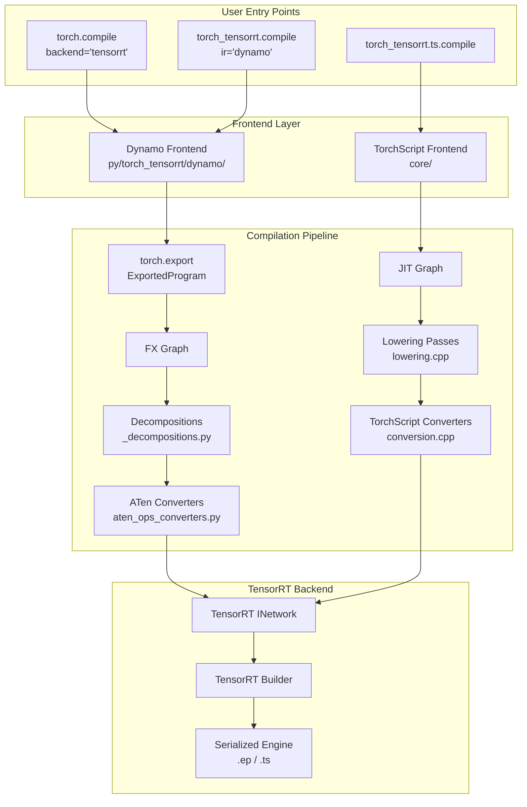
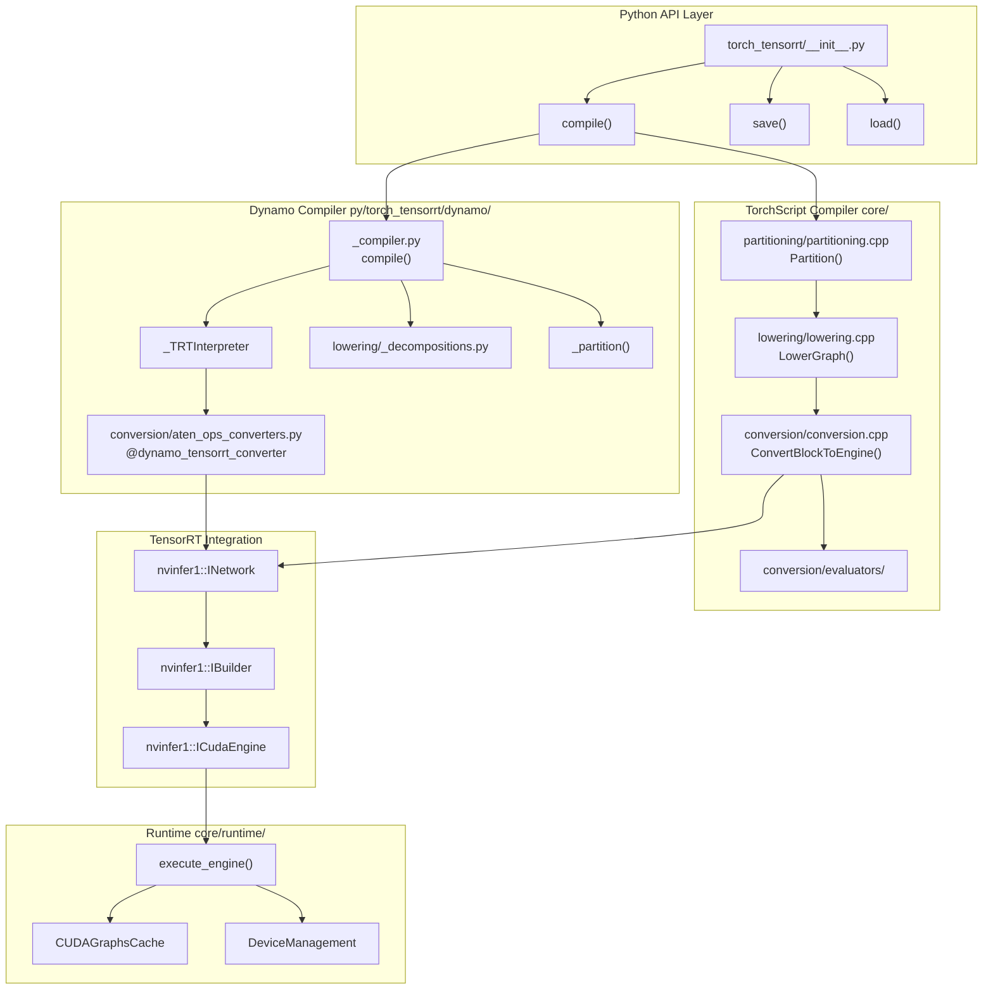
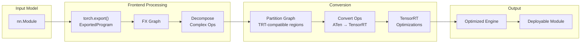

<!-- source: DeepWiki mcp.deepwiki.com · repo pytorch/TensorRT · page 1 Overview · fetched 2026-10-21 -->

# Overview

<details>
<summary>Relevant source files</summary>

The following files were used as context for generating this wiki page:

- [.github/scripts/generate-tensorrt-test-matrix.py](.github/scripts/generate-tensorrt-test-matrix.py)
- [.github/scripts/install-torch-tensorrt.sh](.github/scripts/install-torch-tensorrt.sh)
- [.gitignore](.gitignore)
- [MODULE.bazel](MODULE.bazel)
- [README.md](README.md)
- [cpp/include/torch_tensorrt/macros.h](cpp/include/torch_tensorrt/macros.h)
- [dev_dep_versions.yml](dev_dep_versions.yml)
- [docsrc/conf.py](docsrc/conf.py)
- [docsrc/index.rst](docsrc/index.rst)
- [docsrc/requirements.txt](docsrc/requirements.txt)
- [examples/dynamo/README.rst](examples/dynamo/README.rst)
- [examples/dynamo/compile_with_dynamic_inputs.py](examples/dynamo/compile_with_dynamic_inputs.py)
- [examples/dynamo/custom_kernel_plugins.py](examples/dynamo/custom_kernel_plugins.py)
- [examples/dynamo/debugger_example.py](examples/dynamo/debugger_example.py)
- [examples/dynamo/dynamic_memory_allocation.py](examples/dynamo/dynamic_memory_allocation.py)
- [examples/dynamo/low_cpu_memory_compilation.py](examples/dynamo/low_cpu_memory_compilation.py)
- [examples/dynamo/refit_engine_example.py](examples/dynamo/refit_engine_example.py)
- [packaging/pre_build_script.sh](packaging/pre_build_script.sh)
- [packaging/pre_build_script_windows.sh](packaging/pre_build_script_windows.sh)
- [py/requirements.txt](py/requirements.txt)
- [pyproject.toml](pyproject.toml)
- [setup.py](setup.py)
- [tests/py/requirements.txt](tests/py/requirements.txt)
- [toolchains/ci_workspaces/MODULE.bazel.tmpl](toolchains/ci_workspaces/MODULE.bazel.tmpl)
- [tools/perf/Flux/create_env.sh](tools/perf/Flux/create_env.sh)
- [uv.lock](uv.lock)
- [version.txt](version.txt)

</details>


Torch-TensorRT is an inference compiler for PyTorch that optimizes models for execution on NVIDIA GPUs using TensorRT. It integrates directly into the PyTorch ecosystem, allowing users to compile models for accelerated inference while maintaining compatibility with standard PyTorch code and workflows.

**Scope**: This page provides a high-level introduction to Torch-TensorRT's purpose, compilation workflows, and major system components. For installation instructions, see page [1.1](). For a detailed architectural breakdown, see page [1.2]().

## What is Torch-TensorRT?

Torch-TensorRT transforms PyTorch models into optimized TensorRT engines that execute faster on NVIDIA GPUs. It bridges the gap between PyTorch's flexibility for model development and TensorRT's performance optimizations for inference deployment.

The compiler operates in two primary modes:
- **Just-In-Time (JIT)**: Compilation occurs automatically during first execution via `torch.compile(backend='tensorrt')`
- **Ahead-Of-Time (AOT)**: Models are compiled and serialized for later deployment using `torch_tensorrt.compile()`

Sources: [README.md:1-20](), [docsrc/index.rst:1-14]()

## Compilation Workflows

### JIT Compilation Workflow

```python
import torch
import torch_tensorrt

model = MyModel().eval().cuda()
x = torch.randn((1, 3, 224, 224)).cuda()

# Compile on first execution
optimized_model = torch.compile(model, backend="tensorrt")
output = optimized_model(x)  # Compilation happens here
```

The JIT workflow automatically identifies TensorRT-compatible regions and compiles them transparently. This is the simplest integration path and requires minimal code changes.

### AOT Compilation Workflow

```python
import torch
import torch_tensorrt

model = MyModel().eval().cuda()
inputs = [torch.randn((1, 3, 224, 224)).cuda()]

# Compile ahead of time
trt_gm = torch_tensorrt.compile(model, ir="dynamo", inputs=inputs)

# Save for deployment
torch_tensorrt.save(trt_gm, "model.ep", inputs=inputs)  # Python runtime
torch_tensorrt.save(trt_gm, "model.ts", output_format="torchscript", inputs=inputs)  # C++ runtime
```

The AOT workflow produces serialized engines that can be deployed in Python (`.ep` files) or C++ (`.ts` files) environments without requiring recompilation.

Sources: [README.md:37-93](), [docsrc/index.rst:19-21]()

## Dual Frontend Architecture



**Dynamo Frontend**: The current primary compilation path for PyTorch 2.x models. Uses FX graphs produced by `torch.export` and ATen-level operator converters. Implemented in Python under [py/torch_tensorrt/dynamo/]().

**TorchScript Frontend**: Legacy compilation path using JIT tracing/scripting. Implemented in C++ under [core/]() with support for hybrid execution — subgraphs not supported by TensorRT fall back automatically to PyTorch.

Sources: [py/torch_tensorrt/dynamo/](), [core/](), [README.md:37-93]()

## System Architecture Overview



### Core Components

| Component | Location | Purpose |
|-----------|----------|---------|
| **Python API** | [py/torch_tensorrt/__init__.py]() | Primary user-facing compilation and serialization APIs |
| **Dynamo Compiler** | [py/torch_tensorrt/dynamo/_compiler.py]() | Compiles FX graphs from `torch.export` to TensorRT |
| **Dynamo Converters** | [py/torch_tensorrt/dynamo/conversion/]() | Maps ATen operators to TensorRT layers |
| **TorchScript Compiler** | [core/]() | C++ implementation for TorchScript compilation |
| **Partitioner** | [core/partitioning/partitioning.cpp]() | Segments graphs into TensorRT and PyTorch regions |
| **Runtime** | [core/runtime/]() | Executes TensorRT engines with CUDA graphs support |

Sources: [py/torch_tensorrt/__init__.py](), [py/torch_tensorrt/dynamo/_compiler.py](), [core/partitioning/partitioning.cpp](), [core/runtime/]()

## Compilation Pipeline Flow



**Stages**:
1. **Export**: Convert PyTorch model to FX graph representation via `torch.export()`
2. **Decomposition**: Break down complex operations into TensorRT-compatible primitives using [py/torch_tensorrt/dynamo/lowering/_decompositions.py]()
3. **Partitioning**: Identify TensorRT-compatible subgraphs (full graph for Dynamo, hybrid for TorchScript)
4. **Conversion**: Map PyTorch operations to TensorRT layers via registered converters
5. **Optimization**: TensorRT applies kernel fusion, precision calibration, and memory optimization
6. **Serialization**: Package engine into deployable module format

Sources: [py/torch_tensorrt/dynamo/_compiler.py](), [py/torch_tensorrt/dynamo/lowering/_decompositions.py](), [core/partitioning/partitioning.cpp]()

## Platform Support

| Platform | Architecture | Status | Notes |
|----------|-------------|--------|-------|
| **Linux x86_64** | x86_64 | Supported | Primary development platform |
| **Linux SBSA** | aarch64 | Supported | ARM server platforms |
| **Windows** | x86_64 | Supported (Dynamo only) | TorchScript frontend not available |
| **Jetson** | aarch64 (Tegra) | Source compilation supported | Requires JetPack 4.4+ |

**Dependencies** (configured in [dev_dep_versions.yml:1-4]()):
- **CUDA**: 13.0 (standard), 12.6 (Jetson)
- **TensorRT**: 10.15.1 (standard), 10.3.0 (Jetson)
- **PyTorch**: 2.12.0.dev+ (nightly)
- **Bazel**: 8.1.1 (via Bazelisk)
</thinking>
</old_str>
<new_str>
**Dependencies** (configured in [dev_dep_versions.yml:1-4]()):
- **CUDA**: 13.0 (standard), 12.6 (Jetson)
- **TensorRT**: 10.15.1 (standard), 10.3.0 (Jetson)
- **PyTorch**: 2.12.0.dev+ (nightly)
- **Bazel**: 8.1.1 (via Bazelisk)

Sources: [README.md:106-127](), [dev_dep_versions.yml:1-4](), [MODULE.bazel:36-55]()

## Key Directories

```
torch-tensorrt/
├── py/torch_tensorrt/          # Python package
│   ├── dynamo/                 # Dynamo frontend implementation
│   │   ├── _compiler.py        # Main compilation logic
│   │   ├── conversion/         # ATen operator converters
│   │   └── lowering/           # Graph decomposition passes
│   ├── ts/                     # TorchScript Python API
│   └── runtime/                # Runtime utilities
├── core/                       # C++ TorchScript frontend
│   ├── partitioning/           # Graph partitioning
│   ├── lowering/               # Graph lowering passes
│   ├── conversion/             # TorchScript converters
│   └── runtime/                # Engine execution
├── tests/                      # Test suites
│   ├── py/dynamo/              # Dynamo tests
│   └── core/                   # TorchScript tests
├── examples/                   # Usage examples
├── docsrc/                     # Documentation source
└── MODULE.bazel                # Bazel build configuration
```

Sources: [py/torch_tensorrt/](), [core/](), [MODULE.bazel:1-10]()

## Build System

Torch-TensorRT uses a hybrid build system:

- **Python Orchestration**: [setup.py:1-623]() manages Python package creation and invokes C++ compilation
- **C++ Compilation**: Bazel builds the C++ core ([MODULE.bazel]()), with platform-specific configurations in [toolchains/]()
- **Platform Detection**: Build system automatically detects architecture (x86_64, aarch64, Jetson, Windows) and applies appropriate configurations

The build process:
1. [setup.py]() invokes Bazel to compile C++ libraries
2. Compiled libraries are packaged into [py/torch_tensorrt/lib/]()
3. Python wheel is created with bundled C++ dependencies

Sources: [setup.py:186-238](), [MODULE.bazel:1-150]()

## Entry Points and APIs

**Primary Python APIs** (defined in [py/torch_tensorrt/__init__.py]()):
- `torch_tensorrt.compile()` - Compile models to TensorRT
- `torch_tensorrt.save()` - Serialize compiled modules
- `torch_tensorrt.load()` - Load serialized modules
- `torch_tensorrt.dynamo.compile()` - Dynamo-specific compilation

**C++ APIs** (defined in [core/torch_tensorrt.h]()):
- `torch_tensorrt::torchscript::compile()` - Compile TorchScript modules
- `torch_tensorrt::torchscript::embed_engine_in_new_module()` - Embed engines in modules

**Torch Integration**:
- `torch.compile(backend='tensorrt')` - Uses Torch-TensorRT as a backend

Sources: [py/torch_tensorrt/__init__.py](), [README.md:39-53]()

---

