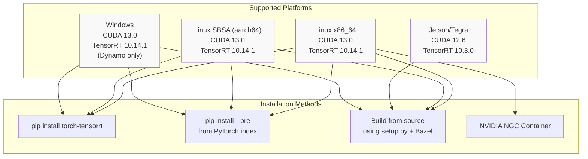
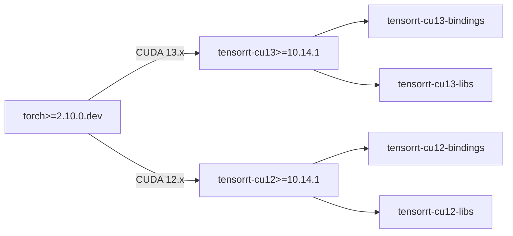
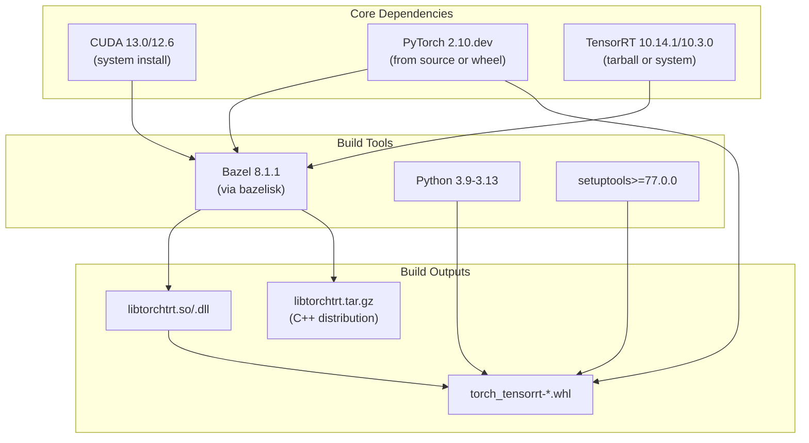
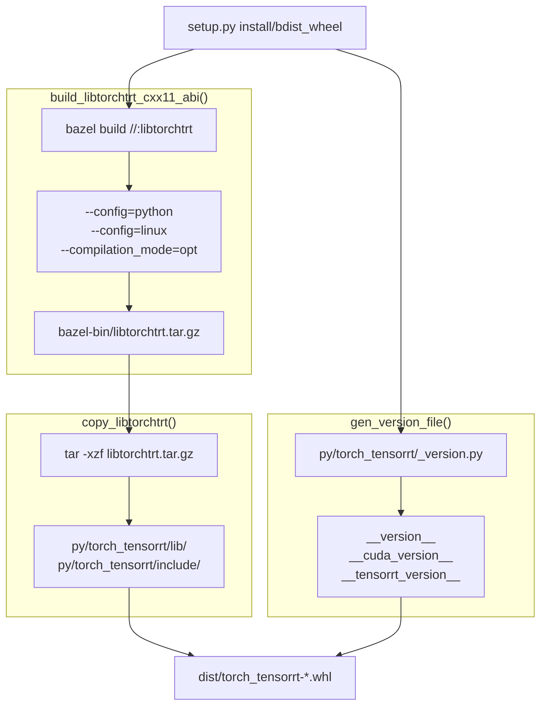
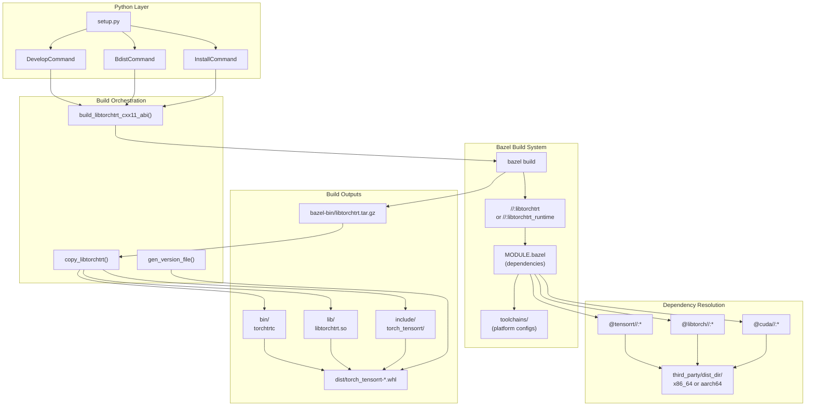
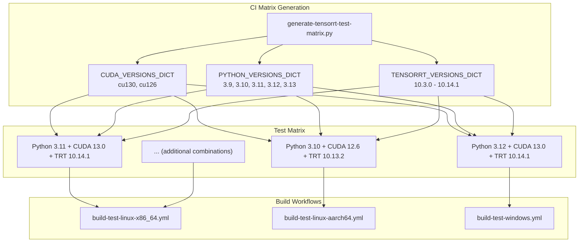

<!-- source: DeepWiki mcp.deepwiki.com · repo pytorch/TensorRT · page 1.1 Installation and Setup · fetched 2026-10-21 -->

# Installation and Setup

<details>
<summary>Relevant source files</summary>

The following files were used as context for generating this wiki page:

- [.github/scripts/generate-tensorrt-test-matrix.py](.github/scripts/generate-tensorrt-test-matrix.py)
- [.github/scripts/install-torch-tensorrt.sh](.github/scripts/install-torch-tensorrt.sh)
- [.github/scripts/run_cpp_linter.py](.github/scripts/run_cpp_linter.py)
- [.github/scripts/run_py_linter.py](.github/scripts/run_py_linter.py)
- [.github/workflows/docgen.yml](.github/workflows/docgen.yml)
- [.github/workflows/linter.yml](.github/workflows/linter.yml)
- [.github/workflows/stale.yml](.github/workflows/stale.yml)
- [MODULE.bazel](MODULE.bazel)
- [README.md](README.md)
- [cpp/include/torch_tensorrt/macros.h](cpp/include/torch_tensorrt/macros.h)
- [dev_dep_versions.yml](dev_dep_versions.yml)
- [docker/Dockerfile](docker/Dockerfile)
- [docker/Dockerfile.docs](docker/Dockerfile.docs)
- [docker/README.md](docker/README.md)
- [docker/dist-build.sh](docker/dist-build.sh)
- [docsrc/getting_started/installation.rst](docsrc/getting_started/installation.rst)
- [packaging/pre_build_script.sh](packaging/pre_build_script.sh)
- [packaging/pre_build_script_windows.sh](packaging/pre_build_script_windows.sh)
- [py/requirements.txt](py/requirements.txt)
- [pyproject.toml](pyproject.toml)
- [setup.py](setup.py)
- [tests/py/requirements.txt](tests/py/requirements.txt)
- [toolchains/ci_workspaces/MODULE.bazel.tmpl](toolchains/ci_workspaces/MODULE.bazel.tmpl)
- [tools/perf/Flux/create_env.sh](tools/perf/Flux/create_env.sh)
- [uv.lock](uv.lock)
- [version.txt](version.txt)

</details>


This page covers the installation and setup of Torch-TensorRT on different platforms, including precompiled binary installation via `pip` and building from source. For information about the system architecture and compilation workflows, see [System Architecture](#1.2) and [User Guide](#2).

---

## Prerequisites

Torch-TensorRT requires three primary dependencies installed on your system:

| Dependency | Version Requirements | Notes |
|------------|---------------------|-------|
| **CUDA** | 12.6 (Jetson) or 13.0 (x86_64, SBSA, Windows) | System installation or CUDA driver in container |
| **PyTorch** | ≥2.10.0.dev for x86_64/SBSA/Windows<br>≥2.8.0 for Jetson | Nightly builds recommended for main branch |
| **TensorRT** | 10.3.0 (Jetson)<br>10.14.1 (x86_64, SBSA, Windows) | Python package sufficient for pip installation |

**Sources:** [README.md:119-126](), [pyproject.toml:9-11](), [dev_dep_versions.yml:1-4]()

---

## Platform Support Overview



**Platform-Specific Notes:**
- **Windows**: Only Dynamo frontend supported, TorchScript frontend not available
- **Jetson**: Requires source compilation, uses older TensorRT/CUDA versions from JetPack
- **SBSA**: ARM server platforms (e.g., Grace, Thor)

**Sources:** [README.md:108-117](), [setup.py:91-174](), [MODULE.bazel:42-55]()

---

## Installing Precompiled Binaries

### Stable Release (PyPI)

Install the latest stable release from PyPI:

```bash
pip install torch-tensorrt
```

This installs Torch-TensorRT along with compatible PyTorch and TensorRT versions. The package will automatically select the appropriate CUDA version based on your installed PyTorch.

**Sources:** [README.md:22-26]()

### Nightly Builds

Nightly builds track the PyTorch nightly and are distributed via the PyTorch package index:

```bash
pip install --pre torch-tensorrt --index-url https://download.pytorch.org/whl/nightly/cu130
```

This installs:
- PyTorch nightly with CUDA 13.0 support
- Torch-TensorRT nightly
- TensorRT dependencies (automatically resolved)

**Sources:** [README.md:28-31](), [py/requirements.txt:4-5]()

### CUDA-Specific Installations

Torch-TensorRT wheels are built for specific CUDA versions. Specify the CUDA version via PyTorch's package index:

| CUDA Version | Installation Command |
|--------------|---------------------|
| CUDA 13.0 (default) | `pip install --pre torch-tensorrt --index-url https://download.pytorch.org/whl/nightly/cu130` |
| CUDA 12.x | `pip install --pre torch-tensorrt --index-url https://download.pytorch.org/whl/nightly/cu126` |

The package dependencies will automatically install the correct TensorRT variant:



**Sources:** [setup.py:738-772](), [pyproject.toml:9-11]()

### Platform-Specific Dependencies

The `setup.py:get_requirements()` function selects dependencies based on platform detection:

- **Standard (x86_64, Windows)**: Uses CUDA-versioned TensorRT packages
- **SBSA (aarch64 server)**: Uses generic TensorRT tarball
- **Jetson (Tegra)**: Uses PyTorch 2.8.0 and TensorRT 10.3.0 from Jetson AI Lab

**Sources:** [setup.py:738-792]()

---

## NVIDIA NGC Container

Torch-TensorRT is pre-installed in the NVIDIA NGC PyTorch containers with all dependencies properly configured:

```bash
docker pull nvcr.io/nvidia/pytorch:XX.XX-py3
```

The container includes:
- Pre-built Torch-TensorRT library
- Compatible PyTorch version
- TensorRT optimized for the platform
- Example notebooks

**Sources:** [README.md:33](), [docker/README.md:43-45]()

---

## Building from Source

### Dependencies for Source Build



**Installing Bazel:**

The easiest method is to use Bazelisk, which automatically selects the correct Bazel version:

```bash
# Linux
curl -L https://github.com/bazelbuild/bazelisk/releases/download/v1.26.0/bazelisk-linux-amd64 -o /usr/bin/bazel
chmod +x /usr/bin/bazel

# Windows (via Chocolatey)
choco install bazelisk -y
```

**Sources:** [packaging/pre_build_script.sh:39-42](), [docker/Dockerfile:46-48](), [pyproject.toml:2-12]()

### Configuring MODULE.bazel

The build system uses `MODULE.bazel` to specify dependency locations. Key configurations include:

**CUDA path (system installation required):**

```python
# Linux x86_64/SBSA
new_local_repository(
    name = "cuda",
    build_file = "@//third_party/cuda:BUILD",
    path = "/usr/local/cuda-13.0/",
)

# Jetson
new_local_repository(
    name = "cuda_l4t",
    build_file = "@//third_party/cuda:BUILD",
    path = "/usr/local/cuda-12.6",
)

# Windows
new_local_repository(
    name = "cuda_win",
    build_file = "@//third_party/cuda:BUILD",
    path = "C:/Program Files/NVIDIA GPU Computing Toolkit/CUDA/v13.0/",
)
```

**PyTorch/LibTorch (automatically downloaded or local):**

```python
# Download from pytorch.org (default for x86_64)
http_archive(
    name = "libtorch",
    build_file = "@//third_party/libtorch:BUILD",
    strip_prefix = "libtorch",
    urls = ["https://download.pytorch.org/libtorch/nightly/cu130/libtorch-shared-with-deps-latest.zip"],
)

# Or use local installation
new_local_repository(
    name = "libtorch",
    path = "/usr/local/lib/python3.11/dist-packages/torch",
    build_file = "third_party/libtorch/BUILD"
)
```

**TensorRT (downloaded tarball):**

```python
http_archive(
    name = "tensorrt",
    build_file = "@//third_party/tensorrt/archive:BUILD",
    strip_prefix = "TensorRT-10.14.1.48",
    urls = [
        "https://developer.nvidia.com/downloads/compute/machine-learning/tensorrt/10.14.1/tars/TensorRT-10.14.1.48.Linux.x86_64-gnu.cuda-13.0.tar.gz",
    ],
)
```

**Sources:** [MODULE.bazel:34-171](), [toolchains/ci_workspaces/MODULE.bazel.tmpl:36-157]()

---

## Building on Linux (x86_64 and SBSA)

### Standard Build

The simplest build command invokes `setup.py`, which orchestrates Bazel:

```bash
python -m pip install --pre . --extra-index-url https://download.pytorch.org/whl/nightly/cu130
```

This executes:
1. `setup.py:InstallCommand.run()` or `BdistCommand.run()`
2. `build_libtorchtrt_cxx11_abi()` - invokes Bazel to compile C++ library
3. `copy_libtorchtrt()` - extracts tarball into Python package
4. `gen_version_file()` - creates `_version.py` with version info
5. Standard Python packaging

**Sources:** [setup.py:311-329](), [setup.py:186-238](), [setup.py:241-252]()

### Build Flow Diagram



**Sources:** [setup.py:186-238](), [setup.py:254-288](), [setup.py:241-252]()

### Platform-Specific Bazel Flags

The `build_libtorchtrt_cxx11_abi()` function adds platform-specific flags:

| Platform | Bazel Flags | Notes |
|----------|-------------|-------|
| Linux x86_64 | `--config=linux` | Default configuration |
| Linux SBSA | `--config=linux` | ARM server platforms |
| Jetson | `--config=linux --config=jetpack` | Enables Jetson-specific builds |
| Windows | `--config=windows` | MSVC toolchain |

For CI builds, additional platform specifications are added:

```bash
# CI x86_64
bazel build //:libtorchtrt --platforms=//toolchains:ci_rhel_x86_64_linux

# CI aarch64
bazel build //:libtorchtrt --platforms=//toolchains:aarch64_linux
```

**Sources:** [setup.py:211-232](), [packaging/pre_build_script.sh:8-24]()

---

## Building on Jetson (Tegra Platforms)

### Prerequisites

Install PyTorch for Jetson from the NVIDIA forums or Jetson AI Lab:

```bash
pip install torch==2.8.0 --index-url=https://pypi.jetson-ai-lab.io/jp6/cu126/
```

Dependencies specific to Jetson:
- **CUDA**: 12.6 (from JetPack)
- **TensorRT**: 10.3.0 (from JetPack)
- **PyTorch**: 2.8.0 (Jetson-specific build)

**Sources:** [packaging/pre_build_script.sh:46-50](), [pyproject.toml:10]()

### Jetson Build Configuration

The Jetson build is triggered by:

```bash
JETPACK_BUILD=1 python -m pip install --pre .
```

Or during setup, the `--jetpack` flag:

```bash
python setup.py install --jetpack
```

Key environment variables and flags:
- `IS_JETPACK=True` - detected via `platform.machine() == "aarch64"` and `JETPACK_BUILD` env var
- `--config=jetpack` - passed to Bazel

**Module.bazel Configuration for Jetson:**

```python
# Jetson-specific CUDA
new_local_repository(
    name = "cuda_l4t",
    build_file = "@//third_party/cuda:BUILD",
    path = "/usr/local/cuda-12.6",
)

# Jetson-specific TensorRT
http_archive(
    name = "tensorrt_l4t",
    build_file = "@//third_party/tensorrt/archive:BUILD",
    strip_prefix = "TensorRT-10.3.0.26",
    urls = [
        "https://developer.nvidia.com/downloads/compute/machine-learning/tensorrt/10.3.0/tars/TensorRT-10.3.0.26.l4t.aarch64-gnu.cuda-12.6.tar.gz",
    ],
)
```

**Sources:** [setup.py:148-174](), [setup.py:220-222](), [MODULE.bazel:42-48](), [MODULE.bazel:128-135]()

---

## Building on Windows

### Prerequisites

- **Visual Studio 2022**: Build tools (x64 Native Tools Command Prompt)
- **Bazelisk**: Install via Chocolatey or manually
- **CUDA**: 13.0 installed in default location
- **PyTorch**: Nightly build with CUDA 13.0

### Windows Build Steps

1. Open "x64 Native Tools Command Prompt for VS 2022" with Admin privileges

2. Install dependencies:

```bash
pip install ninja wheel setuptools
pip install --pre -r py/requirements.txt
```

3. Set environment variable for MSVC:

```bash
set DISTUTILS_USE_SDK=1
```

4. Build wheel:

```bash
python setup.py bdist_wheel
```

5. Install:

```bash
pip install dist/*.whl
```

**Sources:** [docsrc/getting_started/installation.rst:234-254](), [packaging/pre_build_script_windows.sh:1-60]()

### Windows-Specific Module.bazel Configuration

```python
# Windows CUDA
new_local_repository(
    name = "cuda_win",
    build_file = "@//third_party/cuda:BUILD",
    path = "C:/Program Files/NVIDIA GPU Computing Toolkit/CUDA/v13.0/",
)

# Windows LibTorch
http_archive(
    name = "libtorch_win",
    build_file = "@//third_party/libtorch:BUILD",
    strip_prefix = "libtorch",
    urls = ["https://download.pytorch.org/libtorch/nightly/cu130/libtorch-win-shared-with-deps-latest.zip"],
)

# Windows TensorRT
http_archive(
    name = "tensorrt_win",
    build_file = "@//third_party/tensorrt/archive:BUILD",
    strip_prefix = "TensorRT-10.14.1.48",
    urls = [
        "https://developer.nvidia.com/downloads/compute/machine-learning/tensorrt/10.14.1/zip/TensorRT-10.14.1.48.Windows.win10.cuda-13.0.zip",
    ],
)
```

**Important Notes:**
- Windows builds use `--config=windows` which selects MSVC toolchain
- The C++ extension module is built as `torchtrt.dll` and `torchtrt.lib`
- Only Dynamo frontend is supported on Windows (no TorchScript)

**Sources:** [MODULE.bazel:50-55](), [MODULE.bazel:82-87](), [MODULE.bazel:137-144](), [setup.py:259-267]()

---

## Build Options and Variants

### Python-Only Build (No C++ Runtime)

Excludes C++ components (TorchScript frontend and Torch-TensorRT runtime):

```bash
PYTHON_ONLY=1 python -m pip install --pre .
```

This build:
- Skips Bazel compilation
- Only includes Dynamo frontend (Python-based)
- Uses Python runtime instead of C++ runtime
- Faster build, smaller wheel
- Limited serialization capabilities

**Detection in setup.py:**

```python
PY_ONLY = False
if "--py-only" in sys.argv:
    PY_ONLY = True
    sys.argv.remove("--py-only")

if (py_only_env_var := os.environ.get("PYTHON_ONLY")) is not None:
    if py_only_env_var == "1":
        PY_ONLY = True
```

**Sources:** [setup.py:94-135](), [setup.py:299-308](), [docsrc/getting_started/installation.rst:156-167]()

### No TorchScript Build (Dynamo Only)

Excludes TorchScript frontend but keeps C++ runtime:

```bash
NO_TORCHSCRIPT=1 python -m pip install --pre .
```

This build:
- Compiles C++ runtime only (`//:libtorchtrt_runtime`)
- Excludes TorchScript conversion system
- Dynamo frontend remains fully functional
- Faster build than full build

**Detection in setup.py:**

```python
NO_TS = False
if "--no-ts" in sys.argv:
    NO_TS = True
    sys.argv.remove("--no-ts")

if (no_ts_env_var := os.environ.get("NO_TORCHSCRIPT")) is not None:
    if no_ts_env_var == "1":
        NO_TS = True
```

When `NO_TS=True`, the build target changes:

```python
if rt_only:
    cmd.append("//:libtorchtrt_runtime")
else:
    cmd.append("//:libtorchtrt")
```

**Sources:** [setup.py:113-131](), [setup.py:192-196](), [docsrc/getting_started/installation.rst:170-178]()

### TensorRT-RTX Build

Enables optimizations for RTX GPUs:

```bash
USE_TRT_RTX=1 python -m pip install --pre .
```

This uses TensorRT-RTX libraries instead of standard TensorRT:

```python
if USE_TRT_RTX:
    cmd.append("--config=rtx")
    print("TensorRT RTX build")
```

**Module.bazel configuration:**

```python
http_archive(
    name = "tensorrt_rtx",
    build_file = "@//third_party/tensorrt_rtx/archive:BUILD",
    strip_prefix = "TensorRT-RTX-1.2.0.54",
    urls = [
        "https://developer.nvidia.com/downloads/trt/rtx_sdk/secure/1.2/tensorrt-rtx-1.2.0.54-linux-x86_64-cuda-13.0-release-external.tar.gz",
    ],
)
```

**Sources:** [setup.py:101-139](), [setup.py:216-218](), [MODULE.bazel:110-117]()

---

## Build System Architecture



**Key Build Functions:**

- **`build_libtorchtrt_cxx11_abi()`** [setup.py:186-238](): Invokes Bazel with platform-specific flags
- **`copy_libtorchtrt()`** [setup.py:254-288](): Extracts Bazel output tarball into Python package structure
- **`gen_version_file()`** [setup.py:241-252](): Generates `_version.py` with version metadata
- **`get_requirements()`** [setup.py:738-772](): Resolves platform-specific pip dependencies

**Sources:** [setup.py:186-288](), [setup.py:291-371](), [setup.py:738-792]()

---

## Dependency Version Matrix

The following table shows the tested dependency versions across platforms:

| Platform | Python | CUDA | PyTorch | TensorRT | Notes |
|----------|--------|------|---------|----------|-------|
| **Linux x86_64** | 3.9-3.13 | 13.0 | 2.10.0.dev | 10.14.1.48 | Primary development platform |
| **Linux SBSA** | 3.9-3.13 | 13.0 | 2.10.0.dev | 10.14.1.48 | ARM server (Grace, Thor) |
| **Jetson** | 3.10 | 12.6 | 2.8.0 | 10.3.0.26 | JetPack 6.x, older versions |
| **Windows** | 3.9-3.13 | 13.0 | 2.10.0.dev | 10.14.1.48 | Dynamo only |

**Version Files:**

- **dev_dep_versions.yml** [dev_dep_versions.yml:1-4](): Default versions for development
- **py/requirements.txt** [py/requirements.txt:1-9](): Python package dependencies
- **pyproject.toml** [pyproject.toml:9-11](): Build-time Python requirements

**Sources:** [README.md:119-126](), [dev_dep_versions.yml:1-4](), [pyproject.toml:9-11](), [setup.py:738-792]()

---

## Verification

After installation, verify Torch-TensorRT is correctly installed:

```python
import torch
import torch_tensorrt

# Check versions
print(f"Torch-TensorRT version: {torch_tensorrt.__version__}")
print(f"CUDA version: {torch_tensorrt._version.__cuda_version__}")
print(f"TensorRT version: {torch_tensorrt._version.__tensorrt_version__}")

# Test basic compilation
model = torch.nn.Linear(10, 5).eval().cuda()
example_input = torch.randn(1, 10).cuda()

# JIT compilation test
compiled_model = torch.compile(model, backend="tensorrt")
output = compiled_model(example_input)
```

**Version Information Generation:**

The `gen_version_file()` function creates `py/torch_tensorrt/_version.py`:

```python
def gen_version_file():
    with open(dir_path + "/torch_tensorrt/_version.py", "w") as f:
        f.write('__version__ = "' + __version__ + '"\n')
        f.write('__cuda_version__ = "' + __cuda_version__ + '"\n')
        f.write('__tensorrt_version__ = "' + __tensorrt_version__ + '"\n')
        f.write('__tensorrt_rtx_version__ = "' + __tensorrt_rtx_version__ + '"\n')
        f.write('__tensorrt_llm_version__ = "' + __tensorrt_llm_version__ + '"\n')
```

**Sources:** [setup.py:241-252](), [README.md:42-53]()

---

## Docker-Based Build

For reproducible builds, use the provided Dockerfile:

```bash
DOCKER_BUILDKIT=1 docker build \
    --build-arg TENSORRT_VERSION=10.14.1 \
    --build-arg PYTHON_VERSION=3.11 \
    -f docker/Dockerfile \
    -t torch_tensorrt:latest .
```

The multi-stage Dockerfile:
1. **base**: Installs CUDA, Python (via pyenv), and TensorRT
2. **torch-tensorrt-builder**: Runs `docker/dist-build.sh` to build wheel
3. **torch-tensorrt**: Final image with installed package

**Key Build Script:** [docker/dist-build.sh:1-23]()

```bash
BUILD_CMD="python -m pip wheel . --extra-index-url https://download.pytorch.org/whl/nightly/cu130 -w dist"
cd ${TOP_DIR} \
    && python -m pip install "pip<=23.1" wheel \
    && python -m pip install -r py/requirements.txt
MAX_JOBS=4 LANG=en_US.UTF-8 LANGUAGE=en_US:en LC_ALL=en_US.UTF-8 ${BUILD_CMD}
```

**Sources:** [docker/Dockerfile:1-124](), [docker/dist-build.sh:1-23](), [docker/README.md:1-46]()

---

## CI/CD Build Matrix

The CI system tests multiple configurations using a dynamically-generated matrix:



The matrix generation script filters valid combinations based on:
- Channel (nightly, test, release)
- Platform (linux, windows)
- TensorRT availability checks

**Sources:** [.github/scripts/generate-tensorrt-test-matrix.py:1-224](), [README.md:12-14]()

---

## Troubleshooting Common Issues

| Issue | Cause | Solution |
|-------|-------|----------|
| `Could not find bazel in PATH` | Bazel/Bazelisk not installed | Install bazelisk via package manager or manually |
| `CUDA not found` | CUDA not in standard location | Update `MODULE.bazel` with correct CUDA path |
| `TensorRT version mismatch` | Installed TensorRT incompatible | Install correct version: 10.14.1 (x86_64/Windows) or 10.3.0 (Jetson) |
| `torch not found during build` | PyTorch not installed | Install PyTorch before building: `pip install torch` |
| `Windows: fmt/format.h not found` | Missing fmt library in PyTorch include | [packaging/pre_build_script_windows.sh:32-36]() downloads and copies fmt |
| `Jetson: Wrong TensorRT version` | Using x86_64 TensorRT | Use JetPack TensorRT 10.3.0 and CUDA 12.6 |

**Sources:** [setup.py:177-183](), [packaging/pre_build_script_windows.sh:30-36]()

---

This concludes the installation and setup guide. For architecture details, see [System Architecture](#1.2). For usage examples, see [User Guide](#2).

---

