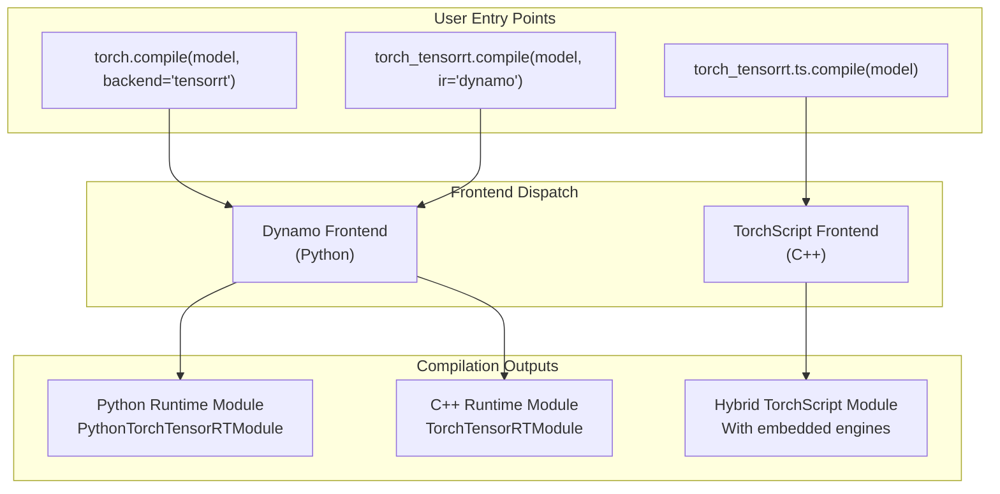
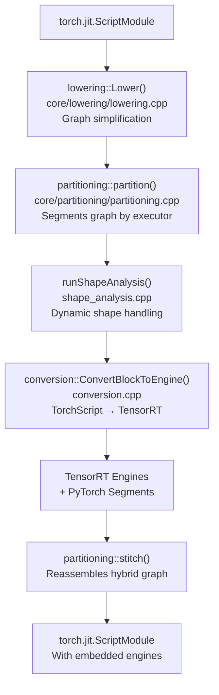
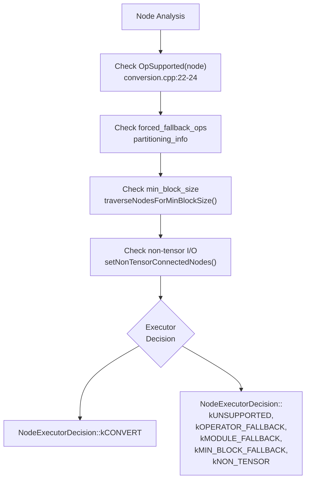
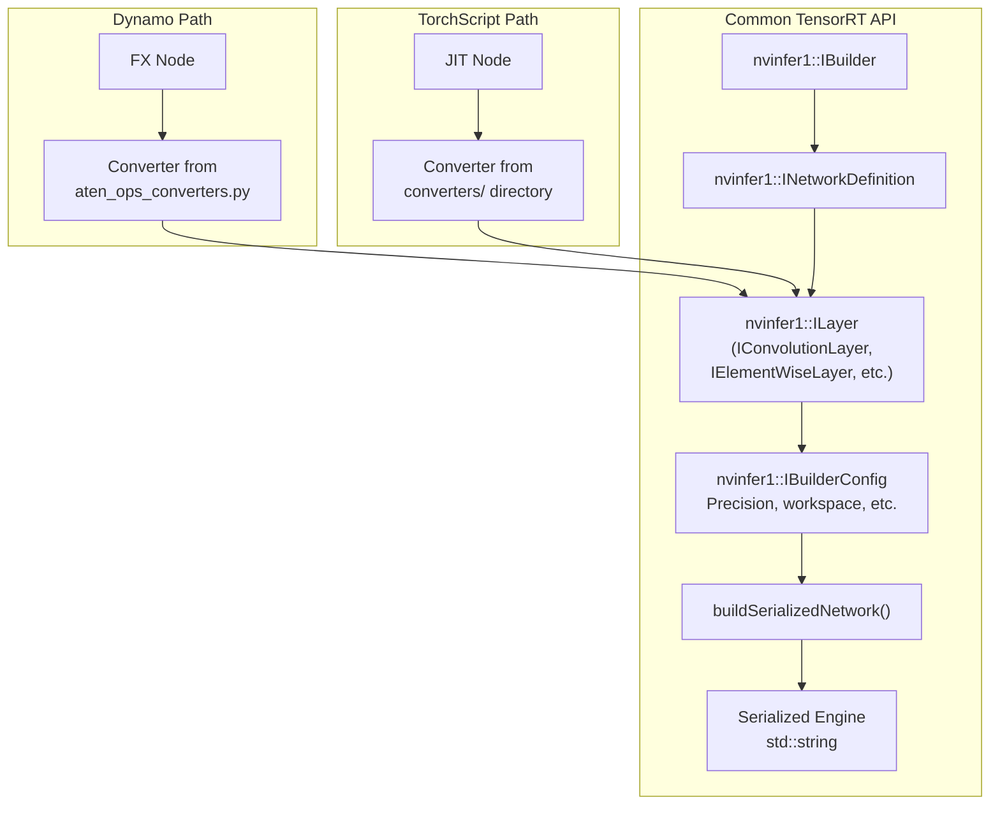
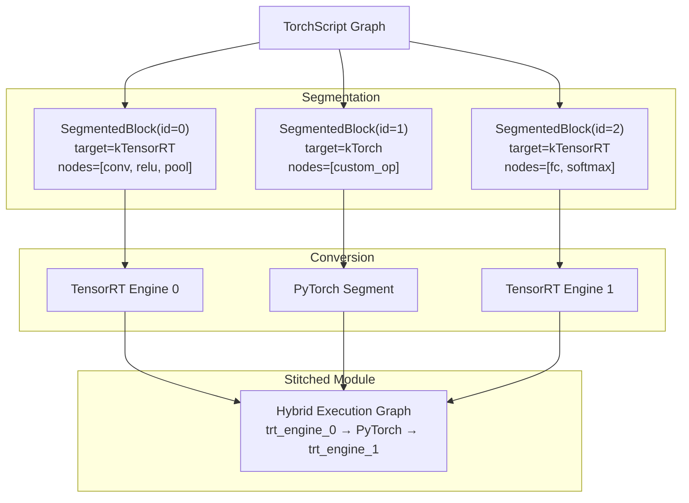

<!-- source: DeepWiki mcp.deepwiki.com · repo pytorch/TensorRT · page 1.2 System Architecture · fetched 2026-10-21 -->

# System Architecture

<details>
<summary>Relevant source files</summary>

The following files were used as context for generating this wiki page:

- [.github/scripts/generate-tensorrt-test-matrix.py](.github/scripts/generate-tensorrt-test-matrix.py)
- [.github/scripts/install-torch-tensorrt.sh](.github/scripts/install-torch-tensorrt.sh)
- [.gitignore](.gitignore)
- [MODULE.bazel](MODULE.bazel)
- [README.md](README.md)
- [core/compiler.cpp](core/compiler.cpp)
- [core/conversion/conversion.cpp](core/conversion/conversion.cpp)
- [core/conversion/conversionctx/ConversionCtx.cpp](core/conversion/conversionctx/ConversionCtx.cpp)
- [core/conversion/conversionctx/ConversionCtx.h](core/conversion/conversionctx/ConversionCtx.h)
- [core/partitioning/BUILD](core/partitioning/BUILD)
- [core/partitioning/partitioning.cpp](core/partitioning/partitioning.cpp)
- [core/partitioning/partitioning.h](core/partitioning/partitioning.h)
- [core/partitioning/partitioningctx/PartitioningCtx.cpp](core/partitioning/partitioningctx/PartitioningCtx.cpp)
- [core/partitioning/partitioningctx/PartitioningCtx.h](core/partitioning/partitioningctx/PartitioningCtx.h)
- [core/partitioning/segmentedblock/SegmentedBlock.cpp](core/partitioning/segmentedblock/SegmentedBlock.cpp)
- [core/partitioning/segmentedblock/SegmentedBlock.h](core/partitioning/segmentedblock/SegmentedBlock.h)
- [core/partitioning/shape_analysis.cpp](core/partitioning/shape_analysis.cpp)
- [core/partitioning/stitching.cpp](core/partitioning/stitching.cpp)
- [cpp/include/torch_tensorrt/macros.h](cpp/include/torch_tensorrt/macros.h)
- [dev_dep_versions.yml](dev_dep_versions.yml)
- [docsrc/conf.py](docsrc/conf.py)
- [docsrc/index.rst](docsrc/index.rst)
- [docsrc/requirements.txt](docsrc/requirements.txt)
- [examples/dynamo/README.rst](examples/dynamo/README.rst)
- [examples/dynamo/compile_with_dynamic_inputs.py](examples/dynamo/compile_with_dynamic_inputs.py)
- [examples/dynamo/custom_kernel_plugins.py](examples/dynamo/custom_kernel_plugins.py)
- [examples/dynamo/debugger_example.py](examples/dynamo/debugger_example.py)
- [examples/dynamo/dynamic_memory_allocation.py](examples/dynamo/dynamic_memory_allocation.py)
- [examples/dynamo/low_cpu_memory_compilation.py](examples/dynamo/low_cpu_memory_compilation.py)
- [examples/dynamo/refit_engine_example.py](examples/dynamo/refit_engine_example.py)
- [packaging/pre_build_script.sh](packaging/pre_build_script.sh)
- [packaging/pre_build_script_windows.sh](packaging/pre_build_script_windows.sh)
- [py/requirements.txt](py/requirements.txt)
- [pyproject.toml](pyproject.toml)
- [setup.py](setup.py)
- [tests/core/partitioning/test_conditionals.cpp](tests/core/partitioning/test_conditionals.cpp)
- [tests/core/partitioning/test_resolve_nontensor_inputs.cpp](tests/core/partitioning/test_resolve_nontensor_inputs.cpp)
- [tests/core/partitioning/test_segmentation.cpp](tests/core/partitioning/test_segmentation.cpp)
- [tests/core/partitioning/test_shape_analysis.cpp](tests/core/partitioning/test_shape_analysis.cpp)
- [tests/cpp/test_dynamic_fallback.cpp](tests/cpp/test_dynamic_fallback.cpp)
- [tests/py/requirements.txt](tests/py/requirements.txt)
- [toolchains/ci_workspaces/MODULE.bazel.tmpl](toolchains/ci_workspaces/MODULE.bazel.tmpl)
- [tools/perf/Flux/create_env.sh](tools/perf/Flux/create_env.sh)
- [uv.lock](uv.lock)
- [version.txt](version.txt)

</details>


## Purpose and Scope

This document describes the high-level architecture of Torch-TensorRT, explaining how the system compiles PyTorch models to optimized TensorRT engines through two distinct frontend paths. It covers the dual-frontend design, compilation pipelines, convergence on TensorRT, and the partitioning system for hybrid execution.

For installation and platform-specific setup instructions, see [Installation and Setup](#1.1). For detailed information about specific compilation workflows, see [User Guide](#2). For in-depth coverage of each frontend, see [Dynamo Frontend Architecture](#3) and [TorchScript Frontend Architecture](#4).

## Architecture Overview

Torch-TensorRT provides a **dual-frontend architecture** to support both modern PyTorch 2.x models and legacy TorchScript models. Both frontends ultimately produce TensorRT engines but differ significantly in their implementation, capabilities, and use cases.

### Entry Points and Frontend Selection



**Sources:** [README.md:37-93](), [py/torch_tensorrt/dynamo/_compiler.py:1-56](), [core/compiler.cpp:1-28]()

The system provides three main entry points:

| Entry Point | Frontend | Use Case | Python Runtime | C++ Runtime |
|------------|----------|----------|----------------|-------------|
| `torch.compile` | Dynamo | JIT compilation during first execution | ✓ | ✓ |
| `torch_tensorrt.compile(ir="dynamo")` | Dynamo | AOT compilation for deployment | ✓ | ✓ |
| `torch_tensorrt.ts.compile` | TorchScript | Legacy models, C++ deployment | ✗ | ✓ |

**Sources:** [README.md:37-93](), [py/torch_tensorrt/dynamo/_compiler.py:394-427]()

## Dynamo Frontend Architecture

The Dynamo frontend is implemented in Python and designed for PyTorch 2.x's `torch.export` API. It uses FX graphs as the intermediate representation and applies decompositions to break complex operations into TensorRT-compatible primitives.

### Dynamo Compilation Pipeline

```mermaid
graph LR
    INPUT["torch.nn.Module"]
    EXPORT["torch.export.export()<br/>ExportedProgram"]
    FXGRAPH["FX Graph<br/>torch.fx.GraphModule"]
    PRELOWER["pre_export_lowering()<br/>py/torch_tensorrt/dynamo/lowering"]
    DECOMP["Decompositions<br/>get_decompositions()<br/>_decompositions.py"]
    POSTLOWER["post_lowering()<br/>constant_folding, pass pipeline"]
    PARTITION["Partitioning<br/>resource_partition() or<br/>make_operator_support()"]
    INTERPRET["TRTInterpreter<br/>_TRTInterpreter.py<br/>Converts FX → TensorRT"]
    ENGINE["TensorRT Engine<br/>Serialized INetwork"]
    RUNTIME["Runtime Module<br/>PythonTorchTensorRTModule or<br/>TorchTensorRTModule"]
    
    INPUT --> EXPORT
    EXPORT --> FXGRAPH
    FXGRAPH --> PRELOWER
    PRELOWER --> DECOMP
    DECOMP --> POSTLOWER
    POSTLOWER --> PARTITION
    PARTITION --> INTERPRET
    INTERPRET --> ENGINE
    ENGINE --> RUNTIME
```



**Sources:** [py/torch_tensorrt/dynamo/_compiler.py:365-393](), [py/torch_tensorrt/dynamo/lowering/__init__.py](), [py/torch_tensorrt/dynamo/conversion/_TRTInterpreter.py:80-159]()

### Key Components in Dynamo Path

#### 1. Graph Export and Lowering

The compilation begins with `torch.export.export()` which produces an `ExportedProgram` containing an FX graph. This graph is then lowered through multiple passes:

- **Pre-export lowering** ([py/torch_tensorrt/dynamo/lowering/__init__.py]()): Prepares the graph before decompositions
- **Decompositions** ([py/torch_tensorrt/dynamo/lowering/_decompositions.py]()): Breaks complex ops into primitives using `get_decompositions()`
- **Post-lowering** ([py/torch_tensorrt/dynamo/lowering/__init__.py:post_lowering]()): Applies optimization passes including constant folding and graph cleanup

**Sources:** [py/torch_tensorrt/dynamo/_compiler.py:365-375](), [py/torch_tensorrt/dynamo/lowering/passes/constant_folding.py:23-29]()

#### 2. Operator Conversion Registry

The Dynamo frontend uses a **decorator-based converter registry** where each supported operation is registered using `@dynamo_tensorrt_converter`:

```python
@dynamo_tensorrt_converter(torch.ops.aten.conv2d.default)
def aten_ops_conv2d(ctx, target, args, kwargs, name):
    # Converter implementation
```

The registry is managed by the `DYNAMO_CONVERTERS` singleton in `_ConverterRegistry.py`.

**Sources:** [py/torch_tensorrt/dynamo/conversion/_ConverterRegistry.py](), [py/torch_tensorrt/dynamo/conversion/aten_ops_converters.py]()

#### 3. TRTInterpreter

The `TRTInterpreter` class ([py/torch_tensorrt/dynamo/conversion/_TRTInterpreter.py:80-219]()) is the core component that:

1. Creates a TensorRT builder and network: `self.builder = trt.Builder(self.logger)` and `self.ctx = ConversionContext(self.builder.create_network(flag), compilation_settings)`
2. Validates operator support via `validate_conversion()`
3. Iterates through FX nodes and invokes registered converters
4. Manages optimization profiles for dynamic shapes
5. Builds and serializes the TensorRT engine

**Sources:** [py/torch_tensorrt/dynamo/conversion/_TRTInterpreter.py:80-219]()

#### 4. Partitioning

Dynamo supports two partitioning strategies:
- **Fast partitioner** (adjacency-based, default): `use_fast_partitioner=True`
- **Global partitioner**: More optimal but slower

Partitioning identifies which subgraphs can run in TensorRT vs. PyTorch based on operator support, minimum block size, and user-specified constraints.

**Sources:** [py/torch_tensorrt/dynamo/partitioning/](), [py/torch_tensorrt/dynamo/_compiler.py:388-393]()

## TorchScript Frontend Architecture

The TorchScript frontend is implemented in C++ and designed for legacy models using `torch.jit.script` or `torch.jit.trace`. It includes sophisticated graph partitioning capabilities for hybrid execution.

### TorchScript Compilation Pipeline



**Sources:** [core/compiler.cpp:300-327](), [core/partitioning/partitioning.cpp:567-610](), [core/conversion/conversion.cpp:491-499]()

### Key Components in TorchScript Path

#### 1. Graph Lowering

The `lowering::Lower()` function ([core/lowering/lowering.cpp]()) performs multiple graph transformations:
- Exception elimination
- Constant folding
- Dead code elimination
- Conv/BN fusion
- Operator unpacking

This produces a simplified JIT graph and extracts static parameters (weights).

**Sources:** [core/compiler.cpp:302](), [core/lowering/lowering.cpp]()

#### 2. Partitioning System

The partitioning system ([core/partitioning/partitioning.cpp:567-610]()) is the most distinctive feature of the TorchScript frontend. It analyzes the graph to determine which nodes can execute in TensorRT:

```cpp
void partition(PartitioningCtx* ctx, bool expect_full_compilation) {
    // Build node executor decision LUT
    setNodeExecutorLUT(ctx, block);
    
    // Segment the graph into TensorRT and PyTorch blocks
    segmentGraph(ctx, block);
    
    // Resolve non-tensor inputs between segments
    resolveTRTNonTensorInputs(ctx, block);
    
    // Run shape analysis for each segment
    runShapeAnalysis(ctx, block, ...);
}
```

**Partitioning Decision Process:**



**Sources:** [core/partitioning/partitioning.cpp:367-388](), [core/partitioning/partitioning.cpp:65-94](), [core/partitioning/partitioning.cpp:187-201]()

The `PartitioningCtx` struct maintains:
- `node_executor_decision`: Maps each node to its execution target
- `partitioned_blocks`: Maps blocks to their segmented subgraphs
- `min_input_ivalues_map`, `opt_input_ivalues_map`, `max_input_ivalues_map`: Shape profiles

**Sources:** [core/partitioning/partitioningctx/PartitioningCtx.h]()

#### 3. Shape Analysis

For dynamic shapes, `runShapeAnalysis()` ([core/partitioning/shape_analysis.cpp:345-357]()) executes each segment with min/opt/max input shapes to infer output shapes. This enables the system to:

1. Generate random inputs for each shape mode via `generateRandomInputs()` ([core/partitioning/shape_analysis.cpp:52-84]())
2. Execute PyTorch segments to get actual output shapes
3. Insert type casts (INT64→INT32, UINT8→INT32) for TensorRT compatibility
4. Register input shapes for each segment via `seg_block.register_inshapes()`

**Sources:** [core/partitioning/shape_analysis.cpp:150-343](), [core/partitioning/partitioning.cpp:599-608]()

#### 4. Conversion and Engine Building

The `conversion::ConvertBlockToEngine()` function ([core/conversion/conversion.cpp:491-499]()) converts a TorchScript block to a serialized TensorRT engine:

```cpp
std::string ConvertBlockToEngine(
    const torch::jit::Block* b,
    ConversionInfo build_info,
    ir::StaticParams& static_params) {
    ConversionCtx ctx(build_info.engine_settings);
    ConvertBlockToNetDef(&ctx, b, build_info, static_params);
    std::string engine = ctx.SerializeEngine();
    return engine;
}
```

The `ConversionCtx` ([core/conversion/conversionctx/ConversionCtx.h:40-71]()) manages:
- `builder`: TensorRT builder instance
- `net`: TensorRT network definition
- `cfg`: Builder configuration
- `value_tensor_map`: Maps JIT values to ITensors
- `evaluated_value_map`: Maps JIT values to evaluated IValues

**Sources:** [core/conversion/conversion.cpp:402-485](), [core/conversion/conversionctx/ConversionCtx.cpp:39-131]()

#### 5. Stitching

After conversion, `partitioning::stitch()` reassembles the hybrid graph by:
1. Creating a new graph structure
2. Inserting TensorRT engine execution nodes via `AddEngineToGraph()`
3. Connecting PyTorch and TensorRT segments with proper input/output mappings

**Sources:** [core/compiler.cpp:136-216](), [core/compiler.cpp:30-124]()

## Convergence: TensorRT Engine Creation

Both frontends ultimately create TensorRT engines through similar low-level operations, despite different high-level representations:

### Common TensorRT Builder Flow



**Sources:** [py/torch_tensorrt/dynamo/conversion/_TRTInterpreter.py:94-112](), [core/conversion/conversionctx/ConversionCtx.cpp:39-131]()

### Builder Configuration

Both frontends configure the TensorRT builder with similar settings:

| Setting | Dynamo | TorchScript | Purpose |
|---------|--------|-------------|---------|
| Precision modes | `compilation_settings.enabled_precisions` | `BuilderSettings.enabled_precisions` | FP32, FP16, BF16, INT8 |
| Workspace size | `compilation_settings.workspace_size` | `BuilderSettings.workspace_size` | Memory for tactics |
| TF32 mode | `compilation_settings.disable_tf32` | `BuilderSettings.disable_tf32` | Control tensor core usage |
| Optimization profiles | Created in `TRTInterpreter.__init__()` | Created in `ConversionCtx` | Dynamic shape support |
| Engine capability | `compilation_settings.engine_capability` | `BuilderSettings.capability` | DLA vs. GPU |

**Sources:** [py/torch_tensorrt/dynamo/_settings.py:59-149](), [core/conversion/conversionctx/ConversionCtx.h:19-38]()

### Converter Organization

| Operation Category | Dynamo Converters | TorchScript Converters |
|-------------------|-------------------|------------------------|
| Element-wise | `py/torch_tensorrt/dynamo/conversion/aten_ops_converters.py` | `core/conversion/converters/impl/element_wise.cpp` |
| Convolution | `py/torch_tensorrt/dynamo/conversion/impl/conv_deconv.py` | `core/conversion/converters/impl/conv_deconv.cpp` |
| Reduction | `py/torch_tensorrt/dynamo/conversion/impl/reduce.py` | `core/conversion/converters/impl/reduce.cpp` |
| Selection/Slicing | `py/torch_tensorrt/dynamo/conversion/impl/select.py` | `core/conversion/converters/impl/select.cpp` |
| Normalization | `py/torch_tensorrt/dynamo/conversion/impl/normalization/` | `core/conversion/converters/impl/normalization.cpp` |

**Sources:** [py/torch_tensorrt/dynamo/conversion/](), [core/conversion/converters/impl/]()

## Partitioning and Hybrid Execution

The partitioning system enables **hybrid execution** where unsupported operations fall back to PyTorch while supported operations run in TensorRT. This is fully implemented in the TorchScript frontend and partially in the Dynamo frontend.

### TorchScript Partitioning (Full Hybrid Support)

The TorchScript partitioning system creates a `PartitionedGraph` containing `SegmentedBlock` objects:



**Sources:** [core/partitioning/partitioning.cpp:443-526](), [core/partitioning/SegmentedBlock.h]()

**Key Partitioning Rules:**

1. **Minimum Block Size** ([core/partitioning/partitioning.cpp:155-184]()): TensorRT segments must have at least `min_block_size` contiguous convertible operations (default 3)
2. **Non-Tensor Dependencies** ([core/partitioning/partitioning.cpp:98-129]()): Nodes producing/consuming non-tensor values used by fallback nodes must also fall back
3. **Forced Fallback** ([core/partitioning/partitioning.cpp:82-84]()): User-specified operators/modules always run in PyTorch
4. **Conditional Blocks** ([core/partitioning/partitioning.cpp:492-504]()): `prim::If` nodes are isolated in separate segments

**Sources:** [core/partitioning/partitioning.cpp:367-388]()

### Dynamo Partitioning (Limited Hybrid Support)

The Dynamo frontend uses a simpler partitioning approach:

- **Fast partitioner**: Adjacency-based, creates segments of consecutive supported ops
- **Global partitioner**: More optimal graph cuts but slower

Partitioning is configured via `torch_executed_ops` and `min_block_size` in `CompilationSettings`.

**Sources:** [py/torch_tensorrt/dynamo/partitioning/](), [py/torch_tensorrt/dynamo/_compiler.py:388-393]()

## Runtime Execution

### Dynamo Runtime Modules

The Dynamo frontend produces two possible runtime implementations:

1. **PythonTorchTensorRTModule** ([py/torch_tensorrt/dynamo/runtime/_PythonTorchTensorRTModule.py]()): Pure Python runtime using `tensorrt` bindings
2. **TorchTensorRTModule** ([cpp/src/runtime/TorchTensorRTModule.cpp]()): C++ runtime compiled as PyTorch extension

Selection is controlled by `use_python_runtime` in compilation settings:

```python
if use_python_runtime_parser(compilation_settings.use_python_runtime):
    return PythonTorchTensorRTModule(...)
else:
    return TorchTensorRTModule(...)
```

**Sources:** [py/torch_tensorrt/dynamo/conversion/_conversion.py:217-249](), [py/torch_tensorrt/dynamo/utils.py:142-170]()

### TorchScript Runtime

TorchScript modules use the C++ runtime exclusively. Engines are embedded as custom class attributes via `runtime::TRTEngine`:

```cpp
auto engine_ptr = c10::make_intrusive<runtime::TRTEngine>(
    mod._ivalue()->name() + "_engine_" + engine_id,
    serialized_engine,
    device_info,
    input_binding_names,
    output_binding_names);
mod.register_attribute(name, ..., c10::IValue(std::move(engine_ptr)), false);
```

At runtime, the `tensorrt::execute_engine` operator executes the engine.

**Sources:** [core/compiler.cpp:30-124](), [core/runtime/runtime.h]()

## Platform Support Matrix

| Platform | Dynamo Support | TorchScript Support | TensorRT Version | CUDA Version |
|----------|----------------|---------------------|------------------|--------------|
| Linux x86_64 | ✓ | ✓ | 10.14.1 | 13.0 |
| Linux SBSA (ARM server) | ✓ | ✓ | 10.14.1 | 13.0 |
| Jetson / Tegra | ✓ | ✓ | 10.3.0 | 12.6 |
| Windows x86_64 | ✓ | Limited | 10.14.1 | 13.0 |

**Build Configuration:**

The build system ([setup.py:1-452]()) uses:
- **setup.py**: Python orchestrator that invokes Bazel for C++ compilation
- **Bazel**: Builds C++ components with platform-specific configs
- **Platform detection**: Automatic via `IS_AARCH64`, `IS_JETPACK`, `IS_SBSA`, `IS_WINDOWS` flags

**Sources:** [README.md:106-127](), [setup.py:91-174](), [MODULE.bazel:1-90]()

## Summary

The Torch-TensorRT dual-frontend architecture provides flexibility for different use cases:

- **Dynamo frontend**: Modern Python-based path for PyTorch 2.x with simpler implementation and better ecosystem integration
- **TorchScript frontend**: Mature C++-based path with sophisticated partitioning for complex hybrid execution scenarios

Both converge on TensorRT's low-level API to produce optimized engines, enabling up to 5x speedups over eager execution while maintaining PyTorch integration.

**Sources:** [README.md:1-142](), [core/compiler.cpp:334-427](), [py/torch_tensorrt/dynamo/_compiler.py:114-427]()

---

