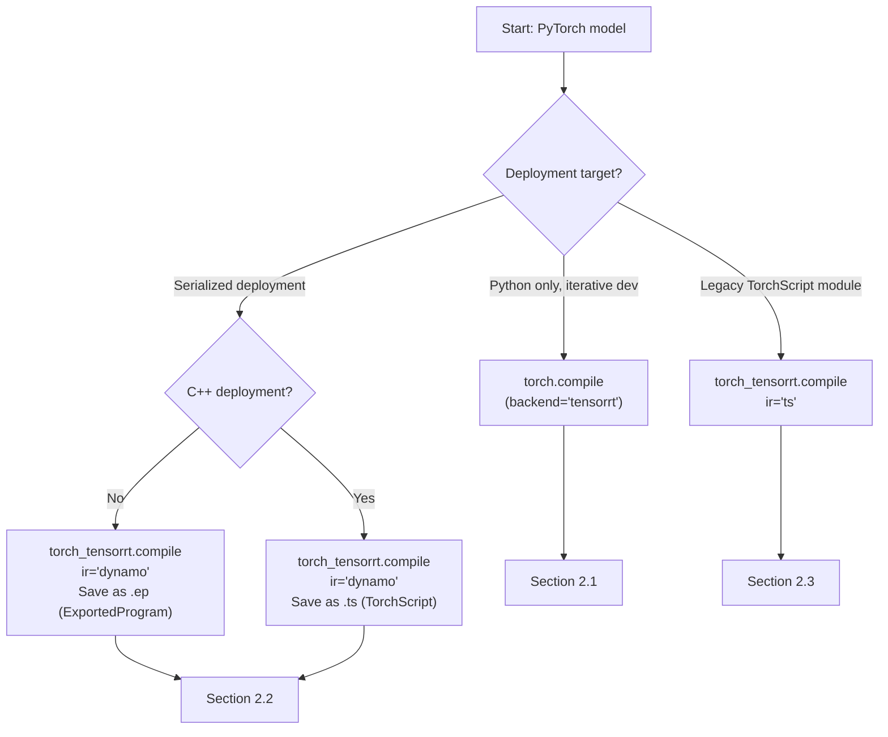
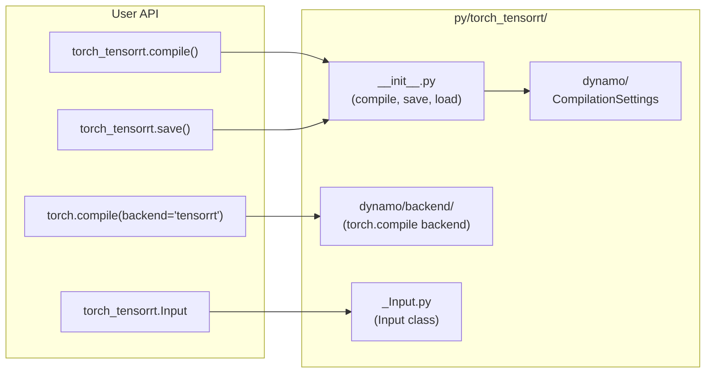
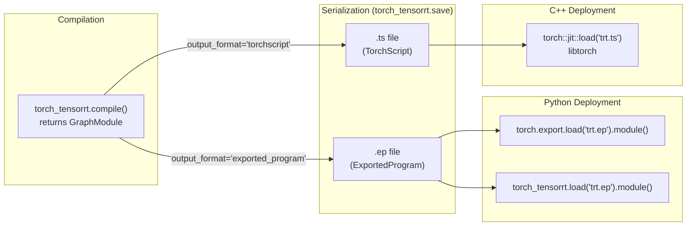

<!-- source: DeepWiki mcp.deepwiki.com · repo pytorch/TensorRT · page 2 User Guide · fetched 2026-10-21 -->

# User Guide

Relevant source files

The following files were used as context for generating this wiki page:

- [.github/scripts/generate-tensorrt-test-matrix.py](.github/scripts/generate-tensorrt-test-matrix.py)
- [.github/scripts/install-torch-tensorrt.sh](.github/scripts/install-torch-tensorrt.sh)
- [MODULE.bazel](MODULE.bazel)
- [README.md](README.md)
- [cpp/include/torch_tensorrt/macros.h](cpp/include/torch_tensorrt/macros.h)
- [dev_dep_versions.yml](dev_dep_versions.yml)
- [packaging/pre_build_script.sh](packaging/pre_build_script.sh)
- [packaging/pre_build_script_windows.sh](packaging/pre_build_script_windows.sh)
- [py/requirements.txt](py/requirements.txt)
- [pyproject.toml](pyproject.toml)
- [setup.py](setup.py)
- [tests/py/requirements.txt](tests/py/requirements.txt)
- [toolchains/ci_workspaces/MODULE.bazel.tmpl](toolchains/ci_workspaces/MODULE.bazel.tmpl)
- [tools/perf/Flux/create_env.sh](tools/perf/Flux/create_env.sh)
- [uv.lock](uv.lock)
- [version.txt](version.txt)

This section covers practical usage of Torch-TensorRT for optimizing and deploying PyTorch models. It describes the available compilation workflows, input configuration, precision options, and debugging tools.

For background on the system's internal architecture, see the [System Architecture](#1.2) page. For information about building from source, see [Build System and Development](#7).

---

## Overview

Torch-TensorRT compiles PyTorch models to run on NVIDIA GPUs using TensorRT. It provides two primary user-facing compilation workflows:

| Workflow | Entry Point | When to Use |
|---|---|---|
| **JIT (`torch.compile`)** | `torch.compile(model, backend="tensorrt")` | Development, experimentation, minimal code changes |
| **AOT (Export)** | `torch_tensorrt.compile(model, ir="dynamo")` | Deployment, serialization, C++ inference |
| **TorchScript** | `torch_tensorrt.compile(model, ir="ts")` | Legacy TorchScript workflows |

The JIT workflow compiles lazily on the first forward pass. The AOT workflows compile ahead of time and produce serializable artifacts. The TorchScript workflow is considered legacy; prefer the Dynamo-based workflows for new projects.

---

## Compilation Workflows

**Workflow decision diagram:**

### JIT Compilation (`torch.compile`)

Use `torch.compile` with `backend="tensorrt"` for drop-in TensorRT acceleration. The model is traced and compiled on the first call, and subsequent calls use the compiled engine.

See [JIT Compilation with torch.compile](#2.1) for full details.

### AOT Compilation and Export

Use `torch_tensorrt.compile` with `ir="dynamo"` to produce a compiled `GraphModule`. Save to an `ExportedProgram` (`.ep`) for Python deployment, or to a TorchScript file (`.ts`) for C++ deployment via `libtorch`.

The primary save function is `torch_tensorrt.save`, which delegates to the appropriate serializer based on the `output_format` argument.

See [AOT Compilation and Export](#2.2) for full details.

### TorchScript Compilation

`torch_tensorrt.compile` with `ir="ts"` targets the TorchScript C++ backend. This path is driven by the `torch_tensorrt.ts` package and the `torchtrtc` CLI tool.

See [TorchScript Compilation](#2.3) for full details.

---

## Key Configuration Concepts

**Concept-to-code mapping:**

### `torch_tensorrt.Input`

Input specifications are declared with `torch_tensorrt.Input` (defined in [py/torch_tensorrt/_Input.py]()). Each `Input` specifies:

- **Static shape**: a single tuple
- **Dynamic shape**: `min`, `opt`, and `max` shape tuples

The `enabled_precisions` argument on `torch_tensorrt.compile` accepts a set of `torch.dtype` values (e.g., `{torch.float16}`) and controls which TensorRT kernel precisions are enabled.

See [Precision Modes](#2.4) and [Dynamic Shapes and Input Specifications](#2.5).

### `CompilationSettings`

All compilation parameters are gathered into a `CompilationSettings` dataclass in [py/torch_tensorrt/dynamo/_settings.py](). These settings control partitioning behavior, precision, caching, and more. They are passed through `torch_tensorrt.compile` as keyword arguments or as part of the `torch.compile` backend options dict.

See [Compilation Settings and Configuration](#2.6).

---

## Serialization and Deployment

**Save/load flow:**

> **Note:** `ExportedProgram` (`.ep`) only supports the Python runtime. For C++ deployment without a Python dependency, save as TorchScript (`.ts`).

---

## Platform Support

| Platform | Support |
|---|---|
| Linux AMD64 / GPU | Supported |
| Linux SBSA (aarch64) / GPU | Supported |
| Windows / GPU | Supported (Dynamo only) |
| Linux Jetson / GPU | Source compilation, JetPack 4.4+ |
| Linux Jetson / DLA | Source compilation, JetPack 4.4+ |
| Linux ppc64le / GPU | Not supported |

Sources: [README.md:106-114]()

---

## Dependency Versions

| Dependency | Version |
|---|---|
| Python | ≥ 3.10 |
| PyTorch | 2.12.x (nightly) |
| CUDA | 13.0 (12.6 on Jetson) |
| TensorRT | 10.15.x (10.3.x on Jetson) |

Sources: [dev_dep_versions.yml:1-4](), [pyproject.toml:35](), [MODULE.bazel:39]()

---

## Section Index

| Section | Topic |
|---|---|
| [2.1 JIT Compilation with torch.compile](#2.1) | `torch.compile` with `backend="tensorrt"` |
| [2.2 AOT Compilation and Export](#2.2) | `torch_tensorrt.compile`, `torch_tensorrt.save`, `.ep` / `.ts` |
| [2.3 TorchScript Compilation](#2.3) | Legacy `ir="ts"` path and `torchtrtc` CLI |
| [2.4 Precision Modes](#2.4) | `enabled_precisions`, FP32/FP16/INT8, PTQ/QAT calibration |
| [2.5 Dynamic Shapes and Input Specifications](#2.5) | `torch_tensorrt.Input`, min/opt/max profiles |
| [2.6 Compilation Settings and Configuration](#2.6) | `CompilationSettings` parameters |
| [2.7 Debugging and Profiling](#2.7) | `Debugger` context manager, engine profiling hooks |

Sources: [README.md:37-93](), [setup.py:462-527](), [pyproject.toml:14-53]()

---

