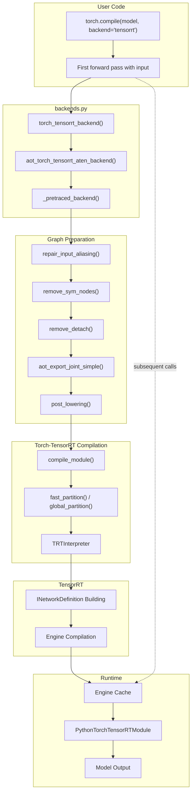
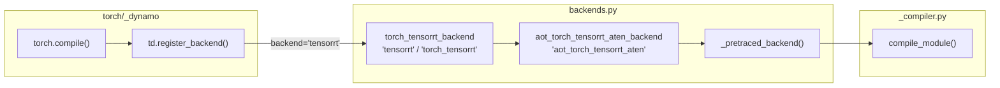

<!-- source: DeepWiki mcp.deepwiki.com · repo pytorch/TensorRT · page 2.1 JIT Compilation with torch.compile · fetched 2026-10-21 -->

# JIT Compilation with torch.compile

<details>
<summary>Relevant source files</summary>

The following files were used as context for generating this wiki page:

- [.github/scripts/generate-tensorrt-test-matrix.py](.github/scripts/generate-tensorrt-test-matrix.py)
- [.github/scripts/install-torch-tensorrt.sh](.github/scripts/install-torch-tensorrt.sh)
- [.gitignore](.gitignore)
- [MODULE.bazel](MODULE.bazel)
- [README.md](README.md)
- [cpp/include/torch_tensorrt/macros.h](cpp/include/torch_tensorrt/macros.h)
- [dev_dep_versions.yml](dev_dep_versions.yml)
- [docsrc/conf.py](docsrc/conf.py)
- [docsrc/contributors/writing_dynamo_aten_lowering_passes.rst](docsrc/contributors/writing_dynamo_aten_lowering_passes.rst)
- [docsrc/index.rst](docsrc/index.rst)
- [docsrc/requirements.txt](docsrc/requirements.txt)
- [examples/dynamo/README.rst](examples/dynamo/README.rst)
- [examples/dynamo/compile_with_dynamic_inputs.py](examples/dynamo/compile_with_dynamic_inputs.py)
- [examples/dynamo/custom_kernel_plugins.py](examples/dynamo/custom_kernel_plugins.py)
- [examples/dynamo/debugger_example.py](examples/dynamo/debugger_example.py)
- [examples/dynamo/dynamic_memory_allocation.py](examples/dynamo/dynamic_memory_allocation.py)
- [examples/dynamo/low_cpu_memory_compilation.py](examples/dynamo/low_cpu_memory_compilation.py)
- [examples/dynamo/refit_engine_example.py](examples/dynamo/refit_engine_example.py)
- [packaging/pre_build_script.sh](packaging/pre_build_script.sh)
- [packaging/pre_build_script_windows.sh](packaging/pre_build_script_windows.sh)
- [py/requirements.txt](py/requirements.txt)
- [py/torch_tensorrt/dynamo/backend/backends.py](py/torch_tensorrt/dynamo/backend/backends.py)
- [py/torch_tensorrt/dynamo/lowering/passes/constant_folding.py](py/torch_tensorrt/dynamo/lowering/passes/constant_folding.py)
- [py/torch_tensorrt/dynamo/lowering/passes/fuse_prims_broadcast.py](py/torch_tensorrt/dynamo/lowering/passes/fuse_prims_broadcast.py)
- [py/torch_tensorrt/dynamo/lowering/passes/pass_manager.py](py/torch_tensorrt/dynamo/lowering/passes/pass_manager.py)
- [py/torch_tensorrt/dynamo/lowering/passes/remove_input_alias_fixing_clones.py](py/torch_tensorrt/dynamo/lowering/passes/remove_input_alias_fixing_clones.py)
- [py/torch_tensorrt/dynamo/lowering/passes/repair_input_as_output.py](py/torch_tensorrt/dynamo/lowering/passes/repair_input_as_output.py)
- [pyproject.toml](pyproject.toml)
- [setup.py](setup.py)
- [tests/py/dynamo/testing_utilities.py](tests/py/dynamo/testing_utilities.py)
- [tests/py/requirements.txt](tests/py/requirements.txt)
- [toolchains/ci_workspaces/MODULE.bazel.tmpl](toolchains/ci_workspaces/MODULE.bazel.tmpl)
- [tools/perf/Flux/create_env.sh](tools/perf/Flux/create_env.sh)
- [uv.lock](uv.lock)
- [version.txt](version.txt)

</details>


## Purpose and Scope

This page describes how to use Torch-TensorRT for Just-In-Time (JIT) compilation via PyTorch's `torch.compile` interface with `backend='tensorrt'`. The compilation happens automatically during the first model execution, and subsequent runs leverage the compiled TensorRT engine for accelerated inference.

**Related pages:**
- For Ahead-of-Time (AOT) compilation and model export, see [AOT Compilation and Export](#2.2)
- For TorchScript-based compilation, see [TorchScript Compilation](#2.3)
- For detailed compilation settings, see [Compilation Settings and Configuration](#2.6)

## What is JIT Compilation?

JIT compilation with `torch.compile` defers TensorRT engine building until the first model execution. The key characteristics are:

| Aspect | JIT Compilation | AOT Compilation |
|--------|----------------|-----------------|
| **When compilation occurs** | First forward pass | Before deployment |
| **Input specification** | Inferred from runtime tensors | Explicitly specified via `torch_tensorrt.Input` |
| **Deployment workflow** | Load model, compile on-demand | Compile once, deploy serialized artifact |
| **Flexibility** | Easy iteration during development | Optimized for production |
| **Use case** | Development, prototyping | Production deployment |

Sources: [README.md:39-53](), [py/torch_tensorrt/dynamo/backend/backends.py:32-47]()

## Basic Usage

### Minimal Example

```python
import torch
import torch_tensorrt

# Define your model
model = MyModel().eval().cuda()

# Create sample input
x = torch.randn((1, 3, 224, 224)).cuda()

# Compile with TensorRT backend
optimized_model = torch.compile(model, backend="tensorrt")

# First execution triggers compilation
output = optimized_model(x)  # Compiles on first run

# Subsequent executions use cached TensorRT engine
output = optimized_model(x)  # Fast!
```

The `torch.compile` call returns a wrapped model that:
1. Intercepts the first forward pass
2. Captures the computation graph via PyTorch's Dynamo
3. Converts the graph to TensorRT
4. Caches the TensorRT engine
5. Executes subsequent forward passes using the cached engine

Sources: [README.md:39-53](), [py/torch_tensorrt/dynamo/backend/backends.py:32-96]()

### Compilation Options

You can pass compilation settings through `torch.compile` options:

```python
optimized_model = torch.compile(
    model,
    backend="tensorrt",
    options={
        "enabled_precisions": {torch.float16},  # Enable FP16
        "debug": False,
        "min_block_size": 3,
        "optimization_level": 3,
    }
)
```

Common options include:

| Option | Type | Default | Description |
|--------|------|---------|-------------|
| `enabled_precisions` | Set[dtype] | `{torch.float}` | Kernel precision modes (FP32, FP16, BF16, INT8) |
| `min_block_size` | int | `5` | Minimum operators per TensorRT block |
| `optimization_level` | int | `3` | TensorRT builder optimization level (0-5) |
| `debug` | bool | `False` | Enable verbose debug logging |
| `truncate_double` | bool | `False` | Convert FP64 to FP32 |

Sources: [py/torch_tensorrt/dynamo/_defaults.py:1-70](), [py/torch_tensorrt/dynamo/_settings.py:59-129]()

## Compilation Flow

**`torch.compile` Backend Dispatch Flow**



**Flow Explanation:**

1. `torch.compile(model, backend="tensorrt")` registers `torch_tensorrt_backend` as the compiler
2. On the **first forward pass**, Dynamo captures the graph and calls `torch_tensorrt_backend`
3. `torch_tensorrt_backend` delegates to `aot_torch_tensorrt_aten_backend`, then `_pretraced_backend`
4. `_pretraced_backend` applies graph preparation passes:
   - `repair_input_aliasing` — fixes aliased graph inputs
   - `remove_sym_nodes` — strips symbolic integer placeholders
   - `remove_detach` — removes detach nodes
   - `aot_export_joint_simple` — lowers to ATen operators
   - `post_lowering` — applies Torch-TensorRT lowering passes
5. `compile_module` partitions and converts the lowered graph to TensorRT engines
6. Compiled engines are cached; **subsequent calls** skip all compilation steps

Sources: [py/torch_tensorrt/dynamo/backend/backends.py:32-190](), [py/torch_tensorrt/dynamo/_compiler.py]()

## Key Components

**Backend Registration and Dispatch**



### Backend Functions

The backend is registered in `py/torch_tensorrt/dynamo/backend/backends.py` using the `@td.register_backend` decorator. Two backend names are registered:

| Name | Function | Notes |
|------|----------|-------|
| `"tensorrt"` | `torch_tensorrt_backend` | Primary alias |
| `"torch_tensorrt"` | `torch_tensorrt_backend` | Alternative alias |
| `"aot_torch_tensorrt_aten"` | `aot_torch_tensorrt_aten_backend` | Internal; used for distributed tracing |

Sources: [py/torch_tensorrt/dynamo/backend/backends.py:32-47]()

### `_pretraced_backend`

The core compilation function. Receives a `torch.fx.GraphModule` from Dynamo and sample inputs, applies pre-processing, then calls `compile_module`.

**Inputs:**
- `gm: torch.fx.GraphModule` — Dynamo-traced graph
- `sample_inputs: Sequence[Any]` — Sample tensors from the first forward pass
- `settings: CompilationSettings` — Parsed from `torch.compile` options
- `engine_cache: Any` — Optional engine cache instance

**Pre-processing steps (in order):**
1. `repair_input_aliasing(gm, settings)` — Fixes aliased inputs
2. `remove_sym_nodes(gm, sample_inputs, settings)` — Removes symbolic int placeholders
3. `remove_detach(gm, settings)` — Removes detach nodes
4. `aot_export_joint_simple(...)` — ATen decomposition via AOTAutograd
5. `post_lowering(gm, settings)` — Applies registered Torch-TensorRT lowering passes

On failure, if `settings.pass_through_build_failures` is `False` (default), the original `gm` is returned and execution falls back to eager PyTorch.

Sources: [py/torch_tensorrt/dynamo/backend/backends.py:99-190]()

### `CompilationSettings`

All `options` passed to `torch.compile` are parsed into a `CompilationSettings` dataclass via `parse_dynamo_kwargs`.

**Key Fields:**

| Field | Type | Default | Description |
|-------|------|---------|-------------|
| `enabled_precisions` | `Set[dtype]` | `{torch.float}` | Kernel precision modes |
| `device` | `Device` | Current CUDA device | Target GPU |
| `min_block_size` | `int` | `5` | Minimum ops per TRT block |
| `optimization_level` | `int` | `3` | Builder optimization (0–5) |
| `workspace_size` | `int` | `0` | TRT tactics memory in bytes |
| `use_python_runtime` | `bool` | auto | Force Python or C++ runtime |
| `pass_through_build_failures` | `bool` | `False` | Raise or warn on TRT build errors |

Sources: [py/torch_tensorrt/dynamo/backend/backends.py:54-55](), [py/torch_tensorrt/dynamo/_settings.py](), [py/torch_tensorrt/dynamo/_defaults.py]()

### `TRTInterpreter`

Walks the lowered FX graph and builds a TensorRT `INetworkDefinition`. Called by `compile_module` for each TensorRT-eligible subgraph after partitioning.

**Responsibilities:**
1. Validates all operations have registered converters
2. Creates TensorRT `IBuilder` and `INetworkDefinition`
3. Manages optimization profiles for dynamic shapes
4. Dispatches each FX node to its converter
5. Builds and serializes the engine

**Key methods:** `run()`, `call_function()`, `call_method()`, `call_module()`, `validate_conversion()`

Sources: [py/torch_tensorrt/dynamo/conversion/_TRTInterpreter.py]()

## Dynamic Shapes Handling

JIT compilation can handle dynamic input shapes by:

1. **Marking dimensions as dynamic** using `torch._dynamo.mark_dynamic()` before the first call
2. **Detecting symbolic shapes** in the captured FX graph
3. **Creating optimization profiles** with min/opt/max shape ranges
4. **Building a single engine** that supports the shape range

To mark a dimension as dynamic, call `torch._dynamo.mark_dynamic(tensor, index, min=..., max=...)` on the input before the first forward pass. This signals to Dynamo that the specified dimension is variable-length, and Torch-TensorRT will construct a TensorRT optimization profile covering the given range.

See `examples/dynamo/compile_with_dynamic_inputs.py` for a worked example demonstrating this pattern alongside the AOT approach.

Sources: [examples/dynamo/compile_with_dynamic_inputs.py:55-72](), [py/torch_tensorrt/dynamo/backend/backends.py:99-190]()

## Engine Caching

### In-Memory Caching

By default, compiled TensorRT engines are cached in memory to avoid recompilation:

| Property | Value |
|----------|-------|
| **Key** | Hash of graph structure + input shapes + compilation settings |
| **Value** | Serialized TensorRT engine bytes |
| **Lifetime** | Until model object is deleted or process ends |

### Disk Caching

For persistence across sessions, enable disk caching through the `options` dict:

```python
options={
    "cache_built_engines": True,
    "reuse_cached_engines": True,
    "engine_cache_dir": "./engine_cache",
    "engine_cache_size": 1_000_000_000,  # 1GB
}
```

**Disk Cache Options:**

| Option | Description |
|--------|-------------|
| `cache_built_engines` | Save engines to disk after building |
| `reuse_cached_engines` | Load matching engines from disk if available |
| `engine_cache_dir` | Directory for cached engine files |
| `engine_cache_size` | Maximum cache size in bytes |
| `custom_engine_cache` | Custom `BaseEngineCache` implementation |

`DiskEngineCache` (in `py/torch_tensorrt/dynamo/_engine_cache.py`) handles serialization, LRU eviction, and file locking for multi-process safety.

Sources: [py/torch_tensorrt/dynamo/_engine_cache.py](), [py/torch_tensorrt/dynamo/_defaults.py]()

## Runtime Modes

Two runtime classes execute the compiled TensorRT engines:

| Runtime | Class | Notes |
|---------|-------|-------|
| Python | `PythonTorchTensorRTModule` | Default; no C++ extension required |
| C++ | `TorchTensorRTModule` | Lower per-call overhead; requires compiled C++ extension |

The runtime is auto-detected by attempting to import the C++ extension (`torch_tensorrt._C`). Override via the `use_python_runtime` option:

- `use_python_runtime=True` — force Python runtime
- `use_python_runtime=False` — force C++ runtime (raises if unavailable)

Sources: [py/torch_tensorrt/dynamo/runtime](), [py/torch_tensorrt/dynamo/_defaults.py]()

## Compilation Settings Reference

All settings are passed via the `options` dict to `torch.compile`. They are parsed from kwargs into a `CompilationSettings` instance by `parse_dynamo_kwargs` in `py/torch_tensorrt/dynamo/utils.py`.

### Precision Control

| Option | Description |
|--------|-------------|
| `enabled_precisions` | Set of `torch.dtype` — e.g., `{torch.float16, torch.float32}` |
| `use_fp32_acc` | Insert FP32 cast nodes around matmul for accumulation precision |
| `truncate_double` | Truncate FP64 inputs/weights to FP32 |

See page 2.4 for detailed precision configuration.

### Graph Partitioning

| Option | Description |
|--------|-------------|
| `min_block_size` | Minimum consecutive ops to form a TRT subgraph |
| `torch_executed_ops` | Set of op names forced to run in PyTorch |
| `require_full_compilation` | **Not applicable in `torch.compile` mode** — logged as a warning |
| `use_fast_partitioner` | Use adjacency-based (fast) vs. global partitioner |

Note: `require_full_compilation` is silently ignored when using `torch.compile` and triggers a warning.

### Memory and Performance

| Option | Description |
|--------|-------------|
| `workspace_size` | TRT builder workspace in bytes |
| `optimization_level` | Builder optimization intensity (0–5); higher = slower build, faster runtime |
| `num_avg_timing_iters` | Kernel timing iterations for tactic selection |
| `max_aux_streams` | Maximum auxiliary CUDA streams per engine |

### Unsupported in `torch.compile` Mode

The following `CompilationSettings` fields are **not applicable** when using `torch.compile` and are either ignored or raise a warning:

| Option | Behavior |
|--------|----------|
| `require_full_compilation` | Warning logged; ignored |
| `strip_engine_weights` | Forced to `False`; warning logged |
| `offload_module_to_cpu` | Warning logged; ignored |

Sources: [py/torch_tensorrt/dynamo/backend/backends.py:92-96](), [py/torch_tensorrt/dynamo/backend/backends.py:157-165](), [py/torch_tensorrt/dynamo/_settings.py](), [py/torch_tensorrt/dynamo/_defaults.py]()

## Debugging and Profiling

### Enable Debug Logging

```python
import logging
logging.basicConfig(level=logging.DEBUG)

optimized_model = torch.compile(
    model,
    backend="tensorrt",
    options={"debug": True}  # Deprecated; use logging instead
)
```

Use the `Debugger` context manager for advanced debugging:

```python
from torch_tensorrt.dynamo import Debugger

with Debugger(verbosity="GRAPH", internal_level=logging.DEBUG):
    optimized_model = torch.compile(model, backend="tensorrt")
    output = optimized_model(input)
```

See [Debugging and Profiling](#2.7) for comprehensive debugging guide.

### Dryrun Mode

Test compilation without building TensorRT engines:

```python
optimized_model = torch.compile(
    model,
    backend="tensorrt",
    options={"dryrun": True}
)
```

Dryrun mode:
- Captures and lowers the graph
- Identifies TensorRT-compatible subgraphs
- Reports unsupported operations
- Skips actual engine building

Sources: [py/torch_tensorrt/dynamo/_compiler.py](), [py/torch_tensorrt/dynamo/_defaults.py:30]()

## Common Patterns

### Minimal Development Workflow

The simplest path to TensorRT-accelerated inference:

```python
import torch
import torch_tensorrt

model = MyModel().eval().cuda()
optimized_model = torch.compile(model, backend="tensorrt")

# First run triggers compilation
output = optimized_model(torch.randn(1, 3, 224, 224).cuda())
```

### Hybrid Execution (Fallback to PyTorch)

By default, operations without TRT converters fall back to PyTorch. Control this explicitly:

```python
optimized_model = torch.compile(
    model,
    backend="tensorrt",
    options={
        "min_block_size": 3,
        "pass_through_build_failures": True,
        "torch_executed_ops": {"aten.unique", "aten.sort"},
    }
)
```

Setting `pass_through_build_failures=True` causes TRT build errors to be silently swallowed and the affected subgraph to fall back to PyTorch. When `False` (default), a build error raises an exception.

### Production Deployment

For production, consider AOT compilation instead (see page 2.2):

```python
trt_model = torch_tensorrt.compile(
    model,
    ir="dynamo",
    inputs=[torch_tensorrt.Input((1, 3, 224, 224))],
)
torch_tensorrt.save(trt_model, "model.ep")
```

Sources: [README.md:39-53](), [py/torch_tensorrt/dynamo/backend/backends.py:174-190]()

## Advanced Configuration

### Custom Engine Cache

Subclass `BaseEngineCache` from `py/torch_tensorrt/dynamo/_engine_cache.py` to implement custom caching (e.g., S3, Redis):

```python
from torch_tensorrt.dynamo._engine_cache import BaseEngineCache

class CustomCache(BaseEngineCache):
    def save(self, hash_val, engine, prefix="default"):
        ...
    def load(self, hash_val, prefix="default"):
        ...

optimized_model = torch.compile(
    model,
    backend="tensorrt",
    options={"custom_engine_cache": CustomCache()}
)
```

### Distributed Model Tracing

For models using `torch.distributed` (e.g., DTensor inputs), enable distributed trace mode:

```python
optimized_model = torch.compile(
    model,
    backend="tensorrt",
    options={"use_distributed_mode_trace": True}
)
```

This wraps `_pretraced_backend` with `aot_autograd`, applying decompositions before TensorRT conversion.

### Resource-Aware Partitioning

Limit host (CPU) memory used during compilation to avoid OOM on large models:

```python
optimized_model = torch.compile(
    model,
    backend="tensorrt",
    options={
        "enable_resource_partitioning": True,
        "cpu_memory_budget": 8_000_000_000,  # 8GB
    }
)
```

See `examples/dynamo/low_cpu_memory_compilation.py` for a worked example.

Sources: [py/torch_tensorrt/dynamo/backend/backends.py:56-82](), [py/torch_tensorrt/dynamo/_engine_cache.py](), [examples/dynamo/low_cpu_memory_compilation.py]()

## Limitations

### JIT Compilation Constraints

| Constraint | Details |
|------------|---------|
| **First-call latency** | TensorRT engine build (seconds to minutes) occurs on the first forward pass |
| **Shape changes** | Changing input shapes outside of marked dynamic ranges triggers recompilation |
| **Control flow** | Complex Python control flow may produce multiple subgraphs or fall back to PyTorch |
| **Data-dependent shapes** | Operations with runtime-determined output shapes may not be fully converted |
| **`require_full_compilation`** | Not enforced in `torch.compile` mode — always silently ignored |
| **`strip_engine_weights`** | Not supported; automatically set to `False` |
| **`offload_module_to_cpu`** | Not supported; ignored |

### When to Use AOT Instead (page 2.2)

- Deploying to production servers where first-call latency is unacceptable
- C++ deployment via libtorch
- Engines need to be versioned and stored separately from model code
- You need strict control over input shape ranges

Sources: [py/torch_tensorrt/dynamo/backend/backends.py:92-96](), [py/torch_tensorrt/dynamo/backend/backends.py:157-165](), [README.md:55-93]()

## Performance Considerations

### Compilation Overhead

The first forward pass includes:
- Graph capture: ~100ms-1s
- Lowering and partitioning: ~100ms
- TensorRT building: 10s-5min (model-dependent)

Subsequent runs have near-zero overhead (cached engine lookup).

### Runtime Performance

Expected speedup varies by model:
- **Transformer models**: 2-5x faster
- **CNNs**: 1.5-3x faster  
- **Large models**: Higher speedup due to kernel fusion
- **Small models**: Lower speedup due to overhead

### Memory Usage

- **Python runtime**: ~50-100MB overhead per engine
- **C++ runtime**: ~20-50MB overhead per engine
- **Engine size**: Typically 1-3x model weight size
- **Peak during build**: 2-5x runtime memory

Sources: [README.md:19](), [tutorials/_rendered_examples/dynamo/torch_compile_resnet_example.html]()

---

**Key Takeaways:**

1. JIT compilation with `torch.compile(model, backend="tensorrt")` is the simplest way to accelerate PyTorch models
2. Compilation happens automatically on first execution
3. Engines are cached for reuse on subsequent runs
4. Configuration through `options` dict controls precision, partitioning, and optimization
5. For production deployment, consider [AOT compilation](#2.2) instead

Sources: [README.md](), [py/torch_tensorrt/dynamo/_compiler.py](), [py/torch_tensorrt/dynamo/_settings.py](), [py/torch_tensorrt/dynamo/conversion/_TRTInterpreter.py]()

---

