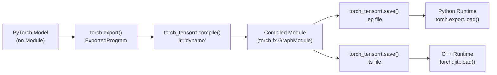
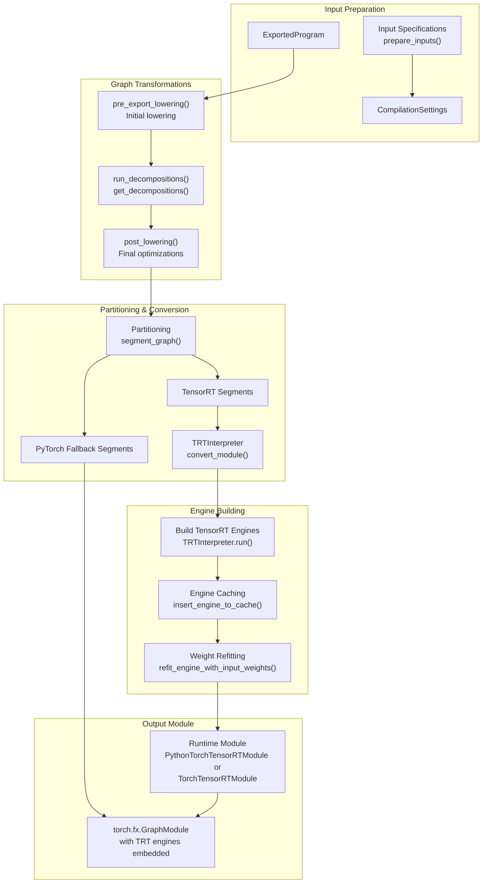
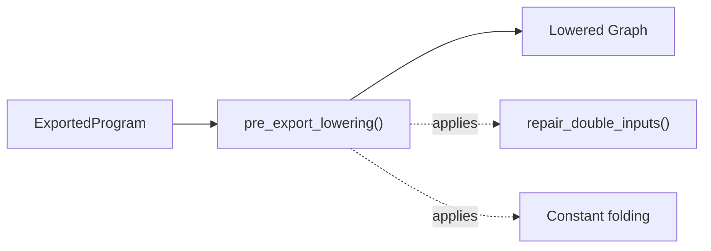
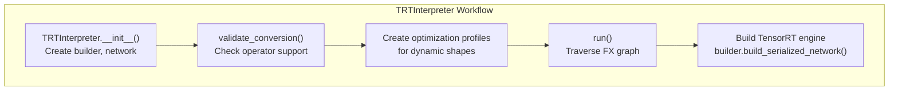
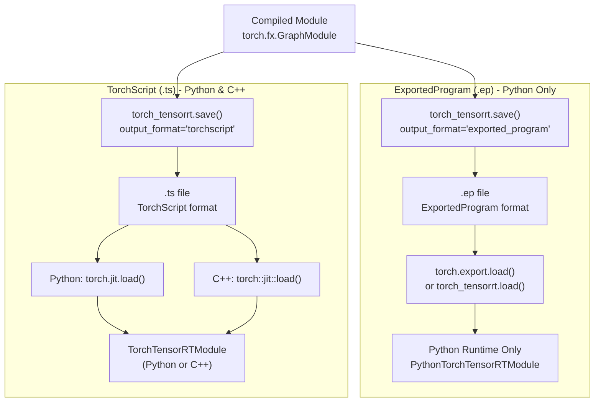
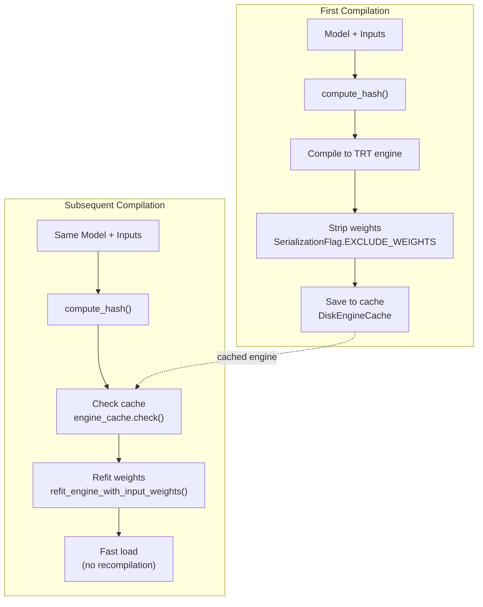
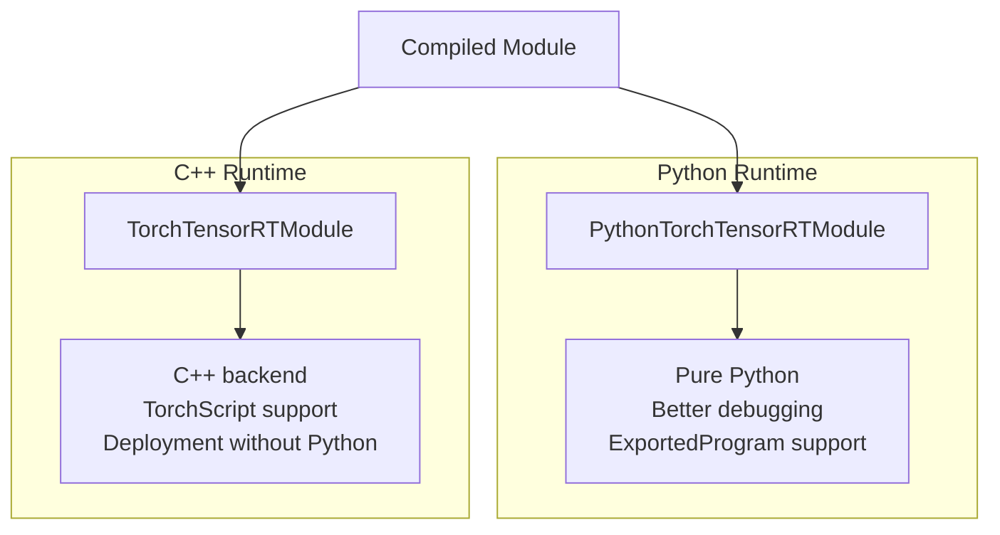

<!-- source: DeepWiki mcp.deepwiki.com · repo pytorch/TensorRT · page 2.2 AOT Compilation and Export · fetched 2026-10-21 -->

# AOT Compilation and Export

<details>
<summary>Relevant source files</summary>

The following files were used as context for generating this wiki page:

- [.github/scripts/generate-tensorrt-test-matrix.py](.github/scripts/generate-tensorrt-test-matrix.py)
- [.github/scripts/install-torch-tensorrt.sh](.github/scripts/install-torch-tensorrt.sh)
- [.gitignore](.gitignore)
- [MODULE.bazel](MODULE.bazel)
- [README.md](README.md)
- [cpp/include/torch_tensorrt/macros.h](cpp/include/torch_tensorrt/macros.h)
- [dev_dep_versions.yml](dev_dep_versions.yml)
- [docsrc/conf.py](docsrc/conf.py)
- [docsrc/index.rst](docsrc/index.rst)
- [docsrc/requirements.txt](docsrc/requirements.txt)
- [examples/dynamo/README.rst](examples/dynamo/README.rst)
- [examples/dynamo/compile_with_dynamic_inputs.py](examples/dynamo/compile_with_dynamic_inputs.py)
- [examples/dynamo/custom_kernel_plugins.py](examples/dynamo/custom_kernel_plugins.py)
- [examples/dynamo/debugger_example.py](examples/dynamo/debugger_example.py)
- [examples/dynamo/dynamic_memory_allocation.py](examples/dynamo/dynamic_memory_allocation.py)
- [examples/dynamo/low_cpu_memory_compilation.py](examples/dynamo/low_cpu_memory_compilation.py)
- [examples/dynamo/refit_engine_example.py](examples/dynamo/refit_engine_example.py)
- [packaging/pre_build_script.sh](packaging/pre_build_script.sh)
- [packaging/pre_build_script_windows.sh](packaging/pre_build_script_windows.sh)
- [py/requirements.txt](py/requirements.txt)
- [py/torch_tensorrt/_compile.py](py/torch_tensorrt/_compile.py)
- [py/torch_tensorrt/dynamo/__init__.py](py/torch_tensorrt/dynamo/__init__.py)
- [py/torch_tensorrt/dynamo/_compiler.py](py/torch_tensorrt/dynamo/_compiler.py)
- [py/torch_tensorrt/dynamo/_defaults.py](py/torch_tensorrt/dynamo/_defaults.py)
- [py/torch_tensorrt/dynamo/_refit.py](py/torch_tensorrt/dynamo/_refit.py)
- [py/torch_tensorrt/dynamo/_settings.py](py/torch_tensorrt/dynamo/_settings.py)
- [py/torch_tensorrt/dynamo/conversion/_TRTInterpreter.py](py/torch_tensorrt/dynamo/conversion/_TRTInterpreter.py)
- [py/torch_tensorrt/dynamo/conversion/_conversion.py](py/torch_tensorrt/dynamo/conversion/_conversion.py)
- [py/torch_tensorrt/dynamo/lowering/passes/__init__.py](py/torch_tensorrt/dynamo/lowering/passes/__init__.py)
- [py/torch_tensorrt/dynamo/utils.py](py/torch_tensorrt/dynamo/utils.py)
- [pyproject.toml](pyproject.toml)
- [setup.py](setup.py)
- [tests/py/dynamo/conversion/harness.py](tests/py/dynamo/conversion/harness.py)
- [tests/py/dynamo/models/test_export_kwargs_serde.py](tests/py/dynamo/models/test_export_kwargs_serde.py)
- [tests/py/dynamo/models/test_export_serde.py](tests/py/dynamo/models/test_export_serde.py)
- [tests/py/dynamo/models/test_model_refit.py](tests/py/dynamo/models/test_model_refit.py)
- [tests/py/dynamo/models/test_reexport.py](tests/py/dynamo/models/test_reexport.py)
- [tests/py/dynamo/runtime/test_002_lazy_engine_init.py](tests/py/dynamo/runtime/test_002_lazy_engine_init.py)
- [tests/py/requirements.txt](tests/py/requirements.txt)
- [toolchains/ci_workspaces/MODULE.bazel.tmpl](toolchains/ci_workspaces/MODULE.bazel.tmpl)
- [tools/perf/Flux/create_env.sh](tools/perf/Flux/create_env.sh)
- [uv.lock](uv.lock)
- [version.txt](version.txt)

</details>


## Purpose and Scope

This page describes ahead-of-time (AOT) compilation using `torch_tensorrt.compile` to convert PyTorch models into optimized TensorRT engines before deployment. Unlike just-in-time (JIT) compilation (see [2.1](#2.1)), AOT compilation produces serialized artifacts that can be saved to disk and deployed in production environments without requiring recompilation.

The AOT workflow supports two output formats:
- **ExportedProgram (.ep)** - Python-only deployment using PyTorch's export format
- **TorchScript (.ts)** - Cross-language deployment supporting both Python and C++ runtimes

For TorchScript-specific APIs and C++ deployment details, see [2.3](#2.3). For precision configuration, see [2.4](#2.4). For dynamic shape handling, see [2.5](#2.5).

## Overview

### When to Use AOT Compilation

AOT compilation is appropriate when:
- Models need to be deployed without Python dependencies (C++ deployment)
- Compilation time should not impact first inference latency
- Optimized engines should be cached and reused across sessions
- Models will be deployed on different machines than where they are compiled
- Cross-platform deployment is required (e.g., compile on Linux, run on Windows)

### High-Level Workflow



**Sources:** [README.md:38-93]()

## Main API: torch_tensorrt.compile

The primary function for AOT compilation is `torch_tensorrt.dynamo.compile`, which accepts an `ExportedProgram` and returns a compiled `torch.fx.GraphModule` containing TensorRT engines.

### Basic Usage

```python
import torch
import torch_tensorrt

# Step 1: Export the model
model = MyModel().eval().cuda()
inputs = [torch.randn((1, 3, 224, 224)).cuda()]
exported_program = torch.export.export(model, tuple(inputs))

# Step 2: Compile with TensorRT
trt_module = torch_tensorrt.compile(
    exported_program,
    inputs=inputs,
    ir="dynamo"
)

# Step 3: Save for deployment
torch_tensorrt.save(trt_module, "model.ep", inputs=inputs)
torch_tensorrt.save(trt_module, "model.ts", output_format="torchscript", inputs=inputs)
```

**Sources:** [README.md:55-69](), [py/torch_tensorrt/dynamo/_compiler.py:397-551]()

### Function Signature

The `compile` function is defined in [py/torch_tensorrt/dynamo/_compiler.py:397-551]() with the following key parameters:

| Parameter | Type | Description |
|-----------|------|-------------|
| `exported_program` | `torch.export.ExportedProgram` | Source module from `torch.export.export()` |
| `inputs` | `Sequence[Input]` | Input specifications (shapes, dtypes, formats) |
| `arg_inputs` | `Sequence[Any]` | Alias for `inputs` parameter |
| `kwarg_inputs` | `dict[str, Any]` | Keyword argument inputs to module |
| `ir` | `str` | Set to `"dynamo"` for AOT compilation |
| `enabled_precisions` | `Set[dtype]` | Kernel precision modes (FP32, FP16, INT8, etc.) |
| `device` | `Device` | Target device for TensorRT engines |
| `use_python_runtime` | `bool` | Use Python runtime (True) or C++ runtime (False) |

**Sources:** [py/torch_tensorrt/dynamo/_compiler.py:397-551]()

## Compilation Pipeline

### End-to-End Flow



**Sources:** [py/torch_tensorrt/dynamo/_compiler.py:388-394, 645-1051]()

### Pipeline Stages

#### 1. Input Preparation

The `prepare_inputs` function converts raw tensors and Input objects into standardized `torch_tensorrt.Input` specifications:

```python
# Converts nested structures of tensors to Input objects
torchtrt_inputs = prepare_inputs(arg_inputs)
```

**Implementation:** [py/torch_tensorrt/dynamo/utils.py:300-352]()

**Sources:** [py/torch_tensorrt/dynamo/utils.py:300-352](), [py/torch_tensorrt/dynamo/_compiler.py:298-301]()

#### 2. Pre-Export Lowering

The `pre_export_lowering` pass performs initial graph transformations before decompositions:



**Sources:** [py/torch_tensorrt/dynamo/_compiler.py:365](), [py/torch_tensorrt/dynamo/lowering/__init__.py]()

#### 3. Decompositions

The decomposition stage breaks complex operations into simpler primitives that TensorRT can handle:

```python
decompositions = get_decompositions(enable_experimental_decompositions)
exported_program = exported_program.run_decompositions(decompositions)
```

**Key decomposition targets:**
- Complex aten operations → simpler aten primitives
- Composite operations → fundamental building blocks
- Dynamic operations → TensorRT-compatible equivalents

**Sources:** [py/torch_tensorrt/dynamo/_compiler.py:366-368](), [py/torch_tensorrt/dynamo/lowering/_decompositions.py]()

#### 4. Post-Lowering Optimization

The `post_lowering` pass applies final graph optimizations:

```python
gm = post_lowering(gm, settings)
```

**Transformations include:**
- Constant folding
- Dead code elimination  
- Operator fusion
- Type inference and casting

**Sources:** [py/torch_tensorrt/dynamo/_compiler.py:374](), [py/torch_tensorrt/dynamo/lowering/__init__.py]()

#### 5. Partitioning

The graph is segmented into TensorRT-compatible and PyTorch fallback regions:

| Setting | Description |
|---------|-------------|
| `min_block_size` | Minimum consecutive ops for TensorRT segment |
| `torch_executed_ops` | Operations forced to run in PyTorch |
| `require_full_compilation` | Error if any ops cannot be converted |
| `use_fast_partitioner` | Use adjacency-based (fast) vs global partitioner |

**Sources:** [py/torch_tensorrt/dynamo/_compiler.py:418, 511]()

#### 6. Conversion

The `TRTInterpreter` converts FX graph segments to TensorRT `INetwork` objects and builds engines:



**Sources:** [py/torch_tensorrt/dynamo/conversion/_TRTInterpreter.py:80-160]()

#### 7. Engine Caching and Refitting

Compiled engines can be cached for reuse:

```python
# Insert engine into cache (weight-stripped)
insert_engine_to_cache(hash_val, interpreter_result, engine_cache, settings, inputs)

# Reuse cached engine and refit weights
cached_engine = pull_cached_engine(hash_val, module, engine_cache, settings, inputs)
```

**Cache workflow:**
1. Strip weights from engine using `SerializationFlag.EXCLUDE_WEIGHTS`
2. Cache weight-stripped engine with metadata
3. On cache hit, refit weights using `refit_engine_with_input_weights`

**Sources:** [py/torch_tensorrt/dynamo/conversion/_conversion.py:50-145]()

## Input Specifications

### Static Shapes

For models with fixed input dimensions:

```python
inputs = [
    torch_tensorrt.Input(
        shape=(1, 3, 224, 224),
        dtype=torch.float32,
        format=torch.contiguous_format
    )
]
```

**Sources:** [README.md:64](), [tests/py/dynamo/models/test_models.py:35-40]()

### Dynamic Shapes

For variable input sizes, specify min/opt/max shapes:

```python
inputs = [
    torch_tensorrt.Input(
        min_shape=(1, 3, 224, 224),
        opt_shape=(4, 3, 224, 224),
        max_shape=(8, 3, 224, 224),
        dtype=torch.float32
    )
]
```

The `opt_shape` is used for TensorRT kernel tuning. See [2.5](#2.5) for detailed dynamic shape handling.

**Sources:** [tests/py/dynamo/models/test_models.py:162-169](), [py/torch_tensorrt/_Input.py]()

### Multiple Inputs

For models with multiple inputs:

```python
inputs = [
    torch_tensorrt.Input((1, 128), dtype=torch.int32),  # Input IDs
    torch_tensorrt.Input((1, 128), dtype=torch.int32),  # Attention mask
]

trt_module = torch_tensorrt.compile(exported_program, inputs=inputs)
```

**Sources:** [tests/py/dynamo/models/test_models.py:296-308]()

## Serialization and Deployment

### Serialization Formats



**Sources:** [README.md:55-93]()

### Saving as ExportedProgram (.ep)

ExportedProgram format is Python-only but provides better debugging and flexibility:

```python
torch_tensorrt.save(
    trt_module, 
    "model.ep", 
    inputs=inputs,
    output_format="exported_program"  # Default
)
```

**Characteristics:**
- Python runtime only (`PythonTorchTensorRTModule`)
- Better error messages and debugging
- Supports latest PyTorch features
- Cannot be loaded in C++

**Loading:**
```python
# Method 1: PyTorch native
model = torch.export.load("model.ep").module()

# Method 2: Torch-TensorRT wrapper
model = torch_tensorrt.load("model.ep").module()

# Inference
output = model(input_tensor)
```

**Sources:** [README.md:67-82]()

### Saving as TorchScript (.ts)

TorchScript format enables C++ deployment:

```python
torch_tensorrt.save(
    trt_module, 
    "model.ts", 
    output_format="torchscript",
    inputs=inputs
)
```

**Characteristics:**
- Cross-language support (Python and C++)
- Uses `TorchTensorRTModule` (C++ backend)
- Required for deployment without Python
- Larger file size than .ep

**Python Loading:**
```python
import torch

model = torch.jit.load("model.ts")
output = model(input_tensor)
```

**C++ Loading:**
```cpp
#include "torch/script.h"
#include "torch_tensorrt/torch_tensorrt.h"

// Load the model
auto trt_mod = torch::jit::load("model.ts");

// Prepare inputs
std::vector<torch::jit::IValue> inputs;
inputs.push_back(input_tensor);

// Run inference
auto outputs = trt_mod.forward(inputs);
```

**Sources:** [README.md:68-69, 85-93]()

## Key Compilation Settings

The `CompilationSettings` dataclass controls compilation behavior:

### Precision Configuration

```python
trt_module = torch_tensorrt.compile(
    exported_program,
    inputs=inputs,
    enabled_precisions={torch.float32, torch.float16},  # Enable FP16
    use_explicit_typing=True  # Preserve model's dtypes
)
```

**Precision options:**
- `torch.float32` / `dtype.f32` - Full precision
- `torch.float16` / `dtype.f16` - Half precision (Tensor Cores)
- `torch.bfloat16` / `dtype.bf16` - Brain float
- `torch.int8` / `dtype.i8` - INT8 quantization
- `dtype.f8` - FP8 (Ada Lovelace and newer)

See [2.4](#2.4) for detailed precision mode documentation.

**Sources:** [py/torch_tensorrt/dynamo/_settings.py:119](), [tests/py/dynamo/models/test_models.py:407-408]()

### Device Configuration

```python
trt_module = torch_tensorrt.compile(
    exported_program,
    inputs=inputs,
    device=torch_tensorrt.Device("cuda:0")  # Specific GPU
)
```

**Sources:** [py/torch_tensorrt/dynamo/_compiler.py:494](), [tests/py/dynamo/models/test_models.py:40]()

### Optimization Settings

| Setting | Default | Description |
|---------|---------|-------------|
| `workspace_size` | 0 | TensorRT builder workspace (bytes) |
| `optimization_level` | None | 0-5, higher = longer build, better performance |
| `num_avg_timing_iters` | 1 | Kernel timing iterations for selection |
| `max_aux_streams` | None | Maximum auxiliary TensorRT streams |
| `disable_tf32` | False | Disable TF32 compute for FP32 layers |
| `sparse_weights` | False | Enable sparse weight optimization |

**Sources:** [py/torch_tensorrt/dynamo/_settings.py:59-175]()

### Version and Hardware Compatibility

```python
trt_module = torch_tensorrt.compile(
    exported_program,
    inputs=inputs,
    version_compatible=True,      # Forward-compatible engines
    hardware_compatible=True      # Multi-GPU architecture support
)
```

- `version_compatible=True` - Engines work with future TensorRT versions (restricts to lean runtime operators)
- `hardware_compatible=True` - Engines work on different GPU architectures (Ampere and newer)

**Sources:** [py/torch_tensorrt/dynamo/_compiler.py:515-516](), [py/torch_tensorrt/dynamo/_settings.py:125-126]()

### Partitioning Configuration

```python
trt_module = torch_tensorrt.compile(
    exported_program,
    inputs=inputs,
    min_block_size=5,                              # Min ops per TRT segment
    torch_executed_ops={torch.ops.aten.add},       # Force ops to PyTorch
    require_full_compilation=False,                # Allow hybrid execution
    use_fast_partitioner=True                      # Fast adjacency partitioner
)
```

**Sources:** [py/torch_tensorrt/dynamo/_compiler.py:510-518](), [tests/py/dynamo/models/test_models.py:177]()

## Engine Caching

### Overview

Engine caching stores compiled TensorRT engines to disk for reuse across sessions, avoiding recompilation:



**Sources:** [py/torch_tensorrt/dynamo/conversion/_conversion.py:50-145]()

### Enabling Engine Caching

```python
trt_module = torch_tensorrt.compile(
    exported_program,
    inputs=inputs,
    cache_built_engines=True,           # Save engines to cache
    reuse_cached_engines=True,          # Load from cache if available
    engine_cache_dir="/tmp/engine_cache",  # Cache directory
    engine_cache_size=5368709120        # 5GB max cache size
)
```

**Default cache location:** `/tmp/torch_tensorrt_engine_cache/`

**Sources:** [py/torch_tensorrt/dynamo/_defaults.py:43-47](), [py/torch_tensorrt/dynamo/_compiler.py:524-527]()

### Custom Engine Cache

Implement `BaseEngineCache` for custom storage backends:

```python
from torch_tensorrt.dynamo._engine_cache import BaseEngineCache

class CustomCache(BaseEngineCache):
    def check(self, hash_val: str) -> Optional[tuple]:
        # Return cached engine data or None
        pass
    
    def insert(self, hash_val: str, blob: tuple) -> None:
        # Store engine to custom backend
        pass

trt_module = torch_tensorrt.compile(
    exported_program,
    inputs=inputs,
    custom_engine_cache=CustomCache()
)
```

**Sources:** [py/torch_tensorrt/dynamo/_engine_cache.py](), [py/torch_tensorrt/dynamo/_compiler.py:528]()

### Weight Refitting

Cached engines are weight-stripped to save space. When reused, weights are refitted:

```python
# Engine is refit with current model weights
cached_engine_data = pull_cached_engine(hash_val, module, engine_cache, settings, inputs)
refitted_engine = refit_engine_with_input_weights(
    serialized_engine=cached_engine_data.serialized_engine,
    weight_name_map=cached_engine_data.weight_name_map,
    module=module
)
```

**Requirements:**
- `immutable_weights=False` to enable refitting
- `refit_identical_engine_weights=True` for identical weight refitting optimization

**Sources:** [py/torch_tensorrt/dynamo/conversion/_conversion.py:98-145](), [py/torch_tensorrt/dynamo/_compiler.py:439-440]()

## Cross-Platform Compilation

### Compile on Linux, Run on Windows

Enable cross-compilation for Windows deployment:

```python
# On Linux machine
trt_module = torch_tensorrt.compile(
    exported_program,
    inputs=inputs,
    enable_cross_compile_for_windows=True
)

torch_tensorrt.save(trt_module, "model.ts", output_format="torchscript", inputs=inputs)
```

**Restrictions:**
- Linux x86-64 compilation host only
- TorchScript output format required (.ts)
- Python runtime, lazy engine init, and caching disabled

**Sources:** [py/torch_tensorrt/dynamo/_compiler.py:60-395](), [py/torch_tensorrt/dynamo/_settings.py:105-106]()

## Memory Management

### CPU Memory Budget

For large models, limit CPU memory usage during compilation:

```python
trt_module = torch_tensorrt.compile(
    exported_program,
    inputs=inputs,
    offload_module_to_cpu=True,           # Move model to CPU
    enable_resource_partitioning=True,    # Enable resource-aware partitioning
    cpu_memory_budget=4 * 1024**3         # 4GB limit
)
```

**Features:**
- `offload_module_to_cpu=True` - Moves PyTorch model to CPU after export, freeing GPU memory for TensorRT compilation
- `enable_resource_partitioning=True` - Partitions graph based on available memory
- `cpu_memory_budget` - Fails compilation if memory budget exceeded

**Sources:** [py/torch_tensorrt/dynamo/_compiler.py:377-387, 446-461](), [py/torch_tensorrt/dynamo/_settings.py:173-174]()

### Lazy Engine Initialization

Defer engine creation to prevent GPU memory oversubscription:

```python
trt_module = torch_tensorrt.compile(
    exported_program,
    inputs=inputs,
    lazy_engine_init=True  # Delay engine setup until all compiled
)
```

**Use case:** Large models with multiple graph breaks benefit from lazy init to avoid OOM during compilation.

**Sources:** [py/torch_tensorrt/dynamo/_compiler.py:523](), [py/torch_tensorrt/dynamo/_defaults.py:43]()

## Debugging and Dryrun Mode

### Dryrun Mode

Test compilation without building TensorRT engines:

```python
trt_module = torch_tensorrt.compile(
    exported_program,
    inputs=inputs,
    dryrun=True  # or dryrun="/path/to/output.log"
)
```

**Output includes:**
- Graph structure after lowering
- Partitioning decisions (TensorRT vs PyTorch segments)
- Operator support analysis
- Shape and dtype information

**Sources:** [py/torch_tensorrt/dynamo/_compiler.py:428, 520](), [py/torch_tensorrt/dynamo/_settings.py:92-93]()

## Runtime Modules

### Runtime Module Types



**Selection:**
- Python runtime used when `use_python_runtime=True` or C++ runtime unavailable
- C++ runtime used when `use_python_runtime=False` and C++ dependency present
- Auto-detected if not specified

**Sources:** [py/torch_tensorrt/dynamo/utils.py:142-171](), [py/torch_tensorrt/dynamo/runtime/__init__.py]()

## Complete Examples

### Basic AOT Workflow

```python
import torch
import torch_tensorrt

# Define and export model
model = torchvision.models.resnet18(pretrained=True).eval().cuda()
inputs = [torch.randn((1, 3, 224, 224)).cuda()]
exported_program = torch.export.export(model, tuple(inputs))

# Compile with TensorRT
trt_module = torch_tensorrt.compile(
    exported_program,
    inputs=[torch_tensorrt.Input(
        shape=(1, 3, 224, 224),
        dtype=torch.float32
    )],
    enabled_precisions={torch.float32, torch.float16},
    device=torch_tensorrt.Device("cuda:0")
)

# Save for deployment
torch_tensorrt.save(trt_module, "resnet18.ep", inputs=inputs)
torch_tensorrt.save(trt_module, "resnet18.ts", 
                   output_format="torchscript", inputs=inputs)

# Deploy - Python
loaded_model = torch.export.load("resnet18.ep").module()
output = loaded_model(*inputs)

# Deploy - C++ (see C++ example above)
```

**Sources:** [README.md:55-93](), [tests/py/dynamo/models/test_models.py:30-54]()

### Multi-Input Model

```python
from transformers import BertModel

# Export BERT model
model = BertModel.from_pretrained("bert-base-uncased").cuda().eval()
input_ids = torch.randint(0, 2, (1, 128), dtype=torch.int32).cuda()
attention_mask = torch.randint(0, 2, (1, 128), dtype=torch.int32).cuda()

exported_program = torch.export.export(
    model, 
    (input_ids, attention_mask)
)

# Compile with multiple inputs
trt_module = torch_tensorrt.compile(
    exported_program,
    inputs=[
        torch_tensorrt.Input((1, 128), dtype=torch.int32),
        torch_tensorrt.Input((1, 128), dtype=torch.int32),
    ],
    enabled_precisions={torch.float32},
    truncate_double=True
)

# Inference
outputs = trt_module(input_ids, attention_mask)
```

**Sources:** [tests/py/dynamo/models/test_models.py:286-335]()

### Dynamic Batch Size

```python
# Compile with dynamic batch size
trt_module = torch_tensorrt.compile(
    exported_program,
    inputs=[torch_tensorrt.Input(
        min_shape=(1, 3, 224, 224),
        opt_shape=(8, 3, 224, 224),
        max_shape=(16, 3, 224, 224),
        dtype=torch.float32
    )],
    enabled_precisions={torch.float32, torch.float16}
)

# Run with different batch sizes
output_bs1 = trt_module(torch.randn(1, 3, 224, 224).cuda())
output_bs8 = trt_module(torch.randn(8, 3, 224, 224).cuda())
output_bs16 = trt_module(torch.randn(16, 3, 224, 224).cuda())
```

**Sources:** [tests/py/dynamo/models/test_models.py:162-169]()

---

**Primary Sources:** [README.md:38-93](), [py/torch_tensorrt/dynamo/_compiler.py:397-1051](), [py/torch_tensorrt/dynamo/conversion/_conversion.py](), [py/torch_tensorrt/dynamo/conversion/_TRTInterpreter.py:80-478](), [py/torch_tensorrt/dynamo/_settings.py:59-230]()

---

