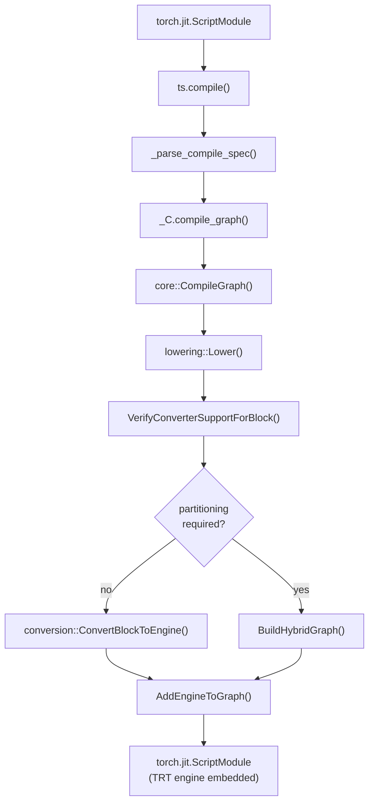
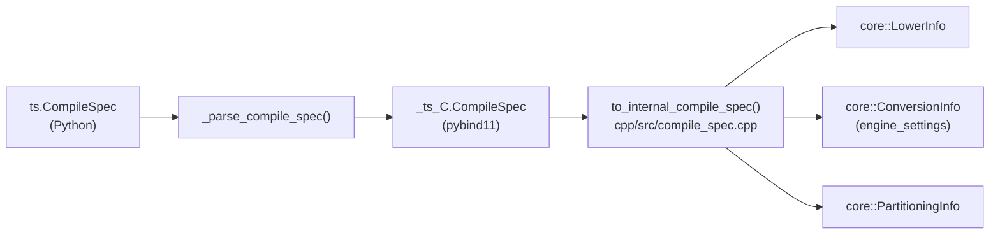
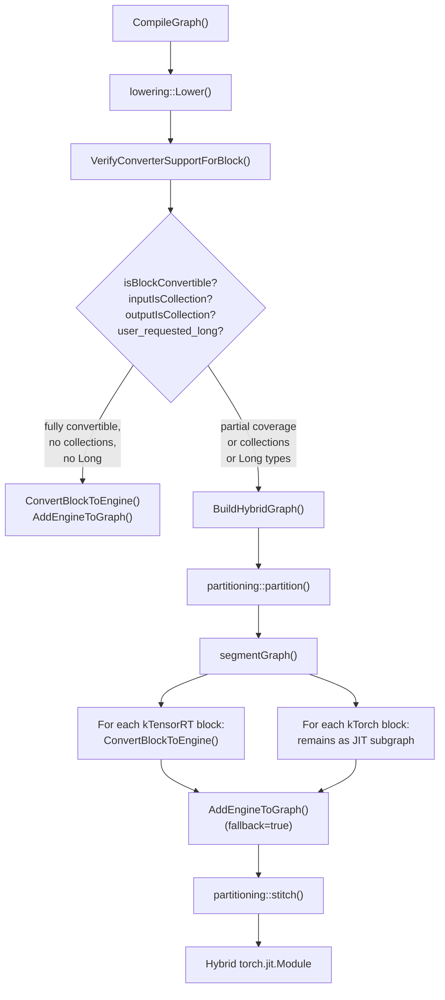
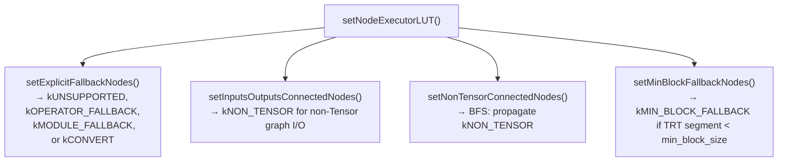
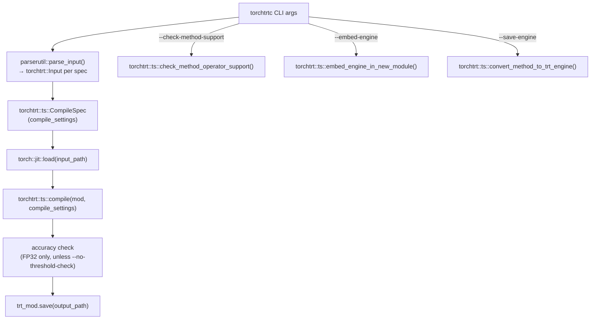

<!-- source: DeepWiki mcp.deepwiki.com · repo pytorch/TensorRT · page 2.3 TorchScript Compilation · fetched 2026-10-21 -->

# TorchScript Compilation

<details>
<summary>Relevant source files</summary>

The following files were used as context for generating this wiki page:

- [core/compiler.cpp](core/compiler.cpp)
- [core/partitioning/BUILD](core/partitioning/BUILD)
- [core/partitioning/partitioning.cpp](core/partitioning/partitioning.cpp)
- [core/partitioning/partitioning.h](core/partitioning/partitioning.h)
- [core/partitioning/partitioningctx/PartitioningCtx.cpp](core/partitioning/partitioningctx/PartitioningCtx.cpp)
- [core/partitioning/partitioningctx/PartitioningCtx.h](core/partitioning/partitioningctx/PartitioningCtx.h)
- [core/partitioning/segmentedblock/SegmentedBlock.cpp](core/partitioning/segmentedblock/SegmentedBlock.cpp)
- [core/partitioning/segmentedblock/SegmentedBlock.h](core/partitioning/segmentedblock/SegmentedBlock.h)
- [core/partitioning/shape_analysis.cpp](core/partitioning/shape_analysis.cpp)
- [core/partitioning/stitching.cpp](core/partitioning/stitching.cpp)
- [cpp/bin/torchtrtc/README.md](cpp/bin/torchtrtc/README.md)
- [cpp/bin/torchtrtc/main.cpp](cpp/bin/torchtrtc/main.cpp)
- [cpp/include/torch_tensorrt/torch_tensorrt.h](cpp/include/torch_tensorrt/torch_tensorrt.h)
- [cpp/src/compile_spec.cpp](cpp/src/compile_spec.cpp)
- [py/torch_tensorrt/_Input.py](py/torch_tensorrt/_Input.py)
- [py/torch_tensorrt/csrc/register_tensorrt_classes.cpp](py/torch_tensorrt/csrc/register_tensorrt_classes.cpp)
- [py/torch_tensorrt/csrc/tensorrt_classes.cpp](py/torch_tensorrt/csrc/tensorrt_classes.cpp)
- [py/torch_tensorrt/csrc/tensorrt_classes.h](py/torch_tensorrt/csrc/tensorrt_classes.h)
- [py/torch_tensorrt/csrc/torch_tensorrt_py.cpp](py/torch_tensorrt/csrc/torch_tensorrt_py.cpp)
- [py/torch_tensorrt/ts/_compile_spec.py](py/torch_tensorrt/ts/_compile_spec.py)
- [py/torch_tensorrt/ts/_compiler.py](py/torch_tensorrt/ts/_compiler.py)
- [tests/core/partitioning/test_conditionals.cpp](tests/core/partitioning/test_conditionals.cpp)
- [tests/core/partitioning/test_resolve_nontensor_inputs.cpp](tests/core/partitioning/test_resolve_nontensor_inputs.cpp)
- [tests/core/partitioning/test_segmentation.cpp](tests/core/partitioning/test_segmentation.cpp)
- [tests/core/partitioning/test_shape_analysis.cpp](tests/core/partitioning/test_shape_analysis.cpp)
- [tests/cpp/test_dynamic_fallback.cpp](tests/cpp/test_dynamic_fallback.cpp)

</details>


## Purpose and Scope

This page describes the TorchScript-based compilation workflow in Torch-TensorRT: the Python API in `torch_tensorrt.ts`, the `CompileSpec` settings, hybrid (partial) compilation behavior, the `convert_method_to_trt_engine` utility, and the `torchtrtc` command-line tool.

> **Deprecation Notice:** The TorchScript frontend is deprecated. `torch_tensorrt.ts.compile()` emits a `DeprecationWarning` directing users to the Dynamo frontend (`ir="dynamo"`). TorchScript remains a supported *deployment format* via post-compilation tracing. For the recommended Dynamo workflow, see [AOT Compilation and Export](#2.2).

For the internal architecture of how the TorchScript pipeline lowers, partitions, and converts graphs, see [TorchScript Frontend Architecture](#4).

---

## Overview

The TorchScript frontend accepts a `torch.jit.ScriptModule` (produced by `torch.jit.trace` or `torch.jit.script`) and outputs a new `torch.jit.ScriptModule` whose `forward` method calls embedded TensorRT engines via the `tensorrt::execute_engine` JIT operator. The output module is serializable with `torch.jit.save` and loadable with `torch.jit.load`.

**Compilation Pipeline (top-level)**



Sources: [py/torch_tensorrt/ts/_compiler.py:14-162](), [py/torch_tensorrt/csrc/torch_tensorrt_py.cpp:29-33](), [core/compiler.cpp:334-427]()

---

## Python API

### `torch_tensorrt.ts.compile`

```python
# py/torch_tensorrt/ts/_compiler.py
compiled_module = torch_tensorrt.ts.compile(
    module,                        # torch.jit.ScriptModule
    inputs=[...],                  # required: list of torch_tensorrt.Input or torch.Tensor
    enabled_precisions={torch.float},
    require_full_compilation=False,
    min_block_size=3,
    torch_executed_ops=[],
    torch_executed_modules=[],
    ...
)
```

The function builds a settings dictionary, calls `_parse_compile_spec()` to produce a `_ts_C.CompileSpec`, then invokes `_C.compile_graph(module._c, spec)`. The C++ binding in [py/torch_tensorrt/csrc/torch_tensorrt_py.cpp:29-33]() calls `core::CompileGraph`.

The function wraps the returned C++ module via `torch.jit._recursive.wrap_cpp_module`.

### `torch_tensorrt.ts.convert_method_to_trt_engine`

Converts a single named method of a module to a serialized TensorRT engine (raw bytes) rather than a wrapped module. Useful when only the engine artifact is needed.

```python
engine_bytes = torch_tensorrt.ts.convert_method_to_trt_engine(
    module,
    method_name="forward",
    inputs=[...],
    ...
)
```

Internally calls `core::ConvertGraphToTRTEngine` via `_C.convert_graph_to_trt_engine`. The engine can be reloaded using `torch_tensorrt.ts.embed_engine_in_new_module`.

Sources: [py/torch_tensorrt/ts/_compiler.py:165-301](), [core/compiler.cpp:300-327]()

---

## CompileSpec Settings

The following table covers all configurable fields in the TorchScript `CompileSpec`. The Python API accepts these as keyword arguments to `ts.compile()`. Internally they are translated by `to_internal_compile_spec()` into `core::CompileSpec`.

| Parameter | Type | Default | Description |
|---|---|---|---|
| `inputs` | `List[Input \| Tensor]` | required | Input shape/dtype/format specifications |
| `input_signature` | tuple/list | `None` | Nested input structure (beta) |
| `enabled_precisions` | `Set[dtype]` | `{float32}` | Precisions TensorRT may use for kernels |
| `device` | `Device \| torch.device` | current | Target GPU or DLA device |
| `require_full_compilation` | `bool` | `False` | Error if any op cannot run in TRT |
| `min_block_size` | `int` | `3` | Minimum TRT-convertible ops per subgraph |
| `torch_executed_ops` | `List[str]` | `[]` | Ops forced to run in PyTorch |
| `torch_executed_modules` | `List[str]` | `[]` | Modules forced to run in PyTorch |
| `truncate_long_and_double` | `bool` | `False` | Cast int64→int32 and float64→float32 |
| `disable_tf32` | `bool` | `False` | Disable TF32 for FP32 matmul accumulation |
| `sparse_weights` | `bool` | `False` | Enable sparsity for conv/FC layers |
| `refit` | `bool` | `False` | Build engine with refit capability |
| `debug` | `bool` | `False` | Build debuggable engine |
| `capability` | `EngineCapability` | `STANDARD` | `STANDARD`, `SAFETY`, or `DLA_STANDALONE` |
| `num_avg_timing_iters` | `int` | `1` | Averaging iterations for kernel selection |
| `workspace_size` | `int` | `0` | Max TRT builder workspace (bytes) |
| `allow_shape_tensors` | `bool` | `False` | (Experimental) Allow `aten::size` as shape tensor |

The `torch_fallback` dict is assembled internally from `require_full_compilation`, `torch_executed_ops`, `torch_executed_modules`, and `min_block_size` [py/torch_tensorrt/ts/_compiler.py:149-155]().

**CompileSpec Mapping to Internal Structures**



Sources: [py/torch_tensorrt/ts/_compile_spec.py:183-300](), [cpp/src/compile_spec.cpp:81-165]()

---

## Input Specifications

Each input is described with a `torch_tensorrt.Input` object. The TorchScript frontend uses `TorchScriptInput` internally.

**Static input:**
```python
torch_tensorrt.Input((1, 3, 224, 224), dtype=torch.float32)
```

**Dynamic input (min/opt/max):**
```python
torch_tensorrt.Input(
    min_shape=(1, 3, 224, 224),
    opt_shape=(4, 3, 224, 224),
    max_shape=(8, 3, 224, 224),
    dtype=torch.float16
)
```

Shape tuples are converted to `nvinfer1::Dims` by `TorchScriptInput._to_internal()`. The `input_is_dynamic` flag is set when min/opt/max differ. For dynamic inputs, the partitioning system generates three sets of random tensors (MIN, OPT, MAX) for shape analysis via `generateRandomInputs` and `runShapeAnalysis`.

For more information on the `Input` class and how it interacts with dynamic shapes, see [Dynamic Shapes and Input Specifications](#2.5).

Sources: [py/torch_tensorrt/ts/_compile_spec.py:183-235](), [core/partitioning/shape_analysis.cpp:13-83]()

---

## Full vs. Partial Compilation

### Decision Logic

`core::CompileGraph` determines whether partitioning is needed:



Sources: [core/compiler.cpp:334-427](), [core/compiler.cpp:136-216]()

### Partitioning: Node Classification

Each JIT node is assigned a `NodeExecutorDecision` by `setNodeExecutorLUT`. The decision controls whether the node goes into a TRT engine or stays in PyTorch.



| `NodeExecutorDecision` | Cause |
|---|---|
| `kCONVERT` | Node will run in TensorRT |
| `kUNSUPPORTED` | No TRT converter registered for this op |
| `kOPERATOR_FALLBACK` | Op name is in `torch_executed_ops` |
| `kMODULE_FALLBACK` | Owning module is in `torch_executed_modules` |
| `kMIN_BLOCK_FALLBACK` | TRT subgraph has fewer ops than `min_block_size` |
| `kNON_TENSOR` | Node produces or consumes non-Tensor values |

Sources: [core/partitioning/partitioning.cpp:367-388](), [core/partitioning/partitioningctx/PartitioningCtx.h:15-30]()

### `SegmentedBlock`

After `segmentGraph()`, the graph is a `PartitionedGraph` (a `std::vector<SegmentedBlock>`). Each `SegmentedBlock` has:
- `target_`: either `kTorch` or `kTensorRT`
- `g_`: a `std::shared_ptr<torch::jit::Graph>` containing the subgraph
- `nodes_`, `inputs_`, `outputs_`: raw JIT values

TRT blocks have their `g_` replaced by a graph containing a `tensorrt::execute_engine` call after `AddEngineToGraph` runs. Torch blocks retain their original JIT graph. The segments are stitched back together by `partitioning::stitch()`.

Sources: [core/partitioning/segmentedblock/SegmentedBlock.h:14-130](), [core/compiler.cpp:30-124]()

---

## Saving and Loading Compiled Modules

After compilation, the returned module is a standard `torch.jit.ScriptModule` and can be saved and loaded with PyTorch's standard serialization:

```python
# Save
trt_module.save("model_trt.ts")

# Load (requires torch_tensorrt to be imported to register tensorrt:: ops)
import torch_tensorrt
loaded = torch.jit.load("model_trt.ts")
output = loaded(input_tensor)
```

The TRT engines are registered as module attributes of type `c10::intrusive_ptr<runtime::TRTEngine>` and are serialized inside the TorchScript archive. The `tensorrt::execute_engine` operator is registered at `torch_tensorrt` import time.

Sources: [core/compiler.cpp:30-57](), [cpp/bin/torchtrtc/README.md:1-13]()

---

## The `torchtrtc` Command-Line Tool

`torchtrtc` is a CLI application in [cpp/bin/torchtrtc/main.cpp]() that compiles a serialized TorchScript file from the command line. It wraps the same `torchtrt::ts::compile` and `torchtrt::ts::convert_method_to_trt_engine` C++ APIs.

### Basic Usage

```
torchtrtc [input_file_path] [output_file_path] [input_specs...] {OPTIONS}
```

**Input spec format:**
- Static: `"(N,C,H,W)"` — e.g. `"(1,3,224,224)"`
- Dynamic: `"[(MIN_N,...);(OPT_N,...);(MAX_N,...)]"` — e.g. `"[(1,3,224,224);(4,3,224,224);(8,3,224,224)]"`
- Dtype suffix: `@f16` — e.g. `"(1,3,224,224)@f16"`
- Format suffix: `%NHWC` — e.g. `"(1,3,224,224)@f16%NHWC"`

### Key Flags

| Flag | Default | Description |
|---|---|---|
| `-p, --enable-precision` | `float32` | Repeatable; add enabled precisions (`float`, `half`, `int8`) |
| `-d, --device-type` | `gpu` | Target device: `gpu` or `dla` |
| `--require-full-compilation` | off | Error if any op cannot be converted |
| `--mbs, --min-block-size` | `3` | Min ops per TRT segment |
| `--teo, --torch-executed-op` | — | Repeatable; force op to run in PyTorch |
| `--tem, --torch-executed-mod` | — | Repeatable; force module to run in PyTorch |
| `--truncate-long-double` | off | Cast int64/float64 to int32/float32 |
| `--save-engine` | off | Write raw TRT engine instead of TorchScript |
| `--embed-engine` | off | Wrap a raw `.plan` engine file in a TorchScript module |
| `--check-method-support` | — | Check if a method is fully convertible, then exit |
| `--gpu-id` | `0` | GPU device index |
| `--workspace-size` | `0` | TRT builder workspace (bytes) |
| `-v, --verbose` | off | Enable DEBUG-level logging |
| `--calibration-cache-file` | — | Path to INT8 PTQ calibration cache |
| `--custom-torch-ops` | — | Repeatable; load shared library with custom torch ops |
| `--custom-converters` | — | Repeatable; load shared library with custom converters |
| `--atol` / `--rtol` | `1e-8` / `1e-5` | Numerical accuracy thresholds for FP32 validation |

### torchtrtc Internal Flow



After compilation the tool optionally runs a numerical accuracy check (comparing original JIT output vs. TRT output within `atol`/`rtol`) before saving. This check is skipped if `--no-threshold-check` is passed or if non-FP32 precisions are enabled.

Sources: [cpp/bin/torchtrtc/main.cpp:44-575](), [cpp/bin/torchtrtc/README.md:1-130]()

---

## DLA Support

When targeting DLA, set `device_type="dla"` and optionally `dla_core`. The `allow_gpu_fallback` flag allows layers unsupported on DLA to fall back to GPU. DLA-specific memory budgets (`dla_sram_size`, `dla_local_dram_size`, `dla_global_dram_size`) can be tuned via `CompileSpec` or `torchtrtc` flags.

Sources: [cpp/src/compile_spec.cpp:116-127](), [cpp/bin/torchtrtc/main.cpp:385-413]()

---

## Relationship to Other Pages

| Topic | Page |
|---|---|
| Internal TorchScript pipeline architecture | [TorchScript Frontend Architecture](#4) |
| Graph lowering passes applied before conversion | [Graph Lowering Passes](#4.2) |
| Partitioning and hybrid execution internals | [Partitioning and Hybrid Execution](#4.3) |
| Shape analysis for partitioned blocks | [Shape Analysis and Dynamic Shapes](#4.4) |
| ConversionCtx and TRT network building | [ConversionCtx and Network Building](#4.5) |
| Dynamo-based AOT compilation | [AOT Compilation and Export](#2.2) |
| Precision modes and INT8 calibration | [Precision Modes (FP32, FP16, INT8)](#2.4) |
| Dynamic shape input specifications | [Dynamic Shapes and Input Specifications](#2.5) |

---

