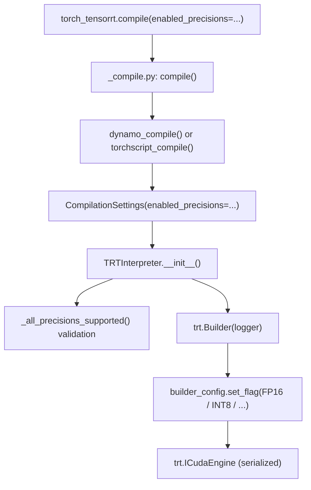
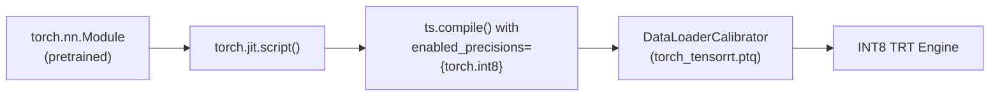
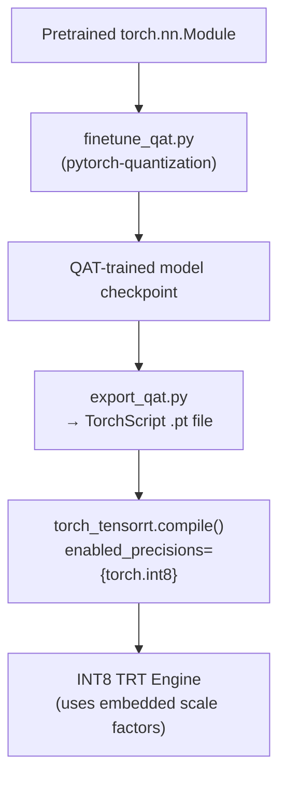
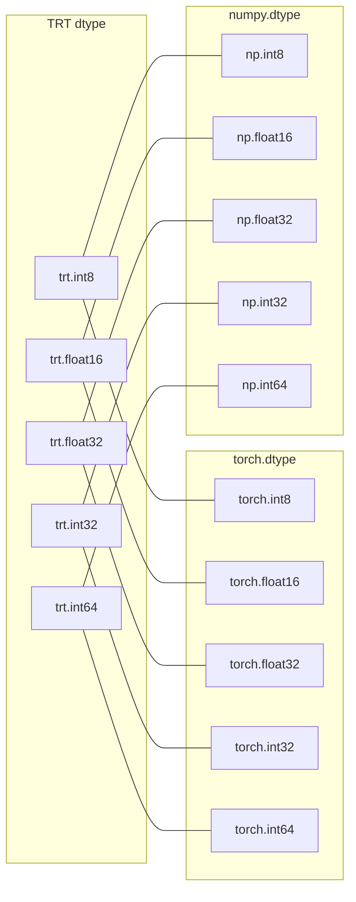
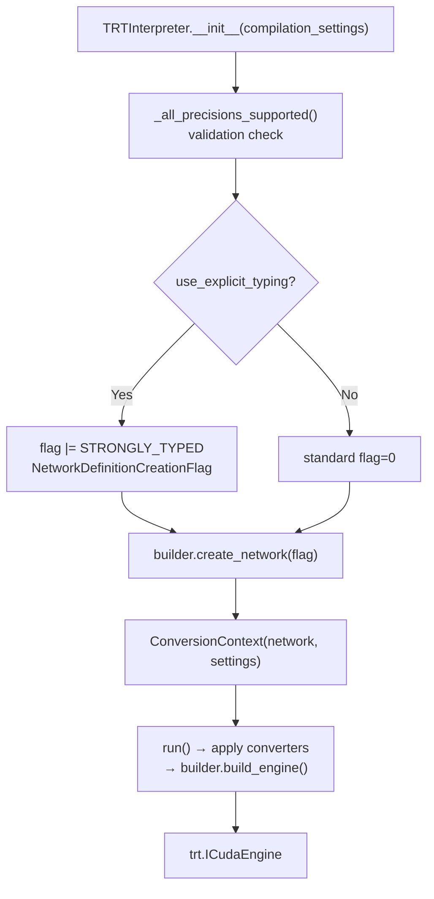

<!-- source: DeepWiki mcp.deepwiki.com · repo pytorch/TensorRT · page 2.4 Precision Modes (FP32, FP16, INT8) · fetched 2026-10-21 -->

# Precision Modes (FP32, FP16, INT8)

<details>
<summary>Relevant source files</summary>

The following files were used as context for generating this wiki page:

- [.dockerignore](.dockerignore)
- [docker/WORKSPACE.ngc](docker/WORKSPACE.ngc)
- [docs/_cpp_api/function_torch__tensorrt_8h_1a710df824a7718b440e4bc17bf9693cef.html](docs/_cpp_api/function_torch__tensorrt_8h_1a710df824a7718b440e4bc17bf9693cef.html)
- [docs/_cpp_api/program_listing_file_cpp_include_torch_tensorrt_macros.h.html](docs/_cpp_api/program_listing_file_cpp_include_torch_tensorrt_macros.h.html)
- [docs/_notebooks/CitriNet-example.html](docs/_notebooks/CitriNet-example.html)
- [docs/_notebooks/EfficientNet-example.html](docs/_notebooks/EfficientNet-example.html)
- [docs/_notebooks/Hugging-Face-BERT.html](docs/_notebooks/Hugging-Face-BERT.html)
- [docs/_notebooks/Resnet50-example.html](docs/_notebooks/Resnet50-example.html)
- [docs/_notebooks/lenet-getting-started.html](docs/_notebooks/lenet-getting-started.html)
- [docs/_notebooks/ssd-object-detection-demo.html](docs/_notebooks/ssd-object-detection-demo.html)
- [docs/_notebooks/vgg-qat.html](docs/_notebooks/vgg-qat.html)
- [docs/_sources/_cpp_api/program_listing_file_cpp_include_torch_tensorrt_macros.h.rst.txt](docs/_sources/_cpp_api/program_listing_file_cpp_include_torch_tensorrt_macros.h.rst.txt)
- [docs/genindex.html](docs/genindex.html)
- [docs/objects.inv](docs/objects.inv)
- [docs/py_api/ts.html](docs/py_api/ts.html)
- [docs/searchindex.js](docs/searchindex.js)
- [examples/int8/benchmark/benchmark.cpp](examples/int8/benchmark/benchmark.cpp)
- [examples/int8/training/vgg16/README.md](examples/int8/training/vgg16/README.md)
- [examples/int8/training/vgg16/export_qat.py](examples/int8/training/vgg16/export_qat.py)
- [examples/int8/training/vgg16/finetune_qat.py](examples/int8/training/vgg16/finetune_qat.py)
- [examples/int8/training/vgg16/requirements.txt](examples/int8/training/vgg16/requirements.txt)
- [noxfile.py](noxfile.py)
- [py/torch_tensorrt/__init__.py](py/torch_tensorrt/__init__.py)
- [py/torch_tensorrt/_compile.py](py/torch_tensorrt/_compile.py)
- [py/torch_tensorrt/dynamo/__init__.py](py/torch_tensorrt/dynamo/__init__.py)
- [py/torch_tensorrt/dynamo/_compiler.py](py/torch_tensorrt/dynamo/_compiler.py)
- [py/torch_tensorrt/dynamo/_defaults.py](py/torch_tensorrt/dynamo/_defaults.py)
- [py/torch_tensorrt/dynamo/_refit.py](py/torch_tensorrt/dynamo/_refit.py)
- [py/torch_tensorrt/dynamo/_settings.py](py/torch_tensorrt/dynamo/_settings.py)
- [py/torch_tensorrt/dynamo/conversion/_TRTInterpreter.py](py/torch_tensorrt/dynamo/conversion/_TRTInterpreter.py)
- [py/torch_tensorrt/dynamo/conversion/_conversion.py](py/torch_tensorrt/dynamo/conversion/_conversion.py)
- [py/torch_tensorrt/dynamo/lowering/passes/__init__.py](py/torch_tensorrt/dynamo/lowering/passes/__init__.py)
- [py/torch_tensorrt/dynamo/utils.py](py/torch_tensorrt/dynamo/utils.py)
- [tests/modules/requirements.txt](tests/modules/requirements.txt)
- [tests/py/dynamo/conversion/harness.py](tests/py/dynamo/conversion/harness.py)
- [tests/py/dynamo/models/test_export_kwargs_serde.py](tests/py/dynamo/models/test_export_kwargs_serde.py)
- [tests/py/dynamo/models/test_export_serde.py](tests/py/dynamo/models/test_export_serde.py)
- [tests/py/dynamo/models/test_model_refit.py](tests/py/dynamo/models/test_model_refit.py)
- [tests/py/dynamo/models/test_reexport.py](tests/py/dynamo/models/test_reexport.py)
- [tests/py/dynamo/runtime/test_002_lazy_engine_init.py](tests/py/dynamo/runtime/test_002_lazy_engine_init.py)

</details>


This page explains how Torch-TensorRT controls numerical precision during compilation, including how to set the `enabled_precisions` parameter, what each precision mode does, and how to use INT8 with Post-Training Quantization (PTQ) and Quantization-Aware Training (QAT).

For information on the compilation settings that contain these options, see [Compilation Settings and Configuration](#2.6). For the overall compilation pipeline, see [Compilation Pipeline Overview](#3.1). For the TorchScript-specific PTQ calibration API, see [TorchScript Compilation](#2.3).

---

## Precision Overview

TensorRT selects GPU kernels during engine building. The `enabled_precisions` parameter tells TensorRT which data types are permitted when selecting kernels. Enabling a lower precision allows TensorRT to consider faster, lower-precision kernel implementations in addition to the default FP32 ones. Actual kernel selection is still TensorRT's decision—enabling a precision does not force every layer to use it.

The full set of precision types recognized by the system is defined in [py/torch_tensorrt/dynamo/_defaults.py:32-39]():

| `dtype` enum value | `torch.dtype` equivalent | Description |
|---|---|---|
| `dtype.f32` | `torch.float32` | 32-bit floating point (default) |
| `dtype.f16` | `torch.float16` | 16-bit floating point (half) |
| `dtype.bf16` | `torch.bfloat16` | 16-bit brain float |
| `dtype.i8` | `torch.int8` | 8-bit signed integer (INT8) |
| `dtype.f8` | `torch.float8_e4m3fn` | 8-bit floating point (FP8) |
| `dtype.f4` | — | 4-bit floating point (FP4) |

These are the valid members of `SUPPORTED_KERNEL_PRECISIONS` [py/torch_tensorrt/dynamo/_defaults.py:32-39](). The `TRTInterpreter` validates at construction time that all precisions requested by the user are in this set [py/torch_tensorrt/dynamo/conversion/_TRTInterpreter.py:120-123]().

The framework-to-framework dtype mapping used at conversion time is defined by the `DataTypeEquivalence` dictionary in [py/torch_tensorrt/dynamo/utils.py:59-92]().

---

## The `enabled_precisions` Parameter

`enabled_precisions` is accepted by all primary compilation entry points:

- `torch_tensorrt.compile()` [py/torch_tensorrt/_compile.py:186-187]()
- `torch_tensorrt.dynamo.compile()` [py/torch_tensorrt/dynamo/_compiler.py:71-73]()
- `torch_tensorrt.dynamo.cross_compile_for_windows()` [py/torch_tensorrt/dynamo/_compiler.py:71-73]()

It is stored in the `CompilationSettings` dataclass [py/torch_tensorrt/dynamo/_settings.py:62-200]() and forwarded to the `TRTInterpreter` and ultimately to the TensorRT builder.

**Default value:** `{dtype.f32}` — only FP32 kernels are considered [py/torch_tensorrt/dynamo/_defaults.py:9]().

Both `torch.dtype` values and `torch_tensorrt._enums.dtype` values are accepted interchangeably. The parameter type is `Set[Union[torch.dtype, dtype]]`.

**Example usage:**

```python
# FP16 mode
torch_tensorrt.compile(model, inputs=inputs,
    enabled_precisions={torch.float16})

# Mixed FP32 + FP16 (TRT chooses per layer)
torch_tensorrt.compile(model, inputs=inputs,
    enabled_precisions={torch.float32, torch.float16})

# INT8 mode (requires calibration, see below)
torch_tensorrt.compile(model, inputs=inputs,
    enabled_precisions={torch.int8})
```

---

## Precision Mode Details

### FP32 (Default)

When `enabled_precisions` contains only `dtype.f32`, TensorRT restricts kernel selection to full 32-bit float operations. This is the default when no precision is specified.

TF32 (TensorFloat-32) is a variant of FP32 that rounds mantissas to 10 bits before multiplication but accumulates in 23-bit precision. TF32 is enabled by default on Ampere and newer GPUs within TensorRT. To disable it, set `disable_tf32=True` in `CompilationSettings` [py/torch_tensorrt/dynamo/_settings.py:87]().

### FP16

Adding `torch.float16` (or `dtype.f16`) to `enabled_precisions` allows TensorRT to use half-precision kernels. This typically results in faster inference on GPUs that have Tensor Cores (Volta and newer). TensorRT still runs layers in FP32 where it deems FP16 numerically unsafe.

**Related option — `use_fp32_acc`:** When running in FP16 mode, matmul accumulation may lose precision. Setting `use_fp32_acc=True` in `CompilationSettings` inserts explicit casts to FP32 around matmul layers, ensuring accumulation happens in full precision [py/torch_tensorrt/dynamo/_settings.py:102]().

### BF16

BF16 (`dtype.bf16`, `torch.bfloat16`) has the same exponent range as FP32 but only 7 mantissa bits. It is available in TensorRT for Ampere and newer GPUs. It is enabled by including `torch.bfloat16` in `enabled_precisions`.

### INT8

INT8 requires explicit quantization: the compiler needs range information (scale factors) for every tensor that will be quantized. There are two methods to provide this information: PTQ and QAT.

### FP8 / FP4

`dtype.f8` and `dtype.f4` are available in newer TensorRT versions. They are included in `SUPPORTED_KERNEL_PRECISIONS` and can be passed in `enabled_precisions`, but kernel support depends on the GPU architecture and TensorRT version.

---

## Strong Typing (Explicit Precision Control)

By default, Torch-TensorRT enables strong typing (`USE_EXPLICIT_TYPING = True` [py/torch_tensorrt/dynamo/_defaults.py:49]()). In this mode, TensorRT respects the precision annotations already in the PyTorch model rather than freely choosing lower-precision kernels.

In the `TRTInterpreter`, if `use_explicit_typing` is set, the `STRONGLY_TYPED` network creation flag is applied to the TensorRT `INetworkDefinition` [py/torch_tensorrt/dynamo/conversion/_TRTInterpreter.py:96-109](). This is useful when the model has mixed-precision layers (e.g., some `float16`, some `float32`) that need to remain at their declared types.

---

## How `enabled_precisions` Flows Through Compilation

**Precision flow from API to TRT builder:**



Sources: [py/torch_tensorrt/_compile.py:180-250](), [py/torch_tensorrt/dynamo/_compiler.py:61-115](), [py/torch_tensorrt/dynamo/conversion/_TRTInterpreter.py:80-160](), [py/torch_tensorrt/dynamo/_settings.py:62-200]()

---

## INT8 Post-Training Quantization (PTQ)

PTQ collects activation range statistics from a representative calibration dataset and then quantizes the model without retraining.

### PTQ in the TorchScript Frontend

The TorchScript frontend provides a dedicated PTQ module at `torch_tensorrt.ts.ptq`. The calibration process uses a `DataLoaderCalibrator` (or `CacheCalibrator`) class that wraps a PyTorch `DataLoader` and implements the TensorRT `IInt8Calibrator` interface.

**Typical PTQ workflow:**



```python
import torch_tensorrt

calibrator = torch_tensorrt.ptq.DataLoaderCalibrator(
    dataloader,
    cache_file="./calibration_cache.bin",
    use_cache=False,
    algo_type=torch_tensorrt.ptq.CalibrationAlgo.ENTROPY_CALIBRATION_2,
    device=torch.device("cuda:0"),
)

trt_model = torch_tensorrt.compile(
    ts_model,
    inputs=[torch_tensorrt.Input((1, 3, 224, 224))],
    enabled_precisions={torch.int8},
    calibrator=calibrator,
    device=torch.device("cuda:0"),
)
```

Sources: [docs/searchindex.js]() (`ts/ptq.rst` entry), [py/torch_tensorrt/dynamo/_defaults.py:9]()

### PTQ in the Dynamo Frontend

In the Dynamo path, INT8 PTQ is handled via pre-quantized models using the `pytorch-quantization` toolkit or similar tooling. The quantization information is embedded in the model graph before calling `torch_tensorrt.compile()`. The `vgg16_ptq` example demonstrates this workflow.

Sources: [docs/searchindex.js]() (`tutorials/_rendered_examples/dynamo/vgg16_ptq.rst` entry)

---

## INT8 Quantization-Aware Training (QAT)

QAT inserts fake quantization nodes into the model during training, allowing the model to learn weights that are robust to quantization noise. When compiled with INT8, TensorRT uses these nodes as quantization parameters.

**QAT workflow overview:**



The VGG16 QAT example resides at `examples/int8/training/vgg16/`. The training step uses `finetune_qat.py` and the export step uses `export_qat.py`. These are invoked by `noxfile.py` in the test session setup [noxfile.py:112-168]().

Sources: [noxfile.py:112-168](), [docs/_notebooks/vgg-qat.html]()

---

## Data Type Mapping Reference

The `DataTypeEquivalence` dictionary in `dynamo/utils.py` is the canonical cross-framework dtype table used during conversion:



The `unified_dtype_converter()` function [py/torch_tensorrt/dynamo/utils.py:102-128]() translates between these representations using `DataTypeEquivalence`.

Sources: [py/torch_tensorrt/dynamo/utils.py:59-128]()

---

## Key Compilation Settings Summary

| Setting | Type | Default | Description |
|---|---|---|---|
| `enabled_precisions` | `Set[dtype\|torch.dtype]` | `{dtype.f32}` | Precisions TRT may use for kernel selection |
| `disable_tf32` | `bool` | `False` | Disable TensorFloat-32 on Ampere GPUs |
| `use_explicit_typing` | `bool` | `True` | Enable strongly-typed TRT network (respect model dtypes) |
| `use_fp32_acc` | `bool` | `False` | Insert FP32 accumulation casts around matmul layers |
| `sparse_weights` | `bool` | `False` | Allow TRT to use sparse weight kernels |

Sources: [py/torch_tensorrt/dynamo/_defaults.py:9-55](), [py/torch_tensorrt/dynamo/_settings.py:62-200]()

---

## Precision and the TRTInterpreter

The `TRTInterpreter` class [py/torch_tensorrt/dynamo/conversion/_TRTInterpreter.py:80-160]() is where precision settings are applied to the TensorRT network definition. Key steps at initialization:

1. **Validation:** `_all_precisions_supported()` checks that every precision in `enabled_precisions` is a member of `SUPPORTED_KERNEL_PRECISIONS` [py/torch_tensorrt/dynamo/conversion/_TRTInterpreter.py:120-123]().
2. **Strong typing flag:** If `use_explicit_typing` is set, `STRONGLY_TYPED` is OR'd into the network creation flags passed to `builder.create_network()` [py/torch_tensorrt/dynamo/conversion/_TRTInterpreter.py:105-109]().
3. **Builder configuration:** The `enabled_precisions` set is later used to configure the `IBuilderConfig` (e.g., setting the FP16 or INT8 mode flags) during the engine building step.



Sources: [py/torch_tensorrt/dynamo/conversion/_TRTInterpreter.py:80-160](), [py/torch_tensorrt/dynamo/_settings.py:62-200]()

---

## Choosing a Precision Mode

| Goal | Recommended setting |
|---|---|
| Maximum numerical accuracy | `enabled_precisions={torch.float32}` (default) |
| Best throughput on Tensor Core GPUs | `enabled_precisions={torch.float16}` |
| Memory-efficient inference on Ampere+ | `enabled_precisions={torch.bfloat16}` |
| Highest throughput, post-training calibration | `enabled_precisions={torch.int8}` with PTQ |
| Highest throughput, fine-tuned accuracy | `enabled_precisions={torch.int8}` with QAT |
| FP16 matmul with full accumulation precision | `enabled_precisions={torch.float16}`, `use_fp32_acc=True` |
| Honor mixed-precision annotations in model | `use_explicit_typing=True` (default) |

---

